# ArXiv Daily Digest - 2026-11-04 (AIGC 音频生成, 10 papers)

**Generated**: 2026-11-04 17:30 CST

**Source**: arXiv cs.CV, cs.SD, eess.AS, cs.CL, cs.AI, cs.RO, cs.LG submissions, listing day 2026-11-03 (announced 2026-11-04 00:00 UTC)

**Batch window**: 2026-11-02T18:00:00Z .. 2026-11-03T18:00:00Z（arXiv 公告批次横跨两个 UTC 日：前一日 18:00 UTC 起算，当日 17:59:59 UTC 截止）

**Track**: aigc_audio (top 10 of 587 papers scanned, 70 full reads)

**Scope**: 音频 / 语音 / 音乐的生成、合成、编辑与生产工具链，含 TTS、语音水印攻防与神经音频编解码

⚠️ **Wild-card**: 本批该线 4 篇为 wild-card 补足，已在正文逐条标注并给出理由。

补足原因：该批次 cs.SD 仅 10 篇、eess.AS 仅 5 篇，音频域总量只有 15 篇；其中真正属于「音频生成 / TTS / 音乐」的只有 2 篇（TTSonic 与面向深伪检测器的对抗式 TTS），其余名额由语音水印攻防、钢琴转谱、跨模态情感、临床声学与可穿戴声学交互等相邻方向补位，已在正文逐条标注并给出理由。

---

## Top 10 - AIGC 音频生成

### 1. TTSonic: A Unified Framework for Composable and Controllable Speech Generation

**arXiv**: [2611.04282](https://arxiv.org/abs/2611.04282) | **Score**: 9.3 (relevance 9.5 x 0.7 + quality 9.0 x 0.3) | **Tags**: AIGC-audio, tts, speech-tokenizer, flow-matching, voice-cloning, ByteDance Douyin Content Group | **Categories**: cs.SD | **Pages**: 15

**Authors**: Zhedong Zhang; Kaiwen Zhou; Junyan Wu; Shengqiang Li; Xuran Chi; Xingui Zeng; Rui Yan; Xu Chen

**Affiliation**: ByteDance Douyin Content Group

**Abstract**

> Modern text-to-speech (TTS) systems can synthesize natural and expressive speech, yet a practical speech foundation model must go beyond naturalness to offer stable quality, precise controllability, and a broad set of composable capabilities within a unified framework. We present TTSonic, a unified speech generation model that supports zero-shot TTS, voice cloning, prosody cloning, instruction following, voice conversion, and cloning from noisy reference speech. Rather than relying on separate task-specific models, TTSonic accommodates diverse conditioning signals, including text, natural language instructions, reference speech, and text-described timbre, within the same model framework. Specifically, we develop a semantic--acoustic disentangled speech tokenizer through ASR-supervised semantic learning and reconstruction-guided generative refinement. Serving as the representational foundation of our unified framework, the tokenizer enables the Text-to-Semantic autoregressive model to focus on semantic and prosodic planning, while the acoustic flow-matching model specializes in high-quality speech rendering under diverse acoustic and timbre conditions. Building on this framework, we incorporate CoT-guided instruction-following planning and Text2Timbre voice design to support controllable speech generation. Experiments across zero-shot synthesis, multilingual and cross-lingual TTS, instruction following, voice design, voice conversion, and noisy-reference cloning demonstrate the competitive performance and broad applicability of TTSonic.

**Key findings**

- **Finding**: 提出统一语音生成模型 TTSonic，包含由 ASR 监督语义学习与重建引导生成式精炼得到的语义-声学解耦 tokenizer、Text-to-Semantic 自回归模型与声学流匹配解码器，并加入 CoT 指令跟随规划与 Text2Timbre 音色设计模块；零样本 TTS 上 test-zh 达 0.78% CER 与 0.784 SIM、test-en 为 1.66% WER 与 0.717 SIM、test-hard 为 5.64% CER 与 0.774 SIM；中文指令跟随取得最佳 APS 88.8、第二佳 RP 69.4、DSD 82.3，英文子集为 APS 77.6、DSD 78.4、RP 64.4；音色多样性上 Micro 碰撞率在两种判定协议下均为最低，严格 Joint-pass 协议阈值 0.50 时为 62.00%，低于 Qwen3-TTS 的 67.54% 与 VoxCPM2 的 67.51%。
- **Inference**: 语义与声学解耦后模型既保住了指令遵循的竞争力，又在音色多样性上优于 Qwen3-TTS 与 VoxCPM2，说明统一框架不必以牺牲可控性为代价。
- **Recommendation**: 需要一套模型覆盖多任务的团队值得试它；但注意本文评测集中在指令遵循与音色多样性，跨语言指令泛化仍被作者列为待改进方向，克隆与高保真场景需自行复测说话人相似度与音质。

**Key figures**

*Framework - Training pipeline of the TTSonic Speech Tokenizer. Stage I inserts the FSQ bottleneck after the first 19 E-Branchformer blocks, then upsamples the quantized features and processes them with 1*

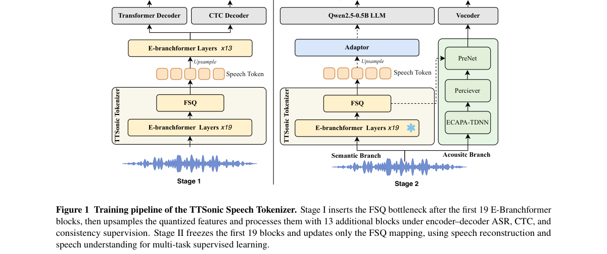

*Result - Overview of TTSonic. TTSonic consists of three main components: the TTSonic Speech Tokenizer, a Text-to-Semantic Speech LM, and an acoustic flow-matching model. The Text-to-Semantic Speech LM*

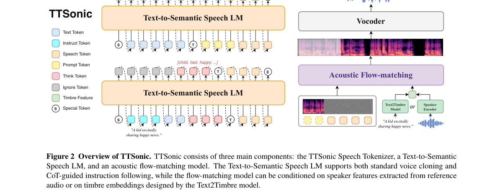

**Why this ranks #1**: 语音生成真正难在可控性：零样本 TTS、声音克隆、韵律克隆、指令跟随、声音转换、噪声参考克隆过去各是一套模型。TTSonic 用 ASR 监督的语义学习加重建引导的生成式精炼做出语义-声学解耦 tokenizer，让 Text-to-Semantic 自回归模型只管语义与韵律规划、声学流匹配模型只管渲染，再叠上 CoT 指令跟随规划与 Text2Timbre 音色设计。

---

### 2. Detector-Guided Vocoder Training for Adversarial Text-to-Speech Synthesis

**arXiv**: [2611.04511](https://arxiv.org/abs/2611.04511) | **Score**: 8.8 (relevance 9.0 x 0.7 + quality 8.5 x 0.3) | **Tags**: AIGC-audio, adversarial-tts, deepfake-detection, vocoder-finetuning, red-team, Dipartimento di Elettronica | **Categories**: cs.SD | **Pages**: 6

**Authors**: Jiayan Cui; Davide Salvi; Paolo Bestagini; Stefano Tubaro

**Affiliation**: Dipartimento di Elettronica, Informazione e Bioingegneria (DEIB), Politecnico di Milano

**Abstract**

> In this paper, we propose a novel Text-to-Speech (TTS) framework designed to perform adversarial attacks against speech deepfake detection systems. Given a TTS model and a detector capable of classifying its outputs as synthetic, our approach fine-tunes the vocoder by integrating the detector into the TTS training loop. Unlike traditional adversarial methods that rely on post-hoc perturbations or external noise injection, our approach enables the generation of synthetic speech that is intrinsically adversarial, capable of lowering the target detector's reliability without requiring additional post-processing steps. We evaluate the framework in both white-box and black-box settings, showing its effectiveness against known and unseen detectors. We also propose a multi-detector strategy that allows the system to simultaneously learn to deceive multiple detectors, showcasing the scalability of the method. Experimental results confirm the efficacy of our approach, which has the potential to impact forensic security and detection countermeasures. At the same time, subjective listening tests reveal that the proposed method also enhances synthesized speech quality.

**Key findings**

- **Finding**: 提出把检测器接入 TTS 训练回路的对抗框架，直接微调声码器而非做后处理扰动：仅针对 RawNet2 优化时其 EER 从 5.8% 升到 39.1%，逼近 50% 的随机猜测上界；未被直接优化的 TSSD 也升到 38.3%，完全未参与优化的 AASIST 升到 21.1%；联合针对 RawNet2 与 TSSD 优化时两者 EER 均超过 43%、平衡准确率降到约 56%，AASIST 进一步到 23.3%；混淆矩阵上 TNR 0.946、TPR 0.073、平衡准确率 55%；同时 FAD 从基线声码器的 31.25 降到 22.95 再到 17.81，主观听测显示音质反而提升。
- **Inference**: 检测器学到的取证线索是跨架构共享的，因此白盒攻击能迁移到黑盒检测器，这既是攻击能力，也是防御侧必须警惕的迁移性。
- **Recommendation**: 防御方应把跨检测器迁移纳入红队评估，并考虑针对共享取证线索而非单个模型做检测；使用方则需重新评估合成语音的可信度风险，不要把高 AUC 当成安全保证。

**Key figures**

*Framework - Pipeline of the proposed TTS adversarial model.*

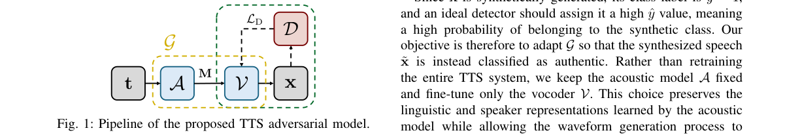

*Result - Mel-spectrograms of real and synthetic signals. The real signal (top) is from LibriTTS, the synthetic ones are from V (middle) and VR (bottom).*

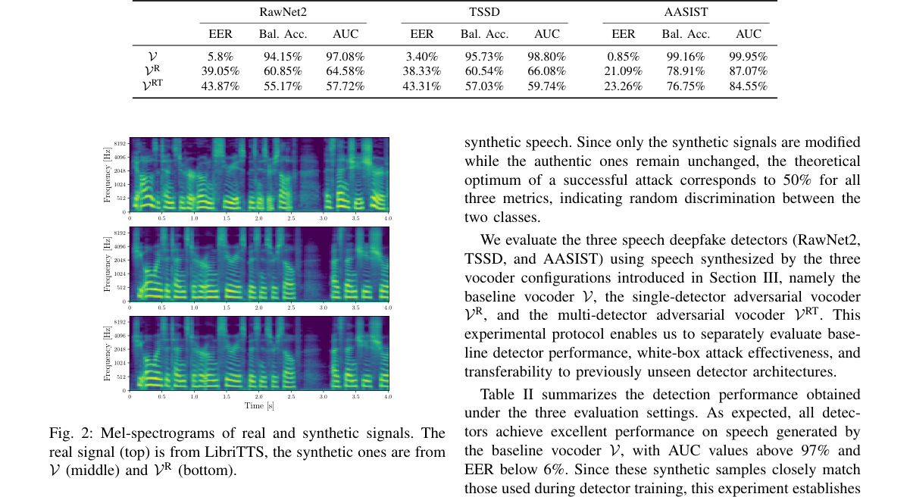

**Why this ranks #2**: 语音深伪检测器被反复报告高 AUC，但这篇把检测器直接拉进 TTS 训练回路做对抗：不做后处理、不加噪声，直接微调声码器让合成语音天生就能骗过检测。只针对 RawNet2 优化时其 EER 从 5.8% 升到 39.1%，逼近 50% 的随机猜测上界，未参与优化的 AASIST 也升到 21.1%，同时 FAD 从 31.25 降到 17.81、主观听感反而提升。

---

### 3. ScrambleMark: Zero-Query Watermark-Agnostic Black-Box Evasion of Modern Speech Watermarking

**arXiv**: [2611.04122](https://arxiv.org/abs/2611.04122) | **Score**: 8.5 (relevance 8.5 x 0.7 + quality 8.5 x 0.3) | **Tags**: AIGC-audio, watermark-attack, zero-query, black-box, diffusion, University of Missouri-Kansas City | **Categories**: cs.CR, cs.LG | **Pages**: 19

**Authors**: Binhao Ma; Weikang Ding; Hanqing Guo; Wenwei Zhao; Xiaowen Li; Leah Ding; Zhuo Lu; Rui Duan

**Affiliation**: University of Missouri-Kansas City; Indiana University Bloomington; University of South Florida; American University

**Abstract**

> Speech watermarking is becoming a key defense for digital copyright and content authentication. Existing attacks treat evasion as a removal problem: they erase the watermark, relying on detector access or on speech data that is hard to collect, such as paired clean-watermarked or clean target speaker speech. Commercial platforms are moving to close off these assumptions. TrustedAudio, for instance, restricts detection to authenticated users and denies meaningful detection feedback to unauthorized parties. Adversaries thus cannot tell whether a sample is watermarked or which watermark it carries, nor reliably remove it without degrading speech quality. In this work, we show that evading a speech watermark does not require erasing it: detection relies on the structural consistency of the embedded pattern, and disrupting this consistency is enough to defeat it. Building on this observation, we identify harmonic structure as an effective attack surface, as perturbing it breaks watermark consistency while preserving perceptual quality. We therefore propose ScrambleMark, a zero-query, watermark-agnostic, black-box attack that evades detection through harmonic scrambling. ScrambleMark combines a deterministic engine for discovering transferable harmonic perturbations with a generative model that learns randomized scrambling patterns, avoiding reliance on fixed attack rules. Across three commercial platforms (Google SynthID, Resemble AI, and TrustedAudio), ScrambleMark is the only attack to both evade detection and keep speech natural, achieving nearly 97% evasion and a 4.2/5 human rating, far above the 1.1 to 1.7 of prior attacks. Beyond evasion, ScrambleMark withstands adaptive recovery designed to reverse it, evidence that structural evasion is hard to mitigate in practice.

**Key findings**

- **Finding**: 提出零查询、水印无关的黑盒攻击 ScrambleMark，指出检测依赖嵌入图案的结构一致性，破坏一致性即可绕过检测，因此以谐波结构为攻击面，用可迁移谐波扰动的确定性引擎加学习随机化扰动模式的生成模型实现；在三个商用平台（Google SynthID、Resemble AI、TrustedAudio）上取得近 97% 的规避率与 4.2/5 的人评，远高于先前攻击的 1.1 到 1.7，并且能抵抗专为逆转它而设计的自适应恢复（实验中以 AudioSeal 作为代理水印模型）。
- **Inference**: 水印检测的脆弱性来自结构一致性而非水印本身，商用平台收紧接口只能抬高攻击门槛，无法消除这类结构性弱点。
- **Recommendation**: 水印方应把结构一致性攻击纳入红队清单，并考虑加入一致性自检或冗余嵌入；使用方不要把商用水印当作可信度证明，需配合其他检测手段交叉验证。

**Key figures**

*Framework - Overview of the watermarking pipeline.*

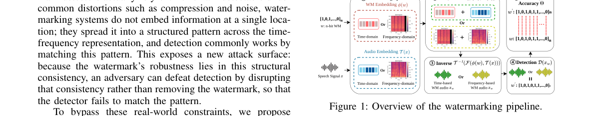

*Result - Comparison of watermark patterns under different attack strategies. The Timbre watermark [4] is used as the target, while AudioSeal [5] serves as a surrogate watermarking model to which nois*

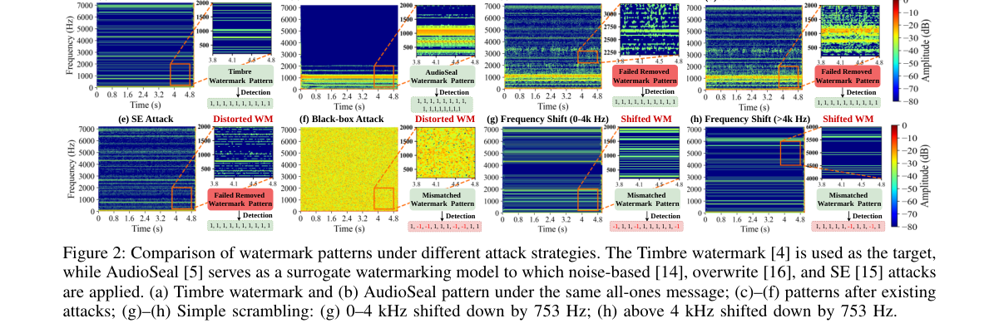

**Why this ranks #3**: 语音水印的商用平台正在收紧攻击前提：TrustedAudio 只对认证用户开放检测，攻击者既不知道样本是否带水印也不知道带的是哪一种。ScrambleMark 的洞察是绕过检测不必抹掉水印，只需破坏其嵌入图案的结构一致性，通过谐波结构乱序实现；在 Google SynthID、Resemble AI、TrustedAudio 三个商用平台上取得近 97% 的规避率与 4.2/5 的人评，而先前攻击只有 1.1 到 1.7。

---

### 4. Averaging Collusion Breaks Traceability in Personalized Neural Audio Watermarking

**arXiv**: [2611.04400](https://arxiv.org/abs/2611.04400) | **Score**: 8.3 (relevance 8.5 x 0.7 + quality 8.0 x 0.3) | **Tags**: AIGC-audio, watermark-collusion, traceability, multi-copy, privacy, Tsinghua University | **Categories**: cs.CR, cs.SD | **Pages**: 5

**Authors**: Yangming Liu; Haiyun Li; Dongfu Song; Ziang Xu; Jiehui Luo; Yining Zhang; Zhiyong Wu

**Affiliation**: Tsinghua University, Shenzhen, China

**Abstract**

> Personalized neural audio watermarking systems embed user-specific payloads into audio to trace the user associated with a leaked or misused copy. Existing evaluations mainly assume access to a single personalized copy, but real-world distribution may expose multiple copies of the same recording. We find that simple sample-wise averaging breaks traceability: averaging only two copies produces tracing-failure rates of 87.7-99.7% across the five systems while largely preserving audio quality. Decoder outputs show distinct responses to coalition payload composition across systems, with high majority agreement in TimbreWM but substantially lower agreement in WMCodec. In a more sophisticated payload-aware setting, mixture weighting can further steer the decoder toward a selected nonmember, achieving a target success rate of 92.3% in TimbreWM. Preliminary confidence screening rejects many collusion-induced assignments while retaining most valid single-copy outputs. Code and results are available at https://github.com/Silwan5z/neural-audio-watermark-collusion-attack. This work highlights multi-copy traceability as an additional evaluation dimension for personalized neural audio watermarking alongside conventional single-copy robustness.

**Key findings**

- **Finding**: 系统研究个性化神经音频水印的多拷贝串谋攻击：仅把两份拷贝做样本级平均，就在五个系统上造成 87.7% 到 99.7% 的追踪失败率且基本不损音质；解码器输出显示各系统对联盟载荷组合的响应差异明显，TimbreWM 的多数一致度很高而 WMCodec 明显更低；在载荷感知设定下，混合权重可进一步把解码器导向指定的非联盟成员，在 TimbreWM 上达到 92.3% 的目标成功率；置信度筛选可拒掉许多串谋导致的误判，同时保留大多数合法单拷贝输出。
- **Inference**: 个性化水印的可溯源性依赖单拷贝假设，多拷贝共存时的可组合性是一个独立于单拷贝鲁棒性的失效面。
- **Recommendation**: 部署个性化水印前先评估你的分发是否会出现同一录音的多份拷贝；若会，需要设计抗串谋机制或在协议层限制多拷贝共存，评测时把多拷贝场景单列出来。

**Key figures**

*Framework - A single copy maps to its user; averaging personalized copies from a coalition can produce a payload assigned to a user outside the coalition.*

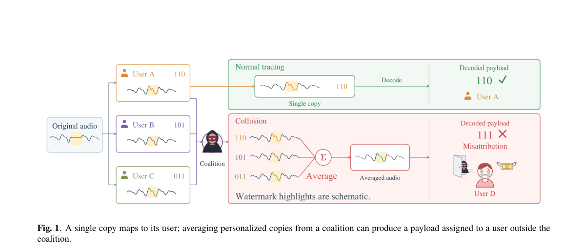

*Result - Fraction decoded as 1 versus bit support at K = 8. The dashed line is the ideal bit-choice reference; error bars show 95% intervals across speakers.*

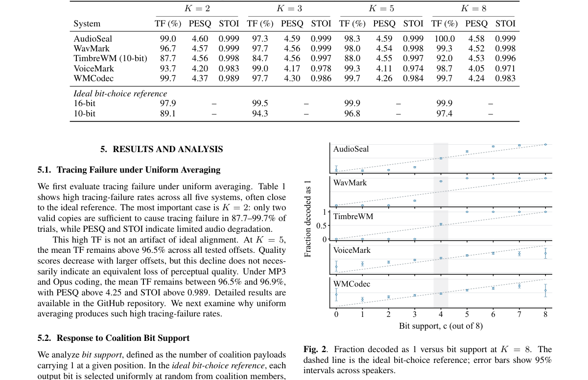

**Why this ranks #4**: 个性化神经音频水印的评测几乎都假设攻击者只有一份拷贝，但真实分发中同一条录音往往有多份。论文发现仅仅把两份拷贝做样本级平均就能击穿溯源：五个系统上的追踪失败率达 87.7% 到 99.7%，且音质基本无损；在更精细的载荷感知设定下还能把解码结果导向指定的非联盟成员，在 TimbreWM 上达到 92.3% 的目标成功率。

---

### 5. Cross-Codec Robustness in Speech Watermarking

**arXiv**: [2611.04716](https://arxiv.org/abs/2611.04716) | **Score**: 8.3 (relevance 8.5 x 0.7 + quality 8.0 x 0.3) | **Tags**: AIGC-audio, speech-watermarking, channel-augmentation, neural-codec, robustness, Information and Communications Engineering | **Categories**: eess.AS | **Pages**: 5

**Authors**: Olli-Pekka Pauna; Xin Wang; Lauri Juvela

**Affiliation**: Department of Information and Communications Engineering, Aalto University, Espoo, Finland; National Institute of Informatics, Tokyo, Japan

**Abstract**

> Generative speech models synthesize audio that is difficult to distinguish from human recordings. Synthetic speech can be watermarked as a proactive disclosure method, but watermarking models remain vulnerable to resynthesis attacks using neural audio codecs. This article investigates speech watermarking robustness across neural codec and digital signal processing attacks, when specific neural codecs are used for channel augmentation during training. We also present a novel zero-bit watermarking system that uses Descript Audio Codec as the generator. Our results demonstrate that the choice of augmentation codec significantly influences robustness generalization. Experiments show that augmentation with low-bitrate, high-quality neural codecs-Mimi and SNAC-results in promising robustness against unseen neural codecs and traditional attacks with limited quality impact.

**Key findings**

- **Finding**: 系统研究语音水印跨神经编解码器与 DSP 攻击的鲁棒性，比较用不同编解码器做通道增广的效果：EnCodec 与 DAC 泛化差、SpeechTokenizer 较好，Mimi（1.1 kbps）与 SNAC（0.98 kbps）单独使用已明显更好，两者联合对未见神经编解码器与经典 DSP 攻击泛化最广（对 EnCodec、DAC 与经典 DSP 表现很好，但对 SpeechTokenizer 与 NanoCodec 下降）；Mimi 与 SNAC 相互之间又泛化很差，暗示两种增广可能引入矛盾梯度；混响与多次重合成仍是难点，双模型对 SNAC 与 Mimi 自身均未达 90% 鲁棒；另提出以 Descript Audio Codec 为生成器的新零比特水印系统，质量测试中 DAC 变体相对自然样本 CMOS 0.231±0.269、PESQ 4.429。
- **Inference**: 用哪些编解码器做增广比增广次数更决定泛化边界，而且选择本身会引入互相干扰的梯度，这是通道增广方法论上值得记住的负面结论。
- **Recommendation**: 做语音水印的团队应把未见编解码器测试集固定下来并区分同族与跨族；混响与多次重合成目前仍是开放缺口，需要单独投入。

**Key figures**

*Framework - Training setup.*

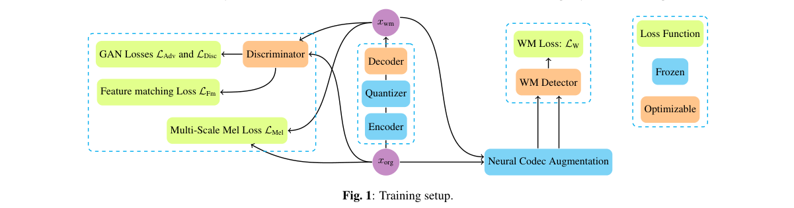

**Why this ranks #5**: 语音水印最大的现实威胁是神经音频编解码器的重合成攻击，而用水印生成器同族的编解码器做增广，很容易只学会防自己。这篇系统比较了不同增广编解码器带来的泛化差异：Mimi（1.1 kbps）与 SNAC（0.98 kbps）双增广对未见神经编解码器与传统 DSP 攻击的泛化最好，但在混响与多次重合成上仍然吃力；作者还提出以 DAC 为生成器的新零比特水印系统。

---

### 6. KeyWise: Efficient Video-Only Piano Transcription with a Lightweight Per-Key Architecture

**arXiv**: [2611.04476](https://arxiv.org/abs/2611.04476) | **Score**: 8.0 (relevance 8.0 x 0.7 + quality 8.0 x 0.3) | **Tags**: AIGC-audio, piano-transcription, video-only, per-key-roi, lightweight, Informatics and Telecommunications | **Categories**: cs.CV, cs.LG | **Pages**: 12

**Authors**: Anastasios Chatzigiannis; Natalia Panagou; Maria Koziri

**Affiliation**: Department of Informatics and Telecommunications, University of Thessaly, Lamia

**Abstract**

> Audio-based piano transcription is hampered by the sustain pedal and by noisy or missing soundtracks, problems that video-only transcription avoids, since a top-view video shows directly when each key is pressed and released. Most visual transcription networks, however, describe the whole keyboard with one global feature vector and must learn where each key is. In this paper, we propose KeyWise, a lightweight per-key architecture that exploits the known geometry of the keyboard instead of learning it. The rectified keyboard is divided into 88 equal tiles that serve as regions of interest (ROIs), and one small recurrent network, shared by all keys, follows each key over time. On PianoVAM, KeyWise reaches the onset accuracy of the state-of-the-art V2N (95.0% vs. 94.7% onset F1 at 50 ms and 97.8% vs. 97.0% at 100 ms) with 1.3 M instead of 28.2 M parameters, and it runs 4.7 times faster on the same GPU. At 100 ms, it is also significantly more accurate when the key releases (97.0% vs. 95.5% F1) or the velocities (89.4% vs. 84.5% F1) must be correct as well. On PianoYT, KeyWise pre-trained on PianoVAM reaches 69.4% onset F1 at 100 ms, comparable to the best published result, although it needs fine-tuning for new recording conditions.

**Key findings**

- **Finding**: 提出 KeyWise，用已知的键盘几何代替需要学习的键定位：把校正后的键盘等分为 88 个键 ROI 作为感兴趣区，CNN 编码器为每个键 ROI 产出一列特征，再由一个全键共享的 BiGRU 逐帧预测每个键的 onset、按键状态与力度；在 PianoVAM 上 50 ms onset F1 为 95.0%（V2N 94.7%）、100 ms 为 97.8%（97.0%），要求键释放也正确时 100 ms F1 为 97.0%（95.5%）、要求力度也正确时为 89.4%（84.5%），参数量 1.3M 对 28.2M、同一 GPU 上快 4.7 倍；在 PianoYT 上以 PianoVAM 预训练后达 69.4% 的 100 ms onset F1，与已发表最好结果相当，但仍需针对新录音条件微调。
- **Inference**: 当输入有已知强几何先验时，比如键盘、琴弦、工位，把定位问题直接编码进架构比让网络去学划算得多，这是视频与音频联合任务里可推广的设计思路。
- **Recommendation**: 若你的场景是固定机位的俯视键盘视频，这套 per-key ROI 架构可直接迁移；注意跨录音条件仍要微调，先在自己的机位上验证透视校正误差。

**Key figures**

*Framework - Overview of KeyWise. On the left, the keyboard is rectified from its four corners and cut into 88 equal key ROIs. In the middle, a CNN encoder gives one feature column per key ROI, and a BiGRU*

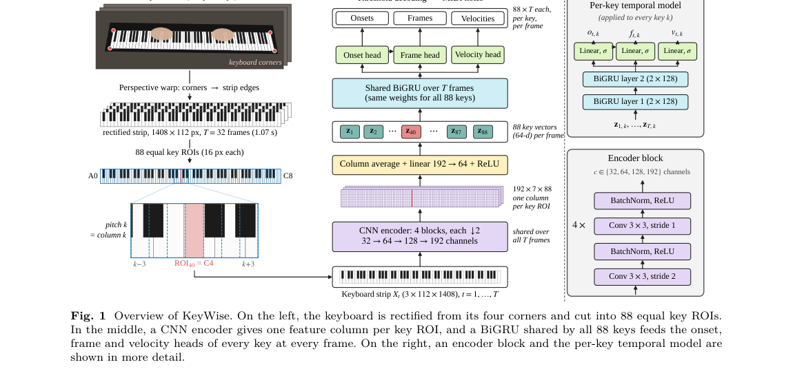

*Result - Key ROIs through the encoder, for five keys around C4. Each block halves the width, so the 16-pixel ROI of key k becomes exactly one column of the final feature map, which is averaged into the*

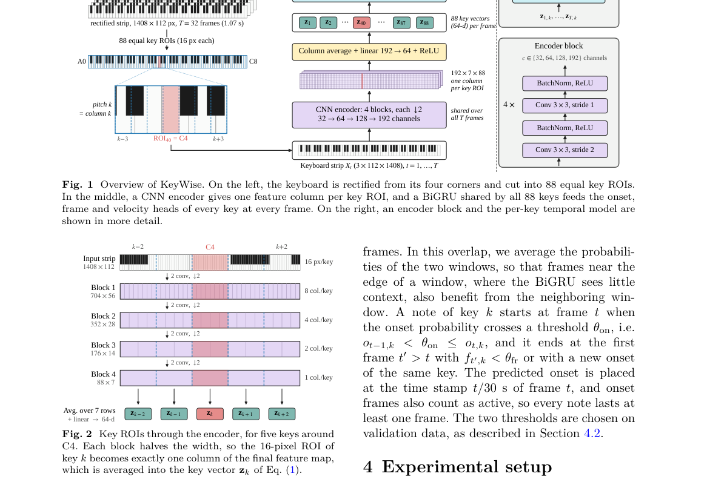

**Why this ranks #6**: 只看视频的钢琴转写能天然绕开延音踏板与嘈杂音轨，但主流视觉转写网络用单一全局特征描述整块键盘，还得自己学会键的位置。KeyWise 利用键盘的已知几何，把校正后的键盘切成 88 个键 ROI、用一个全键共享的小型循环网络逐键跟踪，在 PianoVAM 上 onset F1 达 95.0% 与 97.8%（50 与 100 ms），略胜 V2N 的 94.7% 与 97.0%，而参数量只有 1.3M 对 28.2M、同卡快 4.7 倍。

---

### 7. DGC-Net: Cross-Modal Dynamic Routing with Global-Guided Compensation in Multimodal Sentiment Analysis

**arXiv**: [2611.04841](https://arxiv.org/abs/2611.04841) | **Score**: 7.5 (relevance 7.5 x 0.7 + quality 7.5 x 0.3) | **Tags**: AIGC-audio, multimodal-sentiment, dynamic-routing, global-local-fusion, acoustic-visual, College of Computer Science and Technology | **Categories**: cs.AI, cs.MM | **Pages**: 13

**Authors**: Linan Zhu; Huaijing Wu; Xiao Han; Yuhao Wang

**Affiliation**: College of Computer Science and Technology, Zhejiang University of Technology; AIDC, Alibaba Group; Department of Data Science, City University of Hong Kong

**Abstract**

> User-generated videos, including opinion vlogs and video reviews, provide a rich source of people's attitudes toward products, services, and social topics. Understanding the sentiment expressed by speakers is important for analyzing online opinions, as transcripts alone may not capture the attitude and intensity conveyed through vocal tone and facial expressions. Multimodal sentiment analysis (MSA) addresses this need by integrating textual, acoustic, and visual cues. However, these cues are often subtle, noisy, and inconsistent across modalities. Existing local affective cue modeling methods typically operate within individual modalities and overlook global contexts from other modalities. This may cause cross-modal affective cue inconsistency. Hierarchical global-local fusion methods integrate global semantics with fine-grained local affective cues. However, they commonly determine the relative contributions of the two representations implicitly, preventing the global-local contributions from adapting to the sample-dependent reliability of local cues and resulting in either insufficient use of informative local cues or excessive interference from unreliable ones. To address these issues, we propose DGC-Net, a Dynamic Gating and Global-Guided Compensation Network for MSA. DGC-Net mitigates cross-modal affective cue inconsistency through cross-modal contribution-aware dynamic expert routing. This mechanism uses auxiliary global contexts to guide local expert selection. Moreover, global-guided dynamic compensation fusion alleviates sample-dependent global-local contribution imbalance while preserving global semantic as the primary anchor and adaptively incorporating expert-refined local cues. Experiments on five multimodal benchmark datasets demonstrate the effectiveness and general applicability of DGC-Net, and ablation studies verify the contribution of each proposed component.

**Key findings**

- **Finding**: 提出 DGC-Net（Dynamic Gating and Global-Guided Compensation Network），用跨模态贡献感知的动态专家路由（借助辅助全局上下文引导局部专家选择）加全局引导的动态补偿融合，缓解跨模态情感线索不一致与全局-局部贡献失衡；在 CMU-MOSI 上取得最佳 MAE 与 Corr，在 CMU-MOSEI 上取得领先的 Acc-7 与 F1；消融显示把动态路由换成固定混合、去掉全局引导或改用非路由专家都会降低 Acc-2 与 F1；作者也如实指出该方法在 CMU-MOSI 的 Acc-7 上不及 GLoMo，在 CMU-MOSEI 的 Corr 与负向正向 Acc-2 上也不是最优。
- **Inference**: 情感线索的可靠性是逐样本变化的，把全局与局部谁说了算交给隐式权重就注定在难样本上出错，显式的样本级路由是更合理的建模方式，但其收益并不覆盖所有指标。
- **Recommendation**: 做音视频情感或人机交互情绪识别的团队可参考其路由与补偿思路；迁移时先确认你的模态可靠性确实逐样本波动，否则显式路由的收益可能不及额外复杂度。

**Key figures**

*Result - Overall architecture of DGC-Net, consisting of unimodal global–local representation, cross-modal contribution-aware dynamic expert routing, and global-guided dynamic compensation fusion.*

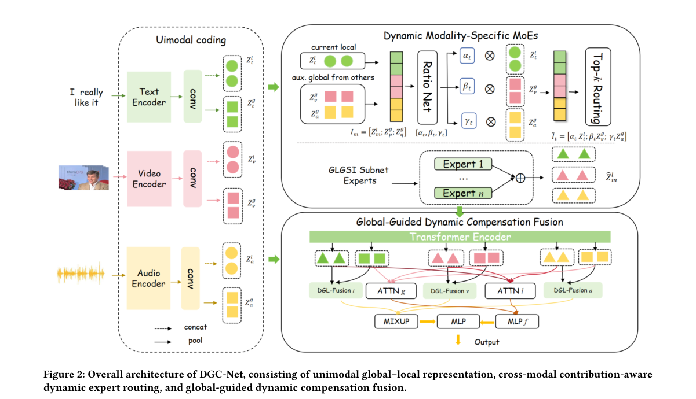

**Why this ranks #7**: 补位说明：本批次 aigc_audio 线真实供给只有 15 篇（cs.SD 10 篇加 eess.AS 5 篇），真正属于音频生成、TTS 与音乐的只有 2 篇，本篇属跨模态情感这一相邻方向补位。它解决的痛点很实在：多模态情感里的文本、声音与表情线索各自微妙、噪声大且互相冲突，而层级式全局-局部融合方法对两者贡献的分配是隐式的，无法随样本可靠性变化；DGC-Net 用跨模态贡献感知的动态专家路由加全局引导的动态补偿融合纠偏，在 CMU-MOSI 上取得最佳 MAE 与 Corr，在更大的 CMU-MOSEI 上 Acc-7 与 F1 领先。  [wild-card=yes] 该论文是文本-声学-视觉三模态的情感分析，属于跨模态理解与评测方向而非音频生成模型，补位计入。

---

### 8. Therapy-FIS: A Dataset for Assessing Facilitative Interpersonal Skills in Psychotherapeutic Setting

**arXiv**: [2611.04645](https://arxiv.org/abs/2611.04645) | **Score**: 7.5 (relevance 7.5 x 0.7 + quality 7.5 x 0.3) | **Tags**: AIGC-audio, clinical-acoustics, psychotherapy, multimodal-dataset, ccc-metric, College of Computer Science and | **Categories**: cs.AI, cs.CV, cs.CY | **Pages**: 10

**Authors**: Qijian Zheng; Wanqing Lin; Yuanfang Wang; Yijun Ge; Jordan Bate; Katie Aafjes-van Doorn; Feng Liu

**Affiliation**: College of Computer Science and Artificial Intelligence, Fudan University; Faculty of Arts and Sciences, New York University Shanghai; Global College, Shanghai Jiao Tong University; Adelphi University

**Abstract**

> Facilitative Interpersonal Skills (FIS) is a performance-based assessment method that provides a structured framework for evaluating the interpersonal competencies of mental health professionals. However, existing FIS assessment relies heavily on human observer ratings, making the evaluation process labor-intensive, costly, and difficult to scale. Progress toward automated FIS assessment has also been constrained by the lack of publicly available professional data in psychotherapy settings. To address this limitation, we introduce Therapy-FIS, a dataset for automated FIS assessment in standardized psychotherapy tasks. To our knowledge, Therapy-FIS is the first publicly available dataset in this domain. It contains facial, acoustic, and textual signals derived from standardized therapist responses to standardized mock patient stimulus clips, based on 890 therapist video recordings and 8 patient videos, and is rated with eight FIS subscale ratings and an overall FIS score. Built on Therapy-FIS, we further establish a benchmark with two downstream tasks: Therapist Performance Rating and Joint Therapist--mock-Patient Performance Rating. We also introduce a competitive baseline, DyadicFIS, with gated fusion and routed readout under therapist-only and dyadic settings. DyadicFIS obtains the best macro CCC(Concordance Correlation Coefficient) scores on both tasks (0.2807 and 0.3299). Therapy-FIS offers a reproducible resource for data-driven automated assessment of therapeutic interpersonal skills in mental health.

**Key findings**

- **Finding**: 发布 Therapy-FIS 数据集，为心理治疗场景中促进性人际技能（FIS）的自动评估提供首个公开专业数据：由 890 段治疗师录像与 8 段标准化来访者视频构成，包含面部、声学与文本信号，每段回应由 3 名受过训练的 FIS 评分者给出 1–5 的共识分，并标注 8 个 FIS 分量与一个总体 FIS 分；配套建立治疗师表现评分与治疗师-来访者联合表现评分两个下游任务的基准，并提出带门控融合与路由读出的基线 DyadicFIS，在两个任务上取得最佳宏平均 CCC，分别为 0.2807 与 0.3299。
- **Inference**: 公开数据加明确任务加基线三件套齐全，是这类长期依赖人工评估的领域少见的起点；0.28 到 0.33 的 CCC 也说明自动评估离替代人类观察者还很远。
- **Recommendation**: 做临床对话质量或音视频评测的团队可直接拿它当基准；若关心人工成本的投入产出，建议以 CCC 作为主指标而非只看分类准确率，因为评分本身是连续的主观量。

**Key figures**

*Result - Dataset construction pipeline overview. FIS experiment: therapists watch a patient’s help-seeking segment and provide a recorded response. Human ratings: each response clip is rated by three*

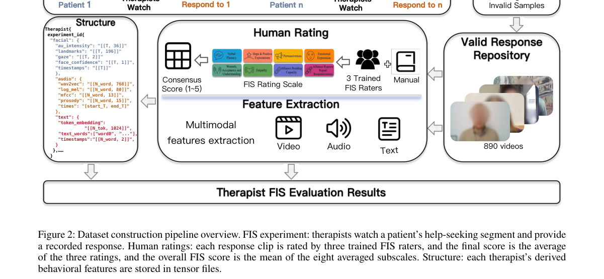

**Why this ranks #8**: 补位说明：本批次 aigc_audio 线真实供给仅 15 篇（cs.SD 10 篇加 eess.AS 5 篇），纯音频生成、TTS 与音乐的只有 2 篇，本篇属临床声学这一相邻方向补位。心理治疗中的助人 interpersonal 技能评估长期依赖人工观察者打分，昂贵且难规模化，又没有公开的专业数据；Therapy-FIS 是该领域首个公开数据集，基于 890 段治疗师录像与 8 段标准化来访者刺激片段，标注了 8 个 FIS 分量与一个总体 FIS 分，并配套两个下游任务与基线模型。  [wild-card=yes] 该论文是心理治疗师人际沟通能力的多模态数据集与基准，属临床声学与数据集方向而非音频生成模型，补位计入。

---

### 9. Hybrid acoustic and pretrained embedding feature fusion for unmanned aerial vehicle detection using stacking ensemble learning under a leakage-aware evaluation protocol

**arXiv**: [2611.04714](https://arxiv.org/abs/2611.04714) | **Score**: 7.3 (relevance 7.5 x 0.7 + quality 7.0 x 0.3) | **Tags**: AIGC-audio, drone-detection, acoustic-features, yamnnet, leakage-aware-split, Computer Science | **Categories**: cs.LG, cs.SD | **Pages**: 21

**Authors**: Zahid Iqbal

**Affiliation**: Department of Computer Science, Faculty of Computing and Information Technology, University of Gujrat

**Abstract**

> Small multirotor drones produce a characteristic acoustic signature, and microphones offer a low-cost way to detect them. High accuracies have been reported on public drone audio benchmarks, often with random clip-level splits of datasets built from a few long recordings and pieces of existing sound collections, so pieces of one source can appear in both training and test data. We study the binary task of the public DroneAudioDataset (11,704 one-second clips). Its 1,332 drone clips come from 257 five-second chunks of 7 recordings, and 96.4% of its non-drone clips are pieces of the 2,000 clips of the ESC-50 sound dataset. A grouped, source-disjoint protocol (five folds, three repeats) is compared with a random split. Each clip is described by 57 hand-crafted acoustic descriptors, reduced by a hybrid minimum-redundancy maximum-relevance and ReliefF selection or by NSGA-II multi-objective search, and by a 1024-dimensional embedding from the pretrained YAMNet network. Random Forest and XGBoost learners on both views form a stacking ensemble. Under the grouped protocol, the two-view stack reached a mean accuracy of 95.29% (SD 1.62 points over 15 test folds), a specificity of 98.29% and an area under the ROC curve of 0.990, and it correctly classified 98.78% of unseen ESC-50 source clips as non-drone. The random split overstated accuracy by 1.89 to 3.22 points for the four models. Adding YAMNet embeddings to the hand-crafted view raised accuracy by 1.11 points (higher in 12 of 15 folds). Hybrid selection matched the accuracy of all 44 baseline descriptors with 16 to 18 features, and NSGA-II retained 4 to 6 features at lower accuracy. The stack took 51.0 ms per clip on one CPU thread. Source-disjoint evaluation is needed for a fair benchmark on this dataset, and fusing hand-crafted descriptors with pretrained embeddings gives a small but consistent gain at modest computational cost.

**Key findings**

- **Finding**: 在公开 DroneAudioDataset（11,704 段 1 秒片段；1,332 段无人机片段来自 7 条录音的 257 个 5 秒块，96.4% 非无人机片段取自 ESC-50 的 2,000 段）上，用 57 个人工声学描述符（经混合 mRMR 与 ReliefF 或 NSGA-II 筛选）与预训练 YAMNet 的 1024 维嵌入组成双视图，随机森林与 XGBoost 堆叠成集成，在五折三重复的来源不相交划分下取得平均准确率 95.29%（15 个测试折上标准差 1.62）、特异度 98.29%、AUC 0.990，并把 98.78% 的未见 ESC-50 来源片段正确判为非无人机；随机片段级划分把四个模型的准确率高估 1.89 到 3.22 个百分点，YAMNet 嵌入带来 1.11 个百分点增益（15 折中 12 折更高），混合筛选用 16 到 18 个特征即达到全部 44 个基线描述符的水平，单线程 CPU 上每段 51.0 ms。
- **Inference**: 这类由少量长录音切块拼成的公共音频基准，随机划分的高准确率主要来自来源泄漏而非模型能力，评测协议比模型差异更能左右结论。
- **Recommendation**: 做声学事件检测时先审计数据集的来源构成并改用来源不相交划分；预训练嵌入与传统描述符融合收益不大但稳定，边缘部署可按 51 毫秒每段的 CPU 开销做取舍。

**Key figures**

*Framework - summarises the system. Each one-second clip is described in two ways: by 57 hand-crafted descriptors, reduced*

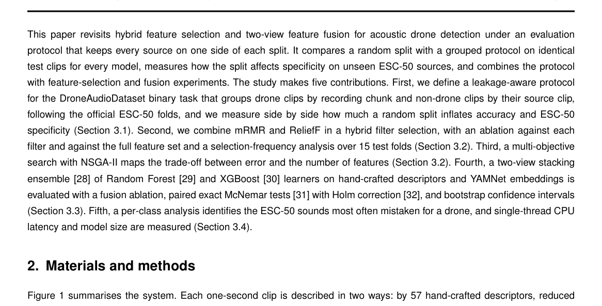

*Result - Random piece-level splitting places pieces of one source on both sides of the split (left); the grouped protocol keeps every recording chunk and every ESC-50 source clip on one side (right).*

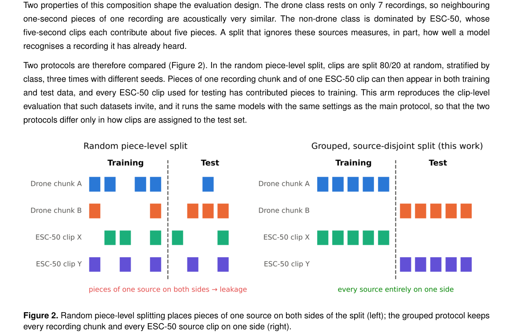

**Why this ranks #9**: 补位说明：本批次 aigc_audio 线真实供给仅 15 篇（cs.SD 10 篇加 eess.AS 5 篇），音频生成、TTS 与音乐的只有 2 篇，本篇属户外声学事件检测这一相邻方向补位。它的价值在于把无人机声学检测公开基准里的数据泄漏算清楚：11,704 段一秒片段中 96.4% 的非无人机片段其实取自 ESC-50，而 1,332 段无人机片段只来自 7 条录音的 257 个五秒块，随机划分会让同一来源同时出现在训练与测试中。  [wild-card=yes] 该论文是基于声学与预训练嵌入融合的无人机检测，属音频信号处理应用方向而非音频生成模型，补位计入。

---

### 10. Just Between Us? Exploring a Wearable-Mediated Channel for Discreet Human-Agent Interaction in a Shared Game Setting

**arXiv**: [2611.04692](https://arxiv.org/abs/2611.04692) | **Score**: 7.1 (relevance 7.0 x 0.7 + quality 7.5 x 0.3) | **Tags**: AIGC-audio, wearable-audio, human-robot-interaction, user-study, in-ear-audio, Universität Siegen | **Categories**: cs.HC, cs.RO | **Pages**: 11

**Authors**: Atikkhan Faridkhan Nilgar; Manuel Dietrich; Kristof Van Laerhoven

**Affiliation**: Universität Siegen; Honda Research Institute Europe GmbH

**Abstract**

> In shared settings, social robots may need to exchange information with an individual while limiting co-present others' access to or interpretation of that information. Publicly observable speech and gestures may not adequately support such exchanges. We investigate a wearable-mediated channel for discreet interaction that combines in-ear audio messages with deliberate rightward head tilts as responses. To examine its feasibility and participants' experiences, we studied 20 pairs (40 participants) playing a card game with a screen-based conversational agent representing a social robot, controlled by a researcher in a Wizard-of-Oz setup. Each pair played with and without the channel. One participant wore the device (the wearer), while the other (the non-wearer) was informed about the channel after gameplay. The channel conveyed information that could help the wearer or robot character select an opponent they could defeat. The information exchange and subsequent opponent selection occurred as intended in 39 of 40 channel-mediated turns. Wearers reported low perceived pressure/tension in both conditions, with no statistically significant difference between conditions, and favorable usability immediately after use. Retrospective interviews, however, revealed varied accounts of noticing the interaction among non-wearers and contrasting perceptions of teamwork and unfairness. These findings support the feasibility of wearable-mediated exchanges within this game and identify awareness and fairness as considerations for future designs.

**Key findings**

- **Finding**: 研究一条可穿戴介导的隐蔽交互信道，用耳内音频消息配合有意的向右歪头作为回应，在共享牌局中由研究者在 Wizard-of-Oz 设定下操控屏幕端对话代理代表社交机器人；20 对共 40 名参与者分别体验有信道与无信道两种条件，携带者佩戴设备、非携带者在游戏后才被告知信道存在，40 次信道回合中有 39 次的信息传递与后续对手选择完全按预期完成；佩戴者报告的感知压力与紧张度在两种条件下均低且无统计显著差异，事后访谈则显示非佩戴者对是否察觉到互动的描述不一，对团队感与不公平也有相反看法。
- **Inference**: 定向音频加手势能在不打扰旁人的情况下完成双向交互，但真正会被泄露的是可察觉性本身，非佩戴者的感知差异说明隐蔽性无法由佩戴者单方面保证。
- **Recommendation**: 若要做共享空间的人机交互原型，先把可察觉性与公平感当成一等设计变量而非事后调研项；这类研究的结论高度依赖任务形态与告知时机，迁移到别的场景需重新验证。

**Key figures**

*Framework - Two hypothetical scenarios illustrating discreet interaction. On the left, a social robot suggests ordering pizza to a mother via in-ear audio instead of raising the idea openly in front of*

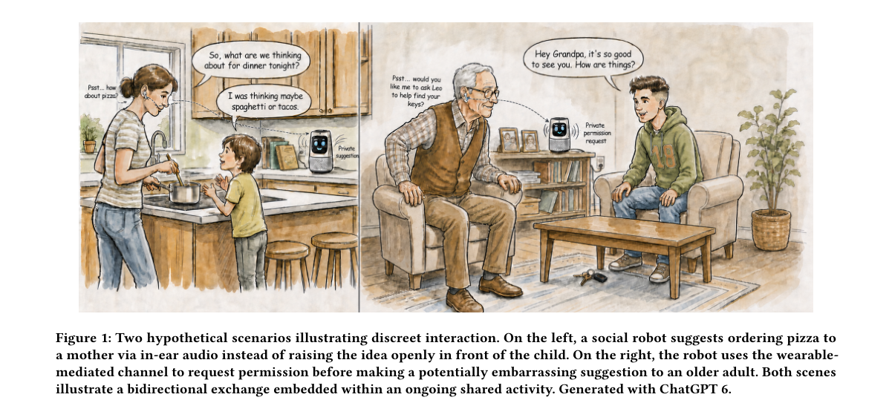

*Result - Study setup for the three-player card game: (a) schematic showing the wearer and non-wearer seated across a table, with the screen-based robot character acting as both host and fellow player*

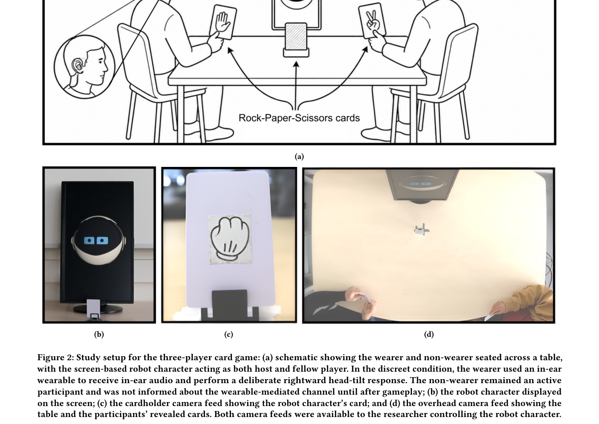

**Why this ranks #10**: 补位说明：本批次 aigc_audio 线真实供给只有 15 篇（cs.SD 10 篇加 eess.AS 5 篇），音频生成、TTS 与音乐的只有 2 篇，本篇属可穿戴声学交互这一相邻方向补位。它把耳内语音消息配合有意的向右歪头作答组合成一条隐蔽信道，用于在共享场合中让社交机器人只与指定一人交换信息；在 20 对、40 人参与的 Wizard-of-Oz 牌局研究中，40 次信道回合有 39 次的信息传递与对手选择完全按预期进行。  [wild-card=yes] 该论文是耳内音频 + 头部姿态构成的可穿戴隐蔽交互通道，属人机交互界面方向而非音频生成模型，补位计入。

---

