# ArXiv Daily Digest - 2026-11-04 (AIGC 视觉生成, 10 papers)

**Generated**: 2026-11-04 17:30 CST

**Source**: arXiv cs.CV, cs.SD, eess.AS, cs.CL, cs.AI, cs.RO, cs.LG submissions, listing day 2026-11-03 (announced 2026-11-04 00:00 UTC)

**Batch window**: 2026-11-02T18:00:00Z .. 2026-11-03T18:00:00Z（arXiv 公告批次横跨两个 UTC 日：前一日 18:00 UTC 起算，当日 17:59:59 UTC 截止）

**Track**: aigc_visual (top 10 of 587 papers scanned, 70 full reads)

**Scope**: 图像 / 视频 / 3D / 4D 内容的生成与编辑，含扩散与流匹配模型的训练方法、加速与评测基准

---

## Top 10 - AIGC 视觉生成

### 1. FlowTranslator: Training-Free In-Image Machine Translation with Flow-Based Editing

**arXiv**: [2611.04303](https://arxiv.org/abs/2611.04303) | **Score**: 9.3 (relevance 9.5 x 0.7 + quality 9.0 x 0.3) | **Tags**: AIGC-visual, in-image-translation, training-free, flow-editing, text-rendering, Institute of Trustworthy Embodied AI | **Categories**: cs.AI, cs.CV | **Pages**: 17

**Authors**: Zhixian Li; Xingsong Ye; Yongkun Du; Yunyan Xiao; Yanglin Huang; Pinxuan Chen; Jiyu Zhuang; Cong Xu; Zhineng Chen

**Affiliation**: Institute of Trustworthy Embodied AI, Fudan University; Shanghai Key Laboratory of Multimodal Embodied AI

**Abstract**

> In-image machine translation (IIMT) replaces text in an image with its translation while preserving the surrounding visual context. Existing task-specific models achieve convincing performance but require massive paired training images before and after translation. As advanced text-to-image (T2I) models have reached a practically usable level of multilingual text generation, we argue that this capability can be transferred to IIMT and present FlowTranslator. It is a training-free IIMT framework that first employs an OCR model and an LLM to generate the translation prompt, which is injected into the T2I-based diffusion model. To optimize the accurate and natural generation of translated text, we introduce two trajectory controls: Region Coupling Release (RCR) partially decorrelates target-branch noise inside the text region early in the trajectory, while Coupling Expansion (CE) amplifies the emerging edit displacement mid-trajectory. Under the EasyOCR read-back protocol, FlowTranslator achieves average PRIM BLEU and COMET scores of 20.6 and 57.2, respectively, substantially outperforming the strong training-based baseline UniTranslator. On the more challenging and realistic whole-image ScenePair photographs translated into Chinese, it reaches 40.1\% exact-match accuracy and surpasses existing editing systems, some of which only address the text-rendering stage rather than the complete IIMT task. These results establish flow-based editing as a strong, fully training-free baseline for IIMT.

**Key findings**

- **Finding**: 提出免训练的图内机器翻译框架 FlowTranslator，用 OCR 与 LLM 生成翻译提示注入 T2I 扩散模型，并提出两个轨迹控制 Region Coupling Release 与 Coupling Expansion 来优化目标文字区的准确与自然；在 EasyOCR 回读协议下平均 PRIM BLEU 为 20.6、COMET 为 57.2，显著优于训练型基线 UniTranslator，在更真实困难的整图 ScenePair 照片译为中文任务上取得 40.1% 的精确匹配率。
- **Inference**: 免训练的图内翻译能追平甚至超过专用模型，说明让生成模型自己写好目标语言文字这条路已经成立，任务专用的大规模配对训练数据不再是必要前提。
- **Recommendation**: 先把它当作图内翻译的零训练基线复现；真要上生产，请先在自己的图种上测 PRIM BLEU 与回读失败率，再决定是否补少量配对数据做微调。

**Key figures**

*Framework - Overview of the IIMT framework and editor paradigms. (a) The pipeline: OCR extracts text →a translator produces the translation →a scene text editor generates the output image. (b) Rule-based*

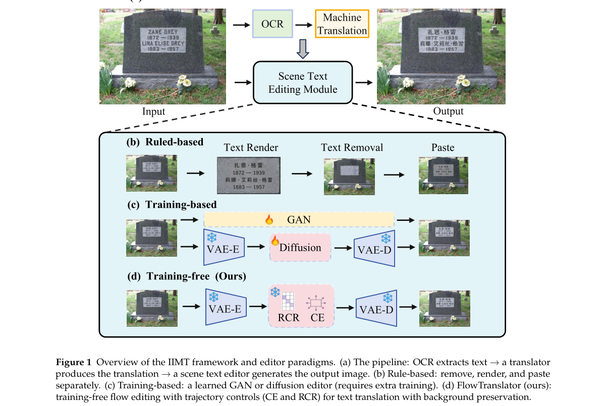

*Result - Overview of FlowTranslator. OCR extracts the source text and forms a source caption, while a frozen LLM translates it to obtain the target caption. A frozen VAE encodes the source image into*

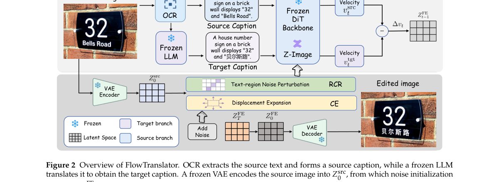

**Why this ranks #1**: 把 T2I 的多语言文字生成能力直接迁移到图内机器翻译，不训任何任务专用模型。它用 Region Coupling Release 在轨迹早期解耦文字区的目标分支噪声、用 Coupling Expansion 在中段放大编辑位移，在 EasyOCR 回读协议下拿到平均 PRIM BLEU 20.6 与 COMET 57.2，显著超过训练型基线 UniTranslator；整图 ScenePair 照片译为中文时精确匹配率达 40.1%，对做文档与海报本地化的团队是零训练成本的可落地基线。

---

### 2. Pixel-space video generation with U-JiT

**arXiv**: [2611.04764](https://arxiv.org/abs/2611.04764) | **Score**: 9.3 (relevance 9.5 x 0.7 + quality 9.0 x 0.3) | **Tags**: AIGC-visual, pixel-space, video-generation, u-shaped-transformer, flow-matching, FAIR | **Categories**: cs.CV | **Pages**: 19

**Authors**: Théophane Vallaeys; Jakob Verbeek; Matthieu Cord

**Affiliation**: FAIR, Meta; Sorbonne University, Paris; Valeo.ai

**Abstract**

> Latent diffusion and flow matching models are ubiquitous in state-of-the-art generative video models. While highly effective, relying on pretrained autoencoders to compress the data into a lower-dimensional latent space also comes with drawbacks. First, training proceeds in two stages: autoencoder pretraining, with compression and reconstruction objectives, followed by latent generative model training, precluding fully end-to-end training. Second, autoencoders also lead to an inherent loss of signal, and the trade-off between reconstruction quality and generative performance in the latent space is still an active area of research. In this paper we explore the viability of generative video models directly in pixel space. We analyze recent approaches in pixel-space generative modeling of images that rely on basic transformer designs, and identify several shortcomings that limit their effectiveness for the high-dimensional pixel-space video generation. To overcome these limitations, we propose a UNet-like transformer architecture along with improvements to the training recipe and sampling strategy. We conduct controlled experiments, training latent and pixel-space models from scratch on Kinetics-600. For the standard frames-to-video task at 128 resolution, our U-JiT model improves generative FVD by 27% over prior state-of-the-art results, and by 14% against the JiT pixel-space baseline. Scaling to higher 256 resolution, we find the improvement over pixel-space and latent-based models grows as we increase the spatiotemporal compression rate up to $64 \times 64 \times 8$. Finally, we find that U-JiT improves per-frame FID by 27% over latent models and 61% over pixel-space models on class-to-video generation, with respectively 9% and 56% reduction in FVD.

**Key findings**

- **Finding**: 提出 UNet 式像素空间视频 Transformer U-JiT，并改造训练配方与采样策略，在 Kinetics-600 上从零对照训练潜空间与像素空间模型：128 分辨率 frames-to-video 的 FVD 相对先前 SOTA 改善 27%、相对 JiT 像素基线改善 14%；在 256 分辨率 class-to-video 生成上 per-frame FID 相对潜空间模型改善 27%、相对像素空间模型改善 61%，FVD 分别下降 9% 与 56%。
- **Inference**: 自编码器压缩带来的信号损失并不必然压过像素空间端到端训练的收益，且压缩率提高到 64×64×8 时优势更大，说明 VAE 并不是不可替代的前置阶段。
- **Recommendation**: 关注它对高分辨率、纹理细节敏感的生成任务的影响；想跟进可先在自家数据上跑一组潜空间与像素空间的等算力对照，再决定是否放弃 VAE。

**Key figures**

*Framework - Comparison of JiT and our proposed U-JiT on video generation. While JiT processes the video with a single stack of large-patch blocks, U-JiT varies the patch size along model depth. In this m*

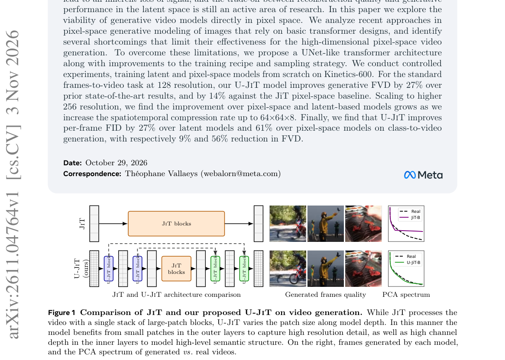

*Result - PCA spectrum over 16 × 16 × 4 patches, computed over 1k real and sampled videos.*

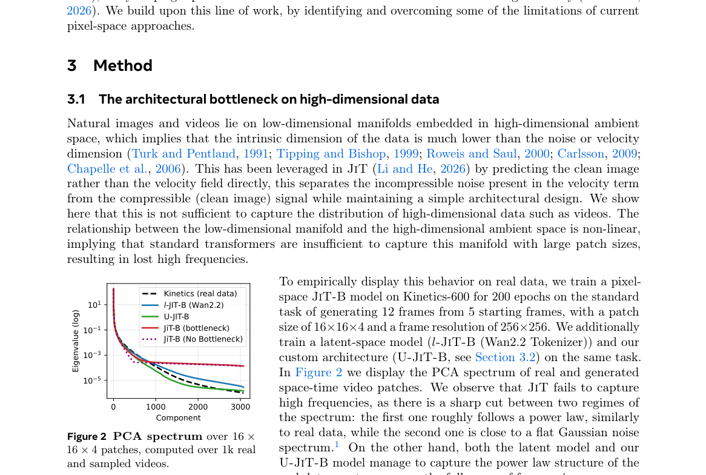

**Why this ranks #2**: 这篇直接质疑视频生成必须走潜空间这一共识：作者在 Kinetics-600 上从头对照训练潜空间与像素空间模型，像素空间的 U-JiT 在 128 分辨率 frames-to-video 上把 FVD 相对先前 SOTA 改善 27%、相对 JiT 像素基线改善 14%，256 分辨率下 per-frame FID 相对潜空间模型改善 27%、相对像素模型改善 61%。对做端到端视频模型、或怀疑预训练自编码器才是瓶颈的人，这是必须读的对照实验。

---

### 3. FlowRig: Unified Skeleton Generation for 3D and 4D Meshes via Flow Matching

**arXiv**: [2611.03775](https://arxiv.org/abs/2611.03775) | **Score**: 8.8 (relevance 9.0 x 0.7 + quality 8.5 x 0.3) | **Tags**: AIGC-visual, automatic-rigging, flow-matching, 4d-mesh, feed-forward, Texas A&M University | **Categories**: cs.CV, cs.GR | **Pages**: 22

**Authors**: Fengzhi Guo; Nate Morrill; Shiqi Li; Cheng Zhang

**Affiliation**: Texas A&M University

**Abstract**

> Automatic rigging is a fundamental task for both static 3D and dynamic 4D mesh animation, yet existing methods do not provide a unified feedforward solution for these two settings. While static 3D riggers achieve strong quality, they often provide limited control over bone count and become temporally unstable when applied frame by frame to dynamic meshes. Existing 4D methods, in contrast, typically rely on expensive per-sequence optimization. We propose MoTWorld, a template-free, data-efficient framework for unified 3D and 4D skeleton generation. Built on flow matching, MoTWorld generates temporally aligned skeletons for an entire sequence in a single feedforward pass, while naturally handling single-mesh 3D rigging. The model further supports explicit skeleton-count control, uncertainty estimation for candidate selection, and masking-based interpolation, forecasting, and backcasting. To address limited paired 4D rigging data, we adopt a curriculum that initializes from large-scale 3D rigging data and adapts to mid-scale 4D mesh-skeleton data. Experiments show that MoTWorld achieves strong static 3D rigging performance with controllable bone complexity, as well as high-quality and temporally consistent 4D reconstruction and prediction results.

**Key findings**

- **Finding**: 提出基于 flow matching 的统一骨骼生成框架 FlowRig（MoTWorld），模板无关、单次前馈即可为整个 4D 序列生成时间对齐的骨架，并支持显式骨骼数控制、不确定性估计与掩码式插值、预测、回推；采用 3D 到 4D 的课程学习缓解 4D 配对数据稀缺；在 Articulation-XL 2.0 与 Diverse-Pose 上，用不确定性从 5 个采样候选中选优（Ours*）后优于全部基线，在 ModelsResource 上的零样本表现接近同数据训练的 RigAnything。
- **Inference**: 骨骼这类结构化输出可以被生成式模型一次性建模，而骨架生成与下游动画控制的解耦——上游模型提供动态几何、本方法提供绑定——是一条可复用的分工。
- **Recommendation**: 做 3D 资产自动化绑定值得跟进；先在自有 mesh 集合上验证骨骼数可控性与时序抖动，再评估是否替换现有的逐帧 rigger。

**Key figures**

*Framework - FLOWRIG unifies rigging for both 3D and 4D meshes. Compared with prior methods such as Puppeteer (Song et al., 2025a) and UniRig (Zhang et al., 2025a), our model delivers accurate 3D rigging*

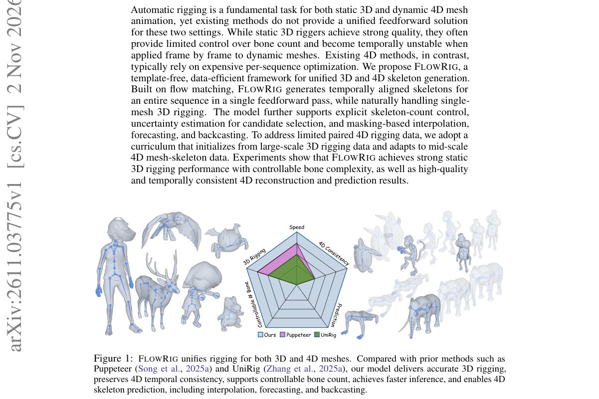

*Result - FLOWRIG overview. We encode meshes into conditioning tokens, and initialize noisy skeleton slots, which are processed by a flow matching transformer to predict temporally aligned skeleton re*

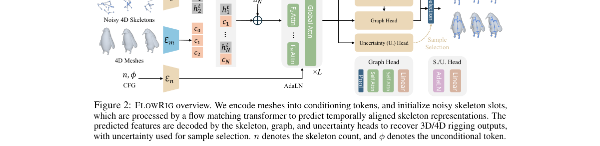

**Why this ranks #3**: 静态 3D 与动态 4D 骨骼生成此前是两套方法：3D 只能逐帧跑导致时序不稳，4D 要做昂贵的逐序列优化。FlowRig 用 flow matching 把两者统一成模板无关的单次前馈，一次输出整段时间对齐的骨架，并支持显式骨骼数控制、不确定性估计与掩码式插值、外推、回推；在 Articulation-XL 2.0 与 Diverse-Pose 上，用不确定性从 5 个采样候选里选优后超过全部基线。

---

### 4. Efficient and Faithful High-Resolution Image Editing with Sparse Cross-Resolution Denoising

**arXiv**: [2611.04416](https://arxiv.org/abs/2611.04416) | **Score**: 8.5 (relevance 8.5 x 0.7 + quality 8.5 x 0.3) | **Tags**: AIGC-visual, high-resolution, image-editing, sparse-attention, progressive-inference, Shanghai Innovation Institute | **Categories**: cs.CV | **Pages**: 25

**Authors**: Maosen Zhao; Xianfang Zeng; Pengtao Chen; Peng Ye; Gang Yu; Jiayuan Fan; Tao Chen

**Affiliation**: Shanghai Innovation Institute; Fudan University; StepFun; The Chinese University of Hong Kong

**Abstract**

> Instruction-based image editors still primarily operate at 1K, whereas practical editing increasingly requires faithful 2K/4K outputs. Dense high-resolution adaptation preserves the editing trajectory but incurs expensive target-source attention; editing at 1K followed by external refinement is cheaper but can separate detail restoration from the editing trajectory. We introduce FLASH, a native high-resolution editor based on sparse cross-resolution denoising. A frozen 1K branch provides a semantic and structural anchor, while a target-resolution branch reconstructs local detail within the same Transformer. An asymmetric topology retains full 1K attention, guides high-resolution queries with spatially aligned low-resolution noisy-target states, and confines high-resolution target-reference interaction to local Halo neighborhoods. Resolution-specific diffusion-state mapping and spatial YaRN adapt the pretrained editor to larger grids. An optional, training-free progressive path replaces early high-resolution denoising with a 1K prefix and completes refinement in the same editor. On VINS-4KEval, the direct model achieves the strongest structural fidelity among the compared methods at both 2K and 4K. A separate 4K forward benchmark with R = 1 records 4.2x faster total forward execution and 25.3x faster attention than dense target-reference attention. Progressive inference reduces end-to-end 4K latency by 30.5%, with a modest quality cost.

**Key findings**

- **Finding**: 提出基于稀疏跨分辨率去噪的高分辨率编辑器 FLASH：冻结的 1K 分支提供语义与结构锚定，目标分辨率分支在同一个 Transformer 内重建局部细节，配合分辨率专属扩散状态映射与空间 YaRN 适配更大网格；在 VINS-4KEval 上 2K 与 4K 的结构保真均为对比方法中最强，R=1 的 4K 前向 benchmark 中总执行快 4.2 倍、attention 快 25.3 倍，额外的训练无关渐进推理路径把端到端 4K 延迟再降低 30.5%，代价是质量略降。
- **Inference**: 不牺牲编辑轨迹的原生高分辨率在工程上可行，真正的瓶颈是目标与参考交互的注意力密度，而把高分辨率目标-参考交互限制在局部 Halo 邻域已足以保住结构。
- **Recommendation**: 需要交付 2K/4K 编辑结果时优先试 FLASH 的稀疏拓扑；落地前在自己的分辨率与提示词分布上重测结构保真与延迟，并量化渐进推理那 30.5% 提速对应的画质损失。

**Key figures**

*Framework - Three routes to high-resolution editing: dense native 4K editing, 1K editing with super-resolution, and our FLASH framework.*

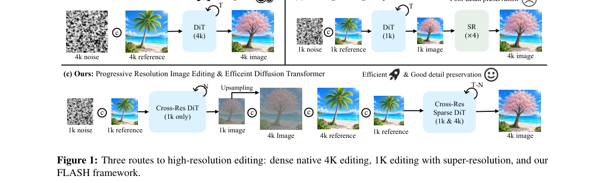

*Result - Per-forward runtime across resolutions. Each bar shows attention and other forward computation. Dense attention uses target–reference sequences; the separate sparse diagnostic uses R = 1 and*

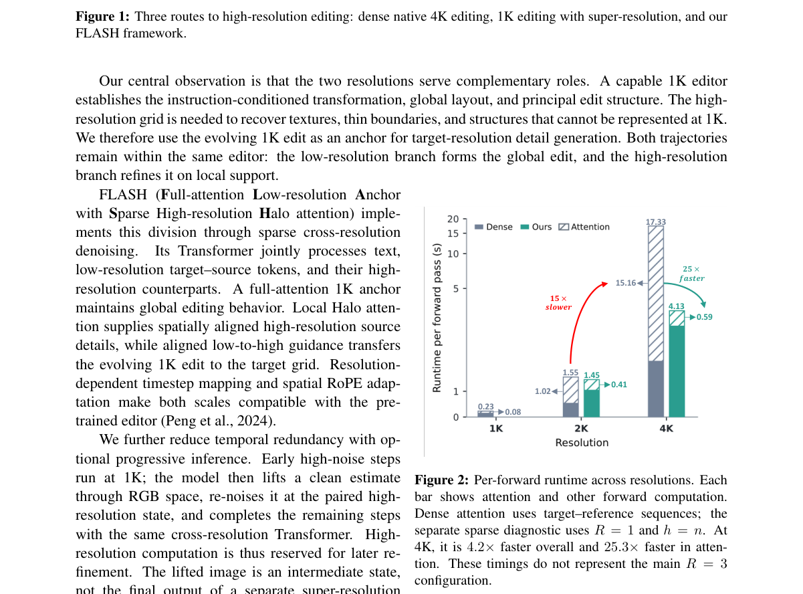

**Why this ranks #4**: 指令编辑模型普遍停在 1K，而真实的 2K/4K 交付要么付出昂贵的稠密目标-源注意力，要么把细节恢复与编辑轨迹拆成两段而脱节。FLASH 在同一个 Transformer 里用冻结 1K 分支做语义与结构锚定、目标分辨率分支补局部细节，R=1 的 4K 前向 benchmark 上总执行快 4.2 倍、attention 快 25.3 倍，渐进推理再把端到端 4K 延迟降 30.5%，且在 VINS-4KEval 上 2K 与 4K 的结构保真均为对比方法中最强。

---

### 5. ScoreDial: Precise Control of Visual Attributes in Image Generation via Regressor Guidance from Limited Human Ratings

**arXiv**: [2611.05004](https://arxiv.org/abs/2611.05004) | **Score**: 8.5 (relevance 8.5 x 0.7 + quality 8.5 x 0.3) | **Tags**: AIGC-visual, attribute-control, regressor-guidance, human-ratings, continuity, Keio University | **Categories**: cs.CV | **Pages**: 37

**Authors**: Jianbo Tang; Keita Ishii; Hiroki Sakamoto; Manabu Kikuchi; Katsuma Kitamura; Chiho Semba; Kenta Nishiyama; Teppei Mori; Yukihiro Kiwaki; Takeo Kato

**Affiliation**: Keio University, Japan; Bridgestone Corporation, Japan

**Abstract**

> Requested-value control is stricter than continuous steering: given $c$ on a human-rating scale, the generated image should attain that value from only limited ratings. We present ScoreDial, which fits a differentiable regressor $R$ to 100-479 human-rated images; once $R$ is fixed, a requested value $c$ is defined on its output scale, and learned target conditioning is paired with error-adaptive guidance that repeatedly reduces $|R(\mathbf{x})-c|$ during sampling. Across tire slip resistance, interior visual complexity, food desire-to-eat, and soap translucency, using one set of sampler settings shared across all four, ScoreDial reaches requested values and achieves, on all four attributes, $R$-MAE at most 0.013 over a range of width 0.8 and Spearman $ρ=0.980$, the maximum attainable under our evaluation protocol. Because $R$ also drives sampling, we evaluate agreement with $R$ separately from matched sweeps, an independent auditor fitted to the same ratings on a backbone none of the deployed regressors uses, and blinded human judgments. MPGD-flow also reaches the requested values under $R$, but ScoreDial has larger auditor displacement on every attribute, the largest among all compared methods, and a stronger MPGD-flow setting gives up target agreement without closing this gap. On every attribute, removing target conditioning leaves low $R$-MAE but more than halves auditor displacement, separating precise score correction from attribute movement. Blinded rating studies with 15 raters per attribute show that mean human ratings track $c$ on tire and soap, with linear $R^2=0.665$ and $R^2=0.786$, and in forced-choice comparisons of matched sweeps, raters chose ScoreDial's as the clearer progression in at least 84% of judgments against every baseline.

**Key findings**

- **Finding**: 提出 ScoreDial，把可微回归器 R 拟合到 100–479 张人工评分图上，在 R 的输出刻度上定义请求值 c，并用目标条件化加误差自适应引导在采样中持续压低 |R(x)-c|；跨轮胎滑移阻力、内部视觉复杂度、食品食欲感与肥皂通透性四个属性共用一套采样器设置，均达到 R-MAE 不超过 0.013（区间宽度 0.8）与 Spearman ρ=0.980，独立审计器上的位移在所有对比方法中最大；每属性 15 名评分者的盲评中，轮胎与肥皂对 c 的线性 R² 为 0.665 与 0.786，配对强制比较里至少 84% 的判断认为 ScoreDial 的推进更清晰。
- **Inference**: 在 R 上打准与人觉得在动是两件事，论文用独立审计器与盲评把两者拆开评估，才让指定值控制真正可信，这类评测设计值得照抄。
- **Recommendation**: 做属性滑杆产品的团队可照搬这套流程：少量人工评分拟合 R、把 c 定义在 R 刻度、再用误差自适应引导；先用多轮评分预算验证 R 的稳定度，审计器位移过大时慎用。

**Key figures**

*Framework - Matched requested-value sweeps for the four compared methods (MPGD-flow at its selected strength); c increases from left to right in steps of 0.2. All methods share the frozen SD3.5 model, r*

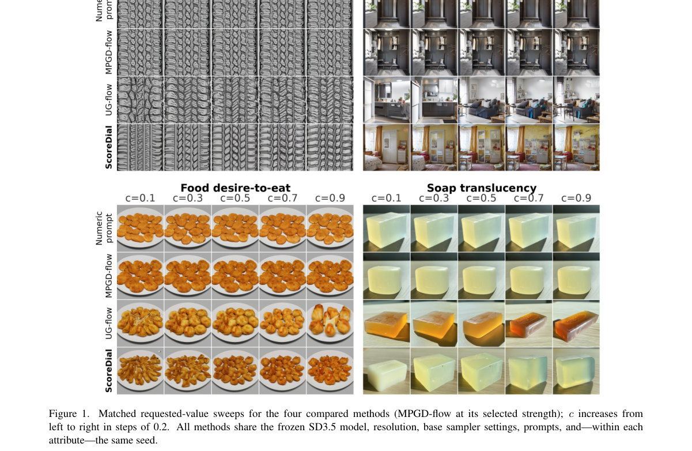

*Result - ScoreDial separates target positioning from residual correction. (A) A frozen pretrained visual backbone and a fitted linear ridge head form the differentiable attribute regressor R. (B) A l*

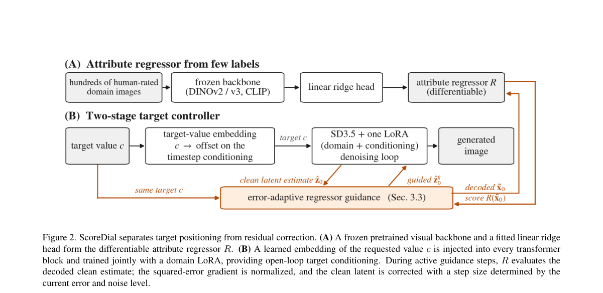

**Why this ranks #5**: 多数可控生成只给更多或更少，ScoreDial 做的是更严格的指定值：先拟合一个可微属性回归器 R，再把请求值 c 定义在 R 的输出刻度上，用目标条件化加误差自适应引导在采样过程中反复压低 |R(x)-c|。在轮胎滑移阻力、内部视觉复杂度、食品食欲感、肥皂通透性四个属性上共用一套采样器设置，R-MAE 不超过 0.013（区间宽度 0.8）、Spearman ρ=0.980，15 名评分者的线性 R² 达 0.665 与 0.786。

---

### 6. What Remains in Sight? Autoregressive Video Decoding as Representation-Guided Context Rewriting

**arXiv**: [2611.04164](https://arxiv.org/abs/2611.04164) | **Score**: 8.5 (relevance 8.5 x 0.7 + quality 8.5 x 0.3) | **Tags**: AIGC-visual, long-video, context-selection, training-free, kv-cache, Stanford University | **Categories**: cs.AI, cs.CV, cs.LG | **Pages**: 31

**Authors**: Lixuan He; Jihyeon Je; Yang You; Leonidas Guibas

**Affiliation**: Stanford University

**Abstract**

> Long-horizon video generation is increasingly moving toward autoregressive rollout, where each newly generated segment becomes part of the evidence used for future prediction. Recent causal decoders, long-context training, and KV-cache mechanisms have extended feasible duration, but most inference pipelines still decide the visible past implicitly through recent windows, compressed caches, or external memory. This raises a direct question: \textbf{can the choice of which past frames or segments to show to the decoder be treated as an explicit test-time decision?} We answer this question with \textsc{ReCR}, a training-free method that formulates autoregressive video decoding as representation-guided context rewriting. At each step, \textsc{ReCR} builds a selected visible context from the generated history by using internal decoder representations to favor context units that match the global rollout state, avoid redundancy with the recent continuation, preserve temporal boundary coverage, and widen the range of spatial layouts in view. The selected units are then mapped onto a compact causal axis before decoding the next block. Across long-horizon text-to-video benchmarks, \textsc{ReCR} consistently improves multiple autoregressive backbones under matched visible-token budgets. Empirical analyses such as representation-space diagnostics and transition-count prompt switching further show that improving what remains visible is an effective path toward more stable long-video decoding.

**Key findings**

- **Finding**: 提出免训练的 ReCR，把自回归视频解码表述为表征引导的上下文重写：每步用解码器内部表征为上下文单元打分（表征效用、时间边界覆盖、与近期续写的冗余惩罚），选中的单元映射到紧凑因果轴后再解码下一块；在 128 条 MovieGen 提示上，跨 Self-Forcing、Causal-Forcing、Self-Forcing++、HiAR、Deep Forcing 与 Infinity-RoPE 等骨干、在匹配可见 token 预算下比较，30 秒与 60 秒 rollout 的聚合质量分平均提升 1.41 与 1.94 分，Dynamic Degree 最多提升 17.92 分与 23.65 分，并降低文本对齐衰减与美学漂移。
- **Inference**: 长视频退化不只来自训练窗口，显式的上下文预算分配同样是重要变量，而且这类改动零训练成本，可以直接叠加到已有骨干上。
- **Recommendation**: 手里有自回归长视频骨干的团队可以直接试：固定可见 token 预算，对比近期窗口与 ReCR 选择下的 60 秒结果；若只有推理期改造的预算，这是性价比最高的一类改动。

**Key figures**

*Framework - Qualitative overview of ReCR across backbones. ReCR is applied as a training-free context rewriting module on top of different autoregressive video backbones. On 60-second rollouts, ReCR red*

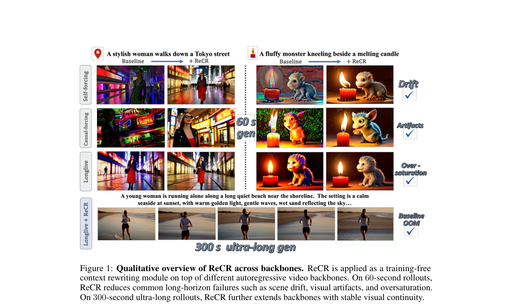

*Result - Overview of the ReCR framework. Instead of exposing the full generated history or a fixed recent window, ReCR scores context units with unit-level representations and selects a compact visib*

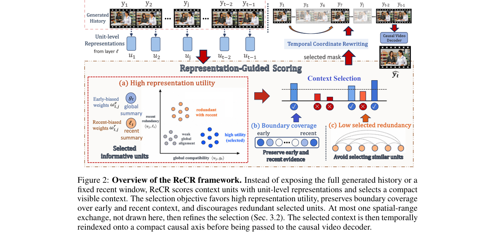

**Why this ranks #6**: 长视频自回归解码里，给解码器看哪段历史一直由近期窗口、压缩缓存或外部记忆隐式决定。ReCR 把它变成显式的测试期决策：用解码器内部表征挑选匹配全局状态、避免与近期续写冗余、又能覆盖时间边界的上下文单元，在匹配的可见 token 预算下跨多种自回归骨干都稳定增益——30 秒与 60 秒 rollout 平均提升 1.41 与 1.94 分，Dynamic Degree 最多提升 17.92 与 23.65 分。

---

### 7. Phase-DGS: Phase-guided Dynamic Gaussian Splatting from Unsynchronized Multi-view Video

**arXiv**: [2611.04666](https://arxiv.org/abs/2611.04666) | **Score**: 8.0 (relevance 8.0 x 0.7 + quality 8.0 x 0.3) | **Tags**: AIGC-visual, dynamic-gaussian-splatting, unsynchronized-video, motion-phase, multi-view, Electronics and Telecommunications | **Categories**: cs.CV, cs.GR | **Pages**: 22

**Authors**: Hosung Jeon; Jun Young Jeong; Sangwoon Kwak; Joonsoo Kim; Sangmin Kim; Jaesik Park; Won-Sik Cheong; Hyon-Gon Choo

**Affiliation**: Electronics and Telecommunications Research Institute (ETRI), Daejeon, Republic of Korea; Seoul National University, Seoul, Republic of Korea

**Abstract**

> Spatiotemporal scene reconstruction with Dynamic Gaussian Splatting (DGS) fundamentally depends on perfect temporal synchronization across all cameras, an assumption rarely achievable in practice. Industry-standard synchronization requires expensive specialized hardware and complex setup, while data-driven alternatives including audio-based alignment, geometry matching, and pose tracking remain limited by restrictive environmental or scene-specific assumptions. To overcome these limitations, we propose Phase-DGS, a framework that replaces conventional timestamps with a semantic phase representing each frame's inherent state within the underlying motion cycle. Frames capturing the same motion state share the same phase regardless of which camera records them or when, naturally establishing spatiotemporal correspondence across unsynchronized cameras. We validate Phase-DGS under temporal offsets, frame drops, and camera freezes, achieving up to +8.5 dB PSNR improvement over baselines while enabling seamless integration with existing DGS backbones including RealTime-4DGS and FreeTimeGS.

**Key findings**

- **Finding**: 提出 Phase-DGS，用表示帧在运动周期中所处状态的语义相位替代时间戳，把相位提取模块接入 4D Gaussian Splatting，使共享相位的图像无论由哪台相机、何时拍摄都自然建立时空对应；在时间偏移、丢帧与相机冻结的非同步条件下相对基线最高提升 +8.5 dB PSNR，并可与 RealTime-4DGS、FreeTimeGS 等现有 DGS 骨干无缝集成。
- **Inference**: 相位比时间戳是更鲁棒的对应关系，这是把真实采集约束转成归纳偏置的典型例子，对多设备或手持采集的多机位数据尤其有用。
- **Recommendation**: 如果你的 4D 重建数据来自不同设备且未做硬件同步，优先试相位对齐而不是先上时间戳拟合；先在自己的偏移与丢帧数据上复现 +8.5 dB 量级的增益，再接入现有 DGS 骨干。

**Key figures**

*Framework - Conceptual diagram of Phase-DGS. (a) In an unsynchronized multi-view dataset, images sharing the frame index are actually captured at different time instants. The proposed phase extraction m*

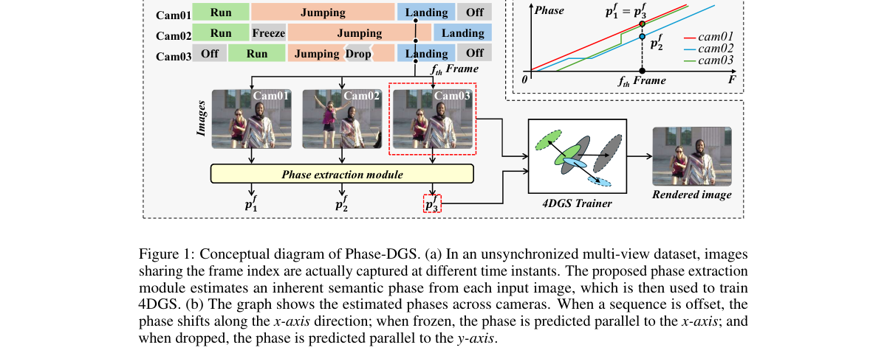

*Result - Training pipeline of Phase-DGS. Multi-view data provides camera parameters (view matrix, focal length, resolution) and an RGB image. The phase projector module predicts a phase value from th*

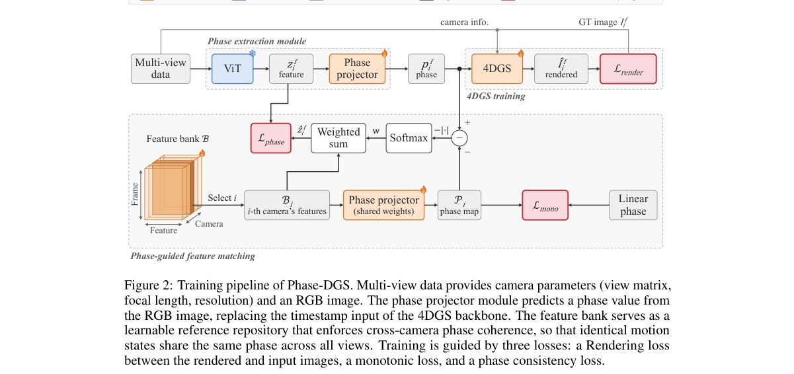

**Why this ranks #7**: 动态高斯泼溅默认所有相机严格同步，而工业级同步硬件昂贵、音频对齐等替代方案又依赖环境或场景假设。Phase-DGS 用运动周期中的语义相位替代绝对时间戳：捕捉同一运动状态的帧天然同相位，跨相机跨时刻建立时空对应，在时间偏移、丢帧与相机冻结下最高取得 +8.5 dB PSNR，并能直接接进 RealTime-4DGS、FreeTimeGS 等已有 4DGS 骨干。

---

### 8. 3DGS-VBench+ and 3DGSV-Assessor: A Multi-Dimensional Subjective Benchmark and a Reference-Flexible Objective Model for 3D Gaussian Splatting Video Quality Assessment

**arXiv**: [2611.04498](https://arxiv.org/abs/2611.04498) | **Score**: 8.0 (relevance 8.0 x 0.7 + quality 8.0 x 0.3) | **Tags**: AIGC-visual, 3dgs-compression, video-quality-assessment, benchmark, multi-dimensional, School of Information Science and | **Categories**: cs.CV | **Pages**: 14

**Authors**: Yuke Xing; William Gordon; Jiarui Wang; Yujie Zhang; Guangtao Zhai; Yiling Xu

**Affiliation**: School of Information Science and Electronic Engineering, Shanghai Jiao Tong University

**Abstract**

> 3D Gaussian Splatting (3DGS) enables real-time novel view synthesis (NVS), but its heavy storage makes compression essential, and both training and compression introduce representation-specific distortions. Since generative compression in many methods treats geometric and color attributes via different parameters, it can induce dimension-specific distortions, motivating multi-dimensional assessment. Moreover, real-world captures generally lack an aligned ground-truth video for a synthesized, continuous camera trajectory, leaving only sparse captured views as references. To enable multi-dimensional quality assessment of 3DGS videos with scarce aligned references, we first present 3DGS-VBench+, a large-scale subjective video quality assessment (VQA) benchmark comprising 3{,}036 3DGS reconstructions, each paired with a rendered video, across 11 real-world and 22 synthetic scenes, generated by 6 representative compression algorithms at systematically designed levels and annotated with 9{,}108 MOSs covering overall, geometry, and color quality. Based on 3DGS-VBench+, we propose 3DGSV-Assessor, a reference-flexible, large multimodal framework that scores all three dimensions in one generation pass and fuses a ranking-based reference cue into the frozen regressor through a bounded gate, supporting both reduced-reference (RR) and no-reference (NR) assessment. Extensive experiments demonstrate state-of-the-art correlation with human perception on 3DGS-VBench+ and strong zero-shot generalization to other NVS benchmarks. The dataset and code will be released at https://github.com/YukeXing/3DGSV-Assessor.

**Key findings**

- **Finding**: 发布 3DGS-VBench+，含 3036 个 3DGS 重建及其渲染视频，覆盖 11 个真实与 22 个合成场景，由 6 种代表性压缩算法在系统设计的压缩档位生成，并标注 9108 个覆盖整体、几何与颜色三个维度的 MOS；据此提出参考灵活的 3DGSV-Assessor，在一次生成中同时输出三个维度分数，并通过有界门控把基于排序的参考线索融进冻结回归器，在 RR 与 NR 两种设定下与人类感知的相关性达到 SOTA，并可零样本泛化到其他 NVS 质量评测基准。
- **Inference**: 3DGS 压缩的评测空白正在被填上，而把几何失真与颜色失真拆成独立维度评估，避免单一总分把结构问题与色彩问题混在一起。
- **Recommendation**: 做 3DGS 压缩或重建质量对比的团队可直接采用该基准与评测器；注意这 9108 个 MOS 只覆盖特定压缩算法与档位，换新压缩方法需自行补充标注。

**Key figures**

*Framework - Overview of the proposed benchmark and model. Left: 3DGS- VBench+, a multi-dimensional subjective VQA benchmark for compressed 3DGS. Right: 3DGSV-Assessor scores the overall, geometry, and col*

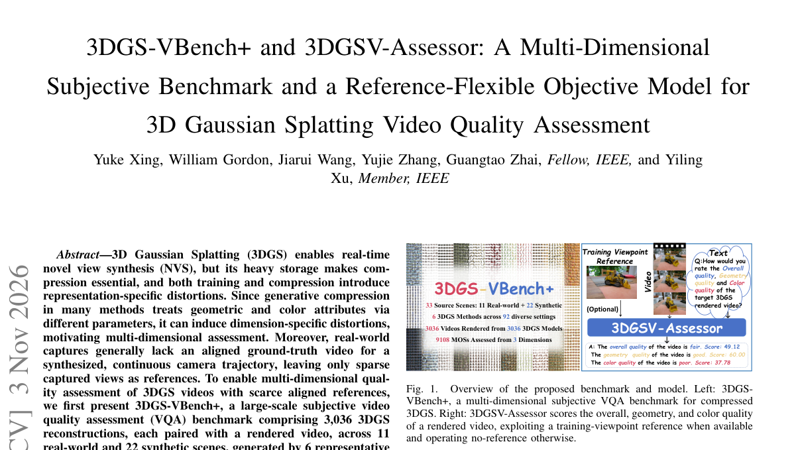

*Result - 22 selected synthetic source content in 3DGS-VBench+ with diverse material properties.*

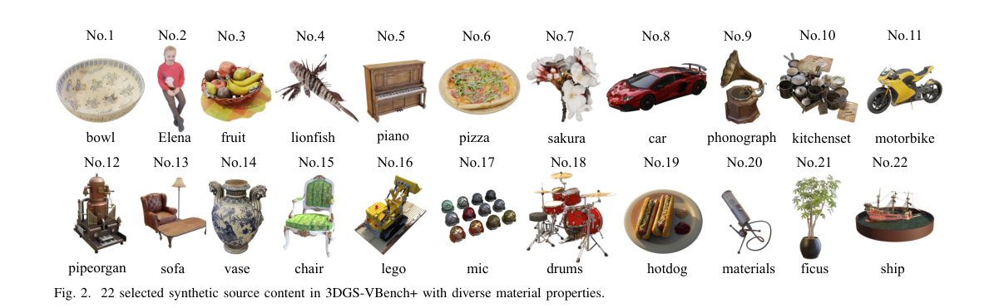

**Why this ranks #8**: 3DGS 为实时渲染必须压缩，而训练与压缩都会带来几何、颜色两类不同维度的失真，却没有对应的客观评测。3DGS-VBench+ 用 3036 个 3DGS 重建、11 个真实加 22 个合成场景、6 种压缩算法在系统设计的压缩档位上生成并标注了 9108 个 MOS（整体、几何、颜色三个维度），配套的 3DGSV-Assessor 在单次生成中同时打出三个维度分，并能在有参考与无参考两种设定下工作。

---

### 9. CounterSketch: Physics-Grounded Counterfactual Reasoning for Sketch-to-Video Generation

**arXiv**: [2611.04244](https://arxiv.org/abs/2611.04244) | **Score**: 8.0 (relevance 8.0 x 0.7 + quality 8.0 x 0.3) | **Tags**: AIGC-visual, sketch-to-video, counterfactual, vlm-reasoning, physics, University of Science | **Categories**: cs.CV | **Pages**: 11

**Authors**: Hien Trinh; Tan-Hiep To; Dinh-Khoi Vo; Tam V. Nguyen; Minh-Triet Tran; Trung-Nghia Le

**Affiliation**: University of Science, Ho Chi Minh City, Vietnam; Vietnam National University, Ho Chi Minh City, Vietnam; University of Dayton, Ohio, USA

**Abstract**

> Counterfactual sketch animation explores how a static sketch evolves under a hypothetical intervention. We present CounterSketch, a physics-grounded framework that transforms natural-language ``What if...?'' queries into physically plausible sketch animations. The framework integrates VLM-guided scene grounding, causal event-chain reasoning, constraint-based trajectory generation, and verification. It models physical transitions to update the scene graph, computes continuous object trajectories, and validates them against physical, geometric, and semantic constraints. The verified trajectories are then projected into object-level motion bounding boxes to guide downstream sketch-video synthesis. Experiments on CounterSketchBench (80 questions) demonstrate that physics-grounded trajectories provide stronger motion guidance than direct VLM predictions.

**Key findings**

- **Finding**: 提出物理接地的反事实草图动画框架 CounterSketch，用 VLM 场景接地、因果事件链推理、约束式轨迹生成与校验，把 What if 查询转成更新后的场景图与连续轨迹，再投影为物体级运动框引导草图视频合成；在 CounterSketchBench（80 个问题）上的消融显示，把物理接地 rollout 换成 VLM 直接预测会使 T2V 对齐从 0.2011 降到 0.1729、Dynamic Degree 从 0.7750 降到 0.7250，再移除结构化场景修改则进一步降到 0.1682 与 0.5625。
- **Inference**: 反事实生成的瓶颈不在渲染而在轨迹正确性，先做结构化推理再交给生成模型，比让 VLM 直接输出运动可靠得多。
- **Recommendation**: 关注用规划与校验层替代端到端直出的思路；自行尝试时先在自己的反事实集上量化轨迹正确性再评画面，避免只凭视觉样例下结论。

**Key figures**

*Framework - CounterSketch interprets a counterfactual intervention, reasons about its physical consequences, and generates a sketch video whose motion follows the resulting trajectory.*

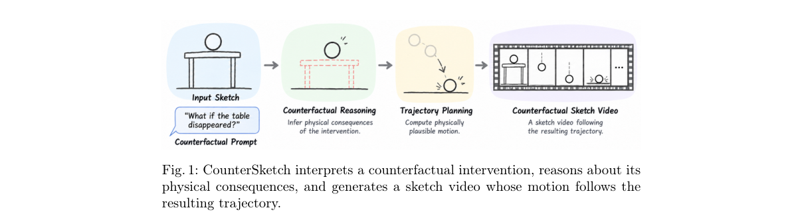

*Result - Representative six types of counterfactual scenes in CounterSketchBench.*

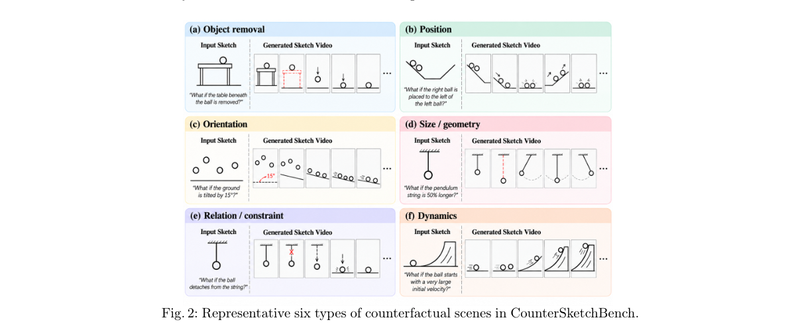

**Why this ranks #9**: 如果把桌腿抽掉，球会怎么动，这类反事实草图动画用 VLM 直接猜轨迹只会得到物理上站不住的运动。CounterSketch 把自然语言反事实查询先转成场景图更新、连续轨迹与约束校验，再把验证过的轨迹投影成物体级运动框去引导草图视频合成，在 CounterSketchBench 的 80 个问题上，物理轨迹带来的运动引导明显强于 VLM 直接预测。

---

### 10. IGSW: Multi-Weather Urban Scene Reconstruction with Intrinsic-Decoupled Gaussian Splatting

**arXiv**: [2611.04374](https://arxiv.org/abs/2611.04374) | **Score**: 8.0 (relevance 8.0 x 0.7 + quality 8.0 x 0.3) | **Tags**: AIGC-visual, autonomous-driving, weather-editing, 4d-gaussian, intrinsic-decomposition, College of Mechanical and Vehicle | **Categories**: cs.CV | **Pages**: 10

**Authors**: Zhongquan Wang; Long Cao; Peijia Xie; Senlei Ma; Jie Li; Guofa Li

**Affiliation**: College of Mechanical and Vehicle Engineering, Chongqing University

**Abstract**

> High-fidelity weather editing of 4D scenes can support end-to-end training and closed-loop simulation for autonomous driving. Combining generative image editing with dynamic Gaussian representations enables multi-weather scene reconstruction, but weather-edited images often contain structural distortions. Directly fitting their appearance may propagate errors from teacher images into the reconstructed 4D scene, compromising the original scene structure and temporal continuity. To address these challenges, we propose IGSW, a two-stage framework that combines intrinsic-decoupled 4D Gaussian scene modeling with structure-preserving weather refinement. In Stage I, background Gaussian appearance is decomposed into weather-shared albedo and normals and weather-specific irradiance and residuals. Weather teacher images generated by a diffusion-based image editing model and intrinsic maps estimated by a diffusion-based inverse renderer provide feature-level soft supervision for stable structure and illumination changes. In Stage II, a structure-preservation gate combines semantic conflicts with cross-weather intrinsic discrepancies to suppress unreliable teacher regions. Per-Gaussian weather transport variables and target-weather branches then strengthen the desired weather appearance over the intrinsic-decoupled scene. Experiments on nuScenes and Waymo show that IGSW achieves the highest content similarity and semantic consistency and the lowest temporal error among the compared methods, while retaining pronounced weather-dependent illumination and atmosphere. The project page is available at https://akaxi6.github.io/IGSW/ .

**Key findings**

- **Finding**: 提出两阶段框架 IGSW：阶段 I 把背景高斯外观分解为天气共享的 albedo 与 normal、天气特定的 irradiance 与残差，用扩散编辑模型生成的天气教师图与扩散逆渲染器估计的本征图提供软监督；阶段 II 用结构保持门控结合语义冲突与跨天气本征差异抑制不可靠教师区域，并引入逐高斯天气传输变量与目标天气分支；在 nuScenes 与 Waymo 上取得对比方法中最高的内容相似度与语义一致性、最低时序误差，四个数据集与天气设定中 CLIP-S 与 Sem-CS 最高且 Ewarp 最低（三个设定 CLIP-DS 最高），nuScenes 雨天天序误差 0.0021 低于 WeatherCity 的 0.0023、WeatherEdit 的 0.0148 与 Qwen-Image 的 0.0294。
- **Inference**: 用生成模型做教师这条路真正的瓶颈是教师图的结构错误，靠本征分解加门控做结构校验，比直接拟合编辑图更可控。
- **Recommendation**: 做驾驶场景多天气仿真或数据增强的团队可参考其两阶段解耦思路；先测自己教师模型在本征域的误差有多大，再决定是否需要这类结构保持门控。

**Key figures**

*Framework - Teaser of IGSW. Given a driving-scene sequence, target-weather teacher images, and intrinsic maps (albedo, normal, and irradiance) estimated through inverse rendering, IGSW reconstructs a dyna*

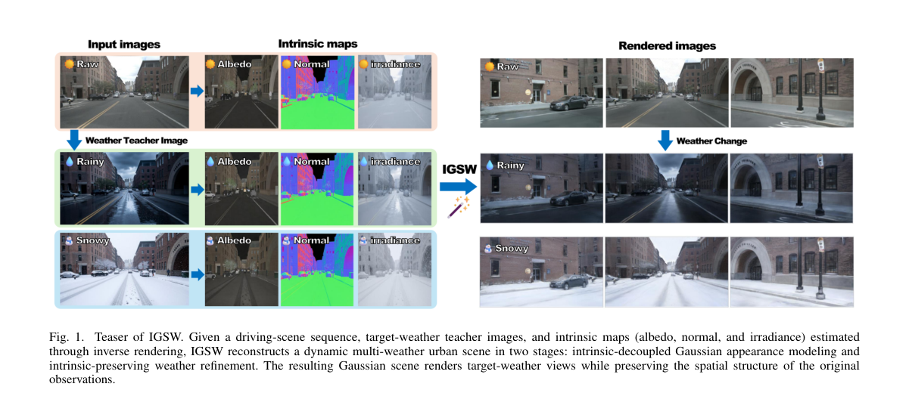

*Result - Overview of IGSW. (a) Qwen-Image produces target-weather teachers from the original driving observations. (b) A diffusion-based inverse renderer estimates albedo, normals, and irradiance for b*

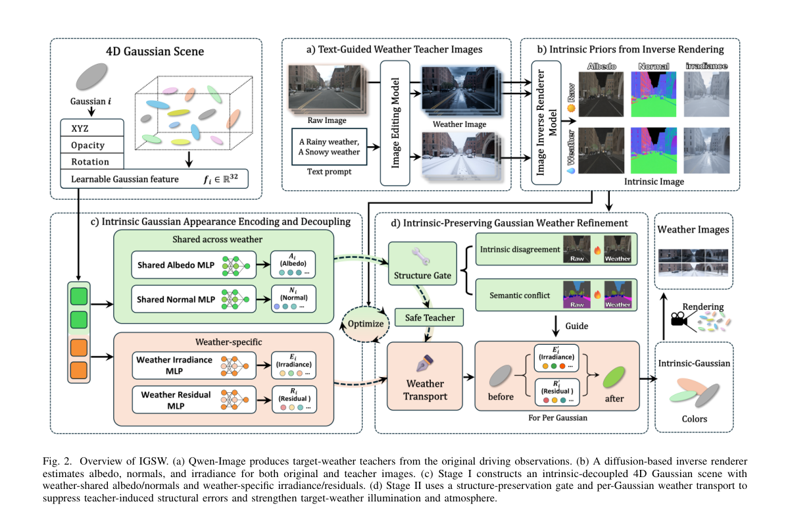

**Why this ranks #10**: 用生成式编辑造多天气数据去做自动驾驶仿真，但编辑图常带结构畸变，直接拟合会把教师图的错误写进 4D 场景。IGSW 分两阶段：先把背景高斯外观拆成天气共享的 albedo 与 normal、天气特有的 irradiance 与残差，再用一个结构保持门控把语义冲突与跨天气本征差异合起来压掉不可靠教师区域；nuScenes 与 Waymo 上内容相似度与语义一致性最高、时序误差最低，nuScenes 雨天 Ewarp 仅 0.0021，Qwen-Image 为 0.0294。

---

