# ArXiv Daily Digest - 2026-11-04 (音频与语音语言模型, 10 papers)

**Generated**: 2026-11-04 17:30 CST

**Source**: arXiv cs.CV, cs.SD, eess.AS, cs.CL, cs.AI, cs.RO, cs.LG submissions, listing day 2026-11-03 (announced 2026-11-04 00:00 UTC)

**Batch window**: 2026-11-02T18:00:00Z .. 2026-11-03T18:00:00Z（arXiv 公告批次横跨两个 UTC 日：前一日 18:00 UTC 起算，当日 17:59:59 UTC 截止）

**Track**: audio_lm (top 10 of 587 papers scanned, 70 full reads)

**Scope**: 音频 / 语音语言模型与多模态助手，含语音记忆、长音频检索、空间音频与多语种对话评测

---

## Top 10 - 音频与语音语言模型

### 1. VeriSpoof: Beyond Real or Fake with One Audio LLM

**arXiv**: [2611.04634](https://arxiv.org/abs/2611.04634) | **Score**: 8.8 (relevance 9.0 x 0.7 + quality 8.5 x 0.3) | **Tags**: audio-lm, deepfake-detection, audio-language-model, generator-attribution, rationale-grounding, University of Melbourne | **Categories**: cs.CR, cs.SD, eess.AS | **Pages**: 33

**Authors**: Yang Xiao; Ting Dang

**Affiliation**: The University of Melbourne

**Abstract**

> A speech deepfake detector estimates whether a recording is synthetic, but a forensic analyst also asks which system produced it, whether recordings share a source, and what evidence supports each conclusion. We present VeriSpoof, an audio language model that unifies five tasks with shared weights: deepfake detection, generator attribution (generator, acoustic model and vocoder), recording-condition analysis, synthesized-span localisation, and source verification. Each decision is supported by grounded rationales whose statements can be independently verified. Answers are scored by sentence likelihood, allowing detection and source verification to be thresholded without separate heads. Rationale statements can be checked against waveform measurements, span labels, or generator metadata. Counterfactual examples train decisions to follow the stated evidence. Across the 14 Speech-DF-Arena test sets, VeriSpoof-Plus achieves 2.14% pooled EER, ranking third of 28 systems and first among open-weight systems. VeriSpoof-Base, trained only on official training splits of eight corpora, achieves 4.43% EER, less than half that of the next open-weight detector. With the same weights, VeriSpoof-Plus verifies whether recordings from generators unseen in training share a source at 6.2% EER. Controlled studies show that the audio representation governs detection, the LLM governs recording comparison, and source supervision is necessary for neural-codec fakes. Statement-checkable rationales catch partial fakes missed by one-step answers (99.6% vs. 78.4% on PartialEdit) and determine decisions under edits unseen in training (99.5%). Training updates only 29.7M of 2.85B parameters, fitting a single 24 GB GPU with gradient checkpointing. We release both models, inference code, a demo, and VeriSpoof-Bench, the evaluation suite covering these questions.

**Key findings**

- **Finding**: 用一套权重统一深伪检测、生成器/声学模型/声码器归因、录音条件分析、合成片段定位与源验证五类取证任务，每个结论都配可独立核查的理由；在 14 个 Speech-DF-Arena 测试集上 pooled EER 为 2.14%（28 个系统中第 3、开源第 1），仅用八个语料官方训练划分训练的 Base 版 EER 4.43%（不到次优开源检测器的一半），训练只更新 2.85B 参数中的 29.7M，单张 24GB 显卡加梯度检查点即可完成，PartialEdit 上 99.6% 对 78.4%，训练未见的编辑下仍能 99.5% 判定。
- **Inference**: 「一个分数 → 可核查证据」把深伪检测从黑盒二分类推进到可审计的取证流程，句级可验证性比再加一个检测头更有工程价值；同时 29.7M/2.85B 的极小可训练比例说明这类取证模型可以被当作通用音频骨干来低成本微调，不必从头训。
- **Recommendation**: 评测你的检测器时直接接入 sentence-likelihood 打分做阈值化，而不是训独立检测头；把 VeriSpoof-Bench 与 Speech-DF-Arena 并列跑一遍看 pooled EER，若你的场景是局部编辑伪造，务必单独测 PartialEdit 这类样本，整体 EER 会显著低估这种失效模式。

**Key figures**

*Framework - VeriSpoof at a glance. (a) Detection on the 14 test sets of Speech-DF-Arena [1], pooled EER (one threshold over all sets, the board’s ranking); the public snapshot of 31 Oct 2026 with both V*

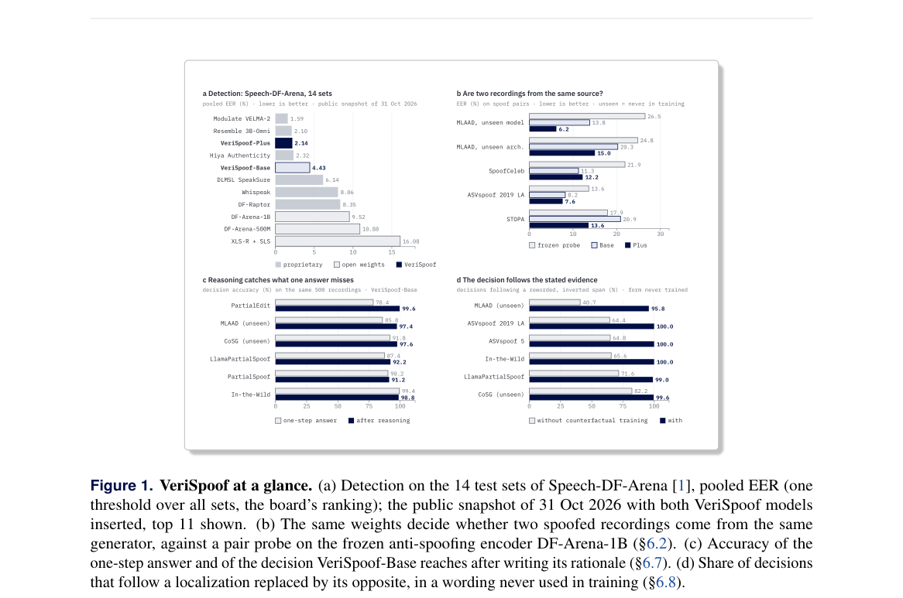

*Result - One score versus checkable evidence on the same recording, in which one word of genuine speech was replaced by synthesized speech. Asked directly, the model judges the recording genuine (lef*

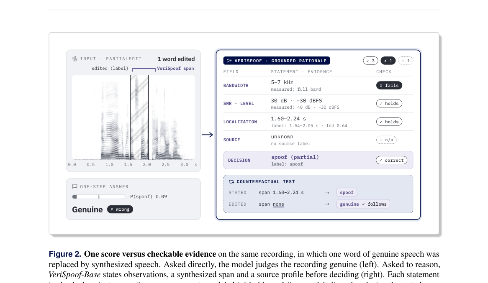

**Why this ranks #1**: 墨尔本大学把深伪检测、生成器归因、录音条件分析、合成片段定位、源验证五类取证任务压进同一套权重，在 14 个 Speech-DF-Arena 测试集上 pooled EER 2.14%，28 个系统里第 3、开源第 1；训练只更新 2.85B 参数中的 29.7M，单张 24GB 显卡即可完成。最值得看的是它让每个结论都带可逐句核查的理由，PartialEdit 局部伪造上 99.6% 对 78.4% 的差距说明判定依据确实是理由里陈述的证据，而不是数据集记忆。

---

### 2. ReListen: Training-Free Evidence Localization in Hour-Long Audio with Frozen Audio Language Models

**arXiv**: [2611.04480](https://arxiv.org/abs/2611.04480) | **Score**: 8.5 (relevance 8.5 x 0.7 + quality 8.5 x 0.3) | **Tags**: audio-lm, audio-lm, evidence-localization, training-free, long-audio, Microsoft | **Categories**: cs.CL, cs.SD, eess.AS | **Pages**: 23

**Authors**: Ming-Hao Hsu; Shujie Liu; Yuxuan Hu; Yuxiang Wang; Yingda Shen; Jinyu Li; Zhizheng Wu

**Affiliation**: Microsoft; Microsoft Research Asia

**Abstract**

> Audio language models are meant to answer questions from the audio itself, but an hour-long recording rarely fits in their context, and the answer often depends on a few seconds of it. Transcribing the recording first makes it fit but discards sounds and voices, while systems that return to the audio must be trained for this behavior. We propose ReListen, a training-free method in which a frozen audio language model finds its own evidence before answering. In a Jev-style scan, the model scores each 20-second window by the probability that it helps answer the question, and it then answers from the highest-scoring minute. This minute overlaps the annotated evidence far more often than transcript retrieval, for 88.5% of VoiceGiraffe questions. Without any change, the same scan also grounds events on LAT-Bench as well as a model trained for temporal grounding. Answering from it matches or exceeds hearing the whole recording with a small fraction of the audio, and on VoiceGiraffe it exceeds a transcript of the whole recording by 9.2 points. The selected evidence is also worth hearing rather than reading. Given the same excerpts, reading their transcript matches listening on speech content, but listening is clearly more accurate on questions about sounds and voices. Moreover, ReListen answers faster than every transcript-based system, and its memory stays constant even for recordings too long to hear whole on one GPU. Therefore, a frozen audio language model can search hour-long recordings by itself, without a transcript or additional training.

**Key findings**

- **Finding**: 提出免训练的 ReListen：冻结的音频语言模型按 Jevons 式扫描为每个 20 秒窗口打分「该窗口对回答问题是否有帮助」，再从最高分的一分钟作答；该分钟覆盖标注证据的比例在 VoiceGiraffe 上达 88.5%，作答比整段录音的转写文本高 9.2 分，在 LAT-Bench 上不经改动即可达到与专门做时序定位训练的模型相当的接地效果，内存恒定，读取相同片段时听比读转写更利于声音与人声类问题。
- **Inference**: 把「检索证据」交给模型自身的似然去解，同时避开了转写丢声音与重训定位器两条常见路线，是当前长音频 QA 里少见的免训练方案；内存恒定这一条意味着它能处理单卡放不下的整段录音，工程可扩展性比精度提升本身更关键。
- **Recommendation**: 若你有小时级录音加冻结音频大模型，直接复用这个扫描-作答两段式接口；先在自己数据上量一遍「选中窗口覆盖标注证据的比例」作为代理指标，因为 88.5% 与 9.2 分都是针对 VoiceGiraffe 的具体设定，换域后未必成立。

**Key figures**

*Framework - ReListen on a test question about an 84- minute recording. All scores and answers come from the actual run. The frozen audio language model scores each 20-second window by the log-odds of a*

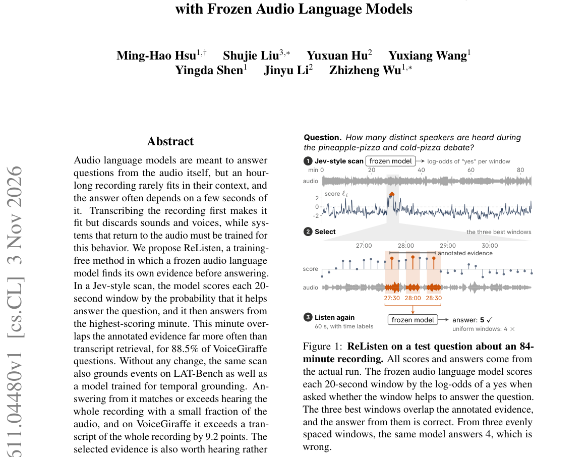

*Result - Architecture of ReListen. One frozen reader scores every window in a Jev-style scan (1). It reads each yes/no decision from one forward pass as a probability, and it then answers from the se*

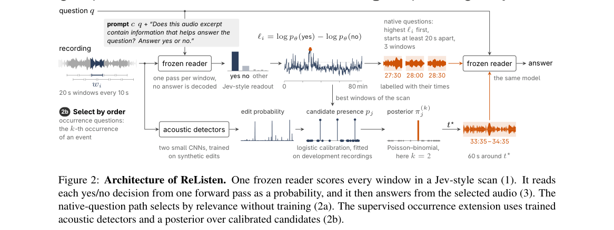

**Why this ranks #2**: 微软提出免训练方案：冻结的音频语言模型按 20 秒窗口给自己打分挑证据，再从选中的那一分钟作答，VoiceGiraffe 上 88.5% 的问题所选分钟覆盖标注证据，比用整段转写文本检索高 9.2 分，且内存恒定、速度快过所有基于转写的系统。对「一小时录音 + 冻结模型」这类算力受限的落地场景，这套接口可以直接用。

---

### 3. Do Multi-Turn Conversational Capabilities Carry Over from Text to Speech? A Parallel Multilingual Benchmark

**arXiv**: [2611.04390](https://arxiv.org/abs/2611.04390) | **Score**: 8.5 (relevance 8.5 x 0.7 + quality 8.5 x 0.3) | **Tags**: audio-lm, spoken-dialogue, benchmark, multilingual, evaluation, College of Computer Science | **Categories**: cs.CL | **Pages**: 30

**Authors**: Jiaming Zhou; Pei Zhang; Shiwan Zhao; Zhijun Wang; Baosong Yang; Yong Qin

**Affiliation**: College of Computer Science, Nankai University; Alibaba Token Hub, Alibaba Group

**Abstract**

> Successful multi-turn voice interaction requires models to retain information from earlier turns, follow persistent instructions, and track revisions to conversational state. These abilities are usually evaluated from transcripts, leaving open whether successes demonstrated from text carry over when the same turns are spoken, and whether this transfer is consistent across languages. We introduce Omnilingua-AudioMC, a strictly parallel multilingual extension of Audio MultiChallenge, to study this question. The benchmark contains 354 conversations and 1,404 rubric items across ten languages, with content, turn structure, cross-turn dependencies, and evaluation criteria aligned across transcript and speech conditions. Across six speech-language models, the shift from reference transcripts to direct speech input is strongly model- and language-dependent: models with similar transcript performance can diverge substantially under speech, and their relative strengths across languages can change. Paired rubric-level analysis shows that aggregate transcript-speech gaps can obscure which conversational requirements are preserved, because losses of transcript-demonstrated successes can be offset by gains on other items. Replacing preceding user turns, the current turn, or both with model-generated transcripts localizes recoverable degradation: for the two models with the largest gaps, history substitution yields a larger macro-level improvement than current-turn substitution in all ten languages, while the strongest direct-speech model gains little from either. These results show that transcript performance is an unreliable proxy for multilingual spoken conversational ability and identify the representation of preceding spoken context as an important source of recoverable degradation. Our code is publicly available at https://github.com/QwenLM/Omnilingua-Bench/tree/main/Omnilingua-AudioMC.

**Key findings**

- **Finding**: 发布 Omnilingua-AudioMC，Audio MultiChallenge 的严格平行多语种扩展，含 354 段对话、1404 个评分项、覆盖 10 种语言，六个语音语言模型在从参考转写切换到直接语音输入时性能变化强烈依赖模型与语言，文本表现相近的模型在语音下可显著分化；配对评分项分析显示，替换历史轮次带来的宏观改善在全部十种语言上都大于替换当前轮次，而最强的直接语音模型从两种替换中都几乎不获益。
- **Inference**: 聚合的「转写-语音」总差距会掩盖具体丢的是哪类对话能力（保留历史信息、遵循持久指令、跟踪状态修订），所以只报一个总分会让改进方向失焦；历史上下文表示是可恢复退化的主要来源，意味着修记忆编码比改解码更有性价比。
- **Recommendation**: 做多轮语音助手评测时不要沿用文本基准的结论，务必建严格平行的语音/转写双条件版本；可优先做「替换历史轮次」的消融，把退化归因到历史表示而非模型本身能力，再决定要不要扩数据或改架构。

**Key figures**

*Framework - Overview of the six primary models: gray segments connect Reference Transcript and Direct Audio; teal points show History Transcript, which replaces preceding user turns with model-generated*

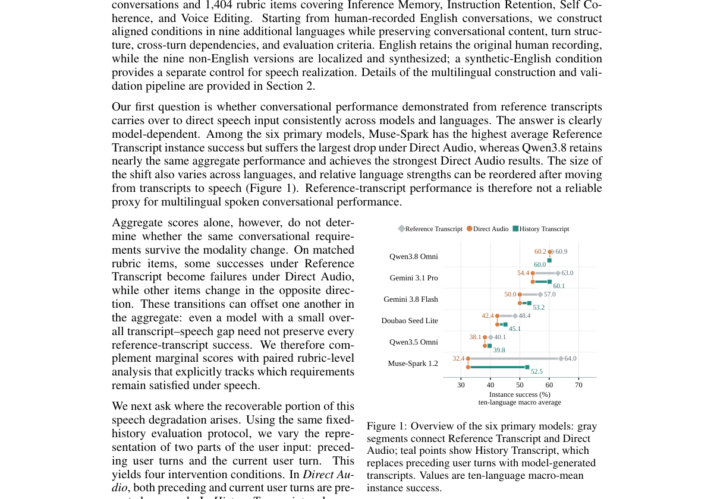

*Result - Top: paired Reference Transcript / Direct Audio rubric outcomes, pooled over ten lan- guages. Bottom: survival of reference-passing items by language; counts appear in Table A.9.*

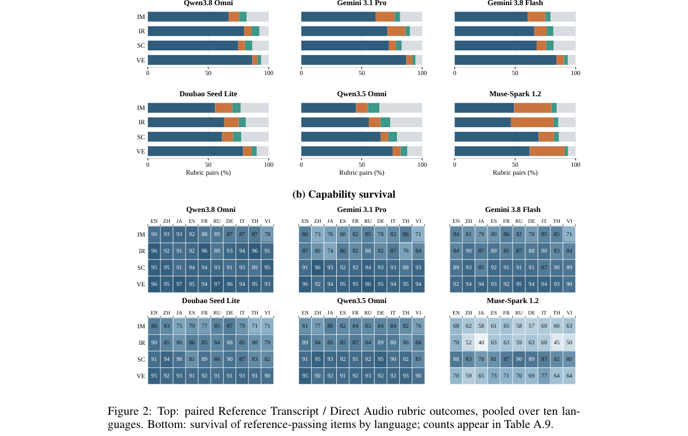

**Why this ranks #3**: 南开大学与阿里 Token Hub 给出严格平行的多语种多轮语音对话基准：354 段对话、1404 个评分项、10 种语言、六个语音语言模型。核心结论是文本上的多轮能力不可靠地迁移到语音，且聚合分数会掩盖到底丢了哪些能力——「替换历史轮次」与「替换当前轮次」的对照实验把退化定位到了可恢复的来源上。

---

### 4. Confidence-Aware Aggregation for Multimodal Audio Reasoning

**arXiv**: [2611.04580](https://arxiv.org/abs/2611.04580) | **Score**: 8.3 (relevance 8.5 x 0.7 + quality 8.0 x 0.3) | **Tags**: audio-lm, audio-reasoning, self-consistency, calibration, inference-time, LTCI | **Categories**: cs.SD | **Pages**: 5

**Authors**: Michel Olvera; Paraskevas Stamatiadis; Ga{ë}l Richard

**Affiliation**: LTCI, Télécom Paris, Institut Polytechnique de Paris, France

**Abstract**

> Large Audio Language Models (LALMs) enable generative reasoning over complex acoustic scenes but often exhibit prediction instability. We show that this variability can serve as a reliability metric via inference-time self-consistency and confidence-aware aggregation. Using a log-probability--based scoring framework, candidate answers are weighted by model likelihoods, leveraging reasoning diversity and self-certainty without additional training. Experiments on four LALMs, including Qwen3-Omni and Audio Flamingo 3, demonstrate that confidence-aware aggregation improves accuracy and calibration, with additive methods like Borda voting outperforming classical Majority Vote, especially under high disagreement. This approach transforms LALM variability into a source of reliability for scalable and robust multimodal audio understanding. Project code is available at https://github.com/michelolzam/lalm-self-consistency.

**Key findings**

- **Finding**: 提出推理时的自一致性与置信度感知聚合框架，按对数概率给候选答案加权以同时利用输出多样性与模型自确定性，无需额外训练；在 Qwen3-Omni、Audio Flamingo 3 等四个 LALM 上准确率与校准同时提升，在模型分歧大的情形下 Borda 这类加性投票明显优于经典 Majority Vote。
- **Inference**: 说明 LALM 的随机性不是纯粹的噪声，而是可被显式利用的可靠性信号；由于打分框架复用模型自身的似然，部署方不必换模型就能替换掉 Majority Vote 这一层，成本几乎为零，这是比改进采样策略更划算的落地点。
- **Recommendation**: 在你自己的 AQA 评测里先记录多次采样的似然分布，对比 Majority Vote 与 Borda/似然加权在「高分歧子集」上的准确率与 ECE，再决定是否上线；注意收益主要出现在模型分歧大的题目上，若你的任务本就稳定，提升会相当有限。

**Key figures**

*Framework - Variability in LALMs leads to inconsistent single-shot predictions. Self-consistency improves accuracy but assumes equal reliability. Leveraging confidence scores enables principled aggregatio*

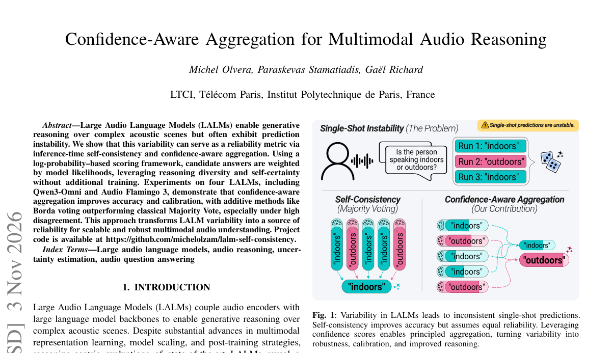

*Result - Accuracy (%) vs. sampling budget N for four large audio-language models. Confidence-aware methods consistently outperform the Naive Pick baseline, and achieve typically higher accuracy than Ma*

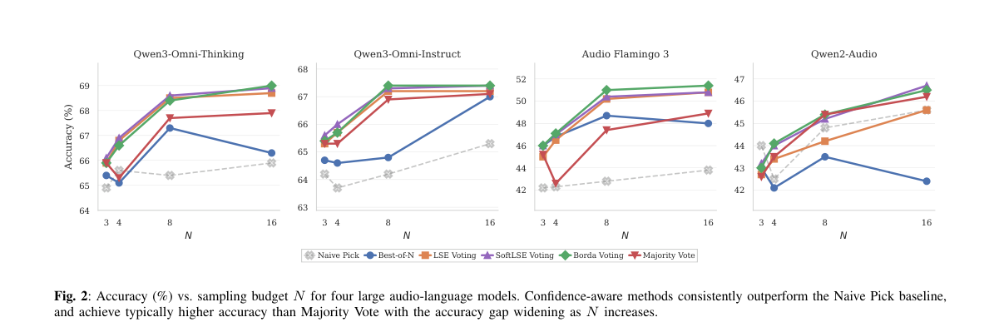

**Why this ranks #4**: 巴黎电信学院把 LALM 的预测波动本身当成可靠性信号：推理时按对数概率给候选答案加权，在包含 Qwen3-Omni 与 Audio Flamingo 3 的四个模型上同时提升准确率与校准，高分歧场景下 Borda 这类加性聚合明显优于经典 Majority Vote。免训练、可插在现有音频大模型输出层之上，是给 LALM 落地做低成本加固的现成手段。

---

### 5. The Right Source Is Not Enough: Understanding History Interference in Speech-LLM Memory

**arXiv**: [2611.05124](https://arxiv.org/abs/2611.05124) | **Score**: 8.3 (relevance 8.5 x 0.7 + quality 8.0 x 0.3) | **Tags**: audio-lm, speech-lm, memory-interference, causal-analysis, multi-turn, Beijing Institute of Technology | **Categories**: cs.AI, cs.CL | **Pages**: 18

**Authors**: HongJin Song; Weiqiao Shan; Runwu Shi; Yifei Wu; Yujin Wang; Jiale Luo; Jiasheng Kuang; Xinyu Yang; Zhaoqi Cui; Chuizheng Kong; Ziyu Wu; Guowu Tan

**Affiliation**: Beijing Institute of Technology; Northeastern University, China; Institute of Science Tokyo; Ant Group

**Abstract**

> Speech large language models retain audio history to support multi-turn conversations. Yet remembering an event does not ensure that its information is used only when relevant. We investigate why irrelevant historical audio changes answers even when the queried event remains represented. Controlled experiments on MOSS-Audio and MiMo-Audio show that historical values direct errors toward specific competing answers, beyond a generic effect of context length. Causal interventions distinguish two paths. In open-ended question answering, most history-value errors disappear when subsequent computation cannot directly access the irrelevant source. In multiple-choice answering, many errors persist: early historical influence is carried by question-candidate states even after direct source access is blocked. Low-dimensional interventions further separate source-role information from answer-value information. Their effects peak at different depths, and changing the source-role signal does not eliminate the causal influence of competing values. On naturally occurring errors, strengthening the queried role and counteracting the historical value each improve answers; their joint intervention gives the greatest recovery. These findings support a failure of downstream evidence use beyond source identification alone: source-role information can influence a decision without exclusively controlling which historical values affect it. Reliable conversational memory therefore requires not only retention and retrieval, but also control over how retained information enters answer computation.

**Key findings**

- **Finding**: 在 MOSS-Audio 与 MiMo-Audio 上做受控实验，证明历史数值会把错误导向特定的竞争答案，其影响超出「上下文变长」的普遍效应；因果干预区分出两条通路——开放式问答中大部分历史值错误在后续计算无法直接访问该来源后消失，而多选题中许多错误仍然存在，早期历史影响由题目-候选状态承载；低维干预显示来源-角色信息与答案值信息的作用在不同深度达到峰值，改变来源角色信号并不能消除竞争值的因果影响，且在自然出现的错误上同时强化被查询角色并抵消历史值可获得最大恢复。
- **Inference**: 问题出在下游证据使用而非来源识别——模型知道「这段历史来自哪里」并不等于它能控制「哪些历史值进入答案计算」，这为对话记忆提供了一个比单纯提高检索率更精确的优化目标。
- **Recommendation**: 若你在做语音多轮记忆，先复现「屏蔽历史直接访问」的对照实验来判断自己属于哪一类故障；再尝试论文的做法——联合强化被查询的角色信号并抵消历史值，联合干预的恢复幅度最大，适合作为记忆模块的基线增强方案。

**Key figures**

*Framework - Historical interference during answer formation. A source-role signal can favor the queried event without excluding competing values from other memories. The example and influence paths are*

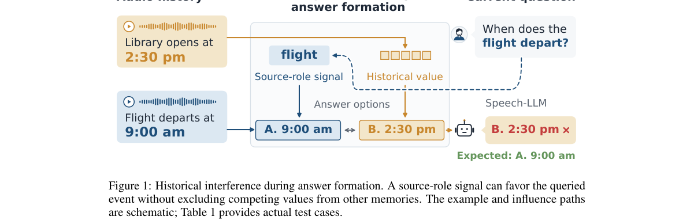

*Result - Intervention setup. Audio turns pass through the audio encoder; the text question does not. We intervene on decoder states to separate requested-source and historical-value influences. The s*

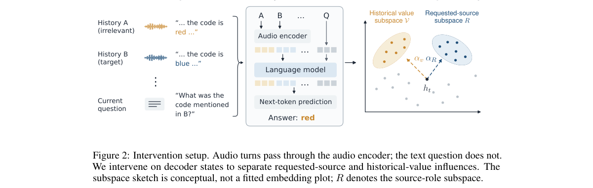

**Why this ranks #5**: 北京理工大学、东北大学、东京科学大学与蚂蚁的研究指出语音大模型的记忆问题不是「记不住」而是「用错了」：历史里的具体数值会把答案导向特定的竞争答案，这在多选题里即使屏蔽直接访问也无法消除。对做多轮语音对话记忆模块的人，这篇给出的是可操作的干预点——把来源角色信息与答案值信息分开对待。

---

### 6. SciPhi-Chat: Training a Spatial Audio Agent for Question Answering, Dialogue, and Tool Use

**arXiv**: [2611.04114](https://arxiv.org/abs/2611.04114) | **Score**: 8.1 (relevance 8.0 x 0.7 + quality 8.5 x 0.3) | **Tags**: audio-lm, spatial-audio, ambisonics, tool-use, benchmark, Microsoft Research | **Categories**: cs.SD | **Pages**: 7

**Authors**: Gijs Wijngaard; Hannes Gamper; Sebastian Braun

**Affiliation**: Microsoft Research, Redmond, WA, USA

**Abstract**

> Spatial audio question answering requires associating sound identities with locations and reasoning about their relations. This paper introduces SciPhi-Chat, a spatial audio agent that answers questions, conducts multi-turn dialogue, and calls tools on first-order ambisonic recordings. The accompanying MASU benchmark contains 12,000 samples across 42 task categories, the widest task coverage of any spatial model, with real recordings and simulated audio scenes. SciPhi-Chat achieves a score of 44.9%, 7.4 percentage points above the previous state-of-the-art. On the external ASA-Bench, SciPhi-Chat achieves 74.5% azimuth and 60.0% elevation accuracy, the highest among locally evaluated models. Removing reasoning supervision reduces ASA-Bench accuracy by 17.4 percentage points. All materials will be released via https://github.com/microsoft/sciphi-chat

**Key findings**

- **Finding**: 提出 SciPhi-Chat，一个能在一阶 ambisonic 录音上问答、进行多轮对话并调用工具的空间音频智能体；配套 MASU 基准含 12,000 个样本、覆盖 42 个任务类别，包含真实录音与仿真声场；SciPhi-Chat 得分 44.9%，比先前 SOTA 高 7.4 个百分点；在外部 ASA-Bench 上方位角准确率 74.5%、仰角 60.0%，为本地评测模型中最高；移除推理监督后 ASA-Bench 准确率下降 17.4 个百分点。
- **Inference**: 44.9% 的绝对分数说明空间音频问答离可用还很远，但 7.4 个百分点的相对提升与 17.4 个百分点的推理监督消融说明增益来自训练配方而非参数量；空间音频主流水线长期缺公开基准，MASU 的 42 类任务覆盖本身可能比这个 SOTA 数字更有长期价值。
- **Recommendation**: 做空间音频问答时先在 ASA-Bench 这类外部集上交叉验证，MASU 的内部任务分布可能偏乐观；复现时务必保留推理监督这条训练支路，消融显示它的贡献超过很多架构改动。

**Key figures**

*Framework - SciPhi-Chat overview. Left: architecture and interaction loop with audio and conversation inputs. Right: training excerpts with shortened questions and selected reasoning/JSON fields. A follow*

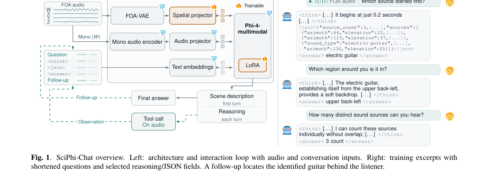

*Result - Spatial audio taxonomy for the MASU benchmark. Each cat- egory has 163 to 462 samples: 43 to 84 in the single-turn track and 119 to 379 in the dialogue track. Numbers count explicit question o*

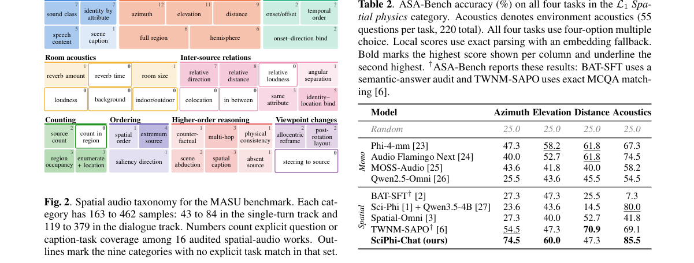

**Why this ranks #6**: 微软研究院的空间音频智能体在包含 12,000 样本、42 个任务类别的 MASU 基准上得分 44.9%，比先前 SOTA 高 7.4 个百分点，在外部 ASA-Bench 上方位角 74.5%、仰角 60.0% 均为本地评测最高；去掉推理监督直接掉 17.4 个百分点，说明空间推理能力是被显式训练出来的，而不是架构自带。

---

### 7. PianoBench: Evaluating Musical Perception and Reasoning in Language Models

**arXiv**: [2611.03839](https://arxiv.org/abs/2611.03839) | **Score**: 8.0 (relevance 8.0 x 0.7 + quality 8.0 x 0.3) | **Tags**: audio-lm, music-understanding, benchmark, multimodal, reasoning, Queen Mary University of London | **Categories**: cs.AI, cs.LG, cs.SD | **Pages**: 21

**Authors**: Louis Bradshaw; Irmak Bukey; Daniel Chenyu Lin; John Thickstun; Chris Donahue

**Affiliation**: Queen Mary University of London; Carnegie Mellon University; Cornell University

**Abstract**

> Multimodal language models continue to improve on broad music understanding benchmarks, but which musical features can they perceive and reason about? We investigate this question by introducing PianoBench, a benchmark that tasks language models with reasoning about musical performances across congruent acoustic and symbolic input representations. PianoBench is derived from our new multimodal, training-scale dataset comprising more than 20,000 hours of interleaved transcripts of music and spoken musical commentary from instructional piano videos. Open-weight audio-language models achieve at most 52.8% accuracy on PianoBench, and at best only modestly outperform their accuracy on a no-audio control. In contrast, frontier models using chain of thought achieve up to 93.2% accuracy when provided transcripts of music as text, exposing a gap between perceiving musical features from audio and reasoning about musical events when they are given explicitly. We then test whether mid-training on interleaved musical instruction can improve question answering without chain of thought, raising Qwen 3.5 9B Base's zero-shot accuracy on PianoBench with music transcripts from 42.8% to 56.0% after instruction tuning. These experiments suggest that instructional videos may represent an overlooked source of multimodal supervision for music. Available: https://gclef-cmu.org/pianobench.

**Key findings**

- **Finding**: 引入 PianoTalk（来自教学钢琴视频、超过 20,000 小时的音乐与口语讲解交错转写）与人工校验的 PianoBench，同一段音乐以声学或符号两种对齐表征呈现；开源音频语言模型最高仅 52.8% 准确率、最佳也只略高于无音频对照，而提供音乐转写文本的前沿模型用思维链可达 93.2%；再以交错音乐指令做中期训练后，Qwen 3.5 9B Base 的零样本准确率由 42.8% 升至 56.0%。
- **Inference**: 52.8% 与 93.2% 之间的巨大落差说明当前音频语言模型在音乐上几乎没形成可用的感知底座，瓶颈在「从声音里提取音乐特征」而非「音乐推理」；教学视频这类天然带讲解的数据是少见的近乎免费的多模态监督来源。
- **Recommendation**: 评估音频语言模型的音乐能力时务必同时跑无音频对照，否则分不清是在猜；想提升的话先试 PianoTalk 这类交错数据做中期训练而不是只做指令微调——论文显示仅指令微调后的 56.0% 仍远低于有转写文本的 93.2%。

**Key figures**

*Framework - We release PianoBench, a benchmark for evaluating music perception and reasoning in LLMs. PianoBench is derived from PianoTalk, a training-scale (20k hours) dataset of interleaved commentary*

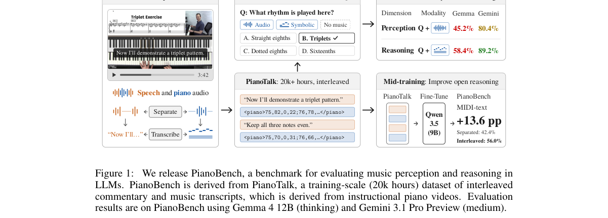

*Result - PianoTalk data recipe. Starting from seed videos, we crawl related videos and YouTube channels. An LLM evaluates video metadata to select videos likely to contain both speech and piano. Audi*

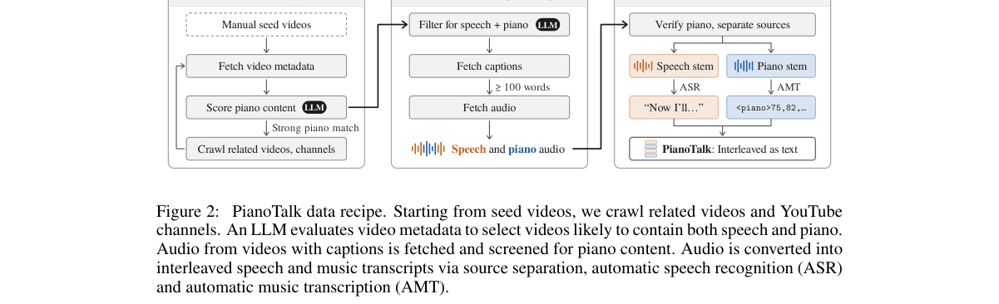

**Why this ranks #7**: 伦敦玛丽女王学院、CMU 与康奈尔推出 PianoBench 与两万多小时的 PianoTalk 数据：开源音频语言模型最高只有 52.8% 准确率、几乎不超过无音频对照，而拿到音乐转写文本的前沿模型用思维链可达 93.2%——这把「听不出来」和「不会推理」两件事彻底分开，对做音频基础模型的人是很明确的诊断。

---

### 8. ufakzeka-kulak: Building and Evaluating a 31.6M-Parameter Turkish Speech Recognizer from Scratch

**arXiv**: [2611.03605](https://arxiv.org/abs/2611.03605) | **Score**: 7.8 (relevance 8.0 x 0.7 + quality 7.5 x 0.3) | **Tags**: audio-lm, turkish-asr, low-resource, tdt-transducer, open-weights, ufak AI | **Categories**: cs.CL, eess.AS | **Pages**: 9

**Authors**: Sait Furkan Teke

**Affiliation**: ufak AI

**Abstract**

> ufakzeka-kulak is an open Turkish speech-to-text model of 31.6M parameters, a FastConformer encoder with a token-and-duration transducer (TDT) and a CTC head, trained from scratch and released under Apache-2.0. It writes cased, punctuated Turkish with numbers as words. Its 4,977 training hours come from sources whose licences allow commercial use; 281 hours are human-transcribed, and for the other 4,696 the training text is an uploader subtitle or a machine transcript, kept only where a second, independent reading of the audio agrees with it. The recipe, checkpoint, labelling and export choices were made on development data, and the test sets were scored once, in a release gate fixed before training. With greedy TDT decoding the normalised word error rate (WER) is 0.0921 (95 percent interval 0.0792 to 0.1055) on FLEURS Turkish test and 0.0916 (0.0873 to 0.0958) on Common Voice 27.0 Turkish test, lower than Whisper base and Whisper small on both sets with paired intervals wholly below zero; Whisper large-v3 (greedy) scores 0.0604 and 0.0767. On conversational speech the WER is 0.3807. We also report punctuation and casing, degraded audio, and how closely each shipped export reproduces the trained model.

**Key findings**

- **Finding**: 发布 ufakzeka-kulak：31.6M 参数的 FastConformer 编码器加 token-and-duration transducer 与 CTC 双头，从零训练并以 Apache-2.0 开源，输出带大小写与标点、数字转词的土耳其语文本；4,977 小时训练数据中仅 281 小时人工转写，其余 4,696 小时只在第二次独立听读与字幕一致时才保留；贪心 TDT 解码下 FLEURS 土耳其测试集 WER 为 0.0921（95% 区间 0.0792 至 0.1055）、Common Voice 27.0 为 0.0916，均显著优于 Whisper base 与 small，而 Whisper large-v3 为 0.0604 与 0.0767；对话语音上 WER 达 0.3807。
- **Inference**: 3 千多万参数打赢 Whisper base 与 small，说明低资源场景的瓶颈主要在转写数据的可信度而非模型容量——「二次独立听读一致才保留」把数千小时的机翻噪声过滤掉；但对话语音 0.38 的 WER 也说明它离真实口语场景仍有距离。
- **Recommendation**: 若你在做小语种 ASR，优先复用这套数据筛选流程（交叉听读校验加训练前固定的发布门限），再考虑换架构；注意它对 Whisper large-v3 仍是劣势、对话语音是明显短板，选用前先在目标场景上实测一遍。

**Why this ranks #8**: 一个 31.6M 参数的土耳其语 ASR 从零训起并以 Apache-2.0 发布：FLEURS 土耳其测试集 WER 0.0921、Common Voice 27.0 上 0.0916，都显著低于 Whisper base 与 small，而训练数据里 4696 小时是「第二次独立听读与字幕一致才保留」的自动标注。这套数据筛选流程比任何架构改动都更值得小语种团队复用。

---

### 9. Clean-anchored excess-emission control for CTC adaptation under competing speech

**arXiv**: [2611.03900](https://arxiv.org/abs/2611.03900) | **Score**: 7.5 (relevance 7.5 x 0.7 + quality 7.5 x 0.3) | **Tags**: audio-lm, robust-asr, ctc, excess-emission, adaptation, Missouri University of Science and | **Categories**: cs.SD | **Pages**: 5

**Authors**: Yuanbo Zhou; Junjie Xiong

**Affiliation**: Missouri University of Science and Technology

**Abstract**

> Competing speech can cause excess emissions in a connectionist temporal classification (CTC) recognizer. We penalize the amount by which the noisy student's expected collapsed token count exceeds a frozen teacher's count on the paired clean utterance. The one-sided objective caches one scalar per utterance and adds no inference module. With 147,456 trainable parameters in wav2vec 2.0, it improves competing-speech word error rate (WER) over matched CTC-only adaptation across three development seeds. On a locked LibriSpeech test, speech-interference WER falls from 45.198% to 44.323%, while clean WER changes by 0.004 percentage points. Unseen VCTK interferers yield a 0.307-point improvement. Ablations favor collapsed-count control over frame-mass regularization. Longer training increases the speech gain but worsens noise and music performance, identifying an insertion-deletion tradeoff rather than uniform robustness.

**Key findings**

- **Finding**: 提出干净锚定的超额发射抑制目标：惩罚噪声学生的期望塌缩 token 数超出冻结教师在配对干净语音上的计数，每句只缓存一个标量且推理不增加任何模块；在 wav2vec 2.0 中仅 147,456 个可训练参数，跨三个开发种子在匹配数据的 CTC-only 适配之上取得改进，锁定的 LibriSpeech 测试集上语音干扰 WER 由 45.198% 降至 44.323%，干净 WER 仅变化 0.004 个百分点，未见过的 VCTK 干扰者带来 0.307 个百分点改进；消融显示塌缩计数控制优于帧级非空白质量正则，后者比本方法多出 324 个插入错误。
- **Inference**: 用塌缩计数而非帧级质量做锚定，等于把「多发射」直接写进目标函数，因此只需极少参数就能拿到干净的鲁棒性与干净率折中；不过 0.875 个百分点的干扰 WER 改善本身很小，论文也指出训练变长反而恶化噪声与音乐表现，说明存在插入-删除权衡而非均匀鲁棒性。
- **Recommendation**: 若你的 CTC 系统在干扰语音下插入错误偏多，可把这个单边目标作为低成本起点（147K 参数、无推理开销）；务必同时监控干净集与插入率，论文明确警告长训练会牺牲噪声与音乐表现，不要默认训久更好。

**Key figures**

*Framework - Clean-anchored excess-emission control. (a) The frozen teacher supplies a cached count for each clean utterance. The student receives the mixture and target transcript; only LoRA weights are u*

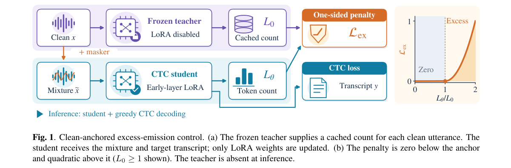

*Result - Locked-test changes in substitution, deletion, and insertion rates (proposed minus CTC-LoRA). Each family uses the same 210,304 reference words. The speech gain includes fewer substitutions an*

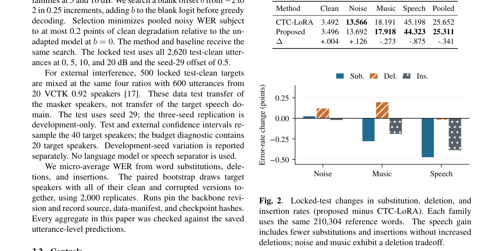

**Why this ranks #9**: 密苏里理工用「噪声学生的塌缩 token 数不得超过干净教师」这一单边目标来压 CTC 的多余发射，只训 147,456 个参数、在 wav2vec 2.0 上就把语音干扰 WER 从 45.198% 压到 44.323%，干净 WER 只动了 0.004 个百分点。收益不大但方向干净，是加性正则的一个廉价替代方案。

---

### 10. Attendance-guided speaker enrollment across meetings

**arXiv**: [2611.04394](https://arxiv.org/abs/2611.04394) | **Score**: 7.5 (relevance 7.5 x 0.7 + quality 7.5 x 0.3) | **Tags**: audio-lm, speaker-enrollment, meeting-audio, benchmark, abstention, NAVER Cloud | **Categories**: eess.AS | **Pages**: 5

**Authors**: Minjae Lee; Hee-Soo Heo; Youngki Kwon; Bong-Jin Lee

**Affiliation**: NAVER Cloud Corporation, South Korea

**Abstract**

> Speaker-aware applications rely on enrolled voice profiles, yet collecting enrollment speech from every participant is impractical. Meeting archives provide an alternative source of enrollment speech, comprising recordings of recurring participants paired with expected attendance lists. We investigate whether expected attendance lists can be cross-referenced with diarized anonymous speaker clusters to identify reliable enrollment speech for recurring participants. The resulting task, multi-participant automatic enrollment, must accommodate two types of attendance noise: a listed participant may not speak, and a speaker may be unlisted. To this end, we introduce a benchmark for the task: a synthetic corpus calibrated to an in-house meeting corpus, paired with a contamination-sensitive evaluation protocol. The reference method we introduce scores cross-session cluster chains against expected-attendance patterns and abstains when the evidence is insufficient. We quantify the reference method's benchmark performance as a trade-off between enrollment success and contamination. Applying synthetic-development thresholds unchanged to real meetings exposes a synthetic-to-real gap that remains an open challenge. We will release the benchmark generator and evaluation code.

**Key findings**

- **Finding**: 研究能否用预期出席名单与已分离的匿名说话人聚类互相索引，从会议归档中为反复出现的参会者挑选可靠注册语音；为此提出多参与者自动注册任务及配套基准——一个按内部会议语料校准的合成语料库，加上污染敏感的评测协议；参考方法按预期出席模式为跨会话聚类链打分并在证据不足时弃权，其性能被刻画为注册成功率与污染之间的权衡，把合成开发集阈值原样用于真实会议时暴露出仍未解决的合成-真实差距。
- **Inference**: 会议场景的注册语音几乎不可能靠人工逐人采集，出席名单与说话人聚类的交叉索引是可行替代方案；作者把「弃权」写进基线方法本身，说明这个任务的评测不能只看注册率，否则会用污染换分数——合成-真实差距未解则意味着阈值仍需按场景重新标定。
- **Recommendation**: 如果你的产品要在会议里自动建声纹库，优先把「该拒绝就拒绝」的机制做扎实，而不是追求注册覆盖率；评估时把污染率与弃权率同注册成功率并列报告，并注意作者明示的合成-真实差距——合成集上调好的阈值不能直接迁移到真实会议。

**Key figures**

*Framework - Attendance-guided enrollment on a noise-free toy episode. (1) Each session provides an expected attendance list Ls and a recording; (2) diarization yields anonymous single-speaker clusters; (3*

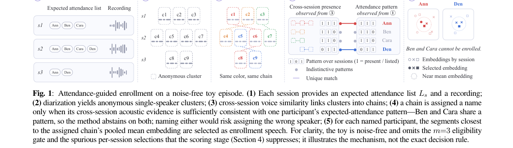

*Result - Evaluation-set contamination–success curves. Each curve is traced by sweeping the decision threshold; lowering it enrolls more names and generally raises both strong success and contamination.*

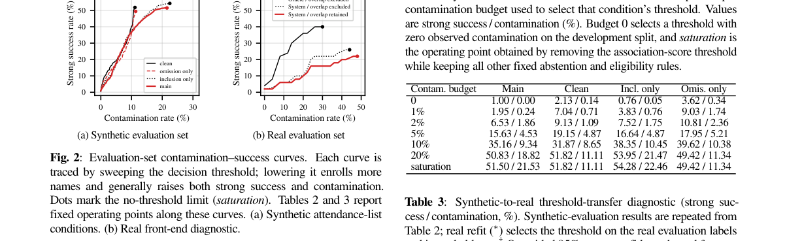

**Why this ranks #10**: NAVER Cloud 把会议归档变成注册语音的来源：用预期出席名单去交叉引用匿名说话人聚类。但作者自己承认，把合成数据上调好的阈值原样用到真实会议会暴露明显的合成-真实差距——这篇的价值更多在于把问题定义清楚，并把「必须能弃权」写进了基线方法本身。

---

