# ArXiv Daily Digest - 2026-11-04 (具身智能与世界模型, 10 papers)

**Generated**: 2026-11-04 17:30 CST

**Source**: arXiv cs.CV, cs.SD, eess.AS, cs.CL, cs.AI, cs.RO, cs.LG submissions, listing day 2026-11-03 (announced 2026-11-04 00:00 UTC)

**Batch window**: 2026-11-02T18:00:00Z .. 2026-11-03T18:00:00Z（arXiv 公告批次横跨两个 UTC 日：前一日 18:00 UTC 起算，当日 17:59:59 UTC 截止）

**Track**: embodied (top 10 of 587 papers scanned, 70 full reads)

**Scope**: 具身智能与世界模型，含移动操作、人形控制、触觉反射、VLA 策略与世界动作模型

---

## Top 10 - 具身智能与世界模型

### 1. TAMPAgent: Agentic Belief-Space Planning for Mobile Manipulation

**arXiv**: [2611.03584](https://arxiv.org/abs/2611.03584) | **Score**: 9.3 (relevance 9.5 x 0.7 + quality 9.0 x 0.3) | **Tags**: embodied, task-motion-planning, lvlm-agent, mobile-manipulation, belief-space, NVIDIA Research | **Categories**: cs.RO | **Pages**: 31

**Authors**: Utkarsh A. Mishra; Alperen Degirmenci; Yongxin Chen; Danfei Xu; Tucker Hermans; Caelan Garrett

**Affiliation**: NVIDIA Research; Georgia Institute of Technology; University of Utah

**Abstract**

> Open-world robotic mobile manipulation requires acting in physical environments with only partial information. While recent Large Vision-Language Model (LVLM) agents show strong open-world reasoning capabilities, existing architectures that rely on direct tool calling struggle with geometric uncertainty and thus are limited to fully-observable tabletop environments. In contrast, Task and Motion Planning (TAMP) systems can solve long-horizon tasks under partial observability but incur high computational costs and require closed worlds. We propose \textbf{TAMPAgent}, an agentic planning framework that unifies the reasoning of LVLMs with the structured constraint satisfaction of TAMP systems. We endow an LVLM agent with a belief-space planning model operating over an extensible API of perception, planning, and control tools. The agent formulates a partial task plan composed of parameterized observation and execution actions, which is subsequently completed using classical search algorithms. After extracting the plan's geometric constraints, the agent leverages its tool API to bind valid parameter values, satisfying feasibility requirements and producing an executable motion plan. Upon execution, the agent continuously updates its belief history and repeats this closed-loop process by interleaving observation and manipulation actions. Evaluated across complex household mobile manipulation tasks on Rainbow Y1 and Unitree G1 platforms, TAMPAgent significantly outperforms direct tool-calling agentic baselines, demonstrating that integrating TAMP constraint satisfaction into agentic planning loops is essential for unstructured, partially observable environments.

**Key findings**

- **Finding**: 提出 TAMPAgent：给 LVLM agent 配备在可扩展工具 API 上运作的信念空间规划模型，agent 写出由参数化观测与执行动作构成的部分任务计划，再由经典搜索算法补全，从计划中抽取几何约束后用工具 API 绑定合法参数以满足可行性并产出可执行运动计划，执行时持续更新信念历史并闭环重规划；在 MuJoCo 仿真的 RBY1 厨房任务上取得 77.2% 绝对成功率，对比 CaP 的 57.2% 与 GaP 的 61.1%，非抓取类阻挡任务上 75% 对 50%/56%，每模拟分钟未缓存输入/输出 token 为 19.3k/1.75k（CaP 20.3k/1.91k、GaP 27.4k/2.73k）；真实实验为 RBY1 上三类真实移动操作与真实 G1 清障任务的演示。
- **Inference**: 关键增量来自「约束可验证」而非更聪明的 prompt——在遮挡与非抓取类任务上 75% 对 50%/56%，说明把失败原因显式命名（哪个抓取被挡、哪个检测因子不可满足）才是 agent 少掉物体的原因；但三房间长程任务 T11 至 T13 上三种方法都是 5/5 与 4/5，长程优势并未体现。
- **Recommendation**: 把 TAMPAgent 当成「约束先行」的设计范式来看——先确认你的失败是几何不可行还是推理选错，再决定是否值得接规划器；由于 77.2% 来自仿真、真机证据只有定性演示，任何真机收益都需自行复现，引用时务必标注仿真与真机的区别。

**Key figures**

*Framework - Integrating agents with planning. We compare four systems that maps a history of observations to whole body control for long-horizon mobile-manipulation tasks: (a) TAMP [14, 7] solves hand-*

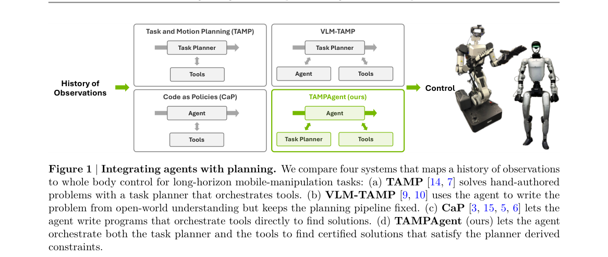

*Result - Plan skeleton as a factor graph. The skeleton⃗ 𝑎 = ⟨detect[𝐴], pick[𝐴], place[𝐴, 𝐵]⟩ unrolled over states 𝑠0, . . . , 𝑠3 (columns) becomes factor graph with: (i) nodes 𝑉as the planning vari*

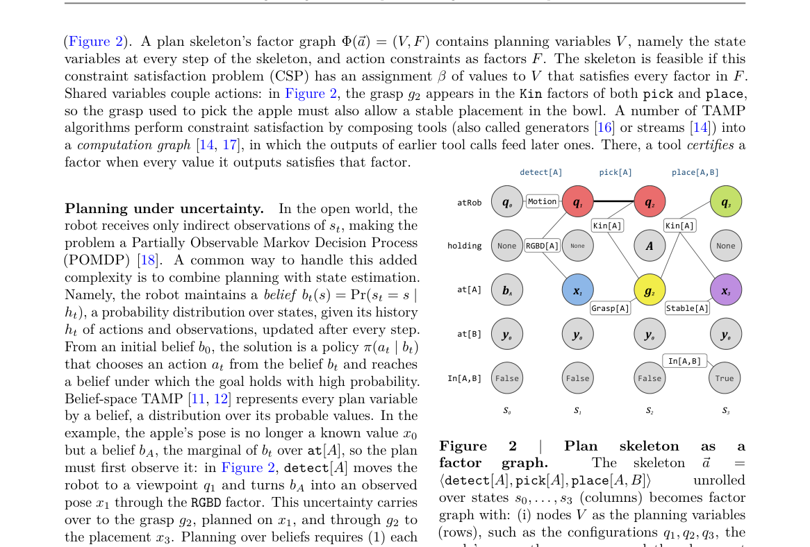

**Why this ranks #1**: 英伟达等把 LVLM 推理与 TAMP 的约束满足揉到一起：agent 只写带参数的部分任务计划，由规划器编译成可验证约束并绑定合法参数。仿真 RBY1 厨房任务 77.2% 绝对成功率（CaP 57.2%、GaP 61.1%），但真机只有定性演示，且三房间长程任务上三种方法打平——这条仿真与真机的边界必须看清楚。

---

### 2. Pixel: A Co-Designed Full-Stack Robot System for Learning General-Purpose Mobile Manipulation

**arXiv**: [2611.03648](https://arxiv.org/abs/2611.03648) | **Score**: 9.3 (relevance 9.5 x 0.7 + quality 9.0 x 0.3) | **Tags**: embodied, mobile-manipulation, co-design, humanoid, teleoperation, Carnegie Mellon University | **Categories**: cs.AI, cs.CV, cs.LG, cs.RO, eess.SY | **Pages**: 33

**Authors**: Tony Tao; Jason Jingzhou Liu; Ruslan Salakhutdinov; Deepak Pathak

**Affiliation**: Carnegie Mellon University

**Abstract**

> General-purpose mobile manipulation requires a combination of capable robot hardware, scalable demonstration collection, expressive whole-body control, and effective policy learning. Yet these components are often developed independently, creating mismatches that limit the capabilities of the complete system. We present Pixel, a co-designed full-stack system for learning general-purpose mobile manipulation. Pixel combines a low-cost wheeled humanoid with human-aligned kinematics and compliant grippers, multiple teleoperation and robot-free human data-collection interfaces, a unified whole-body controller, and a common policy learning pipeline across human and robot demonstrations. A hierarchical learning stack further enables language-conditioned visuomotor control and long-horizon task execution. We evaluate the system across hardware, data collection, and policy learning, and demonstrate mobile-manipulation behaviors requiring dexterity, active perception, navigation, and whole-body coordination. We hope that Pixel provides an integrated and extensible foundation for studying how robot hardware, data, control, and learning can be designed together for robot learning. More results at https://pixel-robot.com/pixel

**Key findings**

- **Finding**: 给出全栈协同设计的移动操作系统 Pixel：低价轮式人形机器人整机低于 15,000 美元，人形比例的 17 自由度上半身（躯干俯仰、两个 7 自由度手臂、2 自由度头部），夹爪单只重 680 克、可在 200 美元以内组装，续航约 2.5 至 3 小时；系统同时提供遥操作与无需机器人的传感器化人体采集接口，数据经统一全身控制器映射到机器人，并引入跨人类与机器人演示共享的相对基座动作空间；由传感器化人体演示训练的策略在三个高难度移动操作任务上平均任务进度 82.0%，机器人遥操作演示训练的策略在另外三个任务上为 78.7%。
- **Inference**: 82.0% 对 78.7% 说明在这套硬件上，人体传感器演示已能替代相当部分真机遥操作数据，这对采集成本是实质削减；同时 1.5 万美元级整机与开源姿态意味着「自己造一台机器人做研究」的门槛从实验室级降到课题组级。
- **Recommendation**: 若你在评估是否自建平台，Pixel 值得作为成本与自由度的参考基线，重点看它的 65% 尺度人体替身与相对基座动作空间设计，那才是让异构数据可混训的关键；注意任务进度不等于成功率，跨任务对比时要看清这个口径。

**Key figures**

*Framework - Pixel system highlights. (a) Our co-designed data-collection system captures human whole-body demonstrations and transfers them to our custom robot platform. (b) A whole-body controller coordi*

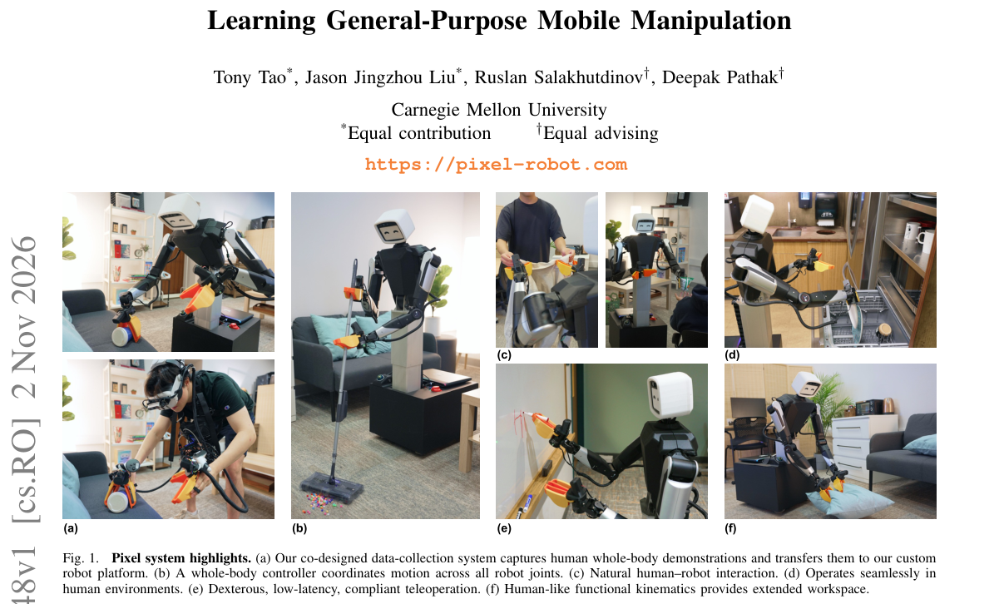

*Result - Hardware co-design. Our robot hardware and sensorized human data collection system are co-designed at all levels, with shared camera perspectives, aligned human–robot kinematics, paired end ef*

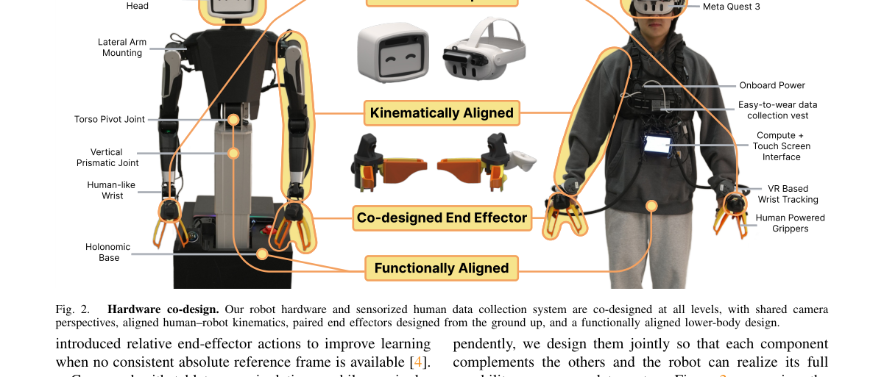

**Why this ranks #2**: CMU 的 Pixel 把硬件、遥操作接口、采集方式与学习栈一起设计：整车低于 1.5 万美元、人形比例的 17 自由度上半身、夹爪单只 200 美元以内，用传感器化人体演示训出的策略在三个移动操作任务上平均任务进度 82.0%。这套「整机可复现」的路子对缺硬件的小组很友好。

---

### 3. ReflexArc: Bottom-Up Integration of Instantaneous Tactile Reflexes into Whole-Body Humanoid Control

**arXiv**: [2611.04424](https://arxiv.org/abs/2611.04424) | **Score**: 8.5 (relevance 8.5 x 0.7 + quality 8.5 x 0.3) | **Tags**: embodied, tactile-reflex, humanoid, whole-body-control, real-time, Tsinghua University | **Categories**: cs.RO | **Pages**: 8

**Authors**: Mingyu Wang; Si Li; Ziqing Chen; He Wang; Li Yi

**Affiliation**: Tsinghua University; Peking University; Galbot

**Abstract**

> Humanoid robots operating in cluttered environments must react to unexpected contacts before the first impact peak, which arrives within tens of milliseconds. Learned whole-body policies running at 50 Hz introduce a policy-cycle delay and may suppress a protective withdrawal as a tracking error. To address these challenges, we propose ARC (Ascending Reflex Control), a bottom-up framework that integrates instantaneous tactile reflexes with learned whole-body control. ARC consists of two components: an instantaneous reflex pathway and bottom-up reflex integration. The reflex pathway detects hazardous contacts from full-body tactile sensing, solves a whole-body withdrawal pose, and delivers it directly to the motors within 10 ms. Bottom-up reflex integration combines reflex-in-the-loop policy learning, reflex-transparent policy alignment, and reflex-informed policy adaptation to sustain the withdrawal, maintain balance, and complete longer-horizon recovery. We deploy ARC on a Unitree G1 and evaluate three categories of hazardous contact. Compared with an otherwise identical reflex delayed by 20 ms, ARC reduces the first force peak by 34.1% and reduces the contact impulse from 0.2632 N s to 0.1225 N s (a 2.15x ratio). We further demonstrate protected motion tracking, teleoperation, and vision-free obstacle traversal guided by foot tactile sensing. Project page: https://minusmodulo.github.io/reflexarc-website/

**Key findings**

- **Finding**: 提出 ARC（Ascending Reflex Control）自底向上框架，把瞬时触觉反射与学到的全身控制结合：反射通路从全身触觉感知中检测危险接触、解算全身撤避姿态，并在 10 ms 内直接送达电机；自底向上整合结合反射在环的策略学习、反射透明的策略对齐与反射信息化的策略适配以维持撤避、保持平衡并完成长程恢复；在 Unitree G1 上评测三类危险接触，相比一个完全相同但延迟 20 ms 的反射，首次力峰值降低 34.1%，接触冲量由 0.2632 N·s 降至 0.1225 N·s（2.15 倍），并演示了受保护的运动跟踪、遥操作与基于足底触觉的无视觉越障。
- **Inference**: 2.15 倍的冲量差说明在接触这种强非线性场景里，20 ms 的延迟足以让「保护性撤避」变成「撞上去之后才撤」；而 50Hz 策略周期本身就引入延迟，因此让反射走独立通路而不是挤进策略里，是结构上的选择而非调参问题。
- **Recommendation**: 若你在做人形机器人的接触安全，把 10 ms 量级的反射通路当作独立子系统设计并单独标定延迟；评估时用首次力峰值与接触冲量这类物理量，而不是只看任务成功率——这两项指标直接暴露了时延设计的差异。

**Key figures**

*Framework - Whole-body tactile reflexes with ARC. (a) A tactile reflex (orange) reaches the motors before the first impact peak; routing the same reflex through the policy (white) adds an inference-step d*

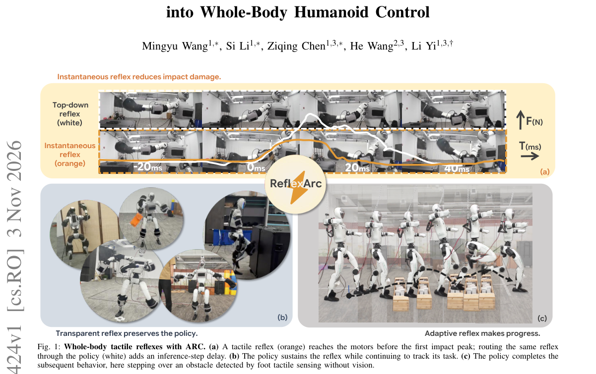

*Result - Overview of ARC. A hazardous contact is localized within milliseconds, a whole-body reflex pose is solved, and the motors withdraw within 10 ms of the collision (Sec. III). The reflex then pro*

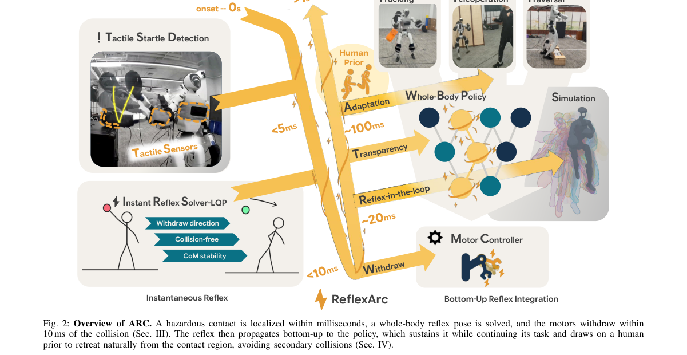

**Why this ranks #3**: 清华、北大与 Galbot 把「10 毫秒内送达电机的触觉反射」接进 50Hz 全身策略里：在 Unitree G1 上，与同样但延迟 20ms 的反射相比首次力峰值降 34.1%、接触冲量从 0.2632 N·s 降到 0.1225 N·s。这是本批里少见的、由物理量直接佐证「必须够快」的工作。

---

### 4. Coordinating Humanoid Loco-Manipulation through Action-Conditioned Latent Foresight

**arXiv**: [2611.04839](https://arxiv.org/abs/2611.04839) | **Score**: 8.5 (relevance 8.5 x 0.7 + quality 8.5 x 0.3) | **Tags**: embodied, humanoid, loco-manipulation, world-model, latent-foresight, University of Hamburg | **Categories**: cs.RO | **Pages**: 10

**Authors**: Ju Dong; Xinyu Xiao; Yiming Zhou; Tianshuo Yang; Xuerong Liu; Lei Zhang; Jian Chen; Haocheng Zhao; Yu Fu; Yujie Wei; Diwen Zheng; Alois Christian Knoll

**Affiliation**: University of Hamburg, Hamburg, Germany; The University of Hong Kong, Hong Kong, China; Technical University of Munich, Germany

**Abstract**

> Humanoid loco-manipulation requires coordinated body motion and hand interaction over time, and a plausible-looking command sequence can still drop a held object or leave an interaction incomplete. We present action-conditioned latent foresight, a latent world-action model (WAM) that evaluates proposed command sequences before execution. An action generator proposes joint motion-hand command sequences from vision, language, and the robot state. An action-conditioned endpoint predictor estimates the visual features each sequence prefix reaches and measures progress toward a demonstration-derived subgoal, while a joint temporal prior scores temporal consistency given the robot state and preceding commands. The robot executes the first commands of the best-scoring sequence and replans from the next observation. During training, action consistency regularization reconstructs the first demonstrated command from observed and predicted feature changes, encouraging the predictor to retain action-relevant information. On ten tasks in the humanoid loco-manipulation simulation benchmark SIMPLE, our method achieves 89.7% average success, compared with 73.7% for Psi-Zero and 82.0% for DiT4DiT. On seven real-robot tasks, it achieves 85.7% under standard conditions and 65.7% under unseen object configurations, while GR00T N1.7 achieves 70.0% and 48.6%, respectively. Project page: https://ju6276.github.io/Action-Grounded-Foresight/

**Key findings**

- **Finding**: 提出动作条件化潜在前瞻的潜在世界-动作模型（WAM）：动作生成器从视觉、语言与机器人状态提出关节-手部命令序列，动作条件端点预测器估计每个序列前缀达到的视觉特征并度量朝向示教派生子目标的进度，联合时序先验在给定机器人状态与前序命令下打分时序一致性，机器人执行最优序列的首个命令并从下一次观测重规划，训练期用动作一致性正则从观测与预测的特征变化重建首个示教命令；SIMPLE 仿真基准 10 个任务平均成功率 89.7%（Ψ0 73.7%、DiT4DiT 82.0%），7 个真机任务标准条件下 85.7%、未见物体配置下 65.7%，而 GR00T N1.7 分别为 70.0% 与 48.6%。
- **Inference**: 标准条件下真机 85.7% 已接近仿真 89.7%，但物体配置没见过就掉到 65.7%，说明系统强依赖示教分布而非任务本身；与 GR00T N1.7 的对比显示基线在未见配置下退化更剧烈（70.0% 到 48.6%），这 17 个百分点更像是潜在前瞻带来的鲁棒性而非单纯的策略优势。
- **Recommendation**: 复用它「执行前先打分」的结构时，务必把未见物体配置单独列为一栏——很多工作只报标准条件；如果你关心部署后的分布漂移，这篇的 65.7% 比 89.7% 更值得作为预期。

**Key figures**

*Framework - Left: two independent Place Basket on Table recordings with GR00T N1.7 and our method. Right: each sampled sequence A(i)*

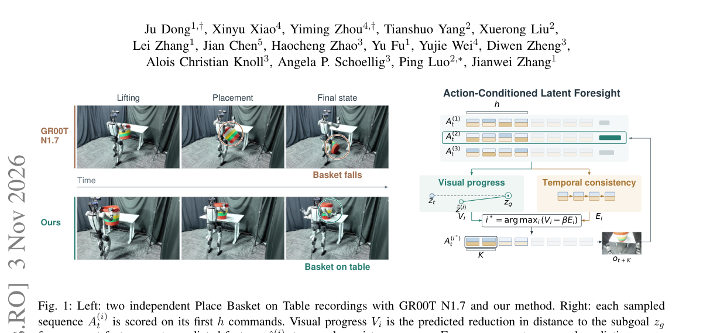

*Result - Architecture. f denotes V-JEPA features. Each prefix B(i)*

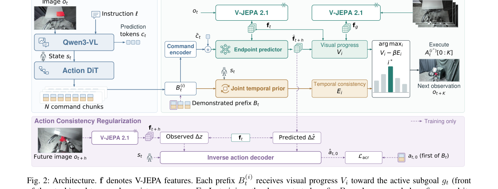

**Why this ranks #4**: 汉堡大学、香港大学与慕尼黑工大让世界-动作模型在执行前先给动作序列打分：SIMPLE 仿真 10 任务平均成功率 89.7%（Ψ0 73.7%、DiT4DiT 82.0%），7 个真机任务 85.7%，未见物体配置下 65.7% 而 GR00T N1.7 是 70.0%/48.6%。仿真到真机的落差与未见配置下的大幅下滑，是这篇最该被引用的部分。

---

### 5. FEIJOA: Task-Driven Grounding and Execution for Mobile Manipulation

**arXiv**: [2611.04080](https://arxiv.org/abs/2611.04080) | **Score**: 8.5 (relevance 8.5 x 0.7 + quality 8.5 x 0.3) | **Tags**: embodied, mobile-manipulation, grounding, test-time-refinement, verification, MIT CSAIL | **Categories**: cs.RO | **Pages**: 14

**Authors**: Aditya Agarwal; William Shen; Sahit Chintalapudi; Lucy Cai; Nishanth Kumar; Aidan Curtis; Travis Manderson; Tomás Lozano-Pérez; Leslie Pack Kaelbling

**Affiliation**: MIT CSAIL

**Abstract**

> A mobile manipulator asked to "put the toys away in the toy box" must decide which objects are toys and which container the user means, then find base poses, grasps, and placements it can execute. Because a scene representation is built before the instruction is known, it may lack the attributes, affordances, or concepts needed to resolve the task. We present FEIJOA, a language-model agent that grounds the instruction at test time. It queries a grounding tool over a posed RGB-D scan, inspects the returned candidates, and refines its queries until they resolve the instruction. An embodiment-aware harness checks each skill's preconditions, samples base poses from which the target is reachable, and verifies the skill's effect from observations before and after execution. On 103 open-ended grounding queries, FEIJOA resolves 94.2% exactly, compared with 68.0% for the best prebuilt representation. Over 50 real-world trials on Spot, it completes 35 tasks; 17 of these successes follow recovery from a failed tool call or verification check. Of the 15 failed trials, 13 were caused by the robot's physical skills, and only 2 by grounding or the agent's reasoning. Project website: https://williamshen-nz.github.io/feijoa/.

**Key findings**

- **Finding**: 提出 FEIJOA，一个在测试时刻做 grounding 的语言模型 agent：它在带位姿的 RGB-D 扫描上查询 grounding 工具、检查返回候选并不断精化查询直到指令被解析；具身感知的 harness 会检查每个技能的前置条件、采样目标可达的基座位姿，并在执行前后从观测验证技能效果；103 条开放式 grounding query 上 94.2% 精确解析，对比最强预构建表征的 68.0%；Spot 真机 50 次试验完成 35 个任务，其中 17 次成功来自失败工具调用或验证检查后的恢复，15 次失败中 13 次源于机器人物理技能、仅 2 次源于 grounding 或 agent 推理。
- **Inference**: 94.2% 对 68.0% 说明「按指令现场问」的收益远大于「预先把场景问全」；但失败归因反过来给出更重要结论——现代移动操作的主要瓶颈已是物理技能（抓取、放置、力控）而非语言理解，继续在 grounding 上堆模型的收益会快速见顶。
- **Recommendation**: 用这套「工具查询加前置条件检查加效果验证加恢复」的执行范式搭自己的 agent，并像论文那样统计失败归因，先确认你的瓶颈在语言还是在物理；10% 的未解析与 2/15 的推理侧失败说明 grounding 已接近饱和，不值得作为主要发力点。

**Key figures**

*Framework - FEIJOA on Spot. Given “Erase whatever is on the whiteboard that’s bringing down the mood, then put the thing you used to erase back on the table next to the burger”, the agent must work out*

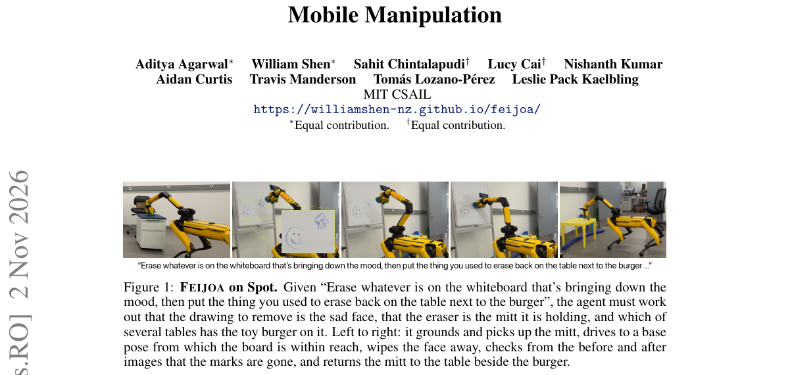

*Result - FEIJOA overview. At each turn the harness assembles the working context Wt from a fixed context, the interaction history ht, and the current context and the task plan Pt. LLM πθ selects tool*

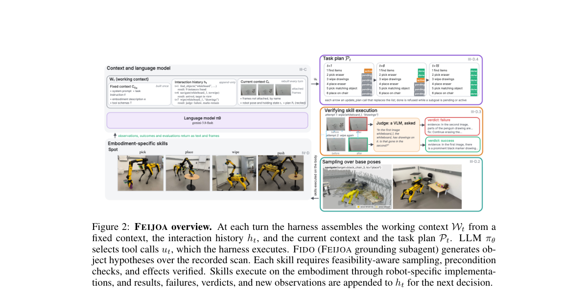

**Why this ranks #5**: MIT CSAIL 的 FEIJOA 把 grounding 推迟到测试时刻：指令没到之前场景表征就可能缺属性，于是 agent 反复查询并精化查询，103 条开放式 grounding query 精确解析率 94.2%（最强预构建表征 68.0%）。更值得注意的是它的失败归因：15 次真机失败里 13 次出在物理技能，只有 2 次出在 grounding 与推理。

---

### 6. Spectrally Routed Diffusion Policy for Multi-Task Robotic Manipulation

**arXiv**: [2611.04477](https://arxiv.org/abs/2611.04477) | **Score**: 8.5 (relevance 8.5 x 0.7 + quality 8.5 x 0.3) | **Tags**: embodied, diffusion-policy, multi-task, svd-routing, bimanual, School of Automation | **Categories**: cs.RO | **Pages**: 8

**Authors**: Mingcong Li; Yihan Zhou; Jiayu Qu; Xueyang Guo; Yilin Mo

**Affiliation**: School of Automation, Beijing Institute of Technology; Department of Automation, Tsinghua University; LingYu Robotics

**Abstract**

> Diffusion-based policies have achieved strong performance on single-task robotic manipulation. However, a single model trained jointly on multiple tasks consistently underperforms the per-task specialists trained on the same demonstrations. We focus on two challenges. First, the convolutional encoders commonly used in diffusion-based policies produce visual conditions that are not discriminative enough. Second, gradients from incompatible action modes update the shared denoiser's dense parameters along the same directions, causing destructive interference during joint training. To address both, we propose SR-DP (Spectrally Routed Diffusion Policy). A frozen VGGT encoder with a spatial-compression adapter produces compact multi-scale semantic-geometric tokens, a task-discriminative visual condition for tasks that share a workspace. We first train the denoiser as a standard diffusion policy, then decompose selected linear layers by SVD into a frozen basis of orthogonal rank-one experts, adapted through spectral routing and Householder input rotations. On six RoboTwin tasks, SR-DP averages a 68.4% success rate, surpassing multi-task VO-DP by 21.8 points and the strongest per-task baseline by 3.8 points. On four real-world bimanual tasks, Stage 2 reaches a 43.0% average success rate and improves over Stage 1 by 19.0 points.

**Key findings**

- **Finding**: 提出 SR-DP：冻结的 VGGT 编码器加空间压缩适配器产出紧凑的多尺度语义-几何 token，为共享工作区的任务提供判别性视觉条件；去噪器先按标准扩散策略训练，再把选定线性层用 SVD 分解为正交 rank-1 专家的冻结基，通过谱路由与 Householder 输入旋转适配；6 个 RoboTwin 任务平均成功率 68.4%，超出多任务 VO-DP 21.8 个百分点、超出最强单任务基线 3.8 个百分点；4 个真实双臂任务上 Stage 2 达 43.0% 平均成功率，比 Stage 1 提升 19.0 个百分点。
- **Inference**: 21.8 个百分点说明多任务扩散策略的差距主要不是容量问题而是优化方向冲突问题，正交分解加旋转能在不动架构主干的前提下拆开这个问题；但真实双臂 43.0% 也说明仿真与真机之间仍差约 25 个百分点，离可用尚远。
- **Recommendation**: 若你正被「一个模型多任务始终不如专家」卡住，可直接尝试 SVD 分层加谱路由，不必先换 VLA 或更粗的架构；真机 43.0% 提醒你 RoboTwin 上的 68.4% 不要直接当作预期，务必在自己的双臂任务上先量一遍。

**Key figures**

*Framework - Overview of SR-DP. A frozen VGGT encoder with a spatial-compression adapter produces 14 tokens per view, which condition an AdaLN-Zero DiT denoiser. Selected linear layers of the denoiser are*

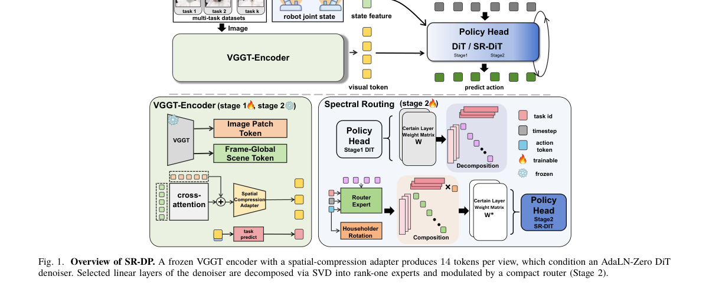

*Result - Spatial-compression adapter. Three residual blocks form a coarse- to-fine pyramid; each level is pooled at 1×1, 2×2 or 3×3, flattened, linearly projected, and concatenated into 14 tokens per v*

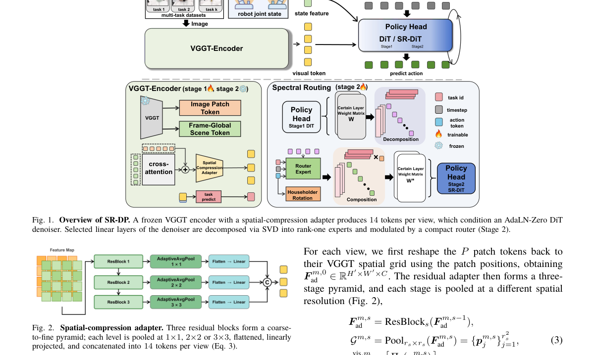

**Why this ranks #6**: 清华与北京理工等指出多任务扩散策略打不过单任务专家的根源是梯度互相破坏：他们把去噪器线性层做 SVD 分解成冻结的正交 rank-1 专家并用谱路由与 Householder 旋转适配，6 个 RoboTwin 任务平均 68.4%（超多任务 VO-DP 21.8 点），4 个真实双臂任务 Stage 2 达 43.0%。

---

### 7. Future Representation Distillation for Imagination-Free World Action Models

**arXiv**: [2611.04527](https://arxiv.org/abs/2611.04527) | **Score**: 8.5 (relevance 8.5 x 0.7 + quality 8.5 x 0.3) | **Tags**: embodied, world-action-model, video-diffusion, representation-distillation, real-time-control, KAIST | **Categories**: cs.RO | **Pages**: 23

**Authors**: Jaehyeong Jo; Sangwon Jang; Sihyun Yu; Seonghyeon Ye; Yekyung Nah; Hojung Jung; Kimin Lee; Sung Ju Hwang

**Affiliation**: KAIST

**Abstract**

> World Action Models (WAMs) use the predictive knowledge of pretrained video diffusion models for robot control through future video prediction. However, iterative video denoising is costly, and inaccurate visual predictions can compromise action prediction. Our key idea is to make this predictive knowledge available through visual representations computed from the current observation, enabling action prediction without generating future videos. We introduce DreamFree, a WAM that repurposes a pretrained video diffusion model as a predictive visual encoder through representation distillation. The visual encoder learns to predict a frozen video diffusion model's representation using only the current observation. An action module is then trained to predict actions by extracting action-relevant information from the visual encoder. Across real-world and simulated tasks, DreamFree achieves higher success rates than state-of-the-art VLAs and WAMs, while performing real-time closed-loop control at 11Hz with a 14B video diffusion backbone. Experiments show that DreamFree can translate stronger video priors and additional video data into better robot control and enable learning new robot tasks from video demonstrations, including videos from a different embodiment, without action annotation for the new tasks.

**Key findings**

- **Finding**: 提出 DreamFree：把预训练视频扩散模型通过表征蒸馏改造为预测性视觉编码器，编码器仅凭当前观测去预测冻结视频扩散模型的表征，行动模块再从编码器中提取动作相关信息预测动作；RoboCasa-Kitchen 上 14B 视频骨干的平均成功率为 71.7% 为各基线最高，而同样不生成未来视频的 Fast-WAM 仅 44.4%，骨干由 5B 扩到 14B 带来 13.2 个百分点提升；10 类真机任务上平均成功率 64%（DreamZero 56%、π0.5 16%），平均任务进度 83%（71.8%、33.5%）；部署时单次编码器前向即可生成动作块，14B 骨干实现 11Hz 实时闭环，较同规模生成式 WAM 提速 17.8 倍。
- **Inference**: 71.7% 对 44.4% 说明「不生成视频」本身不够，关键是编码器是否真的吸收了冻结扩散模型的未来先验；而 5B 到 14B 只对 DreamFree 有效、对 Fast-WAM 几乎无效，说明收益来自更强的视频先验被正确蒸馏进表征，而非骨干规模本身。
- **Recommendation**: 想在真机上跑世界动作模型又受限于推理延迟的，可以优先试这条「不生成视频」的路线；先检查你手上的视频骨干是否够强（5B 到 14B 的差异很大），再排查 Fast-WAM 这类朴素版本为何失败，两者的 27 个百分点差距是本文最值得复现的部分。

**Key figures**

*Framework - Overview. DREAMFREE distills predictive knowledge from a frozen video diffusion model into a predictive visual encoder, enabling action prediction from the current observation without gener*

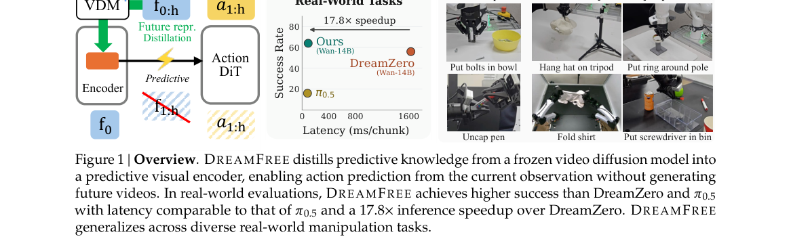

*Result - Model architecture of DREAMFREE. Training is separated into two stages: (a) In the first stage, a pretrained video diffusion backbone is repurposed as a visual encoder through video generat*

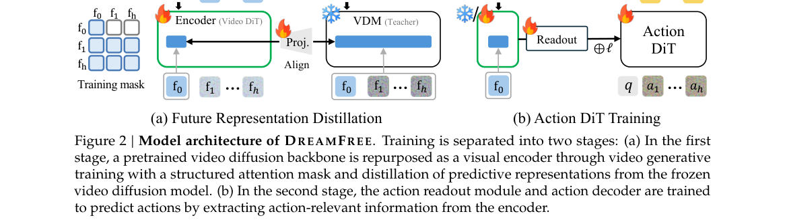

**Why this ranks #7**: KAIST 把世界-动作模型的「想未来」改成「蒸馏未来」：用冻结视频扩散模型的表征监督一个只吃当前观测的编码器，14B 骨干下做到 11Hz 实时闭环、较同规模生成式 WAM 提速 17.8 倍，RoboCasa-Kitchen 平均成功率 71.7%，真机 10 类任务 64%（DreamZero 56%、π0.5 16%）。

---

### 8. DexHOT: Learning Hand-Object Configuration Transfer for Dexterous Manipulation

**arXiv**: [2611.05119](https://arxiv.org/abs/2611.05119) | **Score**: 8.3 (relevance 8.5 x 0.7 + quality 8.0 x 0.3) | **Tags**: embodied, dexterous-manipulation, configuration-transfer, benchmark, sim-to-real, CFCS | **Categories**: cs.RO | **Pages**: 9

**Authors**: Zhewei Gui; Anthony Bolton; Jiyao Zhang; Zeyuan Chen; Qiyang Yan; Tianyu Wang; Hao Dong

**Affiliation**: CFCS, School of CS, Peking University; National Key Laboratory of Multimedia Information Processing, Peking University; State Key Laboratory of General Artificial Intelligence, BIGAI

**Abstract**

> Dexterous manipulation involves not only moving objects, but also arranging the hand around them to maintain useful contacts and enable subsequent actions. Yet many learning-based systems specify goals primarily through object poses or trajectories, leaving hand-object configurations to emerge implicitly. We introduce DexHOT, which formulates dexterous manipulation as hand-object configuration transfer: moving between feasible configurations that jointly specify hand articulation and object pose relative to the wrist. DexHOT learns a reusable relation-conditioned transfer primitive from synthetic feasible configuration pairs, without human reference motions, and composes long-horizon behaviors through closed-loop tracking of configuration subgoals. On DexHOTBench with 120 objects, a single policy achieves 80.5% transfer success on seen objects and 69.4% on unseen objects; on a real dexterous hand, it achieves 61.5% success over 200 real-robot transfers and 90% task success across six demonstration-guided tasks. These results show that explicit hand-object goals provide an expressive and composable interface for dexterous manipulation. More details and videos are available at https://dex-hot.github.io/.

**Key findings**

- **Finding**: 提出 DexHOT，把灵巧操作形式化为手-物配置迁移：目标同时规定手部关节构型与手-物相对位姿，方法从合成的可行配置对学习可复用的关系条件化迁移原语（无需人类参考动作），并通过闭环跟踪配置子目标组合出长程行为；新基准 DexHOTBench 含 120 个物体、物理验证过的配置池与固定迁移对，单策略在已见物体上迁移成功率 80.5%、未见物体 69.4%；真实灵巧手上 200 次真机迁移成功率 61.5%，6 个示教引导任务上任务成功率 90%。
- **Inference**: 显式指定手-物配置比只给物体位姿或轨迹提供了更可组合的目标接口，这解释了为何长程任务能靠闭环跟踪子目标拼出来；但真机 61.5% 相对仿真 80.5% 的落差说明合成可行配置池到实体的物理差距仍是主要瓶颈。
- **Recommendation**: 若你在做灵巧操作，可考虑把目标定义从物体位姿换成手-物联合配置，这是低成本的结构改动；真机 61.5% 是更现实的参考值，注意 DexHOTBench 的未见物体列（69.4%）比已见列更能反映部署预期。

**Key figures**

*Framework - DexHOT learns a single policy across multiple objects to transfer between configurations that jointly specify hand articulation and object pose relative to the wrist. Left: a greedy planner gu*

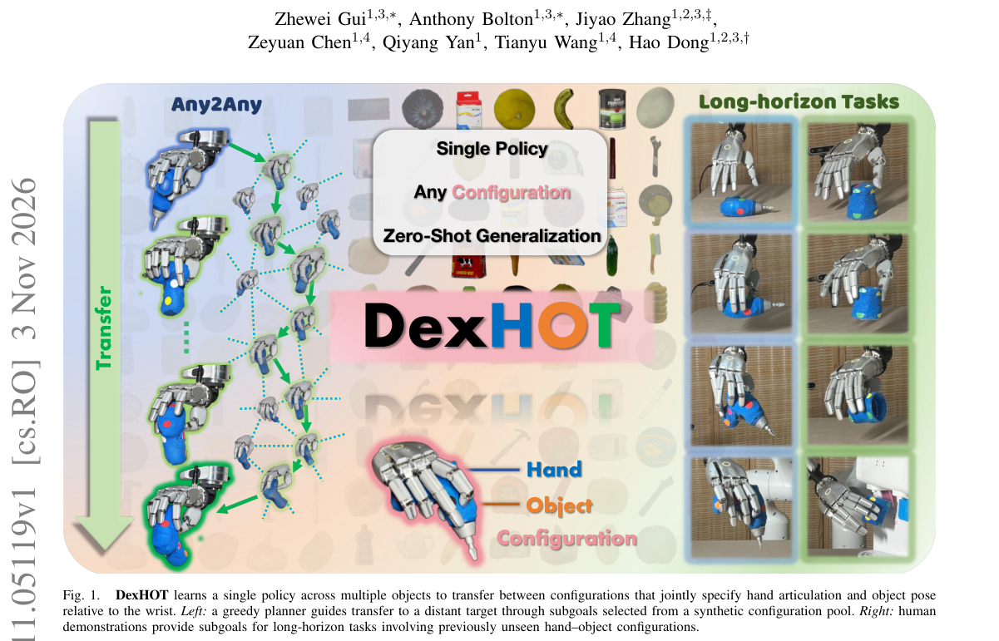

*Result - DexHOT overview. Top: a recurrent policy learns local transfers from physically validated configuration pools using population-based reinforcement learning. Observations include goals, object-*

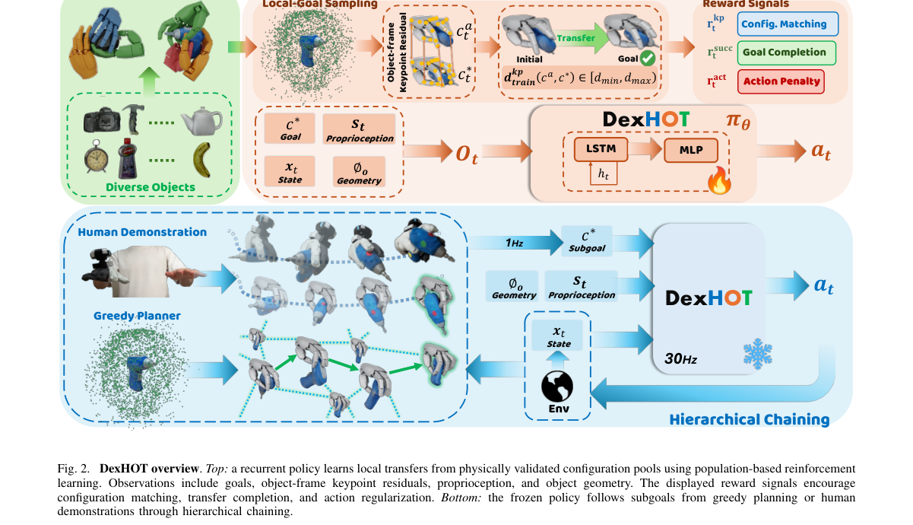

**Why this ranks #8**: 北大把灵巧操作重新表述为「手-物配置迁移」：目标同时给出手部关节构型与相对腕部的物体位姿，从合成可行配置对里学一个可复用的迁移原语。DexHOTBench 120 个物体上已见 80.5%、未见 69.4%，真机 200 次迁移 61.5%，6 个示教引导任务 90%。

---

### 9. FloMo: 3D Scene Flow as a World Action Model Intermediate for Learning from Human Video

**arXiv**: [2611.05062](https://arxiv.org/abs/2611.05062) | **Score**: 8.1 (relevance 8.0 x 0.7 + quality 8.5 x 0.3) | **Tags**: embodied, world-action-model, scene-flow, video-pretraining, human-video, Georgia Institute of Technology | **Categories**: cs.AI, cs.CV | **Pages**: 10

**Authors**: Jeremy Collins; Namra Patel; Ayush Agarwal; Shitij Govil; Animesh Garg

**Affiliation**: Georgia Institute of Technology

**Abstract**

> Pretrained video generation models distill internet-scale motion priors into robot policies, but full video is a redundant signal for action prediction. We argue that dense 3D motion is the medium through which video pretraining best transfers to robot actions, and that predicting motion rather than video affords better sample-efficiency for action prediction. FloMo is a 5B video-generation model fine-tuned to predict 3D scene-flow and action tokens. Rendering scene flow as RGB and encoding it into the same latent space as video enables a pretrained video generation backbone to efficiently adapt to predict 3D scene flow. Co-trained on action-free human video and action-labeled robot teleoperation data, our model benefits from human-video pretraining and generalizes to unseen objects, motion primitives, and tasks. Replacing motion prediction with a video prediction objective degrades out-of-distribution generalization, while adding a video prediction target alongside motion lowers policy success rather than improving it. When motion, video, and action are predicted jointly, action tokens attend far more to motion than to video, suggesting that predicting video wastes model capacity. Together, these results indicate that motion effectively mediates the transfer from video pretraining to action. More information can be found at flomo-wam.github.io.

**Key findings**

- **Finding**: 提出 FloMo，一个 5B 视频生成模型，微调后同时预测 3D 场景流与动作 token：把场景流渲染成 RGB 并编码进与视频相同的潜空间，使预训练视频生成骨干高效适配到预测 3D 场景流；模型在无动作标注的人类视频与带动作标注的机器人遥操作数据上联合训练，因此受益于人类视频预训练并泛化到未见物体、运动基元与任务；消融显示用视频预测目标替换运动预测会退化分布外泛化，而在运动之外附加视频预测目标会降低而非提升策略成功率；联合预测运动、视频与动作时，动作 token 对运动的关注远多于对视频。
- **Inference**: 「加视频反而变差」是比「换掉视频」更强的证据——问题不在于视频信息无用，而在于输出完整视频会占用容量却不帮助动作解码，3D 运动是更合适的中间表征；同时无动作标注的人类视频即可提升泛化，说明视频预训练的迁移路径确实存在。
- **Recommendation**: 若你在训世界-动作模型，可直接尝试把预测目标换成 3D 场景流并沿用现有视频 VAE 潜空间，无需自建表征；务必做那条加性消融——同时加视频预测会拉低成功率，这是最容易被忽略的坑。

**Key figures**

*Framework - Given an image and text prompt, FloMo jointly predicts dense 3D motion (scene flow) and robot actions using a pretrained video generation model using flow-matching. To tokenize scene flow, we*

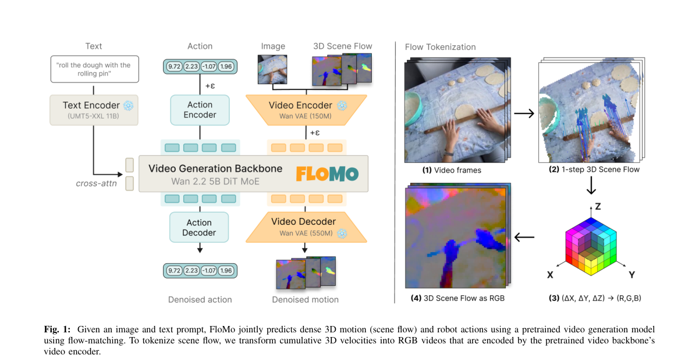

**Why this ranks #9**: 佐治亚理工论证视频对动作预测是冗余信号、密集 3D 运动才是中介：把场景流渲染成 RGB 塞进视频潜空间，5B 视频生成模型就能同时预测运动与动作 token。关键消融是加性反证——同时预测视频反而降低策略成功率，且动作 token 对运动的关注远超对视频。

---

### 10. PrimeSim: A Generalist World Model Simulator from Large-Scale Cross-Embodiment Demonstrations

**arXiv**: [2611.04870](https://arxiv.org/abs/2611.04870) | **Score**: 8.1 (relevance 8.0 x 0.7 + quality 8.5 x 0.3) | **Tags**: embodied, world-model, simulator, cross-embodiment, multiview, PrimeBot Research | **Categories**: cs.RO | **Pages**: 42

**Authors**: Travis Davies; Wentao Ma; Lihao Guo; Tengfei Ma; Xiaowen Chang; Jiafeng Xu; Shilong Wang; Yiqi Deng; Shaowen He; Xiaoqi Li; Qian Zhu; Ran Cheng

**Affiliation**: PrimeBot Research; Southeast University; Shanghai Jiao Tong University; The Chinese University of Hong Kong

**Abstract**

> A robot world model that serves as a simulator must do more than generate plausible videos: it must faithfully follow commanded actions, maintain consistency across camera views, and sustain coherent long-horizon rollouts. We present PrimeSim, an action-conditioned, multiview world model simulator that addresses these challenges through progressive midtraining and posttraining. Starting from a pretrained video generator, we midtrain on 30,110 hours of robot demonstrations spanning 22 platforms. To improve action following, we introduce a unified cross-embodiment action representation and frame-aligned dual-path conditioning to strengthen action-frame correspondence. To maintain multiview consistency, we develop view-aware interleaved attention with explicit camera identities, enabling cross-view information exchange while preserving view-specific representations. We further introduce a fast-video, slow-memory posttraining framework that transforms the bidirectional video generator into an efficient autoregressive simulator. By combining fast causal generation, self-rollout training, and hierarchical temporal memory, PrimeSim mitigates error accumulation from self-generated histories and supports coherent long-horizon simulation. PrimeSim runs at 10.1 FPS, remains stable over long-horizon rollouts on rigid and deformable manipulation tasks, and transfers to held-out platforms within 100 to 200 gradient steps where the pretrained backbone does not. Against five open-source action-conditioned world models it leads four of the five WorldSimProbe suites and posts the best overall EWMBench score, while fine-grained local calibration still trails the field; its rollouts are faithful enough to support GRPO-based policy optimization. We release the model weights, inference code, and training code.

**Key findings**

- **Finding**: 提出 PrimeSim，一个动作条件化的多视角世界模型模拟器：从预训练视频生成器出发，在覆盖 22 个平台的 30,110 小时机器人演示上做中途训练，用统一跨形态动作表征与帧对齐双路径条件强化动作-帧对应，用带显式相机身份的视角感知交错注意力维持多视角一致性，再以快视频-慢记忆的后训练框架结合快速因果生成、自 rollout 训练与分层时序记忆把双向生成器改造成高效自回归模拟器；运行速度 10.1 FPS，在刚体与可形变操作任务上的长程 rollout 保持稳定，在留出平台上 100–200 个梯度步即可迁移而预训练骨干做不到；对五个开源动作条件世界模型，在 WorldSimProbe 的五个套件中领先四个并取得最佳 EWMBench 总分，但细粒度局部标定仍落后同类，其 rollout 保真度足以支撑基于 GRPO 的策略优化，模型权重、推理与训练代码均将发布。
- **Inference**: 100–200 梯度步的跨平台迁移说明「跨形态统一动作表征加多视角一致性」这两件事撑起了通用性，而不是数据量本身；不过细粒度局部标定落后、保真度只被证明足以做 GRPO 策略优化，意味着它目前是策略优化的训练环境而非物理真值的替代品。
- **Recommendation**: 需要一个可训的世界模型环境时，PrimeSim 的自回归加分层记忆结构值得直接参考；但做物理敏感的仿真（接触、摩擦、可形变精度）前务必先在自己的指标上量一遍局部标定误差，别把视觉逼真当成物理正确。

**Key figures**

*Framework - PrimeSim. (a) The midtraining corpus: roughly 30.1K hours of curated robot data spanning humanoid, dual-arm, single-arm and handheld UMI [3, 14] platforms, mixing real and simulated footage.*

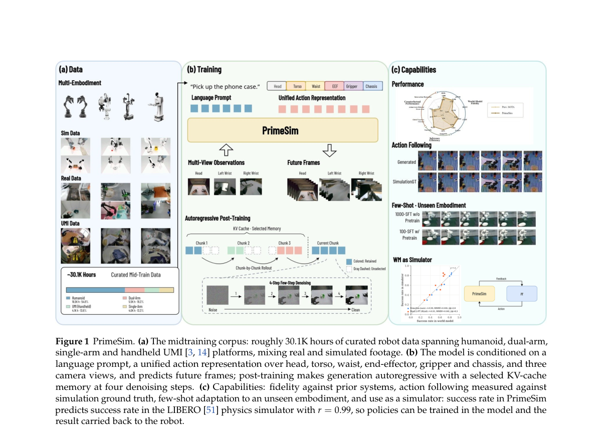

*Result - Overview of the data pipeline. Raw demonstrations from teleoperation, UMI, and simulation are converted through four stages: video quality filtering, action quality filtering, action preproce*

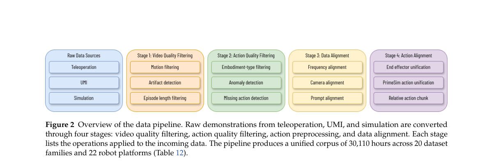

**Why this ranks #10**: PrimeBot 等在 30,110 小时、22 个平台的机器人演示上做中途训练，再做后训练把双向视频生成器改造成自回归模拟器：10.1 FPS、长程 rollout 稳定，留出平台 100–200 梯度步即可迁移。WorldSimProbe 五个套件领先四个且 EWMBench 总分最佳，但细粒度局部标定仍落后同类——这是它自己承认的短板。

---

