# ArXiv Daily Digest - 2026-11-04 (生成式内容模型的 RL, 10 papers)

**Generated**: 2026-11-04 17:30 CST

**Source**: arXiv cs.CV, cs.SD, eess.AS, cs.CL, cs.AI, cs.RO, cs.LG submissions, listing day 2026-11-03 (announced 2026-11-04 00:00 UTC)

**Batch window**: 2026-11-02T18:00:00Z .. 2026-11-03T18:00:00Z（arXiv 公告批次横跨两个 UTC 日：前一日 18:00 UTC 起算，当日 17:59:59 UTC 截止）

**Track**: rl_aigc (top 10 of 587 papers scanned, 70 full reads)

**Scope**: 生成式内容模型的 RL：扩散 / 流匹配 RL、生成式奖励模型与推理期采样扩展

⚠️ **Wild-card**: 本批该线 5 篇为 wild-card 补足，已在正文逐条标注并给出理由。

补足原因：该批次「生成式内容模型的 RL」（扩散 / 流匹配 RL、生成式奖励模型）的硬供给只有 5 篇，其余 5 篇是「生成内容模型方向但不含 RL，或 RL 方向与生成模型方向相反」的相邻工作（离散扩散蒸馏、自博弈视觉验证器、扩散分数学习理论、以扩散生成 RL 策略参数、世界动作模型的推理期选择器），已在正文逐条标注并给出理由。

---

## Top 10 - 生成式内容模型的 RL

### 1. StepX-OPD: Rethinking Multi-Teacher On-Policy Distillation in Diffusion Models

**arXiv**: [2611.04386](https://arxiv.org/abs/2611.04386) | **Score**: 9.3 (relevance 9.5 x 0.7 + quality 9.0 x 0.3) | **Tags**: rl-aigc, on-policy-distillation, step-distillation, few-step-diffusion, text-to-image, multi-teacher, StepFun | **Categories**: cs.CV | **Pages**: 35

**Authors**: Chenru Wang; Xuanyang Zhang; Yucheng Han; Wenbo Nie; Wei Cheng; Xianfang Zeng; Gang YU; Chi Zhang

**Affiliation**: StepFun; Westlake University

**Abstract**

> A deployable text-to-image diffusion model must hold several capabilities at once, such as instruction following, text rendering and human preference, and must sample in a few steps. Capabilities and few-step sampling are built in separate stages: a full-step model first consolidates capabilities through multi-teacher on-policy distillation, then serves as a fixed teacher for step distillation. Every full-step model we evaluate scores lower once compressed, and the second stage cannot begin until the first finishes. We introduce StepX-OPD, which merges the two stages: one student acquires every capability while learning to sample in a few steps, so frozen specialists supervise it on the states its own rollout visits rather than on a longer trajectory it never runs. Because a decomposition of the rollout's KL weights velocity mismatch most heavily near the clean end, we also regress the student's velocity on the low-noise part of the rollout. Separately, we find that capability integration makes models write prompt words into images on prompts that never asked for text, and we give a variant that lowers it. We evaluate on SD3.5-Medium and FLUX.1-dev across instruction following, text rendering, image quality and human preference. On both architectures, StepX-OPD attains the highest normalized average score among the four-step methods compared and exceeds the forty-step Flow-OPD model, and on SD3.5-Medium it trains with about 37% fewer GPU-hours than sequential DiffusionOPD followed by step distillation.

**Key findings**

- **Finding**: StepX-OPD 让冻结的专长教师在学生自己的 rollout 状态上提供分布匹配与速度回归目标，并额外回归 rollout 的低噪声段以补偿速度失配。在 SD3.5-Medium 上四步 GenEval 0.944、归一化均分 0.8901，FLUX.1-dev 上四步均分 0.8902，均高于四步的 Flow-OPD+TDM（0.8345 / 0.8695）与 DiffusionOPD+TDM（0.8403 / 0.8761），并超过 80 步 Flow-OPD 的 0.8788 与 40 步 Flow-OPD 的 0.8864；SD3.5 上比顺序 DiffusionOPD+TDM 少用约 37% GPU 小时。
- **Inference**: 结论边界很清楚——四步 0.8901 仍低于 80 步 DiffusionOPD 的 0.9022，StepX-OPD 并没有消除蒸馏损失，它消除的是「两阶段串行」的结构性损失。这说明少步化不是一个可以后置的部署优化，而必须在能力后训练的设计阶段就决定奖励与监督的落点，否则压缩会把后训练收益一起压掉。
- **Recommendation**: 复现时务必把 Flow-OPD / DiffusionOPD 加步数蒸馏的两个基线一起跑出来做对照，否则无法区分「方法更好」与「基线更弱」；另外检查你选的能力教师是否让模型在无文字要求的提示上乱写字——该文实测这一比例从基线的 21 涨到 DiffusionOPD 的 218，StepX-OPD 降到 94、精确教师变体降到 84，这类副作用在美术向产品上比分数更致命。

**Key figures**

*Framework - Training cost for the displayed optimization stages (left) and four-step performance across nine benchmarks after fixed axis-wise normalization (right).*

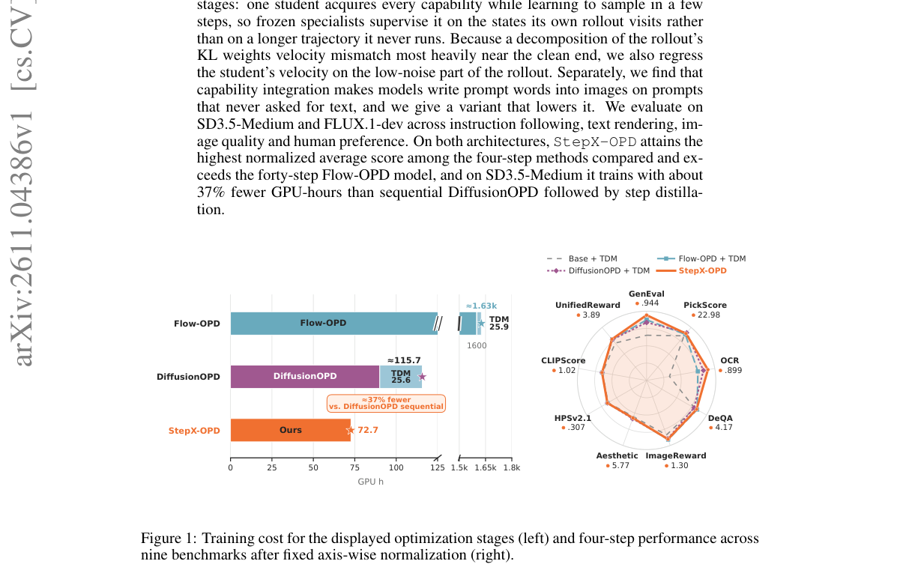

*Result - Qualitative comparison result from benchmark.*

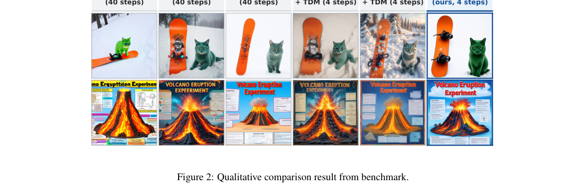

**Why this ranks #1**: 把「多教师能力整合」与「步数蒸馏」从两阶段接力合成一次训练，是它能进本线前 10 的主因：冻结的专长教师直接在被压学生自己的 rollout 状态上给监督，四步采样下 SD3.5-Medium 与 FLUX.1-dev 的归一化均分达 0.8901 与 0.8902，都超过 40 步的 Flow-OPD，训练还省下约 37% GPU 小时。对做文生图 RL 后训练的人，它还给出一个反直觉事实：能力整合后的模型一压到四步就掉分（80 步 DiffusionOPD 的 0.9022 → 四步 DiffusionOPD+TDM 的 0.8403），因此后训练与少步化应该同期设计，而不是串行接力。

---

### 2. PATTS: Parallel-Aware Test-Time Scaling for Thought-Image Generation in Multimodal Discrete Diffusion LLMs

**arXiv**: [2611.04948](https://arxiv.org/abs/2611.04948) | **Score**: 8.8 (relevance 9.0 x 0.7 + quality 8.5 x 0.3) | **Tags**: rl-aigc, test-time-scaling, discrete-diffusion, multimodal-llm, geneval, verifier-search, Australian National University | **Categories**: cs.CV | **Pages**: 13

**Authors**: Yasong Dai; Zeeshan Hayder; David Ahmedt-Aristizabal; Hongdong Li

**Affiliation**: Australian National University; CSIRO Data61; Amazon

**Abstract**

> Test-time scaling (TTS) improves generative models by allocating additional inference-time computation to sampling, search, and verification. Existing image generation approaches, however, typically rank completed images or image-centric intermediate states. We study TTS for parallel multimodal discrete diffusion language models, in which reasoning tokens and image tokens are decoded jointly within a single generation trajectory. We first diagnose a limitation of conventional final-image selection: on GenEval, a CLIP-style image-prompt score is weakly aligned with within-prompt compositional correctness, leaving substantial headroom between verifier selection and oracle selection. We then propose PATTS, a novel parallel-aware TTS framework that searches over intermediate thought-image states using cross-modal verifier signals. PATTS uses a state-dependent reliability weight, derived from model-internal trajectory diagnostics, to modulate the influence of external semantic verification during generation. In the fixed N=32 evaluation on MMaDA-Parallel, the PATTS reaches a GenEval score of 0.844, compared with 0.628 without TTS, 0.787 for Best-of-N, and 0.810 for FKD. These results show that reliability-aware trajectory verification can improve test-time selection for parallel thought-image co-generation under the evaluated search budget. Our code release is at https://github.com/Ringo-Star/PATTS.git

**Key findings**

- **Finding**: PATTS 先诊断出在 GenEval 上 CLIP 式图文分数与提示内组合正确性只有弱相关，因此改为在并行解码的中间 thought-image 状态上构造预测干净预览并用跨模态验证器打分，再用模型内部轨迹诊断（token logits、熵统计、注意力模式）导出的状态相关可靠性权重来调节外部语义验证的影响。在 MMaDA-Parallel 上固定 N=32 时 GenEval 达 0.844，对比无 TTS 的 0.628、Best-of-N 的 0.787 与 FKD 的 0.810。
- **Inference**: 推理期扩展的收益并不由候选数决定，而由验证信号与解码状态的匹配度决定：同样 N=32，Best-of-N 只到 0.787，PATTS 到 0.844，多出的 5.7 分来自「在中间态验证并按可靠性加权」而不是更多采样。对工程侧的直接含义是，与其把预算堆在采样数上，先把验证器做对更划算。
- **Recommendation**: 动手前先花半天复现「最终图选择」与 oracle 选择之间的差距——论文明确说这两者之间仍有明显空间，这个差值直接决定你该继续投采样预算还是投验证器；代码在 GitHub 的 Ringo-Star/PATTS，固定 N=32 的设置可直接对照，注意它只在并行离散扩散 LLM 上验证过，迁到连续扩散视频模型前需要重做可靠性诊断。

**Key figures**

*Framework - Overview of PATTS. A parallel diffusion multimodal LLM generates multiple partially decoded thought-image trajectories. At selected cut point, PATTS forms a predicted clean preview ˆz(t)*

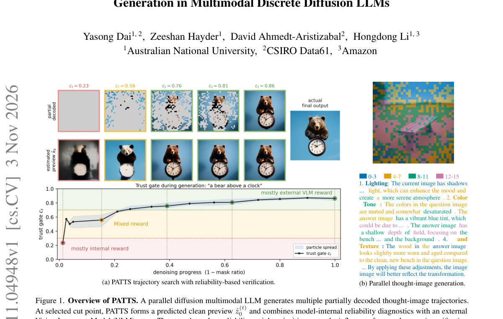

*Result - Method Overview of PATTS. Left: at each denoising cutpoint, the parallel MdLLM provides token logits, entropy statistics, attention patterns, and an estimated clean preview ˆz(t)*

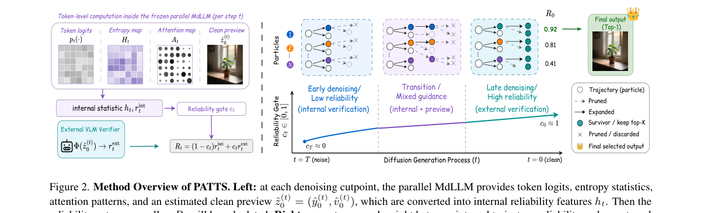

**Why this ranks #2**: 它把推理期扩展搬到并行多模态离散扩散 LLM 上，并证明关键不在采样数而在验证信号是否匹配当前解码状态：固定 N=32 时 GenEval 达 0.844，明显高于 Best-of-N 的 0.787 与 FKD 的 0.810，且作者诊断出 CLIP 式图文分数与提示内组合正确性只有弱相关。对做生成模型 RL 后训练的人，它是「后训练做不出的能力可以用推理期搜索补」的正面证据；但边界同样清楚——固定搜索预算下上限仍受验证器质量制约。

---

### 3. Density-Aware Reward Scaling: A Reinforcement Learning Framework for Reward-Proportional Sampling

**arXiv**: [2611.04792](https://arxiv.org/abs/2611.04792) | **Score**: 8.5 (relevance 8.5 x 0.7 + quality 8.5 x 0.3) | **Tags**: rl-aigc, reward-shaping, grpo, diversity, text-to-image, prompt-adaptation, National University of Singapore | **Categories**: cs.AI, cs.LG | **Pages**: 25

**Authors**: Ria Shekhawat; Abhijeet Sinha; Yingtao Zhu; Dianbo Liu

**Affiliation**: National University of Singapore

**Abstract**

> Reinforcement learning objectives that maximize expected return can concentrate probability mass on a small subset of high-reward outcomes, limiting diversity when multiple distinct solutions are desirable. We introduce Density-Aware Reward Scaling (DARS), a simple reward-processing mechanism that promotes reward-proportional sampling in continuous outcome spaces while retaining standard policy-gradient training. DARS estimates the local density of outcomes within each on-policy rollout group and inversely scales rewards by this density. The method requires no learned density model, auxiliary objective, critic, or modification to the underlying policy-gradient objective. In a controlled multimodal navigation task, DARS-GRPO avoids the single-mode collapse exhibited by GRPO and closely recovers the target mode allocation. Applied to text-to-image prompt adaptation, DARS-GRPO consistently improves image and prompt diversity across datasets, Policy LMs, and reward settings while maintaining good semantic alignment. These results show that density-aware reward scaling provides a lightweight way to improve coverage of diverse high-reward outcomes within existing reinforcement-learning pipelines.

**Key findings**

- **Finding**: DARS 用冻结 DINOv2 特征上的高斯核估计每个 on-policy rollout 组内的局部密度，再把任务奖励除以该密度，不引入学习到的密度模型、辅助目标或 critic，也不修改底层策略梯度目标。导航任务上 DARS-GRPO 把模式 TV 距离从 GRPO 的 0.750 降到 0.014、最小模式质量从 0.000 提到 0.236，代价是平均原始奖励从 6.96 降到 4.59（GFlowNet 参考为 3.44）。文生图提示适配上以 Stable Diffusion v1.4 生成、Qwen3-0.6B 为策略，MS-COCO 上图像 Vendi 从 8.76 升到 13.04、DINO 两两距离从 40.90 升到 46.92、提示两两距离从 0.00 升到 0.05，而 CLIP-align 保持 0.24、HPSv2 保持 0.23 不变，PickScore 从 20.92 微降到 20.80。
- **Inference**: 这条路径的代价结构说得很直白：多样性提升是以原始奖励为代价换来的（导航任务 6.96→4.59），但落到文生图提示适配上，CLIP 对齐与美学分几乎不动而覆盖率明显变宽，说明「奖励排序被密度重排」在多解提示任务里比在单解任务里安全得多——这也提示它更适合做覆盖度补丁而不是单独的对齐算法。
- **Recommendation**: 接入前先量一下你自己的任务里存在多少个同样高分的解，若存在多个等价解（如文生图的多种合理构图）再加密度缩放，收益远大于在唯一解任务上强行使用；实现上只需在现有 GRPO/DPO 循环里插入一次组内核密度估计，但要记住它改的是奖励而非策略梯度目标，因此和 group size、核宽 h 强耦合，建议直接扫一遍 h。

**Key figures**

*Result - Overview of DARS-GRPO for text-to-image prompt adaptation. A trainable language-model policy samples G rewrites of an input prompt, and a frozen text-to-image model generates one image per r*

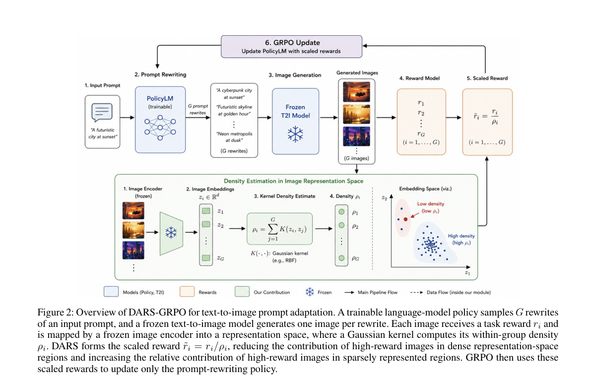

**Why this ranks #3**: 它用一条极轻的改写把「RL 后训练把多样性磨光」这个问题从目标函数层面挪到奖励处理层面：不改策略梯度目标、不加 critic、不训密度模型，只在每个 on-policy rollout 组内估计局部密度并反向缩放奖励。多模态导航上把 GRPO 的模式坍缩基本抹平（模式 TV 距离 0.750→0.014、最小模式质量 0.000→0.236），文生图提示适配上图像 Vendi 从 8.76 提到 13.04 而 CLIP 对齐保持 0.24 不变，对正在做文生图 GRPO/DPO 的团队是几乎可以直接抄的补丁。

---

### 4. Behind Video Generation: Observations and Insights on Multimodal Understanding from Kling

**arXiv**: [2611.04916](https://arxiv.org/abs/2611.04916) | **Score**: 8.5 (relevance 8.5 x 0.7 + quality 8.5 x 0.3) | **Tags**: rl-aigc, video-generation, reward-model, prompt-enhancement, mllm, technical-report, Kling Team | **Categories**: cs.CV | **Pages**: 38

**Authors**: Kling Team; Dong Chen; Jialu Chen; Xinlong Chen; Yifan Dai; Haotian Dong; Binzong Geng; Yushuo Guan; Minghui Guo; Guanlin He; Guanxiao He; Jingyun Hua

**Affiliation**: Kling Team

**Abstract**

> Video generation has progressed from isolated clips to coherent short-form audiovisual sequences, and the bottleneck is shifting from rendering to semantic control. This report summarizes the observations and insights on multimodal understanding gained from successive generations of Kling. We argue that generation quality is the projection of multimodal understanding through the entire data--conditioning--alignment--evaluation chain, and we examine this chain module by module. Kling-MLLM, a shared multimodal foundation model that unifies image, video, audio, synchronized audio--video, and interleaved inputs, is specialized for each downstream module. Because a DiT is trained on far fewer training samples than a language model, we treat captioning as a semantic contract that maximizes description density, and extend it to reference-grounded captioning that makes reference bindings explicit. Prompt enhancement translates user intent into this caption distribution: basic PE is derived from captions of compelling videos and refined with text-level and generator-in-the-loop reinforcement learning, while agentic PE refines the story and retrieves compelling examples. We show that a reliable text encoder comes from perceptual training rather than from stronger language ability, and that candidates can be screened from text alone before end-to-end training. Reward modeling pairs a general reward model for explainable, localized critiques with a decision reward model for fast multidimensional scoring, treating perceptual bandwidth as a first-class design parameter. Finally, we review task-specific automatic evaluation, focusing on protocols that expose scoring shortcuts and help trace failures to their upstream source. We hope these lessons offer practical guidance for building the understanding stack behind controllable video generation.

**Key findings**

- **Finding**: 报告基于 Kling 1.0 到 Kling 4.0、Kling AI Avatar 与 Kling Motion Control 的迭代经验，核心论点是生成质量是多模态理解在数据-条件-对齐-评估整条链上的投影。Kling-MLLM 家族含稠密 27B 与两个 MoE 变体 35B-A3B、397B-A17B，统一图像、视频、音频、音视频同步与交错输入；提示增强分基础 PE（从精彩视频的字幕派生，用文本级与生成器在环的强化学习精修）与 agentic PE（改写故事并检索精彩样例）；奖励建模把可解释、可定位点评的通用奖励模型与快速多维打分的决策奖励模型配对使用，并把感知带宽当作一等设计参数。
- **Inference**: 对做生成式后训练的人，这套分工值得抄：通用奖励模型负责说清哪里不对，决策奖励模型负责快速给分，混成一个模型会让刷分变慢、或让快速评分退化成会糊弄的点评。另一个反直觉点是可靠的文本编码器来自感知训练而非更强的语言能力，说明对齐链路的瓶颈往往在表征而不是数据量或模型规模。
- **Recommendation**: 读的时候重点看第 7 章奖励模型与第 8 章自动评估两节，把「感知带宽是一等设计参数」这一点对照自己的 reward head 设计；如果在做提示增强，可照它的分层顺序推进——文本级 RL 先行、生成器在环 RL 后置、agentic 检索最后，而不是一上来就做端到端；同时注意这份报告几乎不给出可复现的数字与配置，只适合当设计清单而非复现目标。

**Key figures**

*Framework - Multimodal understanding along the data–conditioning–alignment–evaluation chain behind Kling.*

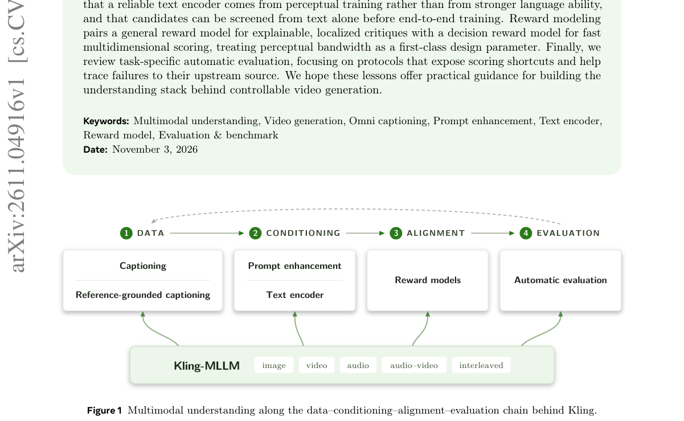

*Result - Kling-MLLM architecture. Multimodal inputs are encoded by visual and audio paths into aligned continuous tokens, delimited by modality boundary markers, anchored with physical timestamps, and*

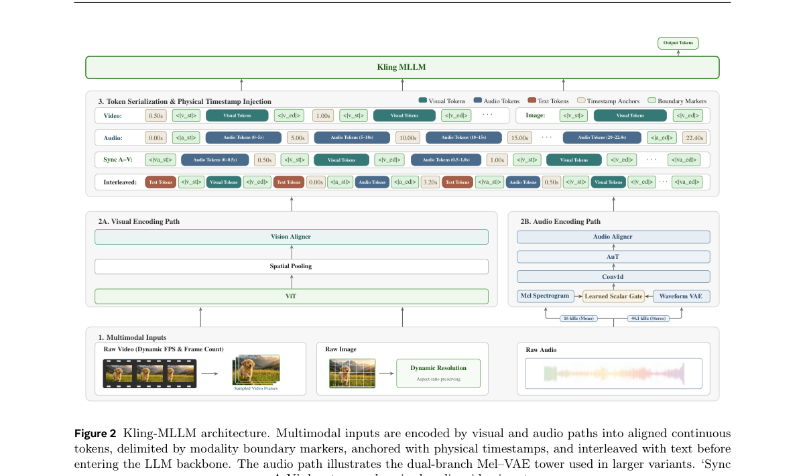

**Why this ranks #4**: 这是少见的把工业视频生成系统的「理解栈」整条链摊开的技术报告，而链上每段都对应一次生成模型的后训练：Kling-MLLM 统一图像、视频、音频、音视频同步与交错输入后被专门化成字幕、提示增强、文本编码器、奖励模型，提示增强用文本级与生成器在环的强化学习精修，奖励建模拆成可解释可定位点评的通用奖励模型与快速多维打分的决策奖励模型。对做生成式 RL 的读者，它给出的是 reward model 分工与评估协议这类工程结论，而不只是模型分数。

---

### 5. Multi-Objective Generative Optimization via Expected Hypervolume Fine-Tuning

**arXiv**: [2611.05207](https://arxiv.org/abs/2611.05207) | **Score**: 8.1 (relevance 8.0 x 0.7 + quality 8.5 x 0.3) | **Tags**: rl-aigc, multi-objective, hypervolume, flow-matching, discrete-diffusion, molecule-design, Mohamed Bin Zayed University of | **Categories**: cs.LG | **Pages**: 26

**Authors**: Juan Guevara; Riccardo De Santi; Andreas Krause; Raul Astudillo

**Affiliation**: Mohamed Bin Zayed University of Artificial Intelligence; ETH Zurich; ETH AI Center

**Abstract**

> Scientific discovery requires plausible designs spanning useful trade-offs among competing properties: a molecule with strong binding affinity, for example, may be difficult to synthesize. Pretrained generative models, e.g., flow and diffusion generators, provide a foundation for proposing such designs, but steering them toward high-quality, complementary trade-offs remains challenging. Inference-time search incurs high per-sample costs, while fine-tuning typically relies on fixed per-candidate rewards that do not capture how designs complement one another. We introduce Hypervolume Fine-Tuning (HVFT), which adapts a single pretrained generator to maximize the expected hypervolume of its samples while controlling departure from the pretrained distribution. Expected hypervolume jointly rewards candidate quality and collective trade-off coverage. Nonetheless, we show that it cannot be expressed as the expectation of a fixed per-candidate reward and therefore cannot be optimized directly with standard techniques. A key observation of this work is that its first variation corresponds to the expected marginal hypervolume contribution of a candidate, which yields a tractable adaptive reward via an unbiased estimator based on model samples. HVFT uses this reward to decompose the objective into a sequence of KL-proximal scalar-reward subproblems. We establish concavity, relative smoothness, and convergence guarantees for the resulting distributional procedure. Across therapeutic-peptide and molecular design tasks spanning discrete diffusion and continuous flow-matching models, HVFT achieves state-of-the-art expected hypervolume and trade-off coverage.

**Key findings**

- **Finding**: HVFT 证明期望超体积不能表示为固定逐样本奖励的期望，因而无法用标准技术直接优化；其关键观察是一阶变分对应候选的期望边际超体积贡献，由此得到基于模型样本的无偏估计量，再用该奖励把目标分解成一串 KL 近似的标量奖励子问题（内层求解器取 TR2D2 的单目标变体，奖励不做缩放）。三个治疗性肽段任务上 100-超体积为 GLAST 11.67±0.27、GLP-1R 11.23±0.08、TfR 11.57±0.16，高于 TR2D2 的 7.78/7.07/4.41 与 TR2D2++ 的 8.56/8.93/7.63；GLAST 上设计空间多样性 64.78 对 TR2D2 的 9.08、覆盖度 465.45 对 136.64，基线为 60.35 与 401.50，并在小分子设计上跨离散扩散与连续流匹配取得最优期望超体积。
- **Inference**: 这组数字点破了多目标微调的一个常见误区：TR2D2 把 GLAST 的超体积从基线 2.78 拉到 7.78，但多样性同时从 60.35 崩到 9.08，等于用整批设计的多样性换了一个目标；HVFT 第一次把超体积与多样性同时推上去，说明「集合级目标」必须靠自适应奖励来实现，固定奖励加权在结构上做不到这件事。
- **Recommendation**: 动手前先量现有方法的超体积与多样性两条曲线，若多样性已在下滑就说明你被固定逐样本奖励卡住了；HVFT 的「自适应边际贡献 → KL 近似标量子问题」分解值得照搬，但注意它依赖内层求解器，跨离散扩散与连续流匹配的配方需要分别调，且本文只在分子与肽段这类可验证目标上验证过。

**Key figures**

*Framework - HVFT for multi-objective generative fine-tuning. (a) HVFT iteratively constructs a scalar reward from the current distribution pk and fine-tunes the generator, shifting the pushforward distr*

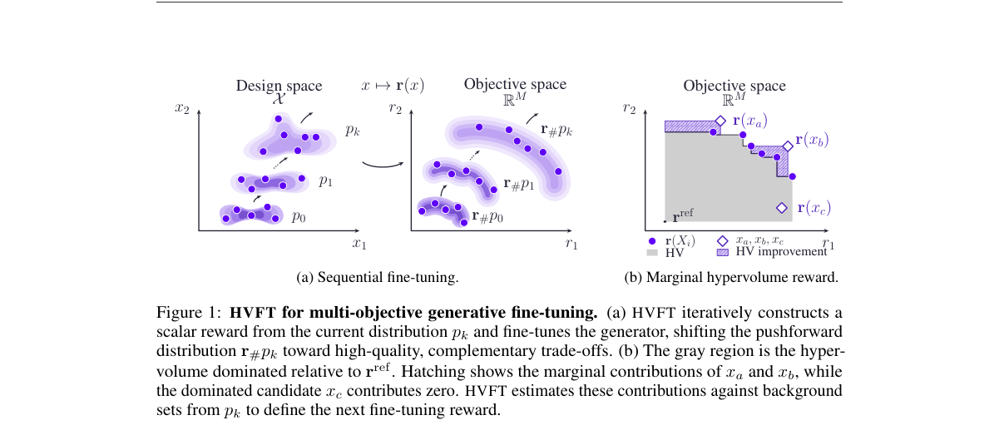

*Result - Pareto sets induced by 1,000 samples from TR2D2 (Tang et al., 2025b), a state-of-the-art discrete diffusion fine-tuning algorithm, and HVFT, on the GLAST task. HVFT achieves broader objectiv*

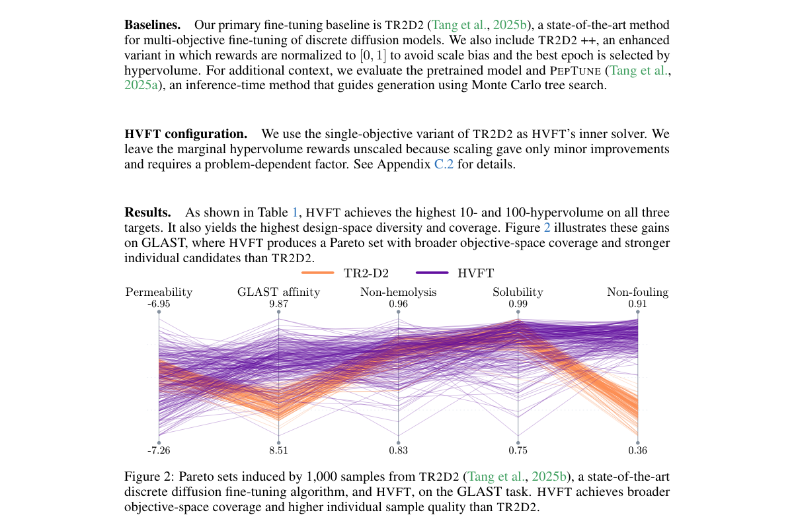

**Why this ranks #5**: 它正面处理了一个此前没人碰的硬障碍：期望超体积无法写成固定逐样本奖励的期望，所以标准 RL 技术根本用不上；解法是一阶变分等于候选的期望边际超体积贡献，由此构造基于模型样本的无偏自适应奖励，再把目标分解成一串 KL 近似的标量奖励子问题。在三个治疗性肽段任务上 100-超体积达 11.67 / 11.23 / 11.57，同时把被 TR2D2 压垮的多样性从 9.08 拉回 64.78，是本批次多目标生成后训练方向最有方法论含量的一篇。

---

### 6. Bidirectional Centered Score Matching for Discrete Diffusion Distillation

**arXiv**: [2611.04279](https://arxiv.org/abs/2611.04279) | **Score**: 8.0 (relevance 8.0 x 0.7 + quality 8.0 x 0.3) | **Tags**: rl-aigc, discrete-diffusion, distillation, score-matching, parallel-decoding, few-step, Shanghai Academy of AI for Science | **Categories**: cs.AI | **Pages**: 14

**Authors**: Peng Tu; Baoyou Chen; Haoyuan Xia; Zilong Dong; Weihao Yuan; Siyu Zhu

**Affiliation**: Shanghai Academy of AI for Science; Shanghai Innovation Institute; Fudan University; Alibaba Group

**Abstract**

> Discrete diffusion models with parallel decoding are often distilled using token-wise KL objectives. Although token-wise KL exactly matches the corresponding product-form block distributions, its probability-space optimization geometry and teacher-only candidate truncation may provide insufficient supervision under aggressive few-step distillation. Concrete Score Matching (CSM) provides an alternative within-position objective by aligning relative logit geometry, but its complete pairwise form incurs $\mathcal{O}(|\mathcal{V}|^2)$ complexity. We propose Bidirectional Centered Score Matching (BCSM), an efficient within-position distillation objective that constructs an $\mathcal{O}(K)$ bidirectional active set, reduces pairwise comparisons to $\mathcal{O}(K^2)$, and factorizes them into an $\mathcal{O}(K)$ objective. We further introduce cross-timestep transition alignment. Experiments demonstrate strong quality--efficiency trade-offs, including up to $6\times$ NFE reduction with a 16.9\% relative HumanEval gain and a 15.1\% relative MMMU gain at single-step inference.

**Key findings**

- **Finding**: BCSM 指出 token-wise KL 虽精确匹配块分布，但在激进少步蒸馏下其概率空间优化几何与仅用教师候选截断的监督都不够，而 Concrete Score Matching 的完整成对形式需要 O(|V|²)。BCSM 构造 O(K) 的双向活跃集、把成对比较降到 O(K²) 并因式分解成 O(K) 目标，另加跨时间步转移对齐。在扩散 VL 模型与扩散语言模型上，单步推理时 MMMU 达 35.67，高于未蒸馏学生 32 步时的 32.14；HumanEval 得 42.1（NFE 42.9），高于 256 步 LLaDA-8B 基座的 36.0，整体 NFE 最多降低 6 倍、HumanEval 与 MMMU 相对提升 16.9% 与 15.1%。
- **Inference**: 它和本线的连接点其实在监督分配：扩散 RL 里 GRPO/DPO 用逐样本奖励去对齐生成分布，少步化时同样会遇到监督信号被截断、候选覆盖不足的问题。BCSM 换了个思路——不对齐分布而对齐分布内部的相对几何，这提示在少步场景下与其在奖励侧硬调，不如先检查教师信号的几何是否完整地传到了学生。
- **Recommendation**: 本线当天「生成式内容模型的 RL」硬供给只有 5 篇，本篇以离散扩散蒸馏补位，信息量集中在少步蒸馏的监督几何；若你同时做少步化与 RL 后训练，可把 BCSM 的活跃集思路与 DARS 的密度缩放放进同一组对照实验，看哪一侧的监督损失更大；复现时先在单步预算上做对照，因为它的收益主要出现在 NFE=1 这种极端压缩档。

**Key figures**

*Framework - Conceptual comparison of discrete distillation objectives. (a) Vanilla KL Divergence aligns position-wise categorical probabilities with linear O(|V|) complexity. (b) Concrete Score Matching*

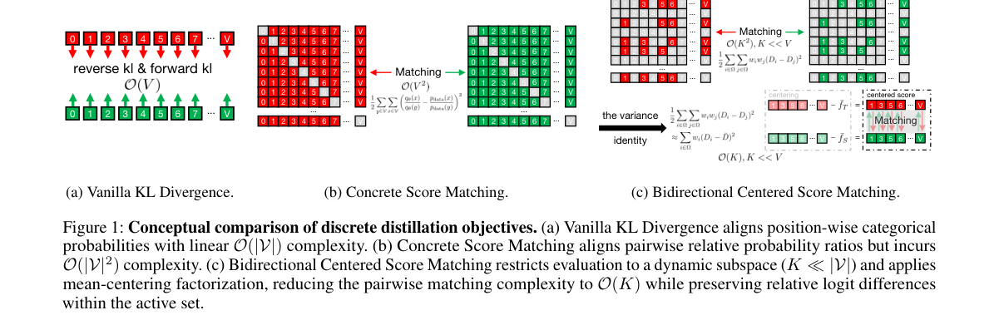

*Result - Kneedle-based extraction of the dynamic active subspace. (a) The sorted logits are normalized to form the logit profile yi over normalized rank xi; the prefix up to kt defines the active sub*

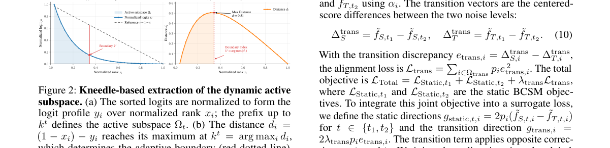

**Why this ranks #6**: 补位说明：本批次「生成式内容模型的 RL」（扩散/流匹配 RL、生成式奖励模型）的硬供给只有 5 篇，其余 5 个名额按契约用相邻工作补位，本文属于「生成内容模型方向但不含 RL」的离散扩散蒸馏。它对 AIGC 方向仍有信息量：少步蒸馏失败往往不是学生容量不足而是监督几何不对——BCSM 用 O(K) 双向活跃集做几何对齐，单步 NFE=1 下 MMMU 达 35.67，反超未蒸馏学生 32 步时的 32.14，这恰是扩散 RL 做少步化时同样会撞上的问题。  [wild-card=yes] 该论文是离散扩散语言模型的分数匹配蒸馏目标，属生成模型训练方法但不含 RL，补位计入。

---

### 7. Perturb, Repair, Verify: Self-Play Vision-Language Verifiers for Compositional Understanding

**arXiv**: [2611.05158](https://arxiv.org/abs/2611.05158) | **Score**: 8.0 (relevance 8.0 x 0.7 + quality 8.0 x 0.3) | **Tags**: rl-aigc, self-play, verifier, vision-language, compositional, reward-model, University of Southern California | **Categories**: cs.CV, cs.LG | **Pages**: 30

**Authors**: Zijun Huang; Yingjun Du; Cees G. M. Snoek

**Affiliation**: University of Southern California; VisLab, University of Amsterdam

**Abstract**

> Vision-language verifiers judge whether an image faithfully matches a textual description, yet existing training pipelines typically rely on static supervision from stronger external judges or curated hard-negative data. Such supervision requires external generation or annotation, is teacher-bounded, and is difficult to adapt as model failures evolve. We introduce PROVE (Perturb-and-Repair Optimization for Vision-Language Evaluation), a self-play framework that trains verifiers through a closed perturb-verify-repair-verify loop. Starting from a known-correct image-caption pair, a Mutator introduces a typed perturbation over objects, attributes, counts, or relations. The verifier then judges the perturbed caption and provides textual feedback, which a Repairer uses to recover a faithful caption for re-verification. These two verification rounds produce structured rewards for informative mismatches and visually grounded repairs. Since perturbation, verification, and repair are role-conditioned behaviors of the same evolving multimodal backbone, updating the shared parameters also improves the verifier itself. Experiments show that PROVE improves fine-grained compositional verification across model scales and families and strengthens visual-detail robustness on the reference backbone, with limited, benchmark-dependent changes on broader multimodal tasks.

**Key findings**

- **Finding**: PROVE 用同一块 Qwen3.5-2B 在三种角色提示下跑「扰动-验证-修复-再验证」闭环：Mutator 对已知正确的图文对施加物体、属性、计数或关系类型的扰动，验证器给出定位化文本反馈，Repairer 据此恢复忠实描述以供再验证，两轮验证产出结构化奖励，不依赖更强的外部评审或人工难负例。同骨干对照下组合理解均分从 83.22 升到 86.85（ARO 均分 74.58→81.83，+7.25；VL-CheckList 均分 76.75→81.46）；更广的 Winoground GS / MMVP pair / MMBench 均分从 58.77 升到 61.03（MMVP pair 56.00→60.00）。消融为：固定类型难负例 85.02、外部评审蒸馏 86.29、验证器自训练 85.66、去掉 Repairer 或第二次验证 84.24、Repairer 不用验证器反馈 85.17、冻结内部验证器 85.12。
- **Inference**: 关键判断是「监督可以自己长出来」：闭环自博弈 86.85 反而高于外部评审蒸馏的 86.29，说明外部强评审提供的是上限有限且会随模型失效而失效的静态监督，而自造错误加自修复能持续适配新的失效模式。对生成式 RL 的直接含义是：与其等一个更强的奖励模型，不如让奖励模型学会自己造失败样本。
- **Recommendation**: 若你要为文生图 RL 提供奖励模型，可直接参考 PROVE 的角色拆分与闭环结构，把 Mutator 换成「对生成图做受控扰动」、Repairer 换成「按反馈重写提示」；但要盯住它的边界——论文自己说在更广的多模态任务上只有有限且依基准而变的提升，Reward Model Image 这条路建议先在组合性基准上验证再扩到通用人类偏好。

**Key figures**

*Result - Overview of PROVE. A single Qwen backbone is reused under three role prompts: Mutator, Verifier, and Repairer. Given a clean image-caption pair, the Mutator produces a localized caption pert*

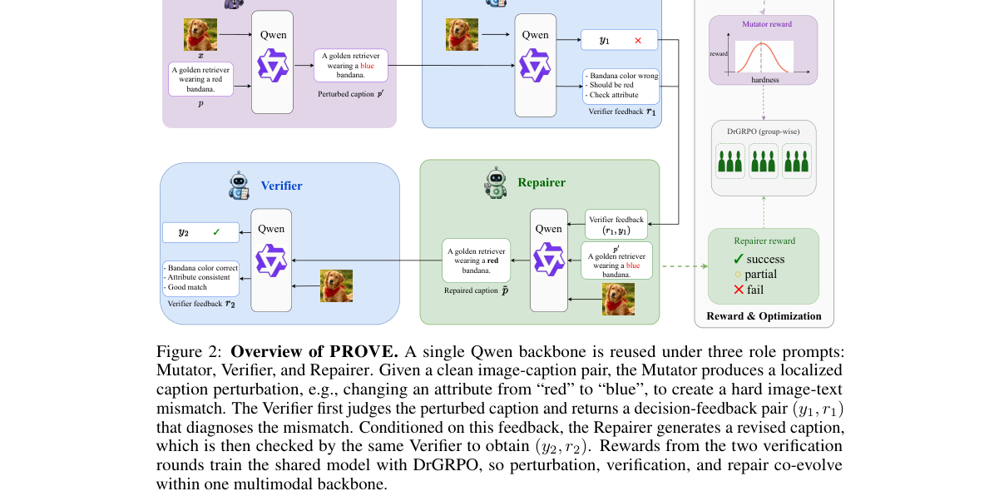

**Why this ranks #7**: 补位说明：本批次生成式内容模型 RL 的硬供给只有 5 篇，本文按契约以「生成内容模型方向但不含 RL」的相邻工作补位，落在生成式奖励模型这一侧。它的信息量在于奖励模型可以自举：PROVE 用同一块 Qwen3.5-2B 跑扰动-验证-修复-再验证闭环，组合理解均分从 83.22 提到 86.85，且消融显示固定难负例（85.02）和外部评审蒸馏（86.29）都不如闭环自博弈，映射到生成式 RL 就是「用生成式奖励模型替代人工偏好标注」的同一条路。  [wild-card=yes] 该论文是自博弈训练的视觉-语言验证器，属奖励/验证器方向但面向理解任务而非生成后训练，补位计入。

---

### 8. Denoising Is Stein: Moment Access and a Resource Hierarchy for Learning Hidden Structure in Diffusion Models

**arXiv**: [2611.04043](https://arxiv.org/abs/2611.04043) | **Score**: 7.7 (relevance 7.5 x 0.7 + quality 8.0 x 0.3) | **Tags**: rl-aigc, score-learning, theory, moments, hidden-component, sample-complexity, Microsoft | **Categories**: cs.LG, stat.ML | **Pages**: 75

**Authors**: Rui Wang

**Affiliation**: Microsoft

**Abstract**

> We study score learning from denoising pairs when the data contain a hidden non-Gaussian component. If covariance reveals the component, its subspace can be recovered directly. If covariance is isotropic, the first distinguishing moment has order $k^\ast$, and the learner must extract that moment from clean points and their noisy views. Correlations in the denoising loss are Stein discrepancies against a baseline; for polynomial fields they determine exactly the corresponding moment differences. Averaging fresh noisy views conditional on a clean point gives an exact moment query on the clean distribution. In the covariance-matched regime, orientation-independent dictionaries satisfying an $L^4/L^2$ condition need order $d^{k^\ast-1}$ features, and the stated dot-product kernel ridge models need the same power in samples. Small-step online SGD on one unit has this exponent up to logarithms. A two-stage learner uses the curvature of a smoothed denoising loss to recover the hidden direction, then sharpens it and fits a scalar readout. For every even $k^\ast$, it obtains a fixed score gain over the Gaussian baseline from $O(d^{k^\ast/2}\log d)$ clean points. In the covariance-visible regime, the frozen-feature threshold occurs at $d^J/J!$, while projection onto principal components makes the fitted-model, score-risk and generated-law distributions independent of ambient dimension. In the covariance-matched experiments, the measured partial-trace overlaps are consistent with the proposed spectral transition. A width-8 network trained with clean-point reuse shows a $d^2$-like training-set threshold over $d=64$--$192$, with fixed validation and calibration overhead.

**Key findings**

- **Finding**: 论文把扩散的去噪对学习放到 Stein 差异框架下：协方差能显出隐藏非高斯成分时其子空间可直接恢复，协方差各向同性时首个可分辨矩为 k* 阶，学习器必须从干净点及其噪声视图中把该矩提取出来，且对干净点条件下的新噪声视图取平均等于对干净分布的精确矩查询。协方差匹配情形下，满足 L^4/L^2 条件的方向无关字典需要 d^{k*-1} 阶特征，点积核岭模型在样本数上需要同样的幂次，单单位的小步在线 SGD 达到该指数（差对数因子）；两阶段学习器用平滑去噪损失的曲率先恢复隐藏方向再锐化并拟合标量读出，对每个偶数 k* 用 O(d^{k*/2} log d) 个干净点获得相对高斯基线的固定分数增益。实验上宽度 8 的网络在 d=64–192 上呈现 d² 级的训练集阈值，固定验证与校准开销。
- **Inference**: 对 AIGC 方向最实用的结论是「可辨识性决定预算」：如果协方差各向同性且 k* 很大，再好的模型也会被样本数卡住，此时加大生成模型或加大采样量都没有意义，该做的是改数据分布让结构在协方差里显形。这也给生成模型做偏好对齐划了一条边界——奖励信号里若藏着你没观测到的高阶结构，再大的对齐预算也训不出可验证的改进。
- **Recommendation**: 建议只在 d 较小、可控的合成设定里先复现，宽度 8、d=64–192 的阈值现象是最小可观测规模，直接在高维图像上验证没有意义；对你的实际项目更有用的是先把协方差/矩的可辨识性做一次诊断，用两阶段学习器在几千个干净点上试一次，看能否拿到相对高斯基线的固定分数增益，再决定要不要投更贵的方案。

**Key figures**

*Framework - Two hidden-component data regimes in two dimensions. (a) Clean points X0 = uZ*

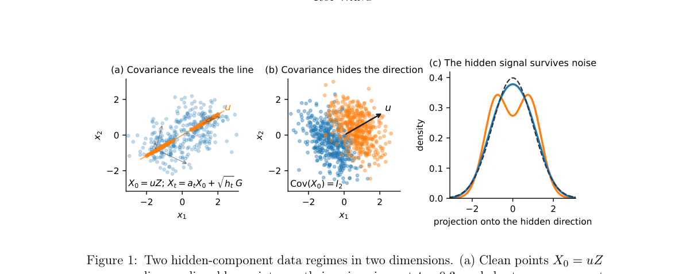

*Result - The covariance-matched rows of Table 1 on one scale, for k∗= 4 and the two-*

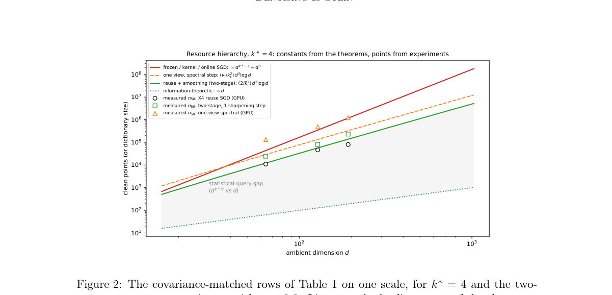

**Why this ranks #8**: 补位说明：本批次生成式内容模型 RL 只有 5 篇硬供给，本文按契约以「不含 RL 的扩散学习理论」补位。它对 AIGC 方向的信息量在资源与可辨识性层面：协方差匹配时学到一个隐藏结构需要 d^{k*-1} 阶特征、两阶段学习器用 O(d^{k*/2} log d) 个干净样本就够，这些量级可以直接用来判断在生成模型上做偏好对齐时，钱该花在更大模型、更多采样还是更多监督数据上。  [wild-card=yes] 该论文是扩散模型分数学习的刻画与资源层级理论，属生成模型学习理论但不含 RL，补位计入。

---

### 9. Policy Network Diffusion

**arXiv**: [2611.04614](https://arxiv.org/abs/2611.04614) | **Score**: 7.5 (relevance 7.5 x 0.7 + quality 7.5 x 0.3) | **Tags**: rl-aigc, parameter-generation, diffusion, latent-autoencoder, rl-policy, generalization, Tencent | **Categories**: cs.LG | **Pages**: 17

**Authors**: Jiate Liu; Deheng Ye

**Affiliation**: Tencent

**Abstract**

> Diffusion models have shown remarkable progress in AI-generated content, including images and videos. In this paper, we explore whether diffusion models can generate the parameters of policy networks in reinforcement learning (RL), and whether the generated policies exhibit generalization capabilities. To achieve this, we propose Diffusion-based Conditional Policy Network Parameter Generation (DPPG), which consists of a Transformer-based autoencoder and a task-conditioned diffusion model. The autoencoder achieves a high compression rate by patchifying network parameters, while the task-conditioned diffusion model generates corresponding parameters conditioned on different environments. Our experiments demonstrate that, with a single unified DPPG model, we can synthesize high-quality policies across a diverse set of tasks from different environment domains, including Classic Control, Atari games, and MuJoCo. Additionally, our method can generate networks with a larger number of parameters compared to previous approaches. Furthermore, we find that in previously unseen environments, DPPG can generate parameters that achieve faster convergence and reach competitive performance, showcasing the potential future applications of parameter generation via diffusion.

**Key findings**

- **Finding**: DPPG 用 Transformer 自编码器把策略网络参数 patchify 后压进高压缩率的潜表示，再由任务条件扩散模型按环境条件生成对应参数。单个统一模型覆盖最多 20 个 Atari、5 个 Classic Control 与 5 个 MuJoCo 任务：在统一模型设定下与原始 RL 基线互有胜负（Alien 727.14 对 674.78、Assault 5140.74 对 5562.01、CrazyClimber 75424.55 对 136518.3）；在约 169 万参数的 Atari 网络上 pdiff 直接 OOM，DPPG 仍能生成可用策略（Alien 799.75 对原始 763.28），同 GPU 显存下可生成的参数量约为 pdiff 的 100 倍。论文另报告在未见环境中生成的参数收敛更快、达到有竞争力的性能。
- **Inference**: 作为镜像用法，它的真正启发是压缩与结构保持的权衡：自编码器把参数量放大到 100 倍仍能保住 Atari 上大部分回报，说明权重分布的低维结构很强；但 MuJoCo 上 HalfCheetah 5079→1949、Ant 996→504 的明显下滑，提示奖励地形敏感的任务在压缩后无法还原，这个结论和生成模型少步蒸馏掉分是同一回事——压不出来不是因为容量不足，而是对齐信号在压缩后丢了结构。
- **Recommendation**: 本批次「生成式内容模型的 RL」硬供给只有 5 篇，本篇以「扩散生成 RL 参数」的逆向用法补位；读的时候重点看 MuJoCo 上的差距（HalfCheetah 1949 对原始 5079、Ant 504.54 对 996.03），它正是生成模型做偏好对齐时会遇到的失败模式，建议把「压缩后哪一类任务掉分」当作通用诊断清单来用；若要复现，pdiff 在 169 万参数上 OOM，需先自备同量级基座。

**Key figures**

*Framework - An overview of the proposed framework. (a) Prepare the parameters of policy networks trained in various reinforcement learning environments. (b) Train a Transformer-based autoencoder to comp*

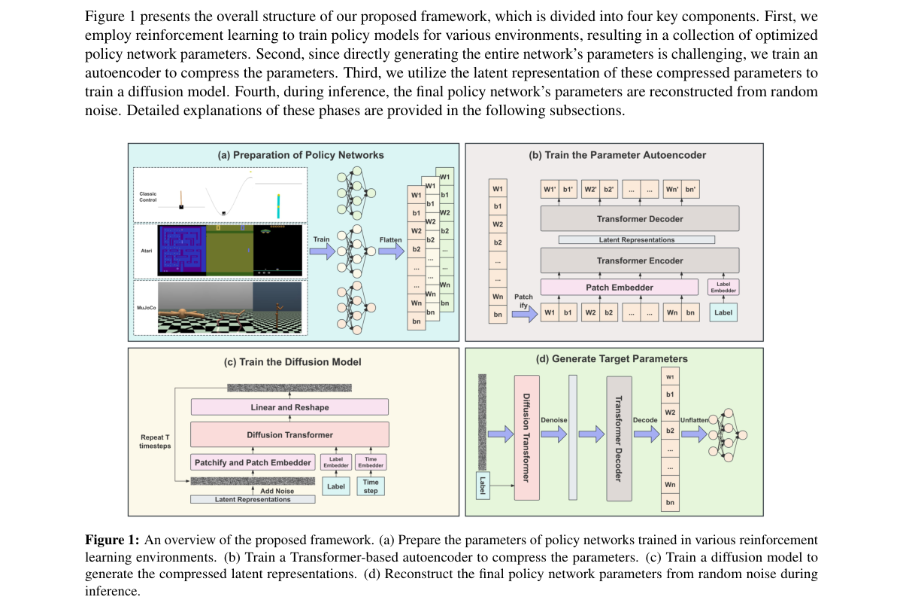

*Result - Under the same GPU memory, DPPG can generate a network with approximately 100 times the number of parameters as pdiff.*

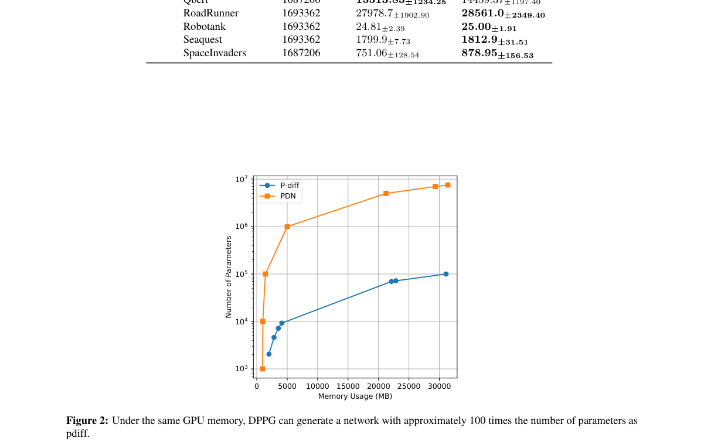

**Why this ranks #9**: 补位说明：本批次生成式内容模型 RL 的硬供给只有 5 篇，本文按契约以「RL 方向与生成模型方向相反」的镜像用法补位——扩散在这里生成的是 RL 策略网络的参数，而不是被 RL 优化。它对 AIGC 方向的信息量在压缩与结构保持：Transformer 自编码器把可生成参数量压到 pdiff 的约 100 倍仍能产出可用策略，而 MuJoCo 上 HalfCheetah 从原始 5079 掉到 1949，说明压缩后结构保不住的任务上收益会反转，这与生成模型少步蒸馏后掉分是同一类现象。  [wild-card=yes] 该论文是用扩散模型生成 RL 策略网络参数，方向与本线相反（扩散服务 RL 而非 RL 服务生成模型），补位计入。

---

### 10. Seeing Through the Illusion: Test-Time Scaling for World Action Models

**arXiv**: [2611.03585](https://arxiv.org/abs/2611.03585) | **Score**: 7.5 (relevance 7.5 x 0.7 + quality 7.5 x 0.3) | **Tags**: rl-aigc, test-time-scaling, world-action-model, candidate-selection, inverse-dynamics, frozen-model, Huawei Technologies Canada | **Categories**: cs.RO | **Pages**: 11

**Authors**: Cheikh Ahmed; Mahdi Mostajabdaveh; Milad Yazdani; Zirui Zhou

**Affiliation**: Huawei Technologies Canada; University of British Columbia

**Abstract**

> World action models (WAMs) jointly generate actions and imagined futures, but a plausible prediction need not be realized by its co-generated action. We introduce WISE (\emph{World Action Inference Scaling through Evaluation}), a pre-execution selector that scores each sampled rollout on action validity and temporal regularity, inverse-dynamics consistency between the proposed action and the imagined motion, and instruction-conditioned task progress, and executes the highest-scoring candidate while keeping the WAM frozen. With four candidates per decision, WISE raises closed-loop success from 6.0\% to 24.0\% on RoboLab with Cosmos~3 Edge and from 75.1\% to 78.3\% mean success on LIBERO with DreamZero, and exceeds the best existing selector in aggregate by 4.0 and 0.9 points. Component ablations and agreement analyses show that the three scores rank candidates differently and that task progress carries the largest weight in the fused decision.

**Key findings**

- **Finding**: WISE 在冻结的世界动作模型之前插入一道执行前选择器，对每个决策采样的 4 个「动作-想象未来」配对打三项分：动作有效性与时序规律性、逆动力学一致性（用逆动力学模型从想象帧反推动作是否匹配）以及指令条件下的任务进度，随后执行最高分候选而不改动世界动作模型。RoboLab 上配合 Cosmos 3 Edge 的闭环成功率从 6.0% 升到 24.0%，LIBERO 上配合 DreamZero 的平均成功率从 75.1% 升到 78.3%，并分别比既有最好的选择器高 4.0 分与 0.9 分。组件消融与一致性分析显示三个分数给出的候选排序互不相同，融合决策中任务进度权重最大。
- **Inference**: 它证明了「选择器可以比生成器更值钱」：在被选模型完全冻结、只把每个决策的候选数从 1 提到 4 的情况下，RoboLab 成功率翻了四倍。把这套逻辑搬到生成式模型上，关键不在候选数而在分数设计——作者明确报告三项分数排序互不相同、任务进度权重最大，说明把多个互补判据融进选择器比调采样温度有效得多。
- **Recommendation**: 如果你在生成式模型上做 Best-of-N，先别急着加采样量，而是为每个候选算一个可验证的一致性分数（例如动作与想象是否互为逆、指令进度是否单调、语义约束是否被满足），先在便宜环境上验证选择器比扩大采样预算更划算再迁移；注意它的收益高度依赖候选多样性，候选之间的想象差异太小时选择器无从发挥作用，这一点论文未展开，落地前需自查。

**Key figures**

*Framework - Dream-execution divergence for Cosmos 3 Edge on RoboLab. Each pair shows the imagined future (Dream, left) and the realized execution (right) at the indicated step. The banana moves away fro*

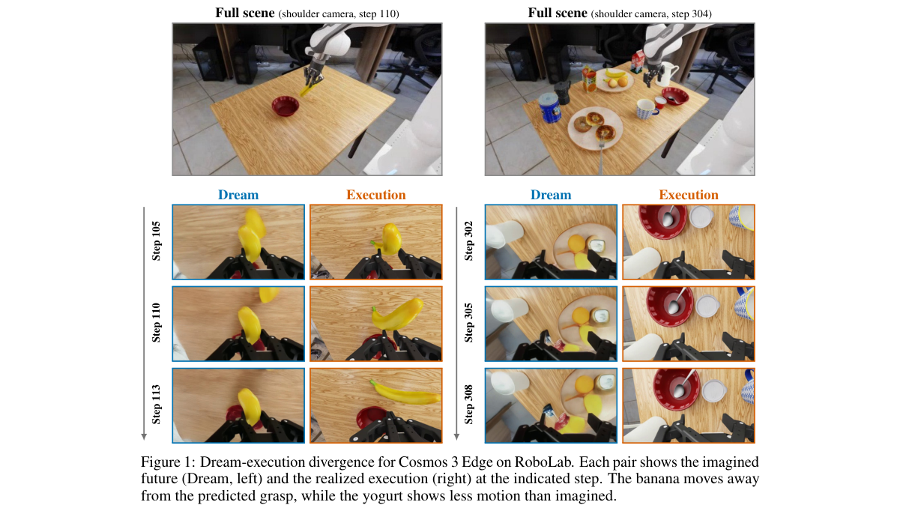

*Result - WISE at each control decision. A frozen WAM samples B paired action–future candidates (B = 4 in our evaluations). Each candidate receives three scores in [0, 1]. The IDM maps imagined frames*

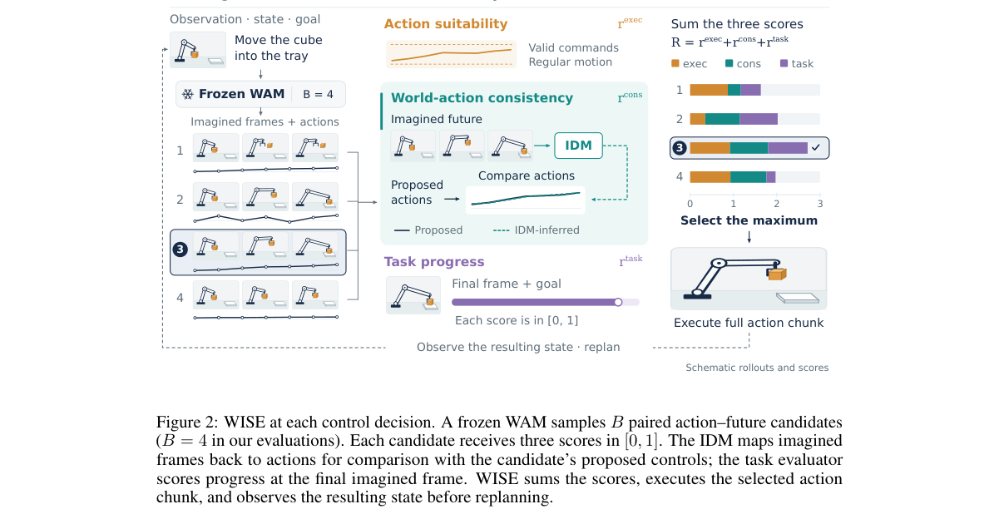

**Why this ranks #10**: 补位说明：本批次生成式内容模型 RL 只有 5 篇硬供给，本文按契约以「不含 RL 的推理期扩展」补位，落在世界动作模型的候选选择上。它对本线的启发很直接：生成式模型做多采样后选择时，若没有专门的一致性判据，选出来的往往只是视觉上更顺的那个；WISE 用动作有效性、逆动力学一致性和指令进度三项分数把选择标准从美学偏好换成物理自洽，RoboLab 闭环成功率因此从 6.0% 提到 24.0%，而模型全程冻结。  [wild-card=yes] 该论文是世界动作模型的推理期候选选择器，属推理期扩展但面向机器人控制而非内容生成，补位计入。

---

