# ArXiv Daily Digest - 2026-11-04 (核心强化学习, 10 papers)

**Generated**: 2026-11-04 17:30 CST

**Source**: arXiv cs.CV, cs.SD, eess.AS, cs.CL, cs.AI, cs.RO, cs.LG submissions, listing day 2026-11-03 (announced 2026-11-04 00:00 UTC)

**Batch window**: 2026-11-02T18:00:00Z .. 2026-11-03T18:00:00Z（arXiv 公告批次横跨两个 UTC 日：前一日 18:00 UTC 起算，当日 17:59:59 UTC 截止）

**Track**: rl_core (top 10 of 587 papers scanned, 70 full reads)

**Scope**: RL 算法与理论、多智能体 RL、sim-to-real 与离线 / 元 RL

---

## Top 10 - 核心强化学习

### 1. Finite-Sample Convergence in Networked Average Reward MARL: Decentralization Pitfalls and Entropy Remedies

**arXiv**: [2611.04072](https://arxiv.org/abs/2611.04072) | **Score**: 8.8 (relevance 9.0 x 0.7 + quality 8.5 x 0.3) | **Tags**: rl-core, marl, average-reward, decentralized, entropy-regularization, California Institute of Technology | **Categories**: cs.LG, cs.MA | **Pages**: 95

**Authors**: Yizhou Zhang; Yashaswini Murthy; Laixi Shi; Adam Vierman

**Affiliation**: California Institute of Technology; The University of Texas at Austin

**Abstract**

> We study the problem of average reward Multi-Agent Reinforcement Learning (MARL) where agents interact within a network. Each agent in the network conducts local updates with information within its $k$-hop neighborhood and collaboratively maximizes the overall reward of the entire network. We first provide impossibility results in achieving convergence to the global optimal joint policies in our setting. These impossibility results highlight the challenges of decentralized learning with local information in multi-agent systems, namely the issues of multiagency, where each agent independently optimizes its policy, and partial observability, where agents have limited visibility into the global state. Given these challenges which indicate that decentralized policy optimization can generally be certified only up to stationarity, we provide finite-sample convergence guarantees for a decentralized actor-critic algorithm with linear function approximation that converges to an approximate stationary point with small gradient norm. To overcome such impossibility results, we further show that adding fixed-state entropy regularization reshapes the objective landscape which leads to even stronger global convergence guarantees for our proposed actor-critic algorithm.

**Key findings**

- **Finding**: 论文证明在网络化平均奖励 MARL 中，仅凭 k 跳邻域信息的分布式策略梯度无法收敛到全局最优联合策略；不加正则时只能保证收敛到梯度范数小的近似平稳点，而加入定态熵正则后其正则化次优性在统计、逼近与局部化误差范围内几何收缩，可收敛到正则化目标的全局最优。
- **Inference**: 这类不可能性结果给社区划清了边界——去中心化 MARL 的全局最优保证并非理所当然，熵正则不是工程技巧而是恢复全局收敛的必要条件之一；但该结论只在平均奖励、定态熵、k 跳局部信息这一设定内成立，折扣型或部分可观测的变体不在其覆盖范围内。
- **Recommendation**: 做去中心化 MARL 的读者应把本文当前提检查表：若你的算法不含定态熵正则，理论上不能声称全局最优；可先在论文的一状态协作玩具网络上复现反例，再评估加熵正则后最优性缺口是否真被抹平，再决定是否投入实现。

**Key figures**

*Framework - One-state coordination example. Panel (a) shows that every joint action returns to the same state; panel (b) gives the reward table; panel (c) plots the unregularized direct product-policy o*

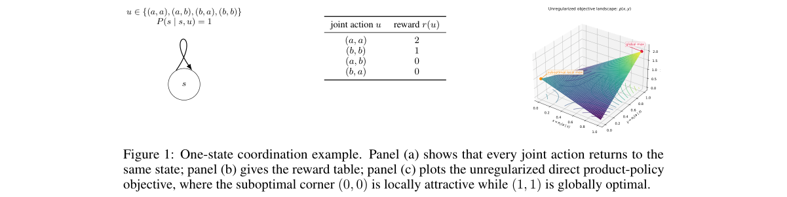

*Result - Partial-observability example. Panel (a) gives the transition table for the hidden local state s2; panel (b) shows the same transition graph. Agent 1 cannot condition its action on s2.*

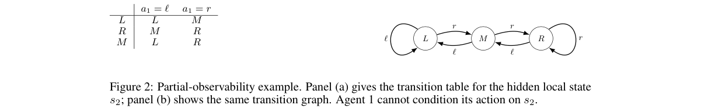

**Why this ranks #1**: 网络化平均奖励 MARL 中每个智能体只能看到 k 跳邻域信息，论文先给出「分布式收敛到全局最优联合策略」的不可能性结果，把 multiagency 与部分可观测性两条障碍讲清楚；随后给出线性函数逼近下 actor-critic 的有限样本平稳性保证，并证明只要加入定态熵正则，就能把结论升级为更强的全局收敛保证。对做去中心化算法的工程团队，这是一份划定理论边界与必要条件的基准文献。

---

### 2. Cooperative Multi-Agent Reinforcement Learning with Submodular Trajectory Rewards

**arXiv**: [2611.04774](https://arxiv.org/abs/2611.04774) | **Score**: 8.5 (relevance 8.5 x 0.7 + quality 8.5 x 0.3) | **Tags**: rl-core, marl, submodular-reward, greedy-approximation, trajectory-optimization, EPFL | **Categories**: cs.LG, cs.MA | **Pages**: 28

**Authors**: Yasaman Zolfimoselo; Nikolas Geroliminis; Maryam Kamgarpour

**Affiliation**: EPFL, Switzerland

**Abstract**

> We study cooperative multi-agent reinforcement learning with decoupled dynamics and a monotone submodular reward function over joint trajectories. Due to the non-additive reward, an optimal policy may depend on the history of all agents. This dependence makes exact optimization exponential in the horizon and the number of agents. To overcome this challenge while retaining theoretical guarantees, we introduce pre-window curvature $c_m$, which quantifies how states visited more than $m$ steps earlier reduce current marginal gains. Using this curvature to control the error from restricting the policy of each agent to depend only on its last $m+1$ states, we propose a greedy algorithm that exploits the decoupled dynamics to optimize local policies sequentially. For fixed $m$, the algorithm achieves a $\frac{1-c_m}{2-c_m}$ approximation guarantee up to estimation error, and its computation time is polynomial in the number of agents and the horizon. We recover the known $1/2$-factor approximation for time-additive rewards and obtain an approximation factor no smaller than the known total-curvature bound for a single agent. We formulate multi-agent traffic monitoring as an example of this framework and evaluate our algorithm on it.

**Key findings**

- **Finding**: 论文提出基于 pre-window curvature c_m 的贪心算法 GWPO，把每个智能体的策略限制在最近 m+1 步状态上，对固定 m 达到 (1-c_m)/(2-c_m) 近似保证（加上估计误差），计算时间对智能体数 N 与时域 H 多项式；在 N=20 个智能体的交通监控实验中，增大记忆长度 m 相对 GPO 持续提升回报，同时计算时间与 GPO 基本相当。
- **Inference**: 近似比随 c_m 变差这一结构性事实说明次模性本身不保证好解，但「早于窗口的历史只影响边际收益」这一衰减结构足以支撑有限记忆下的可计算最优；保证只在解耦动态与全体智能体共同的单调次模奖励下成立，耦合动态或异质奖励不在覆盖内。
- **Recommendation**: 若你的多智能体奖励是轨迹级的（例如联合巡检、联合覆盖），先估一下 pre-window curvature 再决定记忆长度 m；可直接在论文的交通监控设置上复现 m 的消融，并检查自己的场景是否满足解耦动态这一前提假设。

**Key figures**

*Framework - Part of the road grid with five UAV positions s1, . . . , s5. For i ≤4, the roads C(si) monitored from si share the color of si. Each dashed road in C(s5) is colored, so it is also monitored*

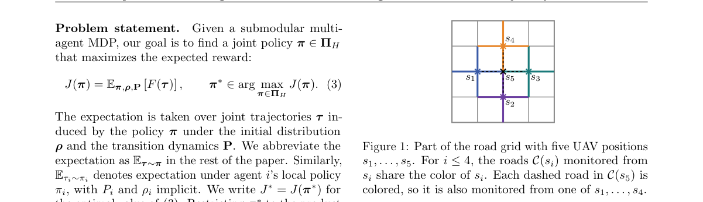

*Result - Performance improvement and computational cost of memory in GWPO. (a) Return improvement of GWPO with different memory lengths m over GPO [4] for N = 20 agents and different recovery rules.*

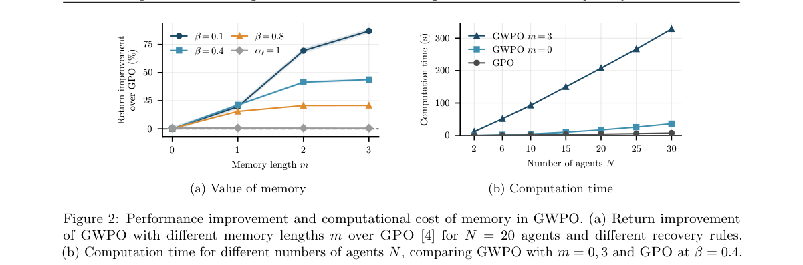

**Why this ranks #2**: 联合轨迹上的单调次模奖励让最优策略可能依赖所有智能体的完整历史，精确优化在时域和智能体数上是指数级的。论文引入 pre-window curvature c_m 控制「只看最近 m+1 步」的截断误差，给出 (1-c_m)/(2-c_m) 的近似保证且计算量对智能体数与时域多项式，并在多智能体交通监控任务上验证了记忆长度的收益。

---

### 3. Safeguarding Multi-Agent Reinforcement Learning for Connected and Automated Vehicles with Recursively Feasible Control Barrier Functions

**arXiv**: [2611.04957](https://arxiv.org/abs/2611.04957) | **Score**: 8.5 (relevance 8.5 x 0.7 + quality 8.5 x 0.3) | **Tags**: rl-core, control-barrier-function, safe-rl, autonomous-driving, marl, Computer Science | **Categories**: cs.RO | **Pages**: 16

**Authors**: Jianye Xu; Yousef Sayed; Bassam Alrifaee

**Affiliation**: Department of Computer Science, RWTH Aachen University, Germany

**Abstract**

> Multi-Agent Reinforcement Learning (MARL) shows promise in coordinating connected and automated vehicles but offers no safety guarantee. Although Control Barrier Functions (CBFs) can add this guarantee, their optimization problem can become infeasible in practice due to control bounds. Moreover, they often overapproximate vehicle and road geometry, which makes them conservative. This paper proposes the Backup-Horizon CBF (BH-CBF), which evaluates safety along a horizon until all vehicles stop. BH-CBF is recursively feasible under control bounds, and it considers the exact vehicle and road geometry. Based on BH-CBF, we derive a fully decentralized safety filter that only needs a single broadcast of vehicle states and routes per step and stays real-time in dense traffic. We use BH-CBF to safeguard a MARL policy over its life cycle: as a reward during pre-training, as a run-time filter at deployment, and as a filter in the training loop that keeps fine-tuning on unseen maps collision-free. In simulations on real-world maps of a roundabout and an intersection, BH-CBF avoids all collisions of unsafe MARL policies and keeps its safety guarantee at every step. Existing filters either collide, lose the guarantee, or fall back to full braking far more often. In recorded roundabout traffic with 1264 human-driven vehicles over 115 km, our safeguarded policies shorten the median travel time by 14% compared with the human drivers, without any collision.

**Key findings**

- **Finding**: BH-CBF 沿「所有车辆刹停」的备份时域评估安全，在控制界约束下递归可行并考虑精确车辆与道路几何；据此构造的去中心化安全滤波器每步只广播一次车辆状态与路径，在真实环岛与路口地图仿真中消除了不安全 MARL 策略的全部碰撞且每步保持安全保证，而现有滤波器出现碰撞、丢失保证或更频繁退回全力刹车；在 1264 辆人工驾驶车、115 km 实录环岛交通中，加固后的策略把中位通行时间比人类司机缩短 14%，且无碰撞。
- **Inference**: 安全保证与通行效率可以同时拿到，说明「CBF 必然保守」更多来自时域不足与几何过度近似而非 CBF 本身；但结论以运动学自行车模型与精确地图几何为前提，感知噪声或模型失配下递归可行性的推导不再直接适用。
- **Recommendation**: 负责车队安全落地的团队值得优先复现：用论文的环岛与路口地图测自家 MARL 策略的碰撞率与全刹频率，再评估用 BH-CBF 替换现有滤波器的净收益；若感知噪声较大，需先补做鲁棒性实验再谈上线。

**Key figures**

*Framework - An unsafe MARL policy safeguarded by our BH-CBF. Light trails: predictions of braking to a standstill along the route. Red: standstill distance of a vehicle pair.*

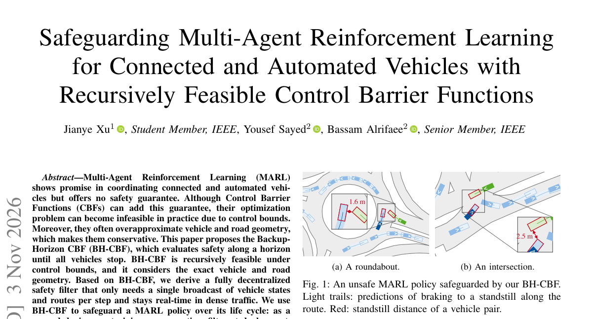

*Result - Kinematic bicycle model. p = (px, py): position; ψ: heading; v: speed; β: slip angle; δ: steering angle; ℓr: rear-axle distance; ℓwb: wheelbase.*

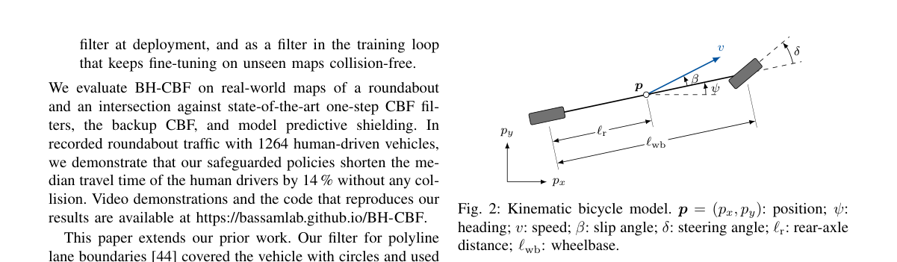

**Why this ranks #3**: MARL 策略在网联车协同上没有安全保证，而 CBF 又常因控制界导致不可行、并因过度近似车辆与道路几何而保守。论文提出 Backup-Horizon CBF，把安全评估延伸到所有车辆停车的备份时域，在控制界下递归可行且只用精确几何，并给出每步只需一次状态与路径广播的完全去中心化实时安全滤波器。

---

### 4. Reconstructing Fraudulent Strategies in Online Payments via Interpretable Inverse Reinforcement Learning

**arXiv**: [2611.04819](https://arxiv.org/abs/2611.04819) | **Score**: 8.1 (relevance 8.0 x 0.7 + quality 8.5 x 0.3) | **Tags**: rl-core, inverse-rl, fraud-detection, data-augmentation, interpretability, Tongji University | **Categories**: cs.AI | **Pages**: 12

**Authors**: Huilin He; Weiyu Han; Linbo Shao; Ruobing Zuo; Xiao Tan; Shuai Chen; Dawei Cheng

**Affiliation**: Tongji University; Ant International; East China Normal University

**Abstract**

> Payment fraud causes financial losses and undermines users' trust in web payment services. Although fraud detection is a critical defense for payment security, complex and diverse fraudulent behaviors can still evade detection. Generating fraud samples for data augmentation can broaden detectors' coverage of different fraud patterns. However, existing methods matching the distribution of transaction attributes alone do not ensure that generated sequences preserve the sequential relationships among transaction choices, payment feedback, and subsequent behavioral adjustments. To this end, we propose PaySeqGen, an interpretable inverse reinforcement learning framework that reconstructs fraud behavior policies from fraudsters' observed payment trajectories. We design a mechanism for constructing candidate actions to support plausible payment sequence generation while enabling exploration. The framework also learns interpretable behavioral rewards that capture fraudsters' preferences across different transaction contexts. By alternating between reward learning and policy optimization, the framework reconstructs policies that generate new fraud sequences for detector augmentation and learns interpretable rewards supporting sequential fraud-pattern analysis in real trajectories. Experiments in real-world payment scenarios at Ant International, a leading global digital payment provider, show that PaySeqGen outperforms state-of-the-art generative augmentation methods. Reward-based trajectory analysis also identifies fraud patterns of practical value, helping analyst locating suspicious segments and examine multistep fraud tactics. Evaluation in the deployed system of online payment further confirms its effectiveness.

**Key findings**

- **Finding**: PaySeqGen 用采样特征期望匹配与奖励-策略交替更新反推欺诈支付策略，每步构造 48 个历史引导加 16 个探索候选动作；在四个检测器上，RT、TabFormer、GraphSAGE 三个指标均排名第一，GraphSAGE 上 Recall@2 提升 4.561 个百分点（比最强生成基线高 1.186 个），并在生产系统的评估中确认有效。
- **Inference**: 把生成目标升级为「可解释的行为奖励」之后，增益不再只是数据量效应——相对真实欺诈回放仍有额外 Recall@2 收益，说明模型捕获到了欺诈者随反馈调整策略的序关系；但所有数字都取自蚂蚁内部流量分布，跨平台迁移性尚未验证。
- **Recommendation**: 风控算法团队可按论文的候选动作构造与交替优化实现一版小规模复现，先看 AUC/Recall@2 的增量能否在自家生产检测器上出现，再评估把学到的行为奖励用于分析师定位可疑片段的实际可用性。

**Key figures**

*Framework - An illustrative online fraud payment sequence and its decision context shaped by feedback.*

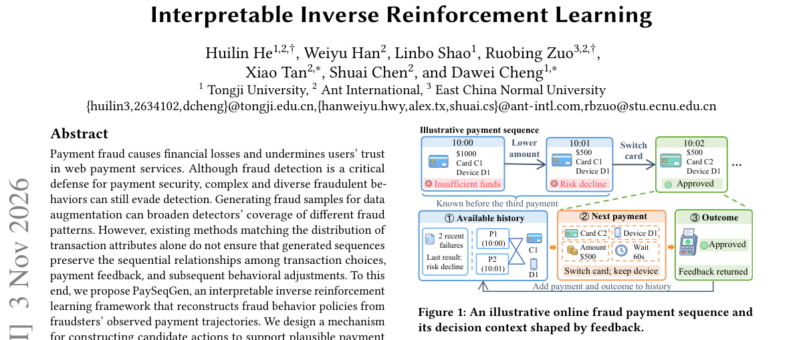

*Result - Overview of PaySeqGen. (a) Model payment trajectories as a sequential decision process. (b) Construct candidate actions through history-guided sampling and exploratory sampling. (c) Learn be*

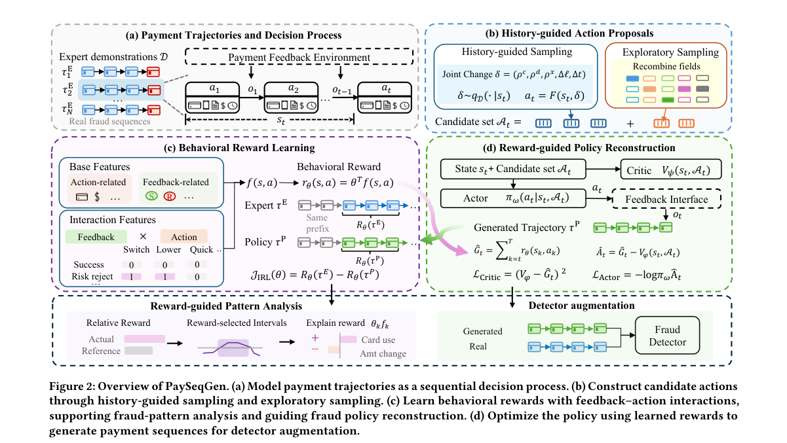

**Why this ranks #4**: 支付欺诈的样本昂贵且难以覆盖新型模式，这篇用可解释 IRL 从真实欺诈轨迹反推欺诈者的策略，把生成样本直接变成检测器的训练资源。在蚂蚁国际线上支付真实场景中，PaySeqGen 在生产检测器 RT 上把 AUC 提升 0.393 个百分点、Recall@2 提升 1.621 个百分点，并优于全部生成类基线，同时给出可交给分析师使用的行为奖励。

---

### 5. Decision Transformer with Task-Aware Representations for Offline Meta-Reinforcement Learning

**arXiv**: [2611.04010](https://arxiv.org/abs/2611.04010) | **Score**: 8.0 (relevance 8.0 x 0.7 + quality 8.0 x 0.3) | **Tags**: rl-core, meta-rl, offline-rl, decision-transformer, language-grounding, State University of New York at Binghamton | **Categories**: cs.LG | **Pages**: 22

**Authors**: Xinbo Zhao; Yuhang Liu; Xin Zhang; Lei Le; Zhaohan Xi; Yingxue Zhang

**Affiliation**: State University of New York at Binghamton; San Diego State University; LinkedIn

**Abstract**

> To enable effective generalization in offline meta-RL, it is essential to accurately infer the underlying task through latent task representations, which provide a compact and transferable summary of task-specific characteristics for guiding policy generation. In this paper, we propose Contrastive Task-Aware Decision Transformer (CoTA-DT), a DT-based offline meta-RL framework that learns task representations by jointly integrating four complementary components: (i) contrastive learning from offline trajectories, (ii) alignment with natural-language task descriptions, (iii) one-step supervision via a task-conditioned world model, and (iv) long-term supervision via a task-conditioned Q function. The learned task representations are used as conditioning signals for a DT-based policy, enabling task-aware meta-policy learning. To further support generalization in both zero-shot and few-shot settings, we design a language-grounded, self-adaptive strategy that enables effective and reliable adaptation to unseen tasks. Notably, in CoTA-DT, the pretrained LLM serves as a shared backbone for language encoding, world modeling, Q-function estimation, and policy learning. This unified design facilitates parameter sharing, improving both efficiency and generalization. Extensive experiments across diverse offline meta-RL benchmarks demonstrate that CoTA-DT consistently outperforms prior methods, particularly in challenging zero-shot generalization scenarios.

**Key findings**

- **Finding**: CoTA-DT 在 Mixed 数据集上的零样本与少样本均取得全部四个基准最优，零样本 Meta-World 回报 1292.5±28.2，较次优 T2DA-T 的 1103.5±36.3 高 189.0，Cheetah-Vel 相对提升 15.7%、Ant-Dir 提升 2.8%；少样本下差距进一步拉大（Meta-World +213.1、Cheetah-Vel +11.5），评测为 5 个留出任务各 5 个种子。
- **Inference**: 四个监督信号指向同一表征空间，比单一信号更能撑住零样本迁移，而 LLM 作为共享骨干带来的参数共享同时改善了效率与泛化；不过全部结论来自离线元 RL 基准，零样本表现高度依赖任务描述 h 的质量，描述缺失时结论不成立。
- **Recommendation**: 做离线元 RL 的读者可用论文的 Pt-Robot、Cheetah-Vel、Ant-Dir、Meta-World 设置复现零样本曲线，并做四路监督的消融以确认增益究竟来自哪一路；若你的场景没有自然语言任务描述，需先补一版无文本变体。

**Key figures**

*Framework - Overview of CoTA-DT. (a) Multi-perspective task representation learning jointly optimizes four signals—(i) contrastive task encoding from offline trajectories, (ii) language alignment betwee*

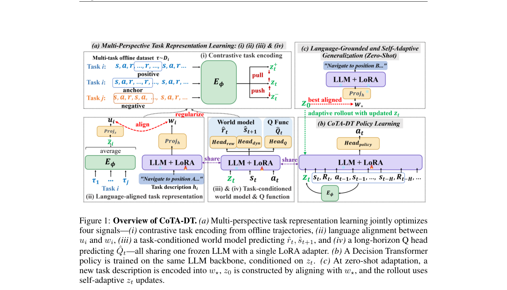

*Result - Zero-shot test return curves of CoTA-DT against baselines on Mixed datasets.*

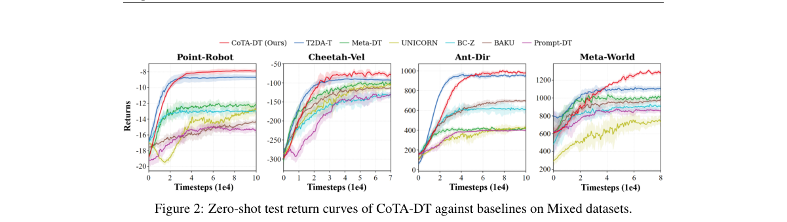

**Why this ranks #5**: 离线元 RL 的泛化瓶颈在任务表示，latent 必须能跨任务迁移并指导策略生成。CoTA-DT 把对比学习、自然语言任务描述对齐、任务条件世界模型的一步监督、任务条件 Q 函数的长时监督四合一训练同一任务表征，并用预训练 LLM 作为语言编码、世界模型、Q 估计与策略学习的共享骨干。最难的 Mixed 数据集零样本设置下四个基准全部最优，Meta-World 相对次优基线绝对提升 189.0。

---

### 6. On the Feature Evolution of Temporal Difference Learning

**arXiv**: [2611.04158](https://arxiv.org/abs/2611.04158) | **Score**: 8.0 (relevance 8.0 x 0.7 + quality 8.0 x 0.3) | **Tags**: rl-core, rl-theory, td-learning, representation-learning, regret-bound, University of North Carolina at Chapel | **Categories**: cs.LG | **Pages**: 76

**Authors**: Shangzhe Li; Dechen Zhang; Difan Zou; Weitong Zhang

**Affiliation**: University of North Carolina at Chapel Hill; The University of Hong Kong

**Abstract**

> Temporal-difference (TD) learning trains neural representations using bootstrapped targets generated by evolving value estimates, yet how predictive features emerge and propagate under incomplete neural updates remains poorly understood. We investigate this problem using finite-width two-layer ReLU critics on a constructed family of smooth stochastic horizon-$H$ MDPs with unknown quadratic structure and $d$-dimensional observations. We first show that an informative TD update acquires the quadratic Bellman signal and yields a representation admitting a bounded predictive readout. The simultaneous hidden-weight and head update achieves a strict finite-sample prediction-risk improvement over matched head-only SGD, with a $2(d+1)$-fold larger population quadratic response. We then establish that an imperfect learned continuation can already provide informative supervision to an earlier zero-reward stage. By tracking coupled neural updates with one SGD step per target copy, without requiring intermediate Bellman regressions to be solved, we obtain a uniform prediction-error transient $\exp[-Ω(K/(Hd))]$, up to action-independent shifts and explicit sampling and finite-width errors. On the constructed signed-action MDP family whose total reward is bounded by 1, we show that an exploration-then-commit algorithm can achieve $\widetilde{O}(d^3H^{1/3}T^{2/3})$ regret over $T$ episodes, using $K=\widetilde{O}(Hd)$ global updates. Our analysis connects bootstrapped feature acquisition, concurrent neural refinement, and finite-budget policy performance.

**Key findings**

- **Finding**: 在有限宽两层 ReLU critic 上，隐层权重与读出头同时更新相对只更新头的匹配 SGD 取得严格的有限样本预测风险改善，总体二次响应大 2(d+1) 倍；对每个目标副本做一步 SGD 即可得到 exp[-Ω(K/(Hd))] 的一致预测误差暂态；在总奖励有界的构造性有符号动作 MDP 族上，explore-then-commit 用 K=Õ(Hd) 次全局更新达到 Õ(d³H^{1/3}T^{2/3}) 的 T 回合遗憾。
- **Inference**: 论文证明「不完美的续接部分也足以给早期零奖励阶段提供有效监督」，这正是 TD 能在稀疏奖励下启动的机制性解释；但全部保证建立在构造出来的二次结构 MDP 族与有限宽 critic 上，不能直接外推到高维深层网络与一般 MDP。
- **Recommendation**: 理论方向读者可把本文当作分析脚手架：先在自己的目标类上验证「隐层-读出头同时更新优于只更新头」的经验规律，据此设计特征诊断实验；若要给出严格结论，需要接受构造性假设而非直接宣称一般情形成立。

**Why this ranks #6**: TD 学习的自举目标如何长出预测特征一直缺严格刻画，这篇在有限宽两层 ReLU critic 与已知二次结构的随机时域 MDP 族上，把「一次有信息的 TD 更新」「有限样本预测风险改善」「explore-then-commit 遗憾上界」串成完整链条，首次把自举式特征获取与有限预算下的策略性能连起来。

---

### 7. Language Model Augmented Decision Transformer for Multi-Task Offline Reinforcement Learning

**arXiv**: [2611.04031](https://arxiv.org/abs/2611.04031) | **Score**: 8.0 (relevance 8.0 x 0.7 + quality 8.0 x 0.3) | **Tags**: rl-core, offline-rl, multi-task, llm-augmentation, decision-transformer, State University of New York at Binghamton | **Categories**: cs.CL, cs.LG | **Pages**: 27

**Authors**: Xinbo Zhao; Yuhang Liu; Xin Zhang; Lei Le; Zhaohan Xi; Yu Yang; Yingxue Zhang

**Affiliation**: State University of New York at Binghamton; San Diego State University; Lehigh University

**Abstract**

> Offline multi-task reinforcement learning (MTRL) aims to learn a unified policy from heterogeneous offline datasets that generalizes across tasks. However, existing offline MTRL methods often struggle with two fundamental issues: severe per-task data scarcity and limited cross-task generalization. In this paper, we propose Language-Model Augmented Decision Transformer (LaMA-DT), a unified sequence-modeling framework that leverages a single large language model (LLM) for both trajectory augmentation and multi-task policy learning. LaMA-DT uses natural-language task descriptions to guide task-aligned trajectory augmentation through a set of supervised generation and alignment objectives, and incorporates a scoring-and-filtering mechanism to retain high-quality augmented trajectories. The same LLM is then repurposed as a language-conditioned Decision Transformer and fine-tuned on a mixture of real and augmented data. Experiments on Meta-World and MuJoCo multi-task benchmarks demonstrate that LaMA-DT consistently outperforms competitive baselines, particularly in low-data regimes, showing that language-guided data augmentation substantially improves cross-task generalization.

**Key findings**

- **Finding**: LaMA-DT 在 Meta-World（ML5/ML30）与 MuJoCo（Cheetah-vel/Cheetah-dir/Ant-dir）上均超过全部基线，标准数据区间相对最强基线平均提升 5.5%（Meta-World）与 6.8%（MuJoCo）；在次优离线数据下，ML30 从 1% 数据的 15.7 提升到 10% 数据的 51.8，相对 Prompt-DT 在 1% 与 10% 数据下分别领先 22.7% 与 40.8%，Cheetah-dir 上超过 HarmoDT 47.3%。
- **Inference**: 收益随数据稀缺程度放大，说明语言先验主要在补数据分布而非补策略能力；同时用同一个 LLM 承担增强与策略角色省掉了额外模型，但增强质量靠似然打分过滤，一旦过滤阈值不当，错误轨迹会被直接注入策略训练。
- **Recommendation**: 数据稀缺的多任务离线 RL 团队值得复现：先用论文的 Meta-World ML30 次优数据设置测 1% 与 10% 数据区间的收益，再调增强比例 r 与过滤阈值做敏感性分析；若没有任务描述文本，可先退化为只用真实数据训练的条件 DT 作为基线。

**Key figures**

*Framework - LaMA-DT consists of three components: (i) Multi-Objective Fine-Tuning. We adapt the LLM to generate meaningful, task-specific trajectories from limited offline data and natural-language task*

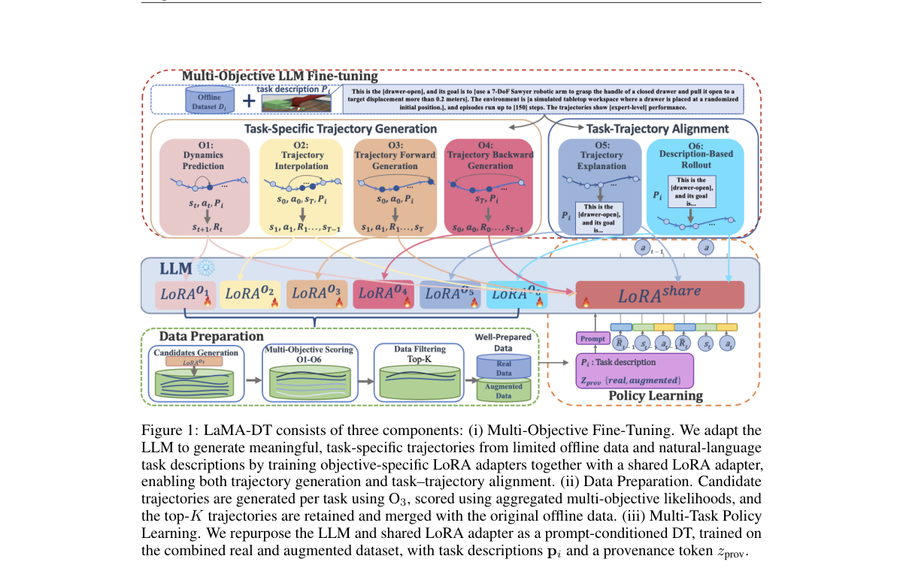

*Result - Performance of LaMA-DT with different augmentation ratios r = |Daug*

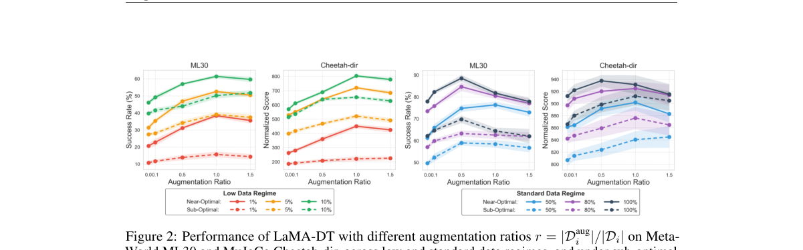

**Why this ranks #7**: 离线多任务 RL 的两大痛点是单任务数据稀缺与跨任务泛化弱，LaMA-DT 让同一个 LLM 既做任务对齐的轨迹增强、又做语言条件的多任务 Decision Transformer 学习，并用似然打分过滤保证增强质量。在 Meta-World 与 MuJoCo 上相对最强基线平均提升 5.5% 与 6.8%，且低数据与次优数据区间收益最大。

---

### 8. CANDO: Conservative Action-Noise Directional Optimization for Residual Reinforcement Learning

**arXiv**: [2611.04543](https://arxiv.org/abs/2611.04543) | **Score**: 8.0 (relevance 8.0 x 0.7 + quality 8.0 x 0.3) | **Tags**: rl-core, residual-rl, generative-policy, offline-conservative, sample-efficiency, School of Data Science | **Categories**: cs.AI, cs.LG | **Pages**: 9

**Authors**: Zeyu Gao; Chengkai Hou; Chaoyue Li; Zhuangzhe Wu; Jiaming Liu; Yao Mu; Peng Jia; Li Zhang; Shanghang Zhang

**Affiliation**: School of Data Science, Fudan University; Shanghai Innovation Institute

**Abstract**

> Pretrained generative policies provide strong behavior priors for robot control, but adapting them efficiently with online reinforcement learning remains difficult. A central challenge is how to improve a frozen generative policy without destroying the structure learned from offline demonstrations. Noise-space residual methods address this by modifying the policy's input noise, but existing noise-space methods typically regulate adaptation through fixed latent feasible regions, which may exclude valuable noise edits. In contrast, action-space residual methods are more sample-efficient, but their efficiency can still be further improved. We propose Conservative Noise Directional Optimization (CNDO), a noise-space residual RL method that improves a frozen generative policy by learning state- and noise-conditioned directions around Gaussian latent samples. CNDO removes predefined latent feasible regions and instead regulates noise-space adaptation through the soft conservative constraint, which consists of conservative value estimation and gated execution. We further introduce Conservative Action-Noise Directional Optimization (CANDO), which adds an action-space residual, combining structured latent-space improvement with local action correction. Experiments show that, once CNDO narrows the gap between noise-space and action-space residual learning, CANDO further improves over single-space optimization, achieving 76.1 NAUC and a 91.4% final success rate, surpassing the best single-space results by 6.6 NAUC and 4.1% success rate. More demos and info are available on https://cando-rl.github.io/.

**Key findings**

- **Finding**: CNDO 在高斯隐样本周围学习状态与噪声条件化的方向，用保守价值估计加门控执行替代固定隐空间可行域，把噪声空间与动作空间残差的效率差距缩小；在此基础上 CANDO 加入动作空间残差，取得 76.1 NAUC 与 91.4% 的最终成功率，相对最优单空间结果分别高出 6.6 NAUC 与 4.1 个百分点。
- **Inference**: 差距的主因不是表示空间本身而是约束形态——硬性可行域会排除有价值的噪声编辑，这对「固定生成策略 + 残差适配」这一通用范式可直接迁移；但样本效率数字取自作者自己的仿真套件，跨策略族与跨任务的稳定性仍需独立验证。
- **Recommendation**: 做生成式策略在线适配的团队可以直接照搬「软保守约束」这条改造路径：先复现单空间基线与 NAUC 口径，再叠动作空间残差做对比；上线前需在自己的仿真器上重测，因为 NAUC 对任务难度与噪声设定相当敏感。

**Key figures**

*Framework - Motivation for residual learning in noise and action spaces. (a) Noise-space residual RL edits the input noise before frozen-policy decoding, while action-space residual RL corrects decoded ac*

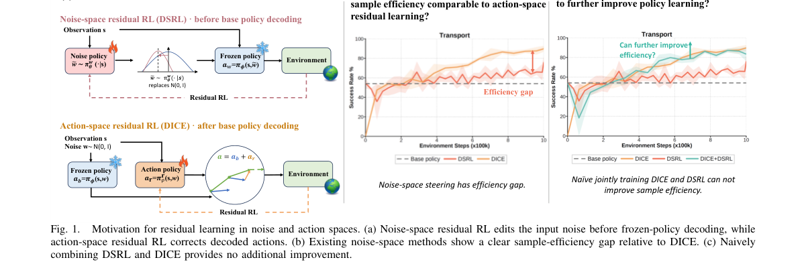

*Result - Comparison of noise-space regulation strategies. (a) DSRL bounds latent variables with tanh squashing. (b) LPS projects latents onto the Gaussian hypersphere. (c) LP-DS constrains residual noi*

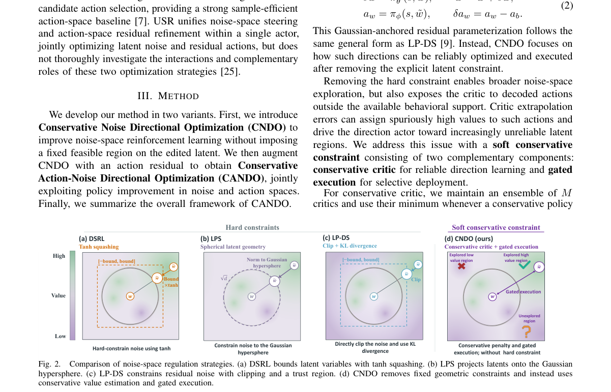

**Why this ranks #8**: 冻结的生成式策略要在不破坏预训练结构的前提下被在线 RL 适配，噪声空间残差方法靠固定隐空间可行域约束、动作空间残差更省样本但仍有差距。CNDO 去掉预定义可行域、改用保守价值估计加门控执行的软约束，缩小噪声与动作空间的差距后，CANDO 叠加动作空间残差取得 76.1 NAUC 与 91.4% 最终成功率，比最优单空间方法高 6.6 NAUC 与 4.1 个百分点。

---

### 9. CRONOS: Benchmarking Non-Episodic Reinforcement Learning for Robotic Manipulation

**arXiv**: [2611.05080](https://arxiv.org/abs/2611.05080) | **Score**: 8.0 (relevance 8.0 x 0.7 + quality 8.0 x 0.3) | **Tags**: rl-core, non-episodic-rl, vision-language-action, benchmark, reset-efficiency, Computer Science and Information | **Categories**: cs.LG, cs.RO | **Pages**: 17

**Authors**: Po-Yi Wu; Djengo Cyun-Jyun Fang; Dian Cheng; Tsung-Wei Ke

**Affiliation**: Department of Computer Science and Information Engineering, National Taiwan University

**Abstract**

> Reinforcement learning (RL) is promising for adapting robot policies to unstructured real-world environments. However, standard RL pipelines rely on episodic training with frequent scene resets, which is impractical for real-world deployment due to the need for substantial human intervention. While prior work has studied non-episodic RL in relatively small policies trained from scratch, its behavior when fine-tuning modern large-scale pre-trained vision-language-action (VLA) models remains underexplored. In this work, we introduce CRONOS, a simulation benchmark for RL fine-tuning of VLAs under non-episodic scene resets. CRONOS leverages high-fidelity physics simulators and adopts shared-scene multi-task settings. Using CRONOS, we show that naively fine-tuning pre-trained policies fails in non-episodic settings due to shifts in object configurations and end-effector poses; however, these challenges can be mitigated through targeted reset allocation and by addressing biases in pre-trained models. Moreover, we find that non-episodic training enhances long-horizon manipulation and improves generalization to previously unseen object configurations and task sequences. Project page: https://embodiedai-ntu.github.io/cronos/

**Key findings**

- **Finding**: CRONOS 显示在共享场景的多任务非情节式设置下直接微调预训练 VLA 会因物体配置与末端执行器位姿漂移而失败：用启发式场景重置（HSR）在重置间隔 T=2560 下把 SpatialVLA 的域内成功率从 14% 提升到 64%，而学习式重置（LSR）与扰动策略（PER）分别与周期重置同效或完全不适配；非情节式训练（T=320）相对情节式（T=80）在 OpenVLA 上把重叠与杂乱配置成功率从 0.554/0.494 提升到 0.593/0.536，SpatialVLA 上从 0.552/0.512 提升到 0.643/0.550。
- **Inference**: 失败根因是策略进入不可恢复状态（物体掉出桌面或离开可达工作空间）后 rollout 全为零奖励，因此强制重置不可恢复场景比任何学习式重置都划算；非情节式训练带来的分散场景暴露反而提升了空间泛化，这修正了「非情节式训练只是省人力」的常见预期。
- **Recommendation**: 打算在真机上做持续学习的研究者应把 CRONOS 当起点：先复现 HSR 把成功率从 14% 拉到 64% 的实验，再在固定重置预算（如 1000 次）下比较各重置策略；若用的是 VLA，建议先做一次线性近似检查，确认 RL 微调没有让模型偏离预训练表示过多。

**Key figures**

*Framework - Overview of non-episodic training in CRONOS. We introduce CRONOS, a benchmark for RL fine-tuning of VLAs under infrequent scene resets. Tasks share a scene (top left). Episodic training rese*

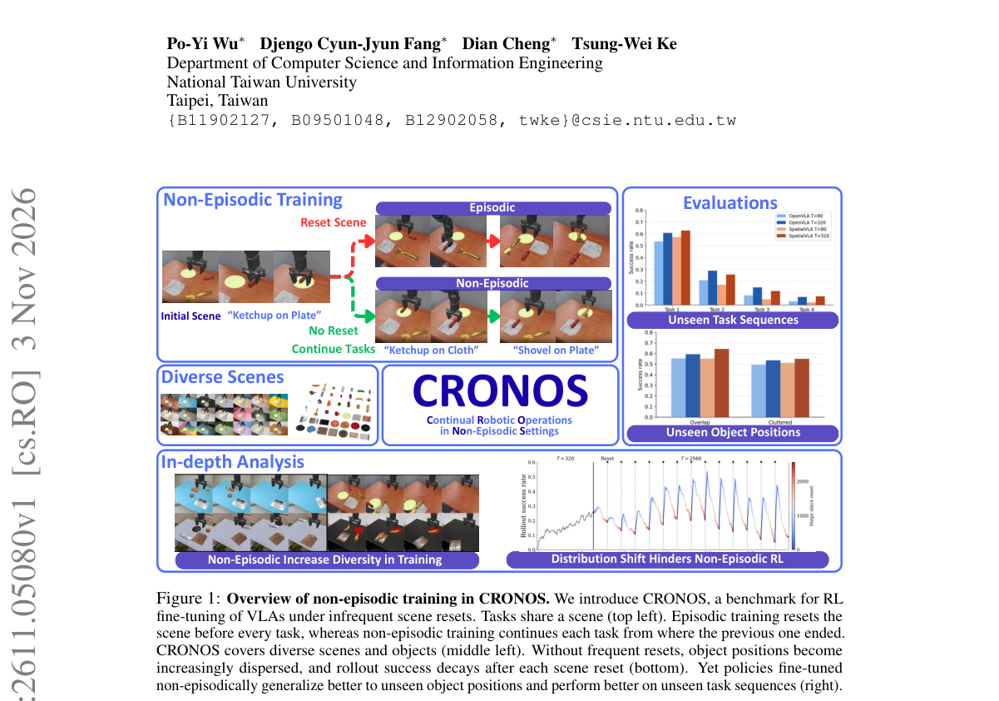

*Result - Pretrained VLAs struggle to learn under non-episodic scene resets. When directly fine-tuned in the non-episodic multi-task setting, learning performance dropped dramatically as the scene res*

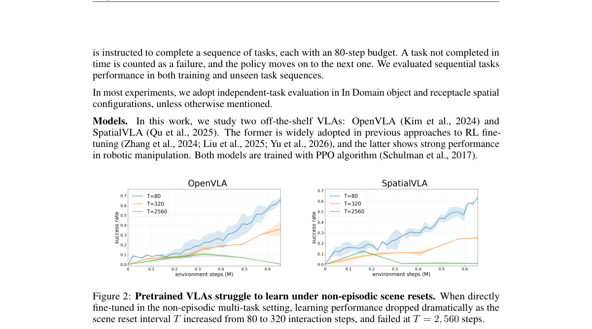

**Why this ranks #9**: 真实机器人 RL 依赖频繁重置场景，而这在部署时不现实；CRONOS 首次把非情节式场景重置下的 VLA 微调做成系统基准，结论既不悲观也不乐观：朴素微调会崩，但把「不可恢复场景」强制重置就能救回来，而且非情节式训练反而提升长程操作与对未见物体配置的泛化。

---

### 10. D&A: Decoupling Description and Assessment Enables VLMs as Zero-Shot Robotic Reward Models

**arXiv**: [2611.03622](https://arxiv.org/abs/2611.03622) | **Score**: 8.0 (relevance 8.0 x 0.7 + quality 8.0 x 0.3) | **Tags**: rl-core, vlm-reward, zero-shot, confirmation-bias, prompt-only, University of Washington | **Categories**: cs.AI, cs.CL, cs.LG, cs.RO, eess.SY | **Pages**: 26

**Authors**: Marius Memmel; Shawn Yin; Urvi Rutia; Angad Wadhwa; Eldon Li; Gavin Angeloff; Ankit Goyal; Jesse Zhang; Dieter Fox; Fabio Ramos; Anqi Li; Abhishek Gupta

**Affiliation**: University of Washington; NVIDIA

**Abstract**

> Vision-Language Models (VLMs) hold promise for zero-shot video task-progress estimation in robot learning, yet existing frameworks frequently suffer from confirmation bias, hallucinating progress in failed executions due to implicit success assumptions or relative temporal ranking designs. Naive prompting of frontier models collapses into a binary success detector that fails to capture nuanced, non-linear progress and failures. While post-training approaches can mitigate this through explicit training, they demand expensive real-world robotics data and require computationally intensive post-training for every individual base model. To resolve these limitations, we introduce D&A (Describe & Assess): our approach decouples progress estimation into an objective, task-grounded textual description of scene dynamics followed by an assessment phase using explicit rubrics. By compelling the VLM to synthesize an explicit, text-based definition of absolute success before scoring, the framework anchors evaluations to an external, global criterion rather than the video's internal timeline. Empirical results demonstrate that our method calibrates zero-shot estimates and mitigates confirmation bias, providing fine-grained, partial progress metrics that accurately penalize failed executions while correctly interpolating successful runs. Being purely prompt-based, D&A generalizes across tasks, embodiments, and benchmarks---matching or surpassing post-trained reward models---and its reward estimates enable efficient downstream reinforcement learning.

**Key findings**

- **Finding**: D&A 先让 VLM 输出任务锚定的场景动态文字描述，再依据显式 rubric 打分，使评分锚定外部全局标准而非视频内部时间线；Kendall τ 在 RBM-EVAL-OOD 上从朴素提示的 0.349 提升到 0.583（+0.234），另一模型上从 0.360 提升到 0.576（+0.216），D&A-Bench 上从 0.597 提升到 0.753（+0.156），RoboRewardBench 的 MAE 降到 0.67（更大底座的 D&A* 为 0.63），其奖励估计可直接用于真实机器人在线与离线 RL。
- **Inference**: 「先描述后评估」用极低成本拿到了后训练奖励模型的水平，说明不少确认偏误来自提示结构而非模型能力不足；但打分质量随底座模型与提示版本漂移（论文示例轨迹来自 GPT-5.3，查询日期为 2026 年 4 月），换底座需要重新校准。
- **Recommendation**: 需要零样本机器人奖励的团队可直接照搬这套两段式提示做基线：用自家失败轨迹检查 Kendall τ 与 MAE 相对朴素提示的提升，再把奖励接入小规模 latent-space RL 验证下游收益；若要产品化，需把 rubric 显式化并固定提示版本。

**Key figures**

*Framework - Confirmation Bias in Na¨ıve VLM Reward Es- timation: Zero-shot querying causes models to hallucinate progress even on failed tasks, resulting in high prediction variance and no clear differenc*

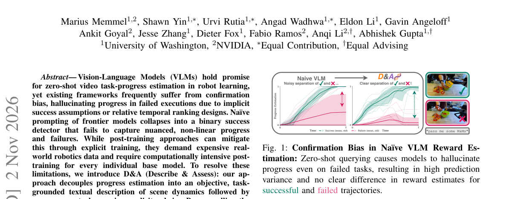

*Result - Example reasoning trace generated by GPT-5.3 (queried April 11, 2026) for the opposite instruction “unfold the shirt.”*

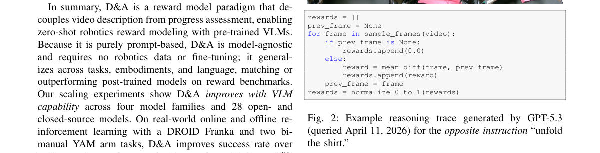

**Why this ranks #10**: 直接提示前沿 VLM 做视频任务进度估计会退化成二元成功检测，并在失败轨迹上幻觉进度。D&A 把进度估计拆成「客观描述场景动态」与「按显式 rubric 评估」两步，纯提示实现、零额外训练，在 D&A-Bench、RBM-EVAL-OOD 与 RoboRewardBench 上匹配或超过后训练奖励模型，并能直接驱动下游真实机器人 RL。

---

