# ArXiv Daily Digest - 2026-11-04 (LLM 后训练 RL, 10 papers)

**Generated**: 2026-11-04 17:30 CST

**Source**: arXiv cs.CV, cs.SD, eess.AS, cs.CL, cs.AI, cs.RO, cs.LG submissions, listing day 2026-11-03 (announced 2026-11-04 00:00 UTC)

**Batch window**: 2026-11-02T18:00:00Z .. 2026-11-03T18:00:00Z（arXiv 公告批次横跨两个 UTC 日：前一日 18:00 UTC 起算，当日 17:59:59 UTC 截止）

**Track**: rl_llm (top 10 of 587 papers scanned, 70 full reads)

**Scope**: LLM 后训练的 RL：RLHF / DPO / GRPO / RLAIF / RLVR / on-policy 蒸馏与 RLVR 调度

---

## Top 10 - LLM 后训练 RL

### 1. Not All Reasoning Generalizes: A Case Study on Learning Generalizable Reasoning Strategies in RLVR

**arXiv**: [2611.03627](https://arxiv.org/abs/2611.03627) | **Score**: 9.3 (relevance 9.5 x 0.7 + quality 9.0 x 0.3) | **Tags**: rl-llm, rlvr, ood-generalization, reasoning-strategy, co-training, University of Illinois Urbana-Champaign | **Categories**: cs.LG | **Pages**: 26

**Authors**: Ziqi Pang; Yu-Xiong Wang

**Affiliation**: University of Illinois Urbana-Champaign

**Abstract**

> Reinforcement learning with verifiable rewards (RLVR) can enable generalizable improvement for large language model (LLM) reasoning. This paper studies how to incentivize such generalization via reasoning strategies. We study this question with a controllable equation-solving framework: finding multiple inputs x for equations f(x)=y, where f is a non-bijective string function. This setting makes reasoning strategies observable while supporting a clear definition of easy-to-hard out-of-distribution (OOD) shifts, e.g., more solutions, longer y, etc. We uncover a subtle RLVR failure: it teaches the model to solve in-distribution tasks with high accuracy and structured step-by-step derivation, yet under OOD shifts, the same model abandons derivation and collapses to ineffective brute-force enumeration, causing sharp accuracy drops. This observation reveals the deeper challenges of RLVR generalization as it is neither incapable base model nor reward hacking, since the model succeeds in-distribution with the correct reasoning strategy. The key to mitigating this failure is an indirect intervention that surprisingly helps: co-training with bijective inversion tasks. Although these bijective tasks are actually not uniformly harder and even further from the non-bijective OOD evaluation, they make derivation more certain and substantially restore the correct strategy and accuracy under OOD shifts. This effect further motivates our theoretical analysis: outcome-only RLVR can shape reasoning processes through implicitly crediting the effective reasoning strategies more, even without process supervision. To conclude, our analysis framework and findings systematically reveal the crucial role and incentivization of reasoning strategies in RLVR generalization under OOD shifts. Code is available at https://github.com/ziqipang/rl_meta_thinking.

**Key findings**

- **Finding**: 在可控方程求解框架中，只训非双射任务的 MONO 模型在分布内的推导占比 85%，到三个更难的 OOD 集上跌破 50%，准确率在最温和的 More Answers 上仍有 80% 以上，但在 Length Change 上跌到 6%（同一模型分布内约 90%）；与双射反演任务共同训练的 MIXED 模型恢复了推导策略，零样本迁移到数学基准上 MATH500 为 77.2%、Minerva-Math 37.5%、AIME24 13.3%、AIME25 10.0%、AMC23 62.5%、OlympiadBench 39.9%，均高于或持平 MONO。
- **Inference**: 失败既不是基座能力不足也不是奖励黑客——模型在分布内确实用对了策略——而是 RLVR 只对结果给信用，策略切换在 OOD 触发下没有被惩罚；共同训练能起作用说明结果监督本身即可隐式地为有效推理过程加信用，比引入过程监督更轻量。
- **Recommendation**: 怀疑自己的 RLVR 模型「一换分布就崩」时，先按论文思路诊断推理策略是否发生切换，而不是只看准确率；再试最省事的干预：把若干分布与难度都不同的任务混入训练集做共同训练，看策略占比与准确率是否同时回升。

**Key figures**

*Result - Reasoning strategy collapse and generalization in OOD tasks (Sec. 4). The MONO model performs normally ID but collapses, which relies on brute-force enumeration OOD. In comparison, MIXED mod*

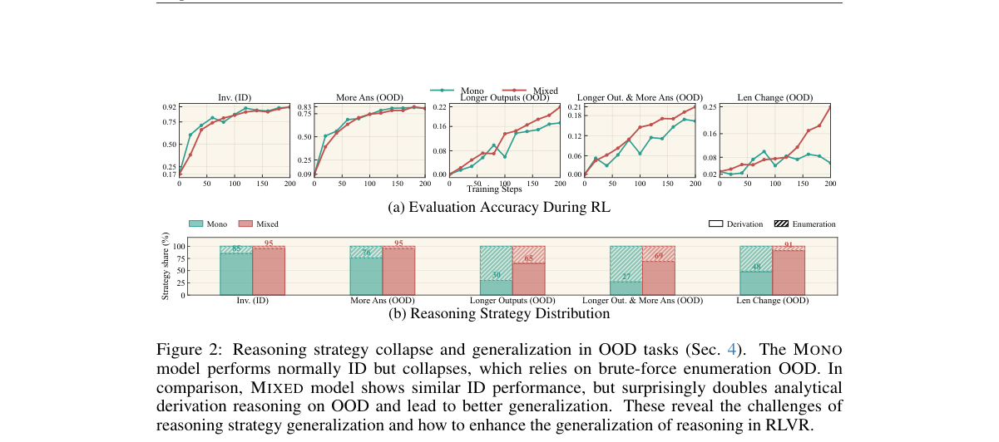

**Why this ranks #1**: 这篇把 RLVR 的泛化问题拆成「模型是否具备能力」与「是否在正确地推理」两件事：在可控的方程求解框架上，RLVR 训出的模型分布内推导准确率高且结构化，但 OOD 时会放弃推导退化为暴力枚举，准确率断崖式下跌。解法反直觉——与并不更难、离 OOD 更远的双射反演任务共同训练，反而能恢复正确策略与准确率。

---

### 2. FADE: Factored Ability--Difficulty Filtering for Online RLVR Scheduling

**arXiv**: [2611.03625](https://arxiv.org/abs/2611.03625) | **Score**: 8.8 (relevance 9.0 x 0.7 + quality 8.5 x 0.3) | **Tags**: rl-llm, rlvr, curriculum, prompt-selection, state-space-filter, University of Michigan | **Categories**: cs.LG | **Pages**: 16

**Authors**: Tomas Duncun; Jonah Ellison; Mateo Ruiz; Hanae Fujita; Ingrid Solberg

**Affiliation**: University of Michigan; University of Edinburgh

**Abstract**

> Group-based reinforcement learning with verifiable rewards (RLVR) learns only from prompts whose sampled completions disagree: all-pass and all-fail groups produce zero relative advantage and burn generation budget without moving the policy. Adaptive schedulers try to steer rollouts toward informative prompts, yet they rely on per-prompt pass-rate trackers that entangle two quantities evolving at very different speeds---the policy's shifting competence across reasoning skills and each prompt's intrinsic difficulty. When a single exponential average or Beta counter tracks both at once, short memory scrambles the relative ordering of prompts whereas long memory reports stale pass rates. We introduce FADE (Factored Ability--Difficulty Estimation), a bilinear state-space filter that separates the two timescales. FADE represents each prompt's success logit as the inner product of a whitened $K$-dimensional skill loading with a fast-drifting policy ability vector, minus a slow-shrinking scalar item intercept. Using Pólya--Gamma augmentation, each minibatch of binary rollout outcomes updates the $K$-dimensional ability posterior in closed form via a rank-$K$ Woodbury step, instantly transferring competence shifts to all unobserved prompts that share those skills while leaving item intercepts stable. From the resulting posterior mean and variance we derive a closed-form utility for the probability of drawing a non-degenerate rollout group. Across five reasoning benchmarks, two base models, and four scheduling paradigms under a matched rollout budget, FADE consistently improves downstream accuracy and calibration while adding less than $0.6$\,ms per step.

**Key findings**

- **Finding**: FADE 把每题成功 logit 表示为白化后的 K 维技能载荷与快漂移能力向量的内积减去慢收缩的题目截距，用 Pólya-Gamma 增广让每个 minibatch 以 rank-K Woodbury 步闭式更新能力后验；跨五个数学基准、两个底座与四种调度范式，在匹配 1.44M rollout 预算下 Qwen2.5-Math-1.5B 的五基准平均分在 DAPO-Filter、PCL、GRESO、GVM 下分别提升 1.8、2.9、2.1、2.8 个点，Llama-3.2-1B-Instruct 上为 1.4、1.3、1.4、1.8 个点，且每步额外开销小于 0.6 毫秒。
- **Inference**: 把能力与难度解耦后，能力变化能即时迁移到所有共享该技能的未见题目，这正是单个 per-prompt 追踪器做不到的；不到 1 毫秒的开销意味着它可以作为调度器直接替换件上线，而不需要改动训练主循环。
- **Recommendation**: 做 RLVR 课程与 rollout 调度的工程团队可以先把 FADE 当作 drop-in 替换 per-prompt 追踪器，测一遍同预算下的准确率与校准；注意论文在 Llama-3.2-1B-Instruct 上发现原生 GVM 反而输给均匀 GRPO（12.3% 对 12.9%），换调度器前建议先跑这一基线。

**Key figures**

*Framework - Why per-prompt trackers face a coupling trade-off. (a) Along a GRPO run on NuminaMath, the absolute pass-rate level decorrelates within ∼100 steps as the policy improves, whereas the relativ*

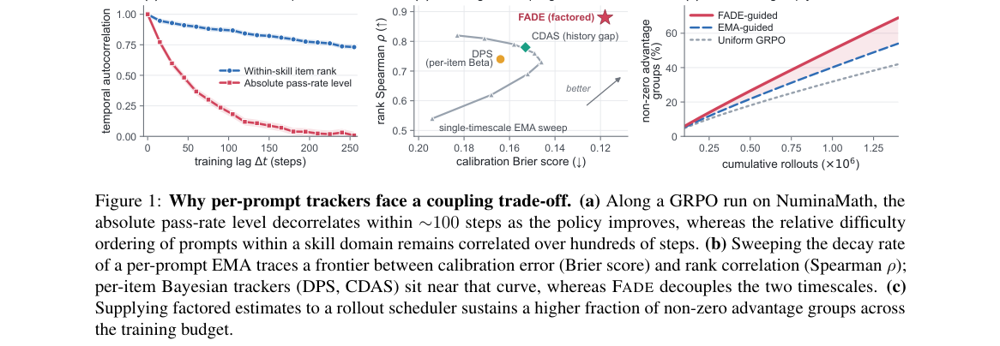

*Result - FADE architecture. (A) Offline, frozen prompt representations are whitened into K orthogonal skill loadings zi ∈RK and an initial difficulty offset ˆbi,0. (B) Online, a dual-timescale Pólya–*

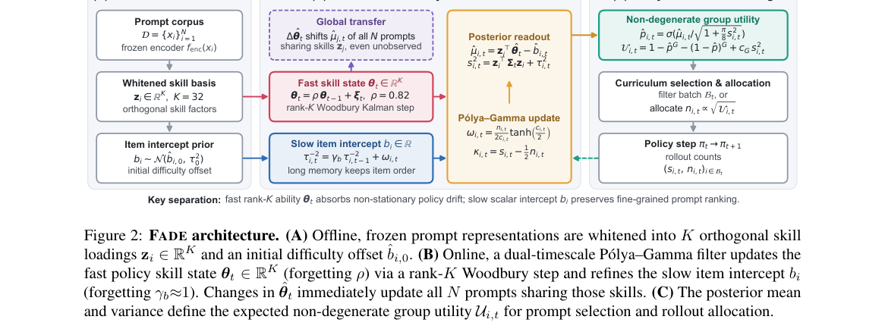

**Why this ranks #2**: GRPO 类方法只有组内答案不一致时才有学习信号，全对全错的组白白烧掉生成预算；但现有自适应调度器用同一个 pass-rate 追踪器同时表示「策略能力变化」与「题目固有难度」，两个时间尺度一混就排序错乱。FADE 用双线性状态空间滤波器把两者分开，闭式更新且每步额外开销不到 0.6 毫秒。

---

### 3. On the Primacy Bias in RLVR Training

**arXiv**: [2611.04061](https://arxiv.org/abs/2611.04061) | **Score**: 8.8 (relevance 9.0 x 0.7 + quality 8.5 x 0.3) | **Tags**: rl-llm, rlvr, primacy-bias, coverage-shrinkage, forgetting, University of Notre Dame | **Categories**: cs.AI | **Pages**: 22

**Authors**: Phuc Minh Nguyen; Ngoc-Hieu Nguyen; Parshin Shojaee; Chinh Duc La; Duy Minh Ho Nguyen; Rui Zhang; Khoa D. Doan; Ting Hua; Nitesh V. Chawl

**Affiliation**: University of Notre Dame; The Pennsylvania State University; Virginia Tech

**Abstract**

> Reinforcement Learning with Verifiable Reward (RLVR) has emerged as a promising approach for enhancing the reasoning capabilities of large language models. However, it still remains unclear whether RLVR can extend reasoning capabilities beyond what is already encoded in the base model. In this paper, we study this question through the lens of primacy bias: the tendency of models to over-rely on already-learned representations, disproportionately improving performance on problems they already handle well while underexploring harder ones that require departing from those representations. Through our controlled experiments and large-scale analysis, we show that RLVR training on mixed data tends to further sharpen performance on easier problems while yielding only marginal gains on harder ones. We find that although hard problems lead to modest gains overall, they are actually the ones that help most in expanding the model's reasoning capabilities and pushing the representations. However, prolonged training on these hard problems may also hurt and lead to forgetting on easy problems. These findings help to better understand some of the prior conflicting observations about RLVR, specifically, why on (OOD) domains where the base model performs poorly, improvements on hard problems can expand reasoning; while on well-trained domains, forgetting can reduce performance and mask genuine gains obtained from hard problems.

**Key findings**

- **Finding**: 论文用受控的偏斜分布实验与大规模分析证明 RLVR 混合训练会进一步锐化简单题表现、对难题只有边际提升，并造成覆盖收缩：预训练模型与随机初始化模型在均匀与易偏分布下均出现 Pass@k 收缩，而只训难题的设定初期提升 Pass@k、随训练延长转为下降；参数更新稀疏度上 SFT 微调模型仅 2.8%，RL 微调模型高达 45.5%–79.9%，且其线性化近似 KL 极小（0.042–0.125）。
- **Inference**: 高更新稀疏率与极小线性 KL 说明 RLVR 实际上把模型「钉」在基座表示附近，这才是难题难被学会的机制根源；由此可解释为何同一配方在基座薄弱域（遗忘少、收益显）与被充分训练域（遗忘严重、掩盖真实收益）上表现相反。
- **Recommendation**: 做 RLVR 数据配比的团队应把「难题比例」与「训练时长」当作两个独立旋钮：先用 Pass@k 覆盖率而非单一准确率做监控，再检查线性化近似 KL 判断更新是否已偏离基座表示太远；只在难题上训练时要显式把简单题加回来以防遗忘。

**Key figures**

*Framework - Experimental designs on toy example of image classification. 1) The pre-trained data distribution is controlled by the skewness parameter β, greater skewness induces strong bias towards domi*

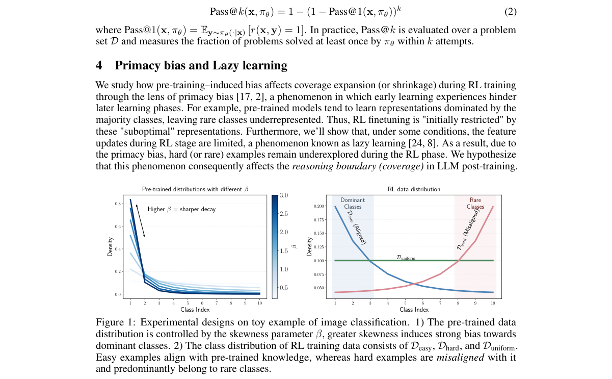

*Result - Coverage (Pass@k) on test inputs over the course of RLVR initialized from a pre-trained or randomly initialized model variants. Coverage shrinkage happens under both Duniform and Deasy, wher*

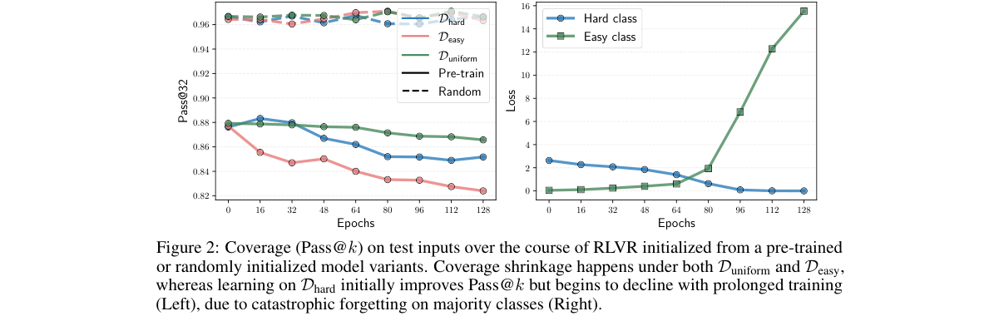

**Why this ranks #3**: 「RLVR 能不能扩展基座已有的推理边界」一直存在冲突结论，这篇用首因偏误给出统一解释：RLVR 偏好已经学会的表示，难题获得的参数更新稀疏，因此混合训练只把简单题做得更好。难点的真正价值在于扩展表示边界，但长时间只练难题又会遗忘简单题——这解释了很多 OOD 域有效、成熟域无效的矛盾观察。

---

### 4. AlgoPilot: Cross-Paradigm Reasoning in Language Models via Strategy Selection and Guidance

**arXiv**: [2611.04079](https://arxiv.org/abs/2611.04079) | **Score**: 8.5 (relevance 8.5 x 0.7 + quality 8.5 x 0.3) | **Tags**: rl-llm, strategy-selection, rl-training, cross-paradigm, llm-reasoning, Massachusetts Institute of Technology | **Categories**: cs.AI, cs.CL, cs.LG | **Pages**: 49

**Authors**: Yilun Hao; Ruixiao Yang; Hudson Hilal; Yongchao Chen; Kaizhi Qian; Yada Zhu; Yang Zhang; Chuchu Fan

**Affiliation**: Massachusetts Institute of Technology; Harvard University; MIT-IBM Watson AI Lab

**Abstract**

> Real-world problems span diverse domains, including program synthesis, symbolic reasoning, planning, and optimization, and often require fundamentally different solution paradigms. A central challenge for LLM-based reasoning is twofold: identifying an appropriate problem-solving approach and formulating it correctly. In this paper, we propose AlgoPilot, a cross-paradigm reasoning framework that enables adaptive selection of the solving approaches and structured problem formulation prior to execution. The AlgoPilot framework contains three components: 1) a SteerLM, trained via supervised fine-tuning (SFT) and reinforcement learning (RL), that adaptively selects the solving strategy (paradigm and modes) based on input problems, 2) the corresponding expert GuideLM, trained via SFT, that generates structured formulation guidance tailored to the selected strategy, and 3) an ExecutionLM that generates solutions conditioned on both the selected strategy and its formulation. Unlike prompting-based methods that rely on fixed reasoning templates, our approach learns to adaptively choose and structure problem-solving strategies based on the input. We build AlgoPilot on Qwen3-8B and evaluate across 5 problem categories and 13 benchmarks with 66 unique domains, comparing against both the latest similarly scaled small models and large LLMs. AlgoPilot significantly improves average accuracy for the same model from 38.4% to 72.9%, outperforming the best large LLM prompting baseline GLM-5 by 11.7%. Ablation studies confirm the effectiveness of each component. Notably, we show that the learned steering and formulation modules can transfer across execution models, suggesting their potential to improve other LLMs. Project page: https://sites.google.com/view/algopilot.

**Key findings**

- **Finding**: AlgoPilot 在 Qwen3-8B 上跨 5 类问题、13 个基准、66 个领域评测，同一模型平均准确率从 38.4% 提升到 72.9%，超过最强的大型 LLM 提示基线 GLM-5 达 11.7 个百分点，消融实验确认三个组件各自有效；训练上先用执行反馈筛选候选指导语来训练 GuideLM，再用其产出的指导训练 SteerLM。
- **Inference**: 收益主要来自「学会选范式并结构化问题」这一层而非更大的执行模型，作者还报告学到的 steering 与 formulation 模块可跨执行模型迁移，说明它们更像可复用的规划资产；但范式集合是人工枚举的，落到枚举之外的新范式仍需重新设计。
- **Recommendation**: 适合把 LLM 用于多范式自动求解的团队：先按论文流程自建 GuideLM 数据管线并做三段消融，确认增益主要来自哪一段；再验证自家执行模型能否替换 Qwen3-8B 保持同等提升，若需扩展范式集合则要额外投入标注。

**Key figures**

*Framework - An overview of AlgoPilot. Given a natural-language problem input, SteerLM first selects a solving paradigm and guidance mode. If guidance is needed, the corresponding paradigm-specific Guide*

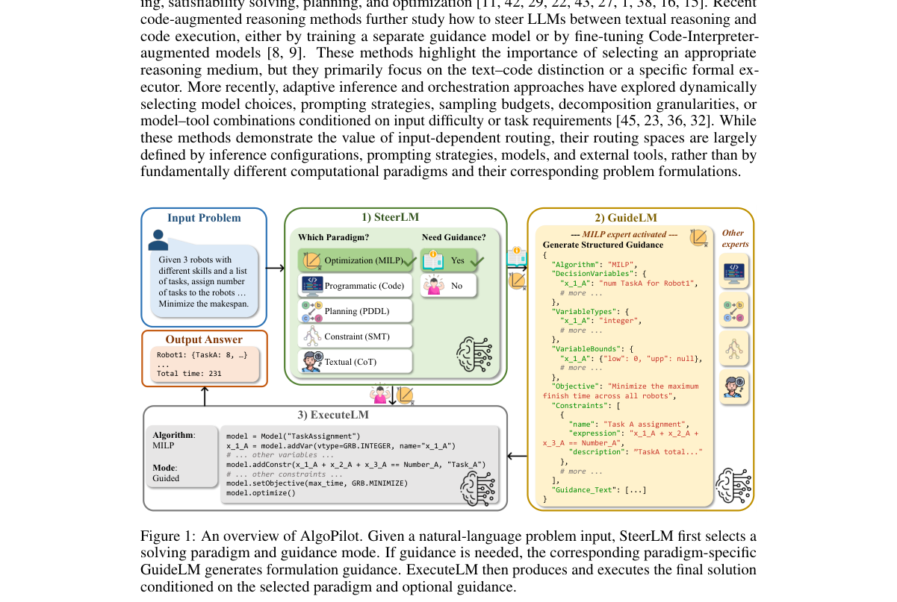

*Result - Training data construction for AlgoPilot. We first generate and filter candidate guidances with execution feedback to train paradigm-specific GuideLMs. The trained GuideLMs are then used in*

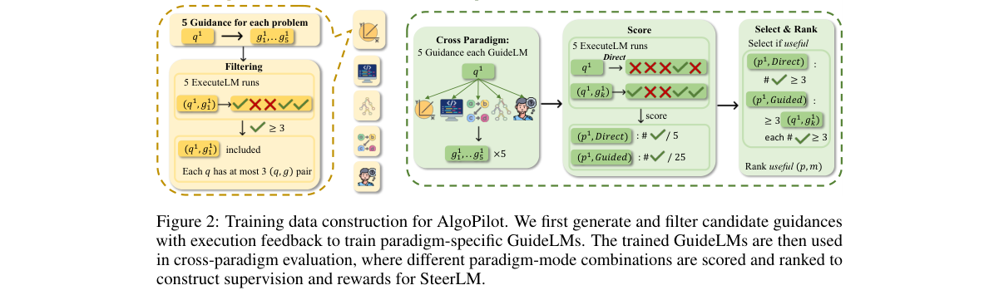

**Why this ranks #4**: 真实问题需要不同范式（程序合成、符号推理、规划、优化），固定提示模板注定失配。AlgoPilot 把它拆成三个模型：SteerLM 用 SFT+RL 学习按输入选择范式，GuideLM 生成该范式对应的结构化表述指导，ExecutionLM 在两者条件下求解。Qwen3-8B 上同一模型平均准确率从 38.4% 提到 72.9%，比最强大型 LLM 提示基线 GLM-5 高 11.7 个百分点。

---

### 5. ReSI-Math: Exploring Recoverable Capability Frontiers for Efficient Reasoning Improvement

**arXiv**: [2611.04787](https://arxiv.org/abs/2611.04787) | **Score**: 8.5 (relevance 8.5 x 0.7 + quality 8.5 x 0.3) | **Tags**: rl-llm, rlvr, evolutionary-search, data-efficiency, math-reasoning, Capital Normal University | **Categories**: cs.AI, cs.CL | **Pages**: 20

**Authors**: Yao Cui; Zhen Yang; Yuandong Wang; Yangfu Zhu; Tianyu Wo; Zhenzhou Shao

**Affiliation**: Capital Normal University; Tsinghua University; Beihang University

**Abstract**

> Reinforcement learning with verifiable rewards (RLVR) has become an effective approach for improving mathematical reasoning in large language models. However, a fundamental question remains: when a model fails to solve a problem, does it truly lack the underlying capability? In this work, we reveal that direct failure does not necessarily imply inability. Some reasoning failures can be recovered by exploring the model's own trajectories, exposing a recoverable capability frontier: a policy-dependent region where solutions are not reliably generated through direct decoding but can be elicited through trajectory-level search. Based on this observation, we introduce ReSI-Math, a framework that explores recoverable capability frontiers and converts recovered capabilities into data-efficient RLVR supervision. ReSI-Math uses Self-Judge-guided evolutionary search to identify recoverable failures under a fixed policy and adaptively selects frontier problems for sequential RLVR as the policy evolves. On Qwen3-VL-8B, correct-incorrect trajectory crossover produces 272 verifier-confirmed correct offspring from 621 attempts (43.8%). After three sequential one-shot RLVR stages, the MATH500 and WE-MATH average improves from 78.71 to 80.16. Under matched single-problem RLVR, random selection reaches only 53.31 versus 54.16 for frontier-guided Q1.

**Key findings**

- **Finding**: ReSI-Math 用 Self-Judge 引导的进化搜索在固定策略下定位可恢复失败，并随策略演化自适应选择前沿题目做顺序 one-shot RLVR；在 Qwen3-VL-8B 上正确-错误轨迹交叉从 621 次尝试产出 272 个经验证器确认的正确子代（43.8%），三轮顺序 one-shot RLVR 后 MATH500 与 WE-MATH 平均准确率从 78.71 提升到 80.16；在匹配的单题 RLVR 预算下随机选题为 53.31，边界引导为 54.16。
- **Inference**: 「失败即不会」这一常识在 RLVR 里并不成立，把搜索预算花在可恢复边界上的收益明显高于均匀投放；但 54.16 对 53.31 的单题差距说明顺序 RLVR 的主要增益来自前几轮的批量恢复，选题策略是次要但便宜的加成。
- **Recommendation**: 做 RLVR 数据工程的团队可先量一下自己的可恢复比例：对失败题做正确-错误轨迹交叉，统计有多少能产出验证器确认的正确子代，若比例可观就值得把预算挪到这条线上；前提是要有可靠验证器与 Self-Judge。

**Key figures**

*Framework - Rollout-profile dynamics over the 28-problem candidate pool and the validation set.*

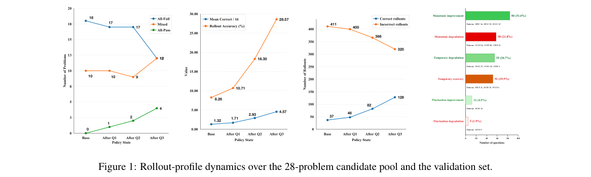

*Result - Overview of ReSI-Math, including four stages: Elicit, Repair, Consolidate, and Reprofile.*

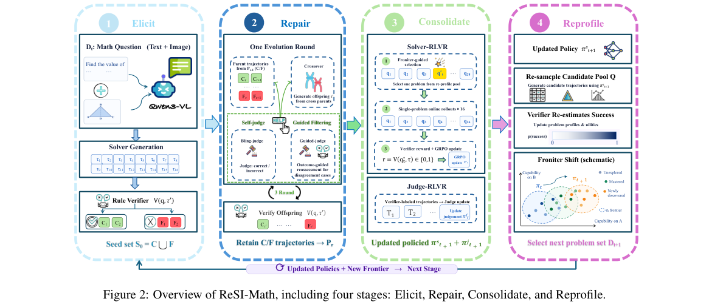

**Why this ranks #5**: 模型解不出题不一定是不具备能力——这篇用正确与错误轨迹交叉把它变成可搜索的可恢复能力前沿，再把恢复出的解转成高信息量的 RLVR 监督。在 Qwen3-VL-8B 上，621 次尝试产出 272 个验证器确认的正确子代（43.8%），三轮顺序 one-shot RLVR 后 MATH500 与 WE-MATH 平均从 78.71 提到 80.16。

---

### 6. JHiMA-WebRL: A Joint Hierarchical Multi-Agent Reinforcement Learning Framework for Long-Horizon Web Tasks

**arXiv**: [2611.05263](https://arxiv.org/abs/2611.05263) | **Score**: 8.5 (relevance 8.5 x 0.7 + quality 8.5 x 0.3) | **Tags**: rl-llm, web-agent, hierarchical-marl, grpo, gui-navigation, Center for Advanced AI | **Categories**: cs.AI | **Pages**: 17

**Authors**: Shanka Subhra Mondal; Jiayun Wang

**Affiliation**: Center for Advanced AI, Accenture

**Abstract**

> Multimodal web agents have shown promising capabilities for interacting with websites through graphical user interfaces (GUIs), yet realistic web tasks often require long-horizon, multi-step planning that remains challenging for monolithic policies. Such agents must jointly infer high-level plans, navigate through intermediate states, track progress over extended interaction histories, and execute visually grounded actions. Although prior work has explored modular multi-agent systems with a separate planner, the planner is typically not updated jointly with the actor. We investigate whether explicitly separating and jointly training planning and execution provides a stronger inductive bias for long-horizon web navigation. We introduce JHiMA-WebRL, a joint hierarchical multi-agent reinforcement learning framework for web agents that couples a task decomposer with an actor. To train the decomposer, we use a strong teacher model to construct structured subtask supervision from multimodal GUI trajectories, and use these annotations to fine-tune both the decomposer and the subtask-conditioned actor. We then extend Group Relative Policy Optimization (GRPO) to jointly optimize the decomposer and actor in the interactive WebArena environment through hierarchical rollout grouping and role-specific advantages. On WebArena-Lite-v2, JHiMA-WebRL-14B, consisting of a 7B actor and a 7B decomposer, achieves an average success rate of 37.2%, compared with 24% for a ScaleCUA-32B agent that we fine-tune with RL on the same training tasks and evaluate under the same protocol. Ablations show that jointly updating the decomposer during RL outperforms updating the actor alone. These results suggest that jointly learned role factorization with smaller models can be a competitive alternative to scaling monolithic agents for long-horizon web tasks.

**Key findings**

- **Finding**: JHiMA-WebRL-14B（7B actor 加 7B 任务分解器）在 WebArena-Lite-v2 上取得 37.2% 的平均成功率，而在相同训练任务上做 RL 微调、相同评测协议下的 ScaleCUA-32B 为 24%；方法只用终局奖励、无稠密过程奖励，通过扩展 GRPO 的分组 rollout 与角色专属优势联合优化两个角色，消融显示联合更新分解器优于只更新 actor。
- **Inference**: 两个 7B 角色胜过单个 32B 单体，说明长程网页任务里「显式角色分工加联合训练」带来的归纳偏置可能比单纯扩规模更划算；不过规划监督由强教师模型标注得到，成本是被转移到了数据构造阶段而非被消除。
- **Recommendation**: 做网页智能体的团队可按论文三阶段流程复现：先用教师模型标注子任务做 SFT，再上联合 RL；若算力只够训一个 7B，可先测分解器是否真学到东西（论文给了子目标完成度与终局成功的相关性分析），而不是直接换更大的单体。

**Key figures**

*Framework - Overview of JHiMA-WebRL. Left: prior web agents use a single policy, or a separate planner that receives no RL updates while the actor is trained. Right: we generate subtask super- vision fr*

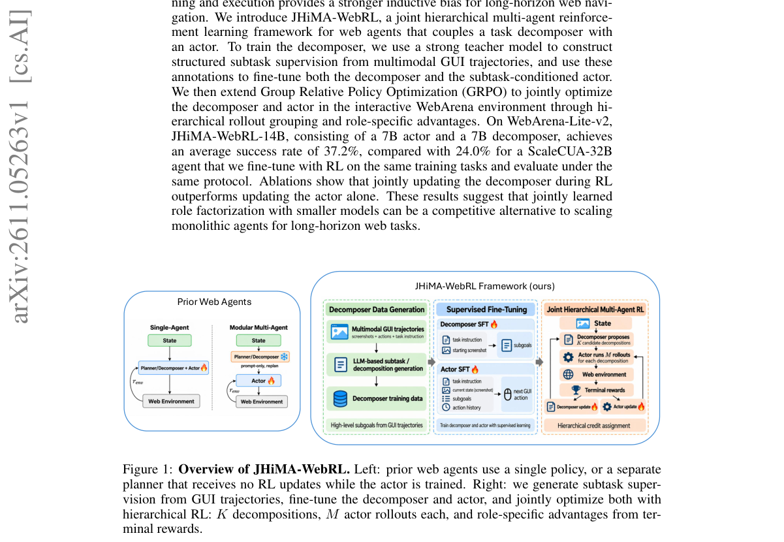

*Result - Subgoal quality analysis. (a) Discriminative power of subgoal completion for predicting terminal task success. (b) Empirical task success versus binned subgoal-completion fraction. Both pane*

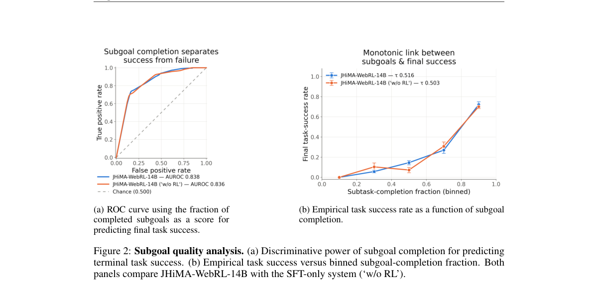

**Why this ranks #6**: 长程网页任务需要高层规划与逐步执行两种能力，但既有的模块化方案里规划器不随 actor 一起更新。JHiMA-WebRL 把任务分解器与 actor 耦合，用强教师模型从多模态 GUI 轨迹构造结构化子任务监督，再把 GRPO 的 rollout 分组与优势计算扩展到两个联合训练的角色。在 WebArena-Lite-v2 上，7B actor 加 7B 分解器拿到 37.2% 平均成功率，显著高于同样做 RL 微调的 ScaleCUA-32B 的 24%。

---

### 7. Stabilizing On-Policy Targeted Guidance in Agentic Reinforcement Learning

**arXiv**: [2611.05266](https://arxiv.org/abs/2611.05266) | **Score**: 8.5 (relevance 8.5 x 0.7 + quality 8.5 x 0.3) | **Tags**: rl-llm, on-policy-distillation, agentic-rl, textual-feedback, entropy-stability, Cursor Research | **Categories**: cs.LG | **Pages**: 14

**Authors**: Kevin Frans; Alexander M Rush; Sergey Levine; Pieter Abbeel; Ashvin Nair

**Affiliation**: Cursor Research; UC Berkeley

**Abstract**

> Naive on-policy RL is often bottlenecked by the capabilities of the base model --- insufficient coverage can result in an inability to learn from certain rewards. At the same time, rewards in modern post-training systems often come from rich textual sources, e.g. judge models with a rubric of criteria. Can we utilize such structures to provide a rich directional signal that enables improving on otherwise difficult to optimize rewards? In this work, we examine a framework we refer to as targeted guidance that learns from per-turn textual feedback via an on-policy self-distillation objective. Our focus is not only on directly improving hard-to-optimize behaviors, but on how to do so throughout the training process without degrading baseline RL performance. Over a range of settings across an agentic multi-turn software engineering environment, we find success by combining targeted self-distillation with a per-criteria RL reward, and by limiting feedback to turns where the policy specifically fails. We further examine the design choices that lead to stable entropy and reduce oscillatory behavior throughout training.

**Key findings**

- **Finding**: 在多轮软件工程环境中，作者把 targeted guidance 实现为逐轮文本反馈上的 on-policy 自蒸馏目标，并发现只有在把蒸馏损失限制在策略具体失败的那些轮、同时叠加逐条判据的 RL 奖励时训练才稳定：最终方法在 Markdown 解决方案、描述用户问题、请求审批、加粗命令、建议后续工作五项风格判据上分别达到 0.85、0.77、0.55、0.99、0.64，同时编码通过率保持 0.33±0.05 与基线持平；对照中 GRPO 通过率同为 0.33 但多数风格判据接近 0，OPSD 通过率降到 0.30，LaTRO 降到 0.14，Verifree 降到 0.20。
- **Inference**: 「只在失败轮上加蒸馏信号」是关键的可操作条件，它把蒸馏从整体行为改造变成定点纠偏，从而避免与主 RL 目标互相拉扯并稳住熵；这也解释了为什么 OPSD 这类全轮蒸馏在主任务上掉点且训练振荡。
- **Recommendation**: 想用 judge 反馈驱动 agentic RL 的团队建议照做三点：用逐条判据奖励而非单一聚合分、蒸馏损失只加在失败轮、并监控熵曲线看是否振荡；若只做全轮蒸馏，先在同样的判据集上测通过率是否会退化再决定投入。

**Key figures**

*Framework - Naive RL fails to optimize criterion that fall outside the support of base policies. Exploration issues in RL can manifest as slow learning (middle) or in the worst case a complete failure t*

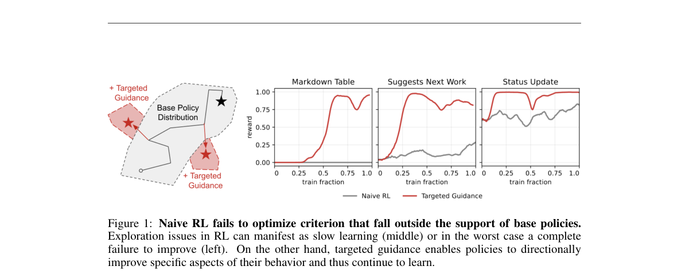

*Result - Targeted guidance derives per-token signal from per-turn hints. During the course of a standard RL procedure, in cases where rollouts fail to satisfy certain criteria, e.g. to utilize a cert*

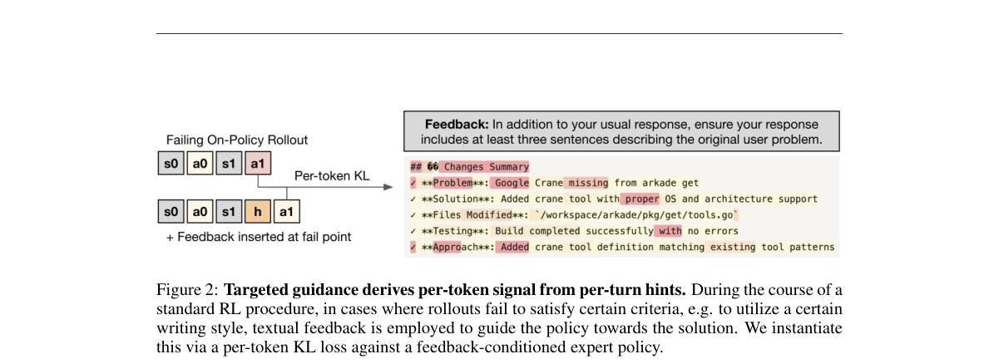

**Why this ranks #7**: 朴素 on-policy RL 受限于基座策略的覆盖，某些判据（如「必须用某个工具格式」）根本采不到样例。论文用逐轮文本反馈做 on-policy 自蒸馏来内化这些方向性信号，关键是只对策略确实失败的那些轮施加反馈、并配合逐条标准的 RL 奖励，才能在拓宽能力的同时不牺牲主任务性能、并稳住熵。

---

### 8. Shuffled OPSD: When Semantic Consistency Hurts On-Policy Self-Distillation?

**arXiv**: [2611.04958](https://arxiv.org/abs/2611.04958) | **Score**: 8.5 (relevance 8.5 x 0.7 + quality 8.5 x 0.3) | **Tags**: rl-llm, on-policy-distillation, self-distillation, input-perturbation, math-reasoning, Duke University | **Categories**: cs.AI, cs.CL | **Pages**: 16

**Authors**: Qingyuan Zheng; Zhihao Dou

**Affiliation**: Duke University

**Abstract**

> Knowledge distillation improves a student model's reasoning ability through supervision from a teacher. On-policy self-distillation (OPSD) uses the same model as both teacher and student under different contexts: the student generates reasoning trajectories from the question alone, while the teacher additionally receives a complete worked example and provides token-level supervision along those trajectories. Because the problem statement is shared, its content and ordering shape both student generation and teacher feedback. Preserving its semantic structure therefore seems natural, but does it always improve learning? We introduce Shuffled OPSD, which shuffles the words of the shared problem statement while keeping the teacher-only worked example intact. Across three mathematical reasoning benchmarks and three Qwen3 model scales, the method improves mean accuracy over both an intact-target control and Standard OPSD under matched training configurations. The largest gain over Standard OPSD is 3.52 percentage points on Qwen3-1.7B. Further controls show that preserving larger word blocks offers no advantage over word-level shuffling at the evaluated scales, whereas shuffling the teacher-only worked example reduces accuracy at every scale. Cross-problem mixing and target-removal experiments further distinguish the roles of problem content, word order, and teacher context. These results show that disrupting the shared problem statement can improve learning, while disrupting the teacher-only reference hurts performance. They challenge semantic coherence as a universally beneficial principle for OPSD and motivate closer study of how input structure shapes student generation and teacher supervision.

**Key findings**

- **Finding**: Shuffled OPSD 只打乱师生共享题面的词序、保持教师专属的完整解题示例不变，在三个数学推理基准与三个 Qwen3 规模上，平均准确率同时超过完整题面对照与标准 OPSD，最大相对标准 OPSD 的增益为 Qwen3-1.7B 上的 3.52 个百分点；对照实验显示保留更大的词块并不优于逐词打乱，而打乱教师专属解题示例在所有规模上都降低准确率。
- **Inference**: 语义连贯性并非自蒸馏的无条件收益来源——共享题面同时塑造学生生成分布与教师打分信号，打乱它实际是一种正则；反例也界定了作用边界：教师侧参考必须保持完整，否则破坏的是监督信号本身。
- **Recommendation**: 用 OPSD 做数学推理蒸馏的团队可以直接在训练中加一次词序打乱，成本几乎为零且在本文的三个规模上都有增益；但务必做一次教师示例打乱对照，确认你的场景里教师监督不被连带破坏后再上线。

**Key figures**

*Framework - Shuffled OPSD transforms the problem statement shared by student and teacher during training. The transformation affects both student rollout generation and frozen-teacher scoring of the sam*

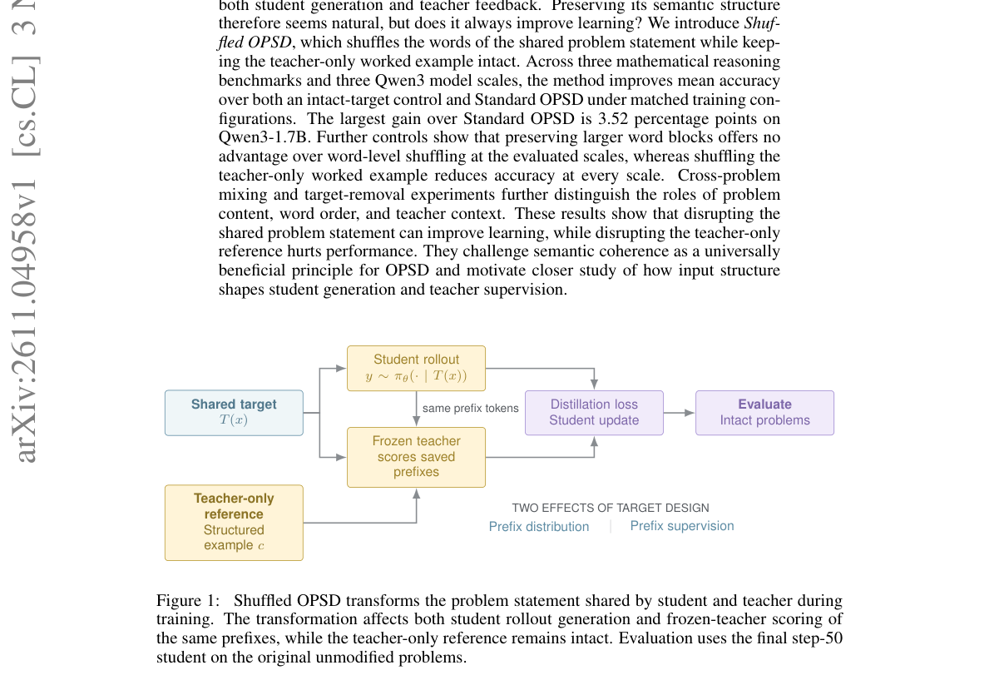

*Result - Shuffled OPSD selectively transforms the problem statement shared by student and teacher. The transformation changes both the student prefix distribution and the distillation signal evaluate*

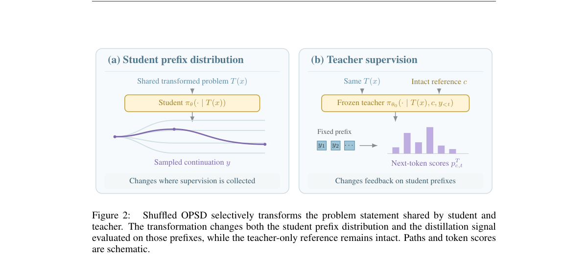

**Why this ranks #8**: on-policy 自蒸馏里师生共享同一道题，于是「保留题面语义结构」看起来天经地义。这篇专门检验这一维度：只打乱共享题面的词序、保留教师专属解题示例，在三个数学基准与三个 Qwen3 规模上平均准确率同时超过完整题面对照与标准 OPSD，Qwen3-1.7B 上最大领先标准 OPSD 3.52 个百分点；而打乱教师示例在所有规模上都变差。

---

### 9. P$^2$-MOPD: Accelerating Multi-Teacher On-Policy Distillation via Parameter Priors

**arXiv**: [2611.03953](https://arxiv.org/abs/2611.03953) | **Score**: 8.5 (relevance 8.5 x 0.7 + quality 8.5 x 0.3) | **Tags**: rl-llm, on-policy-distillation, multi-teacher, task-arithmetic, model-merging, Australian Institute for Machine Learning | **Categories**: cs.AI, cs.LG | **Pages**: 16

**Authors**: Sinuo Wang; Jiacheng Lu; Zeyu Zhang; Maojia Song; Rui Sun; Beidi Luan; Yutong Xie; Jing Li; Daxin Jiang; Qi Wu; Zuo Bai

**Affiliation**: Australian Institute for Machine Learning, Adelaide University; StepFun; Shanghai Jiao Tong University; Singapore University of Technology and Design

**Abstract**

> Multi-teacher on-policy distillation consolidates expert capabilities by supervising student-generated trajectories, whereas task arithmetic offers a training-free alternative through linear parameter combinations. We view the linear combination of student and expert parameters as a single differentiable model and propose P$^2$-MOPD, which jointly optimizes the mixing coefficients and the student weights under the same on-policy distillation objective. Unlike task arithmetic, which stays within the span of the frozen student and expert parameters for any choice of merging coefficients, P$^2$-MOPD keeps the student trainable, so the experts act as parameter priors without confining it to this span. Across four domains at 1.7B and 4B scales, P$^2$-MOPD achieves faster and more balanced recovery than MOPD from the same initialization, surpassing its final average recovery in half the training steps. At the end of training, our 1.7B model reaches 94.7% average recovery, versus 80.9% for MOPD.

**Key findings**

- **Finding**: P²-MOPD 把学生与专家参数的线性组合视为单一可微模型，在同一 on-policy 蒸馏目标下联合优化混合系数与学生权重，使专家作为参数先验而不把学生限制在冻结参数张成的空间内；跨四个领域、1.7B 与 4B 两个规模，它比同初始化的 MOPD 恢复更快更均衡，用一半训练步数即超过 MOPD 的最终平均恢复率，训练结束时 1.7B 模型平均恢复率 94.7%，MOPD 为 80.9%。
- **Inference**: 关键设计差别是保持学生可训练——一旦允许偏离冻结张成空间，多教师能力融合的效率明显提升，这解释了它为何优于纯 task arithmetic 与标准 MOPD；但方法依赖同初始化的教师与学生，跨架构或跨 tokenizer 的融合是否成立论文未涉及。
- **Recommendation**: 想把多个专家模型能力压进一个学生的团队值得复现：按论文设置固定同初始化与教师集合，先画恢复率-训练步数曲线确认「一半步数超过 MOPD 终值」是否稳定；若教师来自不同初始化，需先做对齐实验再谈迁移。

**Key figures**

*Framework - Average recovery over training at Qwen3-4B (top) and*

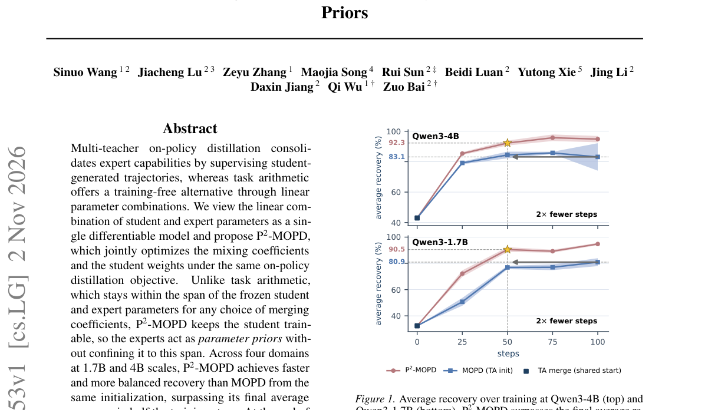

*Result - Overview of P2-MOPD. Each projection of the student is composed as its own learnable full weight plus a learnable linear*

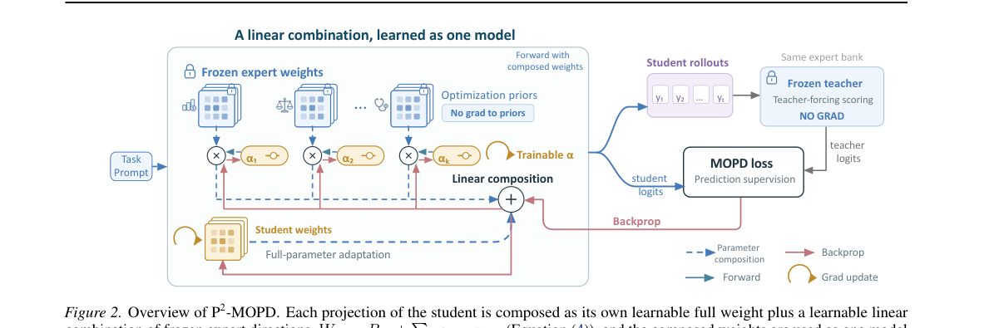

**Why this ranks #9**: 多教师 on-policy 蒸馏要同时承接多个专家能力，而训练外的 task arithmetic 只能做参数线性组合、始终被冻结学生与专家张成的空间限制。这篇把线性组合看作一个可微模型，联合优化混合系数与学生权重，学生保持可训练，因此专家充当「参数先验」而非硬性上限，1.7B 模型平均恢复率达 94.7%，而 MOPD 为 80.9%。

---

### 10. Think Less, Locally: Local Preference Learning for Reasoning Compression

**arXiv**: [2611.04814](https://arxiv.org/abs/2611.04814) | **Score**: 8.5 (relevance 8.5 x 0.7 + quality 8.5 x 0.3) | **Tags**: rl-llm, reasoning-compression, dpo, local-preference, efficiency, MOEKLINNS | **Categories**: cs.AI, cs.CL | **Pages**: 18

**Authors**: Muyao Yuan; Liyan Xu; Weizhan Zhang; Muyan Jiao; Jiangnan Li; Jinchao Zhang; Jie Zhou

**Affiliation**: MOEKLINNS, School of Computer Science and Technology, Xi'an Jiaotong University; WeChat AI, Tencent Inc.

**Abstract**

> Large reasoning models achieve strong performance on challenging tasks, but their long chain-of-thought often incurs substantial inference costs by continuing to deliberate after sufficient information has been obtained. Existing reasoning compression methods primarily operate on reasoning trajectories, paying less attention to the local decision of whether further reasoning is necessary given the current state. We propose LoCo, a local preference learning method for reasoning compression. LoCo detects candidate overthinking states from the model's own traces, freezes the corresponding reasoning prefixes, regenerates shorter verified continuations from the same states, and trains on the resulting state-conditioned preference pairs with DPO. This formulation teaches the model when to continue reasoning and when to conclude, rather than simply encouraging shorter trajectories overall. We construct training data entirely from self-generated mathematical traces and evaluate LoCo on five mathematical and three code generation benchmarks. LoCo reduces completion length by 41.7\%--45.4\% on mathematics and 23.4\%--36.3\% on code, while maintaining or improving accuracy and achieving the best AUC across all code benchmarks. LoCo consistently improves the accuracy-efficiency trade-off on mathematics and transfers effectively to code generation despite math-only training, demonstrating the cross-domain generality of local preference learning for reasoning compression. The code and model will be publicly released at https://github.com/MuyaoYuan/LoCo.

**Key findings**

- **Finding**: LoCo 检测模型自生成轨迹中的候选过度思考状态，冻结对应推理前缀并从同一状态重新生成更短且经验证正确的续写，转成状态条件的偏好对后用 DPO 训练；训练数据全部来自自生成的数学轨迹，在五个数学与三个代码生成基准上评测，数学任务完成长度下降 41.7%–45.4%、代码下降 23.4%–36.3%，准确率持平或更好，并在全部代码基准上取得最佳 AUC，数学训练后仍能有效迁移到代码。
- **Inference**: 长度下降近四成而准确率不降，说明冗余主要来自不知何时停而非推理链本身缺少信息，局部偏好学习比全局长度惩罚更精准；但续写的「更短且正确」依赖可验证奖励，因此数学类可验证任务天然更适用，开放式生成任务的迁移未被验证。
- **Recommendation**: 有推理成本压力的团队可先按论文流程自建数据：从自生成轨迹里标出过度思考状态、重新生成更短且正确的续写，再用 DPO 训练，先在数学集上验证长度-准确率曲线；由于数学训练已能迁移到代码，可把同一管线直接用在代码生成上省一轮数据。

**Key figures**

*Framework - Overview of the LoCo pipeline. Starting from a self-generated reasoning trace, LoCo detects local overthinking states, regenerates shorter correct continuations from those states, and conver*

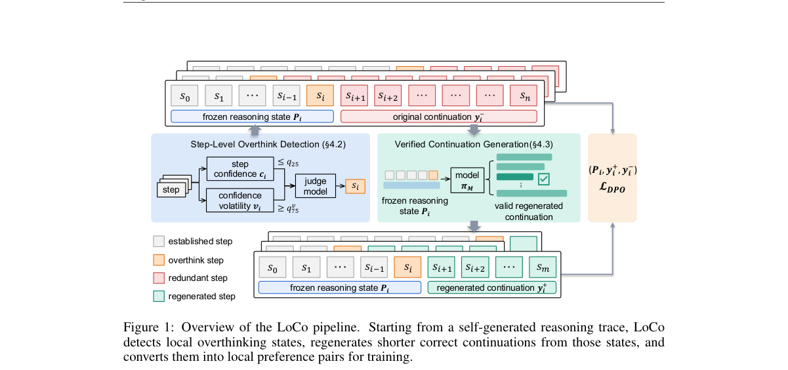

*Result - Accuracy versus token budget on AIME24 and CodeContests. LoCo achieves a better accuracy and efficiency trade-off than TokenSqueeze on both benchmarks.*

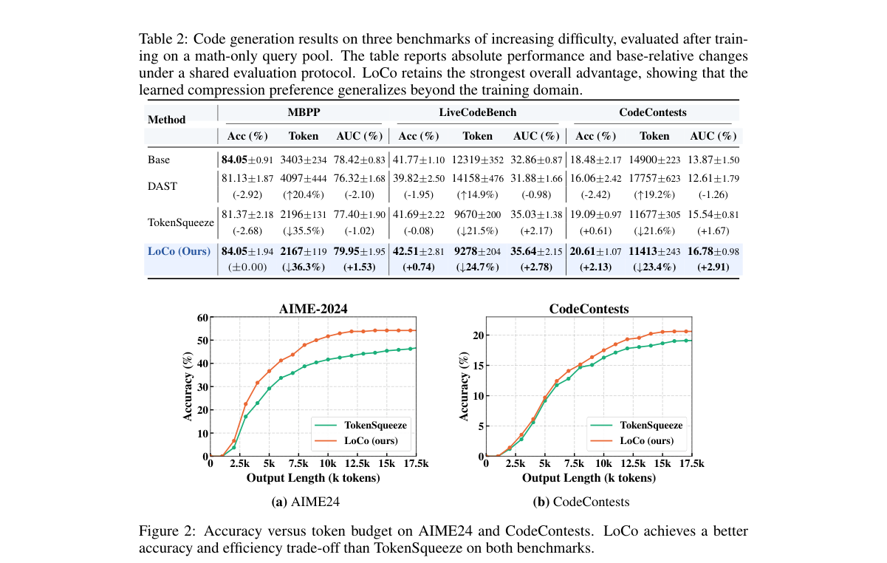

**Why this ranks #10**: 大推理模型常在信息已经足够后继续思考，而推理压缩多在轨迹层面下手，忽略了「此刻还需要不要继续推理」这个局部决策。LoCo 从模型自身轨迹中检测过度思考状态、冻结前缀、重新生成更短且正确的续写，再用这些状态条件的偏好对做 DPO，教模型何时收尾而不是整体鼓励变短。

---

