# ArXiv Daily Digest - 2026-11-05 (AIGC 音频生成, 10 papers)

**Generated**: 2026-11-05 17:30 CST

**Source**: arXiv cs.CV, cs.SD, eess.AS, cs.CL, cs.AI, cs.RO, cs.LG submissions, listing day 2026-11-04 (announced 2026-11-05 00:00 UTC)

**Batch window**: 2026-11-03T18:00:00Z .. 2026-11-04T18:00:00Z（arXiv 公告批次横跨两个 UTC 日：前一日 18:00 UTC 起算，当日 17:59:59 UTC 截止）

**Track**: aigc_audio (top 10 of 518 papers scanned, 70 full reads)

**Scope**: 音频 / 语音 / 音乐的生成、合成、编辑与生产工具链，含 TTS、语音水印攻防与神经音频编解码

⚠️ **Wild-card**: 本批该线 5 篇为 wild-card 补足，已在正文逐条标注并给出理由。

补足原因：该批次音频域总量很少（cs.SD 仅 9 篇、eess.AS 仅 6 篇，标题或摘要命中音频关键词的合计 23 篇），其中真正属于「音频生成 / 合成 / 生产工具链」的只有 5 篇（LiveFoley 实时视频转音频生成、GraphSeal 与 CLRM 两个语音深伪检测、VIPBench 声音身份感知基准、SonoDyno 引擎声学可听化），其余 5 篇由双耳房间脉冲响应数据库、水下声学信道图像通信、双耳视听实例分割、海洋声学自监督表征与光纤定位虚拟麦克风阵列等相邻方向补位，已在正文逐条标注并给出理由。

---

## Top 10 - AIGC 音频生成

### 1. LiveFoley: Dynamic Real-Time Video-to-Audio Generation for Immersive Interactive Worlds

**arXiv**: [2611.05988](https://arxiv.org/abs/2611.05988) | **Score**: 9.7 (relevance 10 x 0.7 + quality 9 x 0.3) | **Tags**: AIGC-audio, streaming-v2a, real-time, low-latency, audio-visual-alignment, autoregressive-diffusion, Monash University | **Categories**: cs.MM, cs.SD | **Pages**: 14

**Authors**: Yusheng Dai; Vladimir Iashin; Kangdi Wang; Yuxuan Jiang; Ilpo Viertola; Weiqiang Wang; Qiuhong Ke; Min Zhao; Jianfei Cai

**Affiliation**: Monash University; Nanjing University; ShengShu Technology; Tampere University

**Abstract**

> Streaming video-to-audio (V2A) generation is essential for immersive interactive applications. However, real-time constraints leave existing streaming V2A methods far behind offline models: (1) visual frontends shrink their receptive fields to cut look-ahead latency, severely degrading audio-visual alignment; (2) causal autoregressive diffusion backends denoise each audio patch in isolation, impairing audio quality. To this end, we present LiveFoley, a streaming causal autoregressive diffusion architecture that addresses both bottlenecks with imperceptible latency. For the visual frontend, we introduce a Trailing Sliding Window that converts non-causal segment-level encoders into streaming modules without retraining. By simply realigning the window, it preserves precise audio-visual alignment, while a configurable hop size reduces the frontend look-ahead well below the human perceptual threshold. Building on this tunable hop size, we propose the Unified Varhop Framework to accommodate scenarios with diverse latency and computation budgets. For the audio backend, we explore widening the denoising window of the local diffusion transformer (LocDiT) head in two temporal directions. History LocDiT adds past context to improve quality at no latency cost and serves as our default. Alternatively, Future-Warmup LocDiT breaks the autoregressive deadlock with an approximate future condition, further improving generation quality at the cost of an acceptable backend look-ahead. Extensive experiments demonstrate that LiveFoley matches offline models in temporal alignment and leads streaming systems in generation quality. Project page: https://dalision.github.io/livefoley-page/

**Key findings**

- **Finding**: 用户研究测得动作音效延迟约 0.34 s、语音约 0.49 s、环境音约 0.85 s 才可察觉；LiveFoley 前端前瞻 0.08 s，端到端延迟估计约 236 ms。
- **Inference**: 缩小滑窗窗口会同时压缩感受野并损害音画对齐，而只缩短 hop 步长能在保留完整感受野的前提下把延迟线性压低。
- **Recommendation**: 做交互式音画系统时应先量出目标场景的可感知延迟阈值，再按 hop 步长而非窗口长度去做延迟与对齐的权衡。

**Key figures**

*Framework - (a) User study: the minimum audio delay at which participants notice the sound lagging behind the video, for ac- tion sounds, speech, and ambient sounds in free roaming (mean ± 95% CI). (b) Empirical study of streaming visual frontends on t*

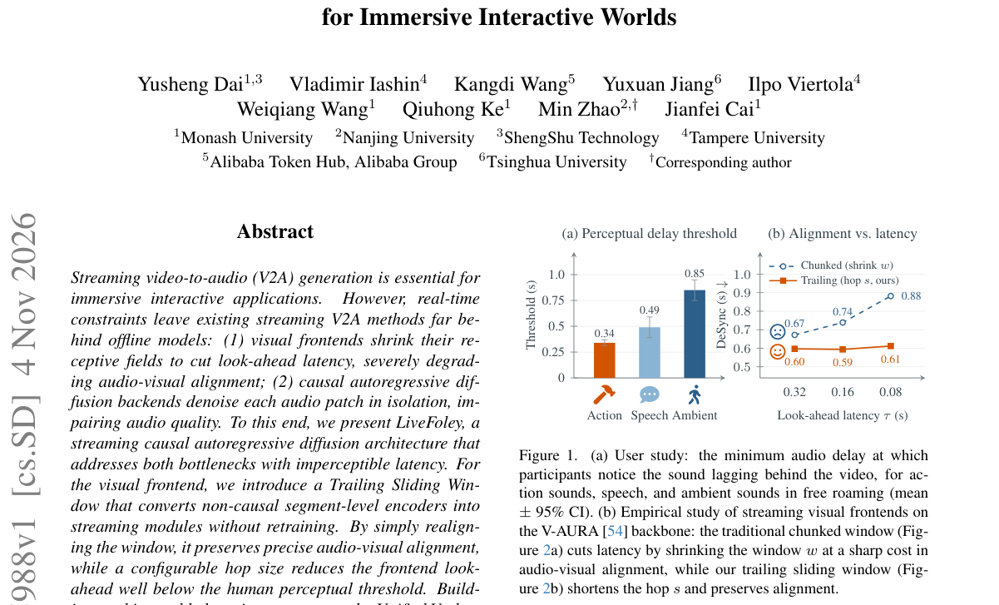

*Result - Streaming visual frontend. Each dot denotes the token at one window position. (a) Chunked window: shrinking the window w lowers latency but also narrows the receptive field, which degrades a*

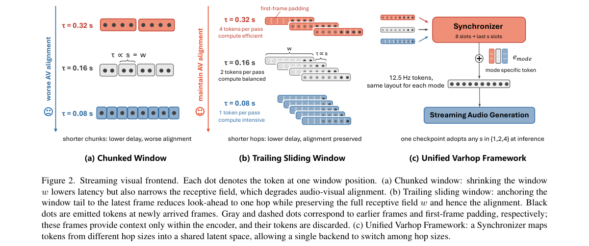

**Why this ranks #1**: 流式视频转音频的实时标杆：尾部滑窗把视觉前瞻压到 0.08 s、端到端延迟估计约 236 ms，低于用户研究中动作音效 0.34 s 的可感知阈值；DeSync 0.48 追平离线 MMAudio-L 的 0.47，流式基线为 0.67-1.03。

---

### 2. GraphSeal: Graph-Augmented Speech Deepfake Detection via Temporal-Spectral Artifact Propagation

**arXiv**: [2611.06171](https://arxiv.org/abs/2611.06171) | **Score**: 9.0 (relevance 9 x 0.7 + quality 9 x 0.3) | **Tags**: AIGC-audio, audio-deepfake, graph-neural-network, ssl-features, temporal-spectral, spoof-detection, Pusan National University | **Categories**: cs.SD | **Pages**: 9

**Authors**: Lee Seung-woo; Bowen Qi; Kim Min-jun; Jang Won-young

**Affiliation**: Pusan National University; Shanghai Jiao Tong University; Hanyang University

**Abstract**

> Current speech deepfake detectors treat each utterance as a flat sequence of frames, limiting their ability to capture long-range spectral inconsistencies that span non-adjacent regions of an audio signal. We propose \textbf{GraphSeal}, which constructs a temporal-spectral graph over short speech segments and propagates artifact cues through graph attention layers before a global readout produces the bonafide-vs-spoof decision. Each node in the graph corresponds to a fixed-length segment; edges encode temporal adjacency and spectral similarity, letting the network attend to distant frames that share suspicious spectral patterns. A multi-head graph attention mechanism weights neighboring nodes according to both learned features and edge attributes, and a hierarchical readout aggregates node representations into a single utterance-level embedding for binary classification. GraphSeal is front-end agnostic: it operates on top of any self-supervised or handcrafted feature extractor. On ASVspoof 2019~LA, ASVspoof 2021~LA, ASVspoof~5, and the In-the-Wild dataset, GraphSeal achieves equal error rates of 0.52\%, 2.41\%, 8.17\%, and 5.24\%, respectively, matching or outperforming prior methods that rely on fixed-topology graph networks or purely sequential architectures.

**Key findings**

- **Finding**: GraphSeal 在 ASVspoof2019 LA、ASVspoof2021 LA、ASVspoof5 与 In-the-Wild 上 EER 分别为 0.52%、2.41%、8.17% 与 5.24%，并在 ASVspoof2019 LA 的 13 种攻击中改进了 12 种。
- **Inference**: 伪造痕迹常出现在时间上不相邻但谱形态相似的片段上，把短片段建成带谱相似度边的图才能让网络跨远距离取证。
- **Recommendation**: 复用现有自监督特征时可把图注意模块直接接在任意前端之后，不必为更换特征前端重训整条检测链。

**Key figures**

*Framework - GraphSeal overview. A waveform is encoded by an SSL front end and segmented into overlapping windows. A temporal-spectral graph is constructed with edge attributes encoding adjacency and spect*

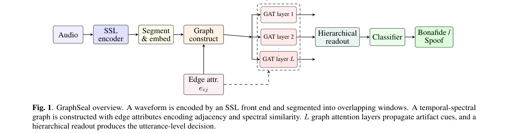

*Result - Per-attack EER (%) on ASVspoof 2019 LA evaluation set. GraphSeal reduces EER on 12 of 13 attack types compared to WavLM-AASIST, with the largest gains on waveform-concatenation (A17) and neura*

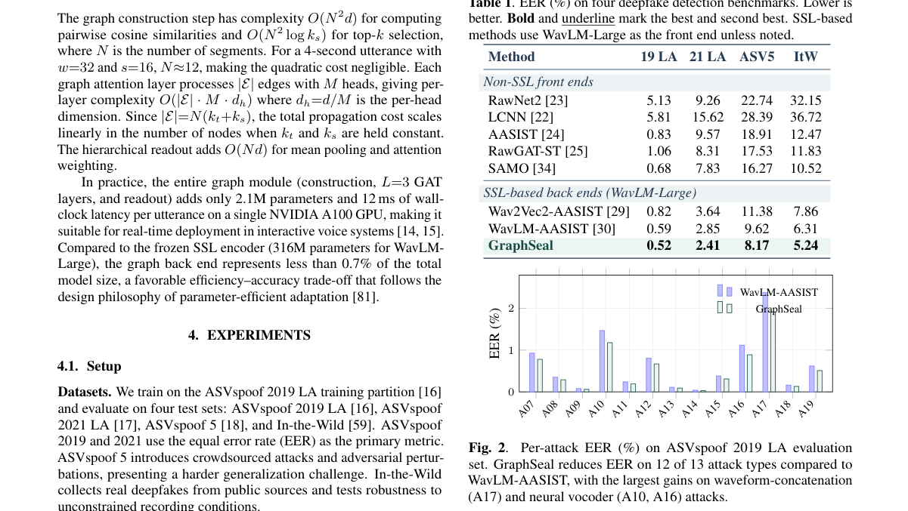

**Why this ranks #2**: 语音伪造检测的图建模：在 ASVspoof2019 LA、ASVspoof2021 LA、ASVspoof5 与 In-the-Wild 上 EER 分别为 0.52%、2.41%、8.17%、5.24%，相对 WavLM-AASIST 在 13 种攻击中的 12 种上更优。

---

### 3. VIPBench: A Human-Aligned Benchmark for Voice Identity Perception in the Age of Voice Cloning

**arXiv**: [2611.05638](https://arxiv.org/abs/2611.05638) | **Score**: 8.7 (relevance 9 x 0.7 + quality 8 x 0.3) | **Tags**: AIGC-audio, voice-identity, benchmark, human-annotation, voice-cloning, speaker-verification, Northwestern University | **Categories**: cs.AI, cs.CY, cs.MM, cs.SD | **Pages**: 30

**Authors**: Xudong Tang; Matthew Groh

**Affiliation**: Northwestern University; Kellogg School of Management, Northwestern University

**Abstract**

> Speaker-recognition benchmarks test how accurately a model recovers the speaker label of a recording, treating voice identity as a property of the person who produced it. However, these benchmarks do not evaluate how humans perceive voice identity. Whether a listener hears two voices as the same person has consequences for intellectual property rights, cybersecurity, and everyday life. We introduce the Voice Identity Perception benchmark (VIPBench), which contains 124,876 same-or-different judgments from 1,290 listeners on 9,800 recording pairs from 100 public figures. The pairs include real recordings, voice clones generated by a text-to-speech system, and morphs between two speakers' voices. We also define four tasks that evaluate the alignment between speaker-representation models and human identity perception. The first two tasks measure how well a model's similarity score predicts the proportion of listeners who respond "same" and the majority response. The other two measure whether a model and listeners find the same speaker pairs similar, and whether a model's relationship to listener judgments holds equally for real and synthetic recordings. We evaluate eleven publicly available speech models. Listener judgments diverge from speaker labels most often for voice clones: in 41% of responses, listeners judged a clone and a real recording of the same speaker to be different people. No model reaches the noise ceiling; the best model explains 61% of the explainable variance. Models trained with speaker labels align with listeners better than self-supervised models do, yet a model with a 12% error rate on speaker labels aligns with listeners as well as models with error rates below 2%. VIPBench enables the evaluation of speaker models against human perception on real, cloned, and morphed speech, and our results motivate training speaker models directly on listener judgments.

**Key findings**

- **Finding**: VIPBench 含 124,876 次同或异判断、1,290 名听众、9,800 对录音与 100 位公众人物；在 41% 的回答中，听众把克隆音与其真人录音判成了不同的人。
- **Inference**: 说话人标签的准确率并不等于人类感知到的身份一致性，克隆语音尤其容易触发标签与感知之间的分裂。
- **Recommendation**: 评测说话人表征时不要只用标签指标，应引入听众判断数据并单独统计克隆语音子集上的表现。

**Why this ranks #3**: 语音身份感知的人类对齐基准：124,876 次同异判断来自 1,290 名听众、覆盖 9,800 对录音与 100 位公众人物；41% 的回答把克隆音与其真人录音判为不同人，最好模型也只解释 61% 的可解释方差。

---

### 4. CLRM: Cross-Layer Relation Modeling for Audio Deepfake Detection

**arXiv**: [2611.05678](https://arxiv.org/abs/2611.05678) | **Score**: 8.7 (relevance 9 x 0.7 + quality 8 x 0.3) | **Tags**: AIGC-audio, audio-deepfake, self-supervised, cross-layer, detector-augmentation, eer-reduction, Hong Kong Polytechnic University | **Categories**: eess.AS | **Pages**: 14

**Authors**: Yangyang Qu; Siqing Qin; Kong Aik Lee; Massimiliano Todisco

**Affiliation**: The Hong Kong Polytechnic University

**Abstract**

> Audio deepfake detection (ADD) aims to distinguish bonafide speech from synthetic or manipulated speech. Representations from different layers of self-supervised learning (SSL) speech encoders vary in their ability to distinguish bonafide from spoofed speech. Comparing representations of the same utterance across encoder depths may reveal useful spoofing cues, yet common layer-selection and aggregation methods do not provide these comparisons as detection inputs. We propose Cross-Layer Relation Modeling (\ours{}), which explicitly encodes cross-layer relations alongside layer-specific features, making both directly available for ADD. CLRM reuses the existing detector's SSL encoder and identifies informative layer pairs by combining speaker-relative representation geometry with source-domain detection performance. The resulting relation score is fused with the detector's original score, requiring only the training of compact relation heads and fusion parameters while keeping the existing detector frozen. Across five external datasets, CLRM reduces the mean equal error rate (EER) for all three evaluated detectors, achieving relative reductions of 7.8--16.7%. Controlled comparisons with identical layer summaries and approximately matched auxiliary-head parameter counts also show a lower mean EER for explicit relations than direct concatenation, both before and after score fusion. These findings support explicit cross-layer comparisons as useful detection inputs for SSL-based audio deepfake detectors.

**Key findings**

- **Finding**: CLRM 在 5 个外部数据集上把三个被测检测器的平均 EER 相对降低 7.8%-16.7%，在层摘要与辅助头参数量近似对齐时仍优于直接拼接。
- **Inference**: 同一句话在不同自监督层的差异本身就是伪造线索，常规选层与聚合把这些对比丢掉了，显式建模才能利用。
- **Recommendation**: 改造已有伪造检测器时优先尝试跨层关系头这类外挂式方案，可避免重训主干带来的兼容与算力成本。

**Key figures**

*Framework - CLRM for ADD. (a) Last-layer detection and (b) multilayer aggregation illustrate conventional uses of SSL representations. (c) CLRM uses selected representations from the frozen XLS-R encode*

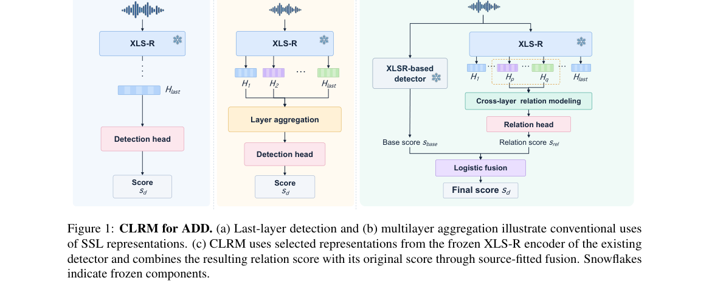

*Result - Speaker-relative statistics across XLS-R layers. Own-speaker rank (lower is better) and max- other margin (higher is better) are two of the four statis- tics used for candidate construction.*

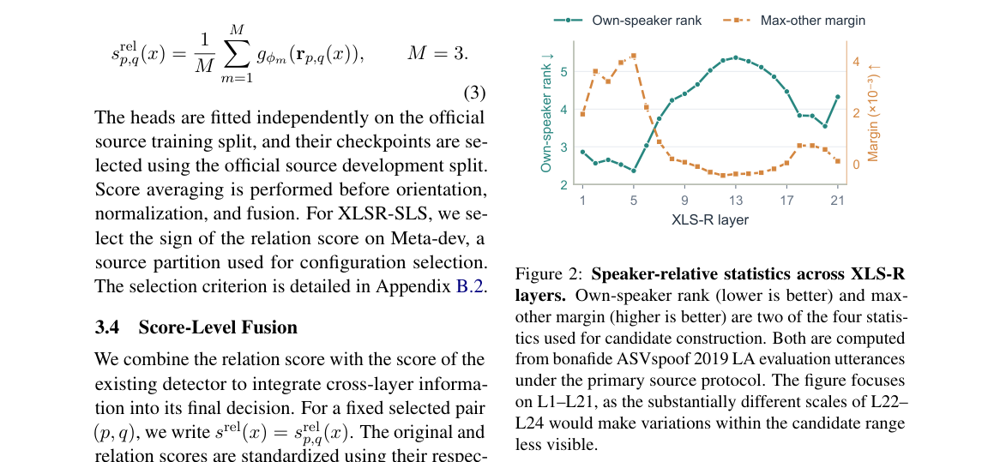

**Why this ranks #4**: 音频伪造检测的跨层关系建模：在 5 个外部数据集上把三个被测检测器的平均 EER 相对降低 7.8%-16.7%，而原检测器全程冻结，只需训练紧凑的关系头与融合参数。

---

### 5. SonoDyno: A Sonic Dynamometer for Engine Speed and Load Estimation from Audio

**arXiv**: [2611.06262](https://arxiv.org/abs/2611.06262) | **Score**: 8.0 (relevance 8 x 0.7 + quality 8 x 0.3) | **Tags**: AIGC-audio, engine-sound, rpm-estimation, harmonic-analysis, acoustic-measurement, lightweight-model, Audio Research & Development | **Categories**: cs.SD, eess.AS, eess.SP | **Pages**: 16

**Authors**: Robin Doerfler; Beat Rossmy

**Affiliation**: Audio Research & Development, Impulse Audio Lab GmbH, Munich, Germany

**Abstract**

> Controllable engine sound synthesis, Active Sound Design and engine order analysis all build on the relationship between the sound of an engine and its momentary operating state: its speed and its load. Recordings of engine sound are abundant in archives, sample packs and online video, yet they rarely carry time-aligned annotations of that state, which limits their applicability to controllable engine sound generation. We present SonoDyno, which estimates the engine speed, the cylinder count and an engine-normalized load intensity from a microphone signal alone, with no tachometer, no bus access and no prior knowledge of the engine configuration. A convolutional scorer of 124,302 parameters reads the harmonic order energy of each frame at three time-frequency resolutions to jointly score cylinder count and speed, and a decoder imposes the rotational dynamics of the engine on the speed trajectory. A second head estimates the load intensity, the position of the torque between the engine's drag floor at 0 and its full-load ceiling at 1, from the order levels at the decoded speed. On recordings of engines it has never heard, with microphone position, engine type and cylinder count unknown, SonoDyno places 93 to 97% of the frames within 2% of the true speed, identifies the cylinder count with 80% accuracy and confuses the octave on fewer than 2% of the frames. On an unseen engine of a known type, the load intensity has a mean absolute error of 0.12, and the sign of the torque, driving or braking, is right on 91% of the frames. General pitch trackers fall behind even when the harmonic order of each engine is supplied: on our validation recordings and at a tolerance of 5%, the best of them places 62% of the frames within the tolerance, against 96% for SonoDyno.

**Key findings**

- **Finding**: 在从未听过且麦克风位置、引擎类型与气缸数均未知的录音上，SonoDyno 让 93%-97% 的帧转速误差控制在 2% 内，气缸数识别准确率 80%，倍频混淆发生在低于 2% 的帧上。
- **Inference**: 谐波阶次能量同时编码了转速与气缸数，再用解码器叠加旋转动力学约束，比通用音高跟踪更贴合发动机的物理结构。
- **Recommendation**: 从归档录音反推发动机状态时优先用谐波阶次分析，通用基频跟踪即使给定阶次也只有 62% 的帧落在 5% 容差内。

**Key figures**

*Result - One frame of a recorded engine at 2418 rpm through two of the session’s simultaneous microphones, one in the interior and one at the exhaust. The steady-speed examples that follow use this fra*

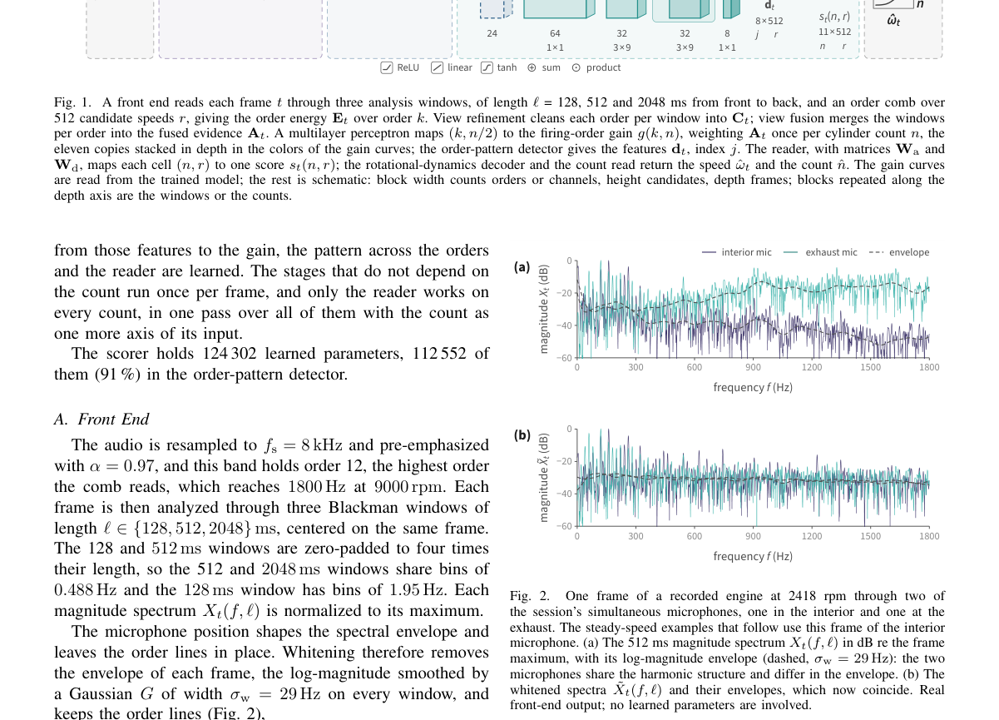

**Why this ranks #5**: 只靠麦克风反推发动机状态：仅 124,302 参数的卷积打分器，在从未听过、位置与气缸数均未知的引擎上，93%-97% 的帧转速误差在 2% 以内，气缸数识别准确率 80%，负载强度平均绝对误差 0.12。

---

### 6. Which One Is Sounding? Binaural Sounding Instance Disambiguation for Audio-Visual Segmentation

**arXiv**: [2611.06074](https://arxiv.org/abs/2611.06074) | **Score**: 7.0 (relevance 7 x 0.7 + quality 7 x 0.3) | **Tags**: AIGC-audio, audio-visual-segmentation, binaural-audio, instance-disambiguation, spatial-cue, robotic-perception, Taiyuan University of Technology | **Categories**: cs.AI, cs.SD | **Pages**: 12

**Authors**: Haoze Ma; Yidi Li; Yu Ma; Pengyuan Zhao; Yi Shi; Bin Ren; Yanwen Guo; Dimitrios Kanoulas

**Affiliation**: Taiyuan University of Technology, China; University College London, United Kingdom; EPFL, Switzerland

**Abstract**

> Existing audio-visual segmentation methods mainly predict sound-related regions or category masks and often fail to identify the sounding instance when multiple same-class candidates coexist. Recent audio-visual instance segmentation methods address instance-level prediction but rely largely on motion and cross-frame association, which may become unreliable under sparse observations or inconspicuous motion. To this end, we introduce binaural audio, whose interaural differences encode source-direction information, to provide spatial constraints for distinguishing the sounding instance among same-class visual candidates. We propose Binaural Sounding Instance Disambiguation for Audio-Visual Segmentation (BiSID-AVS), which progressively refines category-level candidate responses into a mask of the true sounding instance. BiSID-AVS first grounds category-consistent candidate regions through audio prompting, then projects binaural cues into an image-plane spatial response map, and finally refines the true sounding instance through dual-level spatial conditioning at the feature and decoder levels. Experiments on the binaurally extended AVS-Synthetic benchmark and Habitat-AVS dataset for robotic indoor perception show that BiSID-AVS achieves the best performance on the multi-candidate subsets, improving instance-level mIoU by 35.19 and 41.21 percentage points, respectively, while substantially reducing false activation on non-sounding same-class regions.

**Key findings**

- **Finding**: BiSID-AVS 在双耳扩展的 AVS-Synthetic 与 Habitat-AVS 多候选子集上，实例级 mIoU 分别比对比方法高 35.19 与 41.21 个百分点，同时大幅减少对不响的同类区域的误激活。
- **Inference**: 运动与跨帧关联在稀疏观测或不显著运动下会失效，而双耳相位差带来的方向信息不依赖时间上下文。
- **Recommendation**: 做音视分割时若环境允许采集双耳音频，应优先用空间线索消歧，而不是一味加强时序建模。

**Key figures**

*Framework - Task motivation of BiSID-AVS. AVS may activate multiple same-class candidates, while existing AVIS mainly relies on temporal context. BiSID-AVS instead uses binaural spatial cues to identify*

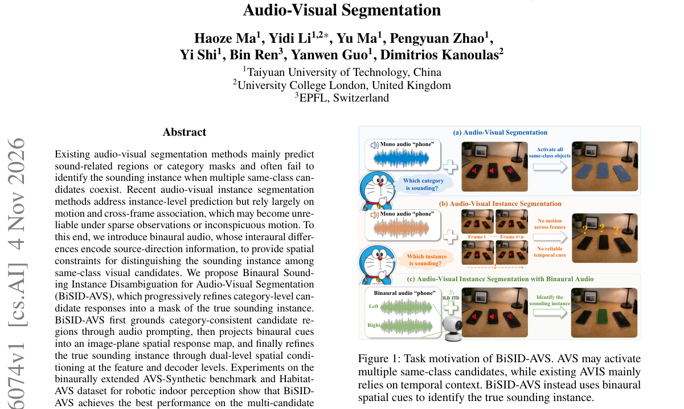

*Result - Overall comparison between SAMA-AVS (Liu et al. 2024a) and BiSID-AVS. SAMA-AVS uses monaural audio prompting to model category-level audio-visual correspondence and may activate same-class c*

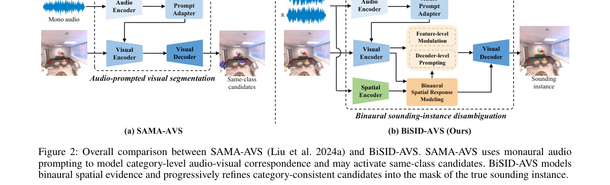

**Why this ranks #6**: 用双耳线索解决同类别多候选的发声实例消歧：把双耳通道间差投影成图像平面空间响应，在双耳扩展的 AVS-Synthetic 与 Habitat-AVS 多候选子集上，实例级 mIoU 分别提升 35.19 与 41.21 个百分点。  [wild-card=yes] 该论文是用双耳音频线索做视听分割中「哪个实例在发声」的消歧，属于视听感知方向而非音频生成模型，补位计入。

---

### 7. Cross-Modal Semantic Successive Refinement for Generative Image Communication over Underwater Acoustic Channels

**arXiv**: [2611.06205](https://arxiv.org/abs/2611.06205) | **Score**: 7.0 (relevance 7 x 0.7 + quality 7 x 0.3) | **Tags**: AIGC-audio, underwater-acoustics, semantic-communication, residual-vector-quantization, error-protection, generative-reconstruction, [unverified] | **Categories**: cs.CV, cs.IT | **Pages**: 13

**Authors**: Xu Pei; Bin Wang; Guangxu Zhu; Yi Zhang; Haiyan Fan

**Affiliation**: [unverified]

**Abstract**

> Underwater acoustic communication faces challenges such as limited available bandwidth and complex channel environments, which impose demanding requirements on efficient image transmission and reliable reconstruction. To address these challenges, this paper proposes a generative image communication framework based on cross-modal semantic successive refinement. At the transmitter, text descriptions, compact bottleneck features, and visual side information compressed by residual vector quantization are transmitted. At the receiver, text and bottleneck features are first fused to predict a base estimate of the intermediate visual representation. The received RVQ indices are then used to recover supplementary visual information and perform residual correction, followed by image reconstruction using a one-step Pixel Mean Flow model. During training, a CLIP-based text-image semantic consistency constraint is introduced to preserve the semantic correspondence between generated results and the original text descriptions. During transmission, protection resources are allocated according to the importance of different information branches and RVQ quantization stages. Simulations using COCO 2017 images and measured underwater acoustic channel records from Watermark show that text and bottleneck features provide complementary semantic and structural conditions, RVQ visual side information further improves reconstruction quality, and layered unequal error protection helps improve recovery at low SNRs. Code-rate allocation experiments reveal a tradeoff between the reliability of fundamental conditions and visual-detail reconstruction under a limited visual-feature coding budget, providing guidance for allocating protection resources in underwater acoustic image transmission.

**Key findings**

- **Finding**: 在 10 dB 信道 SNR、码本 256 的设定下，RVQ 深度由 1 级增到 3 级使 PSNR 从 26.7 dB 升到 27.4 与 27.9 dB；三级 RVQ 下码本扩到 512 时达 28.2 dB。
- **Inference**: 文本与瓶颈特征已覆盖语义与结构，残差矢量量化只补编码器尚未表达的细节，因此分级量化比堆更多比特更划算。
- **Recommendation**: 在带宽受限的水下链路上应按信息分支与量化阶段分配不等错误保护，把保真资源优先留给语义条件。

**Key figures**

*Framework - Overall architecture of the cross-modal semantic successive-refinement generative communication system.*

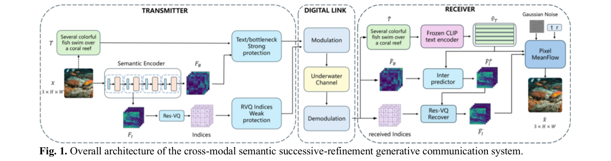

*Result - RVQ-based Intermediate information transmission.*

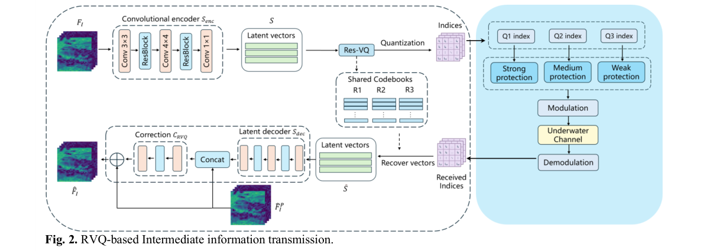

**Why this ranks #7**: 水下声信道的生成式图像通信：文本加瓶颈特征先给出基线预测，再用 RVQ 残差校正，在 10 dB 信道 SNR、码本 256 时把 PSNR 从单级 26.7 dB 提到三级 27.9 dB，作为对照的 CP 分解可达 28.4 dB。  [wild-card=yes] 该论文是在水下声学信道上做生成式图像通信，生成对象是图像、信道才是声学，属于跨模态通信方向而非音频生成模型，补位计入。

---

### 8. The Hearpiece Database of Binaural Room Impulse Responses and Driver Responses on KEMAR

**arXiv**: [2611.06345](https://arxiv.org/abs/2611.06345) | **Score**: 7.0 (relevance 7 x 0.7 + quality 7 x 0.3) | **Tags**: AIGC-audio, impulse-response, binaural, hearing-device, open-dataset, room-acoustics, Carl von Ossietzky Universität Oldenburg | **Categories**: eess.AS | **Pages**: 13

**Authors**: Tong Xiao; Reinhild Roden; Matthias Blau; Simon Doclo

**Affiliation**: Carl von Ossietzky Universität Oldenburg, Germany; Institut für Hörtechnik und Audiologie, Jade Hochschule, Oldenburg, Germany

**Abstract**

> This document describes the measurement setup, signal processing, data organization, and MATLAB file format of a database of acoustic responses measured on a Knowles Electronics Manikin for Acoustic Research (KEMAR) using the Hearpiece, a multi-microphone, multi-driver in-ear research device. The data include binaural room impulse responses (BRIRs) and Hearpiece driver responses, together with center-microphone room impulse responses and a loopback impulse response of the playback and recording system. The BRIRs cover two Hearpiece configurations, three room conditions, three independent insertions per configuration, and 24 horizontal source directions. The database supports reproducible research on binaural and hearing-device signal processing, with potential applications in speech enhancement, spatial filtering and source separation, dereverberation, active noise and occlusion control, and acoustic feedback cancellation. The database, MATLAB loading script, and technical documentation are publicly available at https://doi.org/10.5281/zenodo.23667308.

**Key findings**

- **Finding**: BRIR 部分含 2 配置×3 房间条件×3 次独立佩戴共 18 个文件，每个文件 24 个水平声源方向×10 个录音通道，合计 4320 条脉冲响应，驱动响应部分另有 240 条。
- **Inference**: 双耳重测、空间滤波与助听器算法普遍缺少可复现的真实房间双耳测量，统一开放的 KEMAR-Hearpiece 数据正好补上这一环。
- **Recommendation**: 做双耳或助听器算法评测时优先复用该数据库自带的闭环响应做校准，以保证不同实验之间可比。

**Key figures**

*Framework - Measurement setup with a KEMAR positioned at the center of the circular loudspeaker array.*

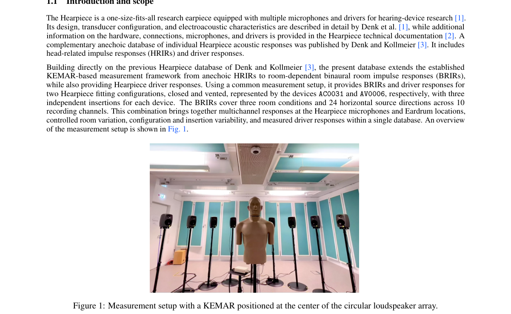

**Why this ranks #8**: 开放的双耳房间脉冲响应数据库：KEMAR 配 Hearpiece 采得 2 种配置×3 种房间×3 次佩戴共 18 个 BRIR 文件，每个含 24 个水平方向×10 个通道，合计 4320 条脉冲响应，采样率 48 kHz。  [wild-card=yes] 该论文是 KEMAR 双耳房间脉冲响应与入耳器件驱动的测量数据库，属于音频测量与数据基础设施方向而非音频生成模型，补位计入。

---

### 9. Drowning in Noise: On Signal Saliency in Self-Supervised Learning for Ocean Acoustics

**arXiv**: [2611.06725](https://arxiv.org/abs/2611.06725) | **Score**: 7.0 (relevance 7 x 0.7 + quality 7 x 0.3) | **Tags**: AIGC-audio, self-supervised-learning, ocean-acoustics, data-curation, marine-mammal, linear-probing, Carnegie Mellon University | **Categories**: cs.SD | **Pages**: 5

**Authors**: Shikhar Bharadwaj; Samuele Cornell; Shinji Watanabe; Malcolm Slaney

**Affiliation**: Carnegie Mellon University, USA; Stanford, USA

**Abstract**

> Self-supervised learning (SSL) for audio typically benefits from larger pre-training corpora, but this relationship assumes that training data carries meaningful learning signal. In ocean acoustics, this assumption is often violated: passive recordings are dominated by waves, wind, and silence, with biological vocalizations occupying a small fraction of the total duration. We show that this overrepresentation of noise causes SSL models to allocate representational capacity to acoustically trivial structure, degrading downstream performance. Using BEATs as a testbed, we demonstrate that pre-training on 30 hours of salient recordings (segments containing animal vocalizations) outperforms 1,240 hours of unfiltered data on a 31-class marine mammal classification benchmark. Under linear probing, the manually curated salient set achieves markedly better accuracy than the full corpus, despite using 41 times less data. Automatic saliency-based filtering improves over unfiltered pre-training, but still falls well short of the manually curated salient set. Our findings suggest that, in domains where informative content is temporally sparse, data curation matters more than data scale for SSL pre-training.

**Key findings**

- **Finding**: 以 BEATs 为测试床，30 小时精选显著片段的预训练效果超过 1,240 小时未过滤数据，在 31 类海洋哺乳动物分类上线性探测时以少 41 倍的数据取得更高准确率。
- **Inference**: 被动录音里生物发声只占极小时间比例，噪声主导会让自监督模型把容量浪费在与任务无关的声学结构上。
- **Recommendation**: 在信号稀疏的领域做自监督预训练应先做显著性筛选再谈数据规模，自动筛选也仍需与人工精选结果对齐。

**Why this ranks #9**: 海洋声学自监督预训练的数据观：30 小时含生物发声的精选片段在 31 类海洋哺乳动物分类上胜过 1,240 小时未过滤数据，线性探测下数据量少 41 倍反而更准。  [wild-card=yes] 该论文是海洋声学自监督预训练的数据显著性分析，属于音频表征学习方向而非音频生成模型，补位计入。

---

### 10. Virtual Microphone Array for Direction-of-Arrival Estimation Based on Fiber-Optic Position Sensing

**arXiv**: [2611.06285](https://arxiv.org/abs/2611.06285) | **Score**: 6.7 (relevance 7 x 0.7 + quality 6 x 0.3) | **Tags**: AIGC-audio, direction-of-arrival, fiber-optic-sensing, virtual-array, tdoa, hyperboloid-intersection, Technische Universität Ilmenau | **Categories**: eess.AS | **Pages**: 11

**Authors**: Sebastian Schwarze; Jiekai Wang; Thomas Kissinger; Stephan Werner

**Affiliation**: Technische Universität Ilmenau, Germany

**Abstract**

> This paper presents a virtual microphone array approach for estimating the direction of arrival of a sound source using a moving microphone and a stationary reference microphone. The method exploits the microphone motion to generate a time-varying array geometry, using fiber-optic position sensing to reconstruct the trajectory and determine the resulting virtual microphone configurations. For each configuration, the estimated time difference of arrival between the two microphone signals and the corresponding microphone geometry define a hyperboloid representing all possible sound source positions consistent with the time difference. By combining multiple hyperboloid constraints, the direction of arrival can be estimated in azimuth and elevation relative to the microphone coordinate system. In contrast to conventional arrays with fixed geometries and approaches based on predefined microphone trajectories, the proposed method derives the virtual array geometry directly from the measured microphone motion, enabling a spatially distributed virtual array to be formed using only two physical microphones and offering potential for size- and weight-constrained applications. The approach was experimentally evaluated under controlled low-reflection conditions for different source positions, source distances, and signal characteristics. The influence of microphone motion was further examined, and the method was tested with a moving sound source. The results demonstrate the feasibility of direction-of-arrival estimation using a virtual microphone array without requiring a predefined microphone trajectory.

**Key findings**

- **Finding**: 16 个声源位置中，方位角中位误差有 13 个、俯仰角有 12 个落在容差（方位 3.39°、俯仰 5.00°）内，有效窗比例接近 100%，有效窗内 71% 的俯仰估计达标。
- **Inference**: 把麦克风运动轨迹转成虚拟阵列几何后，多个双曲面约束的交点即可定位声源，不必预先规划运动路径。
- **Recommendation**: 对体积与重量受限的听音设备，可用运动麦克风加光纤定位搭出虚拟阵列来替代多阵元，但要注意语音信号的达标率会降到 70%。

**Key figures**

*Framework - Concept of the proposed virtual microphone array. The motion of the supporting structure carrying the microphone Mmove generates a sequence of virtual microphone positions Mvirt. The Interfero*

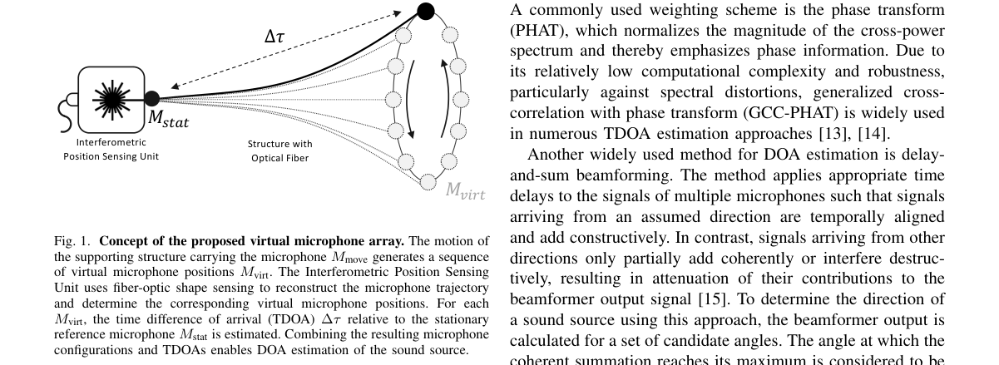

*Result - Illustration of the hyperboloid intersection method. Each colored surface represents a hyperboloid defined by the TDOA between the stationary reference microphone and a virtual microphone posi*

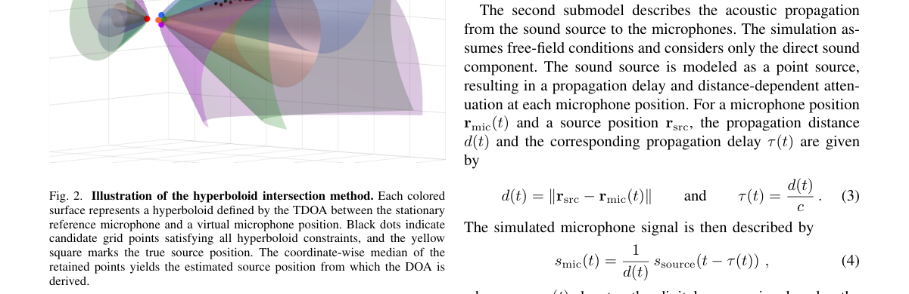

**Why this ranks #10**: 只用两支物理麦克风的波达方向估计：借光纤位置感知重建运动轨迹生成时变阵列，16 个声源位置中方位角中位误差 13 个、俯仰角 12 个落在容差内，方位容差 3.39°、俯仰容差 5.00°。  [wild-card=yes] 该论文是基于光纤定位的虚拟麦克风阵列来估计声源到达方向，属于声学信号处理方向而非音频生成模型，补位计入。

---

