# ArXiv Daily Digest - 2026-11-05 (AIGC 视觉生成, 10 papers)

**Generated**: 2026-11-05 17:30 CST

**Source**: arXiv cs.CV, cs.SD, eess.AS, cs.CL, cs.AI, cs.RO, cs.LG submissions, listing day 2026-11-04 (announced 2026-11-05 00:00 UTC)

**Batch window**: 2026-11-03T18:00:00Z .. 2026-11-04T18:00:00Z（arXiv 公告批次横跨两个 UTC 日：前一日 18:00 UTC 起算，当日 17:59:59 UTC 截止）

**Track**: aigc_visual (top 10 of 518 papers scanned, 70 full reads)

**Scope**: 图像 / 视频 / 3D / 4D 内容的生成与编辑，含扩散与流匹配模型的训练方法、加速与评测基准

---

## Top 10 - AIGC 视觉生成

### 1. Context-Aware Autoregressive Image Generation for Emerging Reasoning Properties

**arXiv**: [2611.06838](https://arxiv.org/abs/2611.06838) | **Score**: 9.7 (relevance 10 x 0.7 + quality 9 x 0.3) | **Tags**: AIGC-visual, autoregressive-image-generation, generation-order, context-aware-decoding, text-to-image, instruction-following, Johns Hopkins University | **Categories**: cs.CV | **Pages**: 16

**Authors**: Jixuan Ying; Haoyu Liu; Timing Yang; Tingyu Zhu; Predrag Neskovic; Anand Bhattad; Cihang Xie; Zeyu Zheng; Alan Yuille; Feng Wang

**Affiliation**: Johns Hopkins University; University of California, Berkeley; University of California, Santa Cruz; Office of Naval Research

**Abstract**

> Autoregressive image generation has recently emerged as a competitive visual generation paradigm, yet its generation order is often predefined or heuristic, such as next-patch prediction, random-order prediction, or one-step generation for specific scales. We observe that these strategies can cause models to overlook important structural dependencies in images, thereby limiting both structural robustness and reasoning capability. In this work, we propose a context-aware autoregressive generation framework, where the model dynamically determines the next token location based on global context and current local information. Rather than following a fixed or random order, our method allows the generation process to adapt to image structure and semantic dependencies. Extensive experiments show that context-aware generation significantly improves structural robustness across different image AR paradigms, including masked autoregressive and scale-wise autoregressive models. Beyond quantitative improvements, we further observe emerging reasoning properties: the model can better understand complex semantic instructions and generate images that more faithfully follow the given guidance. These findings suggest that generation order is a critical yet underexplored factor in image autoregressive modeling, and that context-aware decoding can unlock stronger reasoning-aware visual generation capabilities. Code is available at https://github.com/Hpesojyjx/Saccades-AR.

**Key findings**

- **Finding**: 在自建的 2000 条复杂长提示基准上，由 Gemini 2.5 Pro 按 1-5 分打分，Infinity-8B 的 SAR 顺序平均分 3.42，较随机顺序的 2.92 高 0.50 分。
- **Inference**: 生成顺序本身就是一项可调的推理先验，只改解码次序就能把模型对结构化指令的理解能力拉起来，无需额外训练。
- **Recommendation**: 评测自回归图像模型时应把解码顺序当成独立消融维度，并与随机顺序基线成对报告 GenEval 与长提示分数。

**Key figures**

*Framework - Generation order shapes reasoning-like behaviors in autoregressive image generation. With random-order decoding (top), intermediate predictions remain scattered and incomplete, weaken- ing f*

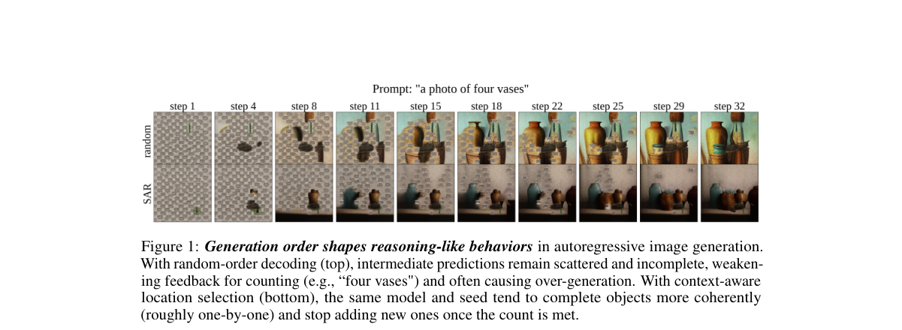

*Result - Comparison to one-step and random-order generation paradigms. Our SAR model decides the generation order based on each token’s latent distance to a global token. This is only a minimal chang*

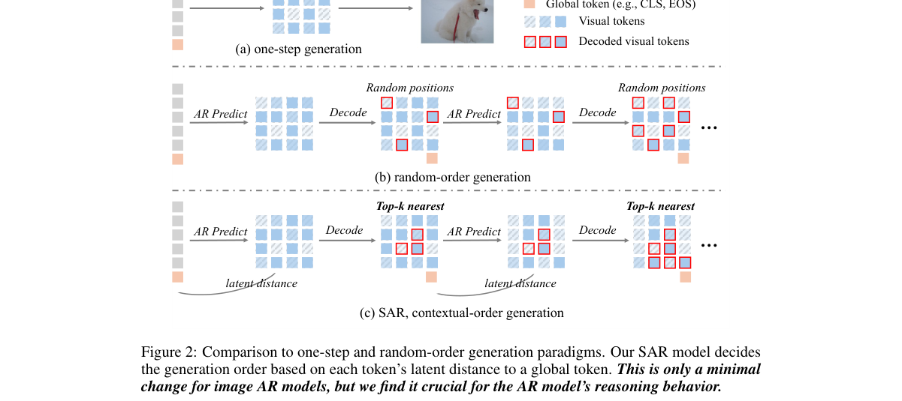

**Why this ranks #1**: 推理式自回归图像生成的代表：只改生成顺序不改权重，GenEval 总通过率在 MaskGen-XL 上从 56.22% 提到 59.99%，自建 2000 条长提示基准上平均分从 2.42 提到 2.92。

---

### 2. NextGAN: Towards Simple and Scalable GAN Training for Image and Video Generation

**arXiv**: [2611.06270](https://arxiv.org/abs/2611.06270) | **Score**: 9.0 (relevance 9 x 0.7 + quality 9 x 0.3) | **Tags**: AIGC-visual, adversarial-training, one-step-generation, few-step-sampling, image-generation, text-to-video, Westlake University | **Categories**: cs.AI, cs.CV | **Pages**: 25

**Authors**: Xinhao Lou; Dongye Xie; Peng Sun; Chenyi Zhuang; Kaicheng Yu; Tao Lin

**Affiliation**: Westlake University; University of Cambridge; Zhejiang University

**Abstract**

> Adversarial training enables one- and few-step image and video generation, but conventional adversarial losses supervise critic values without directly specifying the gradients used to update the generator. We present NEXTGAN, which trains a scalar critic by regressing its input gradient onto displacements between independently paired reference and generated features at interpolated locations in frozen representation spaces. For a fixed generator, this regression is equivalent to an adversarial objective with a gradient-energy penalty, while the generator retains the standard potential-based GAN update. The same objective adapts pre-trained image and video generators with up to 14B parameters, without auxiliary losses, online teacher scores, or trajectories. On ImageNet $256 \times 256$, NEXTGAN achieves one-step FIDs of 2.87 with pixel-space JiT-B and 1.54 with latent-space DiT-XL/1; its adversarial form further reaches 1.36. For text-to-video generation, a single trained Wan2.1-1.3B model supports one-, two-, and four-step sampling, achieving the highest VBench total scores among the compared 1.3B methods at one and two steps. At two steps, NEXTGAN scores 83.13, exceeding rCM and AnyFlow by 1.25 and 0.47 points, respectively. Code is available at https://github.com/LINs-lab/NextGAN.git.

**Key findings**

- **Finding**: 在 ImageNet 256×256 上，NextGAN 一步生成 FID 为 2.87（像素空间 JiT-B）与 1.54（隐空间 DiT-XL/1），对抗变体进一步降到 1.36。
- **Inference**: 用参考特征与生成特征之间的位移来回归 critic 的输入梯度，比传统对抗损失更直接地规定了生成器的更新方向。
- **Recommendation**: 需要一步或少步生成时可把它当基线，训练时应直接用生成端点的位移监督，而不是只去调整对抗损失的权重。

**Key figures**

*Framework - Qualitative samples from NEXTGAN. Left: 1-NFE class-conditional samples on Ima- geNet 256 × 256. Right: four frames from each of four generated videos.*

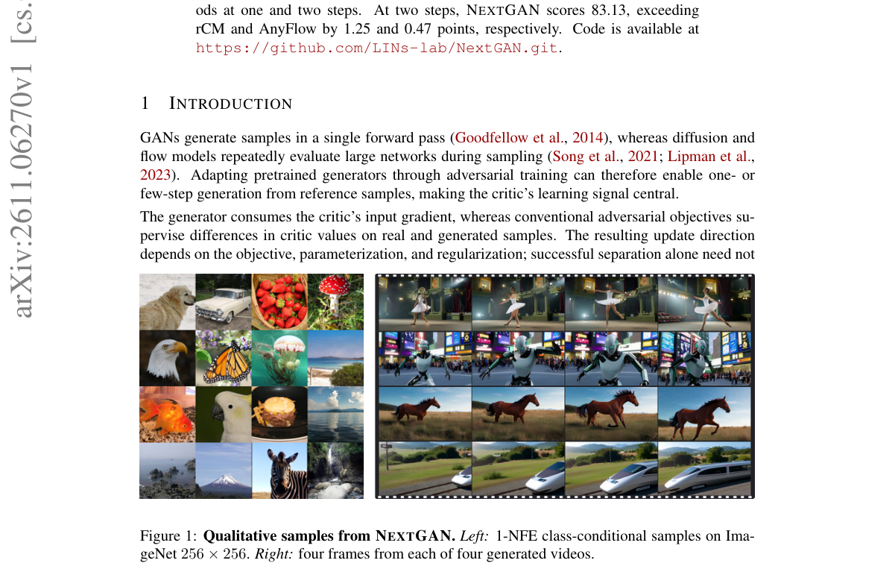

*Result - How NEXTGAN learns to guide the generator. xp and xr are generated and real features; xα lies between them. First, the critic loss LD trains ∇xuϕ to predict their displacement, with endpoint*

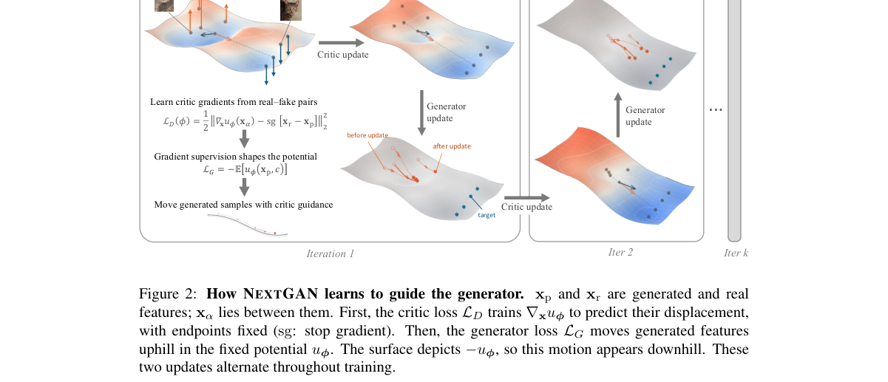

**Why this ranks #2**: 一步生成的新基线：ImageNet 256×256 上一步 FID 做到 2.87（像素空间 JiT-B）与 1.54（隐空间 DiT-XL/1），对抗式进一步到 1.36；Wan2.1-1.3B 两步文生视频 VBench 总分 83.13，超 rCM 1.25 分。

---

### 3. TailSteer: Trajectory-Tail Steering for Drift-Resistant Multi-turn Image Editing

**arXiv**: [2611.06741](https://arxiv.org/abs/2611.06741) | **Score**: 9.0 (relevance 9 x 0.7 + quality 9 x 0.3) | **Tags**: AIGC-visual, multi-turn-editing, visual-drift, on-policy-rollout, final-stage-training, identity-preservation, MMLab | **Categories**: cs.AI, cs.CV | **Pages**: 16

**Authors**: Ruikang Li; Zixuan Chen; Jiarui Wu; Mingde Yao; Yiyuan Zhang; Yujin Wang; Hanming Deng; Lewei Lu; Tianfan Xue

**Affiliation**: MMLab, CUHK; SenseTime Research; Shanghai Artificial Intelligence Laboratory

**Abstract**

> Strong single-turn editing performance does not guarantee reliable multi-turn interaction: as edited outputs are repeatedly reused, small unintended changes can accumulate into severe visual drift. This long-term drift is often mitigated through training on multi-turn data or cross-turn rollouts, potentially altering pretrained priors, or through specialized inference-time mechanisms that are difficult to scale to foundation models. We introduce TailSteer, a final-stage training framework that improves multi-turn robustness while retaining the generative and editing capabilities acquired through earlier training. TailSteer follows a simple principle: keep early denoising dynamics close to those of the base model and concentrate preservation corrections near the trajectory tail, where fine-grained deviations can be suppressed. These corrections are learned from the editor's own on-policy denoising rollouts, using unchanged source content as a preservation reference without requiring curated ground-truth editing pairs. Experiments across the FLUX, SenseNova, and Qwen families show that TailSteer substantially reduces cumulative drift over 15-20 editing turns while largely preserving base-model performance on extensive text-to-image and single-image editing benchmarks. These results demonstrate that long-horizon editing robustness can be unlocked in foundation models after TailSteer, rather than by relearning their existing capabilities.

**Key findings**

- **Finding**: 论文在 FLUX、SenseNova、Qwen 共四个骨干上评测，把保持校正集中在去噪轨迹尾部，在 15-20 轮连续编辑中显著降低累积漂移。
- **Inference**: 低频内容在早期去噪就已定型、高频细节主要在尾部确定，因此尾部是不破坏既有先验的最小干预点。
- **Recommendation**: 做 agent 式多轮图像编辑时，应把漂移与指令完成率拆开评测，并另设只衡量累积漂移的受控协议。

**Key figures**

*Framework - Single- and multi-input multi-turn editing. TailSteer substantially reduces cumulative drift over editing turns while retaining the base model’s (FLUX.2 [klein] Base 9B) editing capability.*

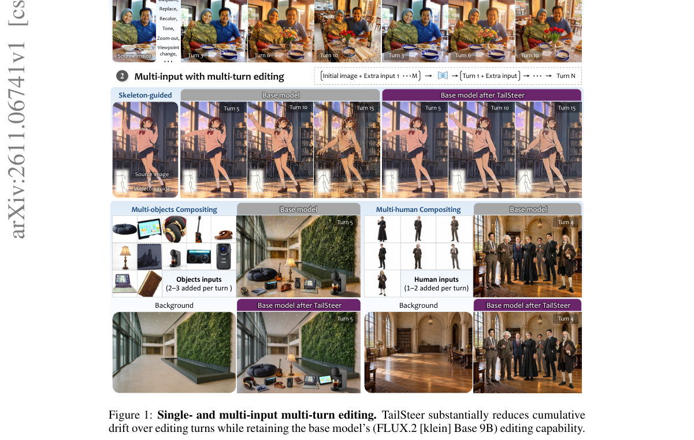

*Result - Trajectory tail remains correctable. Low-frequency content is recovered early, whereas higher-frequency details are primarily recovered near the tail (top), while preservation error in uncha*

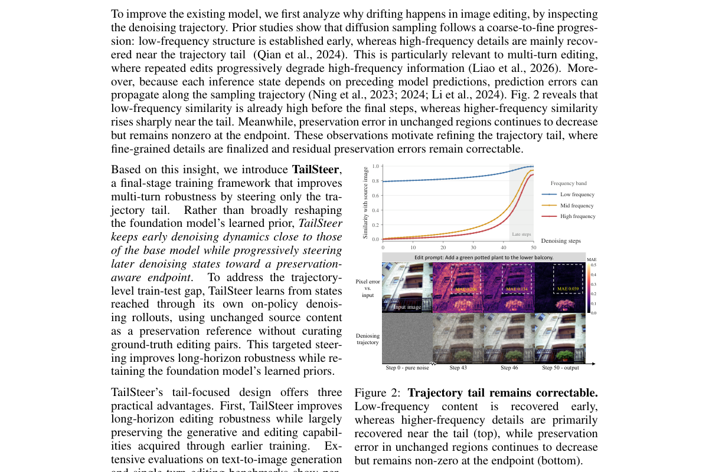

**Why this ranks #3**: 多轮编辑漂移治理的代表作：只在去噪轨迹尾部做保持校正，在 FLUX.2 [klein] Base 9B 等 4 个骨干上于 15-20 轮连续编辑中显著抑制累积漂移，同时基本保留基座的单轮生成与编辑能力。

---

### 4. DecoupAttn: Decoupled Sparse Attention for Training-Free Acceleration of Video Diffusion

**arXiv**: [2611.05917](https://arxiv.org/abs/2611.05917) | **Score**: 8.7 (relevance 9 x 0.7 + quality 8 x 0.3) | **Tags**: AIGC-visual, sparse-attention, video-diffusion, training-free, distortion-budget, few-step-sampling, University of Illinois Urbana-Champaign | **Categories**: cs.CV | **Pages**: 35

**Authors**: Yanjin Li; Bingbing Qiu; Qiang Huang; Rui Qian; Yanfeng Li; Jian Wang; Xiaoying Tang; Mingda Zhang

**Affiliation**: University of Illinois Urbana-Champaign; Fudan University; Macao Polytechnic University; The Chinese University of Hong Kong, Shenzhen

**Abstract**

> Sparse attention accelerates few-step video diffusion transformers by computing a few key blocks exactly and compensating for the rest. However, existing sparse attention still faces key challenges, including identification overhead from finding critical blocks at every denoising step, suboptimal budget allocation that sets sparsity budgets uniformly or by local metrics, and cross-step error accumulation as reused masks or clusters go stale. Observing that the errors left on skipped blocks cancel each other once every key is compensated, we propose DecoupAttn, a new paradigm of decoupled sparse attention: semantic clusters compensate every key, and exact attention corrects their error on a few blocks fixed once offline by position. To support this paradigm, we introduce Distortion Budget, a rate-distortion objective for budget allocation that places exact computation across timesteps, layers, and heads where it removes the most distortion that compensation leaves in the final latent. Built on this budget, we further propose Reassign Cache, in which each step reassigns the drifting keys to cached centroids and refreshes compensation while the budgeted blocks stay fixed. Moreover, DecoupAttn is training-free: a few calibration clips compile one plan offline, and inference runs standard block-sparse kernels with one fused compensation kernel. Our code will be released after submission.

**Key findings**

- **Finding**: Table 1 在密度 0.20 下汇总 10 个视频扩散模型，DecoupAttn 平均 PSNR 为 30.02 dB、加速 1.31×，相对基线均值高出 6.77 dB 与 0.14×。
- **Inference**: 跳块残差在所有 key 都被补偿后近似相消，所以离线固定精确块不再像在线重选那样因掩码过期而累积误差。
- **Recommendation**: 部署少步视频扩散时，可先用少量校准片段离线编译一份块计划，再配合每步重分配缓存的 Reassign Cache 刷新补偿。

**Key figures**

*Framework - DecoupAttn keeps dense-attention quality at a lower latency. Frames from dense attention and DecoupAttn on Cosmos-Predict2.5 (4 steps) and HunyuanVideo (50 steps), with latency, speedup on a*

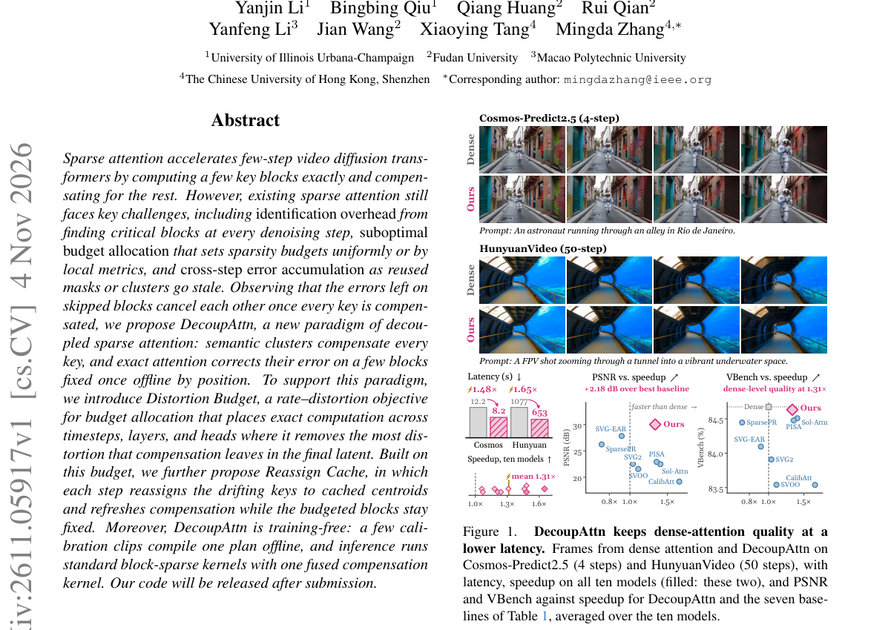

*Result - Three lines of sparse attention and DecoupAttn. (a) Online routing re-picks exact blocks each step and drops the rest, (b) offline calibration fixes them but drops the rest, and (c) compensa*

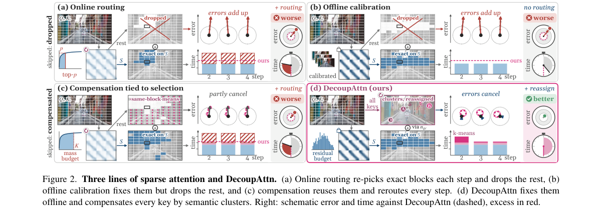

**Why this ranks #4**: 训练无关的视频扩散稀疏注意力：语义簇补偿全部 key、离线固定少量块做精确纠错，在 10 个模型、密度 0.20 下平均 PSNR 达 30.02 dB 且加速 1.31×，比基线均值高 6.77 dB。

---

### 5. CrossPressor: Scalable Cross-View Fusion for Feed-Forward 3D Gaussian Splatting

**arXiv**: [2611.06258](https://arxiv.org/abs/2611.06258) | **Score**: 8.7 (relevance 9 x 0.7 + quality 8 x 0.3) | **Tags**: AIGC-visual, 3d-gaussian-splatting, feed-forward-reconstruction, view-routing, training-free, long-context, Graz University of Technology | **Categories**: cs.CV | **Pages**: 16

**Authors**: Yuxi Hu; Wenhao Dong; Jun Zhang; Friedrich Fraundorfer

**Affiliation**: Graz University of Technology; Ghent University

**Abstract**

> Feed-forward 3D Gaussian Splatting (3D-GS) becomes increasingly difficult to scale to long multi-view sequences. Anchor-based compression methods such as ZPressor alleviate representation growth by decoding Gaussians only from a compact set of anchor feature maps, but keeping these anchors fixed forces each one to aggregate an increasing number of support views. We identify this representation--fusion mismatch and introduce \textbf{CrossPressor}, a training-free method for scalable anchor-based fusion. CrossPressor preserves all decoder-facing anchor queries while constraining the view-growing support sequence through coverage-cycled evidence routing, distributing retained spatial evidence across support views and fusion layers while keeping all support views represented. Routing before K/V projection, together with joint context packing, further reduces support-side fusion cost without retraining. CrossPressor maintains reconstruction quality close to dense fusion while achieving up to $26.12\times$ faster cross-view fusion and $1.43\times$ end-to-end acceleration on long input sequences. Our project page is at: https://yuhsihu.github.io/CrossPressor.

**Key findings**

- **Finding**: 在 MVSplat–ZPressor 的 256 视角设定下，CrossPressor 保留 1.85% 的 dense QK 交互，跨视角延迟 4.80 ms（26.12×）、端到端 1.43×，PSNR 23.1203 对 dense 的 23.1204。
- **Inference**: 固定 anchor 让不断增长的支撑视角全压到同一批 anchor 上形成表示与融合的错配，按覆盖循环分派证据即可在不重训前提下钉住开销。
- **Recommendation**: 评估前馈 3DGS 长序列时应同时报告 p5 ΔPSNR 与融合延迟，只报平均 PSNR 会掩盖下尾质量退化。

**Key figures**

*Framework - Representation–fusion mismatch and CrossPressor. ZPressor [25] bounds the decoder-facing representation by decod- ing Gaussians only from a compact set of anchor feature maps. As more contex*

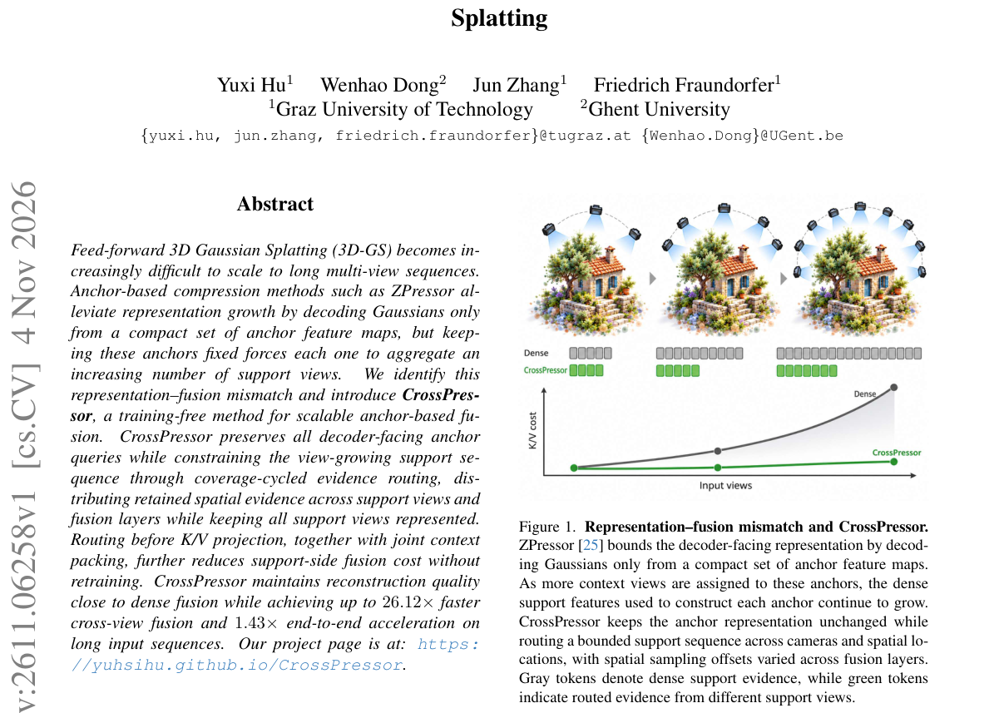

*Result - Overview of CrossPressor. We keep the original ZPressor [25] pipeline unchanged, including anchor selection, anchor–support grouping, the anchor-query pathway, and the downstream prediction*

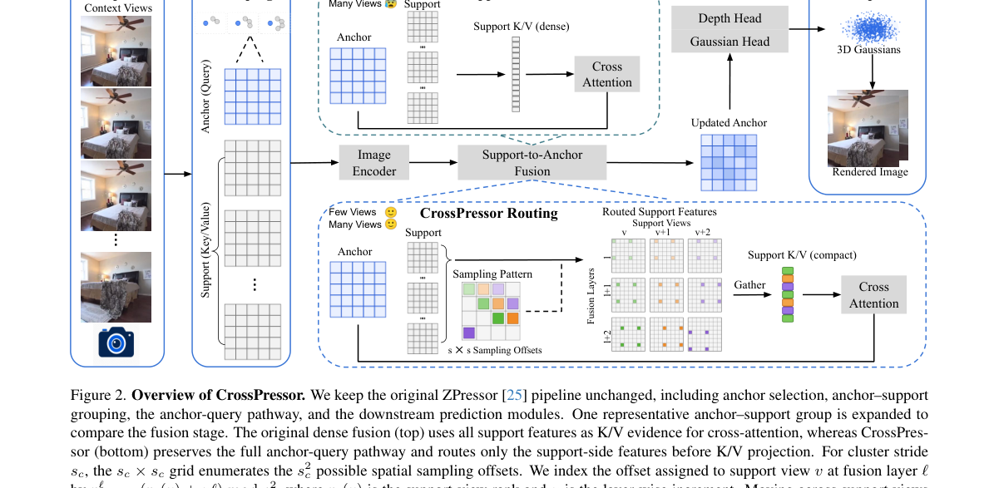

**Why this ranks #5**: 前馈 3D 高斯泼溅的可扩展融合：256 视角下只保留 1.85% 的 dense QK 交互，跨视角融合降到 4.80 ms（26.12×）、端到端 1.43×，PSNR 23.1203 对 dense 的 23.1204 几乎无损。

---

### 6. NanoKV: High-Ratio KV Cache Compression for Autoregressive Video Generation

**arXiv**: [2611.06377](https://arxiv.org/abs/2611.06377) | **Score**: 8.7 (relevance 9 x 0.7 + quality 8 x 0.3) | **Tags**: AIGC-visual, kv-cache, autoregressive-video, quantization, frozen-backbone, attention-efficiency, Zhejiang University | **Categories**: cs.CV | **Pages**: 25

**Authors**: Jiacheng Lu; Haoyi Zhu; Sipei Yi; Enze Xie; Cheng Zhuo; Yu Li

**Affiliation**: Zhejiang University; NVIDIA

**Abstract**

> Autoregressive video models rely on historical key-value (KV) caches to preserve scene consistency over extended rollouts, making KV storage and repeated attention over history a growing memory and computational bottleneck. Aggressive compression can degrade generation quality, while reconstructing full-dimensional KV leaves attention computation largely unchanged. We introduce NanoKV, a frozen-backbone framework for generation-aware high-ratio KV compression. NanoKV exploits redundancy across tokens and attention heads by storing shared content in cluster centers and encoding joint head-channel residuals into low-bit coefficients. Crucially, NanoKV uses different fitting objectives for Keys and Values according to their distinct roles in attention: Key decoders are optimized to preserve downstream block outputs, whereas Value encoders and decoders are fitted for faithful reconstruction through the deployed quantization path. Building on the same compressed representation, the optional NanoKV-Fast variant reuses the stored coefficients for mixed-dimensional attention, reducing computation without modifying the video backbone. Across three autoregressive video backbones, NanoKV consistently improves the quality-storage trade-off. On HY-WorldPlay, NanoKV achieves $26.09\times$ effective KV compression, nearly twice that of KVTC, while improving PSNR by 1.0 dB. NanoKV-Fast retains $20.53\times$ effective compression and achieves an approximately $1.15\times$ end-to-end speedup over KVTC.

**Key findings**

- **Finding**: 在 HY-WorldPlay 上 NanoKV 达到 26.09× 有效 KV 压缩并把 PSNR 提升 1.0 dB；NanoKV-Fast 仍保持 20.53× 压缩，同时取得约 1.15× 的端到端加速。
- **Inference**: Key 与 Value 在注意力中的角色不同，用同一套拟合目标必然次优，按角色分别拟合才能在高压缩比下保住生成质量。
- **Recommendation**: 改造自回归视频推理栈时应按 Key、Value 分别设计压缩目标，并以生成感知的 PSNR 而非重建误差作为评估口径。

**Key figures**

*Framework - NanoKV achieves high-ratio historical KV compression while preserving generated video quality across three autoregressive video backbones. Displayed PSNR is measured against the matched Orig*

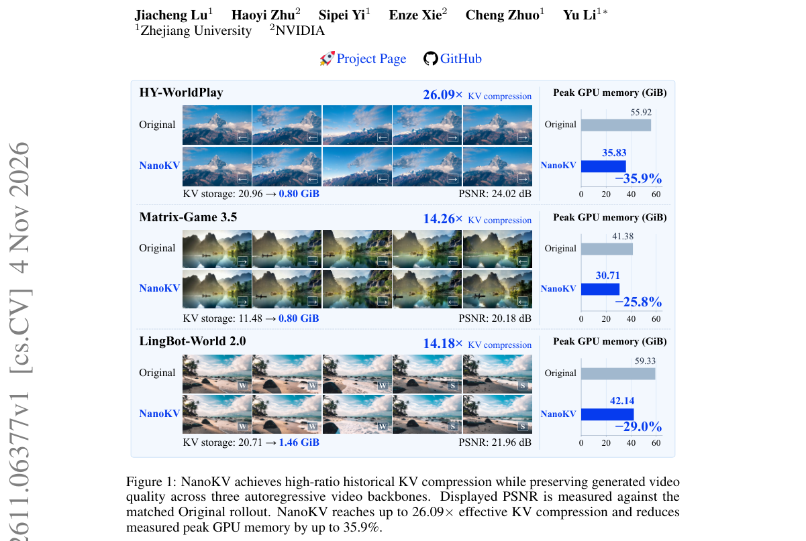

*Result - Comparison of NanoKV(-Fast) with representative KV compression and attention- access baselines. (a) VideoMLA modifies KV projections and adapts the model for shared latent- space attention.*

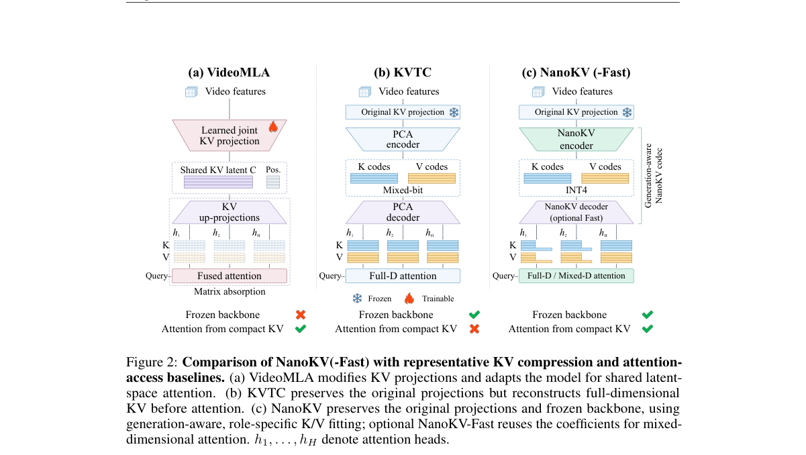

**Why this ranks #6**: 自回归视频的 KV 压缩：簇中心存共享内容、头通道残差存低位系数，HY-WorldPlay 上达 26.09× 有效压缩且 PSNR 反升 1.0 dB，NanoKV-Fast 保 20.53× 压缩并比 KVTC 端到端快约 1.15×。

---

### 7. Chronos: Sequential Identity-Preserving Video Generation by Temporal Anchoring

**arXiv**: [2611.05893](https://arxiv.org/abs/2611.05893) | **Score**: 8.0 (relevance 8 x 0.7 + quality 8 x 0.3) | **Tags**: AIGC-visual, identity-preservation, video-generation, challenge-winner, candidate-routing, training-free, University of Science and Technology of | **Categories**: cs.CV, cs.MM | **Pages**: 8

**Authors**: Mengqi Huang; Wenchuan Wang; Zhendong Mao; Yijing Tu; Zhike Liu; Luoni Wang; Ning Tong; Xiaoxiao Sheng; Tianyu Huang; Xuecheng Qi; Yongdong Zhang

**Affiliation**: University of Science and Technology of China; South China University of Technology; Huawei Inc.

**Abstract**

> Identity-preserving video generation aims to synthesize high-quality and visually realistic videos from textual and visual conditions while faithfully maintaining the subject's identity across diverse motions. Prior methods have extensively introduced reference-guided control signals and identity-aware conditioning to improve facial alignment from reference images. However, improving static identity alignment alone creates a fundamental tension between identity fidelity and temporal controllability, which frequently causes identity drift or motion suppression under large pose variations and multi-segment sequential actions. To address this, we propose Chronos, a framework that unifies single-segment facial identity preservation and multi-segment sequential action generation under a common temporal formulation. Specifically, Chronos integrates Semantic Prompt Anchoring to adaptively refine the user prompt, Visual Frame Anchoring to transform conditions into visually grounded keyframe anchors for visual guidance, and Metric-Guided Candidate Routing to select the highest-quality videos from heterogeneous generators via multi-dimensional evaluation. Extensive evaluations demonstrate the superiority of our approach, which achieved first place in both Track 1 and Track 2 of the ACM MM 2026 Identity-Preserving Video Generation Challenge, demonstrating its effectiveness across both facial identity preservation and sequential action generation settings.

**Key findings**

- **Finding**: Chronos 在 ACM MM 2026 身份保持视频生成挑战赛 Track 1 与 Track 2 的最终分分别为 2.5 与 1.25 且均排名第一，两条赛道的总分 0.6769 与 0.6102 也是全场最高。
- **Inference**: 单段人脸保持与多段连续动作本质是同一时序问题的两个特例，用统一的时间锚定形式化后就不必为赛道分别设计。
- **Recommendation**: 需要跨生成器取长时，可借鉴其度量引导候选路由：先按多维指标打分再选片，并保留异常审查以免选中严重失败样本。

**Key figures**

*Framework - Generated results of our proposed Chronos. Chronos enables multi-subject video generation with precise and flexible temporal control. Given reference images, a raw prompt, and optional tempo*

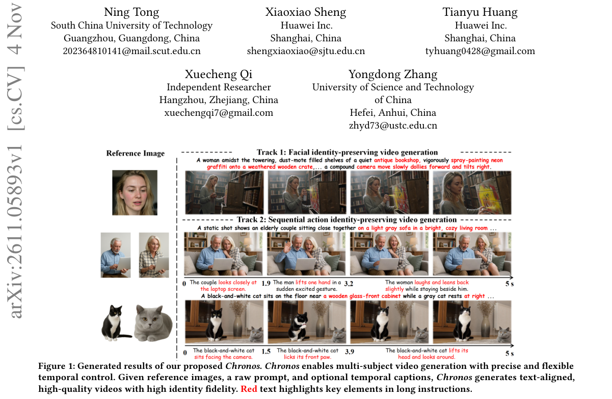

*Result - Our framework of Chronos. Given reference images, a raw prompt, and optional temporal captions, the pipeline first performs Semantic Prompt Anchoring, then generates frame anchors through Vi*

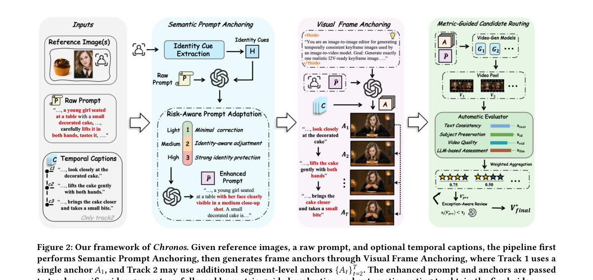

**Why this ranks #7**: 身份保持视频生成的挑战赛双料冠军：语义提示锚定加视觉帧锚定加度量引导候选路由，在 ACM MM 2026 挑战赛 Track 1 与 Track 2 最终分均为 2.5 与 1.25 居首，两条赛道总分 0.6769 与 0.6102 也是最高。

---

### 8. Quo Vadis, Driving Scene Reconstruction? Occlusion-Aware Gaussian Densification

**arXiv**: [2611.06273](https://arxiv.org/abs/2611.06273) | **Score**: 8.0 (relevance 8 x 0.7 + quality 8 x 0.3) | **Tags**: AIGC-visual, 3d-gaussian-splatting, driving-scene, novel-view-synthesis, feed-forward, disocclusion, AITech Lab. | **Categories**: cs.AI, cs.CV | **Pages**: 16

**Authors**: Dung Do Tien; Kien Nguyen Do Trung; Kiet Dang Vu; Trung Thai Tran; Duc Dung Nguyen

**Affiliation**: AITech Lab., Ho Chi Minh City University of Technology (HCMUT); Vietnam National University Ho Chi Minh City (VNUHCM)

**Abstract**

> While recent feed-forward 3D Gaussian Splatting methods enable efficient driving-scene reconstruction from surround-view images, their reliance on a single observation fundamentally hinders novel-view synthesis. Regions occluded in the input can become visible from novel viewpoints, leaving the reconstructed Gaussians under-constrained and incomplete. Moving beyond image-space inpainting for rendered views, we introduce OccSplat, a feed-forward framework whose core contribution is Occlusion-Aware Gaussian Densification, explicitly targeting missing scene geometry rather than missing pixels. By predicting new Gaussian primitives for unsupported regions, OccSplat completes the scene directly in the 3D representation. Specifically, OccSplat first identifies occluded regions that lack Gaussian support through Gaussian Occlusion Mapping. Gaussian Occlusion Completion then generates new primitives for these regions. The predicted primitives are integrated into the original representation to improve novel-view synthesis while retaining feed-forward inference without per-scene optimization. Experiments on the nuScenes benchmark demonstrate that OccSplat improves on the compared methods and yields particularly large gains in occluded regions, leading to more accurate and visually coherent driving-scene reconstruction.

**Key findings**

- **Finding**: nuScenes 验证集上 OccSplat 的 PSNR 为 23.50、SSIM 为 0.767、LPIPS 为 0.182，其中 PSNR 比 DrivingForward 高 1.74 dB、LPIPS 由 0.194 降到 0.182。
- **Inference**: 单帧观测下被遮挡区域的高斯欠约束，问题出在几何缺失而非像素缺失，因此应当补 3D 基元而不是补渲染像素。
- **Recommendation**: 做前馈驾驶重建时应把评估重点放到被遮挡区域，nuScenes 上只报整帧 PSNR 会掩盖这块提升。

**Key figures**

*Framework - The disocclusion problem in forward-driving single-frame (SF) re- construction. Six surround-view cameras at a source frame t (top) and target frame t+1 (bottom). As the ego-vehicle advances,*

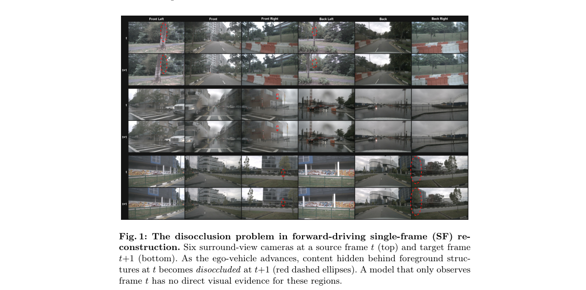

*Result - Overall architecture of OccSplat. (a) From surround-view images {It*

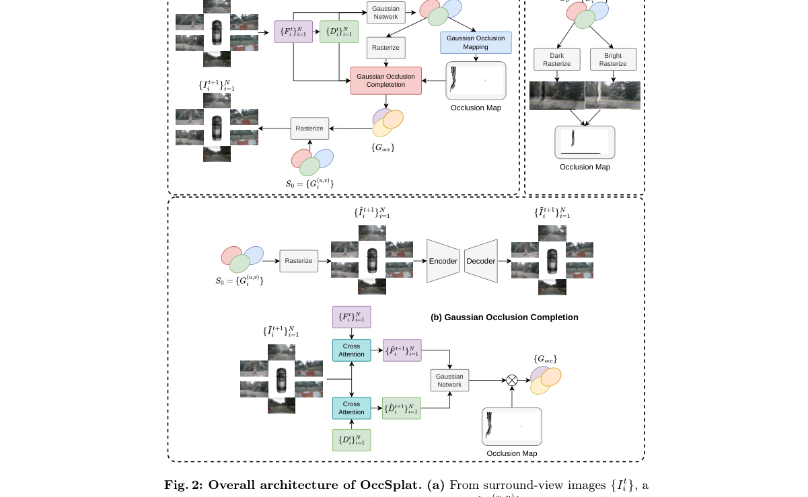

**Why this ranks #8**: 驾驶场景的前馈重建：不做图像域修补而是直接在 3D 表示里补高斯，nuScenes 验证集 PSNR 达 23.50、比 DrivingForward 的 21.76 高 1.74 dB，LPIPS 从 0.194 降到 0.182，SSIM 0.767 与最优持平。

---

### 9. EvoWorld: Towards Out-of-Sight World Evolution in Generative Video Models

**arXiv**: [2611.06748](https://arxiv.org/abs/2611.06748) | **Score**: 8.0 (relevance 8 x 0.7 + quality 8 x 0.3) | **Tags**: AIGC-visual, world-model, causal-reasoning, video-generation, benchmark, vision-language-model, Hong Kong University of Science and | **Categories**: cs.AI, cs.CV | **Pages**: 20

**Authors**: Yequan Bie; Dengyang Jiang; Zhixuan Chen; Xiaozhuan Liang; Haoxuan Che; Quande Liu; Xi Chen; Hao Chen

**Affiliation**: The Hong Kong University of Science and Technology; Tencent; The Chinese University of Hong Kong

**Abstract**

> Generative video models are increasingly used as visual world simulators, yet their primary strength lies in rendering plausible pixels rather than reasoning about how a world should evolve. Coherent world evolution requires more than visual fidelity: when an event occurs, a model must infer its consequences for the entities in the world and then render the resulting state. For example, after a wild beast appears, the model should not only depict the wild beast, but also infer whether a nearby person should flee, take cover, or fight back based on the realized scene. Existing diffusion-based video models lack an explicit mechanism for maintaining world state and reasoning over such event-conditioned consequences, often producing visually plausible but behaviorally static or causally inconsistent outputs. To make this reasoning gap concrete and measurable, we propose a new problem, Out-of-Sight Causal Evolution, which requires a model to render an event, reason about its consequences for the evolving world state, and reveal a causally plausible outcome as the world continues to evolve, even out of sight. As a baseline reference solution, we introduce EvoWorld, a brain-renderer collaboration framework in which a vision-language model serves as the world brain: it observes generated segments, maintains an evolving account of the world, and reasons about plausible state transitions, while a segment-autoregressive video renderer realizes them visually. We further introduce EvoWorld-Data and EvoWorld-Bench for training and evaluating event realization, causal reactions, and revisit consistency. Experiments show that EvoWorld substantially improves event-conditioned causal evolution over recent models while preserving visual quality and consistency, establishing a reference point for reasoning-guided, autonomous world evolution beyond the current field of view.

**Key findings**

- **Finding**: EvoWorld 在 EvoWorld-Bench 上核心任务成功率达 90.8%，较次优基线高 69.1 个百分点；消融显示两阶段训练把该指标从 82.5% 抬到 90.8%，因果合理性达 94.2%。
- **Inference**: 视觉保真与状态推理是两种不同能力，把世界状态交给视觉语言模型维护、渲染器只负责视觉实现，才可能让镜头外的事件产生合理后果。
- **Recommendation**: 评估视频世界模型时应把回访一致性与因果合理性单列，否则高分模型可能只是把事件画出来而没有推演后果。

**Key figures**

*Framework - Challenges in Out-of-Sight Causal Evolution. The camera first observes a subject (a vendor and his handcart), moves away to reveal a newly requested event (a collapsing building facade), and*

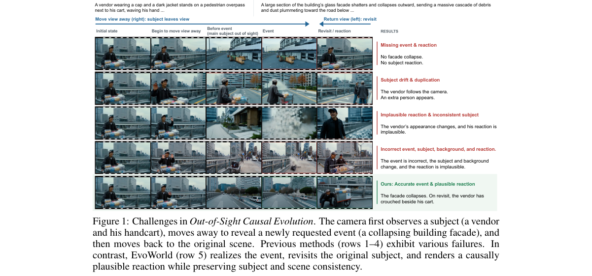

*Result - Overview of the data engine for EvoWorld. Structured scenarios are rendered into single- take out-of-sight interactions, verified against visual evidence, temporally annotated, and converted*

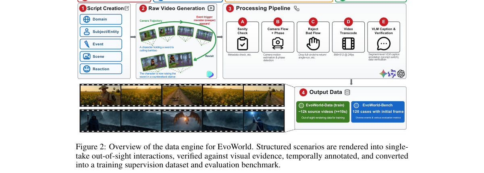

**Why this ranks #9**: 生成式视频的世界演化：提出 Out-of-Sight Causal Evolution 任务，EvoWorld 在 120 例的 EvoWorld-Bench 上取得 90.8% 核心任务成功率，比次优基线高 69.1 个百分点，并配套约 1.2 万条 10 秒以上长视频数据。

---

### 10. DualCast: Dual-Image Conditioned Diffusion Transformers for Digital Human E-Commerce Video Generation

**arXiv**: [2611.05825](https://arxiv.org/abs/2611.05825) | **Score**: 7.7 (relevance 8 x 0.7 + quality 7 x 0.3) | **Tags**: AIGC-visual, dual-image-conditioning, digital-human, e-commerce-video, diffusion-transformer, reference-conditioning, State Key Lab of CAD&CG | **Categories**: cs.CV | **Pages**: 12

**Authors**: Lifan Jiang; Yibo Zhao; Senlin Cheng; Bolei Xu; Xiaobo Li; Can Ye; Dehai Zhao; Deng Cai; Boxi Wu

**Affiliation**: State Key Lab of CAD&CG, Zhejiang University; Ant Group

**Abstract**

> Digital human e-commerce video generation requires preserving product appearance, human identity, and overall video style during dynamic demonstrations. Although recent models support multiple reference images, their general conditioning schemes do not explicitly distinguish the asymmetric roles of "what is presented" and "who presents it." Consequently, generated videos may favor a single reference, resulting in product distortion, identity drift, or single-reference collapse. To address this issue, we propose DualCast, a role-addressed dual-image conditioning framework for video generation. By explicitly modeling the distinct roles of product and human conditions, DualCast reduces role ambiguity and feature competition between references. First, a dual-spatiotemporal slot injection mechanism VAE-encodes the product and human images separately and places their latent features at the front and rear boundaries of the DiT sequence, enabling sequence-level condition separation and directed injection. Second, a mask-guided region-weighted loss strengthens supervision over product, face, and product-face overlap regions, improving generation fidelity in critical areas. Third, image condition dropout enables a single model to support dual-image, product-only, and human-only generation. In addition, we construct a curated dataset of 10K e-commerce videos for model training. Experimental results demonstrate the strong performance of DualCast.

**Key findings**

- **Finding**: DualCast 在 11 项指标上平均排名 1.73，其中 9 项第一或并列第一；五维感知均分 0.9848（原始 4.9240），ID-Adj 0.8517 高于 Wan2.7 的 0.8498 与基座的 0.8206。
- **Inference**: 商品与人物是语义不对等的条件，用同一套通道注入必然引发特征竞争，先分角色再分权重就能同时保住商品外观与人脸身份。
- **Recommendation**: 做多参考图条件生成时应先明确每个参考的角色，用区域加权损失盯住关键区域，并以条件 dropout 兼容单参考输入。

**Key figures**

*Framework - A single fine-tuned DualCast model unifies three inference modes. A (Dual-image): Using dual-spatiotemporal slot injection, the model assigns roles to and preserves both product appearance a*

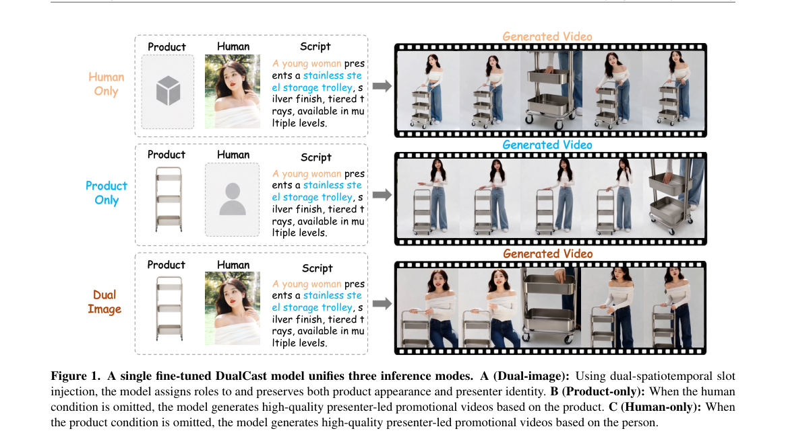

*Result - Overview of DualCast. The product and presenter images are independently VAE-encoded and placed at the front and rear boundaries of the extended latent sequence, respectively. Only intermedi*

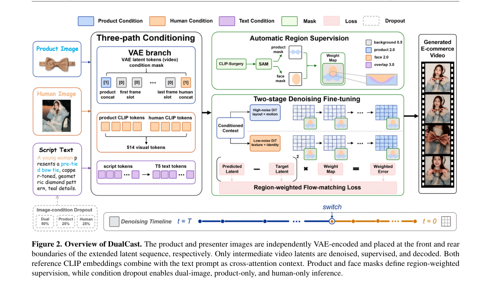

**Why this ranks #10**: 数字人电商视频的双图角色寻址：商品图与人物图分别 VAE 编码并置于 DiT 序列首尾，11 项指标平均排名 1.73、其中 9 项第一或并列第一，人脸一致性 ID-Adj 0.8517 超过 Wan2.7 的 0.8498。

---

