# ArXiv Daily Digest - 2026-11-05 (音频与语音语言模型, 10 papers)

**Generated**: 2026-11-05 17:30 CST

**Source**: arXiv cs.CV, cs.SD, eess.AS, cs.CL, cs.AI, cs.RO, cs.LG submissions, listing day 2026-11-04 (announced 2026-11-05 00:00 UTC)

**Batch window**: 2026-11-03T18:00:00Z .. 2026-11-04T18:00:00Z（arXiv 公告批次横跨两个 UTC 日：前一日 18:00 UTC 起算，当日 17:59:59 UTC 截止）

**Track**: audio_lm (top 10 of 518 papers scanned, 70 full reads)

**Scope**: 音频 / 语音语言模型与多模态助手，含语音记忆、长音频检索、空间音频与多语种对话评测

---

## Top 10 - 音频与语音语言模型

### 1. SleuthVLM: Do We Really Need Audio-in-Video for Omni Video Understanding?

**arXiv**: [2611.06083](https://arxiv.org/abs/2611.06083) | **Score**: 9.0 (relevance 9 x 0.7 + quality 9 x 0.3) | **Tags**: audio-lm, omni-video-understanding, agent-harness, asr-transcription, video-question-answering, University of Bristol | **Categories**: cs.CV | **Pages**: 28

**Authors**: Peiran Wu; Fangfei Gou; Zhaoxi Mu; Changhao Zhang; Jian Liu; Weiqiang Wang; Yuntao Wang; Yuanchun Shi; Junxiao Shen

**Affiliation**: University of Bristol; Ant Group; Tsinghua University

**Abstract**

> Omni models answer questions about videos by jointly processing sampled frames and audio in one turn, with progress driven largely by scaling model size and omni training data. We ask whether a model needs to hear the audio directly at all, and present SleuthVLM, an agent harness built on a VLM that never hears the audio directly: speech will be transcribed into text, and the VLM will sleuth the video on its own without any predefined workflow. On four omni benchmarks with videos up to 90 minutes, SleuthVLM achieves the best average accuracy: \textbf{75.0%}, 2.6 points above Gemini 3.8 Flash, and it also tops the Video-MME-v2 leaderboard with \textbf{77.8%}; with an open-source 27B VLM, it beats all open-source omni models. We draw three findings: SleuthVLM beats a model that glances; hearing is not the bottleneck, agentic ability is; omni understanding needs better agentic ability, not just more omni data for modality alignment. So we provide a simple but effective starting point for doing omni video understanding. Omni understanding needs better agents, not just bigger models that hear.

**Key findings**

- **Finding**: SleuthVLM 全程不直接听音频，只用 ASR 转写加强制对齐把语音转成带时间戳文本，在四个全模态基准上平均准确率 75.0%，比 Gemini 3.8 Flash 高 2.6 分，Video-MME-v2 达 77.8%。
- **Inference**: 转写式方案能压过直接听音的全模态模型，说明瓶颈是代理式推理能力而不是音频对齐质量。
- **Recommendation**: 做全模态视频理解时先搭 ASR 转写加 VLM 自主推理的基线，再决定是否值得引入音轨。

**Key figures**

*Framework - SleuthVLM never hears the audio directly, yet beats the omni models that do. (a) Average accuracy on four omni benchmarks against model size; closed-source models are on the right, and the bl*

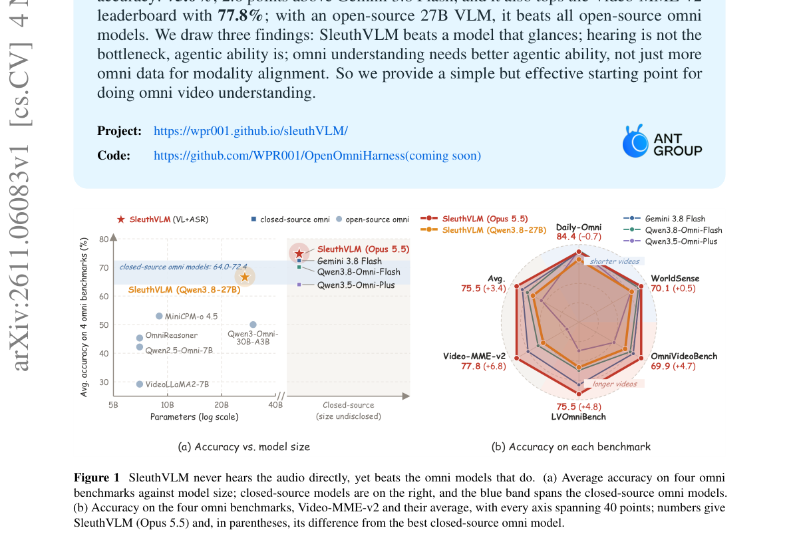

*Result - Overview of SleuthVLM. (a) Once per video, an ASR model transcribes the speech and a forced aligner assigns timestamps to each word, preserving non-speech intervals as gaps. (b) A VLM gathers*

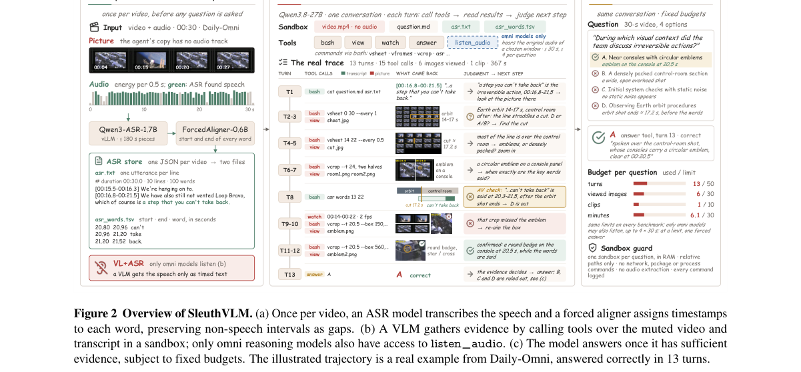

**Why this ranks #1**: 排在 audio_lm 首位：四个全模态基准平均准确率 75.0%，比 Gemini 3.8 Flash 高 2.6 分，Video-MME-v2 上 77.8% 登顶；方案本身不含音频模态，用 27B 开源 VLM 就压过所有开源全模态模型，反直觉结论最值得读。

---

### 2. CRESiST: Self-Enhancing Explorative Policy Learning for Simultaneous Speech Translation

**arXiv**: [2611.06501](https://arxiv.org/abs/2611.06501) | **Score**: 9.0 (relevance 9 x 0.7 + quality 9 x 0.3) | **Tags**: audio-lm, simultaneous-speech-translation, interleaved-read-write, actor-critic, kv-cache-reuse, Shanghai Jiao Tong University | **Categories**: cs.CL, cs.SD | **Pages**: 20

**Authors**: Chenyang Le; Pei Zhang; Yuxiang Chen; Bing Han; Derek F. Wong; Baosong Yang; Yanmin Qian

**Affiliation**: Shanghai Jiao Tong University; Alibaba Token Hub, Alibaba Group; University of Macau; University College London

**Abstract**

> Simultaneous Speech Translation (SimulST) requires balancing translation quality and latency. While Large Language Models (LLMs) excel in offline translation, current LLM-based SimulST systems predominantly rely on prefix-incremental generation. This paradigm suffers from redundant Key-Value cache recomputation and necessitates external Voice Activity Detection to process unbounded streams. To overcome these bottlenecks, we propose an end-to-end interleaved read-write framework built upon an omni-modal LLM. By interleaving speech chunks and text tokens, our architecture achieves full KV cache reuse, natively supporting segmentation-free, infinite-length inference. Furthermore, to learn optimal streaming policies without rigid offline alignments, we introduce a novel Actor-Critic self-enhancement pipeline. An RNN-T Actor dynamically samples read-write trajectories, while an LLM-based Critic evaluates these paths via intrinsic semantic and latency rewards, distilling the optimal policy back to the Actor. Extensive experiments on sentence-level (FLEURS, CoVoST2) and document-level (MuST-C, ACL 60/60) benchmarks demonstrate that our model establishes new state-of-the-art quality-latency Pareto frontiers, substantially outperforming existing cascaded and static-alignment baselines.

**Key findings**

- **Finding**: CRESiST 在 400 毫秒声学块粒度上交错读写语音与文本，无分段流式下 ACL 60/60 英德方向 COMET 85.59、LongYAAL 1.08，而 AlignATT 为 80.83 与 1.57、StreamATT 为 70.61 与 1.89。
- **Inference**: 完整 KV cache 复用让无限长流式不需要外部 VAD 切分，延迟同时压到 1 秒量级。
- **Recommendation**: 改造流式翻译时优先把生成范式换成交错读写，而不是靠外部切分器与历史裁剪。

**Key figures**

*Framework - Training and inference diagram of CRESiST. In the interleaved sequence, red and green target tokens mark whether the Router score at that position passes the decision threshold, i.e., whethe*

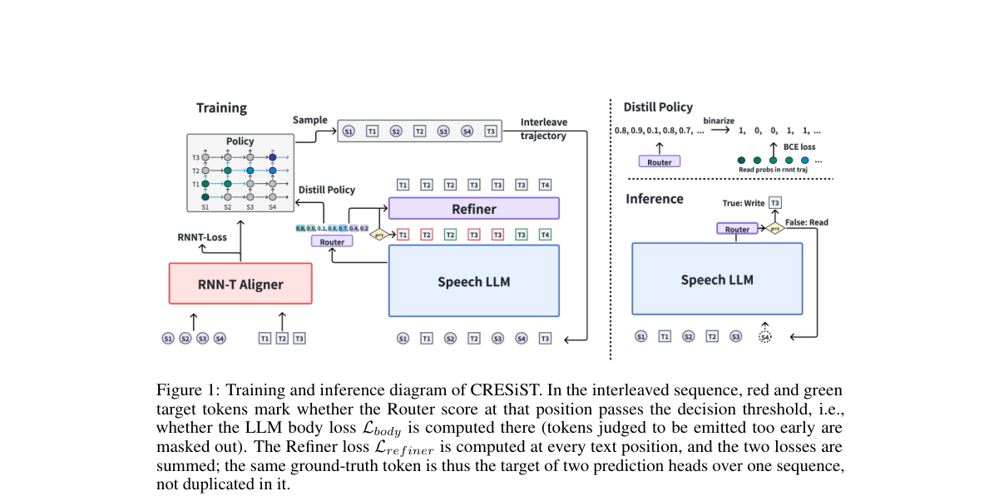

**Why this ranks #2**: 与 SleuthVLM 并列高分：400 毫秒声学块上交错读写语音与文本，实现全 KV cache 复用和免外部切分的无限长流式；ACL 60/60 英德方向无分段时 COMET 85.59、LongYAAL 1.08，而 AlignATT 只有 80.83 与 1.57。

---

### 3. Speaker-Consistent Grounding for Confusion-Resilient LLM-Based Target Speech Extraction

**arXiv**: [2611.06297](https://arxiv.org/abs/2611.06297) | **Score**: 8.7 (relevance 9 x 0.7 + quality 8 x 0.3) | **Tags**: audio-lm, target-speech-extraction, speaker-consistency, llm-grounding, evidence-repair, UNSW Sydney | **Categories**: cs.SD, eess.AS | **Pages**: 5

**Authors**: Hanyu Meng; Hao Shi; Zhanhong He; Qiquan Zhang; Yang Xiao; Sungwoo Cho; Haowei Lou; Haizhou Li

**Affiliation**: UNSW Sydney, Australia; Kyoto University, Japan; University of Western Australia, Australia

**Abstract**

> Deterministic target-speaker extraction (TSE) tends to preserve observed linguistic content but may extract the interfering speaker. In contrast, autoregressive generative TSE improves perceptual quality, but is prone to content hallucination and speaker identity drift, which can be mitigated by model grounding with the evidence from the deterministic TSE. However, grounding such a generative TSE model with speaker-confused evidence may therefore reinforce the error. To address this gap, we proposed a repair-before-grounding framework with a training-free evidence-repair stage. Conditioning-diverse candidate selection (CDCS) selects target speaker-consistent evidence from complementary frozen TSE outputs. The selected waveform can then be used by code-space grounding (CSG) to constrain LLM-based TSE decoding. On Libri2Mix, CDCS reduces wrong-speaker extraction errors from 6.87% to 0.75% on clean mixtures and from 18.95% to 10.46% under noise. With the LLM-based TSE checkpoint unchanged, CSG further reduces noisy content- and acoustic-switch rates from 12.79% and 1.68% to 9.10% and 0.51%, respectively. Despite this stronger grounding, generative TSE retains its predicted perceptual-quality advantage over direct deterministic extraction. These results show that repairing evidence identity before grounding improves the reliability of generative TSE. Audio demos and code are available at https://hanyu-meng.github.io/LLM-TSE-Grounding-Demo/.

**Key findings**

- **Finding**: 在 Libri2Mix 上 CDCS 把干净混合的错说话人抽取错误率从 6.87% 降到 0.75%、噪声下从 18.95% 降到 10.46%，再用代码空间接地把噪声下内容切换率从 12.79% 降到 9.10%、声学切换率从 1.68% 降到 0.51%。
- **Inference**: 用可能被污染的证据去接地会强化错误，先修证据身份比换更大的生成模型更关键。
- **Recommendation**: 做 LLM 式目标语音抽取时，先加一道训练无关的证据一致性筛选再解码。

**Key figures**

*Framework - Overview of the proposed repair-before-grounding framework. (a) CDCS-5 selects target-speaker-consistent evidence from five frozen deterministic TSE estimates. The selected waveform is either*

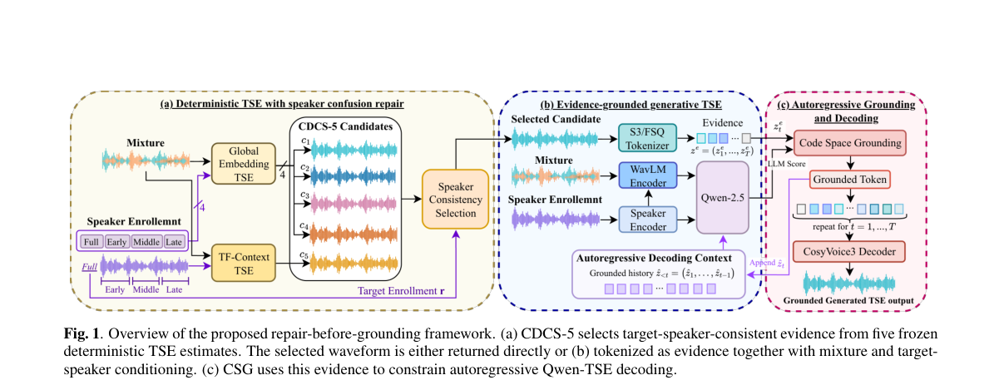

**Why this ranks #3**: 把「先接地还是先修证据」这个顺序问题量化了：CDCS-5 从五路冻结确定性 TSE 输出中选说话人一致的证据，干净混合下错说话人抽取率从 6.87% 降到 0.75%，噪声下从 18.95% 降到 10.46%，改进幅度在本线里最大。

---

### 4. LibriSpeech-Real-QA: A Benchmark for Streaming Question Answering

**arXiv**: [2611.06496](https://arxiv.org/abs/2611.06496) | **Score**: 8.7 (relevance 9 x 0.7 + quality 8 x 0.3) | **Tags**: audio-lm, streaming-question-answering, benchmark, event-triggered-response, speech-llm, Tsinghua University | **Categories**: cs.CL | **Pages**: 5

**Authors**: Zewen Zhan; Hui Lu; Xueyuan Chen; Huimeng Wang; Yikai Huang; Xixin Wu; Shiyin Kang; Bin Xia; Zhiyong Wu

**Affiliation**: Tsinghua University, China; The Chinese University of Hong Kong, China; SenseTime Research, China

**Abstract**

> Most speech large language models (SLMs) still process speech in an offline manner. They only start responding after they receive the complete speech segment. However, many real-world applications require streaming speech interaction, for which the audio continuously flows in and the machine is required to answer questions based on the so far received audio chunks. For example, a user may ask the system to continuously count how many times a person's name has been mentioned while they are speaking. We observe a lack of benchmarks and evaluation protocols for real-time speech interaction. Motivated by this, we propose LibriSpeech-Real-QA, a dataset and a benchmark for real-time speech interaction. We construct different types of real-time question-answer pairs from LibriSpeech to evaluate whether speech LLMs can identify target words in streaming audio. We evaluate several popular real-time commercial models and find that they still tend to respond only after the speech turn has finished. We demonstrate that we can enable a pretrained SLM to perform this task, where we explore several modeling designs and establish a solid baseline for future research.

**Key findings**

- **Finding**: LibriSpeech-Real-QA 用 LibriSpeech 构造词法与语义两类的检测与计数四种流式问答任务；四个商业实时 API 在词法检测上的平均启动延迟为 4.35 到 6.52 秒、词法计数上最高达 10.03 秒，而 STREAMING 400 毫秒分块基线 F1 为 0.993 与 0.978、延迟 0.661 与 0.625 秒。
- **Inference**: 现成实时服务把输入当成对话轮次处理，内容准确但响应时机完全不对。
- **Recommendation**: 评估语音大模型时同时打分「说了什么」和「什么时候说」，只看内容会漏掉流式交互缺陷。

**Key figures**

*Framework - Single-axis chunk timeline for person-name counting with a 0.28 s chunk window.*

**Why this ranks #4**: 补上了本线缺的评测环节：基准覆盖词法与语义各自的检测与计数四类任务，词法检测上商业实时 API 的平均启动延迟 4.35 到 6.52 秒、词法计数更达 10.03 秒，都在轮次结束后才回答，而 400 毫秒分块的流式基线 F1 达 0.993 与 0.978、延迟 0.661 秒。

---

### 5. Holistic Parallel Supervision for Expressive Speech to Speech Translation

**arXiv**: [2611.06010](https://arxiv.org/abs/2611.06010) | **Score**: 8.0 (relevance 8 x 0.7 + quality 8 x 0.3) | **Tags**: audio-lm, expressive-s2st, parallel-supervision, voice-conversion, professional-dubbing, Center for Language and Speech Processing | **Categories**: cs.CL | **Pages**: 5

**Authors**: Hao Zhang; Ismail Rasim Ulgen; Bismarck Bamfo Odoom; Rui Liu; Zihan Zhang; Berrak Sisman; Philipp Koehn

**Affiliation**: Center for Language and Speech Processing, Johns Hopkins University, MD, USA

**Abstract**

> Expressiveness is central to speech-to-speech translation (S2ST), yet existing datasets rarely align source and target speech jointly in content, prosody, timing, and speaker identity. Consequently, current systems often rely on indirect conditioning or transfer mechanisms. To obtain this supervision, we introduce a training-data construction strategy that combines professional dubbing, which provides human-performed correspondence in content, prosody, and timing, with multilingual voice conversion to reduce speaker mismatch. We evaluate this supervision using existing expressive S2ST systems and DirectS2ST, an end-to-end method developed in this work that predicts the complete target-speech representation directly from source speech. Experiments on English-German and English-Spanish show that holistic parallel supervision improves expressive realization across all evaluated systems. DirectS2ST exhibits the largest gains in content, prosody, timing, speaker similarity, and human-rated expressiveness. To our knowledge, this work provides the first systematic investigation of holistic parallel supervision for expressive S2ST.

**Key findings**

- **Finding**: 英德方向 DirectS2ST 用 VC-DUB 训练后 ASR-BLEU 由 6.01 升到 10.52、韵律相似 A.PCP 由 2.162 升到 2.905、说话人相似 Vsim 由 0.114 升到 0.217；打乱源-目标配对后 BLASER 从 3.611 掉到 2.285。
- **Inference**: 专业配音加音色转换能同时对齐内容、韵律、时间与说话人四维监督，负对照证明收益来自配对本身而非语料规模。
- **Recommendation**: 缺高质量平行表达数据时，先用配音加音色转换造对齐语料，并用打乱配对做负对照。

**Key figures**

*Framework - Overview of the holistic parallel supervision: (a) VC-DUB Construction; (b) Parallel Supervision; (c) DirectS2ST.*

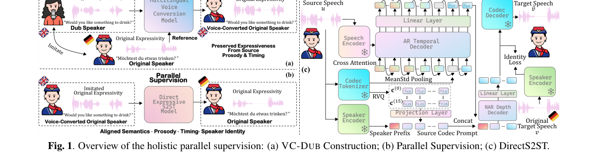

**Why this ranks #5**: 本线少见的把数据构造当主贡献的工作：英德方向 DirectS2ST 换用 VC-DUB 训练后 ASR-BLEU 从 6.01 升到 10.52、韵律相似从 2.162 升到 2.905、说话人相似从 0.114 升到 0.217，且打乱配对会让 BLASER 从 3.611 崩到 2.285。

---

### 6. Confucius4-R2T2: A Stable-Prefix Streaming ASR Model for Real Real-Time Transcription

**arXiv**: [2611.06043](https://arxiv.org/abs/2611.06043) | **Score**: 8.0 (relevance 8 x 0.7 + quality 8 x 0.3) | **Tags**: audio-lm, streaming-asr, stable-prefix, longest-stable-prefix, self-distillation, NetEase Youdao | **Categories**: cs.AI, cs.CL, cs.SD | **Pages**: 30

**Authors**: Daniel Huang; Qi He; Shaoxiong Duan; Yingjie Li; Qiao Cheng; Yitao Duan

**Affiliation**: NetEase Youdao, Beijing, China

**Abstract**

> Streaming speech recognition is increasingly consumed by machines, such as translators and voice agents, that act on each token as it appears. A token that is later revised costs wasted work or a wrong action. In this work, we present Confucius4-R2T2 (short for Real Real-Time Transcription), a stable-prefix streaming ASR model that never modifies its earlier output while maintaining high accuracy and low latency. R2T2 is obtained by post-training Qwen3-ASR-1.7B on 1,500 hours of Chinese and English audio while freezing its pre-trained audio encoder and projector. The adaptation is based on the concept of Longest Stable Prefix (LSP), a new notion that we introduce in this work. We prove that LSP is monotone under the prefix order, consistent with the full-audio output, and maximal among labels that equal a whole earlier output. Learning from LSP labels converts a full-context model into a stable-prefix streaming one without any architectural change. Extensive evaluations show that R2T2 brings streaming recognition close to the base model's full-context quality while delivering stable text with low emission lag. Its gains extend beyond the post-training languages, demonstrating a practical path from full-context ASR to stable streaming. We open-source the model weights and code at https://huggingface.co/netease-youdao/Confucius4-R2T2 and https://github.com/netease-youdao/Confucius4-R2T2.

**Key findings**

- **Finding**: R2T2 用最长稳定前缀标签把全上下文 Qwen3-ASR-1.7B 后训练成稳定前缀流式模型，训练数据为 1,500 小时中英音频且冻结音频编码器，块长 80 毫秒到 2 秒可配置，在 1,860 条 Buckeye 语料上以 80 毫秒间隔构造前缀标签。
- **Inference**: 稳定性可以通过监督标签从非流式模型中直接提取，不必因果化编码器或加注意力掩码。
- **Recommendation**: 机器消费型 ASR 先把输出不可回改写成契约，再用最长稳定前缀标签做后训练。

**Key figures**

*Framework - Streamability plots on 1,860 Buckeye utterances. The curves compare Qwen3-ASR- 1.7B, Qwen3-ASR-0.6B, Whisper large-v2, and WhisperRT, with manually timestamped ground truth as a timing refer*

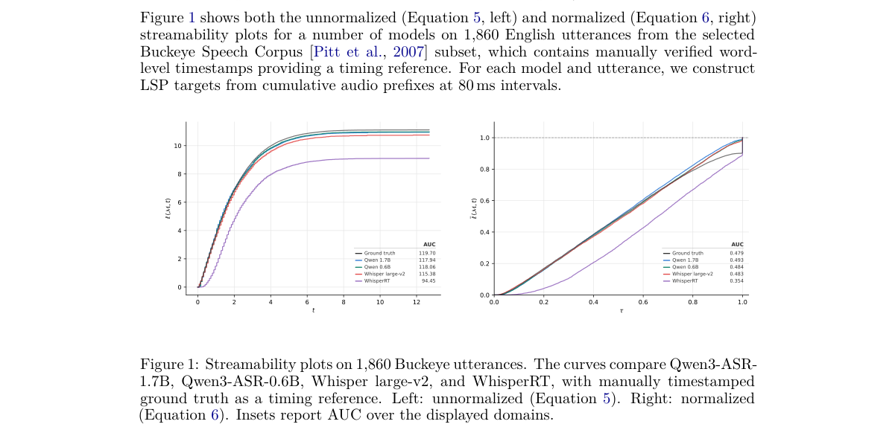

*Result - Stable-prefix interval extraction. A teacher ASR model decodes progressively longer audio prefixes every 80 ms. Each row shows the complete recognition hypothesis. Blue indicates predictions m*

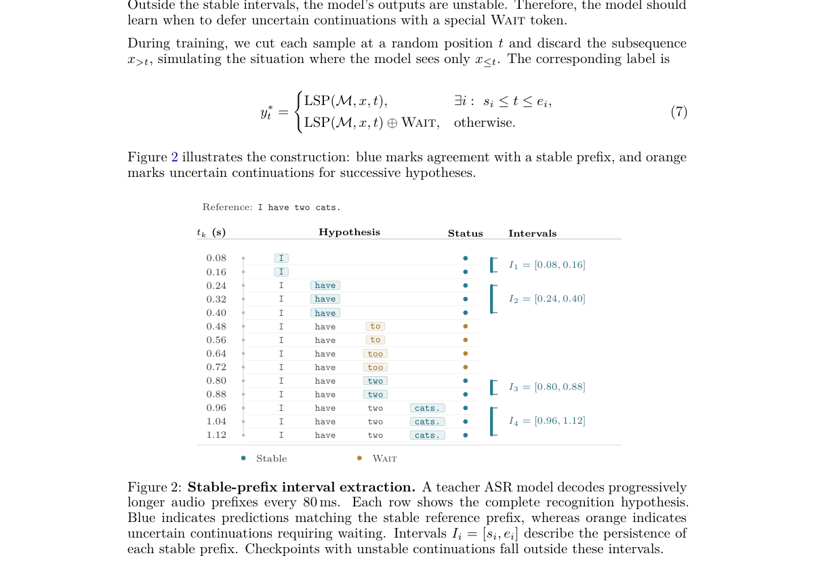

**Why this ranks #6**: 工程价值最高的一篇：只需在 Qwen3-ASR-1.7B 上用 1,500 小时中英音频后训练，用最长稳定前缀标签换取输出永不回改的承诺，块长 80 毫秒到 2 秒可配，并在 1,860 条 Buckeye 语料上做了流式性分析。

---

### 7. Phonological Knowledge of Chinese Characters in Language Models

**arXiv**: [2611.05803](https://arxiv.org/abs/2611.05803) | **Score**: 7.7 (relevance 8 x 0.7 + quality 7 x 0.3) | **Tags**: audio-lm, phonological-probing, chinese-characters, activation-steering, minimal-pairs, School of Foreign Languages and Literature | **Categories**: cs.CL | **Pages**: 17

**Authors**: Xiaozhe Ji; Renfen Hu; Hai Hu

**Affiliation**: School of Foreign Languages and Literature, Beijing Normal University; The Hong Kong Polytechnic University

**Abstract**

> How much phonological knowledge do language models (LMs) possess about Chinese characters, and how is this knowledge represented and used? We introduce PinyinBench, a controlled benchmark covering homophones, phonological features (initials, finals, and tones), and polyphonic characters. We investigate 17 text-only and multimodal LMs through three complementary approaches: behavioral evaluation, layer-wise probing, and activation steering. Behaviorally, models demonstrate substantial knowledge of initials and finals, with a frontier model (DS-v4-flash) scoring 90%+ in homophone judgment, when two characters share no phonological features. However, its accuracy drops sharply to 72% when two characters differ only in lexical tone. Probing reveals that tone is highly decodable from embeddings and improves modestly across layers, whereas segmental information starts less decodable and improves substantially with depth. Activation steering shows that segmental representations can systematically influence generation, while tone exhibits much weaker effects. Furthermore, audio-bearing training improves phonological decodability, including tone, without corresponding improvements in steering effectiveness. Together, these findings reveal distinct representational and functional profiles for segmental and tonal information, with tonal information much harder to access and manipulate, demonstrating the necessity for combined evaluation, probing, and causal intervention for understanding linguistic knowledge in LMs.

**Key findings**

- **Finding**: PinyinBench 含 38,183 个最小对比对，覆盖同音判断、音素特征与多音字，评估 17 个文本与多模态模型；前沿模型 DS-v4-flash 在两字无共同音系特征时同音判断 90% 以上，仅差词调时骤降到 72%（tone-mismatch 条件 72.7%）。
- **Inference**: 声调在表征上可解码但功能上难以被因果干预，说明声调知识的可及性远低于音段信息。
- **Recommendation**: 评估模型语言学知识时不要只看行为准确率，必须叠加分层探针与激活操纵两种手段。

**Key figures**

*Framework - Homophone judgment accuracy vs. (a) frequency gap ΔZipf and (b) DIMSIM distance (ΔZipf≈0). Ac- curacy generally decreases as the frequency gap grows yet stays above chance at parity; it gene*

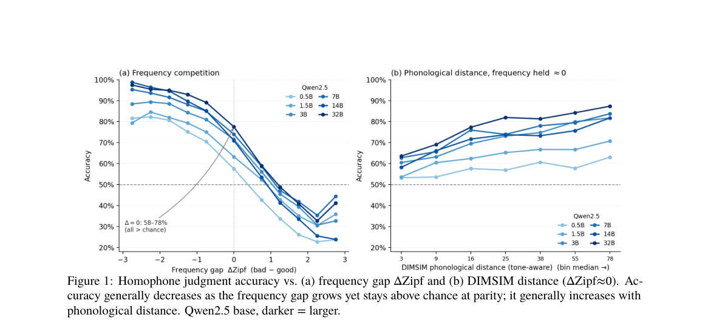

*Result - Phonological decodability across layers. Macro-𝐹1 of linear probes for Qwen2.5-7B-base and Qwen2.5- Omni-7B condition. 𝐾denotes the number of classes. Arrows show the phonetic–bare differenc*

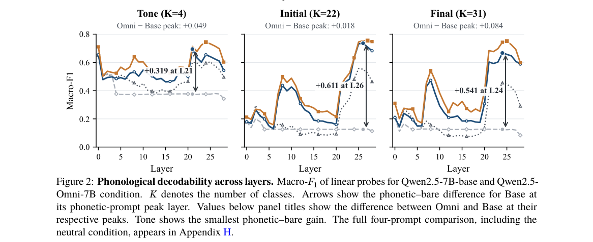

**Why this ranks #7**: 音系知识这条线唯一入选：用 38,183 个最小对比对横跨 17 个文本与多模态模型，发现前沿模型同音判断能到 90% 以上，但两字仅差声调时准确率骤降到 72%，且声调虽然可从嵌入解码却几乎无法被激活操纵。

---

### 8. SAUCE: Summary Analysis Using Conversation Entailment

**arXiv**: [2611.06812](https://arxiv.org/abs/2611.06812) | **Score**: 7.7 (relevance 8 x 0.7 + quality 7 x 0.3) | **Tags**: audio-lm, summarization-evaluation, conversation-entailment, fact-level-diagnosis, cross-lingual-speech, RTX BBN Technologies | **Categories**: cs.CL, eess.AS | **Pages**: 14

**Authors**: Man-Ling Sung; Hemanth Kandula; Jeff Ma; William Hartmann; Matthew Snover

**Affiliation**: RTX BBN Technologies, Cambridge MA, USA

**Abstract**

> With the growing need for evaluating Large Language Models (LLMs) and their applications to speech, challenges persist in summarizing and evaluating conversations that lack a clear end goal. We introduce SAUCE -- a reference-free, fact-based evaluation pipeline for cross-lingual conversational speech summarization. It measures the accuracy and the fact coverage of a summary through the entailment between conversation and text. We compare SAUCE against several popular summarization metrics and demonstrate the effectiveness of capturing information loss due to transcription and translation error and identifying broken summaries. Crucially, unlike black-box LLM evaluators or dense embedding metrics, SAUCE is inherently explainable: it maps summary scores to discrete, verifiable facts, allowing users to pinpoint exact hallucinations or omissions. We illustrate how this interpretability helps developers systematically profile LLM behaviors and gives end-users an actionable tool to verify summary accuracy in noisy, real-world conditions. Preliminary investigations show SAUCE strongly align with human judgment.

**Key findings**

- **Finding**: SAUCE 在阈值 0.9 时对话蕴含判定整体准确率 77.0%，其中蕴含对 88.4%、非蕴含对 63.6%；与真实对话质量的 Kendall 秩相关上，覆盖率 0.677、忠实度 0.153，而 SummaCConv 为 -0.266、SummaCzs 为 0.008。
- **Inference**: 事实级映射能把摘要得分追溯到具体事实，通用 NLI 指标在口语对话上因口语失流与说话人重叠而失效。
- **Recommendation**: 评估口语摘要时优先用可解释的事实级指标，并按语言与错误类别分别报告。

**Key figures**

*Framework - Workflow of the SAUCE. The user can access the fact-text pairs to understand the missing or wrong information in the summary with corresponding faith- fulness and coverage scores.*

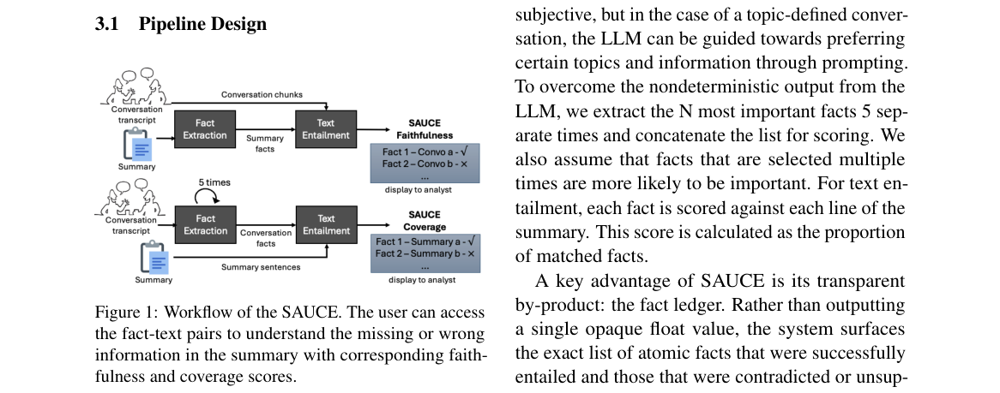

*Result - Mean WER and BLEU scores of each language, and their summary scores on ground truth, MT and ASR+MT English transcriptions. We present the plots in orange for SAUCE, blue for NLI-based metric*

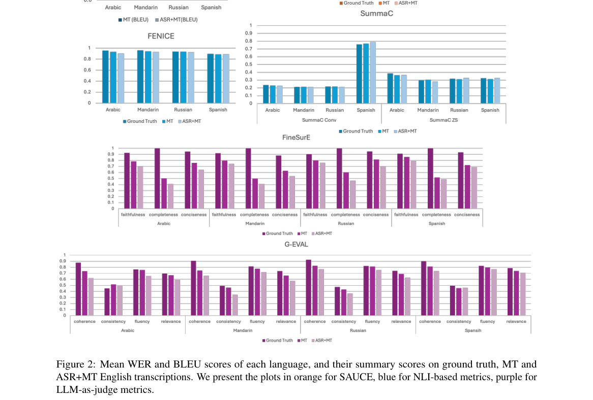

**Why this ranks #8**: 给口语摘要补了可解释的评测口径：阈值 0.9 时对话蕴含判定准确率 77.0%（蕴含对 88.4%、非蕴含对 63.6%），覆盖率与真实对话质量的 Kendall 秩相关 0.677，而 SummaCConv 为 -0.266，几乎无相关。

---

### 9. Text-Only Domain Adaptation for Low-Resource Medical ASR: Shallow Fusion and Density Ratio Rescoring for Hausa

**arXiv**: [2611.05744](https://arxiv.org/abs/2611.05744) | **Score**: 7.0 (relevance 7 x 0.7 + quality 7 x 0.3) | **Tags**: audio-lm, medical-asr, hausa-language, text-only-adaptation, lm-fusion, RUZIVO Research Lab | **Categories**: cs.AI, cs.CL, cs.LG | **Pages**: 11

**Authors**: Oche David Ankeli; Hassan Adelani Luqman; Theodora Ngozi Egbunike; Joshua Gottschalk; Bonaventure F. P. Dossou

**Affiliation**: RUZIVO Research Lab, African Leadership University, Kigali, Rwanda; Stanford University, Stanford, CA, USA; Mila - Quebec AI Institute and McGill University, Montreal, Canada

**Abstract**

> Automatic speech recognition (ASR) systems often struggle with specialised medical vocabulary, especially in low-resource languages where domain-specific speech data are scarce. We investigate text-only domain adaptation for Hausa medical ASR using the fixed MMS-1B-FL102 acoustic model and two decoding-time language-model fusion methods: Shallow Fusion (SF) and the Density Ratio Approach (DRA). A 4-gram KenLM trained on 19,421 Hausa health sentences serves as the medical target model, while a 75,372-sentence general-domain model provides the source prior for DRA. Evaluation uses 250 recordings of 25 physician-reviewed prompts from 10 speakers across six northern Nigerian states. Under prompt-disjoint five-fold cross-validation, SF and DRA reduce WER from 29.56% to 23.55% and 23.33%, respectively. Both significantly outperform greedy decoding (p < 0.001), while their difference is not significant (p = 0.423). However, general-LM-only SF achieves 23.96% WER, indicating that the medical LM's additional improvement over a general LM is modest. Medical Term Error Rate also improves under fusion, but does not establish a distinct medical-domain advantage. These findings demonstrate that lightweight, text-only language-model fusion can improve Hausa medical ASR without additional domain-specific speech collection.

**Key findings**

- **Finding**: 在 Hausa 医疗 ASR 上，提示词不重叠的五折交叉验证显示浅融合与密度比重打分把 WER 从 29.56% 降到 23.55% 与 23.33%，两者均显著优于贪心解码（p 小于 0.001）但彼此差异不显著（p 等于 0.423），仅用通用语言模型的浅融合为 23.96%。
- **Inference**: 纯文本域适配的收益主要来自语言模型本身，医疗领域模型相对通用模型只有有限额外增益。
- **Recommendation**: 资源受限部署可用 16.76 MB 的紧凑 KenLM 做解码期融合，不必为医疗术语再采集语音。

**Key figures**

*Framework - Geographic distribution of speakers. States shaded contributed speakers to the evaluation corpus.*

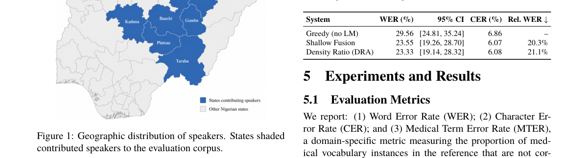

*Result - Word Error Rate, Character Error Rate, and Medical Term Error Rate across Greedy, Shallow Fusion, and Density Ratio decoding, pooled out-of-fold.*

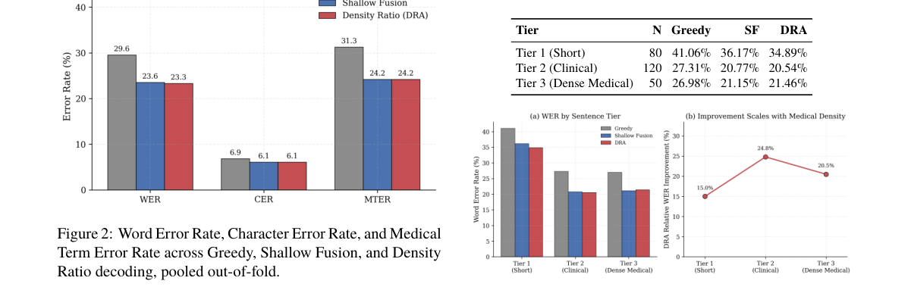

**Why this ranks #9**: 低资源方向的现实可行性证据：固定 MMS-1B-FL102 声学模型不动，用 19,421 句 Hausa 医疗文本训练 4-gram KenLM，在 250 条录音、25 个提示词、10 位说话人跨 6 个州的数据上把 WER 从 29.56% 降到 23.55% 与 23.33%。

---

### 10. Contextual Pictograms for Repairing Multilingual ASR Errors

**arXiv**: [2611.05637](https://arxiv.org/abs/2611.05637) | **Score**: 6.7 (relevance 7 x 0.7 + quality 6 x 0.3) | **Tags**: audio-lm, asr-error-repair, pictogram-interface, multilingual-ui, confidence-calibration, Department Signal Theory | **Categories**: cs.CL, cs.HC | **Pages**: 4

**Authors**: Mariana Hernandez; Hector Luna; Carlos Bruno; Luis Ricardo Santos; Elena Simoes

**Affiliation**: Department Signal Theory, Telematics and Communications, University of Granada; Brain, Mind, and Behavior Research Center (CIMCYC), University of Granada

**Abstract**

> Speech transcription errors can be difficult to recognize when competing word hypotheses are unfamiliar or visually similar. We describe an interface that combines alternative transcripts, replay and contextually checked pictograms for selected uncertain concepts. The system will initially support French and Spanish functional utterances. A counterbalanced study will assess whether pictorial feedback helps listeners recover the speaker's intended action beyond text alternatives alone. We will also quantify semantic mismatch and additional interaction time, since an inappropriate image can reinforce the wrong interpretation rather than repair it.

**Key findings**

- **Finding**: 该文是评测计划型提案，首版修复对话覆盖法语与西班牙语，对比 top-one 转写、备选转写、备选加校验象形图三种显示条件，测试项用 sans/sang/cent、pero/perro、avant/après 等只差一个关键要素的最小对比对构造，并按语义错配与额外交互耗时分别计数。
- **Inference**: 给不确定片段配图可能像固化错误那样强化错误，因此设计里把弃图与覆盖度分开统计。
- **Recommendation**: 读这篇当作交互设计清单：先定好拒绝选项、弃图规则与可靠性报告，再谈象形图本身。

**Why this ranks #10**: 排在末位因为它只是方案提案、没有实验结果：首版只覆盖法语与西班牙语两种语言，对比 top-one 转写、备选转写、备选加象形图三种显示条件，测试项按 sans/sang/cent 这类最小对比对构造，价值在设计取向而非结论。

---

