# ArXiv Daily Digest - 2026-11-05 (具身智能与世界模型, 10 papers)

**Generated**: 2026-11-05 17:30 CST

**Source**: arXiv cs.CV, cs.SD, eess.AS, cs.CL, cs.AI, cs.RO, cs.LG submissions, listing day 2026-11-04 (announced 2026-11-05 00:00 UTC)

**Batch window**: 2026-11-03T18:00:00Z .. 2026-11-04T18:00:00Z（arXiv 公告批次横跨两个 UTC 日：前一日 18:00 UTC 起算，当日 17:59:59 UTC 截止）

**Track**: embodied (top 10 of 518 papers scanned, 70 full reads)

**Scope**: 具身智能与世界模型，含移动操作、人形控制、触觉反射、VLA 策略与世界动作模型

---

## Top 10 - 具身智能与世界模型

### 1. Time-to-Goal: Learned Temporal Metrics for Long-Horizon Planning with JEPA World Models

**arXiv**: [2611.05847](https://arxiv.org/abs/2611.05847) | **Score**: 9.7 (relevance 10 x 0.7 + quality 9 x 0.3) | **Tags**: embodied, jepa-world-model, latent-planning, temporal-metric, goal-cost, University of Electronic Science and | **Categories**: cs.CV, cs.RO | **Pages**: 10

**Authors**: Ruilong Yu; Fei Ye

**Affiliation**: University of Electronic Science and Technology of China

**Abstract**

> Joint-Embedding Predictive Architectures (JEPAs) support planning by comparing predicted latent states with an encoded goal. For this comparison to guide temporal progress, states closer in time to the goal should receive lower costs. However, training representations for prediction and distribution regularization does not directly enforce this ordering. We examine this mismatch in flat LeWorldModel (LeWM) by analyzing how its Euclidean goal cost changes with temporal separation. Our analysis identifies conditions under which states at different long offsets receive similar average costs, weakening their temporal distinction. To learn the missing ordering explicitly, we introduce Time-to-Goal (T2G), a lightweight metric trained on latent triples from offline trajectories. A margin ranking loss encourages smaller distances for temporally nearer states, requiring no rewards or policy labels. The learned metric then replaces the Euclidean planning cost while the JEPA encoder and predictor remain frozen. Diagnostics on AntMaze and FourRoom show that T2G preserves stronger temporal contrast and improves near--far ranking at long offsets. Across four navigation and manipulation benchmarks, T2G improves the average planning success rate from 32.7\% (flat LeWM) to 63.0\% and approaches or even surpasses the performance of the hierarchical H-JEPA baselines. These results show that learning temporal ordering for the goal cost can substantially improve latent planning even with a flat world model.

**Key findings**

- **Finding**: T2G 只新增 0.18M 参数并冻结 JEPA 编码器与预测器，在 AntMaze、OGBench Cube、FourRoomDistractors、Push-T 上把扁平 LeWM 的平均规划成功率从 32.7% 提升到 63.0%，其中 Cube 从 32.0% 升到 63.3%。
- **Inference**: 平面世界模型缺的是目标代价里的时间序，学一个度量补上序就能替代层级化架构。
- **Recommendation**: 用 JEPA 类平面世界模型做规划时，先诊断目标代价的时间对比度，再决定是否上层级模型。

**Key figures**

*Framework - On successful FourRoom executions, Euclidean cost weakly signals initial progress (i.e., distant to goal), whereas T2G provides a more consistent temporal cost.*

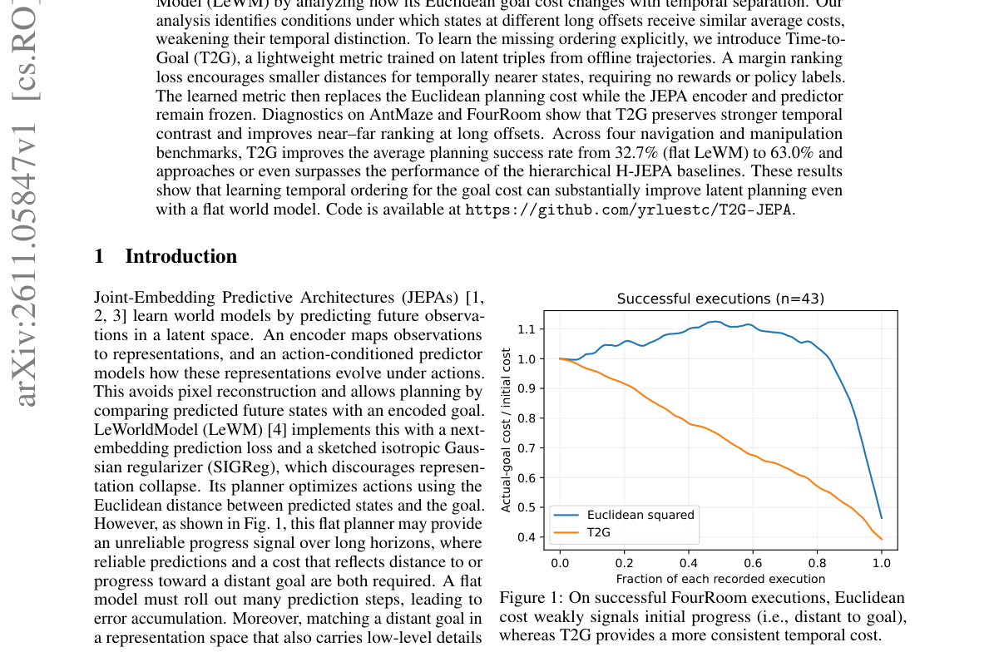

*Result - Changes in the components of Euclidean temporal contrast on AntMaze (left) and FourRoom (right), using 50 recorded planner executions per environment. The horizontal axis is the separation k*

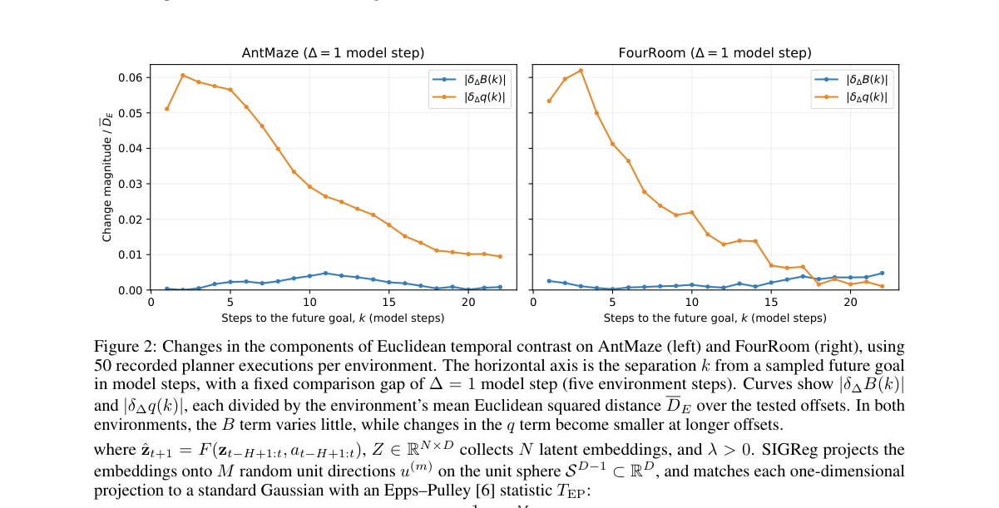

**Why this ranks #1**: 本线最高分：只加 0.18M 参数的度量网络替换欧氏目标代价，四个导航与操作基准的平均规划成功率就从扁平 LeWM 的 32.7% 提到 63.0%，逼近甚至超过需要 10.79M 参数的层级 H-JEPA，改动小、收益大。

---

### 2. Ctrl-F: Force as an Interface for Humanoid Loco-Manipulation

**arXiv**: [2611.05507](https://arxiv.org/abs/2611.05507) | **Score**: 9.0 (relevance 9 x 0.7 + quality 9 x 0.3) | **Tags**: embodied, force-command, humanoid-loco-manipulation, motion-force-tracking, hierarchical-planner, University of California | **Categories**: cs.LG, cs.RO | **Pages**: 15

**Authors**: Mengjie Zhao; Yuxin Chen; Yiyang Shao; Chuye Hong; Jiakang Chen; Koushil Sreenath; Masayoshi Tomizuka

**Affiliation**: University of California, Berkeley

**Abstract**

> Humanoid motion tracking has scaled to general policies that reproduce diverse human motion, but the resulting behavior is in free-space: the tracker knows where the body should be, not how it should interact with the environment. Other work makes the object part of the objective, yet abstracts that interaction to contact or geometry, which leaves the demanding cases under-explored. We argue that force is a natural command channel between motion imitation and object interaction, one that specifies not just where to make contact but how hard. We present Ctrl-F, a hierarchical motion-force framework that augments motion tracking with an explicit force command, a 3-D force at each designated contact body such as a hand or a foot. The hierarchical framework comprises: (1) A unified motion-force controller tracks the reference motion while applying the commanded force to the world. (2) A high-level force planner that issues a force command online based on object state and proprioception observations. In simulation and on hardware, Ctrl-F completes loco-manipulation that demands large, sustained interaction force and adjusts its command online as the load changes, both out of reach of a force-blind tracker. On hardware, Ctrl-F demonstrates hand-based dragging, pushing, and lifting, as well as foot-based kicking, successfully manipulating boxes weighing up to 20kg in pushing and kicking tasks where the force-blind baseline fails, while adapting online to additional loads introduced mid-task.

**Key findings**

- **Finding**: Ctrl-F 在统一运动-力控制器中按手或脚给出三维力命令，高层规划器依据物体状态与本体感知在线下发指令；真机上完成手部拖拽、推举与脚部踢球，推箱与踢球任务可操控重达 20 公斤的箱体，力盲基线在这些任务上失败。
- **Inference**: 只学动作位置而不给力的强度命令，无法覆盖需要持续大作用力的搬运与冲撞场景。
- **Recommendation**: 人形移动操作训练先把力作为独立命令接口建模，再叠高层规划器。

**Key figures**

*Framework - Ctrl-F on hardware, running the raise-walk-kick sequence with a 1 kg box in the hands and an 8 kg cart to kick. Raising the box is already a force task: the hands slide off a box they do no*

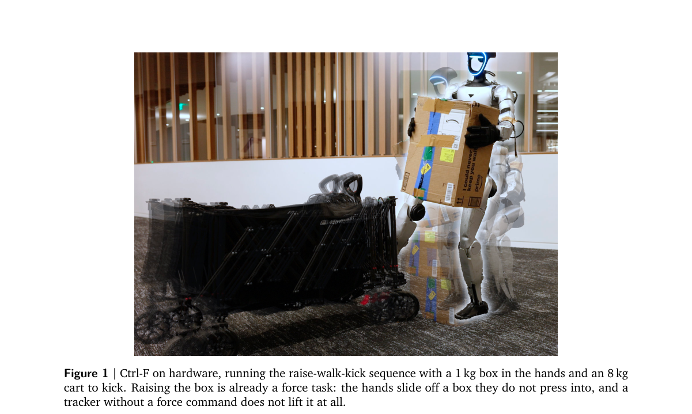

*Result - Ctrl-F. Stage 1 trains the motion–force tracker without objects: a force command is randomly sampled and its corresponding inverse force is applied to the robot, teaching the tracker to fol*

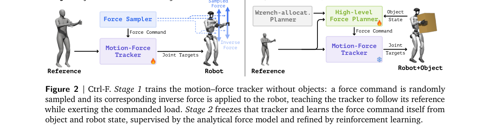

**Why this ranks #2**: 把力提升为一等命令通道，硬件结果够硬：真机推箱与踢球任务能操控重达 20 公斤的箱体，而力盲基线全部失败，且能在任务中途加入额外负载时在线调整力指令。

---

### 3. Robocasa-Mem: Benchmarking Environment and Process Memory in Long-Horizon Mobile Manipulation

**arXiv**: [2611.06475](https://arxiv.org/abs/2611.06475) | **Score**: 9.0 (relevance 9 x 0.7 + quality 9 x 0.3) | **Tags**: embodied, mobile-manipulation, memory-benchmark, behavior-conditioned-evaluation, vla-controller, University of Science and Technology of | **Categories**: cs.RO | **Pages**: 17

**Authors**: Sihang Chen; Chen Ye; Wei Chen; Xiaohan Lei; Zhipeng Tang; Sha Zhang; Yuan Zhang; Zixuan Chen; Jiajun Deng; Houqiang Li; Yanyong Zhang

**Affiliation**: University of Science and Technology of China; Tongji University; The Chinese University of Hong Kong; Anhui University

**Abstract**

> In the real world, mobile manipulation robots must perform complex object interactions and make multi-step decisions, often relying on task-relevant information that is no longer observable. However, existing benchmarks provide limited evaluation of such memory-dependent decision-making in mobile manipulation. To address this gap, we introduce RoboCasa-Mem, a new benchmark comprising nine mobile manipulation tasks that require agents to use interaction history at key decision points. Specifically, the tasks are grouped into two categories of memory: One is environment memory, which captures spatial locations, object attributes, and object relationships. The other is process memory, which captures single-task progress and multi-task scheduling. Particularly, we introduce Behavior-Conditioned Evaluation. For tasks with multiple valid execution paths, instead of fixing a single target or trajectory, the evaluator derives later task constraints from the robot's earlier actions. This allows us to evaluate whether later behavior is consistent with the robot's own interaction history while reducing shortcuts based on fixed target assignments. We provide 1,800 successful demonstrations for policy training. We also develop a baseline on our benchmark, namely Hierarchical Memory-Augmented Policy(HMAP). Its high-level planner uses structured entity and process memories to generate subtasks. Its low-level VLA controller uses subgoal-conditioned queries to incorporate VGGT-Omega geometry into action generation. Together, RoboCasa-Mem and HMAP baseline support systematic evaluation of memory-dependent behavior and the development of memory-aware mobile manipulation policies.

**Key findings**

- **Finding**: RoboCasa-Mem 含九个移动操作任务、五类记忆与 1,800 条成功演示；HMAP 把 π0.5 的平均成功率从 16.2% 提升到 24.2%，TempReport 上 SR 从 0.22 升到 0.86、正确温度的条件召回从 0.41 升到 0.90，真机 10 次试验完成 8 次而 π0.5 只有 2 次。
- **Inference**: 收益集中在需要回忆历史环境状态的环境记忆任务，多任务调度类流程记忆上各方法都没能完整完成任务。
- **Recommendation**: 评测长程记忆任务时按环境记忆与流程记忆分开报告，别用平均分掩盖调度失败。

**Key figures**

*Framework - Overview of RoboCasa-Mem. Top: a history-dependent cup-selection example illustrates why the current observation alone may not determine the correct action. Middle: five memory categories co*

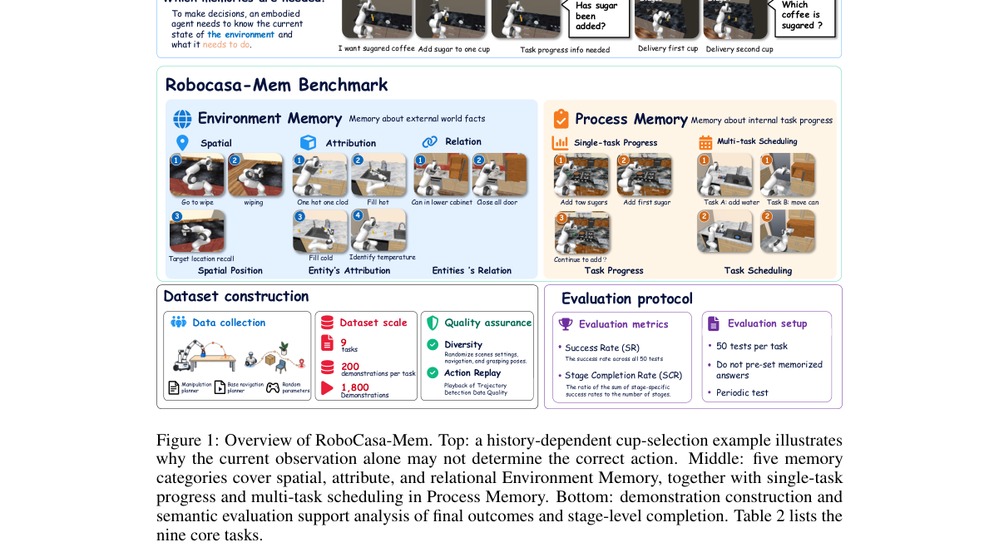

*Result - Overview of our Hierarchical Memory-Augmented Policy. The high-level planner maintains entity and process memory to select an active subgoal. The low-level subgoal-guided 3D-aware controller*

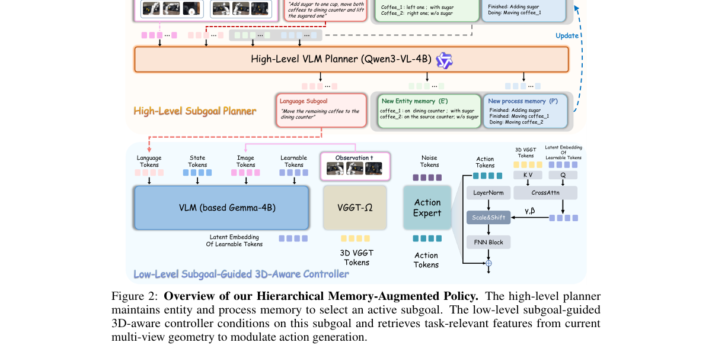

**Why this ranks #3**: 长程记忆这条线唯一的基准型工作：九个任务、五类记忆、1,800 条成功演示，并用行为条件评测从机器人自身历史推出后续约束；HMAP 基线把 π0.5 的平均成功率从 16.2% 提到 24.2%，真机 10 次试验完成 8 次而 π0.5 只有 2 次。

---

### 4. Open-HumanScale: An Open Recipe for Scaling Human and Robot Experience for Embodied Foundation Models

**arXiv**: [2611.06817](https://arxiv.org/abs/2611.06817) | **Score**: 9.0 (relevance 9 x 0.7 + quality 9 x 0.3) | **Tags**: embodied, egocentric-pretraining, data-scaling-law, world-action-model, human-robot-transfer, Peking University | **Categories**: cs.CV | **Pages**: 53

**Authors**: Juncheng Ma; Jiaxin Li; Jiankai Tu; Bo Liang; Guodong Lv; Yufan Deng; Junzhe Tang; Liangzhu Yang; Chen Bian; Zicong Cao; Baohao Zhu; Jianxin Bi

**Affiliation**: Peking University; National University of Singapore; MIT; UC Santa Barbara; NVIDIA

**Abstract**

> Egocentric human video offers a scalable source of manipulation priors for robot learning, yet translating raw data scale into generalizable robot policies demands rigorous data curation and training recipes. We introduce Open-HumanScale, the first fully open recipe for scaling egocentric pretraining to 50,000 hours, anchored by Open-HumanScale-50K---a curated egocentric video corpus densely annotated with hand motion and natural language. Leveraging this corpus, we systematically investigate pure human pretraining via closed-loop simulation evaluations and uncover an empirical log-linear scaling law linking pretraining data hours to downstream robot success rates. Grounded in these findings, we develop HumanWAM-Vanilla, a world--action model pretrained exclusively on 50k hours of egocentric human video. Upon robot post-training, HumanWAM-Vanilla reaches 92.08% success on RoboTwin 2.0 Clean2Clean and 68.88% on Clean2Random, alongside a 14.17% mean success rate and a 19.00 mean progress score on RoboDojo. To push the capability frontier further, we explore joint human--robot pretraining with HumanWAM-Goal, a visual-goal-conditioned world--action model. Hybrid data scaling unlocks broad zero-shot generalization across both simulation and physical benchmarks, propelling post-trained RoboTwin 2.0 performance to new state-of-the-art levels: 92.70% on Clean2Clean and a substantial leap to 84.60% on Clean2Random. On physical robots, HumanWAM-Goal further exhibits emergent embodied in-context learning, dynamically adapting its manipulation behavior to unseen visual goals without parameter updates. To support reproducible scaling research in embodied AI, we open-source the Open-HumanScale-50K corpus, data curation and pretraining pipelines, alongside the pretrained and post-trained HumanWAM checkpoints, inference code, and simulation evaluation suites.

**Key findings**

- **Finding**: Open-HumanScale 用 5 万小时第一人称视频做纯人类预训练，HumanWAM-Vanilla 后训练在 RoboTwin 2.0 的 Clean2Clean 与 Clean2Random 上分别达 92.08% 与 68.88%，在 RoboDojo 上为 14.17% 平均成功率与 19.00 平均进度；混合人类与机器人数据后 HumanWAM-Goal 提升到 92.70% 与 84.60%。
- **Inference**: 预训练时长与下游机器人成功率呈经验对数线性关系，任务与场景多样性越强曲线越陡。
- **Recommendation**: 机器人策略缺数据时，优先扩第一人称人类视频并把缩放曲线画出来，再决定加多少机器人数据。

**Key figures**

*Framework - Overview of Open-HumanScale. Using a curated 50,000-hour egocentric corpus, we show that scaling human data improves robot generalization after post-training, with greater task and scene dive*

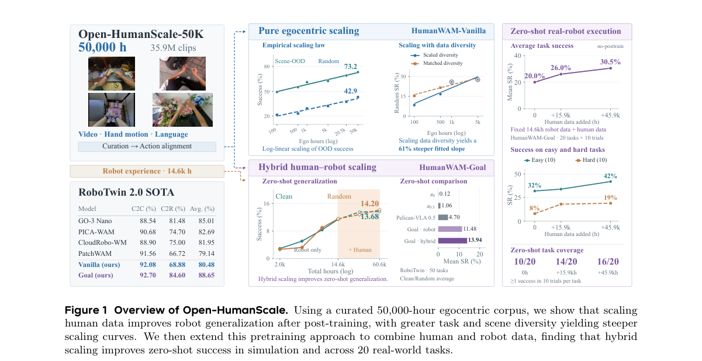

*Result - Construction of Open-HumanScale-50K. (a) Five data sources and their retained durations. (b) Data curation based on hand visibility, motion stability, and manipulation activity. (c) Cross-sou*

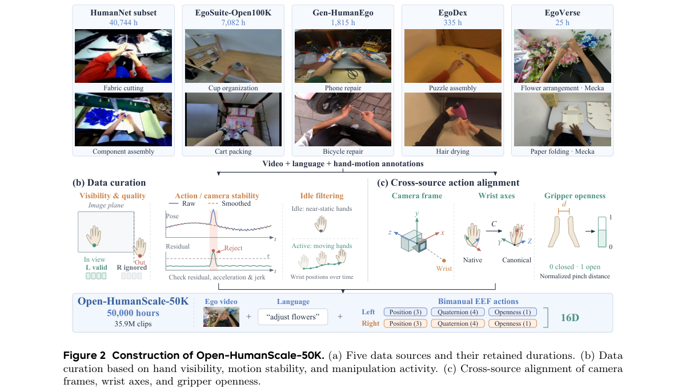

**Why this ranks #4**: 规模路线的代表：5 万小时第一人称语料的完全开放配方，HumanWAM-Vanilla 后训练在 RoboTwin 2.0 Clean2Clean 达 92.08%、Clean2Random 68.88%，换成人机混合数据的 HumanWAM-Goal 再推到 92.70% 与 84.60%，并给出对数线性缩放律。

---

### 5. Learning Object-Centric Motion Priors from Human for Robotic Dexterous Manipulation

**arXiv**: [2611.05979](https://arxiv.org/abs/2611.05979) | **Score**: 8.7 (relevance 9 x 0.7 + quality 8 x 0.3) | **Tags**: embodied, dexterous-manipulation, human-object-interaction, motion-prior, sim-to-real, State Key Lab of CAD&CG | **Categories**: cs.RO | **Pages**: 9

**Authors**: Zhengdong Hong; Guofeng Zhang

**Affiliation**: State Key Lab of CAD&CG, Zhejiang University

**Abstract**

> Manipulating diverse objects with multi-fingered dexterous hands is challenging due to the high dimensionality and complex dynamics. Human-Object Interaction (HOI) datasets provide rich knowledge about task information and embodied interactions. Instead of solely imitating the human demonstrations, our method learns to holistically predict future hand-object states by leveraging these datasets. The predicted future states of the object can serve as a general-purpose reward term for reinforcement learning, reducing reliance on task-specific reward engineering and enhancing generalization across tasks. We conduct extensive experiments on three manipulation tasks in simulation and the real world. Our approach outperforms existing SOTA methods in both success rate and generalizability on novel objects. Furthermore, we validate the cross-embodiment compatibility of our methods by successfully deploying the skills on different robot hands.

**Key findings**

- **Finding**: 方法用 Dex-YCB 与 ARCTIC 的人类-物体交互数据自回归预测未来手-物状态并作为通用奖励项；YCB 抓取仿真平均成功率 0.84、真机 0.77，优于 HOP 的 0.59 与 0.48，铰接物操作仿真 0.66 也高于 Obj-Dex 的 0.40，仿真用 5 个随机种子每个 100 次试验、真机重复 20 次。
- **Inference**: 预测物体未来状态比设计任务专属奖励更通用，因此在新物体和跨手型上仍能迁移。
- **Recommendation**: 多指灵巧操作缺奖励设计时，优先用人类交互数据学预测器，把预测误差当奖励项。

**Key figures**

*Framework - Our method begins by extracting observations from the initial robot-object configuration. These observations are input into a motion predictor to generate a reference trajectory. Guided by t*

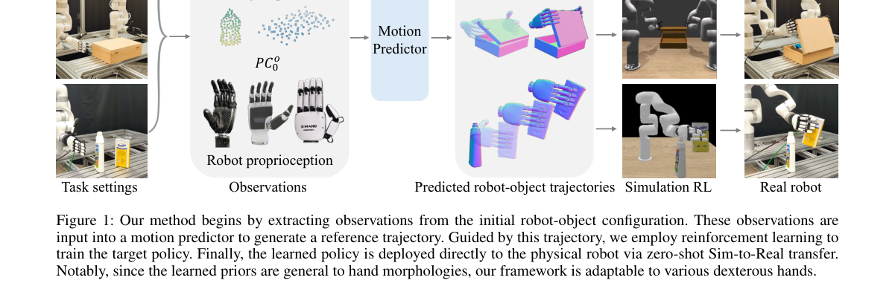

*Result - is our hand-object-interaction (HOI) motion predic- tor. We use Dex-YCB (Chao et al. 2021) and ARCTIC (Fan et al. 2023) as our datasets. Both of them have well-labeled 6DoF hand-object pose pai*

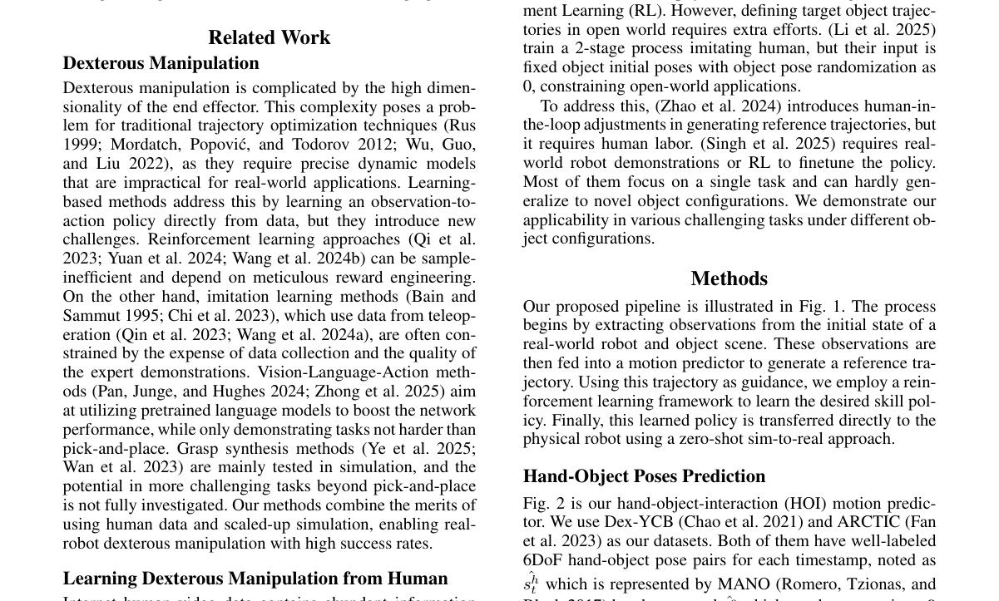

**Why this ranks #5**: 思路与同类不同：不模仿动作而是从人类-物体交互数据预测未来手-物状态当作通用奖励，YCB 抓取仿真平均成功率 0.84、真机 0.77，显著高于最好基线 HOP 的 0.59 与 0.48，还能跨手型部署。

---

### 6. $A^3$-VLA: Automatic Perception-Guided Attention Alignment for Robot Manipulation

**arXiv**: [2611.06447](https://arxiv.org/abs/2611.06447) | **Score**: 8.7 (relevance 9 x 0.7 + quality 8 x 0.3) | **Tags**: embodied, vla-model, attention-alignment, perception-guidance, contrastive-learning, School of Computer Science and Technology | **Categories**: cs.RO | **Pages**: 24

**Authors**: Shengzhe Zhang; Qi Zhang; Dazhong Shen; Chao Wang; Shaopeng Zhai; Hui Xiong

**Affiliation**: School of Computer Science and Technology, University of Science and Technology of China; Shanghai AI Laboratory

**Abstract**

> Vision-Language-Action Models (VLAs) enable robots to perform manipulation tasks by leveraging Vision-Language Models (VLMs) to process visual observations and language instructions. However, the action prediction objective itself lacks fine-grained task-specific perceptual supervision, making it prone to relying on task-irrelevant visual shortcuts, leading attention away from target objects and key interaction areas, thereby limiting its operational performance and generalization ability. To address this, we propose Automatic Perception-Guided Attention Alignment for Robot Manipulation ($A^3$-VLA), a framework that derives task-specific visual guidance from the manipulation process itself. Specifically, $A^3$-VLA first generates heuristic candidate regions for target objects and the robot from interaction-induced visual changes, and refines them with a visual segmentation model offline. These regions serve as explicit perceptual guidance through two complementary objectives: an attention allocation loss that encourages sufficient focus on task-critical regions when language or robot state tokens query the visual input, and a contrastive learning loss that aligns the representations of candidate target regions with language instructions while separating them from task-irrelevant regions. Extensive experiments on simulated and real-world manipulation tasks demonstrate that $A^3$-VLA consistently improves multiple VLA backbones, with an average success rate gain of 6.5% - 25.2% across benchmarks.

**Key findings**

- **Finding**: A3-VLA 先从交互引起的视觉变化生成目标物体与机器人的启发式候选区域，离线用视觉分割模型精修，再以注意力分配损失与对比损失微调；多个 VLA 骨干在仿真与真机任务上平均成功率提升 6.5% 到 25.2%。
- **Inference**: 动作目标缺少细粒度感知监督，模型会用任务无关的视觉捷径，因此需要显式的注意力约束。
- **Recommendation**: 调 VLA 时先画出注意力图确认是否看错目标，再用自动候选区域做对齐微调。

**Key figures**

*Framework - A failure case of the attention maps of language instruction querying visual observations in π0 and OpenVLA-OFT on a Select Poker task from VLABench, visualized across layers from shallow (l*

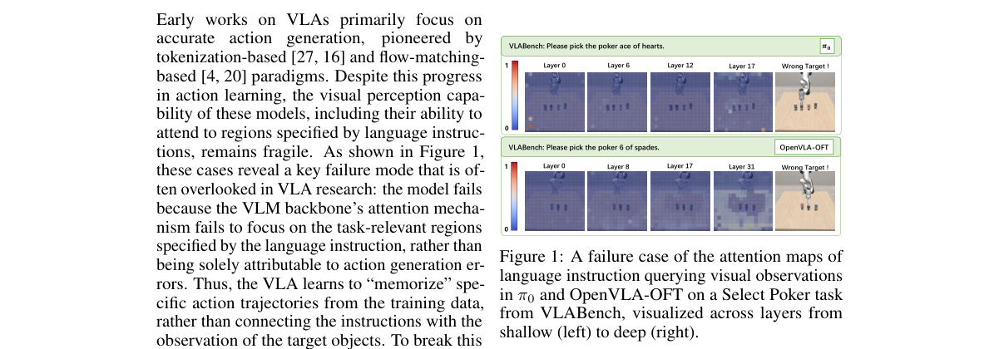

*Result - Overview of the A3-VLA framework.*

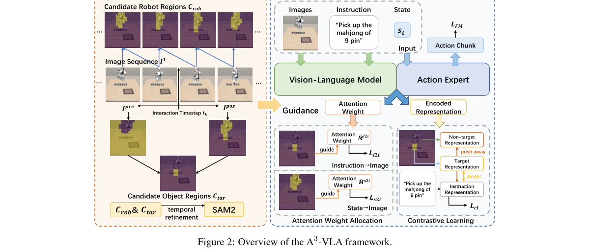

**Why this ranks #6**: 诊断清楚 VLA 的注意力跑偏问题并给出自动补救：从交互引起的视觉变化生成候选区域再离线精修，多个 VLA 骨干在基准上平均成功率提升 6.5% 到 25.2%，且不需要人工标注目标框。

---

### 7. Playing Soccer Like Humans Do: Learning Versatile and Agile Humanoid Soccer via Latent Motion Priors

**arXiv**: [2611.06564](https://arxiv.org/abs/2611.06564) | **Score**: 8.7 (relevance 9 x 0.7 + quality 8 x 0.3) | **Tags**: embodied, humanoid-soccer, latent-motion-prior, skill-conditioned-policy, sim-to-real, University of Science and Technology of | **Categories**: cs.RO | **Pages**: 14

**Authors**: Haoyu Shao; Yunshen Wang; Jingze Zhang; Shaohang Zhu; Yong-Lu Li; Tianzhu Zhang; Baoxiong Jia; Siyuan Huang

**Affiliation**: University of Science and Technology of China; State Key Laboratory of General Artificial Intelligence, BIGAI

**Abstract**

> Humanoid soccer requires a robot to seamlessly combine agile locomotion, ball manipulation, and impact-rich contact dynamics across a continuous, dynamic behavioral spectrum. Yet existing approaches either cover only a limited set of skills, or forego motion priors entirely and produce unnatural behaviors, leaving the combination of a unified skill set and human-like motion quality unaddressed. We present soccerbot, a hierarchical reinforcement learning framework that resolves both limitations through a structured latent motion prior distilled from large-scale human soccer motion capture data. By constraining policy learning within this dynamically plausible motion manifold, a single skill-conditioned policy naturally learns to perform moving, dribbling, trapping, and kicking in a unified formulation, while inherently producing human-like motion and fluid transitions during commanded skill switching. Augmented by robustness-oriented simulation design, soccerbot transfers zero-shot to the Unitree G1 humanoid robot, demonstrating agile, natural, and robust execution of the full soccer skill repertoire under real-world conditions.

**Key findings**

- **Finding**: SOCCERBOT 从人类足球动捕数据筛出约 2.5 小时参考动作，蒸馏成潜在运动先验后训练单一技能条件策略；仿真踢球成功率 97.04%、盘带 89.88%，技能切换表 9 格中有 8 格可组合（如盘带到踢球 87.5% 对 78.0%），真机迁移后移动速度误差由 19.14% 升到 21.53%。
- **Inference**: 把策略限制在动力学可行的运动流形内，可以同时拿到技能统一与动作自然度，而不需要为每项技能单独训控制器。
- **Recommendation**: 人形多技能任务先蒸馏运动跟踪专家得到潜在先验，再在冻结空间里训技能条件残差策略。

**Key figures**

*Framework - Real-world soccer skill execution on the Unitree G1 humanoid robot. SOCCERBOT learns a single unified policy that covers the full soccer behavioral spectrum, including moving, trapping, drib*

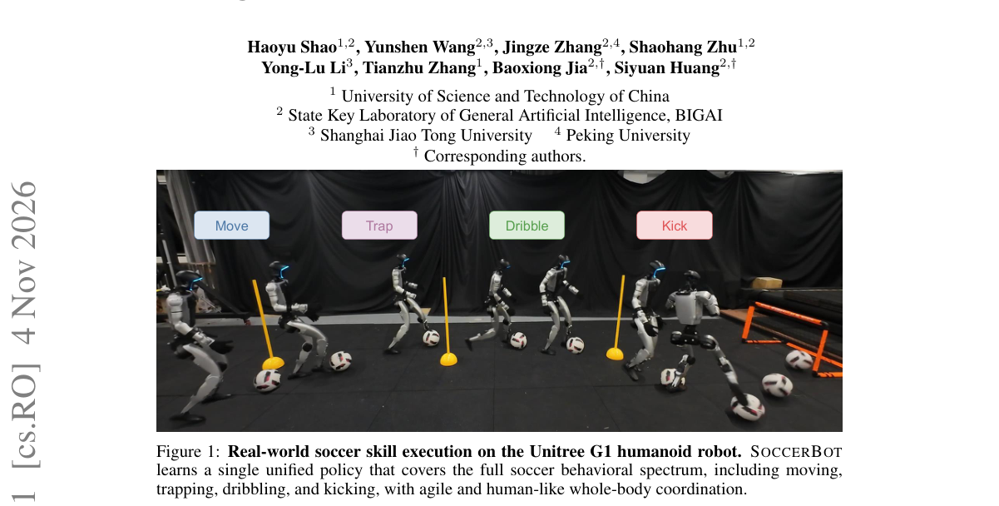

*Result - Overview of SOCCERBOT. The framework consists of three stages: (1) a motion track- ing expert is trained on retargeted human soccer motion data; (2) the tracking expert is distilled into a s*

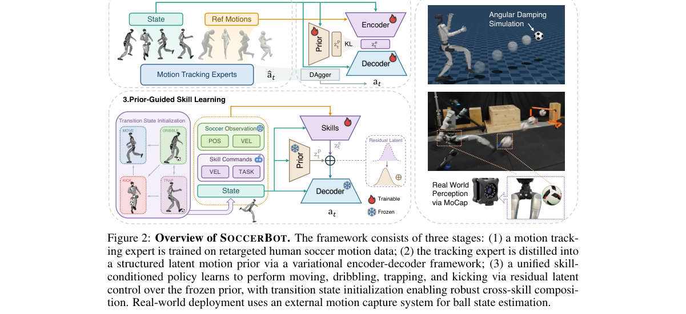

**Why this ranks #7**: 统一技能集这条线唯一入选：从人类足球动捕蒸馏约 2.5 小时结构化潜在运动先验，单一技能条件策略覆盖移动、盘带、停球与射门，仿真踢球成功率 97.04%、盘带 89.88%，零样本迁到 Unitree G1 后移动速度误差仅从 19.14% 升到 21.53%。

---

### 8. DreamX: Video Diffusion Model is a Universal Latent Action Learner

**arXiv**: [2611.05377](https://arxiv.org/abs/2611.05377) | **Score**: 8.0 (relevance 8 x 0.7 + quality 8 x 0.3) | **Tags**: embodied, latent-action, video-diffusion, cross-embodiment, action-interface, KAIST | **Categories**: cs.AI, cs.CV, cs.RO | **Pages**: 25

**Authors**: Jisoo Kim; Chaehyun Kim; Junsu Kim; Jiho Park; Seongchan Kim; Eunbeen Hong; Soowon Son; Fu-En Yang; Seungryong Kim

**Affiliation**: KAIST; NVIDIA

**Abstract**

> Learning a universal action representation from video requires modeling dynamics that are consistent across different executions of the same action yet invariant to changes in embodiment and appearance. Existing latent action models infer actions from visual transitions, but their representations often entangle the underlying action with irrelevant visual variations, limiting transfer across embodiments. We introduce DreamX, which repurposes a pretrained video diffusion model as a universal latent action learner. Our approach extracts compact latent actions from the video model's rich spatiotemporal features, compressing each latent video frame by $\boldsymbol{300\times}$ ($\boldsymbol{1{,}200 \rightarrow 4}$ tokens). In addition, by leveraging the video model's generative prior, these latent actions capture action-relevant dynamics disentangled from visual appearance. The resulting latent space serves as a shared action interface across embodiments (human and robot), environments, and action parameterizations. On LARY-Bench, DreamX achieves state-of-the-art performance among latent action models. Moreover, actions encoded in one setting remain effective in another: the latent space supports any-to-any video transfer and zero-shot action transfer across diverse embodiments and environments. Furthermore, this shared interface also enables policy learning in a compact latent action space, reducing the computational cost of video-diffusion-based policies.

**Key findings**

- **Finding**: DreamX 从视频扩散模型的时空特征中读出紧凑潜在动作，每帧由 1,200 个 token 压到 4 个即 300 倍压缩；LARYBench 上动作回归归一化 MSE 平均 0.17、动作分类准确率 69.67%，优于 DiLA 的 0.38 与 62.25%、MoTo 的 0.44 与 51.01%。
- **Inference**: 视频扩散模型的生成先验天然把动作与外观解耦，压缩后的动作码成为跨本体可共享的接口。
- **Recommendation**: 做跨本体动作迁移时，先在人类视频上学紧凑潜在动作，再让机器人策略回归到该接口。

**Key figures**

*Framework - DreamX learns a shared action interface from egocentric human videos and robot videos. Compact, embodiment-agnostic latent actions extracted from a pretrained video diffusion model capture m*

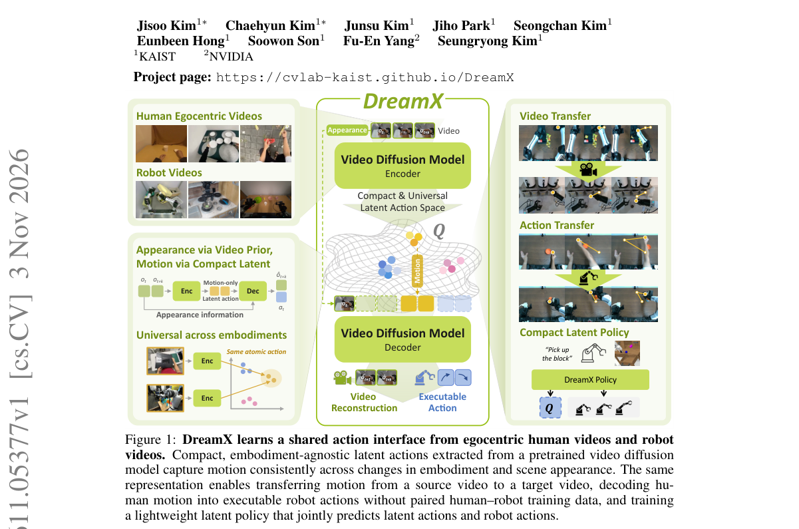

*Result - DreamX architecture and attention masks. (a) Learnable queries read out the pretrained video backbone’s spatiotemporal representations to encode latent actions. A decoder initialized from th*

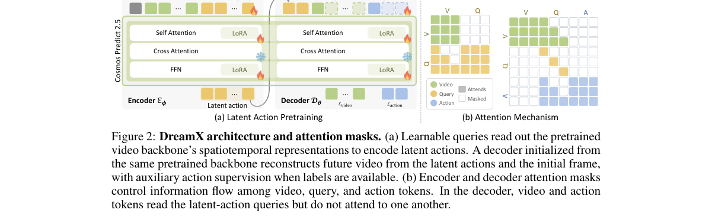

**Why this ranks #8**: 通用动作接口这条线代表作：把预训练视频扩散模型改造成潜在动作学习器，每帧潜在动作从 1,200 压到 4 个 token 即 300 倍压缩，LARYBench 上动作回归归一化 MSE 平均 0.17、动作分类准确率 69.67%，优于 DiLA 的 0.38 与 62.25%。

---

### 9. ReactWorld: Structuring Interaction Responses for Embodied Video Generation

**arXiv**: [2611.06120](https://arxiv.org/abs/2611.06120) | **Score**: 8.0 (relevance 8 x 0.7 + quality 8 x 0.3) | **Tags**: embodied, embodied-video-generation, interaction-response, world-model, physical-consistency, Huawei Technologies Co. | **Categories**: cs.CV, cs.RO | **Pages**: 10

**Authors**: Hanwei Liu; Huijia Zhang; Hanzhang Wang; Guangyu Liu; Hanbei Zhan; Linjie Hu; Bin Xiao; Xuan Zhou; Dong Zhang

**Affiliation**: Huawei Technologies Co., Ltd.; Tongji University; Zhejiang University

**Abstract**

> Embodied video world models predict scene changes caused by robot actions, yet generated object responses may remain inconsistent with task intent and contact dynamics. Critical responses in embodied scenes often concentrate in local regions and specific time intervals. Inspired by chain-of-thought reasoning, we introduce ReactWorld, an embodied video generation model guided by structured interaction anticipation. In the generation backbone's feature space, an interaction response field predictor anticipates how the interaction will unfold, explicitly describing participant roles, future motion response intensity, and local motion changes. A response feedback adapter forms increments to object features from the difference between the object branch's outputs with predicted and zeroed local dynamics inputs. It also converts predicted displacements into positional biases for temporal attention. These two mechanisms guide object feature updates and information retrieval across frames, respectively. Through interaction anticipation and generative feedback, ReactWorld achieves an average score of 77.51 on RBench, outperforming PhysisForcing by 3.29 points with improvements in all nine categories. On EZS-Bench, it achieves a Domain score of 86.98 and an average score of 81.87.

**Key findings**

- **Finding**: ReactWorld 的交互响应场预测器显式给出参与者角色、未来运动响应强度与局部运动变化，响应反馈适配器把预测位移转成时间注意力的位置偏置；RBench 平均 77.51，比 PhysisForcing 高 3.29 分并在九个类别上全面提升，EZS-Bench 领域分 86.98、平均 81.87。
- **Inference**: 物体反应往往集中在局部区域与特定时间区间，把这些结构显式建模比端到端生成更可控。
- **Recommendation**: 做具身视频生成时先标注角色、响应强度与时间区间，再让去噪骨干去填充细节。

**Key figures**

*Framework - Structured interaction responses and generation performance. (a) Roles, local motion support, interval dynamics, and subsequent states in garment folding. Overlay opacity encodes support str*

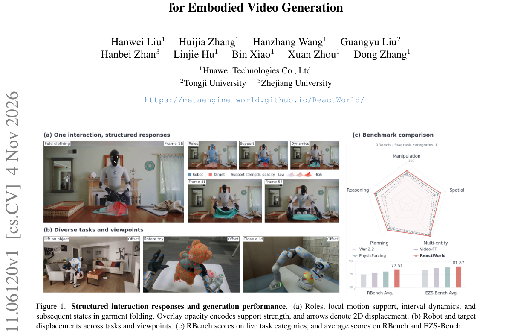

*Result - Overview of ReactWorld. Top: response prediction and generative feedback within each denoising forward pass. Bottom: (a) predicting roles, future responses, and interval dynamics to construc*

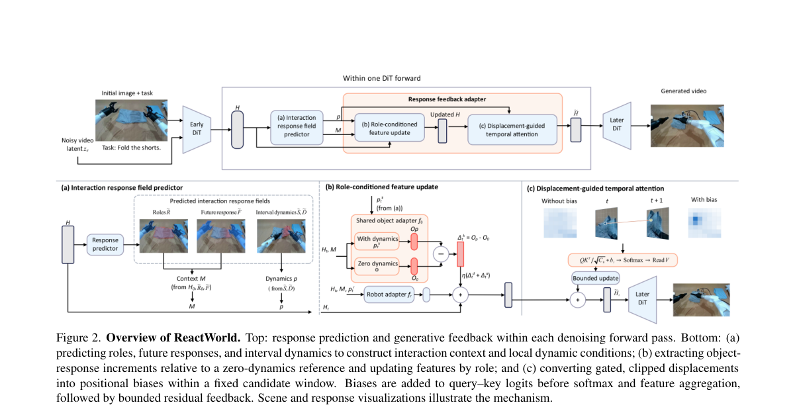

**Why this ranks #9**: 具身视频生成里把交互显式结构化的代表作：在骨干特征空间预测参与者角色、局部运动强度与时间区间，RBench 平均 77.51、比 PhysisForcing 高 3.29 分且九个类别全面提升，EZS-Bench 领域分 86.98、平均 81.87。

---

### 10. Beyond Infraction Scores: Failure-Boundary Profiles for Closed-Loop Evaluation of Driving and Robot Navigation Agents

**arXiv**: [2611.06453](https://arxiv.org/abs/2611.06453) | **Score**: 8.0 (relevance 8 x 0.7 + quality 8 x 0.3) | **Tags**: embodied, closed-loop-evaluation, driving-benchmark, decision-accuracy, failure-analysis, Social Chaos Lab | **Categories**: cs.CV, cs.RO, cs.SE | **Pages**: 16

**Authors**: Milan Bulat; Gino Ardelean; Ellington Kirby

**Affiliation**: Social Chaos Lab; valeo.ai

**Abstract**

> Closed-loop driving benchmarks in CARLA rank agents by a driving score that multiplies route completion by an infraction penalty. This score does not distinguish an agent that stops in front of an obstacle from one that pushes past it. In a corridor closed by two parked cars, for example, one agent that drives through with contact averages 52.2 on the blocked widths, while the agents that stop average between 37.8 and 40.6. We propose failure-boundary profiles, an evaluation in which each scenario family varies one measured factor, such as corridor width or the time gap in oncoming traffic, and each variant is certified from measurement as one where the agent should proceed or one where it should stop. Along this axis we estimate two curves per agent, commitment (the probability of attempting the passage) and competence (the probability of passing without contact), and locate where each crosses one half, with intervals that account for the simulator's run-to-run variance. The certified labels also give a summary metric, decision accuracy, which credits clean passes on passable variants and stops on blocked ones. We evaluate seven driving agents on seven CARLA families. The rule-based expert reaches a decision accuracy of 0.74 and TFv6, the highest-scoring learned agent, 0.60. Agents with similar driving scores fail in different ways, and agents that reliably stop at a blocked corridor still rarely wait for a gap in oncoming traffic. We also apply the method, unchanged, to a warehouse robot in Isaac Sim. The navigation policy we test stops at blocked gaps in only one of three families, and two fine-tuned versions of it pass more gaps cleanly but no longer stop at all.

**Key findings**

- **Finding**: 在 CARLA 的七类场景族上，硬闯窄走廊的智能体在被堵宽度上平均得 52.2 分，而会停车的智能体为 37.8 到 40.6 分；失败边界剖面给出的决策准确率中，规则专家为 0.74，分数最高的 TFv6 只有 0.60，同一方法移植到 Isaac Sim 仓储机器人后只在三类中的阻塞缺口类前停车。
- **Inference**: 驾驶分数把路线完成度与违规惩罚相乘，无法区分撞过去和停下来的智能体，因此需要按可测因素划定应通过与应停的边界。
- **Recommendation**: 评测闭环导航时同时报决策准确率与承诺度曲线，不要只看综合分数排名。

**Key figures**

*Framework - The two ends of the Charger gauntlet. Left: the widest variant, with two cars parked on the shoulders and a 3.64 m free corridor between them. Right: the narrowest variant, where the two car*

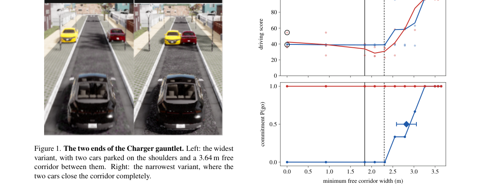

*Result - Driving score and commitment on the Charger gauntlet. TFv6 and BridgeDrive, three traffic seeds each, against the minimum free corridor width. Top: driving score of each run (dots) and the m*

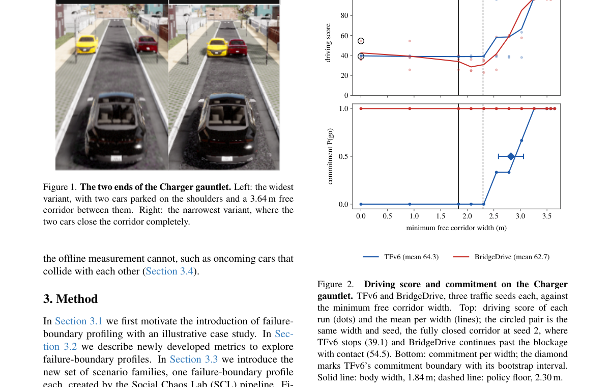

**Why this ranks #10**: 专门打掉单一分数排名的评测工作：分数制会把硬闯窄走廊的智能体排在会停车的智能体之上（52.2 对 37.8 到 40.6），失败边界剖面给出的决策准确率里规则专家 0.74、最高分学习智能体 TFv6 只有 0.60。

---

