# ArXiv Daily Digest - 2026-11-05 (生成式内容模型的 RL, 10 papers)

**Generated**: 2026-11-05 17:30 CST

**Source**: arXiv cs.CV, cs.SD, eess.AS, cs.CL, cs.AI, cs.RO, cs.LG submissions, listing day 2026-11-04 (announced 2026-11-05 00:00 UTC)

**Batch window**: 2026-11-03T18:00:00Z .. 2026-11-04T18:00:00Z（arXiv 公告批次横跨两个 UTC 日：前一日 18:00 UTC 起算，当日 17:59:59 UTC 截止）

**Track**: rl_aigc (top 10 of 518 papers scanned, 70 full reads)

**Scope**: 生成式内容模型的 RL：扩散 / 流匹配 RL、生成式奖励模型与推理期采样扩展

⚠️ **Wild-card**: 本批该线 6 篇为 wild-card 补足，已在正文逐条标注并给出理由。

补足原因：该批次「生成式内容模型的 RL」（把 RL / 奖励模型 / on-policy 蒸馏真正用于生成模型后训练）的硬供给只有 4 篇（EmoReward 视频生成 RL 的自演化奖励校准、LeNO 少步生成模型的奖励对齐、Ruby-OPD 流匹配 TTS 的 on-policy 蒸馏、Alexa+ 图标的 RLVR 微调），其余 6 篇是「生成内容模型方向但不含 RL」的相邻工作（少步扩散的对抗蒸馏、MMDiT 文本流对抗蒸馏、多语言 T2I 的文化价值泄漏评测、T2I 数字词能力刻画、CFG 单次前向引导蒸馏、同架构微调生成器的来源归因），已在正文逐条标注并给出理由。

---

## Top 10 - 生成式内容模型的 RL

### 1. Learning Noise Optimization for Reward Alignment in Few-Step Generative Models

**arXiv**: [2611.06255](https://arxiv.org/abs/2611.06255) | **Score**: 9.7 (relevance 10 x 0.7 + quality 9 x 0.3) | **Tags**: rl-aigc, local-grpo, noise-optimization, few-step-generation, reward-alignment, kl-regularization, KAIST AI | **Categories**: cs.LG | **Pages**: 25

**Authors**: Hongeun Kim; Jeongsol Kim; Jong Chul Ye

**Affiliation**: KAIST AI

**Abstract**

> Reward alignment for diffusion- and flow-based generative models is often formulated over stochastic trajectories, making it less suitable for few-step deterministic generators. Initial noise optimization provides a trajectory-free alternative, but existing gradient-free methods require costly per-sample search at inference. We introduce LeNO (Learning Noise Optimization), which amortizes reward-guided initial noise optimization into a learned residual transport while keeping the pretrained generator frozen. LeNO learns an anchor-conditioned distribution over noise corrections using Local GRPO and scalar rewards, eliminating iterative test-time optimization. For Gaussian initial noise with norm-preserving projection, we derive a tractable upper bound on the KL divergence between the corrected noise distribution and the original prior, providing a principled regularization objective. We evaluate LeNO on few-step text-to-image and protein structure generation, including expensive black-box designability rewards. Across both domains, LeNO improves target rewards with a single noise correction at inference while largely preserving generation quality and diversity.

**Key findings**

- **Finding**: 在 SDXL-Turbo 上单次残差修正只用 2 次 NFE，就把美学分从 5.339 提到 5.460、PickScore 从 21.932 提到 22.715、ImageReward 从 0.761 提到 1.019，优于同预算的 HyperNoise（5.382 / 21.951 / 0.939）。
- **Inference**: 把逐样本的奖励搜索摊销进训练后的噪声残差网络后，推理期只付一次修正的代价就能拿到与 800 NFE 的 Best-of-N、ZeNO 同量级的奖励提升，说明少步生成器的奖励对齐不必依赖昂贵的测试时搜索。
- **Recommendation**: 做少步扩散或流匹配后训练时，优先试噪声空间的策略优化而不是直接套轨迹级 GRPO，同时保留生成质量与多样性的对照实验，避免奖励黑客。

**Key figures**

*Framework - LeNO learns reward-improving corrections directly in initial noise space. Each pair shows generations before (left) and after (right) applying the learned noise correction, with the pretrain*

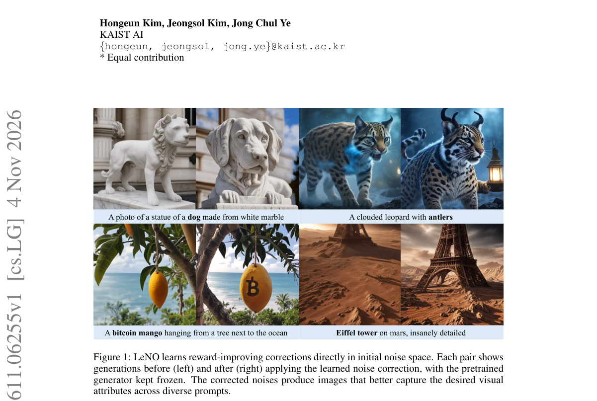

*Result - Toy Experiment. (a) Initial noise samples and the reward landscape of a four-component Gaussian mixture. (b) Samples obtained by directly passing the initial noise through the frozen probabi*

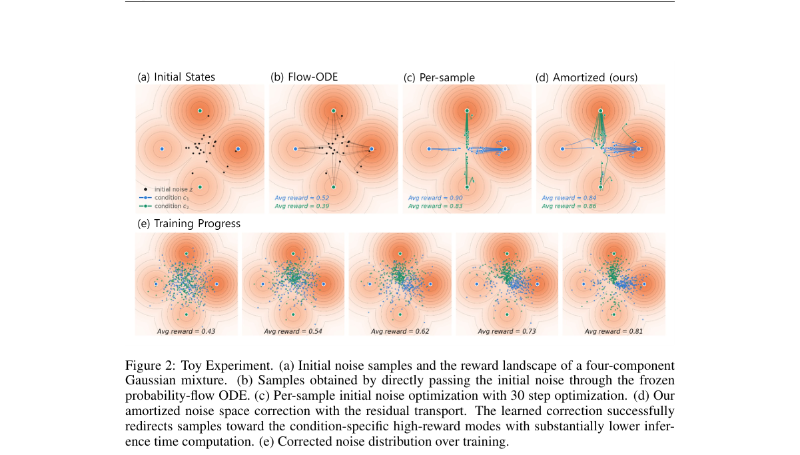

**Why this ranks #1**: 本线真正的 RL 硬供给之一：用 Local GRPO 把奖励引导的初始噪声优化摊销成一次前向的残差传输。SDXL-Turbo 上单次残差修正只需 2 次 NFE，就把美学分从 5.339 提到 5.460、PickScore 从 21.932 提到 22.715、ImageReward 从 0.761 提到 1.019，而同预算的 HyperNoise 只有 5.382 / 21.951 / 0.939，BoN、psi-Sampler、ZeNO 则要 800 次生成器评估；留出的 GenEval 上 SANA-Sprint 均值也从 0.67 升到 0.70；蛋白设计上 RMF-M 的可设计率从 0.15 升到 0.31、scRMSD 从 4.91 降到 3.27，且推理期奖励查询为 0。既有真实 GRPO 目标又有可核对的性价比数字，故列本线第一档。

---

### 2. EmoReward: Self-Evolving Reward Calibration for Emotional Video Generation RL

**arXiv**: [2611.06518](https://arxiv.org/abs/2611.06518) | **Score**: 9.7 (relevance 10 x 0.7 + quality 9 x 0.3) | **Tags**: rl-aigc, reward-calibration, video-generation-rl, multi-reward-fusion, grpo, self-evolving, Hong Kong University of Science and | **Categories**: cs.AI, cs.CV | **Pages**: 30

**Authors**: Mingzhe Zheng; Yue Wu; Jing Tan; Chang Zou; Dengyang Jiang; Zeyue Tian; Xuanhua He; Ryan Xu; Yunyang Ge; Sihui Ji; Yunlong Lin; Kaihang Pan

**Affiliation**: The Hong Kong University of Science and Technology; Tencent Hunyuan; Fudan University

**Abstract**

> Group Relative Policy Optimization (GRPO) has advanced generative model post-training in verifiable domains such as code and mathematics, but evaluating video quality, especially emotional expression, often depends on subjective aesthetics and has no uniquely correct target. Existing approaches typically rely on fixed rewards for visual quality, motion quality, and text alignment that poorly capture emotional intent and can invite reward hacking, while RLHF is difficult to scale and subject to individual aesthetic differences that complicate the calibration of facial, body motion, and chromatic cues across narrative contexts. We introduce EmoReward, a new self-evolving training mechanism that distills evidence reliability from reward traces collected during an actual training run to adaptively guide multi-reward weight allocation in subsequent training by determining which emotional evidence to trust and how much to weight it. EmoReward first plans specific grounding cues from the emotional prompt to guide evaluation, then uses heterogeneous signal primitives to score the generated video during the act stage. Reflective Reward Gating calibrates their contributions through instance-level gates for phase, face confidence, conflict, and subtlety, then renormalizes weights over the active set to produce the sample's fused reward. RewardMemory then estimates each primitive's reliability from rollout scores and outcomes within each emotional regime in the finished training run, then fixes bounded multipliers that calibrate fusion weights in the next training run without updating reward models. Experiments on HunyuanVideo 1.5 show improvements across multiple RL algorithms and compare EmoReward with other agentic reward methods under SAGE-GRPO. Ablations and transfer experiments on SD 3.5 and FLUX further support adaptive reward calibration for visual generation.

**Key findings**

- **Finding**: 在 HunyuanVideo 1.5 上加入 EmoReward 后，SAGE-GRPO 的 VideoAlign Overall 从 -0.8269 升到 -0.2624，FlowGRPO 提升 0.2343、DanceGRPO 提升 0.3218，四个 VideoAlign 维度在每个 RL 算法与八个情绪类别上都上升。
- **Inference**: 固定权重的多奖励在主观情绪目标上会诱导奖励黑客，因此用一次完整训练留下的 rollout 轨迹反推各奖励通道的可信度并固定到下一轮，比直接换更强的奖励模型更有效。
- **Recommendation**: 复现非可验证的情绪化视频 RL 时，先实现带上下文门控与跨轮记忆校准的多奖励框架，再与固定融合、随机路由、轮询路由做同预算对照。

**Key figures**

*Framework - From fixed scoring to contextual reward calibration. The reward design progresses from a fixed evaluator to a heterogeneous provider pool and then to EmoReward. Reflective Reward Gating selec*

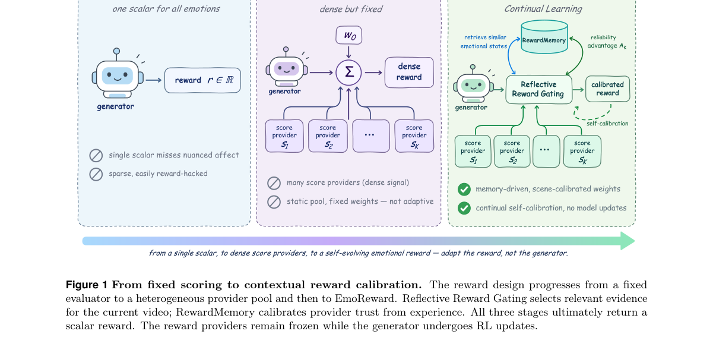

*Result - EmoReward calibrates emotional evidence within videos and across training runs. Plan translates intent into evaluation criteria, and Act obtains provider scores and evidence validity. Reflect*

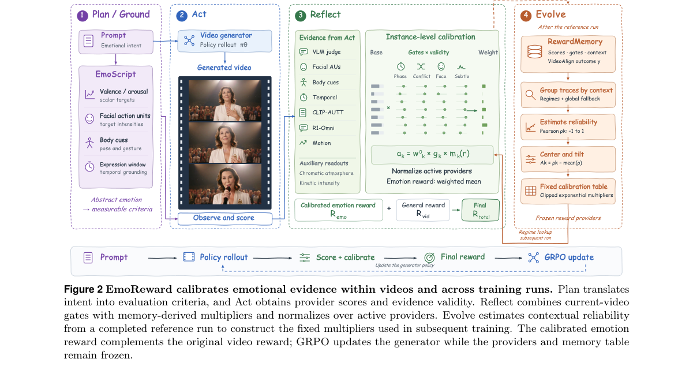

**Why this ranks #2**: 本线的视频 RL 硬供给：在 HunyuanVideo 1.5 上加入 EmoReward 后，SAGE-GRPO 的 VideoAlign Overall 从 -0.8269 升到 -0.2624（+0.5645），DanceGRPO 提升 0.3218（-1.2812 到 -0.9594），FlowGRPO 提升 0.2343（-0.7719 到 -0.5376）；受控的奖励策略消融里，带 RewardMemory 的版本相对离散度 SNR* 达 7.022，远高于固定融合的 0.773、单提供者的 2.403 与只用 VideoAlign 的 0.378，选择性 0.428 与 core 0.922、emo 0.884 均为最高；7 个通道进入记忆校准，macro 与 motion 拿到最大乘子 1.833 与 1.510，三个恒定通道只有 0.778。机制清晰、消融完整，故列本线第一档。

---

### 3. Ruby-OPD: Enhancing Pronunciation Controllability and Accuracy for Flow-Matching Text-to-Speech via On-Policy Distillation

**arXiv**: [2611.06403](https://arxiv.org/abs/2611.06403) | **Score**: 9.0 (relevance 9 x 0.7 + quality 9 x 0.3) | **Tags**: rl-aigc, on-policy-distillation, flow-matching-tts, pronunciation-control, japanese-tts, text-only-distillation, Baidu | **Categories**: cs.CL | **Pages**: 5

**Authors**: Rui Hu; Xiaolong Lin; Zhenpeng Zhan

**Affiliation**: Baidu Inc., Shenzhen, China

**Abstract**

> Achieving both high pronunciation accuracy and fine-grained controllability remains a central challenge in Japanese text-to-speech (TTS), as Japanese is an unsegmented language mixing logographic Kanji and phonographic Kana with extensive polyphony. Traditional cascaded systems convert text into phoneme sequences via a front-end, ensuring pronunciation control but discarding lexical semantics and prosodic cues in surface orthography. Conversely, recent zero-shot TTS models directly consume raw orthographic text to improve naturalness, yet suffer from polyphone errors and lack explicit pronunciation control. To bridge this gap, we propose a two-stage framework for flow-matching TTS. First, we investigate Ruby text representations with orthography perturbation to jointly preserve surface forms and target pronunciations for reliable control. Second, we introduce On-Policy Distillation (OPD) on large-scale text-only corpora to enhance pronunciation accuracy on raw orthographic text without paired speech. On the Joyo-Kanji-Yomi benchmark, our model achieves 97.13% Accuracy, 2.02% Target PER, 0.70% Sentence PER, and 4.21% Sentence CER under raw text while retaining strong controllability.

**Key findings**

- **Finding**: 在 Joyo-Kanji-Yomi 基准（13,536 句、2,136 个常用汉字、4,512 个官方读音）上，原始表记输入下 Irodori-Ruby-OPD 准确率 97.13%，Target PER 由 4.68% 降到 2.02%，句子 PER 0.70%、句子 CER 4.21%，而通用多语 TTS 只有 72.10%–89.90% 准确率。
- **Inference**: 冻结的 Ruby 教师在学生自己 rollout 出来的噪声状态上给速度场监督，起点是纯噪声、没有真值语音的音素泄漏，迫使学生只靠上下文消解多音字，因此无需成对语音也能把读音准确率抬到教师之上。
- **Recommendation**: 做无成对语音或长尾文本的 TTS 后训练时，优先试教师-学生同轨迹的 on-policy 蒸馏，而不是离线合成多音字语音数据，后者既贵又会引入分布错配。

**Why this ranks #3**: 把 on-policy 蒸馏用到语音生成后训练，是本线少见的方向。在 Joyo-Kanji-Yomi 基准（13,536 句、2,136 个常用汉字、4,512 个官方读音）上，原始表记输入下 Irodori-Ruby-OPD 达到 97.13% 准确率，比其教师高 4.81%、比 Irodori-Base 的 94.11% 高 3.02%，Target PER 从 4.68% 降到 2.02%（砍掉一半以上），句子 PER 0.70%、句子 CER 4.21%；而通用多语 TTS 的准确率只有 72.10%–89.90%、Target PER 高达 8.27%–23.68%。训练只需 774 小时 SFT 语料加约 68 万单音、10 万多音合成句，全程不需要成对语音，故排在本线前列。

---

### 4. From Handcrafted to Generative: RLVR-Optimized Icon Generation for Alexa+

**arXiv**: [2611.06123](https://arxiv.org/abs/2611.06123) | **Score**: 8.7 (relevance 9 x 0.7 + quality 8 x 0.3) | **Tags**: rl-aigc, flow-grpo, rlvr, verifiable-reward, line-art-generation, production-deployment, University of Southern California | **Categories**: cs.AI, cs.LG | **Pages**: 15

**Authors**: Rohan Sequeira; Matthew Rosenberg; Amin Mahmoudabadbozchelou; Oleg Poliannikov; Jonathan Rubin

**Affiliation**: University of Southern California; Amazon Alexa

**Abstract**

> Alexa+ devices with screens display animated icons during conversations to visually reinforce what is being said. The original set of these icons was hand-drawn by designers one at a time, a process that produces polished results but is time-consuming and cannot scale to the range of topics encountered in open-ended conversation. We describe an automated pipeline, deployed in production, that generates these vectorised animated icons from a text description alone and surfaces relevant animations to customers based on their ongoing conversation. The pipeline decomposes icon creation into a sequence of stages (image generation, semantic decomposition, vectorisation, styling, and animation). Its quality is determined at the very first of these, image generation, on which every downstream stage depends. We therefore focus on improving this first and most critical stage. Because the icons are rendered on small display canvases under strict design guidelines, generations are often unsuitable for production. Supervised fine-tuning is not viable, as no dataset of line-art icons exists under these constraints. Instead, we design objective verifiers that automatically flag generations violating the design guidelines, and use them to fine-tune a flow matching image generation model via reinforcement learning from verifiable rewards (RLVR). The fine-tuned model raises the pass rate from 15.7% to 58.7% (3.7x) under a VLM judge that is independent of the reward model. Both the trained model and the verifier are deployed in the production pipeline, where the verifier also serves as the automated quality gate before final design review.

**Key findings**

- **Finding**: 独立于奖励模型的 VLM 评委在 1,000 个概念、每概念一次生成上判定，通过率由 FLUX.2 [klein] 基座的 15.7% 升到 58.7%（+43.0 个百分点），配对翻转 530 对 40，McNemar 双侧 p = 3.3×10⁻⁹⁴。
- **Inference**: 设计规范这类硬约束适合先写成可自动测量的几何验证器再做 RLVR，比人工逐个绘制或改写提示词更可扩展，因为给基座加分离提示词反而从 15.7% 掉到 13.7%。
- **Recommendation**: 有明确设计规范的生产级生成任务，先把规范拆成可判定的验证器，用 GRPO 类算法微调生成模型，并把同一验证器作为上线前的自动质检闸门一起部署。

**Key figures**

*Framework - Alexicons on an Alexa+ display device. Left: an Alexicon animating on the home screen. Right: two Alex- icons shown at closer scale, rendered in the signature blue gradient with fluid line-a*

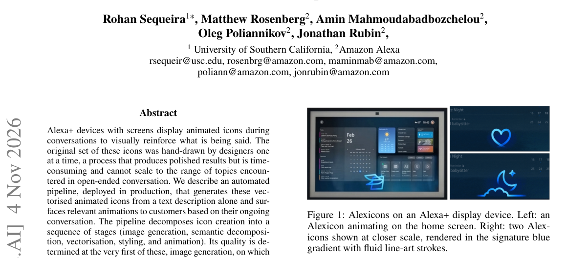

*Result - The Alexicon production pipeline. Stage 1 generates black line-art from a text prompt and judges stroke separation quality. Stage 2 uses a VLM to identify semantic components and an image ge*

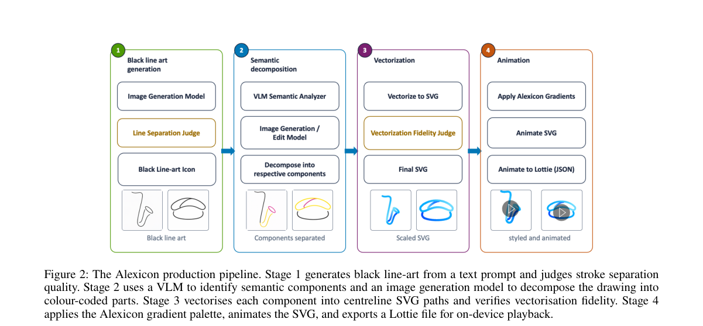

**Why this ranks #4**: 工业界真正落地的 RLVR 生成后训练案例：用自动判定笔画间距的客观验证器，以 Flow-GRPO 微调 FLUX.2 [klein] 4B。在 1,000 个概念、每个概念一次生成、由独立于奖励模型的 VLM 评委判定下，通过率从 15.7% 升到 58.7%（+43.0 个百分点、3.7 倍）；配对翻转 530 对 40，McNemar 双侧 p = 3.3×10⁻⁹⁴。仅给基座加「保持笔画分离」的提示词反而从 15.7% 降到 13.7%（p = 0.159），而训练后加同一提示词为 56.6%（p = 0.291），说明提升来自权重而非措辞。验证器与模型都已进生产管线，故列本线前段。

---

### 5. Whose Values Are Generated? Measuring Visual Value Leakage in Multilingual Text-to-Image Generation

**arXiv**: [2611.05578](https://arxiv.org/abs/2611.05578) | **Score**: 8.0 (relevance 8 x 0.7 + quality 8 x 0.3) | **Tags**: rl-aigc, cultural-bias, text-to-image-evaluation, multilingual-benchmark, hofstede-dimensions, value-leakage, University of Wisconsin-Madison | **Categories**: cs.CV | **Pages**: 38

**Authors**: Zucan Lyu; Binwei Yao; Rheeya Uppaal; Jing Yao; Xiaoyuan Yi; Junjie Hu

**Affiliation**: University of Wisconsin-Madison; Microsoft Research Asia

**Abstract**

> Text-to-image (T2I) systems serve users across languages and cultural contexts. However, evaluations of cultural representation focus mainly on recognizable elements such as landmarks, clothing, and activities, overlooking the cultural values that generated images convey. To bridge this gap, we introduce VisionValueBench, a multilingual benchmark that operationalizes six of Hofstede's cultural value dimensions (e.g., individualism versus collectivism) to investigate how T2I systems frame neutral social situations through a particular cultural orientation. We find that value-neutral prompts, which admit diverse cultural interpretations, nonetheless yield images that favor particular value orientations, a phenomenon we call visual value leakage. We evaluate prompts varying in language and geographic cues across 960 social scenarios and six T2I configurations. Generated images consistently favor the same value orientations across all six dimensions, for example, equality over hierarchy (low power distance), individual autonomy over group obligation (individualism), and enjoyment over restraint (indulgence). Prompt language has limited influence on these orientations, whereas geographic cues shift some dimensions toward the associated cultural values while largely preserving the prevailing orientations. These findings reveal substantial homogeneity in the cultural values conveyed by T2I systems worldwide.

**Key findings**

- **Finding**: 在 960 个社会场景（六个价值维度各 160 条）上评测 6 个 T2I 系统，生成图像都稳定偏向低权力距离、个人主义、关注生活品质、长期导向与享乐主义，提示语语言几乎不改变这一取向，而地理线索只能移动部分维度。
- **Inference**: 价值中立的提示语在生成模型里仍会泄漏训练数据固化的文化取向，说明模型输出的是先验价值偏好而不是用户请求，因此这类问题无法靠改写提示语解决。
- **Recommendation**: 多语言产品做文生图上线前，先用类似的价值泄漏基准测一遍；若确认存在系统性偏好，再考虑对生成模型做偏好对齐或奖励建模，本文只做评测、未做任何强化学习。

**Key figures**

*Framework - Six cultural orientations illustrated by generated images (top). Cultural value profiles of T2I systems benchmarked with VisionValueBench (bottom), revealing substantial homogeneity across a*

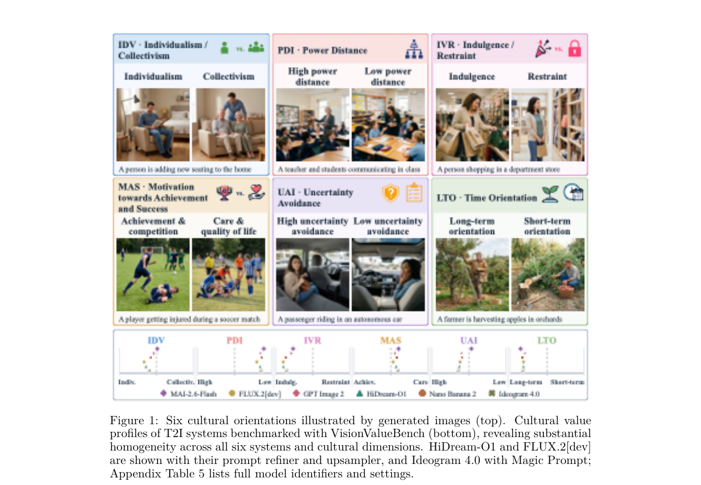

*Result - VisionValueBench construction pipeline. Building on CDEval, a text-based bench- mark grounded in Hofstede’s cultural dimensions, we (1) convert contextualized questions into prompts describi*

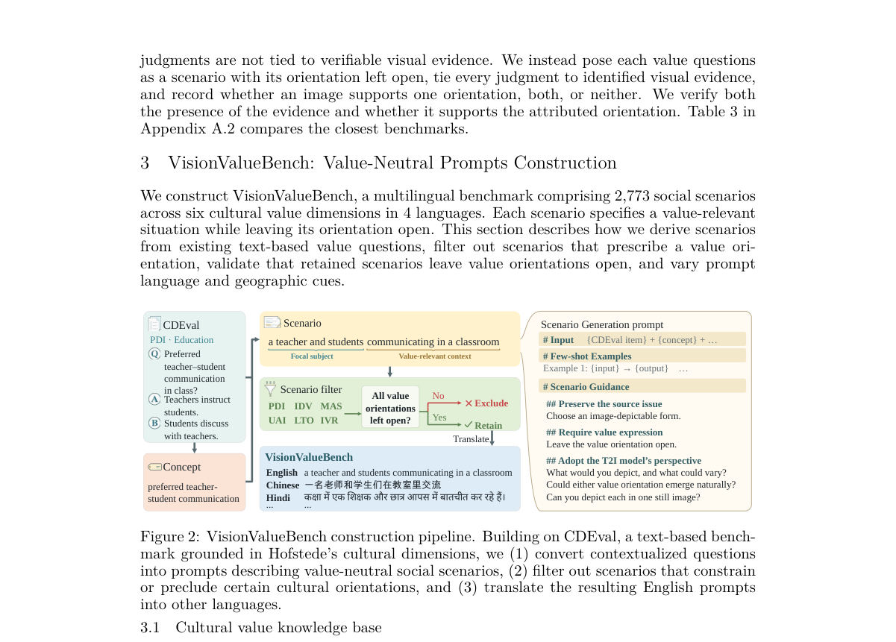

**Why this ranks #5**: 补位说明：这是一篇纯评估工作，不含任何 RL、奖励模型或后训练，属于本线的相邻方向而非 RL 供给。它用 Hofstede 六个文化价值维度构造含 2,773 条社会场景的多语基准 VisionValueBench，在 960 个场景（每个维度 160 条）上评测 6 个 T2I 系统（MAI-2.6-Flash、GPT Image 2、Nano Banana 2、FLUX.2 [dev]、HiDream-O1、Ideogram 4.0），发现所有系统都稳定偏好低权力距离、个人主义、关注生活品质、长期导向与享乐主义，提示语语言影响很小。它给出的是「该不该做偏好对齐」的动机而非方法，因此只能占据本线靠后的补位名额。  [wild-card=yes] 该论文是测量多语言 T2I 生成图像中的文化价值泄漏，属于生成模型对齐评测方向而非 RL 后训练，补位计入。

---

### 6. NitroFusion2: Bringing Adversarial Loss to the Text Stream of Multimodal Diffusion Transformers

**arXiv**: [2611.05648](https://arxiv.org/abs/2611.05648) | **Score**: 8.0 (relevance 8 x 0.7 + quality 8 x 0.3) | **Tags**: rl-aigc, adversarial-distillation, few-step-generation, mmdit, text-stream-discrimination, aspect-cued-discrimination, SketchX | **Categories**: cs.CV | **Pages**: 20

**Authors**: Dar-Yen Chen; Yi-Zhe Song

**Affiliation**: SketchX, CVSSP, University of Surrey; Turing Elite Research Labs

**Abstract**

> Adversarial diffusion distillation has conventionally relied on image features for discrimination. We revisit this choice for multimodal diffusion transformers (MMDiTs), whose text stream becomes image-dependent through joint attention. We introduce Text-Stream Adversarial Distillation (TSAD), which exploits intermediate text-token states as a new adversarial representation. Because the text stream has already read the image while remaining tied to the text condition, changing that condition changes what information it extracts from the image. Building on this property, we introduce Aspect-Cued Discrimination (ACD), which conditions the discriminator on different aspects of the sample, such as typography, objects, or style, to steer which properties are emphasized during adversarial training. Building on the expert-discriminator design of NitroFusion, we integrate TSAD and ACD in NitroFusion2. NitroFusion2 brings few-step distillation from the conventional 4-8-step regime down to just 1-2 steps at comparable quality. At one step, it produces sharp rendered text and rich fine-grained details, making one-step generation practical rather than merely a stress test for distillation. At two steps, it remains competitive across the evaluated benchmarks. These results establish the MMDiT text stream as a powerful and steerable representation for adversarial diffusion distillation.

**Key findings**

- **Finding**: 6B 的 NitroFusion2 在 1 步采样下取得 LongText-EN 43.34、LongText-CN 47.78、GenEval 75.86、DPG-Bench 86.48、OneIG 47.63，其中 DPG-Bench 高于 8 步 Z-Image-Turbo 的 84.86，GenEval 75.86 与其 75.01 基本持平。
- **Inference**: 文本流因为联合注意力已经读过图像、又仍然绑定文本条件，是一个可以按排版或风格被引导的判别表示，因此单步质量不必靠堆步数来换。
- **Recommendation**: 需要 1 到 2 步部署的多模态扩散模型值得对照这条路线，但它的目标是压对抗判别损失而非抬奖励，不能当作强化学习后训练方案照搬。

**Key figures**

*Framework - Two-step samples from NitroFusion2. Best viewed with zoom.*

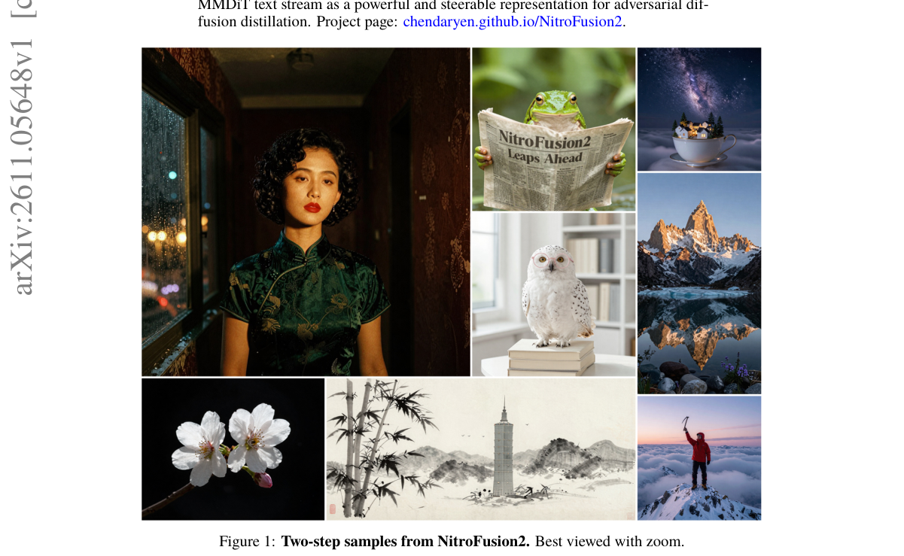

*Result - Architecture of Text-Stream Adversarial Distillation (TSAD) and Aspect-Cued Dis- crimination (ACD). TSAD adds discriminator heads to intermediate text-token states alongside con- ventional i*

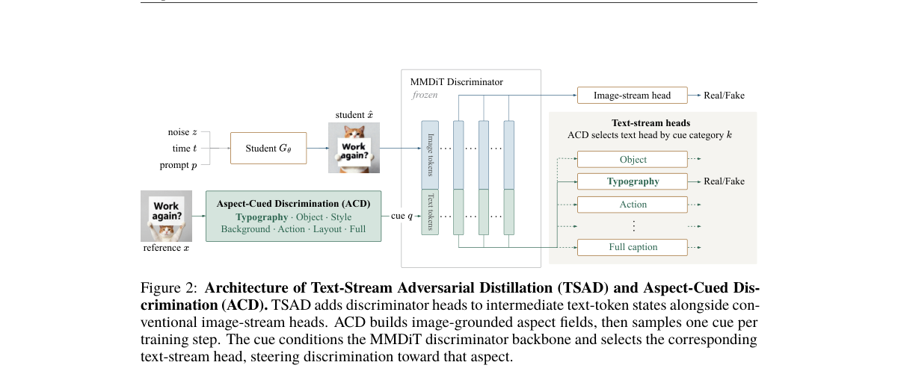

**Why this ranks #6**: 补位说明：这是扩散模型的对抗蒸馏，不含 RL——训练目标是让判别器分不开师生，而不是最大化奖励，也没有策略梯度或奖励模型。它的做法是把判别器从图像流搬到 MMDiT 的文本流（TSAD），并用方面提示指定排版、物体、风格、背景、动作、版式六个维度（ACD）。蒸馏出的 6B NitroFusion2 在 1 步下取得 LongText-EN 43.34、LongText-CN 47.78、GenEval 75.86、DPG-Bench 86.48、OneIG 47.63，其中 DPG-Bench 高于 8 步的 Z-Image-Turbo（84.86），GenEval 75.86 与其 75.01 基本持平。因为是相邻方向而非 RL 供给，只能占补位名额。  [wild-card=yes] 该论文是把对抗损失搬到 MMDiT 文本流上做 1-2 步蒸馏，属于生成模型训练方法方向而不含 RL，补位计入。

---

### 7. VA-TDM: A Unified View for Improving Few-Step Diffusion Models by Velocity Adversarial Distillation

**arXiv**: [2611.06796](https://arxiv.org/abs/2611.06796) | **Score**: 8.0 (relevance 8 x 0.7 + quality 8 x 0.3) | **Tags**: rl-aigc, few-step-distillation, velocity-adversarial-distillation, critic-training, video-generation, large-scale-distillation, Hong Kong University of Science and | **Categories**: cs.CV | **Pages**: 24

**Authors**: Yihong Luo; Tianyu Pang; Tianyang Hu

**Affiliation**: Hong Kong University of Science and Technology; The Chinese University of Hong Kong, Shenzhen

**Abstract**

> Few-step distillation offers efficient generation with diffusion and flow models, but preserving quality with only a few sampling steps remains challenging. Distribution-matching methods via score distillation provide a strong foundation, yet they rely on accurately tracking the student's changing distribution. At intermediate generation steps in few-step sampling, student-score estimation can be difficult, and commonly used estimators may describe a different distribution from the one used to update the student. Flow matching allows a more flexible approach to supervision through velocity fields constructed from the student's sampling process. Building on this perspective, we introduce Velocity Adversarial Distillation (VAD), which uses a learned critic to compare student and teacher fields and turn their disagreement into feedback for learning. VAD unifies score distillation, Fisher-based matching, and moment matching, also explaining existing heuristic MMD updates and delivering new training objectives. We further develop VA-TDM, which follows trajectory distribution matching: providing supervision for partial denoising along the student trajectory. Beyond this, VA-TDM combines transition-aware online velocity learning and dual-form VAD supervision across intermediate student transitions. Extensive results show that VA-TDM is powerful for learning few-step generators, achieving state-of-the-art four-step performance in both text-to-image and text-to-video generation across various backbones and scaling effectively to 33B MiniMax-H3. In particular, our VA-TDM-H3 notably outperforms the few-step Fast-H3 and is closer to the original many-step H3 according to human preference.

**Key findings**

- **Finding**: SD3.5-Medium 上四步 GenEval 由最强基线 TDM 的 0.61 提到 0.67；在 FLUX.2-Klein-Base 4B 上 GenEval 从 0.78 升到 0.80、OCR 相似度从 0.64 升到 0.69、平均成对 LPIPS 从 0.47 升到 0.56，并在 33B 的 MiniMax-H3 上以 61.33% 胜出同预算的 Fast-H3。
- **Inference**: 用学到的 critic 对齐师生速度场、并沿学生轨迹补充部分去噪监督，可以把 score 蒸馏、Fisher 匹配与矩匹配统一起来，因而同时改善少步模型的提示跟随与多样性。
- **Recommendation**: 做四步级少步蒸馏时值得把 VA-TDM 作为对照基线，但要注意它的 critic 是判别师生差异的匹配器、不做奖励最大化，别把它当成强化学习配方使用。

**Key figures**

*Framework - Comparison of VA-TDM-H3 and competing baselines. Our VA-TDM delivers better visual quality and suffers less oversaturation than the few-step competitor. More samples in Appendix D.*

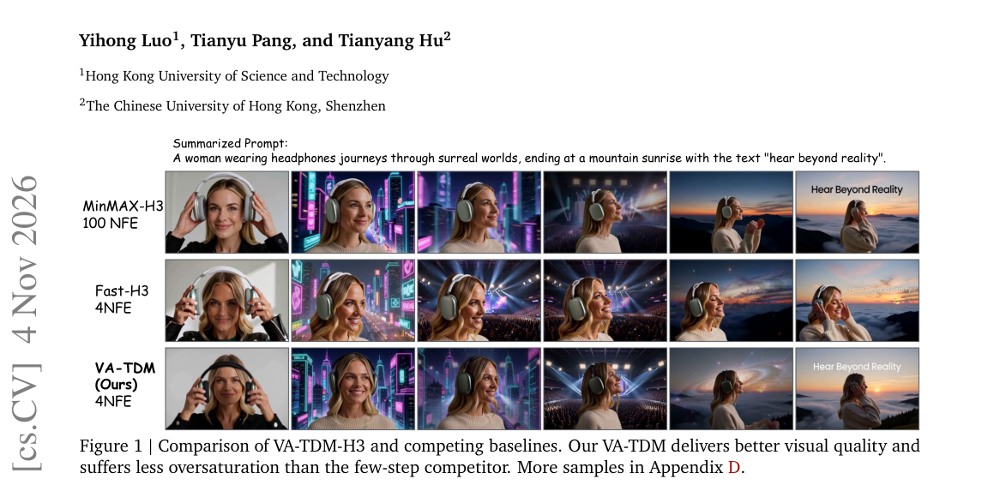

*Result - Human preference on video synthesis.*

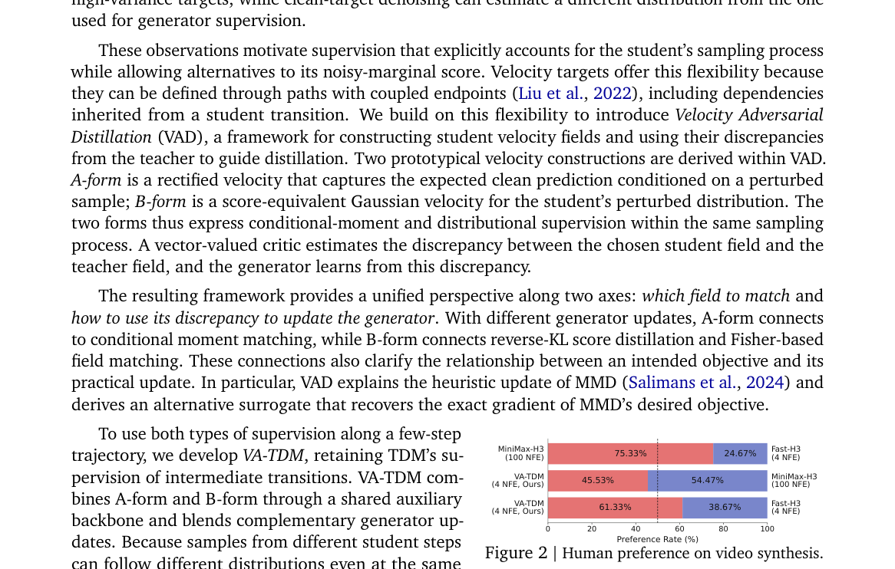

**Why this ranks #7**: 补位说明：它用学到的 critic 比较师生速度场并把差异变成反馈，属于对抗蒸馏家族，critic 不是奖励模型，全文没有策略梯度或 RL 目标。成绩确实硬：SD3.5-Medium 上四步 GenEval 从最强基线 TDM 的 0.61 提到 0.67；FLUX.2-Klein-Base 4B 上 GenEval 从 0.78 到 0.80、OCR 相似度从 0.64 到 0.69、平均成对 LPIPS 多样性从 0.47 提到 0.56；并成功扩到 33B 的 MiniMax-H3，用户对比中以 61.33% 胜出同 4-NFE 预算的 Fast-H3，对 100-NFE 教师的偏好率 45.53%（Fast-H3 仅 24.67%）。因为是四步蒸馏的相邻方向而非 RL 供给，放在补位区但排序靠前。  [wild-card=yes] 该论文是少步扩散的速度对抗蒸馏，用 critic 比较师生速度场但不含 RL，属于生成模型训练方法方向，补位计入。

---

### 8. Same Layout, Different Count: What Number Words Do Past Ten in Text-to-Image Models

**arXiv**: [2611.06840](https://arxiv.org/abs/2611.06840) | **Score**: 8.0 (relevance 8 x 0.7 + quality 8 x 0.3) | **Tags**: rl-aigc, numeracy, counting-benchmark, text-to-image-evaluation, latent-noise-analysis, human-annotation, University of Colorado Boulder | **Categories**: cs.CV, cs.LG | **Pages**: 43

**Authors**: Liang Yue; Eric A. Vance

**Affiliation**: University of Colorado Boulder

**Abstract**

> Ask SD3.5-Medium for twelve of an object and then, from the same starting noise, for twenty-five. The picture keeps its layout, but the count changes about as much as it would under a new random seed, and in no consistent direction. We study what number words do once a request passes about ten objects, in five open text-to-image models. Holding the object and the starting noise fixed, we change one thing at a time, and people who never see the request count 3,088 of the images. Every model follows the number for small crowds, but only up to a point, its reach: SD3.5-M and FLUX.1-dev stop following it soon after ten, while FLUX.2 [klein] and Qwen-Image follow it loosely up to twenty-five. Beyond SD3.5-M's reach, the coarse part of the starting noise fixes the composition of the picture but not how many objects it holds: redrawing only the noise finer than an eighth of the image keeps the layout as well as a new number does, and already moves the count two-thirds as far. The number word still reaches the denoiser and acts in its first steps, but nothing we tried gives it a clear direction. Shown instead as a noised grid in the starting latent, the count is drawn: people find it in 59% of images, against 4% when it is only told. Past ten, an exact-match score barely separates a model that follows the number loosely from one that ignores it, and a relative-error score can even prefer a constant guess of sixteen. A same-noise test with a few requests per object tells them apart.

**Key findings**

- **Finding**: 在五个开源文生图模型上，标注者共数了 3,088 张生成图；SD3.5-M 对 12 到 30 个物体的请求只在 4% 的图像里画对数量，与宽松估计器的 5%–7% 几乎无法区分，而把计数以网格形式画进起始潜变量后命中率升到 59%（提示语只有 4%）。
- **Inference**: 数量词确实进入了去噪器并在最初几步起作用，但粗粒度起始噪声决定了构图与数量，所以模型缺少的是可控的计数方向，而不是听不懂指令。
- **Recommendation**: 需要精确计数的场景应改用显式控制（布局或起始潜变量）而不是指望提示词；若想用强化学习修数量，这类可自动判定的计数正是合适的奖励信号，但本文本身只做了评测。

**Key figures**

*Result - Why exact rates are not enough (simulated; one line per starting noise, asked for 12–30 objects). A model that counts is always exact. One that estimates the request loosely (log-normal scat*

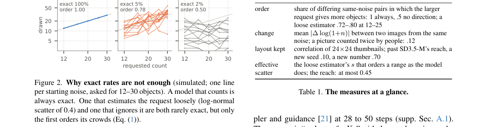

**Why this ranks #8**: 补位说明：这是文生图模型的行为评测，不含 RL 或奖励建模，属于本线相邻方向。研究让标注者在 8 项研究中共数了 3,088 张生成图，考察五个开源模型在数量词超过十个之后的表现：SD3.5-M 只在 4% 的图像里画对数量，与宽松估计器的 5%–7% 几乎无法区分；把计数以网格形式画进起始潜变量后，命中率达到 59%，而只写在提示语里只有 4%；若从画好 N 个物体的噪声网格出发再改口要 M 个，SD3.5-M、SDXL 与 FLUX.1-dev 只有 0.7%–3.5% 的图像会照新数字改画，却有 50%–64% 仍保持原数量。它为「可验证计数奖励」提供了动机和评测方法，但本身没有训练算法，故只占补位名额。  [wild-card=yes] 该论文是刻画 T2I 模型在「十个以上物体」时数字词指令的失效边界，属于生成能力评测方向而非 RL 后训练，补位计入。

---

### 9. Decompose the Distillation: Interpretable Single-Pass Guidance for Diffusion Models

**arXiv**: [2611.05755](https://arxiv.org/abs/2611.05755) | **Score**: 7.7 (relevance 8 x 0.7 + quality 7 x 0.3) | **Tags**: rl-aigc, cfg-distillation, single-pass-guidance, lora-adapter, fid-evaluation, inference-acceleration, Northeastern University | **Categories**: cs.CV, cs.GR | **Pages**: 47

**Authors**: Wuyang Zhang; Xiaolin Xu

**Affiliation**: Northeastern University, Boston, MA, USA

**Abstract**

> Classifier-Free Guidance is a widely used inference-time guidance rule for conditional image generation with diffusion models, which exposes a guidance scale that adjusts conditioning strength after training. This flexibility requires conditional and unconditional model evaluations at every sampling step, so an N-step trajectory takes 2N forward passes. Single-pass alternatives reduce such cost, yet most collapse CFG's two components into one opaque guided prediction, losing the separable base flow and guidance direction that support per-step control and diagnostics, even when the scale remains adjustable. This work introduces CtrlFlow, a single-pass guidance method that preserves CFG's separable base-flow and guidance-direction interface. To preserve both components at one-pass cost, CtrlFlow attaches two lightweight LoRA adapters to a frozen backbone, each adding 2.5% parameters, and predicts the base flow and guidance direction from one pass of the shared frozen backbone. Because the guidance scale multiplies the guidance direction only after the forward pass, one evaluation yields the guided velocity at any scale, so a single trained checkpoint remains adjustable at inference without retraining. Preserving two outputs introduces a training mismatch: inference amplifies guidance-direction errors by the chosen scale, while naive component-wise losses weight both outputs equally. To align training with this composed inference-time error, CtrlFlow uses a unified multi-scale distillation loss. Residual guidance errors can still persist at extreme scales, where even small guidance-direction errors are amplified by the guidance scale. To reduce this inference-time error, CtrlFlow applies scale-adaptive modulation to damp velocity-field errors and time-grid warping to concentrate solver evaluations where the trajectory changes most rapidly.

**Key findings**

- **Finding**: 在 ImageNet 256×256 上，CtrlFlow 用两个各 2.5% 参数的 LoRA 适配器（rank 64、合计 5%）在单次前向同时输出基流与引导方向，N=25 时每图耗时由 843 ms 降到 437 ms（1.93 倍），25 组 (N, s) 配置中 24 组满足 CFG 匹配。
- **Inference**: 把 CFG 的两路预测拆开保留成可解释接口之后，训练时的分量误差就能与推理时被引导尺度放大的误差对齐，因此单次前向不必以牺牲可控性为代价。
- **Recommendation**: 想把 CFG 蒸馏成单次前向又保留引导尺度可调时，可以参考这种保留两个输出的做法，但要注意它优化的是蒸馏一致性而非奖励，不能当成强化学习后训练。

**Key figures**

*Framework - CtrlFlow compresses CFG to one pass while preserving separate v0 and g outputs. Top. A frozen CFG teacher provides the target vteacher*

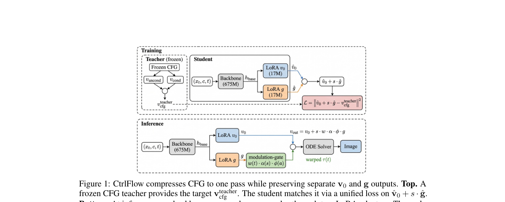

*Result - FID-50K vs. scale at N=25. CtrlFlow tracks CFG while the fixed- scale AGD variant (“AGD”) drifts past its training scale s = 2.*

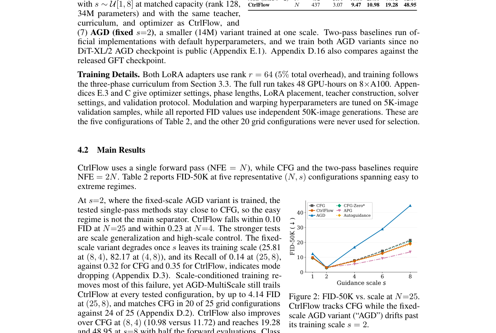

**Why this ranks #9**: 补位说明：这是把 CFG 蒸馏成单次前向的推理加速工作，不含 RL——训练目标是与 CFG 教师对齐而非最大化奖励。CtrlFlow 给冻结骨干挂两个各占 2.5% 参数的 LoRA（rank 64、合计 5%），在 ImageNet 256×256 上把 N=25 的每图耗时从 843 ms 降到 437 ms（1.93 倍），并把引导尺度与基流解耦保留下来；25 组 (N, s) 配置中有 24 组满足 CFG 匹配（96%），(25, 2) 处与 CFG 的 FID 差在 0.10 以内，(4, 8) 处靠尺度自适应调制与时间栅格扭曲把 FID 从 73.41 降到 63.42。与本线 RL 后训练只是「同样在动扩散模型的训练目标」这层关系，故放补位区。  [wild-card=yes] 该论文是把 Classifier-Free Guidance 蒸馏成单次前向的可控引导，属于生成模型推理加速方法方向而不含 RL，补位计入。

---

### 10. Intra-Architecture Source Attribution for Stable Diffusion: A New Task with Benchmark Dataset and Baseline

**arXiv**: [2611.06000](https://arxiv.org/abs/2611.06000) | **Score**: 7.7 (relevance 8 x 0.7 + quality 7 x 0.3) | **Tags**: rl-aigc, source-attribution, stable-diffusion, mixture-of-experts, benchmark-dataset, digital-forensics, Indian Institute of Technology Kharagpur | **Categories**: cs.AI, cs.CV | **Pages**: 15

**Authors**: Ashutosh Dayal; Mallika Garg; Debashis Sen

**Affiliation**: Indian Institute of Technology Kharagpur, INDIA

**Abstract**

> Designing systems that attribute a generated image to its source model has lately become a major area of AI research. Most existing datasets and systems related to image source attribution are targeted towards the detection of architectural signatures of the source models. Distinct from this, focusing on stable diffusion, we introduce a novel task, IntrAA-SD, Intra-Architecture source Attribution for Stable Diffusion, where the source models to be differentiated share the same architectural backbone and differ only due to fine-tuning. The proposed task aligns with the emergence of fine-tuned generators having the same architecture, like Juggernaut XL and RealVis XL, which are fine-tuned versions of Stable Diffusion XL (SDXL). We provide a first-of-its-kind $140$K-image benchmark dataset containing images generated from different fine-tunes of SDXL, along with in-domain and out-of-distribution prompts. We also provide a baseline framework for IntrAA-SD, which leverages a style-conditioned Mixture-of-Experts network. It uses a frozen CLIP backbone to capture the image style and gate the MoE, which processes fine-tuned trace features from a high-resolution LoRA-adapted DINOv2 network. The fine-tuned models used, the prompting strategies considered, and the formation details employed in the novel dataset are elaborated. Our baseline intra-architecture source attribution method is evaluated in terms of attribution accuracy on our dataset, and ablation studies are also performed. Code and dataset is available at https://github.com/mallikagarg/IntrAA-SD.

**Key findings**

- **Finding**: ISDB 基准含 140K 张图、覆盖 10 个 SDXL 微调模型（每类 12K 域内加 2K 域外），风格门控 MoE 基线在域内测试集上达 99.03% 准确率、域外 88.55%；只用风格特征（冻结 CLIP 加线性头）为 87.59%，只用源迹特征（LoRA DINOv2 加线性头）为 98.52%，去掉门控改为等权平均为 98.40%。
- **Inference**: 同架构微调模型之间的指纹主要留在高频细节而非整体风格，因为只用风格特征会掉到 87.59% 而只用源迹特征仍有 98.52%，因此高分辨率 DINOv2 迹特征加 CLIP 风格做交叉门控，比单看风格更能定位来源模型。
- **Recommendation**: 训练或发布微调生成器时可用这类同架构溯源基准自查泄露面，但论文只做溯源与评测，与强化学习后训练无关，不要误当成对齐或奖励建模工作。

**Key figures**

*Result - Our IntrAA-SD Baseline Framework. A frozen CLIP backbone captures the image style (Sec. 4.1) to compute gating weights across N experts. A LoRA-adapted DINOv2 backbone extracts the fine-tune*

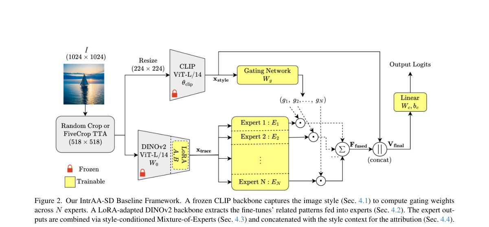

**Why this ranks #10**: 补位说明：这是生成图溯源任务与基准，不含 RL、奖励模型或任何后训练训练，属于本线的相邻方向。论文构建首个 140K 张图像的 IntrAA-SD 基准（ISDB），覆盖 10 个 SDXL 微调模型，每类 12K 域内加 2K 域外；基线用冻结 CLIP 做风格门控的 MoE，配合 LoRA 适配的高分辨率 DINOv2 抽取的微调迹特征，域内测试集准确率 99.03%、域外 88.55%。消融显示只用风格特征（冻结 CLIP 加线性头、不用 MoE）只有 87.59%，只用源迹特征（LoRA DINOv2 加线性头）有 98.52%，把门控换成等权平均则为 98.40%。与本线的方法学没有直接关系，只能排在补位末位。  [wild-card=yes] 该论文是同一 SDXL 架构下不同微调生成器的来源归因，属于生成内容溯源方向而非 RL 后训练，补位计入。

---

