# ArXiv Daily Digest - 2026-11-05 (核心强化学习, 10 papers)

**Generated**: 2026-11-05 17:30 CST

**Source**: arXiv cs.CV, cs.SD, eess.AS, cs.CL, cs.AI, cs.RO, cs.LG submissions, listing day 2026-11-04 (announced 2026-11-05 00:00 UTC)

**Batch window**: 2026-11-03T18:00:00Z .. 2026-11-04T18:00:00Z（arXiv 公告批次横跨两个 UTC 日：前一日 18:00 UTC 起算，当日 17:59:59 UTC 截止）

**Track**: rl_core (top 10 of 518 papers scanned, 70 full reads)

**Scope**: RL 算法与理论、多智能体 RL、sim-to-real 与离线 / 元 RL

---

## Top 10 - 核心强化学习

### 1. GSBR: Geometric Support Behavior Regularization for Online RL

**arXiv**: [2611.05295](https://arxiv.org/abs/2611.05295) | **Score**: 9.7 (relevance 10 x 0.7 + quality 9 x 0.3) | **Tags**: rl-core, support-geometry, behavior-regularization, flow-matching-policy, robot-manipulation, sample-efficiency, UC Berkeley | **Categories**: cs.LG, cs.RO | **Pages**: 23

**Authors**: Charles Xu; Jacob Berg; Liyiming Ke; Sergey Levine

**Affiliation**: UC Berkeley; Physical Intelligence

**Abstract**

> Regularizing online reinforcement learning (RL) toward a pretrained base policy can improve sample efficiency and learning stability, but regularization that is too restrictive limits how much the policy can improve. Base policies -- typically diffusion or flow-matching models trained by imitation learning on large, diverse datasets -- capture many behaviors that are reasonable but suboptimal. Existing regularizers using such base policies are too restrictive in one of two ways: behavioral cloning regularizers pull the actor toward the full base-policy distribution, penalizing it for discarding suboptimal modes, while hard support constraints forbid improvements that lie just outside the base policy's support. We propose Geometric Support Behavior Regularization (GSBR), which penalizes actions by their distance from the base policy's support. Actions within the support incur no penalty, so the actor can concentrate on high-value modes; outside the support, where value estimates are less reliable, the penalty grows smoothly with distance while still permitting improvement when the value gained outweighs the penalty. GSBR estimates this distance from a finite set of base-policy samples, so it requires only sample access to the base policy. Across 19 tasks on four robotic benchmarks, GSBR raises the average success rate from 33% for the base policy to 95%, achieving the highest average success rate and throughput among all compared methods, with about 23% higher normalized throughput than the next-best RL method. Project website and open-source code at https://charlesxu0124.github.io/gsbr/ .

**Key findings**

- **Finding**: GSBR 用基策略采样点集的最近邻距离估计支撑集半径 r_B，支撑集内不惩罚、区外按距离平滑加重；19 个任务上平均成功率从基策略的 33% 升到 95%，归一化吞吐 0.95 对次优 RLT 的 0.77。
- **Inference**: 说明行为克隆正则与硬支撑约束的失败根源都是约束过紧，改成几何软惩罚即可同时容许模态选择与局部精修。
- **Recommendation**: 用扩散或流匹配基策略做在线 RL 时把正则项换成支撑集距离惩罚；消融显示基策略样本数 N=8 已够用，N=16 与 N=32 的归一化吞吐为 0.91 与 0.93，且 r_B=0 时吞吐掉到 0.66。

**Key figures**

*Framework - Left: (a) Behavior cloning regularizer matches the base policy distribution, not allowing the RL actor to drop poor modes. (b) Support constraint allows the actor to select the best behavior*

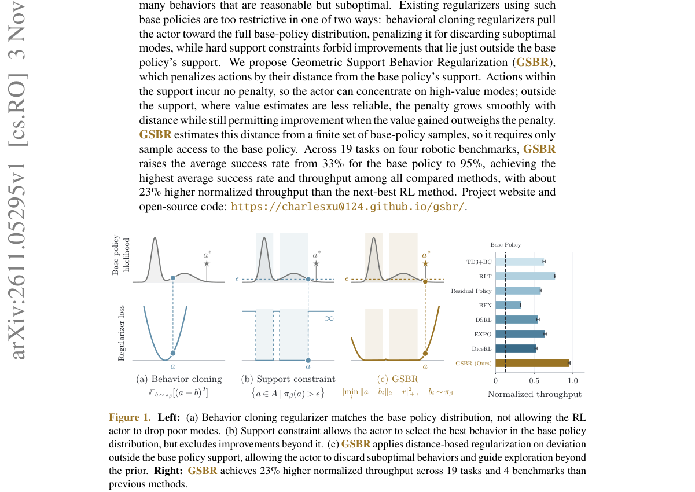

*Result - GSBR. To implement the geometric support regularizer on a generative robot policy, draw samples from πβ(· | s) and compute the nearest-neighbor distance between them. Set rB to a quantile ov*

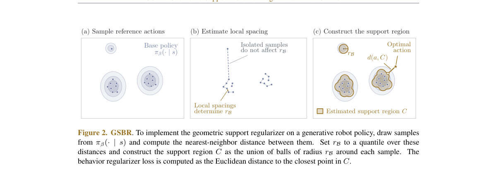

**Why this ranks #1**: 本线第 1：把在线 RL 面向预训练基策略的正则化改成「到基策略支撑集的几何距离」，在 4 个机器人基准的 19 个任务上把平均成功率从基策略的 33% 抬到 95%，归一化吞吐 0.95 超过次优 RL 基线 RLT 的 0.77，吞吐再高约 23%。

---

### 2. Revisiting Critic Estimation in Soft Actor-Critic Algorithms

**arXiv**: [2611.05666](https://arxiv.org/abs/2611.05666) | **Score**: 9.7 (relevance 10 x 0.7 + quality 9 x 0.3) | **Tags**: rl-core, soft-actor-critic, lambda-returns, hyperparameter-robustness, critic-design, multi-step-targets, Leiden Institute of Advanced Computer | **Categories**: cs.LG | **Pages**: 33

**Authors**: Jan Felix Kleuker; Koen Ponse; Aske Plaat; Thomas M. Moerland

**Affiliation**: Leiden Institute of Advanced Computer Science (LIACS), Leiden University

**Abstract**

> Soft Actor-Critic (SAC) is a widely used deep reinforcement learning algorithm that combines entropy regularization with an actor-critic architecture. Standard implementations rely on one-step temporal-difference learning of Q-functions, yet alternative critic design choices remain underexplored. In this work, we revisit three such choices: learning soft advantages instead of soft Q-values, the use of multi-step return targets, and the training of multi-step critics from replay buffer data. Keeping the policy objective fixed, we compare the six critic variants these choices generate: (i) advantage and (ii) dueling-advantage critics learned from one-step transitions, and $λ$-return and soft Generalized Advantage Estimation (GAE) critics learned either (iii, iv) on-policy or (v, vi) from replayed trajectory segments. Each variant is evaluated across an entire random hyperparameter search on fourteen tasks, treating the hyperparameters as part of the algorithm. Learning soft advantages instead of soft Q-values does not improve performance, and the soft GAE critic adds nothing over the simpler $λ$-return critic. What does improve performance, most clearly on continuous control, is training a $λ$-return critic on replayed trajectory segments, even without importance weighting or trace cutting. This extends earlier evidence that uncorrected multi-step targets work well under replay to the full soft $λ$-return, entropy terms included. By design, the underlying ideas studied here extend beyond SAC, and our empirical findings aim to encourage their application to a broader class of reinforcement learning algorithms.

**Key findings**

- **Finding**: 6 个 critic 变体在 3 个基准套件的 14 个任务上做完整随机超参搜索，学习软优势不改善性能，软 GAE critic 相对更简单的 λ-回报 critic 没有增益。
- **Inference**: 说明 SAC 的瓶颈不在熵项或优势形式，而在 critic 目标是否用多步 λ-回报并直接从 replay 轨迹段学习。
- **Recommendation**: 连续控制任务优先改用 SAC-λ-R；它在超参迁移后仍保留约 75% 峰值，而同图中的 PPO 迁移后损失超过一半峰值。

**Key figures**

*Framework - Design choices and resulting variants. The critic is trained on replayed or on-policy data, with one-step or multi- step λ-return targets, and predicts soft Q- values Qπ*

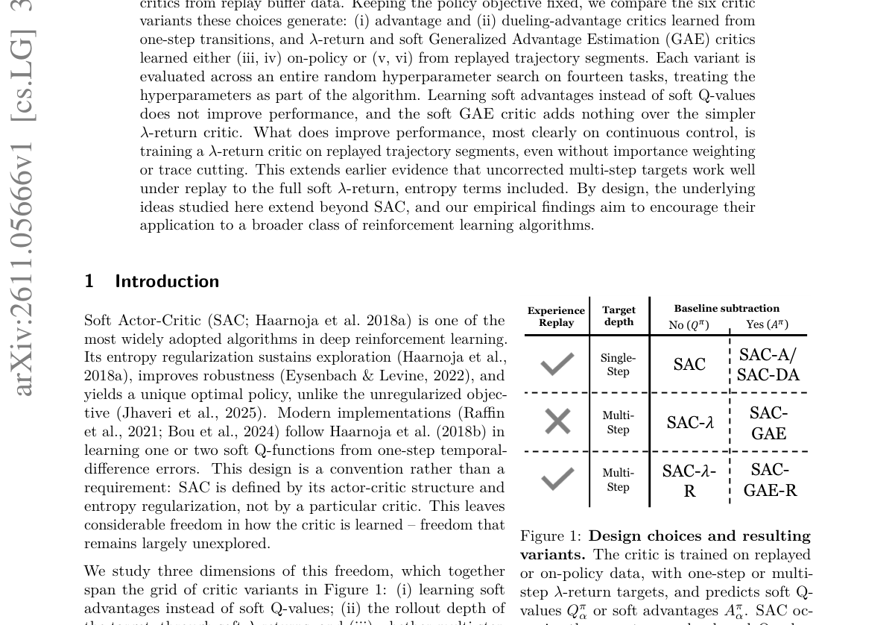

*Result - Training pipelines of the SAC variants. (a) SAC-A and SAC-DA keep SAC’s replay-based one-step pipeline but learn soft advantages. (b) SAC trains its Q-network on replayed transitions, SAC-λ*

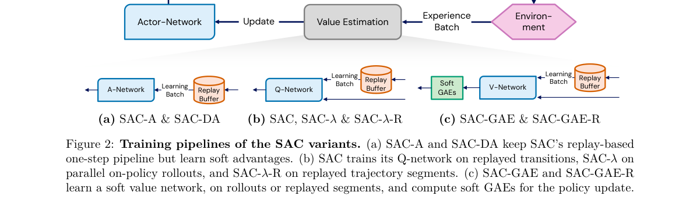

**Why this ranks #2**: 本线第 2：把 SAC 里的三个 critic 设计选择（软优势、多步 λ-回报、从 replay 轨迹段训练）拆成 6 个变体，在 3 个基准套件的 14 个任务上做整轮随机超参搜索；结论是「在 replay 轨迹段上训练的 λ-回报 critic」在连续控制上唯一稳定提升，超参迁移后仍保留约 75% 峰值。

---

### 3. On Convergence of Gradient Temporal-Difference Learning with Regularized Corrections and Eligibility Traces

**arXiv**: [2611.05869](https://arxiv.org/abs/2611.05869) | **Score**: 9.0 (relevance 9 x 0.7 + quality 9 x 0.3) | **Tags**: rl-core, temporal-difference, eligibility-traces, convergence-theory, off-policy, huber-loss, University of Alberta | **Categories**: cs.LG, math.OC | **Pages**: 66

**Authors**: Jingyi Jin; Martha White; Hao Wang

**Affiliation**: University of Alberta; Alberta Machine Intelligence Institute (Amii)

**Abstract**

> Temporal-difference (TD) learning underlies many prediction and control algorithms, but can diverge when combined with off-policy learning, bootstrapping, and function approximation. TD with Regularized Corrections (TDRC) is theoretically sound and practically simple, but existing convergence theory covers only the one-step case under i.i.d. sampling, while the Huber Bellman-error formulation has not been extended to TDRC or eligibility traces. In this work, we establish convergence of constrained TDRC($λ$) with diminishing stepsizes and non-i.i.d. off-policy data, for state-dependent and history-dependent $λ$-parameters. We also propose TDRC($λ$)-Huber, which preserves the TDRC($λ$) fixed point while reducing sensitivity to large Bellman errors. For both algorithms, we apply an ODE-based weak-convergence method from stochastic approximation theory. For the nonlinear mean dynamics of TDRC($λ$)-Huber, we give an integral small-gain condition that guarantees uniqueness and global asymptotic stability of the target equilibrium. We then establish convergence of the constrained algorithm, derive computable sufficient conditions for convergence, and identify a regularization-based convergence mechanism shared by linear TDRC($λ$) and TDRC($λ$)-Huber. When the mean TD matrix is positive stable, both constrained algorithms converge under sufficiently strong regularization without requiring positive definiteness.

**Key findings**

- **Finding**: 论文给出 4 项贡献：非 i.i.d. 离策略数据下 TDRC(λ) 的收敛、TDRC(λ)-Huber 保持同一不动点、积分型小增益条件下的全局渐近稳定性，以及覆盖一步情形与两类 λ 参数的可计算收敛充分条件。
- **Inference**: 说明由正则化带来的大 β 收敛机制是线性 TDRC(λ) 与 Huber 版本共有的，不必额外假设正定性。
- **Recommendation**: 需要用资格迹做离策略 TD 的读者可直接套用该收敛条件；Huber 化的裁剪在保持不动点的同时降低了对大 Bellman 误差的敏感度。

**Why this ranks #3**: 本线第 3：纯理论工作，把 TD with Regularized Corrections 的收敛理论从一步 i.i.d. 情形扩展到带资格迹的 TDRC(λ)，并提出保持同一不动点的 TDRC(λ)-Huber（66 页、投稿 JMLR），覆盖状态相关与历史相关两种 λ 参数，给出可计算的收敛充分条件与积分型小增益条件。

---

### 4. PolicyIK: High-Precision Inverse Kinematics for Robot Arms with Reinforcement Learning

**arXiv**: [2611.05372](https://arxiv.org/abs/2611.05372) | **Score**: 8.7 (relevance 9 x 0.7 + quality 8 x 0.3) | **Tags**: rl-core, inverse-kinematics, goal-conditioned-rl, vla-transfer, millimeter-precision, sim-to-real, New York University | **Categories**: cs.LG, cs.RO | **Pages**: 29

**Authors**: Yuhan Liu; Xinqi Liu; Zixuan Dong; Keith W. Ross; Shenji Wan

**Affiliation**: New York University; New York University Abu Dhabi

**Abstract**

> Inverse kinematics (IK) converts end-effector pose commands into joint motion, and many vision-language-action (VLA) policies rely on it to act on a given arm and to transfer across embodiments. Precise IK remains laborious: redundancy and singularities complicate the inverse mapping, execution depends on hand-tuned controllers, and training data on physical robots are costly to collect. We present PolicyIK, a goal-conditioned reinforcement learning policy for high-precision IK. It updates joint-position references from pose feedback and observes its accumulated reference relative to the measured joints, so it can retain the offset that the position controller needs at rest. Two-scale pose errors with an error-dependent action gain resolve millimeter residuals while preserving large motions. Progress and dwell rewards teach it to both reach the tolerance and stay within it. In simulation, a single attempt by the trained PPO policy keeps the mean errors over the final second within 1 mm and 0.2° on 93.5% of held-out tasks, and a deployment protocol raises success to 98.9%. When trained directly on a physical arm with an off-policy RL learner, PolicyIK achieves higher reaching and holding success than all four classical IK controllers under the same time budgets. In simulated pick-and-place, PolicyIK executes the end-effector commands of the $π_{0.5}$ VLA policy with 95.7% success. These results show that reinforcement learning can provide high-precision inverse kinematics for robot arms. Code is available at https://github.com/Tinaliu0123/PolicyIK.

**Key findings**

- **Finding**: 仿真单次尝试的严格成功率为 93.5%，最终 1 秒内误差始终保持在 1 mm 与 0.2° 以内；加入修正目标与瞬态目标重试的部署协议后严格成功率升到 98.9%，而对照 UMI-RL 只有 16.4% 粗成功率。
- **Inference**: 说明逆映射的病态问题可以在策略内部靠「累积参考 + 误差相关增益」吸收，不必手调雅可比或阻尼控制器。
- **Recommendation**: 需要给 VLA 提供关节级接口时可复用该 formulation；在 10 个改造后的 LIBERO-Object 任务上 PolicyIK 达 95.7%，与手调 DLS 的 96.7% 相当，高于默认 DLS 与手调 QP 的 90.8%。

**Key figures**

*Framework - PolicyIK: from broad reaching to precise regulation. (a) Full-pose reaching across the simulated workspace. (b) Reaching and holding within 1 mm and 0.2◦. (c) On hardware, PolicyIK holds the*

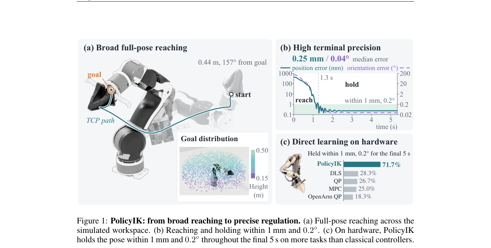

*Result - PolicyIK control formulation. At each step, the policy maps the observation to a joint- reference increment, which is scaled by the error-dependent gain, accumulated in the joint reference,*

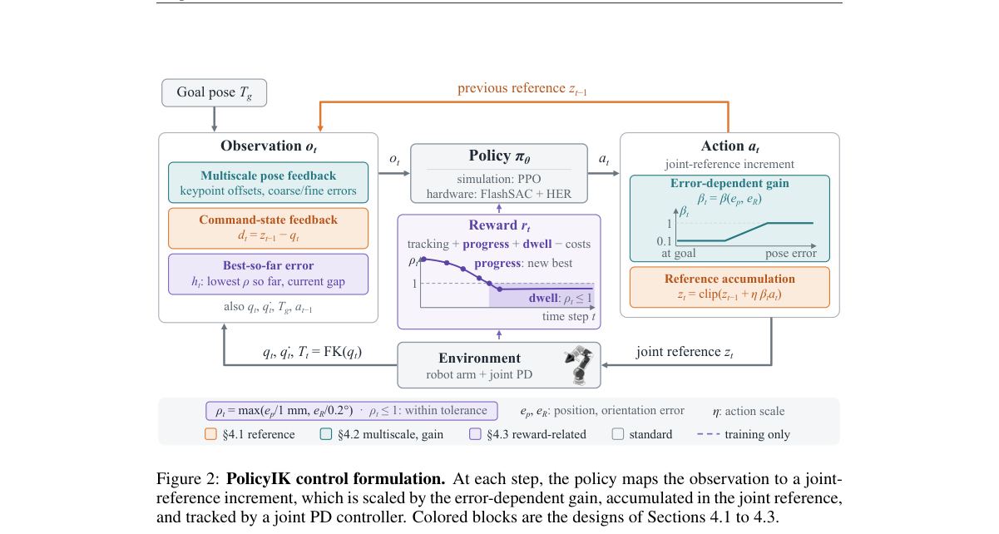

**Why this ranks #4**: 本线第 4：把高精度逆运动学做成目标条件 RL 策略，靠累积关节参考与误差相关增益吸收冗余与奇异点带来的映射病态；仿真单次尝试即在 93.5% 的留出任务上把误差压到 1 mm 与 0.2° 以内，加部署协议升到 98.9%，在 π0.5 VLA 的仿真取放里达 95.7%。

---

### 5. Correct Robots Before They Make Mistakes: Proactive Human-in-the-Loop Intervention via Preference Learning

**arXiv**: [2611.05667](https://arxiv.org/abs/2611.05667) | **Score**: 8.7 (relevance 9 x 0.7 + quality 8 x 0.3) | **Tags**: rl-core, human-in-the-loop, preference-learning, xr-interface, diffusion-policy, vla-robot, Karlsruhe Institute of Technology (KIT) | **Categories**: cs.RO | **Pages**: 11

**Authors**: Xinkai Jiang; Jing Jiang; Hongyi Zhou; Pankhuri Vanjani; Ahmad Baki; Jakub Suliga; Ge Li; Zhuoyue Li; Gerhard Neumann; Rudolf Lioutikov

**Affiliation**: Karlsruhe Institute of Technology (KIT), Germany; Robotics Institute Germany (RIG)

**Abstract**

> This paper presents Proactive Human-in-the-Loop (PHIL), a framework for proactive policy correction and preference-based post-training. PHIL enables operators to preview policy-predicted future motion and intervene before anticipated undesirable actions. During takeover, PHIL continues querying the policy and displaying its predicted trajectories in the physical workspace through an extended reality (XR) interface. PHIL pairs rejected policy predictions with corrective action chunks subsequently executed from the same physical state over the same horizon, and preference-based post-training encourages the policy to favor these corrections. This paper evaluates PHIL on four real-world manipulation tasks using a diffusion policy and a pretrained vision-language-action policy. With five correction episodes per condition, PHIL increases mean success rates across the evaluated tasks and demonstration budgets from 44.0% to 70.3% for the diffusion policy and from 57.8% to 76.9% for X-VLA, compared with HG-DAgger. Separately, policies trained with proactive corrections show fewer unnecessary recovery behaviors in successful episodes. Project page: https://intuitive-robots.github.io/PHIL-page/.

**Key findings**

- **Finding**: 在 4 个真机操作任务、每条件 5 次纠正 episode 的预算下，PHIL 把扩散策略平均成功率从 44.0% 提升到 70.3%，把 X-VLA 从 57.8% 提升到 76.9%，两者都优于 HG-DAgger。
- **Inference**: 说明「先预览再接管」比「等出错再纠正」能产出更干净的偏好对，因为被拒绝预测与纠正动作取自同一状态与同一视界。
- **Recommendation**: 给扩散策略或预训练 VLA 接人类反馈时优先做预测预览式接管；论文还观察到 proactive 纠正训出的策略在成功 episode 中触发更少的无谓恢复行为。

**Key figures**

*Framework - Overview of the Proactive Human-in-the-Loop (PHIL) framework. Demonstrations collected through any suitable interface are used to pre-train or fine-tune a base policy. During rollouts, the ope*

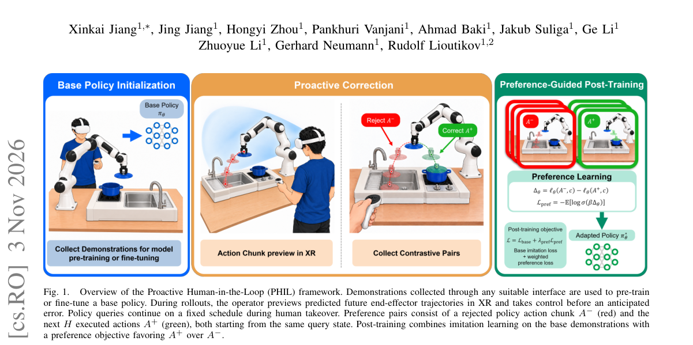

*Result - Reactive versus proactive correction under equal correction budgets (two interventions per panel; only the first annotated). Solid and dashed lines denote executed robot motion and previewed p*

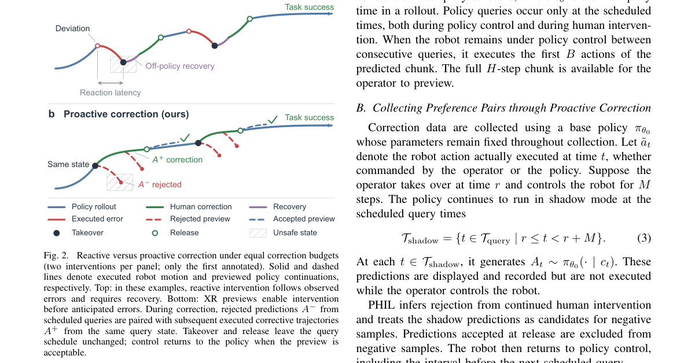

**Why this ranks #5**: 本线第 5：把人类介入从事后纠错改成事前干预，用 XR 在物理工作空间预览策略预测轨迹，并把「被拒绝的预测」与「同一物理状态、同一时间跨度上真正执行的纠正动作」配成偏好对；在 4 个真机操作任务、每条件 5 次纠正预算下，扩散策略成功率从 44.0% 提到 70.3%，X-VLA 从 57.8% 提到 76.9%。

---

### 6. TwinBridge: Digital Twin-Driven Policy and Reward Transfer for Real-World Reinforcement Learning in Laboratory Robotics

**arXiv**: [2611.06442](https://arxiv.org/abs/2611.06442) | **Score**: 8.7 (relevance 9 x 0.7 + quality 8 x 0.3) | **Tags**: rl-core, digital-twin, gaussian-splatting, dense-visual-reward, real-world-rl, sim-to-real, Suzhou Institute for Advanced Research | **Categories**: cs.RO | **Pages**: 8

**Authors**: Shu'ang Sun; Yibo Qiu; Haoliang Ye; Zan Huang; Ao Tian; Kan Ding; Ronald Xu; Mingzhai Sun

**Affiliation**: Suzhou Institute for Advanced Research, University of Science and Technology of China, Suzhou, Jiangsu, China

**Abstract**

> Online reinforcement learning offers an effective approach to precise laboratory manipulation, yet costly real-world demonstrations and limited access to dense process rewards hinder its practical application. We present TwinBridge, a digital twin-driven framework that supplies policy initialization and dense visual rewards for real-world online learning. We construct digital twins by combining 3D Gaussian splatting with physics simulation. Here, simulator states provide task events and geometric progress under physical prerequisites and ordering constraints, yielding rewards for policy pretraining with simulated demonstrations and reinforcement learning. We distill this supervision into a visual reward model. During real-world interaction, its predictions are combined with execution history to compute dense rewards for human-in-the-loop policy refinement. Across five real-world laboratory tasks, TwinBridge achieves a final mean autonomous success rate of 98% with at most 25 minutes of real-world interaction per task. Experiments show that dense rewards improve interaction efficiency over sparse rewards, and simulation-based policy initialization further accelerates learning.

**Key findings**

- **Finding**: 5 个真机任务上 TwinBridge 最终平均自主成功率 98%、每任务真机交互 ≤25 分钟；去掉仿真策略初始化后仍有 92%，对照 HIL-ConRFT 为 44%、HG-DAgger 为 76%、HIL-SERL 为 4%，增益覆盖全部 5 个任务、幅度 30 到 70 个百分点。
- **Inference**: 说明数字孪生的价值主要在同时提供「策略初始化 + 稠密视觉奖励」这两样真机拿不到的东西，单靠奖励稠密化解释不了全部提升。
- **Recommendation**: 真机在线 RL 可照此先做仿真初始化再蒸馏视觉奖励模型；论文报告该奖励模型在留出真机轨迹上事件 F1 为 99.30%、时间 ρ 为 0.889，稀疏奖励基线在多个任务上最高只到 50%。

**Key figures**

*Framework - Overview of TwinBridge. A digital twin supplies two resources for real-world online RL: a policy pretrained with simulated demonstrations and RL, and visual process rewards learned from physic*

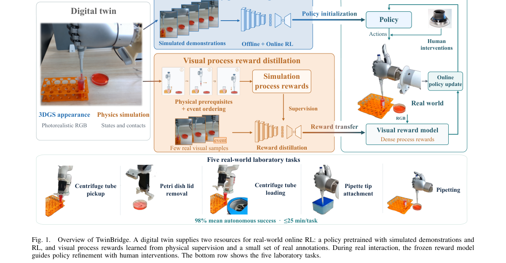

*Result - Physics-grounded reward construction and visual transfer. (a) Ordered events and new valid progress records receive one-time credit in an execution-history ledger, defining the potential for p*

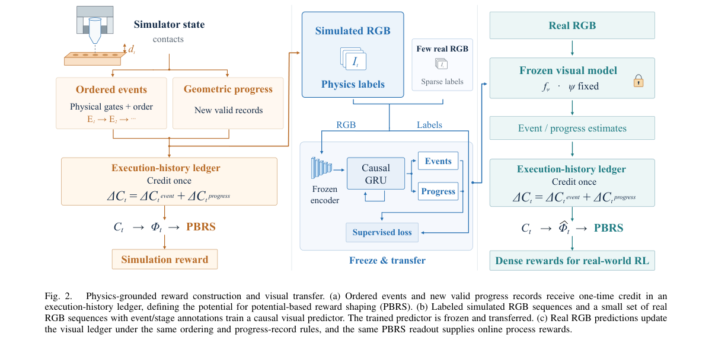

**Why this ranks #6**: 本线第 6：用 3D Gaussian Splatting 加物理仿真搭数字孪生，为真机在线 RL 同时提供策略初始化与稠密视觉过程奖励；在 5 个实验室真机任务上最终平均自主成功率 98%，每任务真机交互不超过 25 分钟，去掉仿真初始化后仍有 92%，而 HIL-ConRFT 只有 44%。

---

### 7. Near-Minimax Sample Complexity for Multi-Objective Reinforcement Learning under Generative Models

**arXiv**: [2611.05562](https://arxiv.org/abs/2611.05562) | **Score**: 8.3 (relevance 8 x 0.7 + quality 9 x 0.3) | **Tags**: rl-core, multi-objective-rl, minimax-sample-complexity, generative-model, reward-hull, preference-conditioned, University of Central Florida | **Categories**: cs.LG, stat.ML | **Pages**: 20

**Authors**: Yue Wang

**Affiliation**: University of Central Florida

**Abstract**

> In multi-objective reinforcement learning, preferences may be specified only after data collection, requiring one dataset to support a continuum of reward trade-offs. We study finite discounted Markov decision processes with unknown transitions, $S$ states, $A$ actions, and $m$ known reward functions taking values in $[0,1]$, given access to a generative model. The learner must provide an $\varepsilon$-optimal policy for every convex combination of these rewards without further sampling, with a guarantee that holds simultaneously over all preferences and initial states. Writing $H=(1-γ)^{-1}$, we establish the constant-confidence minimax sample complexity $\widetildeΘ\!\left( \frac{SAH^3}{\varepsilon^2}\min\{S,\log(em)\} \right)$, where the suppressed factors are logarithmic in $S,A,H,\varepsilon^{-1}$ and the dependence on $m$ is explicit. Thus, up to these logarithmic factors, the worst-case statistical cost of supporting all preferences grows logarithmically with the number of objectives and saturates at the number of states. The upper bound uses uniform state--action sampling and empirical planning, with reward rounding in the logarithmic-objective regime. Its analysis chains optimal-value increments over covers of the reward hull. A one-sided Bellman variance bound controls signed value differences under a second transition kernel, preserving the $H^3\varepsilon^{-2}$ dependence. A complementary uniform guarantee for all bounded rewards yields the state-dimension saturation. We establish lower bounds matching up to logarithmic factors through a rare-exit construction with subset rewards and action encoding. These bounds apply to adaptive simulator queries and arbitrary randomized history-dependent output policies, while the upper bounds are attained by deterministic stationary policies.

**Key findings**

- **Finding**: 常置信度下的 minimax 样本复杂度为 Θ(SAH³/ε²·min{S, log(em)})，被抑制的因子只对 S、A、H、ε⁻¹ 取对数，且对 m 的依赖显式保留；上界由均匀状态-动作采样加经验规划达到。
- **Inference**: 说明多目标的代价几乎只付一次，「数据采完再定偏好权重」不需要为每个偏好重新采样。
- **Recommendation**: 需要在采样后再定偏好时可直接按该复杂度预算样本量；下界用罕见退出构造配合子集奖励与动作编码给出，仅在对数因子上有差距。

**Why this ranks #7**: 本线第 7：给出多目标 RL 在生成模型下的近 minimax 样本复杂度 Θ(SAH³/ε²·min{S, log(em)})，其中 H=(1−γ)⁻¹，即一份数据同时支撑所有偏好组合的最坏统计代价只随目标个数对数增长并在状态数处饱和，条件为 S≥3、A≥2、H≥2、ε≤H/4096。

---

### 8. Diversity-Aware Experience Replay via Statistical Leverage Scores

**arXiv**: [2611.05929](https://arxiv.org/abs/2611.05929) | **Score**: 8.0 (relevance 8 x 0.7 + quality 8 x 0.3) | **Tags**: rl-core, experience-replay, leverage-score, kurtosis, rare-event-sampling, robot-manipulation, Instrumentation & Controls Group at Los | **Categories**: cs.LG, cs.RO | **Pages**: 9

**Authors**: Shaifalee Saxena; Alexander Scheinker

**Affiliation**: Instrumentation & Controls Group at Los Alamos National Laboratory, Los Alamos, New Mexico, USA

**Abstract**

> Off-policy deep reinforcement learning trains on random samples from a replay buffer of past experience. In physical robot settings, that buffer is dominated by routine: thousands of near-identical transitions from normal operation, while the rare events that define the edges of the task are rarely sampled. We propose scoring every stored transition by its statistical leverage, which measures how unusual it is relative to the buffer's own data, computed from the stored numbers alone, with no labels, rewards, or value network. We draw each mini-batch from a mixture of this score and uniform sampling. First, the natural way to build the score along the directions where the data varies most turns out to be blind when actions are stored as one-hot indicators, because indicator columns always win the variance ranking; we instead select the feature columns with the heaviest tails (largest kurtosis) where small far-away populations are revealed. Second, the importance weights that prioritized replay uses to keep gradients unbiased cancel the method exactly: with full correction, training matches uniform sampling, so we drop the correction and deliberately optimize the rebalanced objective. Third, when the rare situations of a log are relational, visible only in how a stretch of behavior relates to its goal, not in any single stored coordinate-per-transition scores are blind; applying the same tail rule to short trajectory windows described relative to their goal restores the signal, and on a three-joint arm that must push an object around an obstacle it raises the rare-task success from 0.49 to 0.69 against a labeled-oracle ceiling of 0.74.

**Key findings**

- **Finding**: 论文报告三个负面发现与一个修复：方差最大的特征列在 one-hot 动作下总是指标列而失效、优先级采样的重要性校正会精确抵消该方法使训练退化到均匀采样、逐转移打分对关系型稀有情形失明；改用最大峰度特征并在相对目标描述的短轨迹窗口上打分后，三关节臂推物体绕障的稀有任务成功率从 0.49 升到 0.69。
- **Inference**: 说明无标签、无奖励的缓冲区几何本身就足以充当采样信号，前提是绕开 one-hot 指示列的方差陷阱并显式放弃无偏校正。
- **Recommendation**: 物理机器人回放缓冲区以常规样本为主的场景值得优先尝试；两房间网格世界中常规区每格约 275 个样本而走廊与 B 区只有约 12 个，正是该方法的目标场景。

**Key figures**

*Framework - Overview of the proposed kurtosis-based leverage-mixture replay framework.*

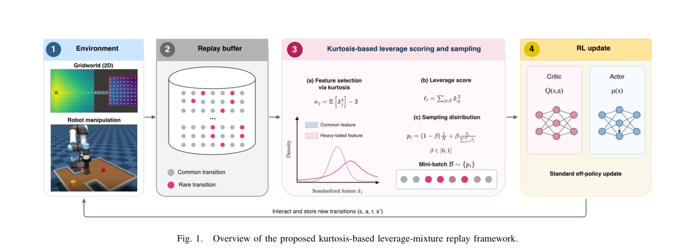

*Result - Two-room gridworld. (a) The logged buffer at ε = 0.05: routine operation covers the main room (≈275 samples/cell) while the corridor and annex region B, dashed, receive ≈12. (b) Ground-truth Q*

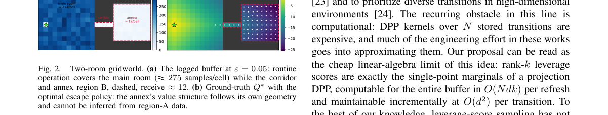

**Why this ranks #8**: 本线第 8：用回放缓冲区自身的统计杠杆分数给每条转移打分，再与均匀采样混合成 mini-batch；关键消融发现按方差最大的方向选特征在 one-hot 动作下必然失效，改用最大峰度后信号恢复，三关节臂推物体绕障的稀有任务成功率从 0.49 升到 0.69，逼近标注 oracle 上限 0.74。

---

### 9. Traffic-VL: Reinforced Vision-Language Models for Generalizable End-to-End Traffic Signal Control

**arXiv**: [2611.06353](https://arxiv.org/abs/2611.06353) | **Score**: 8.0 (relevance 8 x 0.7 + quality 8 x 0.3) | **Tags**: rl-core, traffic-signal-control, vision-language-model, offline-rl, closed-loop-optimization, sim-to-real, Hong Kong University of Science and | **Categories**: cs.AI, cs.CV | **Pages**: 21

**Authors**: Xingchen Zou; Maonan Wang; Kemou Jiang; Jie Li; Yiqi Chen; Xi Chen; Hai Yang; Yuxuan Liang

**Affiliation**: The Hong Kong University of Science and Technology

**Abstract**

> Existing traffic signal control methods typically rely on structured traffic states produced by dedicated perception pipelines. Emerging visual approaches often use idealized simulator images and convert them into intermediate representations before control, limiting their ability to directly exploit roadside visual observations. To bridge both the visual-domain and perception-to-decision gaps, we introduce SynTra-V and Traffic-VL. SynTra-V converts physics-based traffic simulations into photorealistic multi-view surveillance imagery across diverse road topologies and sensing conditions, and automatic semantic auditing checks that control-critical geometry, vehicle movements, and lane semantics match the simulator state. Traffic-VL is an eight-billion-parameter vision-language model that directly maps synchronized multi-view images and natural-language phase descriptions to signal decisions without intermediate structured states. Building on Traffic-R1's two-stage reinforced reasoning framework, Traffic-VL adapts its vision encoder via offline reinforcement learning on SynTra-V and freezes it during online visual stepwise trajectory policy optimization in closed-loop simulation. Experiments show that Traffic-VL matches structured-state Traffic-R1 while outperforming image-based controllers and general-purpose vision-language models, including Gemini 3 Pro. Evaluations on unseen topologies, degraded sensing conditions, real surveillance footage, and a three-week deployment across ten intersections further demonstrate robust visual generalization and effective constrained online control.

**Key findings**

- **Finding**: Traffic-VL 是 80 亿参数模型，直接由同步多视角图像与自然语言相位描述输出信号决策，视觉编码器经离线 RL 适配后在闭环阶段冻结；实验显示其表现追平结构化状态的 Traffic-R1，并优于图像类控制器与 Gemini 3 Pro 等通用视觉语言模型。
- **Inference**: 说明「感知到决策」的转换不必依赖专用感知管线，合成数据加自动语义审计足以支撑真实路侧分布。
- **Recommendation**: 做端到端视觉控制的团队可参考其离线适配加闭环优化的两段式 RL 流程；论文在未见图拓扑、恶劣感知条件、真实监控录像与 10 个路口 3 周部署上均做了验证。

**Key figures**

*Framework - Traffic-VL maps multi-view roadside images and natural-language phase descriptions directly to traffic signal decisions.*

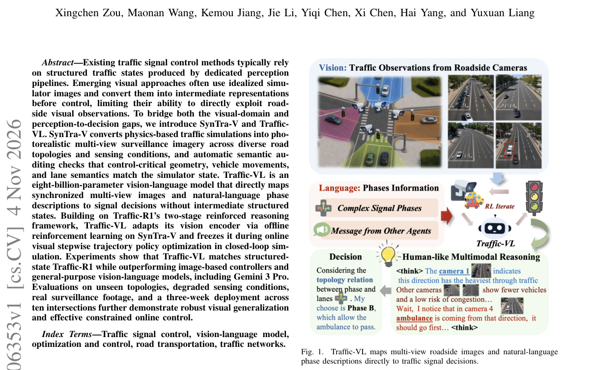

*Result - The Traffic-VL framework combines (a) SynTra-V data generation, (b) offline human-informed RL, and (c) online closed-loop policy optimization.*

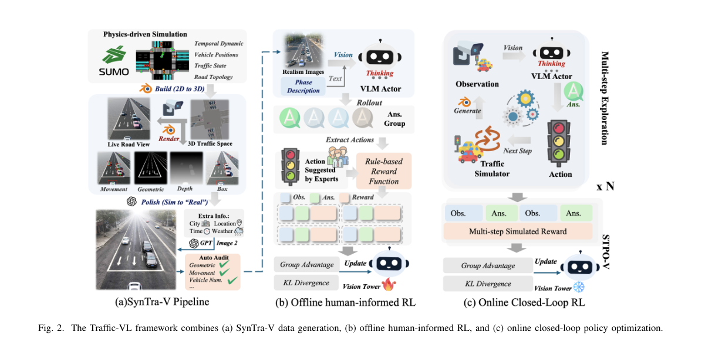

**Why this ranks #9**: 本线第 9：用 80 亿参数的视觉语言模型直接把同步多视角路侧图像加自然语言相位描述映射为配时决策，中间不经过结构化交通状态；视觉编码器先经离线 RL 适配、闭环阶段冻结，再做在线逐步轨迹策略优化，并在 10 个路口完成 3 周部署验证。

---

### 10. H^2MARL: Hierarchical Heterogeneous Multi-agent Reinforcement Learning for Humanoid Robot Control

**arXiv**: [2611.06523](https://arxiv.org/abs/2611.06523) | **Score**: 8.0 (relevance 8 x 0.7 + quality 8 x 0.3) | **Tags**: rl-core, humanoid-control, heterogeneous-marl, joint-dof-factorization, closed-loop-co-optimization, mujoco, School of Artificial Intelligence | **Categories**: cs.RO | **Pages**: 8

**Authors**: Xuemin Hu; Kaixin Li; Qingqing Xia; Yuxin Wang; Wei Xie; Bo Tang; Long Chen

**Affiliation**: School of Artificial Intelligence, Hubei University, Wuhan, China; Worcester Polytechnic Institute

**Abstract**

> Coordinated whole-body control of humanoid robots remains challenging due to high-dimensional coupled dynamics and substantial physical heterogeneity across joint degrees of freedom (JDoFs). Existing multi-agent reinforcement learning methods either employ coarse agent partitions or directly apply generic heterogeneous-agent algorithms, while hierarchical controllers commonly optimize high-level planning and low-level execution independently, leading to uncoordinated motion. In this paper, we propose H^2MARL, a hierarchical heterogeneous multi-agent reinforcement learning framework with two key mechanisms. We first formulate humanoid whole-body control using a JDoF-level physical-heterogeneity-aware policy factorization, where each torque-actuated JDoF is conditioned on an explicit descriptor of its actuation, kinematic, and dynamic properties. Moreover, we develop a closed-loop policy-executor co-optimization mechanism that jointly adapts the high-level pose planner and the low-level joint executor using shared interaction trajectories, thereby reducing the distribution mismatch between planning and execution. Extensive experiments in MuJoCo and Isaac Gym demonstrate that H^2MARL consistently improves locomotion stability, gait coordination, and motion quality over homogeneous, coarse-grained, and independently optimized alternatives.

**Key findings**

- **Finding**: 相对最强基线 MAPPO，H2MARL 的脚-地接触稳定性 FS、躯干稳定性 TS、步态对称性 GS 分别提升 7.3%、35.0%、14.8%，绝对值为 0.5367、0.2516、0.001039；但运动平滑度 MS 为 0.3514，略逊于 MAPPO 的 0.2329。
- **Inference**: 说明异质的关节级分解换来了接地稳定性与协调，代价是更频繁的关节微调带来的平滑度下降。
- **Recommendation**: 做人形全身控制可照用 JDoF 级因子分解加闭环策略-执行器协同优化；策略按 HAPPO 设定训练 1000 万环境步，消融显示去掉闭环协同后 CoT、MJ 与 CAM 明显恶化。

**Key figures**

*Framework - Limb- and JDoF-level multi-agent formulations for the humanoid robot. (a) Traditional limb-level formulation, where each limb is formulated as an independent homogeneous agent. (b) JDoF-level*

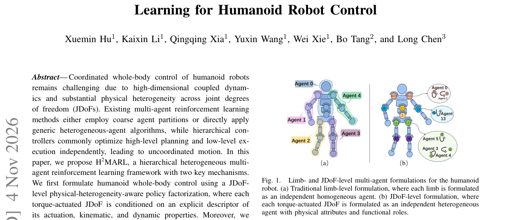

*Result - H2MARL overview. The high-level planner generates JDoF-level pose increments and converts them into absolute target poses. The low-level joint executor receives the absolute target poses combi*

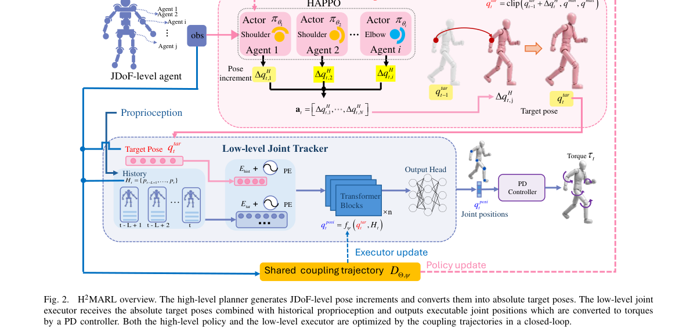

**Why this ranks #10**: 本线第 10：把人形机器人的每个扭矩驱动关节自由度当作独立异质智能体，并让高层位姿规划器与低层关节执行器在同一闭环轨迹上联合优化；在 MuJoCo 与 Isaac Gym 上相对最强的 MAPPO，脚-地接触稳定性、躯干稳定性与步态对称性分别提升 7.3%、35.0% 与 14.8%。

---

