# ArXiv Daily Digest - 2026-11-06 (AIGC 音频生成, 10 papers)

**Generated**: 2026-11-06 17:30 CST

**Source**: arXiv cs.CV, cs.SD, eess.AS, cs.CL, cs.AI, cs.RO, cs.LG submissions, listing day 2026-11-05 (announced 2026-11-06 00:00 UTC)

**Batch window**: 2026-11-04T18:00:00Z .. 2026-11-05T18:00:00Z（arXiv 公告批次横跨两个 UTC 日：前一日 18:00 UTC 起算，当日 17:59:59 UTC 截止）

**Track**: aigc_audio (top 10 of 510 papers scanned, 70 full reads)

**Scope**: 音频 / 语音 / 音乐的生成、合成、编辑与生产工具链，含 TTS、语音水印攻防与神经音频编解码

⚠️ **Wild-card**: 本线 10 篇中 3 篇为 wild-card 补位（07361 / 07975 / 07612），7 篇为音频生成硬相关论文。

本批次是典型的「低音频批次」：eess.AS 分类整批只有 8 篇，cs.SD 只有 9 篇，关键词预筛后的音频候选池仅 19 篇。真正做音频/语音/音乐「生成」的工作只有 ProCraft、VoxCanvas-41M、FUSEMOS、AA-kNN-AC、SubRoformer、Latent Terrain、Route-DMD 七篇，因此第 8-10 位按相邻方向（语音增强与语义通信、多通道声学压缩、XR 空间音频感知评测）补位，并在条目上逐条标注原因。

---

## Top 10 - AIGC 音频生成

### 1. ProCraft: Instruction-Driven Music Production from Free-Form Text

**arXiv**: [2611.07423](https://arxiv.org/abs/2611.07423) | **Score**: 9.0 (relevance 9 x 0.7 + quality 9 x 0.3) | **Tags**: AIGC-audio, music-editing, codec-language-model, instruction-following, compound-instruction, Georgia Institute of Technology | **Categories**: cs.SD, eess.AS | **Pages**: 27

**Authors**: Yuan-Chiao Cheng; Yi-Hsuan Yang; Vincent K. M. Cheung

**Affiliation**: Georgia Institute of Technology; AI-CoRE, National Taiwan University; Sony Computer Science Laboratories

**Abstract**

> Music production typically involves multiple editing operations that each require specialized tools and expertise. Existing text-guided music editing systems support few operations or instruments, operate on short clips, or handle only one operation per instruction, unlike real workflows where several changes are requested at once. Here, we present ProCraft, a lightweight 0.5B-parameter autoregressive codec language model that edits 30s music excerpts end-to-end from free-form instructions, including compound requests. ProCraft supports seven operations across eight instruments, from tasks with a unique target (e.g., track removal) to creative ones (e.g., accompaniment generation). We align intermediate representations with pretrained music embeddings and pitch and instrument targets to preserve content outside the edit, and gated cross-attention in every decoder layer to keep generation tied to the instruction. To train on compound requests, we introduce On-the-fly Editing-pair Synthesis, which generates paired instructions and audio combining track-level operations with effect changes. ProCraft performs competitively against task-specific systems on single-task editing, and outperforms four free-text editors on compound instructions for track removal, extraction and denoising on real (MoisesDB) and synthetic (Slakh) recordings. In a user study (16 listeners), ProCraft was rated highest on removal and denoising and on-par with a 16-times larger model on extraction and instrument transfer. Ablations further show that representation alignment and cross-attention reduce leakage from unwanted tracks and raise editing success rates, especially on out-of-domain data.

**Key findings**

- **Finding**: ProCraft 是 0.5B 参数的自回归编解码语言模型，在 30 秒音乐片段上端到端执行七类编辑操作并覆盖八类乐器；16 名评分者的 MUSHRA 式用户研究中它在删除与降噪上得分最高，在提取与乐器迁移上与 16 倍大的 Audio-Omni 持平，后者为 7.9B 参数、44100 小时训练数据。
- **Inference**: 用 On-the-fly Editing-pair Synthesis 自动合成指令与音频对，让一个小模型也能学到复合编辑，比单纯堆参数更贴近真实工作流。
- **Recommendation**: 做音乐编辑工具的团队优先参考它的数据合成流水线与编辑头设计，评测务必把复合指令与单任务分开，通用基线在复合指令上会明显掉队。

**Key figures**

*Framework - Architecture of ProCraft. The instruction, source codes, and K learnable queries precede the target codes in a single causal sequence. The final hidden states of the queries form the edit hea*

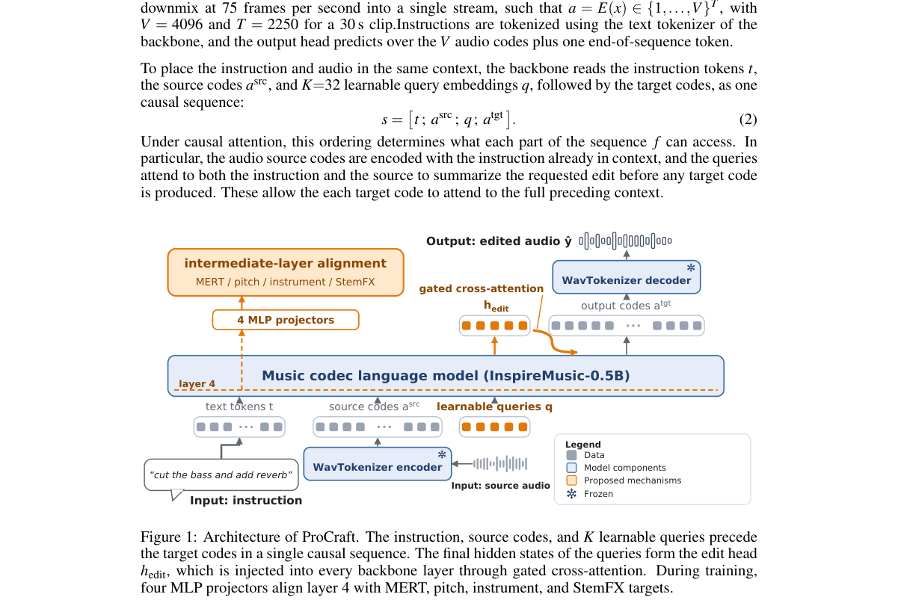

*Result - On-the-fly editing-pair synthesis. For each training item, a track-level task and/or audio effects are applied to the stems of a multitrack recording. A tool-calling language model writes the*

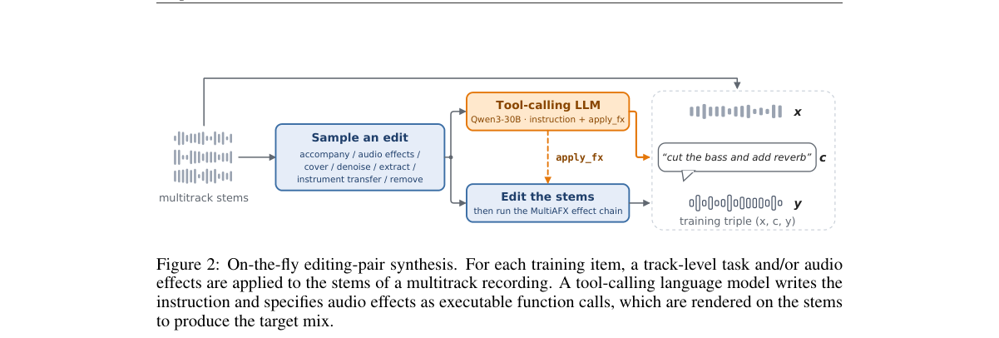

**Why this ranks #1**: 本线第 1 名：ProCraft 是 0.5B 参数的自回归编解码语言模型，在 30 秒音乐片段上端到端执行七类操作、覆盖八类乐器，复合指令上超过四个自由文本编辑器，16 人 MUSHRA 式用户研究中删除与降噪得分最高、提取与乐器迁移与 16 倍大的 Audio-Omni 打平。

---

### 2. VoxCanvas-41M: A Large-Scale Bilingual Dataset for Instruction-Based Speech Editing and Its Learning Dynamics

**arXiv**: [2611.08251](https://arxiv.org/abs/2611.08251) | **Score**: 9.0 (relevance 9 x 0.7 + quality 9 x 0.3) | **Tags**: AIGC-audio, speech-editing, large-scale-dataset, bilingual, learning-dynamics, X-LANCE Lab | **Categories**: cs.SD, eess.AS | **Pages**: 22

**Authors**: Zhikang Niu; Wenming Tu; Yalin Li; Yanru Huo; Junxi Liu; Tianrui Wang; Ruiqi Yan; Junxuan Liang; Ziyang Ma; Zilong Zheng; Xie Chen

**Affiliation**: X-LANCE Lab, Shanghai Jiao Tong University; Shanghai Innovation Institute; Beijing Institute for General Artificial Intelligence; Tianjin University

**Abstract**

> Recent advances in speech generation have spurred the development of speech editing techniques. However, achieving high-quality speech editing remains challenging due to two key limitations. First, the major hurdle is the lack of large-scale, high-quality speech editing datasets. Constructing such datasets is costly, while open-source, scalable data pipelines remain limited. Second, the learning dynamics of speech editing models remain poorly understood. In particular, how models acquire editing capabilities and the relationship between generation and editing remain unclear. To address these challenges, we introduce VoxCanvas-41M, a large-scale bilingual dataset comprising approximately 41 million speech editing pairs. VoxCanvas-41M covers two major categories: content editing, including single-span, multi-span, and location-reference editing, and paralinguistic editing, covering the insertion and deletion of 39 classes of nonverbal events such as laughter, sighs, and coughs. Building on VoxCanvas-41M, we train VoxCanvas-Edit, an instruction-based speech editing model, demonstrating the effectiveness of our dataset in improving editing performance. Furthermore, we systematically investigate the learning dynamics of speech editing, examining how models learn different editing operations and how data scale, task interactions, and training strategies affect editing performance. The dataset, pipeline, and demos are publicly available.

**Key findings**

- **Finding**: VoxCanvas-41M 含约 4100 万条中英双语语音编辑对（中英各约 2050 万），覆盖单段、多段与位置指代编辑，以及 39 类非语言事件（笑声、叹气、咳嗽等）的插入与删除；只用约 1.3% 可训练参数的 LoRA 微调 AuK 后，模型在 SpeechEdBench 与 Ming-Freeform-Audio-Edit 上持续优于原始模型。
- **Inference**: 语音编辑长期缺的是成对监督而不是模型结构，先把数据规模化补齐再系统研究学习动态，结论才更可信。
- **Recommendation**: 想做语音编辑的团队可直接用这套开源流水线扩数据，并参考论文对不同编辑操作如何被习得的分析来设计分阶段训练。

**Key figures**

*Framework - Overview of the speech editing data construction pipeline. ASR: automatic speech recognition; LLM: large language model; TTS: text-to-speech.*

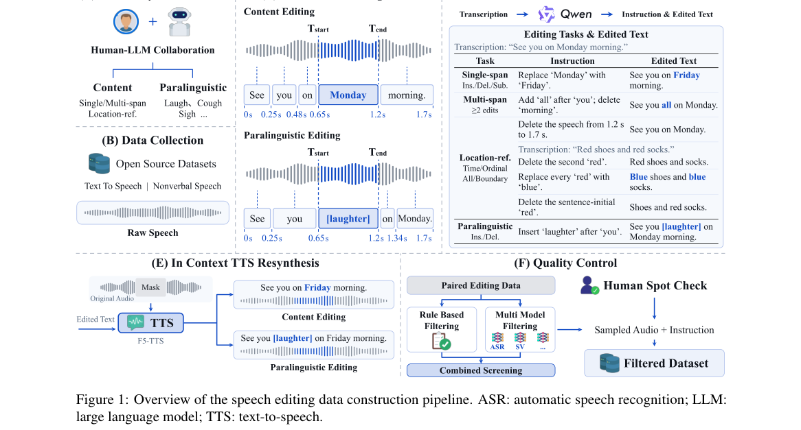

*Result - Dataset statistics of VoxCanvas-41M. From left to right: source utterance duration distributions, multi-span complexity, edit-span length distributions, and nonverbal event category distribu*

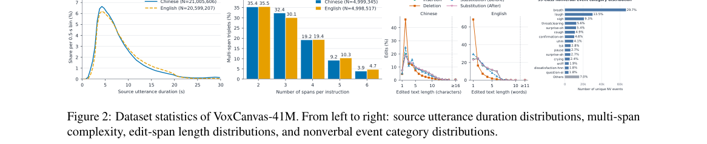

**Why this ranks #2**: 本线第 2 名：VoxCanvas-41M 含约 4100 万条中英双语语音编辑对（中英各约 2050 万），覆盖单段、多段、位置指代编辑与 39 类非语言事件，仅用约 1.3% 可训练参数的 LoRA 微调 AuK 后在 SpeechEdBench 与 Ming-Freeform-Audio-Edit 上持续优于原模型。

---

### 3. Adaptive and High-Fidelity Matching Algorithm for Retrieval-Based Accent Conversion

**arXiv**: [2611.07420](https://arxiv.org/abs/2611.07420) | **Score**: 8.7 (relevance 9 x 0.7 + quality 8 x 0.3) | **Tags**: AIGC-audio, accent-conversion, knn-retrieval, wavlm, retrieval-augmented, East China University of Science and | **Categories**: cs.SD | **Pages**: 15

**Authors**: Xinran Wang; Ning Chen; Yixin Luo; Hongqing Zhu; Li Tian

**Affiliation**: East China University of Science and Technology

**Abstract**

> Accent conversion (AC) aims to transform accent-related acoustic characteristics of the source speech to a target accent while preserving linguistic content and speaker identity. Unlike conventional generative AC models, the retrieval-based ones, which employ k-nearest neighbors (kNN) to directly retrieve acoustic features from target-accent speech and so do not need source-accent speech during training, are more effective. However, existing retrieval-based AC frameworks face three issues: limited intelligibility due to incomplete phoneme coverage from sequential matching pool construction, limited adaptability to source speech variations, and low spectral continuity from coarse-grained style modulation. To address these limitations, we propose Anisotropy-Aware Adaptive k-Nearest Neighbor Accent Conversion (AA-kNN-AC), an enhanced retrieval-based AC model. First, we design a phoneme coverage-based matching pool construction strategy, employing greedy selection with diversity-aware scoring to achieve balanced and near-complete phonetic representation under limited target accent data. Second, we propose an anisotropy-aware adaptive kNN retrieval mechanism that dynamically determines the neighborhood size according to the singular value decomposition (SVD)-based anisotropy analysis, enhancing adaptability to source speech variations. Third, we present a progressive Adaptive Instance Normalization (AdaIN)-based fine-grained decoder by integrating temporal up-sampling within AdaIN blocks, enhancing spectral continuity of the converted speech. Experimental results on the L2-ARCTIC and VCTK datasets demonstrate that the proposed method outperforms existing retrieval-based and generative baselines in both objective and subjective evaluations, achieving high intelligibility, speaker similarity, and naturalness. Demo page is available at https://aa-knn-ac.github.io/demo/.

**Key findings**

- **Finding**: AA-kNN-AC 用基于音素覆盖的贪心选池构造匹配池、按 SVD 各向异性分析动态确定邻域大小并用渐进式 AdaIN 解码器提升谱连续性，在仅用 LibriSpeech 100 小时训练时于 L2-ARCTIC(ASI) 把 WER 降到 8.35%、VCTK(P248) 降到 5.86%，NMOS 分别 4.20 与 4.16、说话人相似度 0.80 与 0.78。
- **Inference**: 检索式口音转换的瓶颈在匹配池的音素覆盖而不是声学模型，把邻域大小做成随输入各向异性自适应比固定 k 稳定。
- **Recommendation**: 做检索式语音转换的工程师重点看音素覆盖的贪心选池与 SVD 各向异性打分，评测要同时报 WER 与说话人相似度，只看一项会误导。

**Key figures**

*Framework - Mel-spectrograms of speech generated by (a) the proposed method and (b) 𝑘NN-AC for the utterance “It’s the aurora borealis.” White boxes highlight vowel regions where 𝑘NN-AC exhibits over-sm*

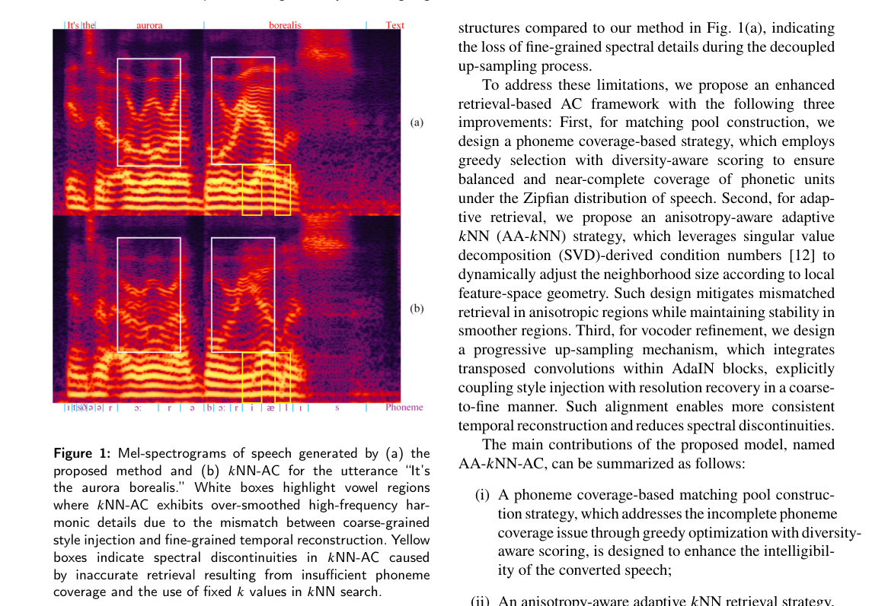

*Result - The Inference pipeline of the proposed model. The source utterance is disentangled into speaker and content embeddings using the 6th and 23rd layers of WavLM, respectively. The AA-𝑘NN module*

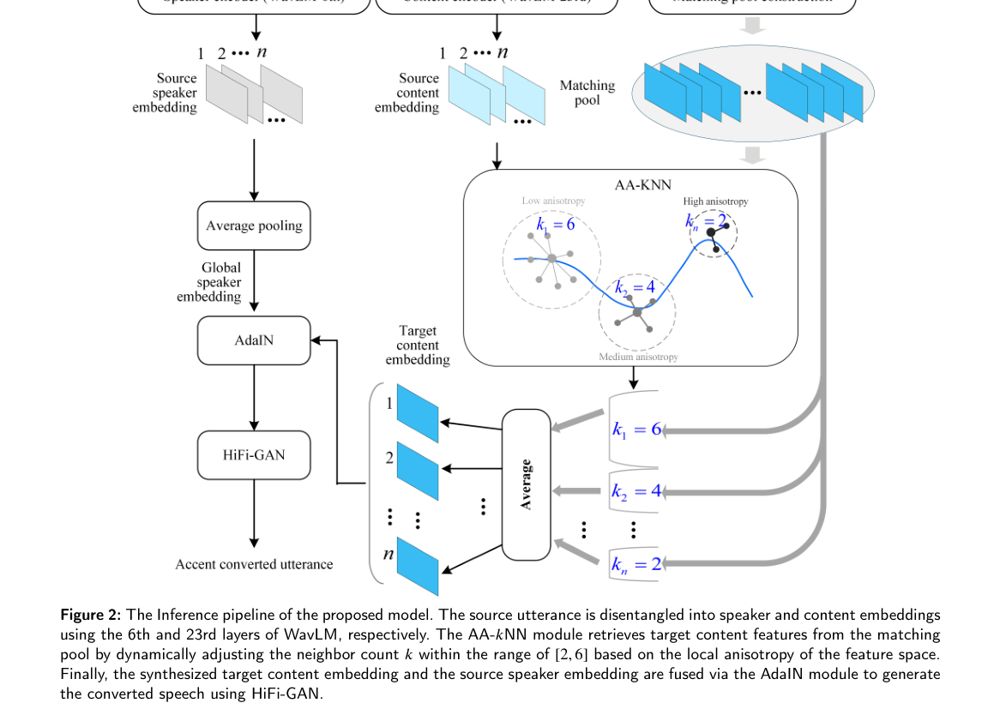

**Why this ranks #3**: 本线第 3 名：AA-kNN-AC 用音素覆盖的贪心匹配池、按 SVD 各向异性分析动态定邻域大小的 kNN 检索与渐进式 AdaIN 解码器，只用 LibriSpeech 100 小时训练，就在 L2-ARCTIC(ASI) 把 WER 降到 8.35%、VCTK(P248) 降到 5.86%，NMOS 分别为 4.20 与 4.16。

---

### 4. FUSEMOS: Perceptual Evaluation of Text-to-Music Generation with Dual-Encoder Fusion and Ranking-Aware Composite Loss

**arXiv**: [2611.07562](https://arxiv.org/abs/2611.07562) | **Score**: 8.7 (relevance 9 x 0.7 + quality 8 x 0.3) | **Tags**: AIGC-audio, text-to-music, mos-prediction, dual-encoder, evaluation, Wuhan University | **Categories**: eess.AS | **Pages**: 5

**Authors**: Jing Yang; Haoyu Wang; Ningning Pan; Zhao Wang; Jianxuan Yang; Gongping Huang

**Affiliation**: Wuhan University; Southwestern University of Finance and Economics; MiLM Plus, Xiaomi Inc.

**Abstract**

> Perceptual evaluation of generated music is essential for developing text-to-music (TTM) generation systems. Existing automatic music perceptual evaluation methods rely solely on the contrastive language audio pretraining (CLAP) model to extract both audio and text features for predicting human-annotated mean opinion scores (MOS), particularly for overall musical impression (OMI) and textual alignment (TA). However, CLAP is limited in capturing fine-grained musical attributes such as timbre and expressiveness \emph{etc}. To address this, we propose FUSEMOS, a dual-encoder fusion framework that integrates CLAP with MERT, a self-supervised model pretrained on large scale music audio, to better capture both high level semantic alignment and detailed musical characteristics for more accurate OMI and TA estimation. Furthermore, to overcome the limitations of conventional regression losses in measuring human preferred relative ranking of music segments, we design a novel ranking-aware composite loss function. Experiments conducted on the MusicEval benchmark demonstrate that our approach outperforms the existing SOTA methods in both mean squared error and rank correlation metrics by a large margin.

**Key findings**

- **Finding**: FUSEMOS 把 CLAP 与大规模音乐自监督模型 MERT 融合成双编码器，并用截断回归加对比项组成的排序感知复合损失训练，在 MusicEval 基准上把整体音乐印象的语句级与片段级 MSE 分别降低 53.6% 与 87.6%，U-SRCC 达 0.811、S-SRCC 达 0.977；文本对齐上 U-SRCC 从 0.495 提升到 0.644、S-SRCC 从 0.861 提升到 0.940。
- **Inference**: 只用 CLAP 会漏掉音色与表现力这类细粒度属性，而人评偏好本身是相对排序、无法被纯回归损失刻画，所以特征与损失两侧都得改。
- **Recommendation**: 做音乐生成评测的团队可直接把 FUSEMOS 当自动指标接进 MusicEval，同时报 MSE 与排序相关性，避免只优化单一回归指标。

**Key figures**

*Framework - The architecture of the proposed FUSEMOS framework for TTM perceptual evaluation. The model is trained with a ranking-aware composite loss that combines truncated regression (Ltrun) and contra*

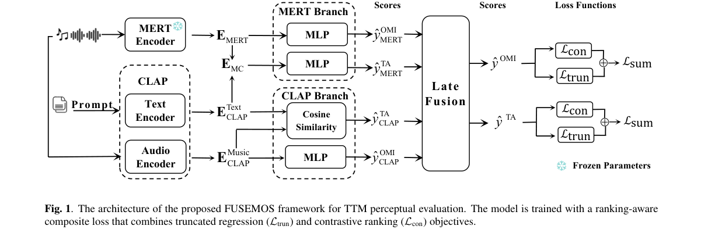

**Why this ranks #4**: 本线第 4 名：FUSEMOS 融合 CLAP 与 MERT 双编码器并设计排序感知复合损失，在 MusicEval 基准上把整体音乐印象的语句级与片段级 MSE 分别降低 53.6% 与 87.6%，语句级 SRCC 达 0.811、片段级达 0.977，文本对齐两项相关系数也明显提升。

---

### 5. Route-DMD: Distribution Matching Distillation with Task-Routed Mechanism for Speech Foundation Models

**arXiv**: [2611.08011](https://arxiv.org/abs/2611.08011) | **Score**: 8.7 (relevance 9 x 0.7 + quality 8 x 0.3) | **Tags**: AIGC-audio, distribution-matching, speech-foundation-model, few-step, task-routing, X-LANCE Lab | **Categories**: cs.SD | **Pages**: 5

**Authors**: Yanru Huo; Zhikang Niu; Wenming Tu; Junxi Liu; Tian Tan; Shan Yang; Yipeng Kang; Ziyang Ma; Xie Chen; Zilong Zheng

**Affiliation**: X-LANCE Lab, Shanghai Jiao Tong University; State Key Laboratory of General Artificial Intelligence, BIGAI; Shanghai Innovation Institute; Nanyang Technological University; Tencent Hunyuan

**Abstract**

> Speech foundation models built on flow matching handle generation, editing, and processing in one system, but every request costs 20-50 iterative steps, and classifier-free guidance (CFG) doubles each of them. Distribution matching distillation (DMD) trains a student that approaches the teacher's quality in a few steps, yet existing speech distillation work applies it to generation alone. We show that a distribution-matching objective does not serve every task: in separation, the noised states of erroneous student outputs deviate far from the teacher's training distribution, where its prediction is unreliable. Route-DMD therefore makes the objective task-dependent, routing the affected tasks to a regression loss and keeping decoupled distribution matching elsewhere. The student is initialized by consistency distillation, and teacher rollouts use adaptive projected guidance (APG) instead of CFG. Without CFG, the 4-step student matches the 32-step teacher on generation, editing, and processing tasks at a 4.5$\times$ end-to-end speedup.

**Key findings**

- **Finding**: Route-DMD 发现分布匹配对分离任务失效——错误学生输出加噪后偏离教师训练分布、教师预测不可靠，因此把分离样本路由到回归损失、其余走解耦 DMD；无 CFG 时 4 步学生在生成、编辑、处理三类任务上匹配 32 步教师，实时因子从 0.4333 降到 0.0958（4.5 倍端到端加速），路由使分离任务 SI-SDRi 从 -1.7 dB 回升到 +6.6 dB、PER 从 8.8% 降到 7.1%。
- **Inference**: 教师预测的可靠性是分布匹配成立的前提，任务级路由等于在损失层面承认这个前提，比继续调蒸馏超参更根本。
- **Recommendation**: 做语音模型蒸馏的工程师先按任务检查教师在学生分布上的预测可靠性，再决定用分布匹配还是回归损失，别默认所有任务共用一套蒸馏目标。

**Key figures**

*Framework - Overview of Route-DMD. Stage 1 uses consistency distillation for initialization. Stage 2 routes separation samples to a regression loss and other samples to Decoupled DMD.*

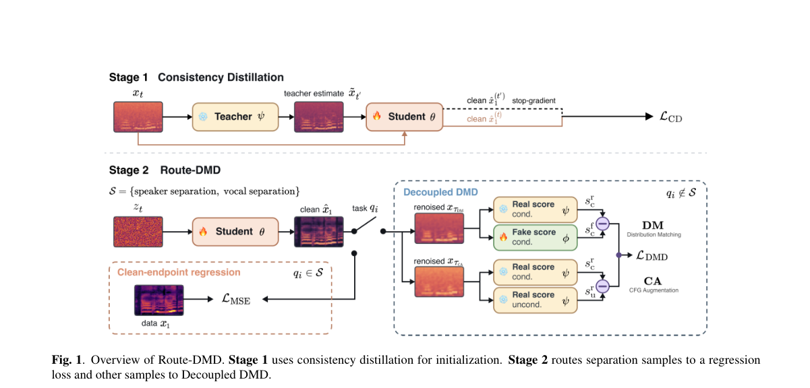

*Result - Ablation of the task-routed mechanism on Libri2Mix. Sep- aration metrics vs. Decoupled DMD updates for the regression loss (w/ routing), Decoupled DMD with the teacher queried on a noised grou*

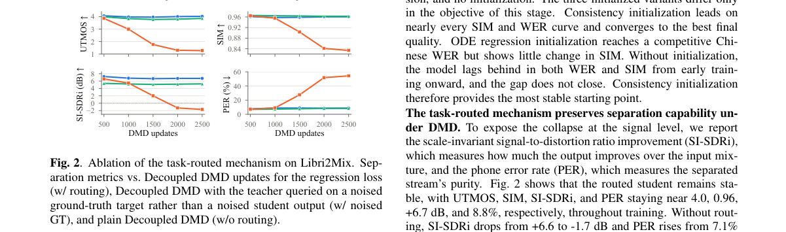

**Why this ranks #5**: 本线第 5 名：Route-DMD 论证分布匹配目标并非对所有任务成立，把分离样本路由到回归损失后，4 步学生在生成、编辑、处理三类语音任务上匹配 32 步教师、端到端提速 4.5 倍（实时因子 0.4333 降到 0.0958），分离任务 SI-SDRi 从 -1.7 dB 回到 +6.6 dB。

---

### 6. SubRoformer: Subband Time-Domain Representation for Music Source Separation

**arXiv**: [2611.08130](https://arxiv.org/abs/2611.08130) | **Score**: 8.7 (relevance 9 x 0.7 + quality 8 x 0.3) | **Tags**: AIGC-audio, source-separation, music, transformer, subband, Chinese University of Hong Kong | **Categories**: cs.SD, eess.AS, eess.SP | **Pages**: 13

**Authors**: Chunyat Wu; Chuang Ding; Paris Smaragdis; Qiuqiang Kong

**Affiliation**: The Chinese University of Hong Kong; Massachusetts Institute of Technology

**Abstract**

> Music source separation extracts vocals and instruments from a mixed recording, enabling remixing, content production, and music analysis. Existing systems commonly operate on waveforms or full-band spectrograms. Waveform inputs contain many samples even in short segments, whereas a single spectrogram resolution imposes a shared time-frequency resolution trade-off across frequency ranges. We propose SubRoFormer, a Transformer-based system comprising a subband module and a residual RoFormer module. The subband module decomposes the mixture into frequency-localized, lower-rate signals for separation. It then reconstructs the target waveforms from the estimated subbands. The residual RoFormer module models temporal and cross-band relationships on temporally compressed features. It combines this context with fine-rate features through gated residual fusion to estimate source-specific complex masks. On the MUSDB18-HQ test set, training only on MUSDB18-HQ yields an average signal-to-distortion ratio (SDR) of 10.63 dB across four stems using target-specific models, achieving state-of-the-art performance among the compared systems without extra training data. With 500 additional training songs, a single model jointly separating all four stems achieves an average SDR of 11.59 dB, establishing state-of-the-art performance among the compared single-model multi-stem systems trained with extra data. Code and checkpoints are released at https://github.com/ArchiMickey/SubRoformer.

**Key findings**

- **Finding**: SubRoformer 由子带模块与残差 RoFormer 模块组成，子带模块把混合信号分解成频率局部化的低采样率信号分别分离、再重建目标波形，残差 RoFormer 在时间压缩特征上建模时间与跨带关系并以门控残差融合估计源特定复数掩码；在 MUSDB18-HQ 测试集上仅用该数据集训练、目标特定模型四轨平均 SDR 为 10.63 dB，加 500 首额外训练歌曲后单模型联合分离四轨达 11.59 dB。
- **Inference**: 频带分解让网络不必用同一时间频率分辨率覆盖全频段，把跨带关系交给一个残差模块，参数效率因此更高。
- **Recommendation**: 做音乐源分离的工程师可直接复用其子带前端与残差 RoFormer 骨干，并同时报告目标特定模型与单模型多轨两种口径的结果。

**Key figures**

*Framework - Overview of SUBROFORMER. The fixed front end converts the analytic mixture into demodulated, decimated subbands; local complex features are processed by fine-rate boundary blocks and a tempora*

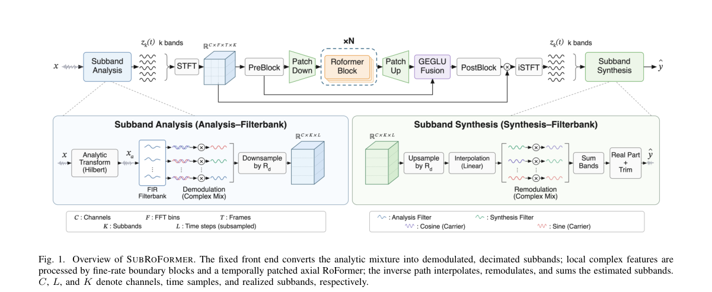

*Result - Schematic target magnitude responses of the triangular filter bank, with illustrative frequency spacing. The highlighted interior band Ak(f) has lower edge fk,ℓ, peak fk,p, and upper edge fk,u*

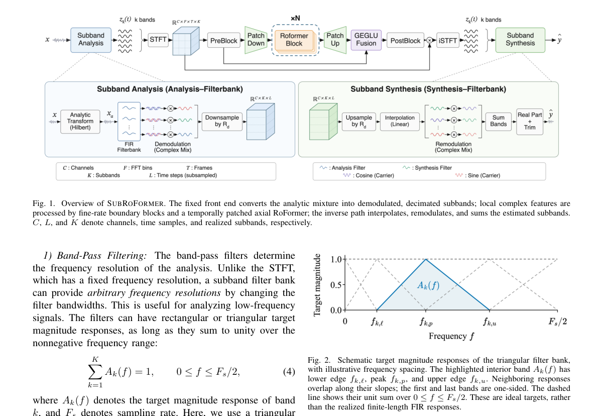

**Why this ranks #6**: 本线第 6 名：SubRoformer 用子带模块把混合信号分解成频率局部化的低采样率信号、再用残差 RoFormer 建模时间与跨带关系，在 MUSDB18-HQ 上仅用该数据集训练时目标特定四轨模型平均 SDR 10.63 dB，加 500 首额外歌曲后单模型联合分离四轨达 11.59 dB。

---

### 7. Latent Terrain: Adapting Neural Audio Autoencoders as Design Materials in NIME

**arXiv**: [2611.07210](https://arxiv.org/abs/2611.07210) | **Score**: 8.3 (relevance 8 x 0.7 + quality 9 x 0.3) | **Tags**: AIGC-audio, neural-audio, latent-space, nime, design-tool, Centre for Digital Music | **Categories**: cs.SD | **Pages**: 14

**Authors**: Shuoyang Jasper Zheng; Keigo Yoshida; Nico García-Peguinho; Jiatong Liu; Dan Hearn; Anna Xambó Sedó; Nick Bryan-Kinns

**Affiliation**: Centre for Digital Music, Queen Mary University of London; Keio University; Creative Computing Institute, University of the Arts London

**Abstract**

> Neural audio autoencoders, a deep learning method for sound synthesis, are increasingly popular in AI-enhanced NIMEs. It is timely to explore as a community how this technological opportunity has opened a domain of design in NIME. This paper focuses on one compelling technique of using autoencoders for sound synthesis: navigating their latent space as a generative sound space. We introduce Latent Terrain, a Max/MSP tool package designed to tailor latent spaces into corpus-based sound spaces for NIMEs. We describe the rationale and development process of Latent Terrain to offer insights into the use of autoencoders in a material-oriented crafting space of musical interface design. We deliver an annotated portfolio resulting from a collaborative artistic exploration of Latent Terrain with four NIME makers, to showcase the design possibilities opened by autoencoders. We reflect on our practice-based account to discuss the challenges and opportunities of enabling neural audio autoencoders as design materials for AI-enhanced NIMEs.

**Key findings**

- **Finding**: Latent Terrain 是一个 Max/MSP 工具包，把 Stable Audio Open 等预训练神经音频自编码器的隐空间经 MLP 映射成二维控制空间可导航的语料声音空间，并与四位 NIME 创作者完成协作式艺术探索，产出一份带注释的作品集。
- **Inference**: 隐空间维度远高于可用控制器维度，坐标到隐空间的 MLP 拟合质量决定了设计材料是否真正可玩，而不只是可看。
- **Recommendation**: 想把神经音频自编码器当设计材料用的艺术家与工程师，先试 Latent Terrain 这类现成的坐标-隐空间映射工具，再决定是否自建管线。

**Key figures**

*Framework - Comparing the coordinate-to-latent mapping method by Vigliensoni and Fiebrink [87] with our method.*

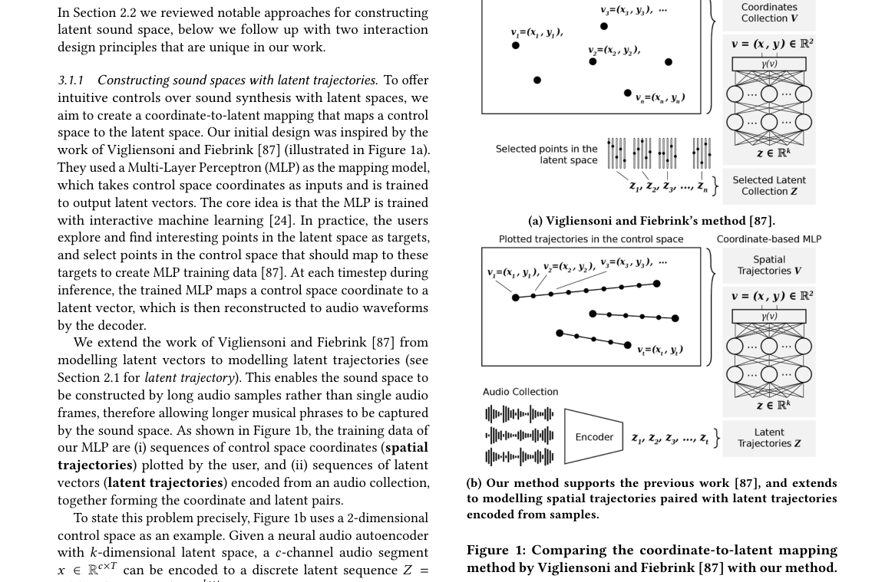

*Result - Latent codes of a 1-sec audio encoded by the au- toencoder in Stable Audio Open [23], showing the first latent dimension. Codes are converted to a latent signal by a zero-order hold. MLPs ar*

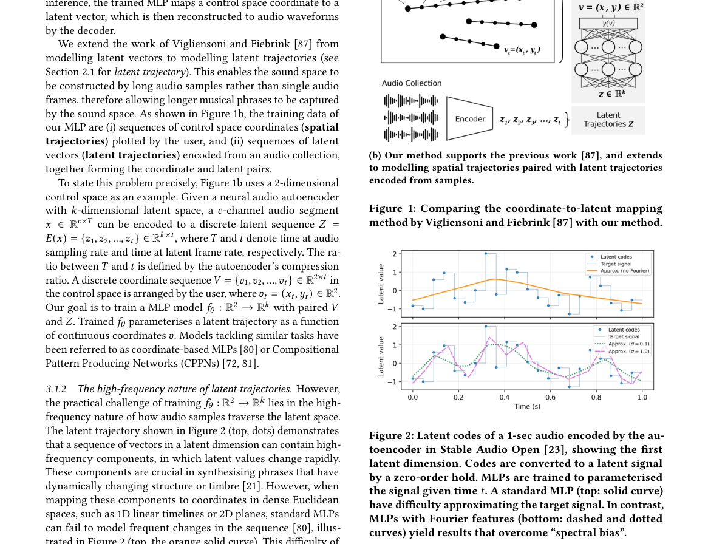

**Why this ranks #7**: 本线第 7 名：Latent Terrain 是把预训练神经音频自编码器隐空间改造成语料声音空间的 Max/MSP 工具包，用 MLP 把二维控制坐标映射到高维隐向量，并与四位 NIME 创作者协作产出带注释的作品集，系统讨论把自编码器当设计材料的门槛。

---

### 8. Design of a Speech Enhancement-Based Deep Semantic Autoencoder for Wireless Communications

**arXiv**: [2611.07361](https://arxiv.org/abs/2611.07361) | **Score**: 8.0 (relevance 8 x 0.7 + quality 8 x 0.3) | **Tags**: AIGC-audio, semantic-communication, speech-enhancement, joint-source-channel, noise-decoupling, Dalian Maritime University | **Categories**: cs.IT, cs.SD | **Pages**: 13

**Authors**: Xiaoling Han; Bin Lin; Nan Wu; Tony Q. S. Quek

**Affiliation**: Dalian Maritime University; Singapore University of Technology and Design

**Abstract**

> Speech communication plays a crucial role in the Internet of Things and autonomous networks. However, traditional communication systems suffer from insufficient semantic extraction and limited noise suppression capability. To address these issues, we propose a Speech enhancement-based Deep Semantic Autoencoder (S-DSA) communication system for wireless communications. It consists of a dual-branch semantic encoder, a channel encoder, a channel decoder, and two semantic decoders, enabling joint source-channel coding for robust transmission. A key novelty lies in an adaptive semantic noise decoupling mechanism that disentangles target speech semantics from noise representations through an interaction module, thus maintaining semantic consistency under low SNR conditions. Furthermore, a joint training strategy optimizes speech reconstruction and noise estimation, while a lightweight testing strategy reduces complexity by disabling the noise-decoding path. The proposed S-DSA enables more effective separation between speech and noise, and yields higher robustness as well as better reconstruction quality. These findings highlight the potential of the proposed S-DSA as a practical solution for next-generation intelligent wireless communications.

**Key findings**

- **Finding**: S-DSA 由双分支语义编码器、信道编码器、信道解码器与两个语义解码器组成，核心是自适应语义噪声解耦机制，AWGN 信道 0 dB 时 PESQ 达 2.05（CNN-AE 与 DeepSC-S 均为 1.73）、STOI 0.89；Rayleigh 信道 0 dB 时 PESQ 升至 2.14（DeepSC-S 1.77、CNN-AE 1.40）、STOI 0.90，输入混合 SNR 20 dB 时 MSE 降到 0.0024、SI-SDR 达 24.48。
- **Inference**: 增益集中在低 SNR 与强衰落场景，说明显式把噪声分量从语义表示里解耦，比单纯加大网络更能在链路恶化时稳住内容。
- **Recommendation**: 做语义通信的工程师可借鉴其噪声解耦交互模块与关掉噪声解码支路的轻量测试策略，评测务必覆盖瑞利衰落而非只测 AWGN。

**Key figures**

*Result - Waveform and spectrogram comparisons for speech enhancement.*

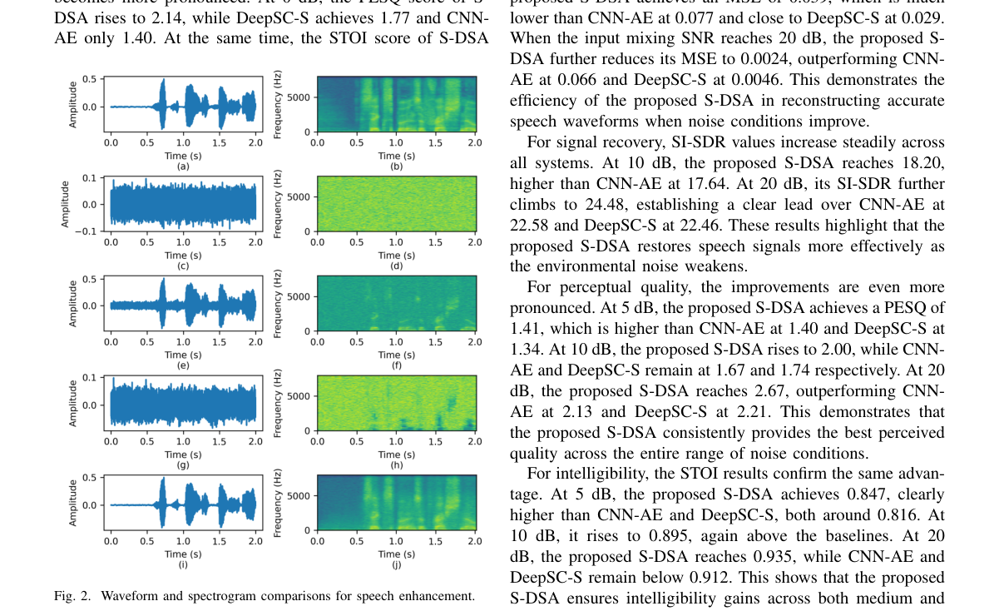

**Why this ranks #8**: 本线第 8 名：S-DSA 用双分支语义编码器加自适应语义噪声解耦做联合信源信道编码，AWGN 信道 0 dB 时 PESQ 2.05（CNN-AE 与 DeepSC-S 均 1.73）、STOI 0.89；Rayleigh 信道 0 dB 时 PESQ 2.14（DeepSC-S 1.77、CNN-AE 1.40）、STOI 0.90。  [wild-card=yes] 本批次 eess.AS 仅 8 篇，纯音频生成论文不足 10 篇；该文是语音增强 + 语义自编码的联合源信源编码，属相邻的语音生成/表示方向，按 wild-card 补位。

---

### 9. Joint Higher-Order Low-Rank Tensor Decompositions for Multichannel Acoustic System Compression

**arXiv**: [2611.07975](https://arxiv.org/abs/2611.07975) | **Score**: 8.0 (relevance 8 x 0.7 + quality 8 x 0.3) | **Tags**: AIGC-audio, room-impulse-response, tensor-decomposition, multichannel, compression, KU Leuven | **Categories**: eess.AS | **Pages**: 15

**Authors**: Matthias Blochberger; Filip Elvander; Jan Østergaard; Toon van Waterschoot

**Affiliation**: KU Leuven; Aalto University; Aalborg University

**Abstract**

> Multichannel room impulse responses (RIRs) in acoustics are often long and therefore the sample count becomes large if seen as finite impulse response (FIR) filters, making storage and real-time convolution costly. Pole-zero (PZ) models are an established way to represent RIRs compactly as infinite impulse response (IIR) transfer functions. We show that a PZ model implies a low-rank canonical polyadic decomposition (CPD) of tensorized RIRs: the early reflections form a sparse rank-1 sum, while the late reverberation admits a CPD with factors determined by the poles. This motivates higher-order-tensor-based compression of RIRs via the block term decomposition (BTD), a generalization of the CPD. We propose two multichannel compression schemes: (i) a stacked multichannel block term decomposition (SMCBTD) applied to a (D+1)-mode tensor of RIRs, and (ii) a joint multichannel block term decomposition (JMCBTD) that shares subsets of factors across channels discovered by spectral clustering on factor-subspace affinity graphs. Both are optimized by an alternating higher-order orthogonal iteration (HOOI) procedure. On simulated rooms as well as measured datasets, the proposed methods achieve consistently lower reconstruction error at equal compression ratios compared to separate single-channel decompositions and a generalized low-rank approximation of matrices (GLRAM) baseline. The largest gains occur with scalar cores (i.e., CPD), supporting the PZ-to-CPD modelling link. We also find D = 3 to be a practical sweet spot, offering most of the achievable gain at moderate compute/memory cost. The compressed models enable efficient downstream multichannel convolution.

**Key findings**

- **Finding**: 论文证明极点-零点模型蕴含张量化房间脉冲响应的低秩规范多元分解结构，早期反射构成稀疏的 rank-1 之和而晚期混响的因子由极点决定，据此提出堆叠式与联合式两种多通道块项分解并用交替高阶正交迭代优化；在压缩率 0.8、张量化阶数 4 的远场设置下联合式的平均重构误差为 -16 dB，优于 GLRAM 的 -13 dB 与堆叠式的 -12 dB。
- **Inference**: 跨通道共享因子之所以有效，是因为物理上相邻麦克风的混响结构本就高度相关，联合分解等于把这一先验写进了模型假设。
- **Recommendation**: 做房间脉冲响应压缩与实时卷积的工程师可用张量化阶数 D=3 作为默认起点，再按算力与内存预算调整核心秩。

**Key figures**

*Framework - Top row: Top views of a shoebox room with the Chordal distance between tensorized RIRs at a reference position and a grid of positions over the room. The distances are computed from the fact*

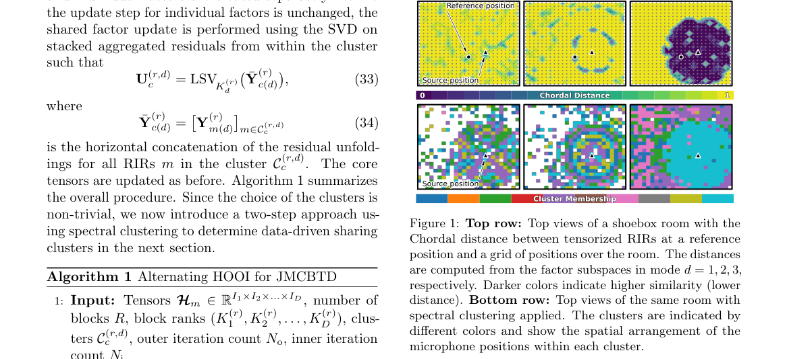

*Result - This figure illustrates the reconstruction error NM over the compact microphone array geometry (dots indicate microphones) for the two source positions. For the near source position (left),*

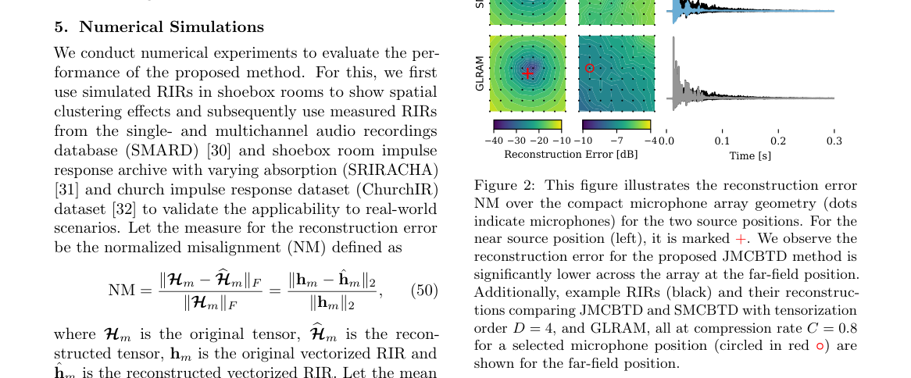

**Why this ranks #9**: 本线第 9 名：论文证明极点-零点模型蕴含张量化房间脉冲响应的低秩 CPD 结构（早期反射为稀疏 rank-1 之和、晚期混响因子由极点决定），据此提出堆叠式与联合式多通道块项分解，远场平均重构误差 -16 dB，优于 GLRAM 的 -13 dB 与堆叠式的 -12 dB。  [wild-card=yes] 多通道房间脉冲响应的高阶张量（BTD）压缩，属音频信号表示与压缩的相邻方向，本批次无更多纯音频生成论文可补，按 wild-card 补位。

---

### 10. Auditory and Visual Virtualization in 6DoF XR: Effects on Plausibility and Dynamic Auditory Distance Perception

**arXiv**: [2611.07612](https://arxiv.org/abs/2611.07612) | **Score**: 7.3 (relevance 7 x 0.7 + quality 8 x 0.3) | **Tags**: AIGC-audio, spatial-audio, xr, perceptual-eval, binaural-rendering, Aalto University | **Categories**: eess.AS | **Pages**: 41

**Authors**: Johannes M. Arend; Christian Scheer; Melissa Ramírez; Stefan Weinzierl; Fabian Brinkmann

**Affiliation**: Aalto University; Technische Universitaet Berlin; TH Koeln - University of Applied Sciences

**Abstract**

> Extended reality (XR) enables controlled yet naturalistic multisensory experiments, but its validity depends on whether virtualized cues are perceptually plausible and lead to behavior comparable to the real world. To the best of our knowledge, this is the first study to perceptually evaluate a six-degree-of-freedom (6DoF) XR system that combines real-time room acoustic simulation, binaural rendering, and an audio-visually matched virtual replica of a large laboratory room in terms of both plausibility and behavior. In two experiments with 45 participants, we investigated how auditory and visual virtualization affect plausibility and dynamic auditory distance perception (ADP). A plausibility experiment compared real and virtual sound sources in audio-augmented reality (AAR) and virtual reality (VR), while a locomotion-based ADP experiment assessed distance-judgment accuracy, signed error, and task effort across four virtualization conditions. The system produced plausible binaural rendering in both AAR and VR, with higher plausibility in VR, indicating that perceptual requirements for XR audio depend on the visual reference frame. In the ADP task, any form of virtualization reduced accuracy and increased effort, although performance remained high overall. Virtual audio produced a bias toward nearer perceived source distances, whereas visual-only virtualization reduced accuracy without a significant directional bias. These effects did not add up in full VR. Overall, the findings demonstrate the strong potential of current 6DoF XR systems for interactive perceptual research, while revealing that task-specific behavioral validation may be necessary.

**Key findings**

- **Finding**: 该研究用实时房间声学模拟加双耳渲染和视听匹配的实验室虚拟副本搭建 6DoF XR 系统，在 45 名参与者（21-42 岁）上做了两组实验、比较四种虚拟化条件，双耳渲染在 AAR 与 VR 下都被判为合理且 VR 更高（判别阈 d'=0.9539，对应约 75% 正确率），但任何形式的虚拟化都降低距离判断精度并增加任务负荷，虚拟音频还使感知距离偏向更近。
- **Inference**: 渲染质量过关并不等于行为有效，XR 音频方案必须额外做任务级行为验证，否则仿真实验结论无法外推到真实使用。
- **Recommendation**: 计划用 XR 做听觉实验的团队先按本文的四种虚拟化条件跑一次对照，尤其别忽略视觉单独虚拟化带来的系统性偏差。

**Key figures**

*Framework - Photo of the Mixed Reality Lab showing the view from the listening area into the room with the eight Genelec loudspeakers (left). Screenshot showing the real-time rendered HMD view of the virt*

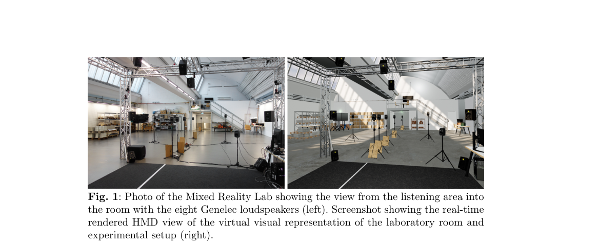

*Result - Floor plan of the experimental environment.*

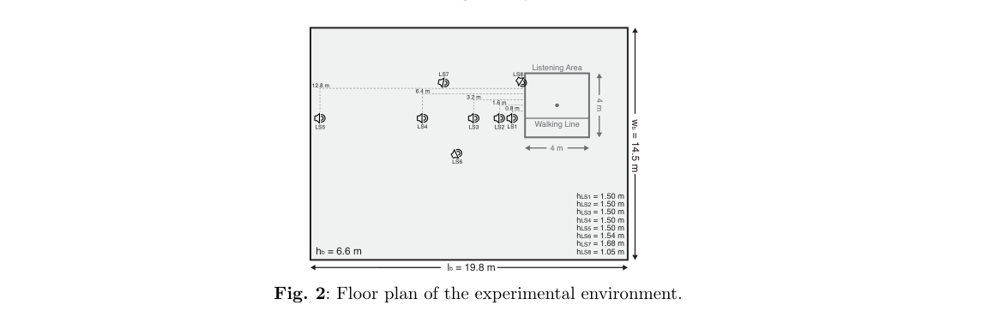

**Why this ranks #10**: 本线第 10 名：论文首次在感知与行为两个层面评估结合实时房间声学模拟与双耳渲染的 6DoF XR 系统，45 名参与者、两组实验、四种虚拟化条件；双耳渲染在 AAR 与 VR 下都具合理性且 VR 更高，但任何虚拟化都降低距离判断精度并加大任务负荷。  [wild-card=yes] 6DoF XR 实时房间声学模拟与听觉距离感知评估，是音频生成/渲染效果的下游感知评测，本批次音频生成供给不足，按 wild-card 补位。

---

