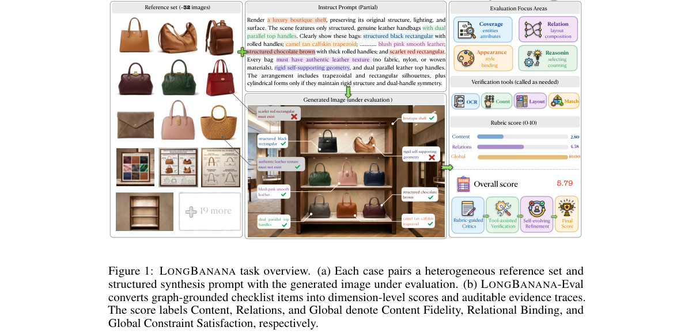
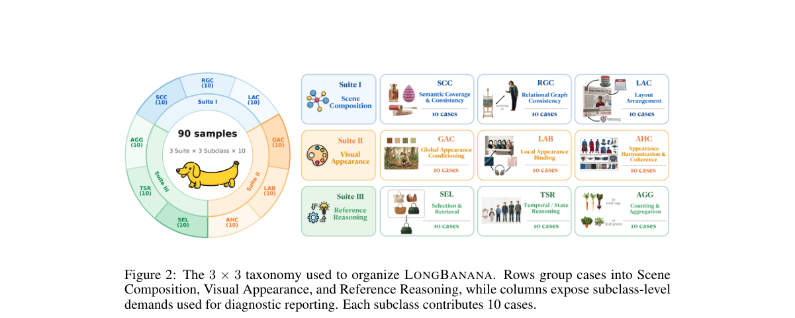
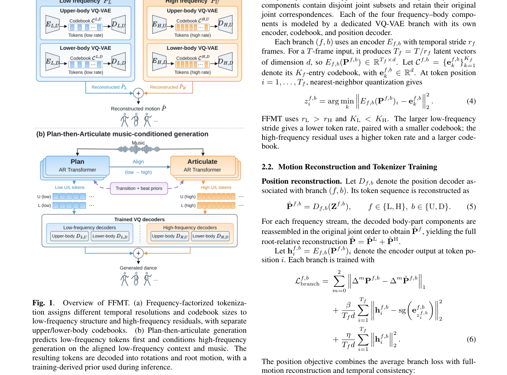
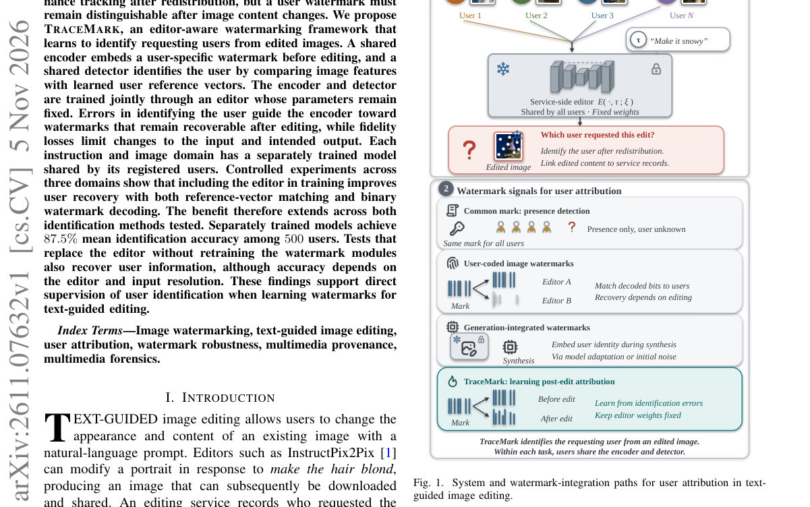
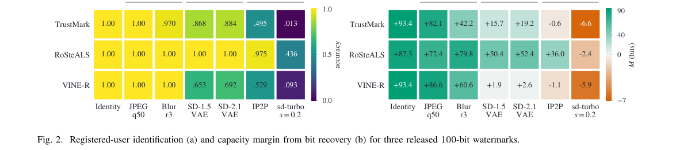

# ArXiv Daily Digest - 2026-11-06 (AIGC 视觉生成, 10 papers)

**Generated**: 2026-11-06 17:30 CST

**Source**: arXiv cs.CV, cs.SD, eess.AS, cs.CL, cs.AI, cs.RO, cs.LG submissions, listing day 2026-11-05 (announced 2026-11-06 00:00 UTC)

**Batch window**: 2026-11-04T18:00:00Z .. 2026-11-05T18:00:00Z（arXiv 公告批次横跨两个 UTC 日：前一日 18:00 UTC 起算，当日 17:59:59 UTC 截止）

**Track**: aigc_visual (top 10 of 510 papers scanned, 70 full reads)

**Scope**: 图像 / 视频 / 3D / 4D 内容的生成与编辑，含扩散与流匹配模型的训练方法、加速与评测基准

---

## Top 10 - AIGC 视觉生成

### 1. Training-Free Predictive Spatio-Temporal Token Pruning for Few-Step Autoregressive Video Diffusion

**arXiv**: [2611.07551](https://arxiv.org/abs/2611.07551) | **Score**: 9.7 (relevance 10 x 0.7 + quality 9 x 0.3) | **Tags**: AIGC-visual, token-pruning, video-diffusion, few-step-generation, training-free, University of Hong Kong | **Categories**: cs.CV | **Pages**: 19

**Authors**: Jia Li; Xurui Peng; Xing Wang; Hayden Kwok-Hay So

**Affiliation**: The University of Hong Kong; ByteDance Seed

**Abstract**

> Few-step autoregressive (AR) video diffusion models generate videos chunk by chunk and have made efficient video generation practical. However, further accelerating these models toward real-time generation remains challenging, as few-step distillation leaves little cross-step redundancy for existing training-free caching methods to exploit. We revisit this regime and identify two token-level redundancy patterns: cross-frame redundancy from static content shared across adjacent frames, and cross-step redundancy from tokens that converge early during denoising. Crucially, we find that early clean estimates along the model's own denoising trajectory provide an effective online signal for locating both patterns, requiring no retraining, auxiliary predictor, or reference video. Based on these findings, we propose PreSTP (Predictive Spatio-Temporal Token Pruning), a training-free framework that constructs a unified token-wise redundancy mask from cross-frame similarity and cross-step convergence. Tokens marked as redundant skip subsequent computation under a consistent last-computed-value restoration rule, and a content-adaptive mask reuse strategy further reduces dense probing cost. On 5-second generation, PreSTP achieves 1.52x-3.20x speedups and a better efficiency-fidelity trade-off than coarse-grained caching baselines such as TeaCache and FlowCache. On 30-second generation, it reaches up to 1.96x speedup while improving VBench-Long and suppressing long-horizon drift. Notably, it continues to reduce inference cost even in the extreme one-step regime, where cross-step redundancy vanishes entirely and coarse step-wise caching is no longer applicable.

**Key findings**

- **Finding**: PreSTP 由跨帧相似度与跨步收敛构造统一的 token 级冗余掩码，被标记的 token 跳过后续计算并按一致性规则恢复上一次计算值，在 5 秒生成上把 CausVid、Self-Forcing、AnyFlow 加速 1.52x-3.20x，30 秒生成最高 1.96x，同时改善 VBench-Long 并抑制长程漂移。
- **Inference**: 少步蒸馏已经把去噪步数压到个位数、跨步冗余被吃干，此时继续沿时间轴做 token 级剪枝比再压步数更划算。
- **Recommendation**: 视频扩散加速方向的工程师优先读方法一节与速度-保真曲线，注意它依赖模型自身轨迹上的早期 clean 估计，需要首帧稠密预热。

**Key figures**

*Framework - Token-level redundancy analysis on Self-Forcing.*

*Result - Overview of PreSTP. After the dense first-frame warm-up, the step-0 clean estimate is compared with the previous-frame reference to predict Ms. At each later denoising step, consecutive clean*

**Why this ranks #1**: 本线第 1 名：免训练的 PreSTP 用模型自身早期 clean 估计在线定位跨帧与跨步冗余，5 秒生成上把 CausVid、Self-Forcing、AnyFlow 加速 1.52x-3.20x 且速度-保真曲线优于 TeaCache、FlowCache，30 秒长视频最高 1.96x，在 one-step 极端设定下仍能继续降本。

---

### 2. WeLM-Image: A Unified Image Generation Model towards Visual Intelligence

**arXiv**: [2611.07392](https://arxiv.org/abs/2611.07392) | **Score**: 9.0 (relevance 9 x 0.7 + quality 9 x 0.3) | **Tags**: AIGC-visual, unified-image-generation, mixture-of-transformers, mixture-of-experts, few-step-distillation, WeChat Vision | **Categories**: cs.AI, cs.CV | **Pages**: 44

**Authors**: Canmiao Fu; Chen Li; Guohui Zhang; Hao Lu; Hongyang Wei; Huadong Wu; Huaisong Zhang; Hubery Yin; Liyuan Cui; Qixin Yan; Tong Shao; Xiaoqiang Zhou

**Affiliation**: WeChat Vision, Tencent Inc.

**Abstract**

> We present \textbf{WeLM-Image}, a unified image foundation model that integrates multimodal understanding into text-to-image generation, instruction-guided editing, and multi-reference synthesis. Designed for single-GPU deployment in WeChat's large-scale consumer applications, the model processes text, reference images, and target latents as one interleaved sequence. A Mixture-of-Transformers (MoT) backbone combines shared attention with independent understanding and generation parameters to limit optimization interference. Equipping each path with Mixture-of-Experts (MoE) modules provides sparse capacity, with 31.7B stored parameters and approximately 5.4B generation parameters activated per target latent token. A generation-oriented data engine combines a knowledge-grounded visual vocabulary with large-scale visual clustering to balance semantic coverage and editing tasks, while training-time evaluation guides iterative data refinement. Bilingual annotations and verified editing supervision support progressive training up to native 1.5K resolution. We optimize generation and editing separately with rubric- and checklist-based rewards, then consolidate the specialized policies through noise-aware on-policy distillation. In the reported overall comparisons, the 1536-resolution model ranks first among the evaluated open-source models on PRISM-Bench, Qwen-Image-Bench, and UnicBench. MeanFlow-based few-step distillation yields WeLM-Image-Turbo, which generates a $1024\times1024$ image in 4.98\,s on a single NVIDIA H20 GPU using eight guidance-free steps.

**Key findings**

- **Finding**: 论文用 Mixture-of-Transformers 加 Mixture-of-Experts 骨干把模型存储参数扩到 31.7B、每个目标 latent token 仅激活约 5.4B 生成参数，MeanFlow 少步蒸馏出的 Turbo 版在单张 NVIDIA H20 上以 8 步无引导采样用 4.98 秒生成 1024x1024 图像，相对 50 步基座模型提速 11.4 倍。
- **Inference**: 消费级产品真正要的是单卡吞吐而不是榜单上限，「稀疏激活的 30B 级骨干 + 少步蒸馏」刚好把这两件事同时兑现。
- **Recommendation**: 做单卡部署的图像生成同学优先复用其 token 打包与少步蒸馏配置，评测时把 QPM/GPU 与单图质量一起看，别只盯榜单分数。

**Key figures**

*Framework - Performance and efficiency overview of WeLM-Image. Left: Throughput (QPM/GPU) compared with representative baselines as the number of input images increases. Middle: Aggregate performance on*

*Result - Overview of the WeLM-Image architecture. Tokens on the understanding (UND) and generation (GEN) paths retain path-specific projections and experts while sharing masked self-attention over on*

**Why this ranks #2**: 本线第 2 名：MoT-MoE 骨干把存储参数做到 31.7B、每个目标 latent token 只激活约 5.4B 生成参数，蒸馏版 WeLM-Image-Turbo 在单张 NVIDIA H20 上 8 步无引导采样 4.98 秒出 1024x1024 图像、较 50 步基座提速 11.4 倍，1536 分辨率模型在 PRISM-Bench、Qwen-Image-Bench、UnicBench 上居开源模型首位。

---

### 3. Householder Motion Embedding: Noise Modulation for Motion-Controllable Video Generation

**arXiv**: [2611.07294](https://arxiv.org/abs/2611.07294) | **Score**: 8.7 (relevance 9 x 0.7 + quality 8 x 0.3) | **Tags**: AIGC-visual, noise-modulation, motion-control, householder-transform, video-diffusion, Australian National University | **Categories**: cs.CV | **Pages**: 23

**Authors**: Tao Jun Lin; Jinhong Ni; Ruyi Zha; Yifu Wang; Xibin Song; Pan Ji; Hongdong Li

**Affiliation**: The Australian National University; Vertex Lab; Amazon Inc.

**Abstract**

> Diffusion models for video generation have achieved remarkable success, yet precise motion control under explicit user guidance remains challenging. Recent noise-warping methods introduce temporal correlations by warping the noise according to the user-provided motion signal. However, standard spatial warping generally disrupts the noise's i.i.d. Gaussian structure, requiring distribution correction, such as Jacobian-based correction, but at a substantial computational overhead. We propose Householder Motion Embedding (HME), which encodes the motion signal into the noise through a sequence of Householder reflections that together form an orthogonal transformation applied to each location's channel vector. HME exactly preserves the spatial Gaussian structure within each frame while introducing cross-frame correlations that promote temporally consistent video. HME is agnostic to the network architecture and integrates directly into standard video diffusion fine-tuning pipelines. Experiments on different scenarios show that HME matches or outperforms the state of the art, while achieving a 2.7x speedup over noise warping. These results demonstrate that channel-space Householder transformations offer a principled and efficient alternative to noise warping for motion-controllable video generation.

**Key findings**

- **Finding**: HME 把运动信号编码成作用于每个位置通道向量的 Householder 反射序列，在仅用 100K 视频微调的情况下于 45 个 DAVIS 视频上十项指标全面超过六个基线，gamma=0.5 时 Flow EPE 从 5.644 降到 4.486、CoTracker mIoU 从 0.464 升到 0.548、PSNR 从 14.748 升到 15.162 dB。
- **Inference**: 噪声搬运会破坏帧内 i.i.d. 高斯结构才需要 Jacobian 修正，而通道维正交变换天然保高斯，所以精度和开销可以同时拿到。
- **Recommendation**: 做运动可控视频生成的工程同学重点看反射数 K 与延迟表，默认 K=2 是速度与质量的折中点，换更大 K 前先确认显存预算。

**Key figures**

*Framework - We propose Householder Motion Embedding (HME), a simple noise-modulation method for motion-controllable diffusion video generation. (a) Prior methods rely on spatial noise warping driven by*

*Result - HME generates motion controlled videos in 3 stages: 1) optical flow estimation and spatial resampling, 2) temporally correlated noise construction via Householder Reflectors (see Section 3.1*

**Why this ranks #3**: 本线第 3 名：HME 用 Householder 反射构造通道维正交变换，精确保持帧内高斯结构同时注入跨帧相关性，在 45 个 DAVIS 视频上十项指标全面超过六个基线，噪声处理比 GWTF 快 2.7 倍、比 HIWYN 快 13.6 倍，额外显存仅 0.5-6 MB。

---

### 4. ArtCrafter: Feed-Forward Generation of Articulated 3D Object with Analytic Joint Derivation

**arXiv**: [2611.07658](https://arxiv.org/abs/2611.07658) | **Score**: 8.7 (relevance 9 x 0.7 + quality 8 x 0.3) | **Tags**: AIGC-visual, articulated-3d, slot-attention, urdf-derivation, feed-forward, Qualcomm AI Research | **Categories**: cs.CV | **Pages**: 25

**Authors**: Minh Canh Tu; Quang-Binh Nguyen; Khoi Nguyen

**Affiliation**: Qualcomm AI Research

**Abstract**

> Articulated 3D assets are essential for robotic simulation and training, yet their generation from casual images poses a key challenge: recovering part geometry and kinematics that remain mutually consistent. We present ArtCrafter, a novel feed-forward generative model for controllable generation of articulated 3D objects from a pair of images, one depicting the object in the rest state and the other in the open state. At the core of ArtCrafter is a DiT-based generative model that jointly produces part-level meshes for both articulation states in a single forward pass. Inspired by Slot Attention, its denoising process operates on a $1+2N$ slot layout comprising one shared base slot and $N$ paired rest/open slots, encouraging each pair to bind to the same kinematic part. To ensure geometrically consistent and disjoint part generation, we introduce Triplet Attention to enforce cross-state geometric consistency between paired rest/open slots anchored through the shared base slot, and a repulsion loss $\mathcal{L}_{\mathrm{rep}}$ on decoded part point clouds to prevent inter-part penetration throughout denoising. Given the resulting paired meshes, URDF joint parameters---type, axis, origin, and range---are derived analytically from the rigid transformation between each rest/open pair, providing an interpretable alternative to learned joint-parameter regression. Extensive experiments on both in-distribution and out-of-distribution datasets demonstrate that ArtCrafter outperforms existing method under the same dual-state setting in geometry quality and articulation precision, while remaining competitive with methods operating under different input settings and paradigms.

**Key findings**

- **Finding**: ArtCrafter 把两个输入图像编码为状态特征，条件化 1+2N 个噪声 latent slot（1 个共享 base slot 加 N 对 rest/open slot），在单次前向中同时生成两个状态下的部件网格，并用 Triplet Attention 与解码点云上的 repulsion loss 维持跨状态几何一致与部件互不穿透，URDF 的关节类型、轴、原点与范围由 rest/open 对的刚体变换解析推导。
- **Inference**: 把关节参数从「回归网络」改成「几何解析推导」，意味着关节语义不会随数据分布漂移，也更容易被仿真器直接消费。
- **Recommendation**: 做机器人仿真资产生成的同学优先看 Triplet Attention 与解析关节推导两节，评估时几何 CD 与关节误差两类指标要一起看。

**Key figures**

*Framework - ArtCrafter pipeline. Two input images (Irest, Iopen) are encoded into state features conditioning 2N + 1 noisy latent slots — base B, rest slots R1. . .RN, open slots O1. . .ON — each augmen*

*Result - Per-slot decoded geometry across denoising timesteps. Rows compare ArtCrafter (Ours), FM-I (independent per-state), and FM-II (unstructured joint generation) on the same object; columns prog*

**Why this ranks #4**: 本线第 4 名：ArtCrafter 用 1+2N slot 布局在单次前向中同时生成静息态与开合态的部件网格，Triplet Attention 加 repulsion loss 保证跨状态几何一致与部件不互穿，URDF 关节参数由 rest/open 对的刚体变换解析推导，同设定下 F1 相对 DIPO 提升约 18%-21%。

---

### 5. StitchEdit: Stitching Depth Priors into Image Editors via Per-Layer Gradient Probing

**arXiv**: [2611.07922](https://arxiv.org/abs/2611.07922) | **Score**: 8.7 (relevance 9 x 0.7 + quality 8 x 0.3) | **Tags**: AIGC-visual, depth-prior, layer-wise-probing, lora, image-editing, Hong Kong University of Science and | **Categories**: cs.CV | **Pages**: 14

**Authors**: Qin Guo; Dan Xu

**Affiliation**: The Hong Kong University of Science and Technology

**Abstract**

> Text-guided image editing with diffusion models struggles with spatial edits (e.g. manipulating objects, changing viewpoints, manipulating occlusions) that depend on the 3D structure understanding of a scene. Marigold and follow-up work demonstrate that a pretrained diffusion backbone already harbors strong geometric priors that can be activated for depth estimation, yet how to redirect these priors toward editing remains unresolved. Through per-layer gradient probing, we discover that the editing and depth objectives are compatible in early transformer layers but actively conflict in late layers, explaining why naive depth-conditioned editing either ignores geometry or degrades visual quality. We present StitchEdit, which first activates the backbone's geometric capability via a lightweight depth-denoising adapter, then selectively fine-tunes this adapter for editing using a probe-guided per-layer learning rate schedule that preserves depth knowledge where it helps and prunes it where it conflicts. On the proposed StitchEditBench, a benchmark of 150 geometry-dependent edits spanning spatial transformation, occlusion manipulation, and viewpoint change, StitchEdit consistently surpasses both instruction-based and depth-conditioned baselines on perceptual quality and geometric fidelity.

**Key findings**

- **Finding**: 逐层梯度探测显示深度与编辑目标的兼容性在早期 transformer 层强正、中段衰减、晚期转负；据此得到的 Probe-Guided 调度在 150 例几何相关编辑的 StitchEditBench 上取得 0.10 LPIPS、0.92 DCS 与 0.81 CLIP-Dir，而直接条件化目标深度真值的 ControlNet oracle 只有 0.90 DCS 与 0.79 CLIP-Dir。
- **Inference**: 深度先验与编辑指令的冲突是分层定位而非全局问题，所以按层裁剪加按层降学习率比统一微调或显式深度条件更划算。
- **Recommendation**: 调深度条件编辑的同学可直接复用这套探测加调度的两段式流程，先跑一遍探测确认自己骨干的层间兼容曲线再定冻结边界。

**Key figures**

*Framework - Top: Challenging 3D-aware edits generated by STITCHEDIT conditioned on text in- structions. The model accurately handles complex object repositions and occlusions while strictly preserving v*

*Result - Overview of STITCHEDIT. Stage 1: Depth activation via a frozen-backbone LoRA adapter. Per-layer gradient probing reveals the layer-wise compatibility between the depth and editing objectives*

**Why this ranks #5**: 本线第 5 名：逐层梯度探测发现深度与编辑目标在浅层兼容、深层冲突，据此设计的 Probe-Guided 调度在 150 例 StitchEditBench 上取得 0.10 LPIPS、0.92 DCS、0.81 CLIP-Dir，优于直接拿到目标深度真值的 ControlNet oracle（0.90 DCS、0.79 CLIP-Dir）。

---

### 6. IDPrior: Decoupling Identity Generation from Facial Image Synthesis

**arXiv**: [2611.07941](https://arxiv.org/abs/2611.07941) | **Score**: 8.7 (relevance 9 x 0.7 + quality 8 x 0.3) | **Tags**: AIGC-visual, face-synthesis, diffusion-prior, synthetic-data, identity-decoupling, Fraunhofer Institute for Computer | **Categories**: cs.CV | **Pages**: 18

**Authors**: Fadi Boutros; Meriç Demirörs; Darian Tomašević; Vitomir Štruc; Naser Damer

**Affiliation**: Fraunhofer Institute for Computer Graphics Research IGD; University of Ljubljana; TU Darmstadt

**Abstract**

> Large-scale identity-labeled face datasets are essential for training modern face recognition models, yet collecting and annotating such data is costly and raises privacy and ethical concerns. Existing synthetic face generation methods typically derive identities from predefined class labels, unconditional image generation, or predefined latent sampling strategies, without explicitly modeling the underlying distribution of facial identities. In this paper, we propose IDPrior, a two-stage framework that decouples identity generation from image synthesis. We first learn a diffusion prior in the embedding space of a pretrained face recognition model to model the distribution of facial identities and generate novel identity embeddings. These embeddings are then used to condition a pretrained identity-conditioned diffusion model (DM), enabling the synthesis of multiple images of the same identity. This modular design provides a scalable approach to identity generation while remaining compatible with existing and future identity-conditioned DMs. Experiments indicate that IDPrior generates diverse and well-separated identities while maintaining a closer correspondence to the distribution of authentic identities. Face recognition models trained on datasets generated using IDPrior-generated identities achieve competitive or improved performance compared with existing synthetic-data-based methods across multiple face verification benchmarks. Code and generated datasets are publicly available at https://github.com/fdbtrs/IDperturb.

**Key findings**

- **Finding**: IDPrior 先在预训练人脸识别模型的嵌入空间学扩散先验并生成新身份嵌入，再条件化预训练的身份条件扩散模型，在 10K 生成身份上取得最低 ID-FID 0.0261 与次低 U-ID-FID 0.0557，并在余弦阈值 0.30 下保留 99.91% 唯一性；用其 4.0M 张图训练的人脸识别模型在六个基准上平均准确率 95.13%。
- **Inference**: 身份唯一性与分布保真在以往方法里往往此消彼长，先验加解码的两段式把二者解耦，说明先定身份分布再采图像比先采图像再聚类更贴近真实身份分布。
- **Recommendation**: 需要合成人脸训练识别模型的团队优先看 ID-FID 与 U-ID-FID 两个指标，它们比图像级 FID 更能反映身份分布是否真的可用。

**Key figures**

*Framework - Overview of IDPrior, a dual diffusion framework that decouples identity generation from image synthesis. Stage 1: A diffusion prior is learned on FR embeddings to model the distribution of f*

*Result - Identity uniqueness as a function of the cosine-similarity threshold. We report the percentage of unique identities among 10K generated identities. As the threshold becomes stricter, ID- Pri*

**Why this ranks #6**: 本线第 6 名：IDPrior 把身份生成与人脸合成解耦，在人脸识别嵌入空间学扩散先验，10K 生成身份上取得最低 ID-FID 0.0261、次低统一 U-ID-FID 0.0557 且在 r=0.30 阈值下保留 99.91% 唯一性，用其 4.0M 图训练识别模型在六个基准上平均 95.13%。

---

### 7. Bri3D: Bridging the Object-Scene Gap in Single-Image 3D Generation via Scene-Anchor

**arXiv**: [2611.07961](https://arxiv.org/abs/2611.07961) | **Score**: 8.7 (relevance 9 x 0.7 + quality 8 x 0.3) | **Tags**: AIGC-visual, compositional-3d, scene-layout, voxel-anchor, single-image, Hong Kong University of Science and | **Categories**: cs.CV | **Pages**: 22

**Authors**: Hongye Hou; Shuai Zhang; Hongjie Li; Zhuoxiao Li; Haiping Wang; Yuan Liu; Wufan Zhao

**Affiliation**: The Hong Kong University of Science and Technology (Guangzhou); Taobao & Tmall Group of Alibaba; The Hong Kong University of Science and Technology

**Abstract**

> Generating compositional 3D scenes from a single image requires recovering detailed object geometry and coherent spatial arrangements. Existing object-to-scene methods, including SAM3D and MIDI, extend object generation through image-context reasoning or inter-instance modeling. Coordinating objects remains challenging with limited scene-level supervision. Directly extending object-centric generators to entire scenes can degrade geometry and fail to preserve instance scale, orientation, and pose. We propose Bri3D, a framework bridging scene-level structural reasoning and object-level generative priors through instance-aware voxel scene anchors. Bri3D predicts a color-coded scene scaffold encoding coarse object geometry and spatial arrangements. Each instance is extracted as a scene anchor and refined into a pose-preserving, prior-compatible voxel support, enabling a frozen object generator to synthesize detailed textured geometry in the anchor-defined spatial reference. This coarse-to-fine design separates scene organization from object-scale detail synthesis, focusing scene-level training on spatial organization and anchor refinement while reusing pretrained object priors. Experiments demonstrate improvements in scene layout, object geometry, visual quality, and generalization. Bri3D predicts scene layouts efficiently; full scene generation is faster than SceneGen and SAM3D.

**Key findings**

- **Finding**: Bri3D 先预测彩色编码的场景脚手架编码物体粗几何与空间排布，再把每个实例抽成场景锚点并细化为保位姿的体素支撑，由冻结的物体生成器补细节，在 300 个场景上取得最优的场景级 Chamfer 距离 0.87、物体级 1.72 与 BBox IoU 0.7540，1-10 物体场景的脚手架预测仅 5.1 秒、完整生成 42.6 秒，物体碰撞率 4%。
- **Inference**: 场景组织与物体细节解耦后，训练只需关注空间排布并复用预训练物体先验，这正是物体到场景迁移时几何退化的根因。
- **Recommendation**: 做单图生成组合式 3D 场景的同学可以直接接入其场景脚手架接口，注意完整生成耗时仍是脚手架预测的 8 倍以上。

**Key figures**

*Framework - Bridging the object–scene generation gap. Object-to-scene methods, such as MIDI and SAM3D, extend object generation to scene composition, where coordination errors can still produce collision*

*Result - Overview of Bri3D. The Scene Scaffold Generator and Anchored Voxel Refiner replace the voxel-generation stage of a two-stage object generator, while its detail-synthesis stage remains frozen.*

**Why this ranks #7**: 本线第 7 名：Bri3D 用实例感知的体素场景锚点把场景级结构推理与物体级生成先验接起来，在 300 个场景上取得最优的场景级 Chamfer 距离 0.87、物体级 1.72 与 BBox IoU 0.7540，场景脚手架预测仅 5.1 秒、远快于 SAM3D 的 64.1 秒与 SceneGen 的 135.0 秒。

---

### 8. LongBanana: An Expert-Verified Benchmark for Long-Context Multi-Reference Image Synthesis

**arXiv**: [2611.06856](https://arxiv.org/abs/2611.06856) | **Score**: 8.3 (relevance 8 x 0.7 + quality 9 x 0.3) | **Tags**: AIGC-visual, benchmark, multi-reference, agentic-generation, human-verification, South China Normal University | **Categories**: cs.CL, cs.CV | **Pages**: 45

**Authors**: Haoxiang Cao; Yuxuan Zhang; Penghui Du; Bo Li; Jiajiong Cao; Yingying Fan; Zimeng Wu; Yifu Luo; Mingzhe Zheng; Junwen Miao; Huaisong Zhang; Yang Yao

**Affiliation**: South China Normal University; University of British Columbia; Vector Institute; Canada CIFAR AI Chair; Carnegie Mellon University; University of Waterloo; KlingAI Research; University of Maryland; Tsinghua University; HKUST; HKU

**Abstract**

> We introduce LongBanana, to our knowledge the first expert-designed and expert-verified benchmark for long-context multi-reference image synthesis in the age of agent-driven image generation. The task requires retrieving dispersed visual evidence, rejecting distractors, binding entities and relations, and composing one coherent final image from multiple references. LongBanana contains 90 carefully designed tasks organized by a 3-by-3 taxonomy; each task includes about 32 reference images, 20 constraints, and 50 evaluation items, yielding 4,670 expert-specified atomic evaluation items in total. Its graph-grounded evaluation design instantiates each task with reference images and an entity-relation graph, then converts node, edge, and whole-graph obligations into checklist items for Content Fidelity, Relational Binding, and Global Constraint Satisfaction. Reviewed expert labels include a 15% double-labeled subset with 89.4% exact agreement and 0.83 quadratic weighted kappa. We further introduce LongBanana-Gen, an agent-harness framework for long-horizon image generation; experiments show that minimal agent harnesses improve over direct generation, while a ReAct-Plan-Exec-Reflect (RPR) workflow yields harness-dependent gains by strengthening evidence grounding and repair. Together, LongBanana provides an auditable testbed for measuring dense visual evidence use and a shared target for developing stronger agent-driven image-generation systems. Code and data are available at the project page: https://long-banana.com/.

**Key findings**

- **Finding**: LongBanana 含 90 个专家设计的任务并按 3x3 分类法组织，每个任务约 32 张参考图、20 条约束与 50 个评测项，合计 4670 个专家指定的原子评测项；其中 15% 为双标注样本，专家之间完全一致率 89.4%、二次加权 kappa 0.83。
- **Inference**: 评测项从整体好不好看下沉到节点、边与全图义务后，长上下文参考图能力才可被逐条审计，否则模型只抓最相关的一张图也能拿高分。
- **Recommendation**: 要评估 agent 式多参考图生成的团队可直接用它把实体关系图转成 checklist，并沿用其 ReAct-Plan-Exec-Reflect 工作流做对照实验。

**Key figures**

*Framework - LONGBANANA task overview. (a) Each case pairs a heterogeneous reference set and structured synthesis prompt with the generated image under evaluation. (b) LONGBANANA-Eval converts graph-grou*

*Result - The 3 × 3 taxonomy used to organize LONGBANANA. Rows group cases into Scene Composition, Visual Appearance, and Reference Reasoning, while columns expose subclass-level demands used for diag*

**Why this ranks #8**: 本线第 8 名：LongBanana 是首个专家设计与专家校验的长上下文多参考图合成基准，90 个任务按 3x3 分类法组织、每任务约 32 张参考图与 20 条约束，合计 4670 个原子评测项，15% 样本双标注下专家完全一致率 89.4%、二次加权 kappa 0.83。

---

### 9. FFMT: Frequency-Factorized Multi-Rate Tokenization for Music-to-Dance Generation

**arXiv**: [2611.07384](https://arxiv.org/abs/2611.07384) | **Score**: 8.3 (relevance 8 x 0.7 + quality 9 x 0.3) | **Tags**: AIGC-visual, motion-tokenizer, frequency-factorization, music-to-dance, autoregressive, Hong Kong University of Science and | **Categories**: cs.CV, cs.SD | **Pages**: 5

**Authors**: Qirong Guo; Ruijie Li; Zeyan Li; Sicheng Shu; Guanzhi Ding; Weihang Ding

**Affiliation**: The Hong Kong University of Science and Technology (Guangzhou); Shanghai Jiao Tong University; Duke University; University of California, Berkeley

**Abstract**

> Dance motion combines slowly varying body configurations with rapid local movements. We investigate how explicit temporal-frequency decomposition can guide the temporal resolution and codebook capacity of discrete motion representations. We introduce frequency-factorized motion tokenization (FFMT), which separates root-relative motion into a low-frequency choreographic scaffold and a complementary high-frequency residual. FFMT uses a lower token rate and a smaller codebook for the low-frequency component, and a higher token rate and a larger codebook for the high-frequency residual. This representation further induces a plan-then-articulate autoregressive factorization: low-frequency tokens establish coarse choreography, while high-frequency tokens realize local motion details conditioned on the generated plan and music. Experiments on AIST++ and FineDance show strong distributional fidelity while preserving realistic diversity and music--motion synchronization. Ablations consistently support frequency factorization, asymmetric temporal allocation, and low-to-high conditioning.

**Key findings**

- **Finding**: FFMT 把根相对运动分解为低频编舞骨架与高频残差，低频用更低 token 率与更小码本 128、高频用更高 token 率与更大码本 512，每个 4 秒窗口低高频各 20 与 40 个 token，在 AIST++ 上取得最低 FIDk/FIDg 9.91/7.02、在 FineDance 上为 35.21/27.66。
- **Inference**: 消融中掩掉低频上下文会让 FID 退化最大，说明先定编舞计划再填局部细节的先低后高条件化才是收益来源，而非单纯提高时间分辨率。
- **Recommendation**: 做舞蹈或人体动作生成的工程师可复用这套频率分解加非对称码本配方，先在自己数据集上确认低频 token 率与码本容量的分配。

**Key figures**

*Framework - Overview of FFMT. (a) Frequency-factorized tokeniza- tion assigns different temporal resolutions and codebook sizes to low-frequency structure and high-frequency residuals, with separate upper*

**Why this ranks #9**: 本线第 9 名：FFMT 把根相对运动拆成低频编舞骨架与高频残差并非对称分配 token 率与码本（128 与 512），在 AIST++ 上取得最低 FIDk/FIDg 9.91/7.02、FineDance 上为 35.21/27.66，每个 4 秒窗口低高频各 20/40 个 token。

---

### 10. TRACEMARK: Editor-Aware Watermarking for User Attribution in Text-Guided Image Editing

**arXiv**: [2611.07632](https://arxiv.org/abs/2611.07632) | **Score**: 8.0 (relevance 8 x 0.7 + quality 8 x 0.3) | **Tags**: AIGC-visual, watermarking, user-attribution, image-editing, editor-aware, Queen's University | **Categories**: cs.CV | **Pages**: 14

**Authors**: Xiaodong Wu; Xiangman Li; Jianbing Ni; Rongxing Lu

**Affiliation**: Queen's University; School of Computing, Queen's University

**Abstract**

> An image editing service records which user requests each edit, but the edited image itself does not contain this account information. Once the image is downloaded and shared, the service cannot identify the requesting user from the image alone. Embedding a user-specific watermark could enable such attribution, but semantic editing may erase the signal. We propose Tracemark, an editor-aware watermarking framework for identifying users from edited images. A shared encoder embeds a user-specific signal before editing, and a shared detector recovers the user by comparing features of the edited image with learned reference vectors. Both components are trained jointly through an editor with fixed parameters. User identification errors encourage the encoder to produce watermarks that survive editing, while fidelity losses limit changes to the input image and intended edit. Each image domain and editing instruction uses a separately trained model shared across registered users. Experiments on three image domains show that editor-aware training improves user recovery with both reference-vector matching and binary watermark decoding. Separately trained models reach 87.5% mean identification accuracy among 500 users. When tested with a different editor without retraining, the watermark modules still recover user information. These results demonstrate that learning watermarks through the editing process enables user attribution without modifying the editor.

**Key findings**

- **Finding**: TRACEMARK 的共享编码器在编辑前嵌入用户特定信号、共享检测器用学习到的参考向量比对编辑后图像恢复用户，两者经固定参数编辑器联合训练，在 500 用户规模下取得 87.5% 的平均识别率，并在 90 个编辑任务、三个未见编辑通道、统一 256 像素分辨率下超过四个已发布水印；身份、JPEG 与高斯模糊仍至少留 42.2 bit 码本余量、对应识别率不低于 0.970。
- **Inference**: 水印必须在编辑之后才可恢复，所以让编辑器参与训练比让编辑器去适配既有水印更贴合真实服务链路。
- **Recommendation**: 做生图服务溯源的工程师应把水印评测放到目标编辑链路上跑，并注意 512 像素与 256 像素模型的对比结论不能互相套用。

**Key figures**

*Framework - System and watermark-integration paths for user attribution in text- guided image editing.*

*Result - Registered-user identification (a) and capacity margin from bit recovery (b) for three released 100-bit watermarks.*

**Why this ranks #10**: 本线第 10 名：TRACEMARK 把共享编码器与共享检测器通过固定参数编辑器联合训练，在 500 用户规模下取得 87.5% 的平均识别率，并在 90 个编辑任务、三个未见编辑通道、统一 256 像素分辨率下优于四个已发布水印方案。

---

