# ArXiv Daily Digest - 2026-11-06 (AIGC 视觉生成与编辑, 10 papers)

**Generated**: 2026-11-09 17:30 CST

**Source**: arXiv cs.CV, cs.SD, eess.AS, cs.CL, cs.AI, cs.RO, cs.LG submissions, listing day 2026-11-05 (announced 2026-11-06 00:00 UTC)

**Batch window**: 2026-11-04T19:00:00Z .. 2026-11-05T19:00:00Z（arXiv 公告批次横跨两个 UTC 日：从前一日的美东 14:00 截止时刻起算（EDT 为 18:00Z，EST 为 19:00Z），到当日的同一时刻为止）

**Track**: aigc_visual (top 10 of 535 papers scanned, 29 full reads)

**Scope**: 图像 / 视频 / 3D / 4D 内容的生成与编辑，含扩散与流匹配模型的训练方法、加速、评测基准，以及面向视觉生成的 RL / 偏好优化与奖励模型

**Wild-card**: 0（本线本批次够格供给充足，未启用补位名额）

---

## Top 10 - AIGC 视觉生成与编辑

### 1. WeLM-Image: A Unified Image Generation Model towards Visual Intelligence

**arXiv**: [2611.07392](https://arxiv.org/abs/2611.07392) | **Score**: 9.7 (relevance 10 x 0.7 + quality 9 x 0.3) | **Tags**: AIGC-visual, unified-image-model, mixture-of-transformers, mixture-of-experts, few-step-distillation, text-rendering, WeChat Vision (Tencent Inc.) | **Categories**: cs.AI, cs.CV | **Pages**: 44

**Authors**: Canmiao Fu; Chen Li; Guohui Zhang; Hao Lu; Hongyang Wei; Huadong Wu; Huaisong Zhang; Hubery Yin; Liyuan Cui; Qixin Yan; Tong Shao; Xiaoqiang Zhou

**Affiliation**: WeChat Vision (Tencent Inc.)

**Abstract**

> We present \textbf{WeLM-Image}, a unified image foundation model that integrates multimodal understanding into text-to-image generation, instruction-guided editing, and multi-reference synthesis. Designed for single-GPU deployment in WeChat's large-scale consumer applications, the model processes text, reference images, and target latents as one interleaved sequence. A Mixture-of-Transformers (MoT) backbone combines shared attention with independent understanding and generation parameters to limit optimization interference. Equipping each path with Mixture-of-Experts (MoE) modules provides sparse capacity, with 31.7B stored parameters and approximately 5.4B generation parameters activated per target latent token. A generation-oriented data engine combines a knowledge-grounded visual vocabulary with large-scale visual clustering to balance semantic coverage and editing tasks, while training-time evaluation guides iterative data refinement. Bilingual annotations and verified editing supervision support progressive training up to native 1.5K resolution. We optimize generation and editing separately with rubric- and checklist-based rewards, then consolidate the specialized policies through noise-aware on-policy distillation. In the reported overall comparisons, the 1536-resolution model ranks first among the evaluated open-source models on PRISM-Bench, Qwen-Image-Bench, and UnicBench. MeanFlow-based few-step distillation yields WeLM-Image-Turbo, which generates a $1024\times1024$ image in 4.98\,s on a single NVIDIA H20 GPU using eight guidance-free steps.

**Key findings**

- **Finding**: 1536 分辨率模型在 PRISM-Bench、Qwen-Image-Bench、UnicBench 上均位列所测开源模型第一；WeLM-Image-Turbo 用 8 步无引导在单卡 H20 上 4.98 秒生成 1024×1024 图像，比带 CFG 的 50 步基线快 11.4 倍，对 1-4 张输入图的编辑耗时 6.78-13.17 秒。
- **Inference**: 把理解与生成放进同一个 MoT 序列、并用 MoE 做稀疏激活，既保住了 31.7B 的知识容量，又把每个目标 latent token 的激活量压到约 5.4B，说明统一的多模态图像基座在单卡消费级部署上可行。
- **Recommendation**: 需要单卡多图输入编辑或多参考合成的团队可直接评估 WeLM-Image-Turbo 的 8 步无引导配置；若要二次训练，先对齐其 rubric/checklist 分任务奖励与噪声感知在线蒸馏这两段后训练流程。

**Key figures**

*Framework - Performance and efficiency overview of WeLM-Image. Left: Throughput (QPM/GPU) compared with representative baselines as the number of input images increases. Middle: Aggregate performance on*

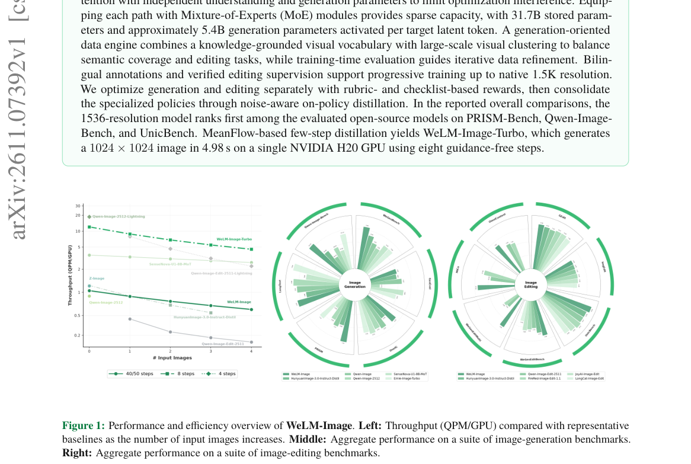

*Result - Overview of the WeLM-Image architecture. Tokens on the understanding (UND) and generation (GEN) paths retain path-specific projections and experts while sharing masked self-attention over on*

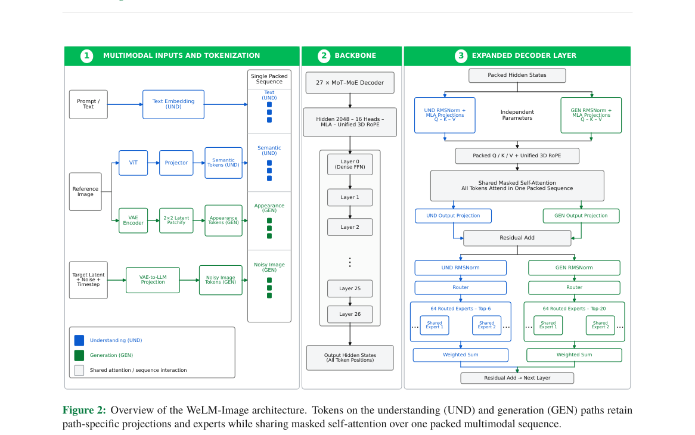

**Why this ranks #1**: 把多模态理解与文生图、指令编辑、多参考合成统一进一条交错序列的 MoT+MoE 基座：31.7B 存储参数、每个目标 latent token 仅激活约 5.4B 生成参数；Turbo 版在单张 H20 上 8 步无引导 4.98 秒出 1024×1024 图，较带 CFG 的 50 步基线快 11.4 倍。

---

### 2. Generator-Aligned Reward Modeling with Target-Aware Bounded Optimization for Visual Generation

**arXiv**: [2611.07648](https://arxiv.org/abs/2611.07648) | **Score**: 9.7 (relevance 10 x 0.7 + quality 9 x 0.3) | **Tags**: AIGC-visual, generator-aligned-reward, bounded-reward-optimization, target-aware-grpo, reward-overoptimization, attribute-control, China Telecom TeleAI | **Categories**: cs.CV | **Pages**: 24

**Authors**: Ziqiao Weng; Yuanzhi Liang; Haibin Huang; Weidong Cai; Xuelong Li

**Affiliation**: China Telecom TeleAI; The University of Sydney

**Abstract**

> Post-training aims to enhance desired attributes in visual generative models while preserving their general generation capabilities. Reward-guided post-training faces two challenges: real training data may mismatch the generator's output distribution, and attribute supervision may be confounded by unrelated content. Unbounded reward maximization can also cause overoptimization and degrade generation quality. We propose a framework combining Generator-Aligned Reward Modeling (GARM) and Target-Aware Bounded Optimization (TABO). GARM mitigates distribution mismatch through generator-support matching and reduces content confounding using content-matched real contrasts, yielding generator-relevant, attribute-focused reward supervision. TABO maps the learned reward to a smooth, upper-bounded function calibrated from real target-positive examples. This transformation is independent of the optimization algorithm and supports both direct reward-gradient and policy-based optimization. We further introduce Target-Aware GRPO (TA-GRPO), an adaptation of Flow-GRPO that combines fixed stage-wise advantage scaling, a generator-to-target curriculum, and timestep-balanced credit assignment for flow-based video optimization. Experiments show that GARM improves target-attribute expression while maintaining competitive generation quality. TABO better balances attribute enhancement and visual quality than unconstrained reward maximization, while TA-GRPO improves target enhancement over vanilla Flow-GRPO and reduces unintended attribute leakage on neutral prompts. These results highlight the importance of generator-aligned reward supervision and controlled, data-calibrated optimization for targeted visual generation.

**Key findings**

- **Finding**: GARM 通过固定生成器检查点与采样配置、只改目标条件构造 Base/Target 锚点对，并在 VAE latent 空间做支撑匹配；TABO 把奖励映射为平滑上界函数，低于由真实 target-positive 样例标定的目标水平时保持敏感度，接近或超过该水平时逐步压缩边际收益。
- **Inference**: 奖励引导的过优化，本质是奖励尺度失控而非监督方向错误，因此把标定与变换从奖励模型里独立出来，同一套变换就能同时服务 VADER 这类直接奖励梯度方法和 TA-GRPO 这类策略优化方法。
- **Recommendation**: 做属性定向增强时，先用生成器自己的 Base/Target 对构造锚点、用真实正例标定目标水平，再选直接奖励梯度或分组策略优化；切勿沿用无界奖励最大化，以免在中性 prompt 上出现属性泄漏。

**Key figures**

*Framework - Targeted attribute enhancement with largely preserved general generation performance. Top: Base vs. Ours across four attributes (Vintage Faded, Oil Painting, Muscular, and 2D Japanese anime*

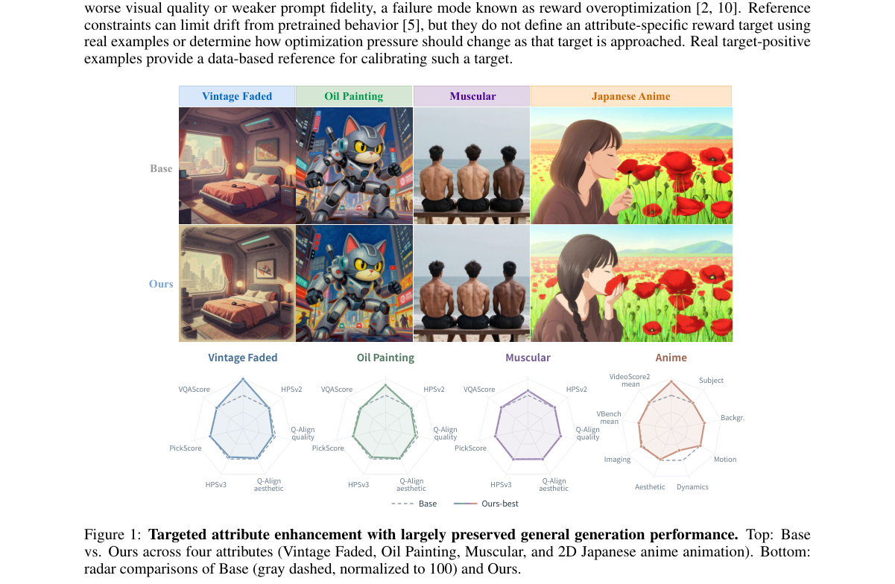

*Result - Overview of our framework. GARM aligns real supervision with the generator-relevant regions defined by paired Base/Target anchors and introduces content-matched negatives to form an attribut*

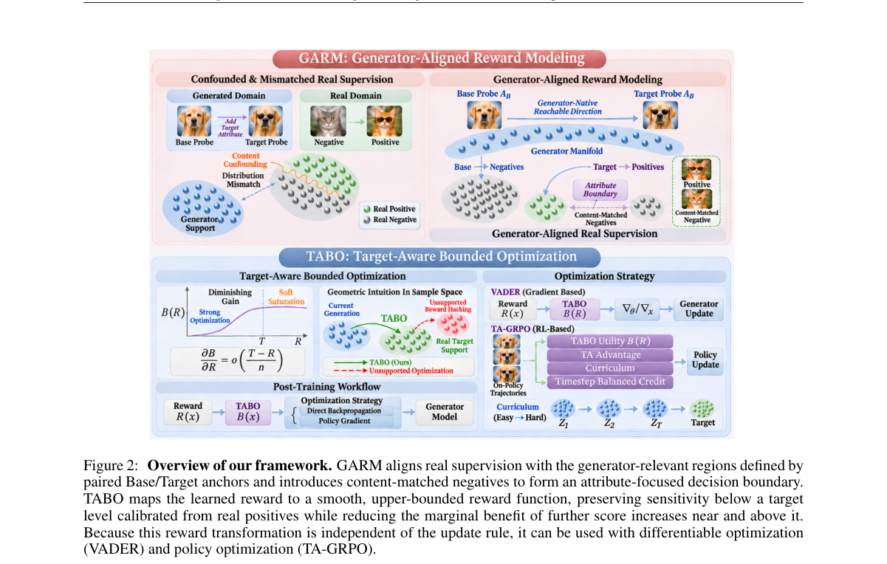

**Why this ranks #2**: 把「奖励监督是否对得上生成器」与「奖励该被优化到多强」拆成两个独立问题：GARM 用生成器原生的 Base/Target 锚点做支撑集匹配并检索内容匹配的真实对比样本，TABO 再用真实 target-positive 样例标定出平滑上界奖励；TA-GRPO 以固定分阶段优势缩放保住被组内归一化抹掉的目标尺度，图像与视频两条线均已验证。

---

### 3. FewStepRL: Fine-tuning Few-step Diffusion Models with Reinforcement Learning

**arXiv**: [2611.08240](https://arxiv.org/abs/2611.08240) | **Score**: 9.7 (relevance 10 x 0.7 + quality 9 x 0.3) | **Tags**: AIGC-visual, reinforcement-learning, few-step-diffusion, flow-matching, geneval2, modular-objectives, Tencent Hunyuan | **Categories**: cs.CV, cs.LG | **Pages**: 86

**Authors**: Haitao Lin; Minsi Ren; Yang Li; Xingtong Ge; Zheyuan Hu; Peiyan Hu; Tailin Wu

**Affiliation**: Tencent Hunyuan; Westlake University; University of Chinese Academy of Sciences

**Abstract**

> Reinforcement learning (RL) has become a standard post-training method for diffusion models, but most RL objectives roll out the current policy at every iteration, and with a many-step sampler these rollouts typically dominate the cost of training. Few-step models cut this cost, yet they model an average velocity over an interval, whereas existing RL objectives are built for an instantaneous velocity with a many-step sampler. We adapt RL objectives to few-step models systematically in three phases, namely a transformation, a decomposition and an adaptation. The transformation to $x$-space expresses each objective we consider through a common policy prediction, at the clean end by default and at an explicitly marked level for transition or flow-map objectives, so that objectives stated over densities, velocities or rewards become comparable. The decomposition writes the gradient of each of these objectives as the sum of a self-regression toward a reference and a reward augmentation, so that a method reduces, at the gradient level, to a choice of anchors and weights. The adaptation computes each anchor from a few-step model at the end of its transport or along its tangent, with the instantaneous velocity recovered from the network itself or from an auxiliary network. This yields few-step versions of FlowGRPO, AWM, DiffusionNFT, DiffusionOPSD and ReFL in one modular codebase. In our experiments, reward-gradient-based methods are the most effective when the reward is differentiable and its gradient is affordable; otherwise DiffusionNFT-style methods generally reach high rewards in relatively few iterations despite a sometimes higher per-iteration cost. Extra inference steps show no systematic aggregate benefit in our experiments, although selected outputs visibly improve with two to four times as many sampling steps as in training.

**Key findings**

- **Finding**: 原文 Figure 1 的留出 GenEval2 曲线显示，把蒸馏少步模型的平均速度直接代入 FlowGRPO、AWM、DiffusionNFT 都会低于本文对应的少步改编版，三组差距分别是最好检查点 +0.005 与 +0.003，以及 +0.005（最好）与 +0.013（第 400 轮）。
- **Inference**: 少步模型建模的是区间平均速度而非瞬时速度，因此直接套用多步 RL 目标会同时搞错该对哪个网络求导、参考策略如何评估、区间哪一段参与训练这三件事，属于目标定义层面的错配而非调参问题。
- **Recommendation**: 在少步扩散/流匹配模型上做 RL 后训练时，采用先变换到 x-space、再分解梯度、最后重算锚点的三阶段流程；奖励可微且梯度代价可接受时优先选奖励梯度类方法，否则用 DiffusionNFT 式方法以较少迭代拿高奖励。

**Key figures**

*Framework - Held-out GenEval2 against the RL iteration in the mixed-reward setting of §6.1, from the shared pre-RL few-step checkpoint. Dashed: the original objective applied to the distilled model with*

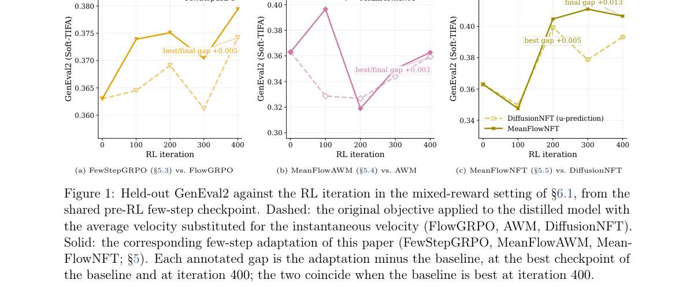

**Why this ranks #3**: 系统性地把为多步采样器写的 RL 目标改造成少步模型版本：先做 x-space 变换，再把每个目标的梯度分解为「朝参考的自回归项 + 奖励增广项」，最后在少步模型上重算锚点，一个代码库同时给出 FewStepGRPO、MeanFlowAWM、MeanFlowNFT 等实现；在 AnyFlow 蒸馏的 SD3.5-Medium 上，直接把平均速度当瞬时速度会让 FlowGRPO 的留出 GenEval2 低于本文改编版。

---

### 4. Householder Motion Embedding: Noise Modulation for Motion-Controllable Video Generation

**arXiv**: [2611.07294](https://arxiv.org/abs/2611.07294) | **Score**: 9.0 (relevance 9 x 0.7 + quality 9 x 0.3) | **Tags**: AIGC-visual, householder-transform, motion-control, noise-modulation, video-diffusion, orthogonal-transform, Australian National University | **Categories**: cs.CV | **Pages**: 23

**Authors**: Tao Jun Lin; Jinhong Ni; Ruyi Zha; Yifu Wang; Xibin Song; Pan Ji; Hongdong Li

**Affiliation**: The Australian National University; Vertex Lab; Amazon Inc.

**Abstract**

> Diffusion models for video generation have achieved remarkable success, yet precise motion control under explicit user guidance remains challenging. Recent noise-warping methods introduce temporal correlations by warping the noise according to the user-provided motion signal. However, standard spatial warping generally disrupts the noise's i.i.d. Gaussian structure, requiring distribution correction, such as Jacobian-based correction, but at a substantial computational overhead. We propose Householder Motion Embedding (HME), which encodes the motion signal into the noise through a sequence of Householder reflections that together form an orthogonal transformation applied to each location's channel vector. HME exactly preserves the spatial Gaussian structure within each frame while introducing cross-frame correlations that promote temporally consistent video. HME is agnostic to the network architecture and integrates directly into standard video diffusion fine-tuning pipelines. Experiments on different scenarios show that HME matches or outperforms the state of the art, while achieving a 2.7x speedup over noise warping. These results demonstrate that channel-space Householder transformations offer a principled and efficient alternative to noise warping for motion-controllable video generation.

**Key findings**

- **Finding**: 反射数消融显示运动贴合度随 K 增大而提升、收益递减：K=1 时 Flow EPE 4.868 最差，K=2 到 K=8 从 4.433 降到 4.144，K=12 时 CoTracker mIoU 0.558、PSNR 15.581 dB；运行时间则从 K=1 的 2.27 ms/latent 增至 K=12 的 14.78 ms/latent。
- **Inference**: 每个 Householder 反射都是保范数、保高斯的正交变换，多个反射复合后仍在每个位置保持 i.i.d. 高斯结构，因此可以用构造性正确性取代昂贵的分布修正与噪声上采样。
- **Recommendation**: 运动迁移、相机轨迹控制与拖拽交互可统一用同一套 HME 实现，默认取 K=2 的速度/质量折中；只有当运动贴合度确实不够时再加大 K，因为运行时间随 K 近似线性增长。

**Key figures**

*Framework - We propose Householder Motion Embedding (HME), a simple noise-modulation method for motion-controllable diffusion video generation. (a) Prior methods rely on spatial noise warping driven by*

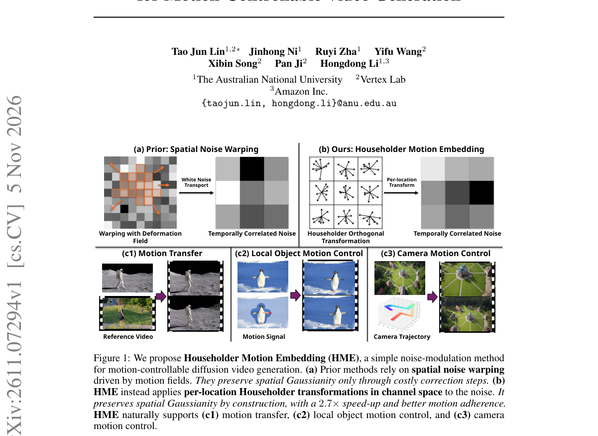

*Result - HME generates motion controlled videos in 3 stages: 1) optical flow estimation and spatial resampling, 2) temporally correlated noise construction via Householder Reflectors (see Section 3.1*

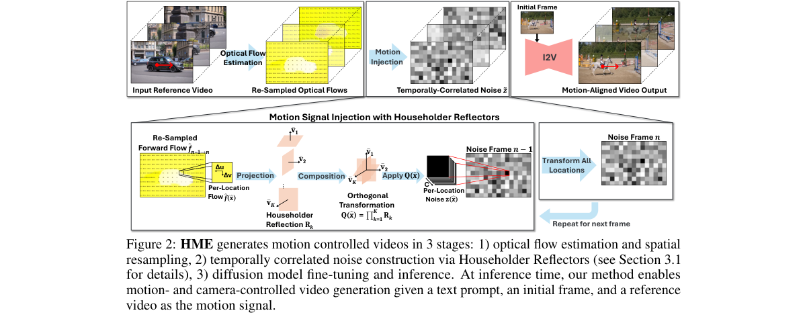

**Why this ranks #4**: 用通道空间的 Householder 反射把运动信号写进噪声，构造上就精确保持每帧的空间高斯性，无需 Jacobian 校正：默认 K=2 时 2.80 ms/latent，比 GWTF 快 2.7 倍、比 HIWYN 快 13.6 倍，额外峰值显存仅 0.5-6 MB，而 GWTF 为 76 MB、InfRes 为 285 MB、HIWYN 高达 49384 MB。

---

### 5. ArtiVidRM: Verifiable Artifact-as-Rubric Reward Modeling for Explicit Quality Articulation in Video Generation

**arXiv**: [2611.07301](https://arxiv.org/abs/2611.07301) | **Score**: 9.0 (relevance 9 x 0.7 + quality 9 x 0.3) | **Tags**: AIGC-visual, reward-model, artifact-rubric, video-generation, verifiable-reward, flow-grpo, Southeast University | **Categories**: cs.CV | **Pages**: 18

**Authors**: Caorui Li; Yangguang Ji; Shuxia Lin; Yu Chen; YiCheng Xiao; Yongliang Wu; Zhenxiang Jiang; Licheng Tang; Deng Li; Zhuxuanzi Wang; Jiahao Sun; Chonghan Liu

**Affiliation**: Southeast University; Opus AI Research; Institute of Automation, Chinese Academy of Sciences; University of Illinois Urbana-Champaign

**Abstract**

> Reinforcement learning has become an effective approach for improving video generation, but its success depends heavily on reliable reward models. Existing methods either map videos directly to opaque scalar scores or generate free-form rationales that are not explicitly optimized as the basis of the final judgment. We propose ArtiVidRM, a verifiable, artifact-as-rubrics video reward model that follows an observe-then-score paradigm. It first identifies visible generation artifacts and organizes them into a structured artifact list, then uses these artifacts as explicit rubrics for quality assessment. This intermediate representation grounds each score in concrete video-level evidence, making the reward more interpretable and informative for optimization. We further introduce a multi-reward reinforcement learning strategy to jointly optimize artifact prediction and quality assessment. The reward decomposes into complementary objectives that evaluate artifact prediction quality, including semantic coverage and prediction efficiency, together with a pairwise preference objective that supervises quality ranking through score differences. By jointly optimizing the intermediate artifact representation and the downstream preference prediction, the model learns to produce informative artifact lists while improving the accuracy of video quality assessment. Experiments show that ArtiVidRM achieves state-of-the-art performance on video preference benchmarks, provides effective signals for video diffusion optimization, and enables artifact-guided refinement of closed-source video generators.

**Key findings**

- **Finding**: 伪影标注流水线从 22,640 对视频偏好数据出发，两名检查员的候选合并（仅一方支持的伪影权重减一），再由 Qwen3-VL-32B 做视频接地复核删除 26.8% 候选、最终每视频平均 6.11 条；六名专家对 50 个视频各标 50 条的对照给出召回 87.84%、精确 84.37%，20 个共享视频的 Fleiss' κ 为 0.78。
- **Inference**: 把评分锚定在可见伪影这一中间表示上，既让每个分数都有视频级证据可查，也让训练信号落到具体缺陷而非一个不透明标量，因此对偏好排序与 RL 优化都更有信息量。
- **Recommendation**: 训视频奖励模型时可照搬「先伪影后打分」的范式并配多目标 RL（伪影语义覆盖 + 长度效率 + 成对偏好）；若只能用闭源生成器，可把伪影清单转成自然语言反馈追加到原提示词做第二轮精修。

**Key figures**

*Framework - Overview of ArtiVidRM. By explicitly predicting structured artifact lists before quality scoring, ArtiVidRM enables (1) accurate video preference prediction, (2) reward-guided optimiza- tion*

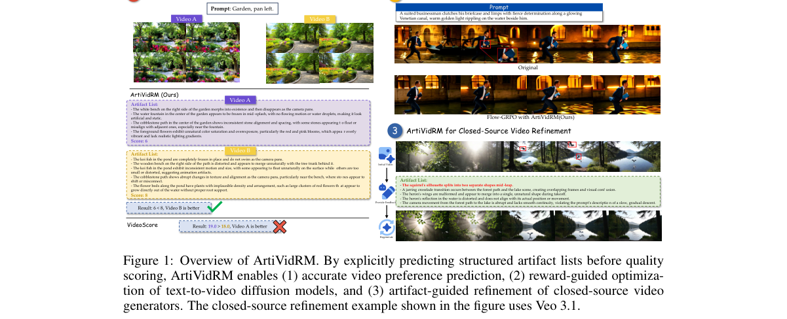

*Result - Overview of the artifact-augmented preference data construction pipeline.*

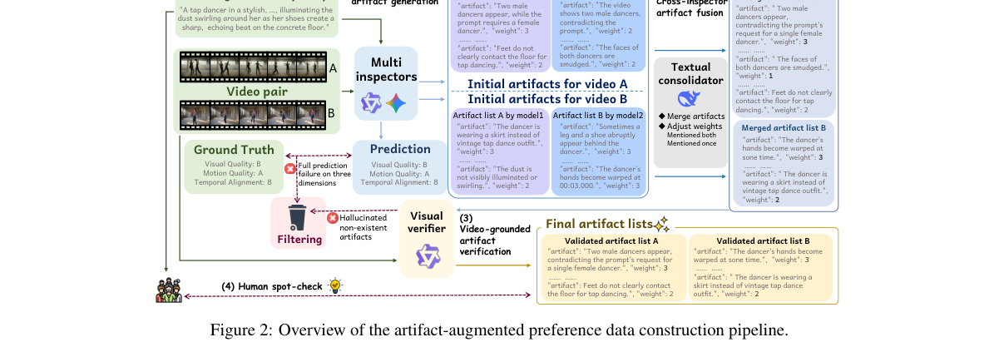

**Why this ranks #5**: 把视频质量评分改成「先列可验证的伪影清单、再按清单打分」：Qwen3-VL-32B 接地复核剔除 26.8% 的候选伪影、每个视频平均保留 6.11 条，专家抽检召回 87.84%、精确率 84.37%、Fleiss' κ=0.78；用它给 Wan2.1-1.3B 做 Flow-GRPO 后运动平滑度 97.41%→98.38%、成像质量 61.31%→63.85%。

---

### 6. Training-Free Predictive Spatio-Temporal Token Pruning for Few-Step Autoregressive Video Diffusion

**arXiv**: [2611.07551](https://arxiv.org/abs/2611.07551) | **Score**: 9.0 (relevance 9 x 0.7 + quality 9 x 0.3) | **Tags**: AIGC-visual, token-pruning, training-free, autoregressive-video, few-step-diffusion, feature-caching, University of Hong Kong | **Categories**: cs.CV | **Pages**: 19

**Authors**: Jia Li; Xurui Peng; Xing Wang; Hayden Kwok-Hay So

**Affiliation**: The University of Hong Kong; ByteDance Seed

**Abstract**

> Few-step autoregressive (AR) video diffusion models generate videos chunk by chunk and have made efficient video generation practical. However, further accelerating these models toward real-time generation remains challenging, as few-step distillation leaves little cross-step redundancy for existing training-free caching methods to exploit. We revisit this regime and identify two token-level redundancy patterns: cross-frame redundancy from static content shared across adjacent frames, and cross-step redundancy from tokens that converge early during denoising. Crucially, we find that early clean estimates along the model's own denoising trajectory provide an effective online signal for locating both patterns, requiring no retraining, auxiliary predictor, or reference video. Based on these findings, we propose PreSTP (Predictive Spatio-Temporal Token Pruning), a training-free framework that constructs a unified token-wise redundancy mask from cross-frame similarity and cross-step convergence. Tokens marked as redundant skip subsequent computation under a consistent last-computed-value restoration rule, and a content-adaptive mask reuse strategy further reduces dense probing cost. On 5-second generation, PreSTP achieves 1.52x-3.20x speedups and a better efficiency-fidelity trade-off than coarse-grained caching baselines such as TeaCache and FlowCache. On 30-second generation, it reaches up to 1.96x speedup while improving VBench-Long and suppressing long-horizon drift. Notably, it continues to reduce inference cost even in the extreme one-step regime, where cross-step redundancy vanishes entirely and coarse step-wise caching is no longer applicable.

**Key findings**

- **Finding**: 5 秒生成表格显示 PreSTP 相对原模型的延迟与加速为 CausVid 7.86→4.65 s（1.69×）、Self-Forcing 7.92→5.21 s（1.52×）、AnyFlow 26.21→8.19 s（3.20×），VBench 总分分别变化 −0.06、−0.07、−0.24，而同场景 TeaCache 的退化是 −0.26、−0.25、−0.38。
- **Inference**: 少步蒸馏几乎抹平了跨步特征冗余，但相邻帧共享的静态内容与去噪早期就已收敛的 token 仍然大量冗余，而模型自身去噪轨迹上的早期干净估计恰好能在线定位这两类模式，无需重训、辅助预测器或参考视频。
- **Recommendation**: 给少步自回归视频模型提速时可直接接入 PreSTP 的 token 级冗余掩码，并用跨帧静态 token 比例作为静态掩码复用的门控；由于质量损失极小，可先在 5 秒短片验证再推广到长时生成。

**Key figures**

*Framework - Token-level redundancy analysis on Self-Forcing.*

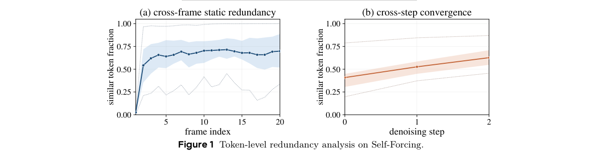

*Result - Overview of PreSTP. After the dense first-frame warm-up, the step-0 clean estimate is compared with the previous-frame reference to predict Ms. At each later denoising step, consecutive clean*

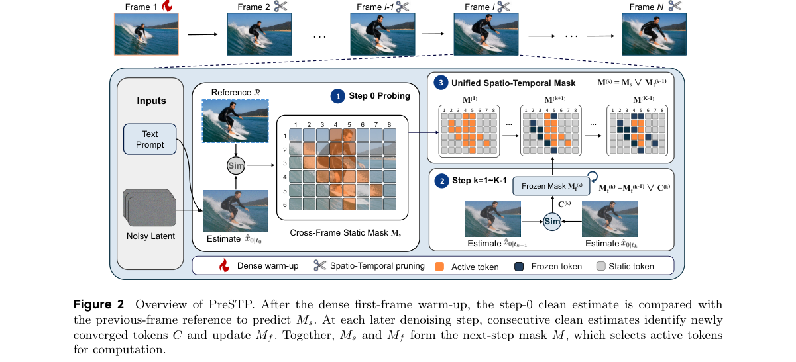

**Why this ranks #6**: 少步自回归视频扩散里粗粒度缓存几乎无处下手，本文改到 token 级剪枝：5 秒生成上 CausVid 从 7.86 s 降到 4.65 s（1.69×）、Self-Forcing 达 1.52×、AnyFlow 从 26.21 s 降到 8.19 s（3.20×），VBench 总分仅掉 0.06/0.07/0.24，优于 TeaCache 与 FlowCache 的速度-画质折中；30 秒场景最高 1.96×，且 VBench-Long 总分从 81.08 提到 81.36。

---

### 7. ArtCrafter: Feed-Forward Generation of Articulated 3D Object with Analytic Joint Derivation

**arXiv**: [2611.07658](https://arxiv.org/abs/2611.07658) | **Score**: 8.7 (relevance 9 x 0.7 + quality 8 x 0.3) | **Tags**: AIGC-visual, articulated-3d, slot-attention, analytic-joint-derivation, urdf, feed-forward, Qualcomm AI Research | **Categories**: cs.CV | **Pages**: 25

**Authors**: Minh Canh Tu; Quang-Binh Nguyen; Khoi Nguyen

**Affiliation**: Qualcomm AI Research

**Abstract**

> Articulated 3D assets are essential for robotic simulation and training, yet their generation from casual images poses a key challenge: recovering part geometry and kinematics that remain mutually consistent. We present ArtCrafter, a novel feed-forward generative model for controllable generation of articulated 3D objects from a pair of images, one depicting the object in the rest state and the other in the open state. At the core of ArtCrafter is a DiT-based generative model that jointly produces part-level meshes for both articulation states in a single forward pass. Inspired by Slot Attention, its denoising process operates on a $1+2N$ slot layout comprising one shared base slot and $N$ paired rest/open slots, encouraging each pair to bind to the same kinematic part. To ensure geometrically consistent and disjoint part generation, we introduce Triplet Attention to enforce cross-state geometric consistency between paired rest/open slots anchored through the shared base slot, and a repulsion loss $\mathcal{L}_{\mathrm{rep}}$ on decoded part point clouds to prevent inter-part penetration throughout denoising. Given the resulting paired meshes, URDF joint parameters---type, axis, origin, and range---are derived analytically from the rigid transformation between each rest/open pair, providing an interpretable alternative to learned joint-parameter regression. Extensive experiments on both in-distribution and out-of-distribution datasets demonstrate that ArtCrafter outperforms existing method under the same dual-state setting in geometry quality and articulation precision, while remaining competitive with methods operating under different input settings and paradigms.

**Key findings**

- **Finding**: 在 URDF-Anything+ 测试集上，ArtCrafter 整物体 CD 0.004、F1 0.721，部件级 CD 0.007、F1 0.698，关节类型准确率 0.890、关节原点误差 0.283；用真值部件数 N 的版本几乎相同（部件级 F1 0.700），同设定的 DIPO 则为整物体 F1 0.519、部件级 0.462。
- **Inference**: 让 rest/open 两种状态的槽位经共享基座槽绑定到同一运动学部件，再由配对网格的刚体变换解析求出关节轴与原点，几何与运动学就能互为约束，而不必依赖学习式的关节参数回归。
- **Recommendation**: 手上有一对静息态/张开态图像时可用 ArtCrafter 一次性拿到可执行的 URDF 铰接资产；比较方法时务必匹配相同输入设定，并把 VLM 估计的部件数 N 与真值 N 两列结果一并对照。

**Key figures**

*Framework - ArtCrafter pipeline. Two input images (Irest, Iopen) are encoded into state features conditioning 2N + 1 noisy latent slots — base B, rest slots R1. . .RN, open slots O1. . .ON — each augmen*

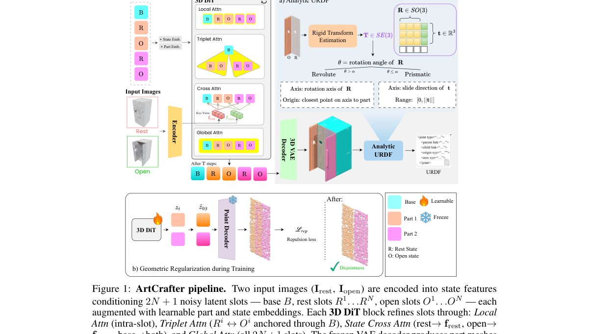

*Result - Per-slot decoded geometry across denoising timesteps. Rows compare ArtCrafter (Ours), FM-I (independent per-state), and FM-II (unstructured joint generation) on the same object; columns prog*

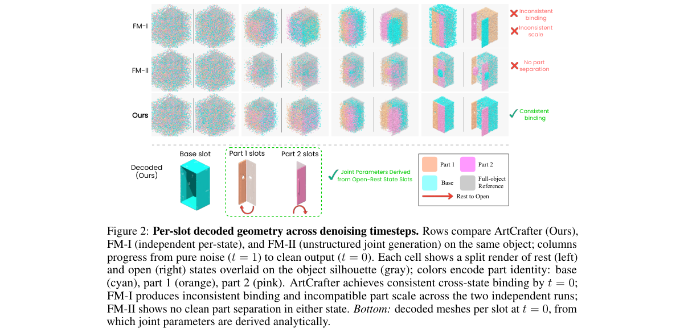

**Why this ranks #7**: 用 1+2N 个槽位（1 个共享基座槽 + N 对 rest/open 槽）在单次前向里同时生成铰接物体两种状态的部件级网格，并以 Triplet Attention 与排斥损失保证跨状态一致与部件互不穿透；URDF 关节参数由两状态间的刚体变换解析反推，URDF-Anything+ 测试集上整物体 F1 达 0.721，比同输入设定的 DIPO 高约 18-21%。

---

### 8. Bri3D: Bridging the Object-Scene Gap in Single-Image 3D Generation via Scene-Anchor

**arXiv**: [2611.07961](https://arxiv.org/abs/2611.07961) | **Score**: 8.7 (relevance 9 x 0.7 + quality 8 x 0.3) | **Tags**: AIGC-visual, single-image-3d, scene-anchor, voxel-scaffold, layout-reasoning, frozen-prior, Hong Kong University of Science and | **Categories**: cs.CV | **Pages**: 22

**Authors**: Hongye Hou; Shuai Zhang; Hongjie Li; Zhuoxiao Li; Haiping Wang; Yuan Liu; Wufan Zhao

**Affiliation**: The Hong Kong University of Science and Technology (Guangzhou); Taobao & Tmall Group of Alibaba; The Hong Kong University of Science and Technology

**Abstract**

> Generating compositional 3D scenes from a single image requires recovering detailed object geometry and coherent spatial arrangements. Existing object-to-scene methods, including SAM3D and MIDI, extend object generation through image-context reasoning or inter-instance modeling. Coordinating objects remains challenging with limited scene-level supervision. Directly extending object-centric generators to entire scenes can degrade geometry and fail to preserve instance scale, orientation, and pose. We propose Bri3D, a framework bridging scene-level structural reasoning and object-level generative priors through instance-aware voxel scene anchors. Bri3D predicts a color-coded scene scaffold encoding coarse object geometry and spatial arrangements. Each instance is extracted as a scene anchor and refined into a pose-preserving, prior-compatible voxel support, enabling a frozen object generator to synthesize detailed textured geometry in the anchor-defined spatial reference. This coarse-to-fine design separates scene organization from object-scale detail synthesis, focusing scene-level training on spatial organization and anchor refinement while reusing pretrained object priors. Experiments demonstrate improvements in scene layout, object geometry, visual quality, and generalization. Bri3D predicts scene layouts efficiently; full scene generation is faster than SceneGen and SAM3D.

**Key findings**

- **Finding**: 3D-FRONT 测试集上 Bri3D 的场景级/物体级 Chamfer 距离为 0.87/1.72，F-Score 96.12%/95.33%，BBox IoU 0.7540，次优的 SAM3D 为 2.11/2.76、92.34%/89.72%、0.6271；布局对比表中 Bri3D 脚手架阶段 5.1 秒、完整生成 42.6 秒，SAM3D 为 64.1 秒与 179.6 秒，碰撞率 4% 对 SAM3D 34%、MIDI 14%、SceneGen 38%。
- **Inference**: 直接把以物体为中心的生成器扩展到整场景会同时破坏几何与实例尺度，而先用粗粒度场景脚手架固定空间组织、再把每个实例细化成保位姿的体素支撑并交给冻结的物体生成器补细节，正好把两类先验解耦。
- **Recommendation**: 单图生成复合 3D 场景时优先采用「先布局后细节」的粗到细两段式；评估时除几何指标外还应统计物体碰撞率与脚手架阶段耗时，因为前者反映布局质量、后者反映是否真比端到端基线快。

**Key figures**

*Framework - Bridging the object–scene generation gap. Object-to-scene methods, such as MIDI and SAM3D, extend object generation to scene composition, where coordination errors can still produce collision*

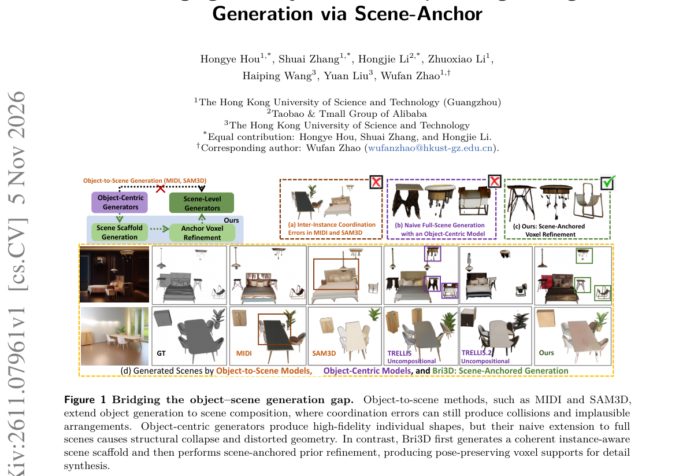

*Result - Overview of Bri3D. The Scene Scaffold Generator and Anchored Voxel Refiner replace the voxel-generation stage of a two-stage object generator, while its detail-synthesis stage remains frozen.*

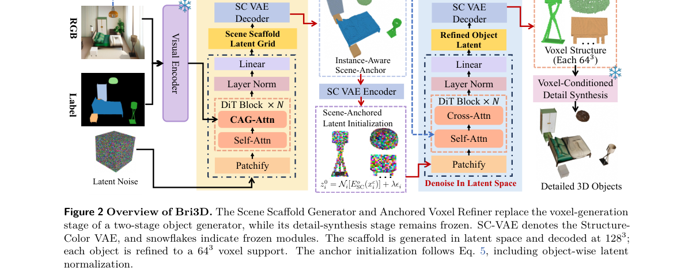

**Why this ranks #8**: 用实例感知的体素场景锚点把场景结构推理与物体生成先验接起来：3D-FRONT 测试集上场景级 Chamfer 距离 0.87、场景 F-Score 96.12%、BBox IoU 0.7540，均优于 SAM3D 的 2.11/92.34/0.6271；场景脚手架预测仅 5.1 秒（完整生成 42.6 秒），物体碰撞率 4%，远低于 MIDI 的 14% 与 SceneGen 的 38%。

---

### 9. StitchEdit: Stitching Depth Priors into Image Editors via Per-Layer Gradient Probing

**arXiv**: [2611.07922](https://arxiv.org/abs/2611.07922) | **Score**: 8.3 (relevance 8 x 0.7 + quality 9 x 0.3) | **Tags**: AIGC-visual, depth-prior, per-layer-probing, lora-pruning, geometry-aware-editing, learning-rate-schedule, Hong Kong University of Science and | **Categories**: cs.CV | **Pages**: 14

**Authors**: Qin Guo; Dan Xu

**Affiliation**: The Hong Kong University of Science and Technology

**Abstract**

> Text-guided image editing with diffusion models struggles with spatial edits (e.g. manipulating objects, changing viewpoints, manipulating occlusions) that depend on the 3D structure understanding of a scene. Marigold and follow-up work demonstrate that a pretrained diffusion backbone already harbors strong geometric priors that can be activated for depth estimation, yet how to redirect these priors toward editing remains unresolved. Through per-layer gradient probing, we discover that the editing and depth objectives are compatible in early transformer layers but actively conflict in late layers, explaining why naive depth-conditioned editing either ignores geometry or degrades visual quality. We present StitchEdit, which first activates the backbone's geometric capability via a lightweight depth-denoising adapter, then selectively fine-tunes this adapter for editing using a probe-guided per-layer learning rate schedule that preserves depth knowledge where it helps and prunes it where it conflicts. On the proposed StitchEditBench, a benchmark of 150 geometry-dependent edits spanning spatial transformation, occlusion manipulation, and viewpoint change, StitchEdit consistently surpasses both instruction-based and depth-conditioned baselines on perceptual quality and geometric fidelity.

**Key findings**

- **Finding**: 在 Qwen-Image-Edit（60 个 DiT 块、LoRA rank 64）上用 1K 对做梯度探针测得临界边界 ls=20、le=45：l≤ls 的相容区 ρ≈1、l≥le 的冲突区 ρ<0；StitchEditBench 150 例上 StitchEdit 为 LPIPS 0.10、DCS 0.92、CLIP-Dir 0.81、用户偏好 58%，Uniform FT 为 0.14/0.80/0.76/12%，Nano-Banana 为 0.13/0.74/0.78/16%。
- **Inference**: 深度条件编辑之所以要么无视几何、要么画质崩坏，是因为深度与编辑目标在深层反向冲突；均匀微调会在冲突层覆盖掉深度能力，而按探针剖面剪枝加分级学习率只微调相容与过渡层，能保住几何先验。
- **Recommendation**: 往预训练扩散骨干上嫁接几何先验时，先测逐层梯度对齐再决定冻结哪几层；冲突区直接丢弃适配器权重并对过渡层用余弦倍率衰减学习率，比全层均匀微调更稳。

**Key figures**

*Framework - Top: Challenging 3D-aware edits generated by STITCHEDIT conditioned on text in- structions. The model accurately handles complex object repositions and occlusions while strictly preserving v*

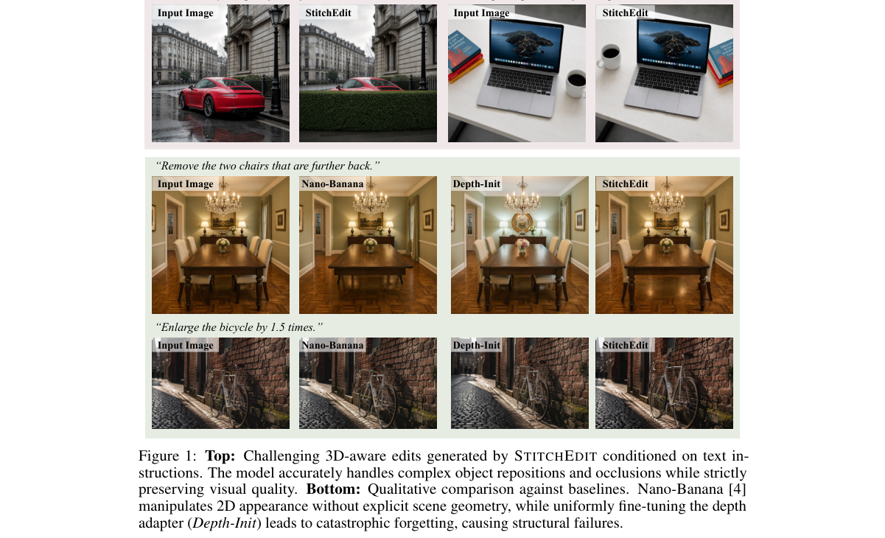

*Result - Overview of STITCHEDIT. Stage 1: Depth activation via a frozen-backbone LoRA adapter. Per-layer gradient probing reveals the layer-wise compatibility between the depth and editing objectives*

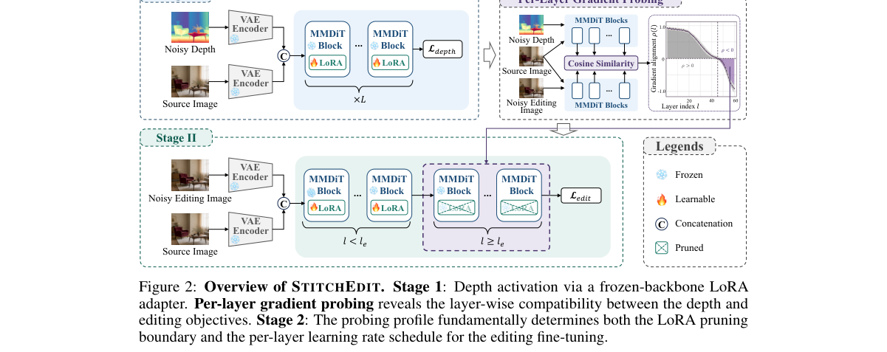

**Why this ranks #9**: 用逐层梯度探针把深度与编辑目标的冲突定位到具体层：60 层骨干上探得 ls=20、le=45，冲突层直接剪掉 LoRA，自建的 150 例 StitchEditBench 上 DCS 0.92、LPIPS 0.10、用户偏好 58%；而同样经过深度预训练但均匀微调的基线 DCS 仅 0.80、用户偏好 12%。

---

### 10. IDPrior: Decoupling Identity Generation from Facial Image Synthesis

**arXiv**: [2611.07941](https://arxiv.org/abs/2611.07941) | **Score**: 8.0 (relevance 8 x 0.7 + quality 8 x 0.3) | **Tags**: AIGC-visual, face-synthesis, identity-embedding, diffusion-prior, synthetic-data, face-recognition, Fraunhofer Institute for Computer | **Categories**: cs.CV | **Pages**: 18

**Authors**: Fadi Boutros; Meriç Demirörs; Darian Tomašević; Vitomir Štruc; Naser Damer

**Affiliation**: Fraunhofer Institute for Computer Graphics Research IGD; University of Ljubljana; TU Darmstadt

**Abstract**

> Large-scale identity-labeled face datasets are essential for training modern face recognition models, yet collecting and annotating such data is costly and raises privacy and ethical concerns. Existing synthetic face generation methods typically derive identities from predefined class labels, unconditional image generation, or predefined latent sampling strategies, without explicitly modeling the underlying distribution of facial identities. In this paper, we propose IDPrior, a two-stage framework that decouples identity generation from image synthesis. We first learn a diffusion prior in the embedding space of a pretrained face recognition model to model the distribution of facial identities and generate novel identity embeddings. These embeddings are then used to condition a pretrained identity-conditioned diffusion model (DM), enabling the synthesis of multiple images of the same identity. This modular design provides a scalable approach to identity generation while remaining compatible with existing and future identity-conditioned DMs. Experiments indicate that IDPrior generates diverse and well-separated identities while maintaining a closer correspondence to the distribution of authentic identities. Face recognition models trained on datasets generated using IDPrior-generated identities achieve competitive or improved performance compared with existing synthetic-data-based methods across multiple face verification benchmarks. Code and generated datasets are publicly available at https://github.com/fdbtrs/IDperturb.

**Key findings**

- **Finding**: 在 100 万生成身份、相似度阈值 r=0.3 下 IDPrior 仍保留 91.63% 分离良好的身份；10K 身份上 IDPrior (DDPM) 的 ID-FID 0.0261、U-ID-FID 0.0557、r=0.30 唯一性 99.91%，而 VIGFace 与随机采样的 U-ID-FID 高达 0.9987 与 0.3210；把 0.5M/1M/4M 合成身份与真实 CASIA-WebFace 混训，平均验证准确率从 94.63% 升至 95.56%/95.81%/96.28%。
- **Inference**: 身份分布本身就是合成人脸数据的独立瓶颈，把身份先验单独训成可插拔模块后，能在不改动既有身份可控扩散模型的前提下替换其身份采样方式，并同时改善下游人脸识别精度。
- **Recommendation**: 需要大规模合成人脸训练数据时，优先学一个覆盖真实身份分布的嵌入空间先验，再接到现成的身份可控扩散模型上；评估时除唯一性外必须看 ID-FID 与 U-ID-FID，否则均匀随机采样会给出虚高的分离度。

**Key figures**

*Framework - Overview of IDPrior, a dual diffusion framework that decouples identity generation from image synthesis. Stage 1: A diffusion prior is learned on FR embeddings to model the distribution of f*

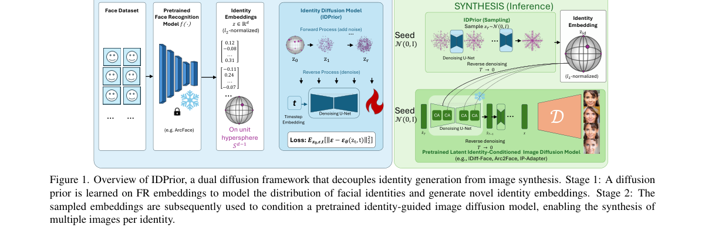

*Result - Identity uniqueness as a function of the cosine-similarity threshold. We report the percentage of unique identities among 10K generated identities. As the threshold becomes stricter, ID- Pri*

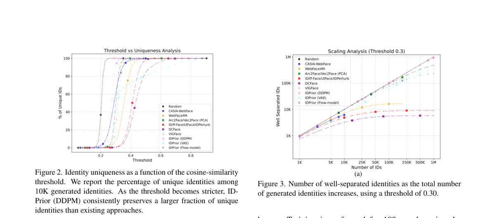

**Why this ranks #10**: 把身份生成与图像合成解耦：在人脸识别模型的嵌入空间里学扩散先验来生成新身份嵌入，再条件化预训练的身份可控扩散模型；DDPM 先验在 100 万身份、r=0.3 时仍保留 91.63% 的良好分离度，ID-FID 0.0261 与 U-ID-FID 0.0557 为各先验最优，且混入 0.5M/1M/4M 合成身份把真实 CASIA-WebFace 的平均验证准确率从 94.63% 提到 95.56%/95.81%/96.28%。

---

