# ArXiv Daily Digest - 2026-11-06 (音频与语音语言模型, 10 papers)

**Generated**: 2026-11-06 17:30 CST

**Source**: arXiv cs.CV, cs.SD, eess.AS, cs.CL, cs.AI, cs.RO, cs.LG submissions, listing day 2026-11-05 (announced 2026-11-06 00:00 UTC)

**Batch window**: 2026-11-04T18:00:00Z .. 2026-11-05T18:00:00Z（arXiv 公告批次横跨两个 UTC 日：前一日 18:00 UTC 起算，当日 17:59:59 UTC 截止）

**Track**: audio_lm (top 10 of 510 papers scanned, 70 full reads)

**Scope**: 音频 / 语音语言模型与多模态助手，含语音记忆、长音频检索、空间音频与多语种对话评测

⚠️ **Wild-card**: 本线 10 篇中 8 篇为 wild-card 补位，仅 2 篇为语音语言模型硬相关论文——这是本批次最紧的一条线。

本批次与「音频/语音语言模型」直接相关的工作只有两篇：严格因果流式识别器 E-Gaborformer 与受损语音转写器微调研究。其余 8 篇来自四条相邻通道：(1) 以音频/ASR 为证据的多模态问答与审计（THG-Omni、VideoRouteAudit、Video-to-QA）；(2) 音频内容理解与感知（歌词可懂度、关键短语抽取、听觉距离感知）；(3) 含音频模态的多模态表示学习（MIIB）；(4) 语音/心理语言学与大模型隐状态的交叉分析（Linguistic Boundaries、AD 语音检测综述）。每篇在条目上标注具体补位理由。

需要注意的是：这 8 篇中除 THG-Omni 外都不是语音大模型本身，因此本线在 2026-11-06 批次的信息密度明显低于常态。

---

## Top 10 - 音频与语音语言模型

### 1. Gabor Gabor: E-Gaborformer, a Strictly Causal Speech Recognizer with Gabor-Dictionary Convolutions and Delta-Rule Memory

**arXiv**: [2611.08092](https://arxiv.org/abs/2611.08092) | **Score**: 9.7 (relevance 10 x 0.7 + quality 9 x 0.3) | **Tags**: audio-lm, streaming-asr, gabor-filter, causal-attention, speech-recognizer, Deepdub | **Categories**: cs.CL, cs.LG, cs.SD | **Pages**: 19

**Authors**: Nir Krakowski; Tamir Cohen; Ohad Zohar; Chen Zarfati

**Affiliation**: Deepdub

**Abstract**

> Real-time voice agents need a speech recognizer that never waits for future audio and whose memory per call does not grow with the length of the call. We present E-Gaborformer, a strictly causal encoder that combines Gated DeltaNet-2 recurrent layers with sliding-window attention in a 3:1 ratio, and builds every temporal convolution from a fixed dictionary of causal Gabor atoms. Its streaming state is constant, about 19 MB per call at production scale including the prediction network, where a causal-attention encoder of the same size accumulates over 1 GB after ten minutes. In a controlled causal study on LibriSpeech, E-Gaborformer leaves the initial plateau earlier, reaches a given accuracy up to 18% sooner, and matches or beats an E-Branchformer trained with the identical front end and recipe. At production scale, a 0.6B-parameter Hebrew and English streaming transducer built on E-Gaborformer has 28 to 31% lower word error rate (WER) than NVIDIA's Nemotron 3.5 ASR Streaming, a model of the same size, on English voice-agent traffic, and up to 20% lower Hebrew WER than our previous production system. The same weights serve strictly causal and 480 ms-lookahead decoding with no loss in accuracy, and a two-class formulation of the RNN-T lattice trains the transducer 2.6x faster with exact loss and gradients.

**Key findings**

- **Finding**: E-Gaborformer 用 Gated DeltaNet-2 递归层与滑动窗口注意力按 3:1 混合，全部时间卷积由固定的因果 Gabor 原子字典构成，生产规模（d=1024、18 层、fp32）下每路流式状态恒定约 19MB。
- **Inference**: 把固定的 Gabor 滤波器组当作字典写进模型，等于把语音的频谱先验前置到编码器，换来有界的流式状态与更早脱离训练平台期。
- **Recommendation**: 做流式 ASR 或端侧语音部署的同学优先读架构与流式状态一节，并对照自己的延迟预算比较严格因果与 480ms 前瞻两档配置。

**Key figures**

*Framework - One E-Gaborformer block (residual connections omitted). The global branch is a GDN-2 recurrence in three layers out of four and causal sliding-window attention in the fourth; both depthwise*

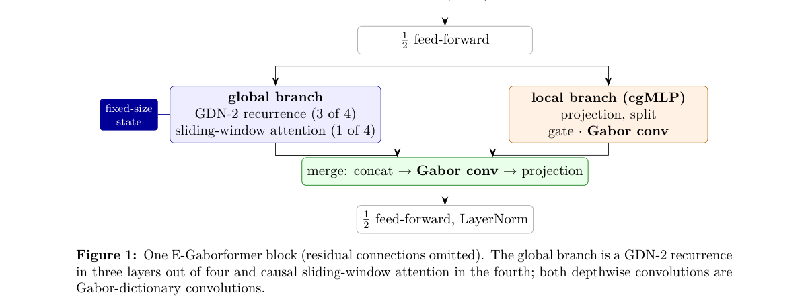

*Result - The 16 fixed causal Gabor atoms (kernel 31, lag −30 . . . 0 left to right; frequencies at 80 ms frames). Each channel’s kernel is a learned linear combination of them.*

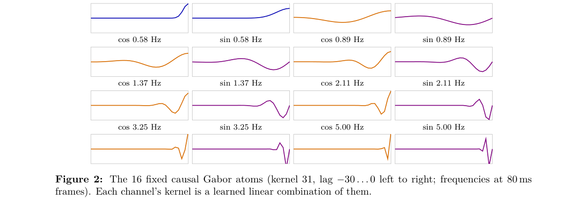

**Why this ranks #1**: 本线第 1 名，也是本批次唯一完整的实时语音模型工作：严格因果编码器把每路流式状态压到恒定约 19MB（同样规模的因果注意力编码器十分钟后就超过 1GB），0.6B 参数的希伯来语/英语流式转写器在英语语音代理流量上 WER 比同规模的 NVIDIA Nemotron 3.5 低 28%-31%。

---

### 2. Fine-Tuning a Transducer for Impaired Speech: Where the Gains Appear and What They Mean for Evaluation

**arXiv**: [2611.07587](https://arxiv.org/abs/2611.07587) | **Score**: 9.0 (relevance 9 x 0.7 + quality 9 x 0.3) | **Tags**: audio-lm, impaired-speech, asr-finetuning, cer-error-analysis, speech-accessibility, Eloky | **Categories**: cs.CL | **Pages**: 6

**Authors**: Kien Nguyen; Tuan Dinh; Bao Phan

**Affiliation**: Eloky

**Abstract**

> Speech recognition still works poorly for many people whose speech is affected by conditions such as ALS, Parkinson's disease, cerebral palsy, Down syndrome or stroke. We took part in the Speech Accessibility Project Challenge 2 (SAPC2) with a public speech recognizer that we fine-tuned on the challenge data. Our best entry scored 7.81% character error rate on Test1, the first of two hidden test sets (official baseline 15.26%). Our live entries ran on CPUs with a combined median latency of about 0.9 seconds at 7.96-8.07% error. On new speakers, fine-tuning reduced errors most for the speakers that an off-the-shelf recognizer finds hardest to understand. Sentences already seen in training had far lower error rates than new ones (2.58% vs 6.42%), a larger difference than being a familiar speaker made. We close with lessons for evaluating such systems.

**Key findings**

- **Finding**: 作者全模型微调公开的 Parakeet TDT 1.1B 并对多个微调模型做平均，在 SAPC2 隐藏测试集 Test1 上取得 7.81% 字符错误率（官方基线 15.26%），CPU 实时版两条流合计中位延迟约 0.9 秒、实时错误率 7.96%-8.07%。
- **Inference**: 新说话人上见过与没见过句子的差距是 2.58% 对 6.42%，比「是不是熟悉说话人」的差距（5.02%）更大，说明这类系统的评测被内容重叠而非说话人覆盖主导。
- **Recommendation**: 评估无障碍或病态语音识别系统时务必做参与者级去重，并按作者建议区分已知句子与新句子，否则会把记忆效应误读成泛化能力。

**Why this ranks #2**: 本线第 2 名，与 E-Gaborformer 并列本批次仅有的两篇真正语音模型工作：用公开的 Parakeet TDT 1.1B 在约 950 小时、1100 多位说话人的受损语音数据上全模型微调并做模型平均，隐藏测试集 Test1 上字符错误率 7.81%，相对官方基线 15.26% 几近减半。

---

### 3. THG-Omni: Traceable Human-Centric Graph Supervision for Video Reasoning

**arXiv**: [2611.07836](https://arxiv.org/abs/2611.07836) | **Score**: 8.3 (relevance 8 x 0.7 + quality 9 x 0.3) | **Tags**: audio-lm, omni-modal, graph-supervision, video-reasoning, traceable-evidence, Lanzhou University | **Categories**: cs.AI, cs.CV | **Pages**: 15

**Authors**: Jisheng Dang; Kai Wei; Ronghao Lin; Bimei Wang; Hong Peng; Wei-Shi Zheng; Bin Hu; Qi Tian; Tat-Seng Chua

**Affiliation**: Lanzhou University; Sun Yat-sen University; Beijing Institute of Technology; Cloud and AI BU, Huawei; National University of Singapore

**Abstract**

> Omni-modal models can answer questions about video, but their predictions rarely show which participant, event, or interval supports an answer. Moreover, answer-level supervision alone does not teach a model to interpret structured video evidence. To systematically mitigate this issue, we present THG-Omni, a human-centric graph-supervision framework that links Segment Anything Model~3 participant tracks with temporally grounded Qwen3-VL annotations. Candidate semantic claims are checked against the source video and available audio before they are used to construct training questions, while track geometry provides explicit spatial and temporal supervision. The resulting questions teach an omni-modal reasoning model to interpret participant attributes, actions, affect, interactions, and their timing from a structured graph. At inference, THG-Omni uses a predicted graph constructed from the evaluation video. Experiments on IntentBench show consistent improvements over the unadapted backbone across social reasoning, emotion understanding, and deception perception. On NExT-QA, THG-Omni achieves 89.54\% accuracy with the matched graph, compared with 85.10\% without graph input. Further validation experiments show that compact graph input achieves 78.22\% accuracy, compared with 78.02\% using the full graph and 77.58\% without graph input. A complementary diagnostic demonstrates that the predicted graph preserves evidence useful for answering questions even without the source video and audio. Together, these findings show that THG-Omni improves human-centric video reasoning while grounding its evidence in identifiable participants and events. Our codes are available at https://anonymous.4open.science/r/review-n94hhfcwp5666/

**Key findings**

- **Finding**: THG-Omni 把 Segment Anything Model 3 的人物轨迹与时序定位的 Qwen3-VL 标注连成结构化图，候选语义声明须先对照源视频与可用音轨核验；NExT-QA 上配对图 89.54%、无图 85.10%，紧凑图输入 78.22% 反而略高于完整图的 78.02%。
- **Inference**: 把答案级监督换成身份与时间对齐的图字段监督，等于逼模型说出是哪个参与者、在哪个区间支撑了答案，因此增益集中在社交推理、情绪理解与欺骗感知三项上。
- **Recommendation**: 想做多模态可追溯推理的同学可读它的图监督构造与 MER24 诊断（150 条多标签情绪样本），但要清楚它本身不做语音大模型建模。

**Key figures**

*Framework - Motivation for traceable graph supervision. This conceptual example contrasts answer-level supervision with identity- and time-grounded graph supervision. The depicted participants and event i*

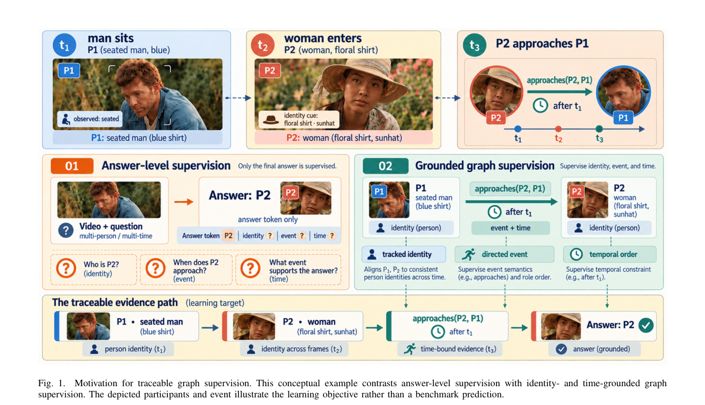

*Result - Overview of the proposed traceable human-centric graph-supervision framework. (a) Temporally ordered video evidence. (b) SAM3 grounds and tracks participants, while Qwen3-VL annotates visible*

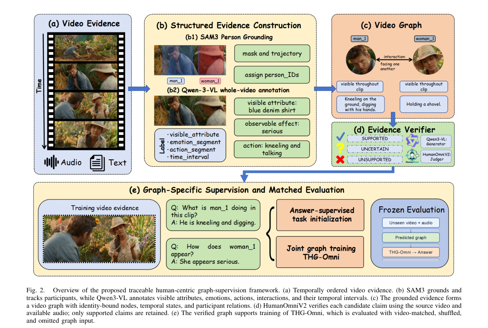

**Why this ranks #3**: 本线第 3 名，但实为 omni-modal 视频推理方向的补位（本批次没有真正的 Omni 音频大模型）：把 SAM3 的人物轨迹与带时间定位的 Qwen3-VL 标注连成图做监督，NExT-QA 上配对图输入比无图输入高 4.44 个百分点（89.54% 对 85.10%），且候选语义声明在造训练问题前会对照源视频与可用音轨核验。  [wild-card=yes] 本批次无真正的 Omni 音频大模型论文；该文是 omni-modal 视频推理（语义声明会对照视频与可用音轨核验），属最接近的音频-语言多模态理解方向。

---

### 4. Where Do Reported Long-Video QA Gains Come From? A Controlled Audit of Frame Selection, Evidence Injection, and Expert Routing

**arXiv**: [2611.07329](https://arxiv.org/abs/2611.07329) | **Score**: 7.6 (relevance 7 x 0.7 + quality 9 x 0.3) | **Tags**: audio-lm, long-video-qa, controlled-audit, asr-injection, frame-selection, Independent Researcher | **Categories**: cs.CV | **Pages**: 22

**Authors**: Shih-Yao Lin

**Affiliation**: Independent Researcher

**Abstract**

> Long-video question answering is usually studied as frame selection: which few frames should a vision-language model see? We introduce VideoRouteAudit, a controlled audit that separates this choice from two alternatives, injecting non-visual evidence and routing to another answering model. It holds the backbone, frame budget, decoding, prompt and grader fixed while varying one decision at a time. On the full Video-MME long bucket (n=900, K=8), no tested selector significantly improves over uniform sampling. The largest selection-only estimate is +1.9 pt (95% CI [-1.2,+5.0]) and our cascade is +1.2 pt [-1.7,+4.1]; all are equivalent to uniform within +/-5 pt. The same contrasts are unstable at the n=200 subset scale commonly used: three of four are up to 3.8x larger, one reverses sign, and resampled 200-item subsets reverse the full-bucket effect's sign in 35.8% of draws. The audit also corrects our own first results. The anomaly-domain "+ASR" arms injected no text, so the pooled +4.7 pt gain was selection plus a development prefix. With transcripts, ASR lowers XD-Violence accuracy by 10.0 pt when appended after the question and not at all when placed before it, and lowers UCF-Crime by 13.0 pt either way; on Video-MME, placing it first adds about 4 pt (7 on Qwen2-VL) to uniform sampling and to the cascade alike (post hoc, unadjusted). Swapping the answering model gives the largest contrast (+15.1 pt on MUSIC-AVQA, +33.3 pt on its worst type), but the same audio-visual expert with its soundtrack silenced keeps 92% of the gain (69% with a mismatched soundtrack), so the contrast is mostly a model swap. Code, per-item predictions and scripts that recompute every statistic are available at https://github.com/mikeslin-ir/long-video-qa-audit.

**Key findings**

- **Finding**: 审计只改动一个决策，在 n=900、K=8 的 Video-MME 长桶上最大选择收益为 +1.9 点、级联为 +1.2 点，与均匀采样在 ±5 点内不可区分；换 answering 模型对比最大（+15.1 点），且该音视频专家静音配乐后仍保留 92% 的增益。
- **Inference**: 长视频问答被归功于帧选择的增益多半来自路由到别的模型，而把 ASR 转写放在问题之后会让 XD-Violence 掉 10.0 点、UCF-Crime 掉 13.0 点，说明证据注入的位置本身就是变量。
- **Recommendation**: 想在长视频问答上报告增益的作者，先做同骨干同预算对照并把 ASR 转写置于问题之前，再去谈选择器或自己方法的功劳。

**Key figures**

*Framework - Three obstacles to long-video QA claims. (a) K frames must cover a 44-minute timeline. (b) The real MUSIC- AVQA question needs sound, not pixels alone. (c) Across 20,000 random n=200 subsets*

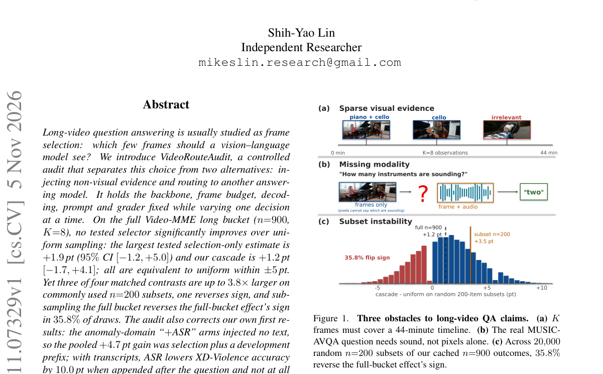

*Result - Matched contrasts are the unit of measurement. (a) Backbone, budget, decoding, prompt, grader and items stay fixed (the ported selectors share one candidate pool; the cascade scores its own,*

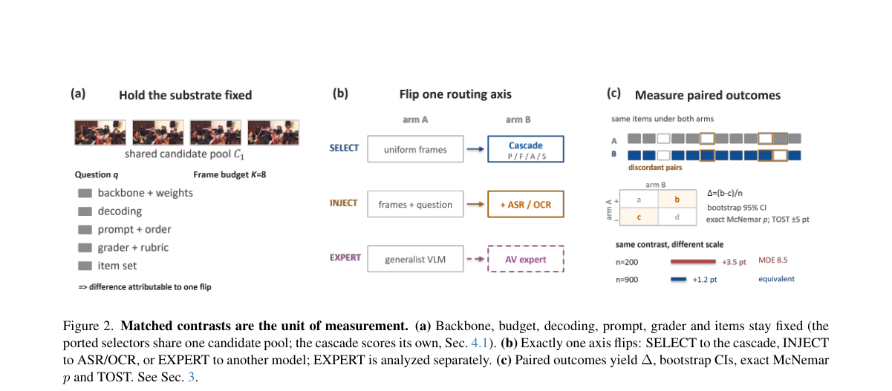

**Why this ranks #4**: 本线第 4 名，但实为长视频问答受控审计方向的补位：固定骨干、帧预算、解码、提示与评分器后，n=900、K=8 的 Video-MME 长桶上没有任何帧选择器显著优于均匀采样（最大 +1.9 点，95% CI [-1.2,+5.0]），而 +ASR 分支量化出转写注入的方向性影响最大可达 -13.0 点。  [wild-card=yes] 长视频 QA 的受控审计，其中 +ASR 分支量化了 ASR 转写注入对答案准确率的方向性影响（-10.0pt / -13.0pt），属音频证据注入与评测的相邻方向。

---

### 5. A Unified Multi-Encoder Framework for Music Lyric Intelligibility Assessment: Bridging Invasive and Non-Invasive Paradigms

**arXiv**: [2611.07485](https://arxiv.org/abs/2611.07485) | **Score**: 7.3 (relevance 7 x 0.7 + quality 8 x 0.3) | **Tags**: audio-lm, lyric-intelligibility, multi-encoder, asr-text-cues, music-perception, Wuhan University | **Categories**: eess.AS | **Pages**: 3

**Authors**: Jing Yang; Shenghao Liao; Shuqing Zhang; Yongyi Deng; Pan Li; Zerui Han; Gongping Huang

**Affiliation**: Wuhan University; MiLM Plus, Xiaomi Inc.

**Abstract**

> Lyric intelligibility significantly impacts music engagement and comprehension, especially for hearing-impaired individuals. Existing speech intelligibility metrics perform poorly in musical contexts due to differences in prosody, timing, and spectral dynamics. We propose a unified multi-encoder framework that supports both invasive and non-invasive modeling for robust lyric intelligibility prediction. By capturing complementary local acoustic-semantic alignments, global musical semantics, and ASR-derived textual cues, our method achieves superior performance over baselines on the ICASSP 2026 Cadenza dataset, with the best model achieving 26.61 RMSE, a $9.2$\% improvement over the baseline, demonstrating its flexibility and robustness.

**Key findings**

- **Finding**: 框架把 WavLM 的细粒度声学-语义对齐、MuQ 的全局音乐结构与上下文、Whisper 转写文本线索和 T5 上下文语义嵌入组合起来，在 ICASSP 2026 Cadenza 上取得 26.61 RMSE，比基线改进 9.2%。
- **Inference**: 有参考时 Whisper 转写只充当软监督、无参考时转写直接进语义嵌入，说明 ASR 派生文本是把音乐声学信号接到语义空间的关键中介。
- **Recommendation**: 做音乐理解或听力辅助评估的同学可以照搬这套「多编码器 + ASR 文本线索」的组织方式，但要清楚它评估的是可懂度而非生成质量。

**Key figures**

*Framework - The architecture of the proposed framework, illustrating both invasive (right) and non-invasive (left) modeling paths.*

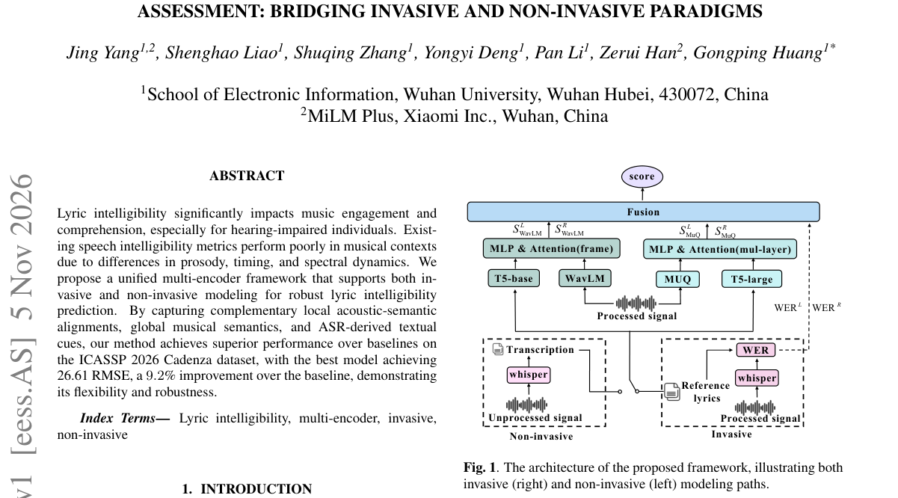

**Why this ranks #5**: 本线第 5 名，但实为音乐歌词可懂度评估方向的补位（本批次 eess.AS 整批只有 8 篇）：统一多编码器框架同时支持有参考与无参考两种建模路径，在 ICASSP 2026 Cadenza 数据集上最好模型取得 26.61 RMSE，相对基线改进 9.2%。  [wild-card=yes] 音乐歌词可懂度评估的多编码器框架，含 ASR 派生文本线索与声学-语义对齐，属语音/音频理解（非生成）方向。

---

### 6. Multimodal Information Interactions Bottleneck for Multimodal Self-Supervised Learning

**arXiv**: [2611.07718](https://arxiv.org/abs/2611.07718) | **Score**: 7.3 (relevance 7 x 0.7 + quality 8 x 0.3) | **Tags**: audio-lm, multimodal-ssl, information-bottleneck, partial-information-decomposition, representation-learning, Southwestern University of Finance and | **Categories**: cs.CV, cs.LG | **Pages**: 15

**Authors**: Liangjian Wen; Jiangtao Zheng; Jiang Duan; Qun Dai; Yong Dai; Jianzhuang Liu; Jun Wang; Shu-Dong Huang; Xinwang Liu; Zenglin Xu; Zhao Kang

**Affiliation**: Southwestern University of Finance and Economics; Chengdu Everimaging Science and Technology Co., Ltd.; X-Humanoid Research Institute; Shenzhen Institutes of Advanced Technology, Chinese Academy of Sciences; Sichuan University; National University of Defense Technology; Fudan University; Shanghai Academy of AI for Science; University of Electronic Science and Technology of China

**Abstract**

> Multimodal self-supervised learning is challenged by heterogeneity, unequal informativeness, and complex information interactions across multimodal data sources such as images, text, audio, and tabular data. While contrastive methods effectively align shared semantics, they typically rely on strong multi-view redundancy assumptions, overlooking modality-specific and synergistic information, thus leading to suboptimal representations. We propose the Multimodal Information Interactions Bottleneck (MIIB), a principled framework grounded in Partial Information Decomposition that explicitly encodes redundant, unique, and synergistic information within multimodal interactions. MIIB employs a dual-path model architecture for modality-specific encoding and multimodal fusion, optimized using surrogate tractable entropy-based objectives that enforce minimal sufficient representations without requiring explicit mutual information estimation. By leveraging variational bounds and score-based entropy estimation, MIIB efficiently captures complex cross-modal interactions while suppressing superfluous information. Experiments across diverse benchmarks demonstrate consistent improvements over state-of-the-art multimodal self-supervised methods. Code is available at https://github.com/wanglingzaishi/MIIB.

**Key findings**

- **Finding**: MIIB 基于部分信息分解显式建模冗余、独有与协同信息，用变分界与基于分数的熵估计构造可优化的代理熵目标而无需显式互信息估计；平均准确率 66.73% 对基线 64.45%，回归任务 MSE 5.74×10⁻⁴ 对此前最好的 7.56。
- **Inference**: 现有对比方法依赖强多视角冗余假设而忽略模态特有与协同信息，信息瓶颈式的双路设计正好补这块缺口，因此含音频的多模态任务受益更明显。
- **Recommendation**: 做多模态自监督表示的同学可以重点看它的信息分解与代理目标设计，并顺手检查自己的多模态组合是否也存在静态内容塌缩。

**Key figures**

*Framework - The process framework for multimodal representation learning orga- nizes modality-specific learning and fusion as a sequential yet interdependent process.*

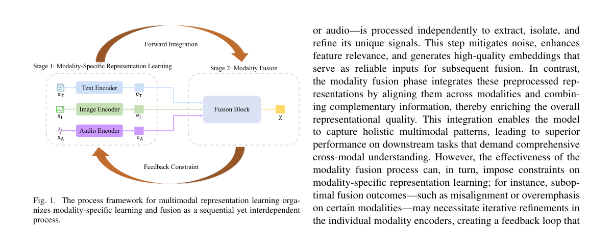

*Result - The overall architecture of MIIB. Given n input modalities X = (X1, . . . , Xn), we first augment them to generate two views, X′ and X′′. These views are encoded independently by modality-spec*

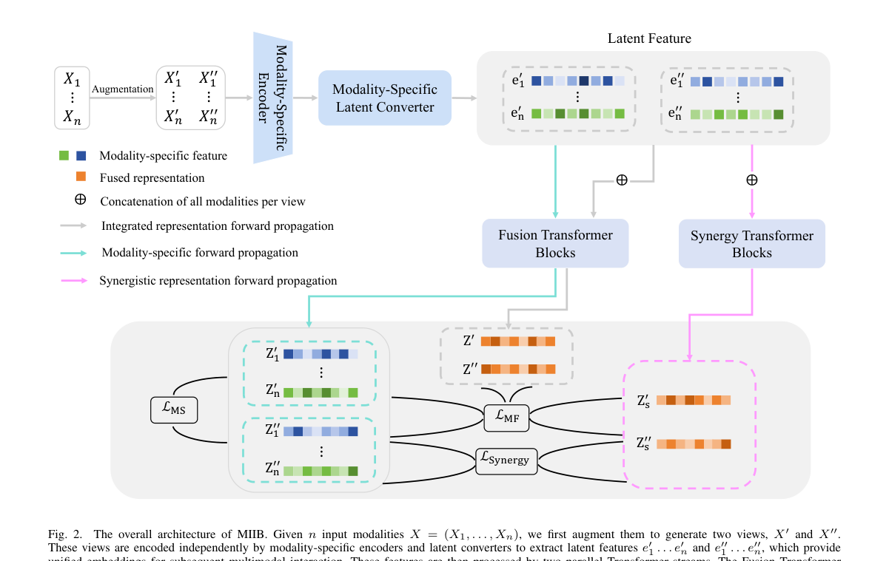

**Why this ranks #6**: 本线第 6 名，但实为含音频模态的多模态表示学习方向的补位：MIIB 用部分信息分解显式编码冗余、独有与协同信息，平均准确率 66.73% 对基线 64.45%，在 MOSI、UR-FUNNY、MUSTARD、MIMIC 上分别提升 3.7、2.1、1.6、1.7 个百分点，回归任务 MSE 5.74×10⁻⁴ 优于此前最好的 7.56。  [wild-card=yes] 多模态自监督学习的信息交互瓶颈框架，显式建模含音频在内的冗余/独有/协同信息，属多模态（含音频）表示学习方向。

---

### 7. Automated Video-to-QA Pipeline: End-to-End Question Generation and Verification Using Large Language Models

**arXiv**: [2611.07755](https://arxiv.org/abs/2611.07755) | **Score**: 7.3 (relevance 7 x 0.7 + quality 8 x 0.3) | **Tags**: audio-lm, video-to-qa, whisper-asr, llm-self-verification, lora-finetuning, Sardar Vallabhbhai National Institute of | **Categories**: cs.CL | **Pages**: 4

**Authors**: Jaival Chauhan; Vikram Singh; Pruthwik Mishra

**Affiliation**: Sardar Vallabhbhai National Institute of Technology

**Abstract**

> The exponential growth of educational and informational video content on platforms like YouTube presents a challenge for efficient knowledge retrieval and assessment. This paper proposes an end-to-end automated pipeline for extracting structured summaries and generating high-fidelity Question-Answer (QA) pairs from video streams. The framework integrates a cascade of state-of-the-art models: audio extraction is handled via FFmpeg, followed by automatic speech recognition (ASR) using Whisper (A library in Python) to generate accurate transcripts. Due to the token constraints of Large Language Models (LLMs), transcripts are segmented and summarized using Facebook's BART. A key innovation of this work is a Self-Verification and Fine-Tuning Loop. We utilize meta-llama/Llama-3.1-8BInstruct to generate candidate QA pairs from transcript chunks, which are then fed back into the model to rigorously assess their relevance and importance. Only verified, high-quality pairs are retained to construct a synthetic dataset. This dataset is subsequently used to fine-tune the Llama model using Low-Rank Adaptation (LoRA), resulting in a specialized model capable of generating domain-aligned assessment questions. This approach demonstrates a scalable method for creating self-improving educational tools without the need for manual data annotation. The proposed model can be downloaded from Kaggle with all the codes from GitHub.

**Key findings**

- **Finding**: 流水线用 Whisper 转写加 BART 分段摘要喂给 Llama-3.1-8B-Instruct 生成候选问答，模型再回灌自评相关性与可答性，只有通过校验的对进入合成数据集；LoRA 把可训练参数量降到最多 10,000 倍，评测视频平均时长 20-30 分钟。
- **Inference**: 「生成—自校验—再筛选」这条闭环能在无人工标注下造出干净训练集，但全文只做了 25 对问答的人工 1-5 分评测，证据强度明显弱于其工程完整度。
- **Recommendation**: 想搭音频内容到语言模型的级联流水线可以照搬它的分段与自校验骨架，但若要下结论，务必自己补更大规模的人工评测。

**Why this ranks #7**: 本线第 7 名，但实为「音频转写级联到语言模型生成与校验问答」方向的补位：FFmpeg 抽音频、Whisper 转写、BART 分段摘要、Llama-3.1-8B-Instruct 自校验生成候选问答再用 LoRA 微调，LoRA 把可训练参数降到最多 1 万分之一，但人工评测只抽了 25 对样本，精度证据偏弱。  [wild-card=yes] 视频问答流水线以 Whisper ASR 转写 + BART 摘要 + LLM 生成/自校验 QA，是音频到语言模型的典型级联，按相邻方向补位。

---

### 8. Automatic keyphrase extraction and annotation: modern theoretical approaches and practical solutions for text and speech

**arXiv**: [2611.08006](https://arxiv.org/abs/2611.08006) | **Score**: 7.3 (relevance 7 x 0.7 + quality 8 x 0.3) | **Tags**: audio-lm, keyphrase-extraction, survey, speech-content-understanding, corpus-annotation, Saint-Petersburg State University | **Categories**: cs.CL, cs.HC | **Pages**: 33

**Authors**: Daria Guseva; Olga Mitrofanova

**Affiliation**: Saint-Petersburg State University

**Abstract**

> The exponential growth of textual and audiovisual information has made the task of automatic keyphrase extraction (KE) increasingly significant. This article provides a comprehensive analysis of contemporary theoretical approaches and practical solutions for KE across both text and speech modalities. The primary contribution of this work is its systematic synthesis of these often-disparate research strands into a unified analytical framework, highlighting the evolution of the field from statistical methods towards large language models (LLMs) and end-to-end speech processing. We examine the stages of KE, the characteristics of keyphrases in written and spoken language, and terminological nuances. Various methods for automatic KE are discussed and analyzed in detail: statistical, hybrid, machine learning-based, and structural. The review dedicates substantial attention to emerging paradigms, including keyphrase generation using LLMs, and provides a detailed overview of methodologies and challenges in automatic corpus annotation. Furthermore, we specifically analyze current directions and inherent difficulties in KE for spoken language, comparing transcript based and end-to-end acoustic approaches. This synthesis leads us to conclude that the field is moving towards a more integrated, context-aware paradigm. Future progress will depend on addressing key challenges such as data scarcity for low-resource languages, effective multimodal fusion, and the nuanced evaluation of generative KE systems.

**Key findings**

- **Finding**: 综述把关键短语抽取从统计方法一路梳理到 LLM 生成与端到端声学处理，并单独对比语音场景下的转写式与端到端声学路线；Dimensions 数据揭示相关文献累计 24,338 篇，前三大领域为生物医学与临床科学 12,485 篇、信息与计算科学 9,836 篇、语言传播与文化 974 篇。
- **Inference**: 领域正在从统计式关键词统计转向上下文感知的生成式抽取，说明语音内容理解的落点越来越像语义压缩而非单纯转写。
- **Recommendation**: 需要给语音内容做抽取或索引的同学可直接拿这篇当路线图，优先盯住低资源语言数据稀缺与生成式抽取的评测方式这两个公认瓶颈。

**Key figures**

*Framework - Publication activity: papers on keyphrase analysis and processing via Dimensions over 50 years Рисунок 1. Публикационная активность: статьи по анализу и обработке ключевых выражений в Dim*

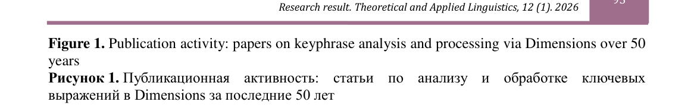

*Result - Distribution of research papers on keyphrase analysis and processing over fields of knowledge (top 10 domains) Рисунок 2. Распределение научных работ по анализу и обработке ключевых вы*

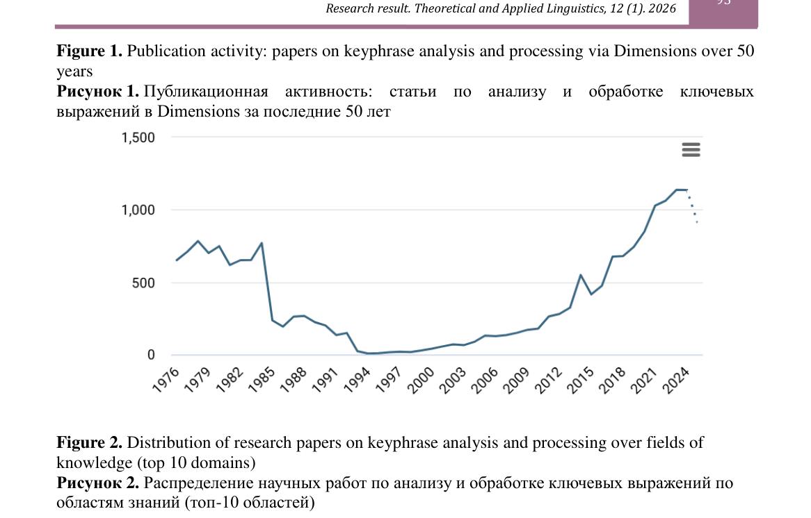

**Why this ranks #8**: 本线第 8 名，但实为文本与语音关键短语抽取综述方向的补位：把统计、混合、机器学习、结构化到 LLM 生成式抽取的路线统一梳理，并专门对比语音场景下的转写式与端到端声学两条路线，Dimensions 上相关文献累计 24,338 篇，低资源语言数据稀缺与生成式抽取评测被列为主要瓶颈。  [wild-card=yes] 文本与语音的关键短语抽取综述，系统梳理了端到端声学路线与 LLM 抽取路线，属语音内容理解方向。

---

### 9. Linguistic boundaries emerge from pressure-constrained processing dynamics

**arXiv**: [2611.08085](https://arxiv.org/abs/2611.08085) | **Score**: 7.3 (relevance 7 x 0.7 + quality 8 x 0.3) | **Tags**: audio-lm, linguistic-boundary, processing-pressure, llm-hidden-states, psycholinguistics, Universitat Pompeu Fabra | **Categories**: cs.CL | **Pages**: 32

**Authors**: Rui He; Philipp Homan; Wolfram Hinzen

**Affiliation**: Universitat Pompeu Fabra; University of Zurich; ETH Zurich; Catalan Institution for Research and Advanced Studies

**Abstract**

> Human cognition organizes continuous experience into bounded units while maintaining continuity across them. Linguistic elements are also organized into bounded structural units such as words and phrases, with sentence marking the final bound of a grammatical construction process. How do such boundaries emerge? We propose boundaries emerge from interacting demands to maintain unresolved dependencies, integrate completed relations, and update semantic context, with structural completion allowing but not determining closure. First, in a generative simulation without predefined boundary positions or constituent labels, these demands produced sentence-like segment-length distributions and distinct characteristic timescales, with structural completion allowing but not determining closure. Near boundaries, unresolved dependency load declined, integration cost peaked, and accumulated pressure reset. Then, we tested whether same demands predicted human listeners' boundary choices during comprehension. Listeners were more likely to mark boundaries with fewer unresolved dependencies, higher integration cost and semantic mismatch, and elevated preceding memory load, beyond syntactic and prosodic cues. Third, in naturalistic self-paced reading, sentence-final slowing coincided with declining memory load and increasing integration cost and semantic mismatch, broadly consistent with the simulation. Processing same narratives with a large language model revealed increased local intrinsic dimensionality and straighter hidden-state trajectories at sentence endings, followed by larger representational updates. Boundary explained additional variation in reading time and hidden-state geometry beyond processing demands, but considerably less in next-token surprisal. Together, these findings suggest linguistic boundaries emerge as discrete manifestations of transitions in continuous processing dynamics.

**Key findings**

- **Finding**: 抽象生成式模型在不给预定义边界位置的情况下，仅靠依赖局部性代价与语境意外度共同累积的处理压力，就产生了句子级片段长度分布与特征时间尺度；感知实验中 50 名听者在 5,140 个候选词位上标记边界，最佳模型在 500 个随机种子上复跑。
- **Inference**: 用大模型读同一批叙事时，句子末尾的局部内蕴维升高、隐状态轨迹更直并伴随更大的表示更新，说明语言边界在模型内部也是连续处理动力学的一次离散外显。
- **Recommendation**: 对模型内部如何表示语言结构感兴趣的同学可读它的压力累积设定与隐状态几何分析，但要注意结论只覆盖阅读与理解实验，不涉及语音识别本身。

**Key figures**

*Framework - Pressure-constrained simulation and parameter selection. (A) Simulation model. Dependency-locality costs and contextual surprisal jointly contribute to processing pressure. Accumulated pressur*

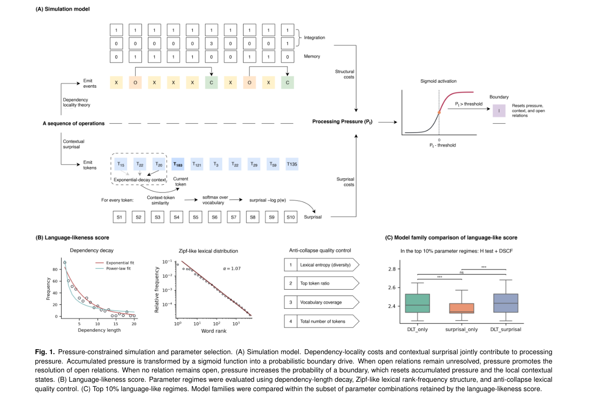

*Result - Boundary-aligned profiles in the best-performing pressure-constrained model. Analyses were performed on the highest-scoring DLT-surprisal parameter regime, rerun across 500 random seeds. Model*

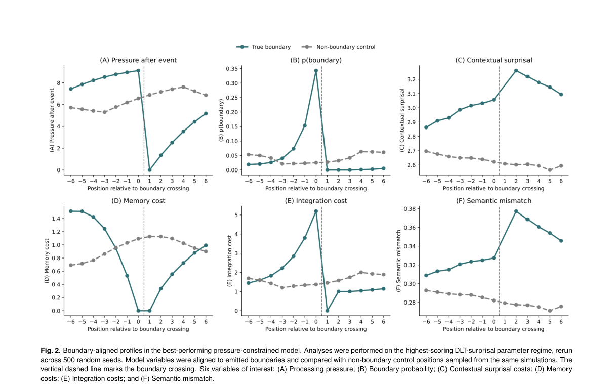

**Why this ranks #9**: 本线第 9 名，但实为心理语言学与大模型隐状态交叉方向的补位：在不含预置边界位置的生成式模拟里，依赖保持、关系整合与语境更新三种压力相互作用就自发产生句子级片段长度分布，人类实验中 50 名听者在 5,140 个候选词位上的边界选择与这些处理压力显著相关。  [wild-card=yes] 语言边界涌现的心理学-计算研究，同时用人类听者与 LLM 隐状态做分析，属语音感知与语言模型表示的交叉方向。

---

### 10. Improving the Clinical Generalizability of Machine Learning-Based Alzheimer's Disease Detection Across Domains and Modalities: A Comprehensive Review

**arXiv**: [2611.08188](https://arxiv.org/abs/2611.08188) | **Score**: 6.6 (relevance 6 x 0.7 + quality 8 x 0.3) | **Tags**: audio-lm, clinical-speech, domain-adaptation, alzheimer-detection, survey, University of Alberta | **Categories**: eess.AS | **Pages**: 53

**Authors**: Yingchao Huang; Yuhan Su; Xin Wang; Shanshan Yao

**Affiliation**: University of Alberta; Hebei University; Saskatchewan Polytechnic; University of Alberta

**Abstract**

> Objective: This review aims to provide a comprehensive synthesis of domain adaptation (DA) and domain general- ization (DG) strategies for AD detection. It focuses on their potential to improve the robustness, generalizability, and clinical reliability of ML-based diagnostic systems. Methods: We conduct a comprehensive scoping review of existing DA and DG approaches across multiple data modalities. The reviewed studies are organized according to data modality, algorithmic framework, adaptation strat- egy, clinical relevance, and reported cross-domain performance. Key methodological trends, performance gains, limitations, and remaining challenges are analyzed to identify future research directions. Results: DA and DG approaches have demonstrated encouraging improvements in cross-domain performance and model robustness. Emerging modalities, such as speech-based approaches, EEG and eye-tracking data, show great po- tential for early, accessible, and non-invasive cognitive assessments. However, important limitations remain, including insufficient external validation, limited interpretability, computational complexity, privacy concerns, and challenges in scaling to routine clinical practice. Conclusion: DA and DG provide important methodological pathways for developing more generalizable ML-based systems for AD detection. Future research should prioritize explainable, computationally efficient, privacy-preserving, and clinically validated DA/DG techniques. Strengthening these aspects will be essential for translating robust AI- based AD detection tools into clinically deployable solutions.

**Key findings**

- **Finding**: 综述最终纳入 83 项研究，按模态分为神经影像 31 项、EEG 10 项、眼动 15 项、语音与文本 14 项、多模态 13 项；语音部分指出在 ADReSS 上训练的模型迁移到 COMPASS-ND 会失败，反向迁移同样失败。
- **Inference**: 语音侧的流利度、韵律、连贯性与词汇多样性等标记本身有区分力，真正卡住临床落地的是数据集、语言与人群之间的域偏移，而不是特征设计。
- **Recommendation**: 若要用语音做认知筛查，请按作者建议做参与者级划分与跨语料、跨语言验证，并补齐外部验证与可解释性这两项公认短板。

**Key figures**

*Framework - A framework for clinical generalizability in ML-based AD detection. The six dimensions organize the sources of domain shift addressed (or left unaddressed) by DA/DG studies; most reviewed st*

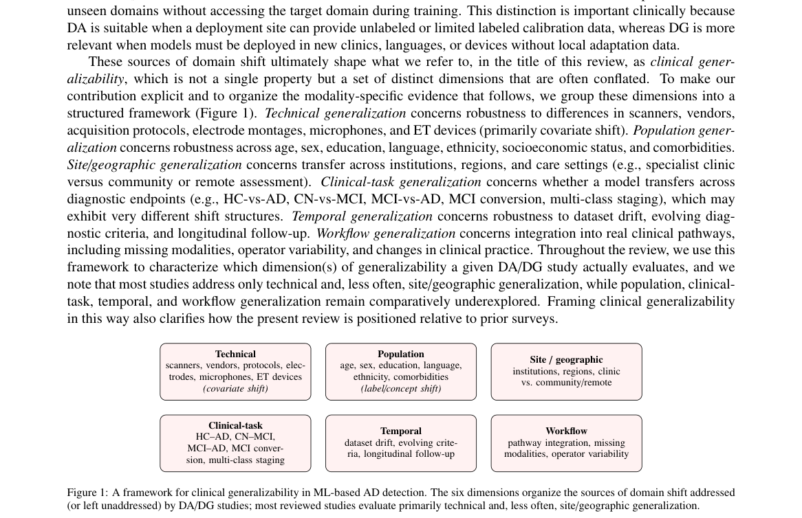

*Result - Scoping-review selection flow. As a non-registered single-reviewer search, exact intermediate record counts were not logged; the diagram reports the search process and the final set of 83 st*

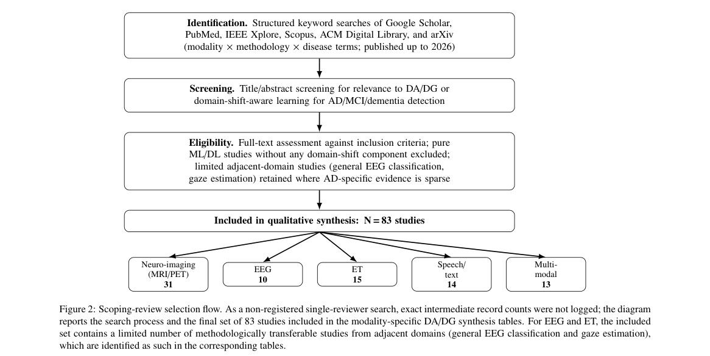

**Why this ranks #10**: 本线第 10 名，也是本线补位序列的末位，实为阿尔茨海默病检测的域适应/域泛化综述方向：最终纳入 83 项研究，其中神经影像 31 项、眼动 15 项、语音与文本 14 项、EEG 10 项、多模态 13 项，语音与文本分支只占 14 项、约六分之一，且外部验证不足。  [wild-card=yes] 阿尔茨海默病检测的域适应/域泛化综述，综述中基于语音的认知评估属音频理解在医疗场景的应用方向。

---

