# ArXiv Daily Digest - 2026-11-06 (全双工语音与语音 LM, 7 papers)

**Generated**: 2026-11-09 17:30 CST

**Source**: arXiv cs.CV, cs.SD, eess.AS, cs.CL, cs.AI, cs.RO, cs.LG submissions, listing day 2026-11-05 (announced 2026-11-06 00:00 UTC)

**Batch window**: 2026-11-04T19:00:00Z .. 2026-11-05T19:00:00Z（arXiv 公告批次横跨两个 UTC 日：从前一日的美东 14:00 截止时刻起算（EDT 为 18:00Z，EST 为 19:00Z），到当日的同一时刻为止）

**Track**: duplex_speech (top 7 of 535 papers scanned, 29 full reads)

**Scope**: 全双工 / 实时 / 流式语音语言模型、speech-to-speech 语音助手，以及 TTS、语音克隆与语音转换等合成侧工作

⚠️ **Wild-card**: 本线收录 2 篇 wild-card（另有 5 篇直接够格论文），共 7 篇。

语音 RL 方向本批次供给为零，语音 LM / 流式 ASR / TTS 侧共 5 篇直接够格；2 篇 wild-card 分别是语音增强语义自编码器与神经音频自编码器潜空间作品，均为语音前端 / codec 侧的相邻方向，已在对应条目内逐条标注收录理由。

---

## Top 7 - 全双工语音与语音 LM

### 1. Gabor Gabor: E-Gaborformer, a Strictly Causal Speech Recognizer with Gabor-Dictionary Convolutions and Delta-Rule Memory

**arXiv**: [2611.08092](https://arxiv.org/abs/2611.08092) | **Score**: 10.0 (relevance 10 x 0.7 + quality 10 x 0.3) | **Tags**: duplex-speech, strictly-causal-encoder, gated-deltanet, constant-streaming-state, gabor-dictionary-conv, rnn-t-transducer, Deepdub | **Categories**: cs.CL, cs.LG, cs.SD | **Pages**: 19

**Authors**: Nir Krakowski; Tamir Cohen; Ohad Zohar; Chen Zarfati

**Affiliation**: Deepdub

**Abstract**

> Real-time voice agents need a speech recognizer that never waits for future audio and whose memory per call does not grow with the length of the call. We present E-Gaborformer, a strictly causal encoder that combines Gated DeltaNet-2 recurrent layers with sliding-window attention in a 3:1 ratio, and builds every temporal convolution from a fixed dictionary of causal Gabor atoms. Its streaming state is constant, about 19 MB per call at production scale including the prediction network, where a causal-attention encoder of the same size accumulates over 1 GB after ten minutes. In a controlled causal study on LibriSpeech, E-Gaborformer leaves the initial plateau earlier, reaches a given accuracy up to 18% sooner, and matches or beats an E-Branchformer trained with the identical front end and recipe. At production scale, a 0.6B-parameter Hebrew and English streaming transducer built on E-Gaborformer has 28 to 31% lower word error rate (WER) than NVIDIA's Nemotron 3.5 ASR Streaming, a model of the same size, on English voice-agent traffic, and up to 20% lower Hebrew WER than our previous production system. The same weights serve strictly causal and 480 ms-lookahead decoding with no loss in accuracy, and a two-class formulation of the RNN-T lattice trains the transducer 2.6x faster with exact loss and gradients.

**Key findings**

- **Finding**: E-Gaborformer 用 Gated DeltaNet-2 递归层与滑窗注意力按 3:1 混合，所有时间卷积由 16 个固定因果 Gabor 原子（kernel 31，滞后 −30 到 0）线性组合而成；生产规模下每路流式状态恒定约 19 MB，而同规模因果注意力编码器 10 分钟后超过 1 GB。
- **Inference**: 递归分支把编码器状态与通话时长解耦，说明长通话语音助手的内存瓶颈可以在前端解决，而不必为状态上限牺牲识别精度。
- **Recommendation**: 搭建实时语音代理时优先评估常量状态编码器（如 GDN-2 类递归结构），并直接对比同一份权重在严格因果与 480 ms 前瞻两种解码档位下的表现。

**Key figures**

*Framework - One E-Gaborformer block (residual connections omitted). The global branch is a GDN-2 recurrence in three layers out of four and causal sliding-window attention in the fourth; both depthwise*

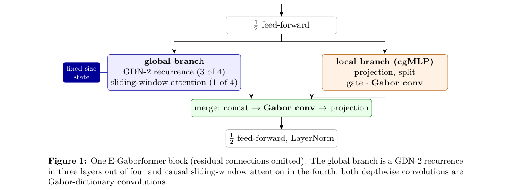

*Result - The 16 fixed causal Gabor atoms (kernel 31, lag −30 . . . 0 left to right; frequencies at 80 ms frames). Each channel’s kernel is a learned linear combination of them.*

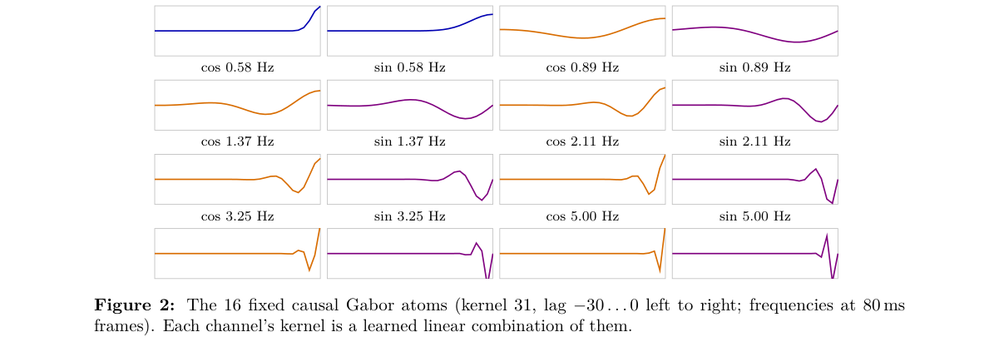

**Why this ranks #1**: 严格因果的 Gated DeltaNet-2 递归层与滑窗注意力按 3:1 混合，时间卷积全部由 16 个固定因果 Gabor 原子组合而成；生产规模下每路流式状态恒定约 19 MB，而同规模因果注意力编码器 10 分钟后超过 1 GB。0.6B 参数的 RNN-T 在英文语音代理流量上比同规模 Nemotron 3.5 ASR Streaming 低 28–31% 的 WER，是本批次最贴题的实时语音前端。

---

### 2. Route-DMD: Distribution Matching Distillation with Task-Routed Mechanism for Speech Foundation Models

**arXiv**: [2611.08011](https://arxiv.org/abs/2611.08011) | **Score**: 9.0 (relevance 9 x 0.7 + quality 9 x 0.3) | **Tags**: duplex-speech, distribution-matching-distillation, few-step-generation, task-routing, flow-matching, speech-foundation-model, Shanghai Jiao Tong University (X-LANCE | **Categories**: cs.SD | **Pages**: 5

**Authors**: Yanru Huo; Zhikang Niu; Wenming Tu; Junxi Liu; Tian Tan; Shan Yang; Yipeng Kang; Ziyang Ma; Xie Chen; Zilong Zheng

**Affiliation**: Shanghai Jiao Tong University (X-LANCE Lab); BIGAI; Shanghai Innovation Institute; Nanyang Technological University; Tencent Hunyuan

**Abstract**

> Speech foundation models built on flow matching handle generation, editing, and processing in one system, but every request costs 20-50 iterative steps, and classifier-free guidance (CFG) doubles each of them. Distribution matching distillation (DMD) trains a student that approaches the teacher's quality in a few steps, yet existing speech distillation work applies it to generation alone. We show that a distribution-matching objective does not serve every task: in separation, the noised states of erroneous student outputs deviate far from the teacher's training distribution, where its prediction is unreliable. Route-DMD therefore makes the objective task-dependent, routing the affected tasks to a regression loss and keeping decoupled distribution matching elsewhere. The student is initialized by consistency distillation, and teacher rollouts use adaptive projected guidance (APG) instead of CFG. Without CFG, the 4-step student matches the 32-step teacher on generation, editing, and processing tasks at a 4.5$\times$ end-to-end speedup.

**Key findings**

- **Finding**: 4 步学生在 SeedTTS-Eval 上与 32 步教师基本持平（SIM/WER 平均 0.790/2.85 对教师 0.795/2.65），端到端 RTF 从 0.4333 降到 0.0958，主观 N-MOS 从 4.23±0.10 升到 4.34±0.10、I-MOS 从 4.50±0.09 升到 4.57±0.09。
- **Inference**: 分离样本被路由到回归损失后，Libri2Mix 上 OVRL/UTMOS 升到 3.32/4.03（教师 3.28/3.87），但 WER 从 9.12 升到 10.07，说明任务路由保住了感知质量却牺牲了一部分可懂度。
- **Recommendation**: 压缩语音基座模型的推理步数时，采用两阶段流程（一致性蒸馏初始化 + 任务路由 DMD）而不是直接套 DMD，并把无 CFG 的 4 步学生设为线上默认档位，同时对分离档位单独核查 WER。

**Key figures**

*Framework - Overview of Route-DMD. Stage 1 uses consistency distillation for initialization. Stage 2 routes separation samples to a regression loss and other samples to Decoupled DMD.*

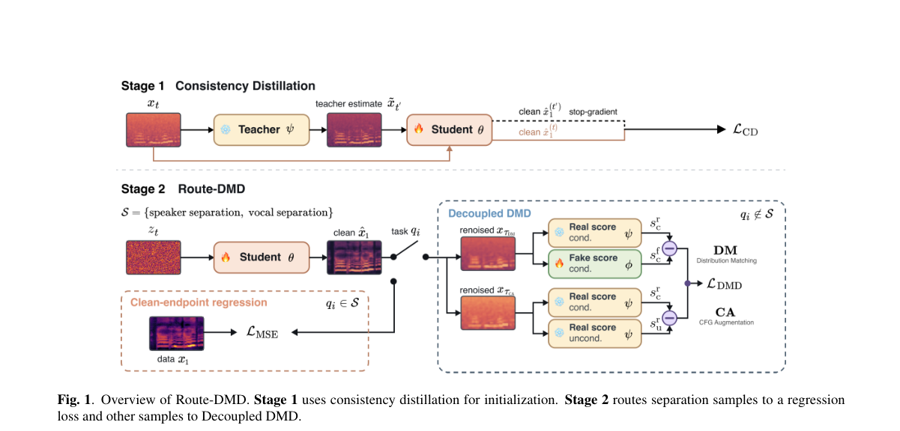

*Result - Ablation of the task-routed mechanism on Libri2Mix. Sep- aration metrics vs. Decoupled DMD updates for the regression loss (w/ routing), Decoupled DMD with the teacher queried on a noised grou*

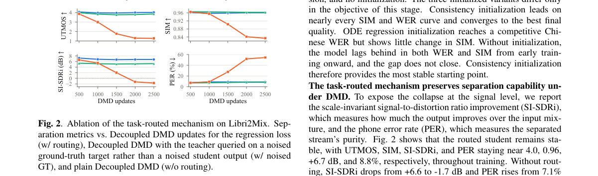

**Why this ranks #2**: 语音基础模型每次请求要 20–50 次迭代，CFG 再把每步计算翻倍；Route-DMD 把学生蒸馏到 4 步且不用 CFG 即可匹配 32 步教师，端到端加速 4.5 倍（RTF 从 0.4333 降到 0.0958），主观自然度 MOS 从 4.23 升到 4.34，是本批次可直接压低语音助手时延的生成侧方案。

---

### 3. VoxCanvas-41M: A Large-Scale Bilingual Dataset for Instruction-Based Speech Editing and Its Learning Dynamics

**arXiv**: [2611.08251](https://arxiv.org/abs/2611.08251) | **Score**: 9.0 (relevance 9 x 0.7 + quality 9 x 0.3) | **Tags**: duplex-speech, speech-editing-dataset, instruction-following, bilingual-corpus, paralinguistic-events, learning-dynamics, X-LANCE Lab | **Categories**: cs.SD, eess.AS | **Pages**: 22

**Authors**: Zhikang Niu; Wenming Tu; Yalin Li; Yanru Huo; Junxi Liu; Tianrui Wang; Ruiqi Yan; Junxuan Liang; Zilong Zheng; Ziyang Ma; Xie Chen

**Affiliation**: X-LANCE Lab, Shanghai Jiao Tong University; Beijing Institute for General Artificial Intelligence; Shanghai Innovation Institute; Tianjin University

**Abstract**

> Recent advances in speech generation have spurred the development of speech editing techniques. However, achieving high-quality speech editing remains challenging due to two key limitations. First, the major hurdle is the lack of large-scale, high-quality speech editing datasets. Constructing such datasets is costly, while open-source, scalable data pipelines remain limited. Second, the learning dynamics of speech editing models remain poorly understood. In particular, how models acquire editing capabilities and the relationship between generation and editing remain unclear. To address these challenges, we introduce VoxCanvas-41M, a large-scale bilingual dataset comprising approximately 41 million speech editing pairs. VoxCanvas-41M covers two major categories: content editing, including single-span, multi-span, and location-reference editing, and paralinguistic editing, covering the insertion and deletion of 39 classes of nonverbal events such as laughter, sighs, and coughs. Building on VoxCanvas-41M, we train VoxCanvas-Edit, an instruction-based speech editing model, demonstrating the effectiveness of our dataset in improving editing performance. Furthermore, we systematically investigate the learning dynamics of speech editing, examining how models learn different editing operations and how data scale, task interactions, and training strategies affect editing performance. The dataset, pipeline, and demos are publicly available.

**Key findings**

- **Finding**: VoxCanvas-41M 含约 4100 万条编辑对，中文与英文各约 2050 万；单段插入、删除、替换各 1000 万条，多段编辑（2–6 处）1000 万条，位置指代编辑各 10 万条，非语言事件插入与删除各 21 万条。
- **Inference**: 只更新约 1.3% 的参数即可把 SpeechEditBench 内容编辑平均准确率从 91.05 提到 95.22、Ming-Freeform 语音子集 WER 从 4.05 降到 3.68，说明语音编辑能力的瓶颈主要在数据覆盖而非模型容量。
- **Recommendation**: 做指令式语音编辑时优先用 VoxCanvas-41M 做 LoRA 微调，并单独评估删除类操作（对数据规模最不敏感）与非语言事件编辑（准确率仅约 54%，仍是短板）。

**Key figures**

*Framework - Overview of the speech editing data construction pipeline. ASR: automatic speech recognition; LLM: large language model; TTS: text-to-speech.*

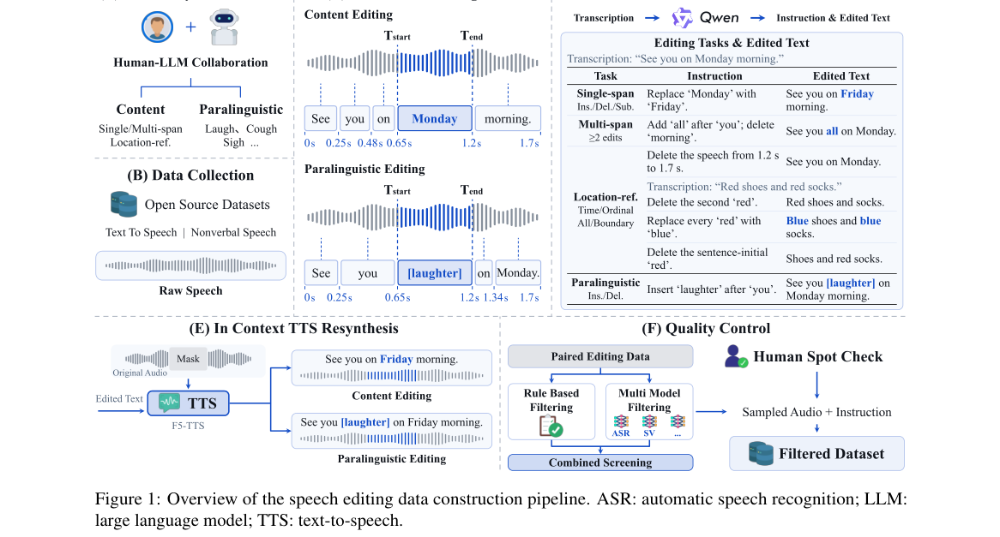

*Result - Dataset statistics of VoxCanvas-41M. From left to right: source utterance duration distributions, multi-span complexity, edit-span length distributions, and nonverbal event category distribu*

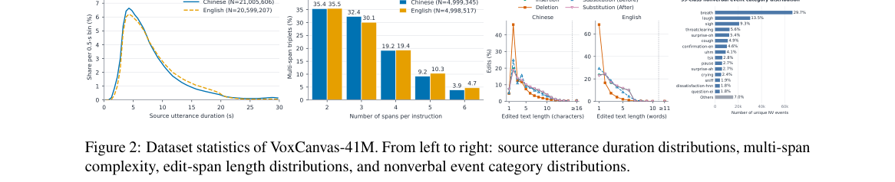

**Why this ranks #3**: 约 4100 万条中英双语编辑对（中文与英文各约 2050 万），单段插入/删除/替换与多段编辑各 1000 万条，另覆盖 39 类非语言事件与位置指代编辑，是目前公开最大的指令式语音编辑数据集；用 LoRA 只更新约 1.3% 的 AuK 参数，SpeechEditBench 内容编辑平均准确率就从 91.05 升到 95.22。

---

### 4. Adaptive and High-Fidelity Matching Algorithm for Retrieval-Based Accent Conversion

**arXiv**: [2611.07420](https://arxiv.org/abs/2611.07420) | **Score**: 8.0 (relevance 8 x 0.7 + quality 8 x 0.3) | **Tags**: duplex-speech, retrieval-based-conversion, accent-conversion, adaptive-knn-retrieval, wavlm-representation, adain-decoder, East China University of Science and | **Categories**: cs.SD | **Pages**: 15

**Authors**: Xinran Wang; Ning Chen; Yixin Luo; Hongqing Zhu; Li Tian

**Affiliation**: East China University of Science and Technology

**Abstract**

> Accent conversion (AC) aims to transform accent-related acoustic characteristics of the source speech to a target accent while preserving linguistic content and speaker identity. Unlike conventional generative AC models, the retrieval-based ones, which employ k-nearest neighbors (kNN) to directly retrieve acoustic features from target-accent speech and so do not need source-accent speech during training, are more effective. However, existing retrieval-based AC frameworks face three issues: limited intelligibility due to incomplete phoneme coverage from sequential matching pool construction, limited adaptability to source speech variations, and low spectral continuity from coarse-grained style modulation. To address these limitations, we propose Anisotropy-Aware Adaptive k-Nearest Neighbor Accent Conversion (AA-kNN-AC), an enhanced retrieval-based AC model. First, we design a phoneme coverage-based matching pool construction strategy, employing greedy selection with diversity-aware scoring to achieve balanced and near-complete phonetic representation under limited target accent data. Second, we propose an anisotropy-aware adaptive kNN retrieval mechanism that dynamically determines the neighborhood size according to the singular value decomposition (SVD)-based anisotropy analysis, enhancing adaptability to source speech variations. Third, we present a progressive Adaptive Instance Normalization (AdaIN)-based fine-grained decoder by integrating temporal up-sampling within AdaIN blocks, enhancing spectral continuity of the converted speech. Experimental results on the L2-ARCTIC and VCTK datasets demonstrate that the proposed method outperforms existing retrieval-based and generative baselines in both objective and subjective evaluations, achieving high intelligibility, speaker similarity, and naturalness. Demo page is available at https://aa-knn-ac.github.io/demo/.

**Key findings**

- **Finding**: 在 L2-ARCTIC ASI 上本文方法 WER 8.35%、CER 4.04%、说话人嵌入余弦相似度 0.80、NMOS 4.20±0.09、口音相似度 ACT 4.18±0.08，而 kNN-AC 的 WER 为 13.12%、NMOS 3.81±0.09；在 VCTK P248 上 WER 5.86%、CER 2.37%。
- **Inference**: 音素覆盖式贪心选池负责保证检索原语齐全、SVD 各向异性自适应 k（取值范围 2–6）负责随源语音变化调整邻域，两者叠加才同时改善了可懂度与自然度。
- **Recommendation**: 若要做无源口音数据的口音转换，把音素覆盖选池与自适应 k 当作默认配置；训练只依赖 100 小时 LibriSpeech，复现成本远低于生成式 AC 基线。

**Key figures**

*Framework - Mel-spectrograms of speech generated by (a) the proposed method and (b) 𝑘NN-AC for the utterance “It’s the aurora borealis.” White boxes highlight vowel regions where 𝑘NN-AC exhibits over-sm*

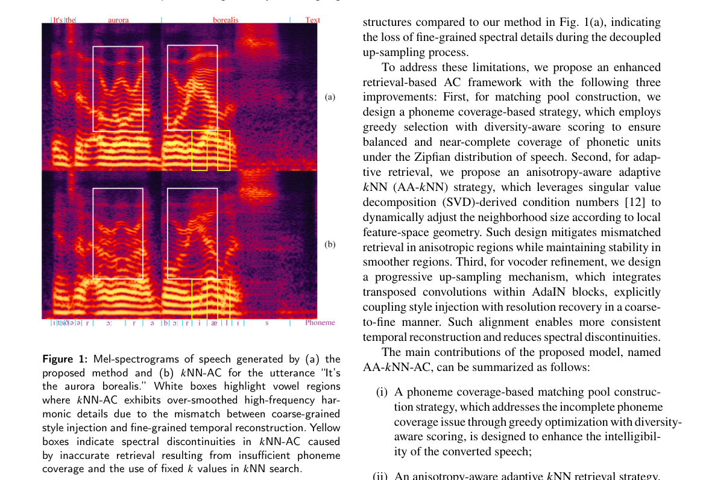

*Result - The Inference pipeline of the proposed model. The source utterance is disentangled into speaker and content embeddings using the 6th and 23rd layers of WavLM, respectively. The AA-𝑘NN module*

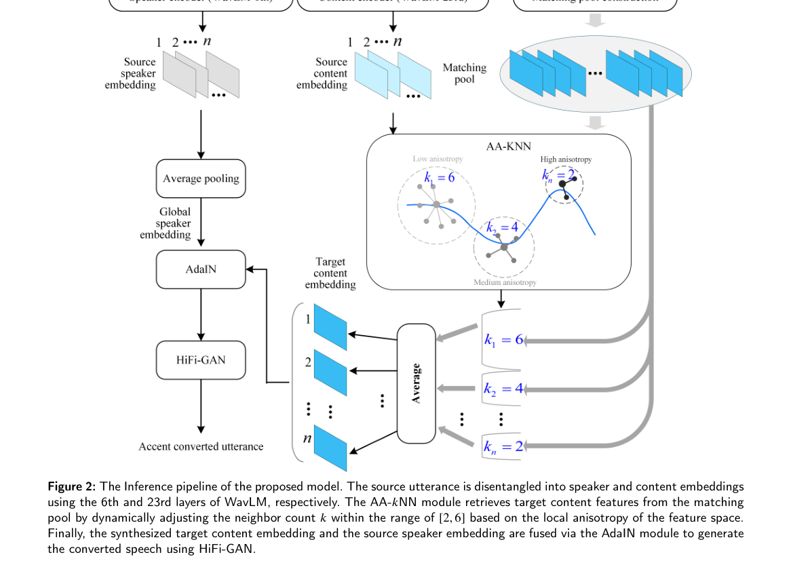

**Why this ranks #4**: 检索式口音转换不需要源口音数据，AA-kNN-AC 只用 100 小时 LibriSpeech 训练，用音素覆盖贪心选池保证检索原语齐全，再按 SVD 各向异性把邻域 k 动态调到 2–6；L2-ARCTIC ASI 上 WER 从 kNN-AC 的 13.12% 降到 8.35%，VCTK P248 上 WER 5.86%、自然度 MOS 4.16。

---

### 5. Fine-Tuning a Transducer for Impaired Speech: Where the Gains Appear and What They Mean for Evaluation

**arXiv**: [2611.07587](https://arxiv.org/abs/2611.07587) | **Score**: 8.0 (relevance 8 x 0.7 + quality 8 x 0.3) | **Tags**: duplex-speech, impaired-speech, transducer-fine-tuning, character-error-rate, error-analysis, evaluation-protocol, Eloky | **Categories**: cs.CL | **Pages**: 6

**Authors**: Kien Nguyen; Tuan Dinh; Bao Phan

**Affiliation**: Eloky

**Abstract**

> Speech recognition still works poorly for many people whose speech is affected by conditions such as ALS, Parkinson's disease, cerebral palsy, Down syndrome or stroke. We took part in the Speech Accessibility Project Challenge 2 (SAPC2) with a public speech recognizer that we fine-tuned on the challenge data. Our best entry scored 7.81% character error rate on Test1, the first of two hidden test sets (official baseline 15.26%). Our live entries ran on CPUs with a combined median latency of about 0.9 seconds at 7.96-8.07% error. On new speakers, fine-tuning reduced errors most for the speakers that an off-the-shelf recognizer finds hardest to understand. Sentences already seen in training had far lower error rates than new ones (2.58% vs 6.42%), a larger difference than being a familiar speaker made. We close with lessons for evaluating such systems.

**Key findings**

- **Finding**: 最佳条目 Test1 字符错误率 7.81%，官方基线为 15.26%；六个实时条目 CER 在 7.96–8.07% 之间，首词稳定与末词输出两个中位延迟合计从 8.56 秒降到 0.85–0.93 秒，全程在 CPU 上运行。
- **Inference**: 对 124 位新说话人按 Whisper 错误率分组，微调消除的错误份额随严重度从 20%、27%、36% 升到 41%（CER 从 51.9% 降到 30.6%），说明微调收益集中在最难识别的群体上。
- **Recommendation**: 评估语音识别系统时必须单独报告新说话人配新句子与新说话人配旧句子两组 CER，并用长度匹配结果复核，因为复用训练提示会系统性低估误差。

**Why this ranks #5**: 参加 SAPC2 障碍语音识别挑战赛并微调公开识别器，最好条目在隐藏测试集 Test1 上 CER 7.81%（官方基线 15.26%），CPU 实时条目的两个中位延迟合计约 0.9 秒。更关键的是它量化了评测陷阱：训练里见过的句子 CER 2.58%，新句子 6.42%，熟悉说话人带来的差距反而更小。

---

### 6. Design of a Speech Enhancement-Based Deep Semantic Autoencoder for Wireless Communications

**arXiv**: [2611.07361](https://arxiv.org/abs/2611.07361) | **Score**: 7.3 (relevance 7 x 0.7 + quality 8 x 0.3) | **Tags**: duplex-speech, semantic-communication, speech-enhancement, joint-source-channel-coding, noise-decoupling, wireless-communication, Dalian Maritime University | **Categories**: cs.IT, cs.SD | **Pages**: 13

**Authors**: Xiaoling Han; Bin Lin; Nan Wu; Tony Q. S. Quek

**Affiliation**: Dalian Maritime University; Singapore University of Technology and Design

**Abstract**

> Speech communication plays a crucial role in the Internet of Things and autonomous networks. However, traditional communication systems suffer from insufficient semantic extraction and limited noise suppression capability. To address these issues, we propose a Speech enhancement-based Deep Semantic Autoencoder (S-DSA) communication system for wireless communications. It consists of a dual-branch semantic encoder, a channel encoder, a channel decoder, and two semantic decoders, enabling joint source-channel coding for robust transmission. A key novelty lies in an adaptive semantic noise decoupling mechanism that disentangles target speech semantics from noise representations through an interaction module, thus maintaining semantic consistency under low SNR conditions. Furthermore, a joint training strategy optimizes speech reconstruction and noise estimation, while a lightweight testing strategy reduces complexity by disabling the noise-decoding path. The proposed S-DSA enables more effective separation between speech and noise, and yields higher robustness as well as better reconstruction quality. These findings highlight the potential of the proposed S-DSA as a practical solution for next-generation intelligent wireless communications.

**Key findings**

- **Finding**: AWGN 信道 0 dB 下 S-DSA 的 PESQ 为 2.05，高于 CNN-AE 与 DeepSC-S 的 1.73，同等信道条件下 STOI 约 0.89；输入混合 SNR 20 dB 时 MSE 降到 0.0024、SI-SDR 升到 24.48。
- **Inference**: 测试阶段关闭噪声解码分支、而把解耦能力保留在编码侧交互模块里，说明语义通信的收益主要来自前端增强与联合训练，而非更大的解码网络。
- **Recommendation**: 做端侧语音增强时可直接借鉴其自适应语义噪声解耦与轻量测试路径，并把 −10 至 20 dB 的 SNR 混合范围纳入训练采样以获得更稳的鲁棒性。

**Key figures**

*Result - Waveform and spectrogram comparisons for speech enhancement.*

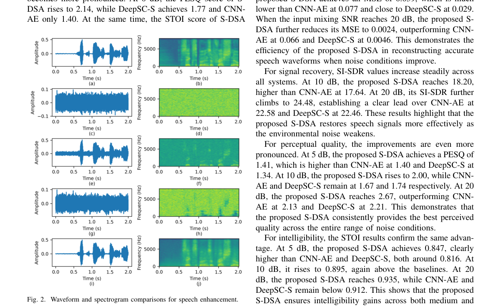

**Why this ranks #6**: 这条线当天直接做全双工语音模型的论文偏少，这篇把语音增强与语义通信结合，属于相邻方向的补位：S-DSA 在 AWGN 信道 0 dB 时 PESQ 达 2.05（CNN-AE 与 DeepSC-S 都是 1.73）、STOI 约 0.89，测试时关掉噪声解码分支即可降低时延与显存占用。  [wild-card=yes] 该文研究的是面向无线通信的语音增强驱动语义自编码器（joint source-channel coding），属于语音前端增强与语义通信方向，与语音大模型栈相邻而非直接对口；本线按 wild-card 预算补位收录，供关注语音前端 / 语义编解码的读者参考。

---

### 7. Latent Terrain: Adapting Neural Audio Autoencoders as Design Materials in NIME

**arXiv**: [2611.07210](https://arxiv.org/abs/2611.07210) | **Score**: 6.3 (relevance 6 x 0.7 + quality 7 x 0.3) | **Tags**: duplex-speech, latent-space-navigation, neural-audio-autoencoder, max-msp-patch, creative-tooling, nime-design, Queen Mary University of London | **Categories**: cs.SD | **Pages**: 14

**Authors**: Shuoyang Jasper Zheng; Keigo Yoshida; Nico García-Peguinho; Jiatong Liu; Dan Hearn; Anna Xambó Sedó; Nick Bryan-Kinns

**Affiliation**: Queen Mary University of London; Keio University

**Abstract**

> Neural audio autoencoders, a deep learning method for sound synthesis, are increasingly popular in AI-enhanced NIMEs. It is timely to explore as a community how this technological opportunity has opened a domain of design in NIME. This paper focuses on one compelling technique of using autoencoders for sound synthesis: navigating their latent space as a generative sound space. We introduce Latent Terrain, a Max/MSP tool package designed to tailor latent spaces into corpus-based sound spaces for NIMEs. We describe the rationale and development process of Latent Terrain to offer insights into the use of autoencoders in a material-oriented crafting space of musical interface design. We deliver an annotated portfolio resulting from a collaborative artistic exploration of Latent Terrain with four NIME makers, to showcase the design possibilities opened by autoencoders. We reflect on our practice-based account to discuss the challenges and opportunities of enabling neural audio autoencoders as design materials for AI-enhanced NIMEs.

**Key findings**

- **Finding**: 该工具把神经音频自编码器的潜空间塑造成基于语料的声音空间，实验中 10 秒音频被编码为 215 个潜码，映射用的 MLP 在 Apple Silicon M4 Max（48GB 内存）上训练约 1.2 分钟收敛，FlowDec 采用潜帧率 25 Hz 的 NDAC-25 配置，RAVE 则有 16 维与 4 维两种潜码配置。
- **Inference**: 高维潜空间可以被压成低维可演奏控制面而无需重训自编码器本身，说明神经音频生成栈的门槛正从模型训练转向界面与语料设计。
- **Recommendation**: 想把神经音频自编码器接入实时乐器或装置时，可直接复用其开源 Max/MSP 包，并用低维控制面与随机采样控制面混合来平衡可控性与不确定性。

**Key figures**

*Framework - Comparing the coordinate-to-latent mapping method by Vigliensoni and Fiebrink [87] with our method.*

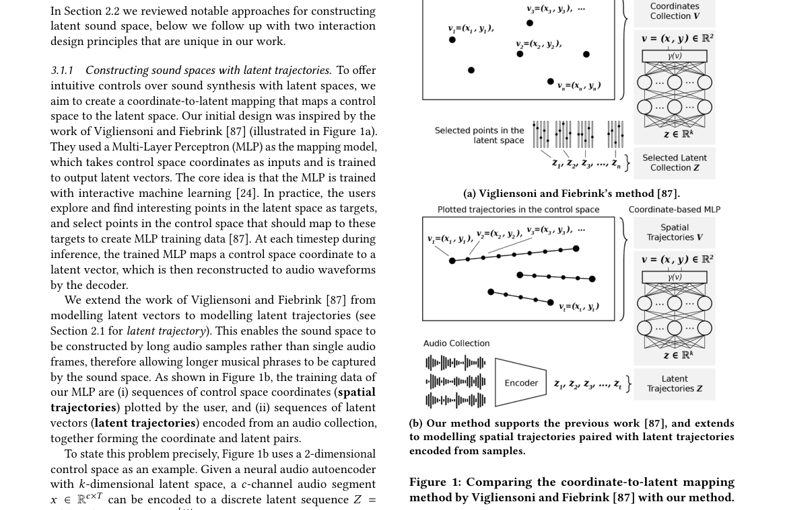

*Result - Latent codes of a 1-sec audio encoded by the au- toencoder in Stable Audio Open [23], showing the first latent dimension. Codes are converted to a latent signal by a zero-order hold. MLPs ar*

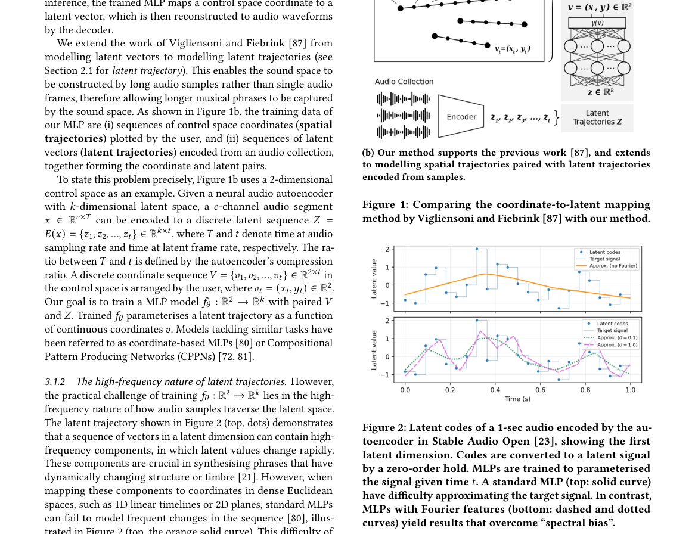

**Why this ranks #7**: 合成侧当天同样缺少直接的语音生成工作，这篇以神经音频自编码器的潜空间为设计材料做相邻方向补位：Latent Terrain 给出 Max/MSP 工具包，把 RAVE（16 维与 4 维潜码）、Stable Audio Open 等自编码器的高维潜空间映射成可演奏的低维控制面，映射网络训练约 1.2 分钟即可收敛。  [wild-card=yes] 该文把神经音频自编码器的潜空间当作可操作的设计材料，属于音频 codec / 潜空间方向，与语音合成栈相邻而非语音 LM 本身；本线按 wild-card 预算补位收录。

---

