# ArXiv Daily Digest - 2026-11-06 (具身智能与世界模型, 10 papers)

**Generated**: 2026-11-06 17:30 CST

**Source**: arXiv cs.CV, cs.SD, eess.AS, cs.CL, cs.AI, cs.RO, cs.LG submissions, listing day 2026-11-05 (announced 2026-11-06 00:00 UTC)

**Batch window**: 2026-11-04T18:00:00Z .. 2026-11-05T18:00:00Z（arXiv 公告批次横跨两个 UTC 日：前一日 18:00 UTC 起算，当日 17:59:59 UTC 截止）

**Track**: embodied (top 10 of 510 papers scanned, 70 full reads)

**Scope**: 具身智能与世界模型，含移动操作、人形控制、触觉反射、VLA 策略与世界动作模型

---

## Top 10 - 具身智能与世界模型

### 1. TactileLab: Sim-to-Real Dexterous Robot Manipulation with Efficient Shear-Sensitive Tactile Simulation

**arXiv**: [2611.07881](https://arxiv.org/abs/2611.07881) | **Score**: 9.7 (relevance 10 x 0.7 + quality 9 x 0.3) | **Tags**: embodied, tactile-simulation, shear-flow, sim-to-real, dexterous-manipulation, Beijing Institute of Technology | **Categories**: cs.RO | **Pages**: 18

**Authors**: Yijiong Lin; Wenhao He; Toby Jack; Max Yang; Haoran Li; Nathan F. Lepora

**Affiliation**: Beijing Institute of Technology; University of Bristol; Xi'an Jiaotong-Liverpool University

**Abstract**

> Robotic simulators that represent shear within tactile sensing are becoming increasingly important for contact-rich manipulation. However, simulating contact shear with high-fidelity deformable or soft-body simulation is computationally demanding, limiting scalability to large-scale reinforcement learning. Here we introduce \textit{TactileLab}, a scalable multimodal tactile simulation framework built on IsaacLab, with a particular focus on a new optical-flow-based tactile representation termed \textit{simulated tactile flow}. Instead of relying on soft-body physics to model shear deformation, TactileLab uses rigid-body simulation to efficiently estimate dense tangential motion at the contact interface, producing tactile flow fields that encode shear-relevant contact dynamics. This flow field complements geometric features from a contact depth field. We further introduce a novel policy architecture for jointly processing long-horizon proprioceptive signals and rich tactile observations. Across multiple contact-rich tasks, policies trained using simulated tactile flow learn efficiently at scale and exhibit emergent contact-aware behaviours. To facilitate sim-to-real policy deployment, we then propose a novel real-to-sim tactile translation method that maps real tactile image streams to simulated tactile flow and depth fields, together with a new tactile data collection method, and validate it across diverse tactile sensor designs. Using this pipeline, we demonstrate real-world deployment on tasks encompassing dual-arm and dexterous in-hand manipulation. Overall, TactileLab provides an end-to-end sim-to-real framework for scalable tactile policy learning, enabling diverse shear-sensitive manipulation across heterogeneous tactile robotic systems.

**Key findings**

- **Finding**: TactileLab 基于 IsaacLab 用刚体仿真估计接触界面的稠密切向运动，生成 simulated tactile flow 并与接触深度场互补；两种模态合用时灵巧手内旋转的存活时间达 27.01 秒、掉落率 11.76%，OOD 物体为 25.08 秒与 18.69%，真机 LEAP Hand 上完成 1.95±0.81 圈旋转。
- **Inference**: 深度类信号只刻画法向接触，相近深度可能对应不同切向状态，用光流式切向场补齐后任务才重新变得可观测，这解释了触觉流单独也能超过纯深度观测的原因。
- **Recommendation**: 做接触丰富机器人学习的同学可先读它的 simulated tactile flow 定义与 real-to-sim 翻译器，再判断自己的接触任务是否同样被切向信息卡住。

**Key figures**

*Framework - TactileLab is an end-to-end framework for efficient, shear-sensitive tactile robot learning. Built on IsaacLab, it integrates GPU- accelerated tactile simulation with a novel sensing modalit*

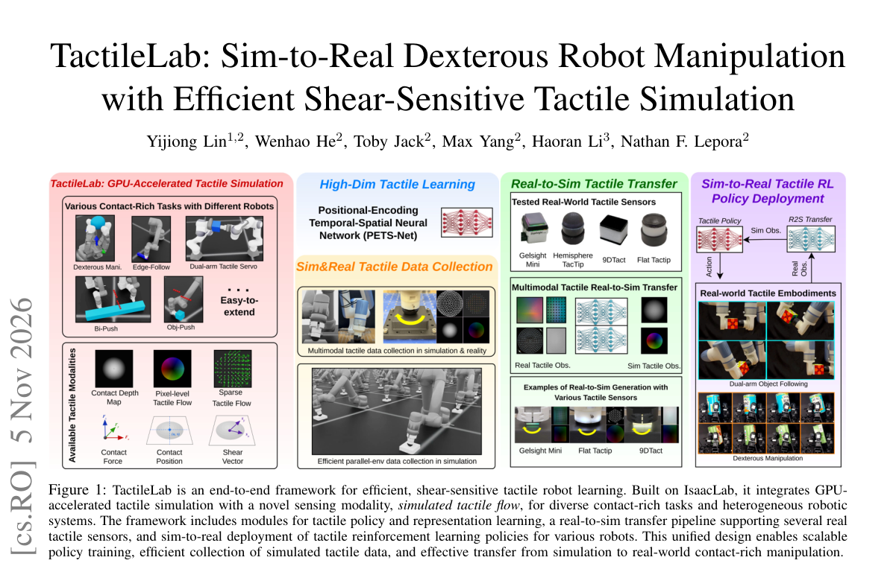

*Result - Overview of the TactileLab simulation framework and simulated tactile-flow computation. The rigid-body simulation pipeline computes contact geometry and generates low-dimensional contact des*

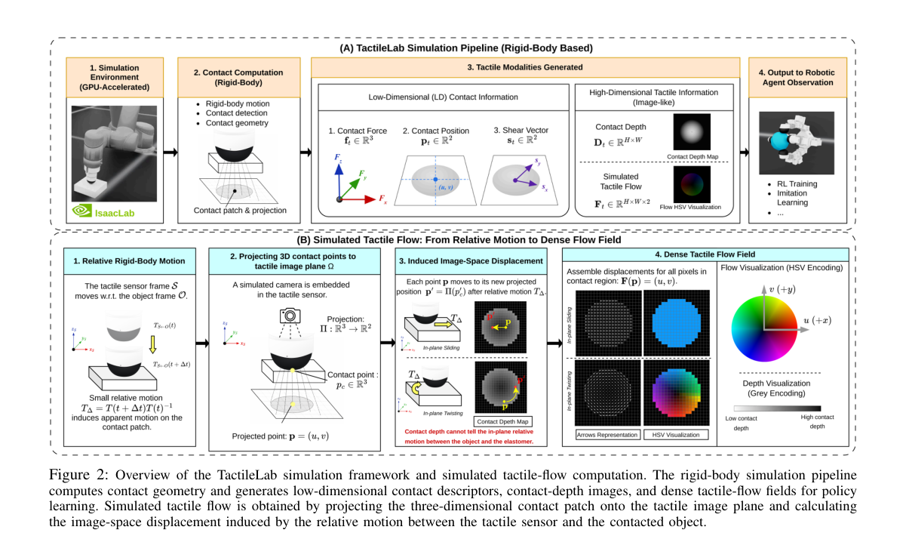

**Why this ranks #1**: 本线第 1 名：不做软体物理而用刚体仿真直接估计接触界面的稠密切向运动，配合 PETS-Net 策略架构完成从仿真到真机的触觉操作迁移，灵巧手内旋转任务上同时做到最长存活时间与最低掉落率（训练分布内 27.01 秒 / 11.76%，OOD 物体 25.08 秒 / 18.69%）。

---

### 2. La-JEPA: Compact Robot Policies with Latent World Modeling

**arXiv**: [2611.08156](https://arxiv.org/abs/2611.08156) | **Score**: 9.7 (relevance 10 x 0.7 + quality 9 x 0.3) | **Tags**: embodied, latent-world-model, jepa-features, diffusion-policy, robot-foundation-model, Huawei Technologies | **Categories**: cs.CV, cs.LG, cs.RO | **Pages**: 30

**Authors**: Mateo Clémente; George Z. Xue; Amin Abyaneh; Liheng Ma; Rui Heng Yang; Tongtong Cao; Zhanguang Zhang; Yingxue Zhang

**Affiliation**: Huawei Technologies; University of Toronto; McGill University; Mila - Quebec Artificial Intelligence Institute

**Abstract**

> World-action models adapt pretrained video generators, and vision-language-action models build on pretrained vision-language backbones; both tie policy architecture and inference cost to large transformers designed for generation rather than control. It remains unclear how much these generation-oriented choices affect control. In this work, we introduce Latent Action JEPA (La-JEPA), a compact world-action model whose policy transformer is trained from scratch in the feature space of a pretrained V-JEPA 2.1 encoder. Following Fast-WAM, La-JEPA learns to predict future features jointly with actions during training and generates only actions at inference. Among policies without embodied pretraining, La-JEPA achieves state-of-the-art performance in clean and randomized RoboTwin 2.0 scenes and on LIBERO-Plus with correct instructions, while using far fewer parameters than the strongest competing policies. It runs substantially faster than Fast-WAM at comparable performance and outperforms the closest JEPA-based methods, LeapBot-WA and JEPA-WAM, on LIBERO-Plus and RoboTwin 2.0 without their pretrained policy backbones. On four real-robot tasks, its average success is comparable to pi0.5 and above non-embodied-pretrained baselines. Through a design study of the choices behind La-JEPA, we show that JEPA features outperform video VAE latents, most clearly out of distribution, and that training-time future prediction choices significantly impact the policy even when future prediction is skipped at inference. We correct the LIBERO-Plus instructions, as the officially released evaluator corrupts them for most variants, and re-evaluate several strong open baselines. Without a generative pretrained policy backbone, La-JEPA is better and faster than far larger policies, suggesting that robot foundation models may benefit from architectures designed for control rather than inherited from generation.

**Key findings**

- **Finding**: La-JEPA 的策略 DiT 从零初始化、只借用冻结的 V-JEPA 2.1 特征，训练时联合预测未来特征与动作、推理时只生成动作；部署参数量约为次优策略的四分之一，比 Fast-WAM 最快可快 5 倍，编译构建下仍比优化后的 Fast-WAM 快 2.6 倍。
- **Inference**: 预训练生成式骨干是为生成而非控制设计的，把它的架构与容量原样继承到策略反而是负担，改用表征型预训练特征配小策略反而更快更强。
- **Recommendation**: 打算自建机器人策略的同学建议先读它的参数与延迟核算表（附录 C），再判断是否值得为固定编码器额外付出参数与推理开销。

**Key figures**

*Framework - Success against deployed parameters, including frozen encoders, on LIBERO-Plus with corrected instructions (Section 5.2) and on RoboTwin 2.0, where the panel reports the equally weighted mea*

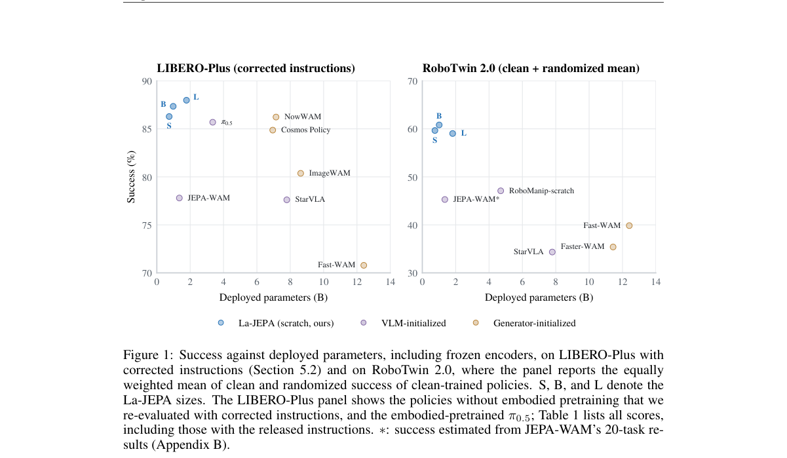

*Result - La-JEPA. Left: general architecture. Right: context and future encoding with V-JEPA 2.1.*

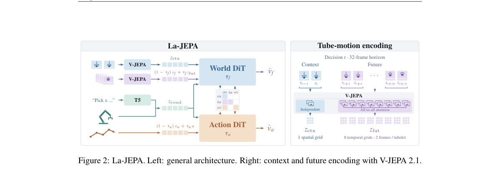

**Why this ranks #2**: 本线第 2 名：策略 Transformer 从零训练在预训练 V-JEPA 2.1 的特征空间里，部署参数量只有次优策略的约四分之一（训练更新 0.10-1.14B，对比视频生成与 VLA 基线的 2.0-7.8B），运行最高可比 Fast-WAM 快 5 倍，纠正指令后的 LIBERO-Plus 上强于所有无具身预训练的策略。

---

### 3. Motion-guided Contrastive Regularization For Latent World Models

**arXiv**: [2611.06901](https://arxiv.org/abs/2611.06901) | **Score**: 9.0 (relevance 9 x 0.7 + quality 9 x 0.3) | **Tags**: embodied, latent-world-model, static-collapse, contrastive-regularization, planning, Northeastern University | **Categories**: cs.CV | **Pages**: 17

**Authors**: Yiwen Chen; Qiqi Hou; Jisoo Jeong; Yinhao Zhu; Huaizu Jiang; Amir Said

**Affiliation**: Northeastern University; Qualcomm AI Research

**Abstract**

> JEPA-style world models learn action-conditioned latent dynamics without reconstructing observations, but distributional regularization alone does not ensure that their representations preserve information needed for control. We identify static collapse, a failure mode in which the encoder preserves episode-specific static content while suppressing manipulation-relevant state changes. Because static content is temporally predictable yet diverse across episodes, this failure can persist despite regularizers such as SIGReg. A controlled study on OGBench-Cube shows that introducing randomized backgrounds substantially degrades planning performance while leaving the underlying manipulation task unchanged. To address this problem, we propose motion-guided contrastive regularization. Our approach compares predicted latent transitions with transitions to candidate observations from the same episode, reducing the usefulness of static background identity for distinguishing action outcomes. Optical-flow similarities provide soft contrastive targets, allowing candidates with similar motion to receive similar supervision. Combined with latent prediction and SIGReg, our objective encourages representations to preserve within-episode state distinctions and similarities between related transitions. Our method improves planning success over LeWorldModel (LeWM) from 52% to 78% on OGBench-Cube with randomized backgrounds and from 14% to 54% on LIBERO-Object, while maintaining comparable performance on four other visual-control benchmarks.

**Key findings**

- **Finding**: 论文把静态塌缩定位为 JEPA 式潜世界模型的失效模式：静态内容时间上可预测但跨回合多样，因此即使有正则也可能持续存在；所提运动引导对比正则把 OGBench-Cube 随机背景下的规划成功率从 52% 提到 78%，LIBERO-Object 从 14% 提到 54%。
- **Inference**: 既然背景身份对区分动作后果没用，对比目标就可以把监督压力从静态外观转移到同回合内的状态区分与相似性上，这解释了为何配对同回合候选观测能同时提分。
- **Recommendation**: 用潜世界模型做规划的同学建议先做一次随机背景的受控实验，若掉分明显就按本文思路补上运动引导的对比正则。

**Why this ranks #3**: 本线第 3 名：指出 JEPA 式世界模型存在「静态塌缩」这一失效模式——编码器保留了与回合绑定的静态内容却压掉操作相关的状态变化，连 SIGReg 这类正则也压不住；所提运动引导对比正则把 OGBench-Cube 随机背景下的规划成功率从 52% 提到 78%、LIBERO-Object 从 14% 提到 54%。

---

### 4. From Pixels to Actions - Towards Native Vision-Language-Action Policies

**arXiv**: [2611.06918](https://arxiv.org/abs/2611.06918) | **Score**: 9.0 (relevance 9 x 0.7 + quality 9 x 0.3) | **Tags**: embodied, encoder-free-vla, flow-matching, layer-probing, pixel-policy, S-Lab | **Categories**: cs.CV | **Pages**: 16

**Authors**: Weichen Fan; Haiwen Diao; Penghao Wu; Siyuan Hu; Ziqi Huang; Tianqi Liu; Mingze Sun; Ziyi Wang; Zhongang Cai; Hanming Deng; Quan Wang; Lei Yang

**Affiliation**: S-Lab, Nanyang Technological University; SenseTime Research; Ropedia

**Abstract**

> Vision-language-action models are typically built on a simple premise: perception is first compressed by visual encoders, and action reasoning begins only afterwards. Yet manipulation often hinges on precisely the visual signals most vulnerable to this abstraction, e.g., local geometry, boundaries, depth, and subtle state changes. This raises a fundamental question: should action policies inherit a fixed visual endpoint, or directly access evolving visual computation? We introduce NEO-VLA, a structurally encoder-free vision-language-action framework. Images are tokenized by lightweight patch convolutional layers and evolve jointly with language throughout the backbone, allowing a flow-matching action expert to draw from instruction-conditioned visual representations at different depths. This simple change reveals a consistent pattern. Native architectures outperform encoder-based counterparts under controlled comparisons; full fine-tuning reduces but does not erase the gap, and additional scale alone cannot recover it. More strikingly, layer-wise probing shows that the action-critical signals often peak well before the final visual representation. Across diverse manipulation settings and distribution shifts, NEO-VLA consequently achieves stronger and more robust control. Together, these results suggest that embodied control benefits from access to visual representations across the computational hierarchy, rather than a fixed encoder output.

**Key findings**

- **Finding**: NEO-VLA 去掉预训练视觉编码器、图像 codebook 与自编码器，图像经轻量 patch 卷积 token 化后与语言在骨干中共同演化，流匹配动作专家可从不同深度的指令条件视觉表示取特征；冻结骨干只训动作专家时 LIBERO 平均成功率 90.9%，对比 Qwen3-VL 的 79.5% 与 Gemma-3 的 84.5%，全量微调后达 95.3%。
- **Inference**: 逐层探针显示动作关键信号在最终视觉表示之前就已达到峰值、交换早层激活造成的预测误差明显大于晚层，说明动作需要的是仍在演化的视觉计算过程而非固定端点。
- **Recommendation**: 做 VLA 骨干选型的同学建议先复现它的冻结骨干对照，再决定要不要为一个固定视觉端点付出额外参数与算力。

**Key figures**

*Framework - Three VLA designs: encoder-based vs. encoder-free backbones, and discrete vs. continuous actions. (a) A separate visual encoder converts pixels into image features, which are consumed by the*

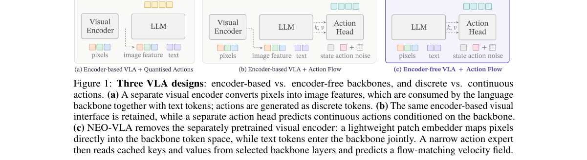

**Why this ranks #4**: 本线第 4 名：提出结构上无视觉编码器的 NEO-VLA，图像由轻量 patch 卷积直接 token 化并与语言在骨干中共同演化；只训动作专家时 LIBERO 平均成功率 90.9%（Qwen3-VL 79.5%、Gemma-3 84.5%），全量微调后 95.3%，LIBERO-Plus 总分 89.7，摄像头扰动下 94.5。

---

### 5. Concertina: Embodying Manipulation and Cognition in One Diffusion Vision-Language Model

**arXiv**: [2611.07513](https://arxiv.org/abs/2611.07513) | **Score**: 9.0 (relevance 9 x 0.7 + quality 9 x 0.3) | **Tags**: embodied, embodied-vlm, diffusion-policy, continuous-action-token, shared-backbone, University of Sydney | **Categories**: cs.AI, cs.CV, cs.RO | **Pages**: 22

**Authors**: Chengcheng Wang; Wei He; Wenhao Li; Hongguang Li; Kai Han; Jianyuan Guo; Chang Xu

**Affiliation**: University of Sydney; TokenRhythm Technologies; City University of Hong Kong

**Abstract**

> Most vision-language-action (VLA) policies decouple manipulation from cognition by bolting an external action mechanism onto a vision-language model (VLM)--either quantizing actions into discrete tokens whose errors bear no stable correspondence to physical displacements, or delegating continuous trajectory generation to a separate action expert whose gradients compete with or are blocked from updating the VLM backbone. We argue that manipulation and cognition should instead be embodied in the same model, shifting from a decoupled VLA to an Embodied Vision-Language Model (eVLM). We introduce Concertina, an eVLM that places continuous trajectory representation, blockwise generation, and physical-coordinate supervision directly on the computation and parameter path of a shared diffusion VLM backbone. Each control timestep is encoded as one continuous latent action token in the backbone hidden space, and the shared Transformer reconstructs temporally ordered action blocks via the same corrupt-and-reconstruct operator used for multimodal pretraining. Active action projections account for only 0.21% of parameters in the 4.46B model with zero separate action-generator layers, compared with 16.5%-35.1% dedicated action-expert capacity in representative continuous VLAs. Using our proposed Action Interface Audit, we confirm that cross-time trajectory coupling emerges in the middle and late layers of the shared backbone rather than at the action interfaces. On standard benchmarks, Concertina achieves 98.15% average success on regular LIBERO, 85.9% on the 10,030-task LIBERO-Plus benchmark, and 4.142 average completed chain length on CALVIN ABC-D. Code: https://github.com/lose4578/Concertina Hugging Face: https://huggingface.co/collections/Traly/concertina

**Key findings**

- **Finding**: Concertina 把每个控制步编码成骨干隐空间里的一个连续动作 token，由共享 Transformer 用与多模态预训练相同的 corrupt-and-reconstruct 算子重建时序动作块；动作投影占 4.46B 模型的 0.21%，而代表性连续 VLA 的专用动作专家占 16.5%-35.1%，模型无独立动作生成层。
- **Inference**: 既然动作可以寄生在 VLM 原有的生成算子上，梯度就不再需要绕过或与骨干竞争，作者据此主张从解耦 VLA 转向具身视觉语言模型这一条路线。
- **Recommendation**: 关心感知与动作该不该共用一个扩散骨干的读者可先读它的 Action Interface Audit——跨时间轨迹耦合出现在共享骨干的中后层而非动作接口上。

**Key figures**

*Framework - Concertina (eVLM) reconstructs continuous action blocks inside a shared diffusion vision-language model. Multimodal inputs and continuous latent action tokens are jointly processed across al*

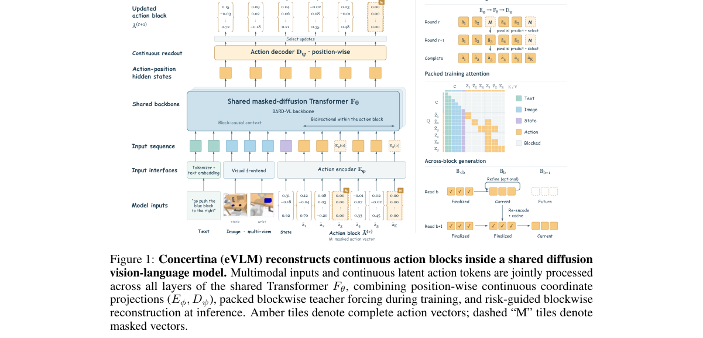

*Result - From decoupled VLAs to an Embodied Vision-Language Model (eVLM). Comparison of four architectural routes to robot manipulation: (A) OpenVLA quantizes coordinates into discrete vocabulary tok*

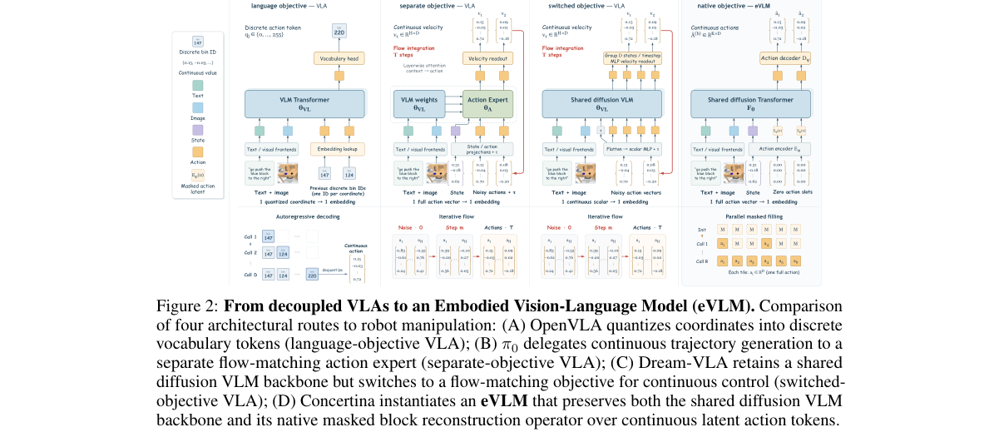

**Why this ranks #5**: 本线第 5 名：把连续轨迹表示、分块生成与物理坐标监督直接放到共享扩散 VLM 骨干的计算与参数路径上，动作投影只占 4.46B 模型的 0.21%（代表性连续 VLA 的专用动作专家占 16.5%-35.1%），LIBERO 常规集平均成功率 98.15%、10,030 任务的 LIBERO-Plus 为 85.9%。

---

### 6. AffectiveVLA: Safe and Intent-Aware VLA Control for Human-Humanoid Social Interaction

**arXiv**: [2611.07712](https://arxiv.org/abs/2611.07712) | **Score**: 9.0 (relevance 9 x 0.7 + quality 9 x 0.3) | **Tags**: embodied, intent-gating, humanoid-social-touch, safe-stop, vla-comparison, Skolkovo Institute of Science and | **Categories**: cs.RO | **Pages**: 5

**Authors**: Nikita Kuzmin; Georgii Demianchuk; Mariya Lezina; Yara Mahmoud; Iana Zhura; Miguel Altamirano Cabrera; Dzmitry Tsetserukou

**Affiliation**: Skolkovo Institute of Science and Technology

**Abstract**

> Social touch interactions, such as handshakes, fist bumps, and hugs, require humanoid robots to infer human intent, generate contact-rich motions, and maintain safe physical contact. We present AffectiveVLA, an intent-gated Vision-Language-Action (VLA) pipeline deployed on a Unitree G1 humanoid with dexterous hands. A lightweight RGB-based model recognizes interaction intent from two onboard cameras and converts it into a language prompt for the VLA policy. Low-confidence predictions suppress motion execution, reducing unintended activations. During physical contact, interaction-specific compliance profiles adjust arm impedance, while an independent voice-triggered mechanism initiates a latched safe-stop procedure. Using VR teleoperation, we collected approximately 1,300 multimodal interaction episodes and fine-tuned four VLA models: GR00T, RLDX-1, Being-H0.5, and UnifoLM-VLA-0. On-robot evaluation identifies GR00T as the best-performing standalone model. Integrating intent recognition increases its macro-F1 score from 0.75 to 0.90, while the intent model achieves a p95 inference latency of 6.27 ms. These results demonstrate that explicit intent gating improves the reliability of VLA-based social interaction without compromising real-time operation.

**Key findings**

- **Finding**: AffectiveVLA 用两路机载 RGB 相机识别交互意图并转成语言提示去门控 VLA，低置信度预测直接抑制动作执行；约 1,300 条 VR 遥操作交互回合微调 GR00T、RLDX-1、Being-H0.5、UnifoLM-VLA-0 后，GR00T 的宏 F1 从 0.75 升到 0.90，意图模型 p95 延迟 6.27 毫秒。
- **Inference**: 把意图识别放在 VLA 前面当门控而不是让策略自己去猜，等于用一个便宜且可拒答的模块承担安全兜底，因此几乎不牺牲实时性。
- **Recommendation**: 做社交机器人或人机协作的同学可借鉴它的四段式结构：意图门控、基于 VLA 的全身动作生成、任务相关柔顺调节与独立语音急停。

**Key figures**

*Framework - AffectiveVLA enables intent-aware and contact-safe execution of three social interactions: (a) handshake, (b) fist bump, and (c) hug. Arrows indicate the direction of interaction motion, and*

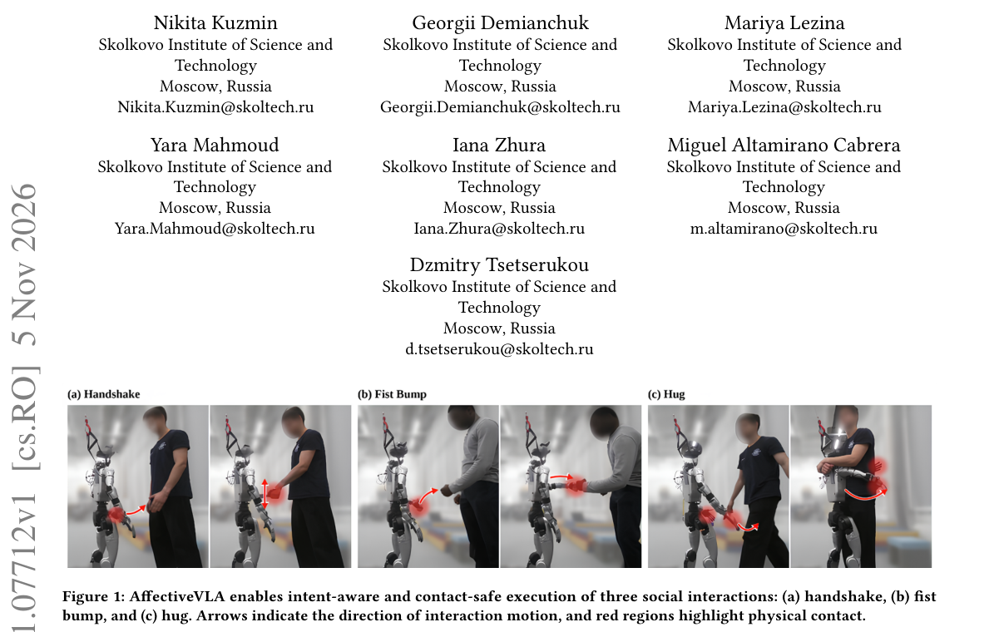

*Result - Overview of the proposed human-aware VLA pipeline. (a) The perception module estimates the human partner’s interaction intent from two RGB camera views, filters uncertain predictions, and in*

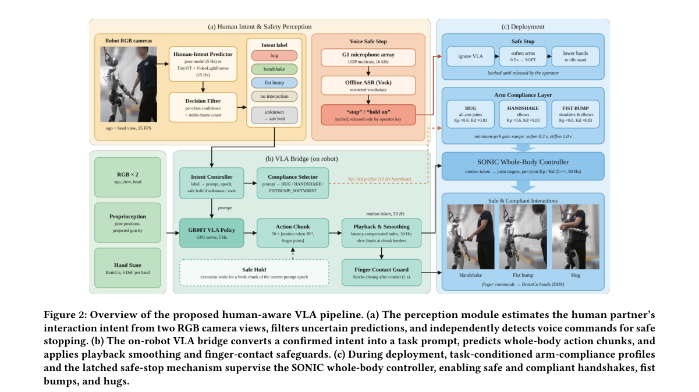

**Why this ranks #6**: 本线第 6 名：在 Unitree G1 人形机器人上部署意图门控的 VLA 流水线，用约 1,300 条 VR 遥操作多模态交互回合微调四个 VLA 模型，接入意图识别后 GR00T 的宏 F1 从 0.75 升到 0.90，而意图模型 p95 推理延迟仅 6.27 毫秒。

---

### 7. Learning Robotic World Models with Semantic and Visual Feedback

**arXiv**: [2611.07850](https://arxiv.org/abs/2611.07850) | **Score**: 9.0 (relevance 9 x 0.7 + quality 9 x 0.3) | **Tags**: embodied, world-model, candidate-comparison, semantic-feedback, group-relative-advantage, City College of New York | **Categories**: cs.CV, cs.RO | **Pages**: 27

**Authors**: Hao Wu; Yuqi Li; Yizhou Zhao; Kun Wang; Xiao Luo; Yu Cheng; Bo An; Yingli Tian; Laszlo A. Jeni; Ming-Hsuan Yang

**Affiliation**: The City College of New York; Nanyang Technological University; University of Wisconsin-Madison; UC Merced

**Abstract**

> Robot world models predict action-conditioned future visual states to support robotic planning and decision making. However, visual reconstruction does not fully capture task progress, semantic evaluation alone provides limited constraints on fine-grained visual errors, and homogeneous predictions limit comparative feedback. We present RoboImagine, a framework for post-training autoregressive robotic world models through candidate-future comparisons with semantic and visual feedback. Diverse search promotes diversity among candidate trajectories under shared visual observations, action sequences, and task instructions. A frozen multimodal evaluator provides task-relevant semantic preferences through pairwise video comparisons in both presentation orders, complemented by pixel- and perceptual-level visual consistency feedback that constrains local structural and appearance errors. These signals drive policy optimization through group-relative advantages. Fixed initial context and branch-specific rolling histories support long-sequence generation with bounded context and consistent conditioning between candidate generation and policy optimization. Experiments with separately trained models on RT-1, BridgeV2, and RoboCasa cover real-world and simulated manipulation. On RT-1, under matched initialization, update counts, and evaluation protocols, RoboImagine improves PSNR by 1.26 dB and reduces LPIPS by 11.93% relative to continued supervised fine-tuning. Ablations show that diverse search improves prediction quality and that combined semantic and visual feedback yields higher external multimodal evaluation scores than visual feedback alone while maintaining comparable visual fidelity. Rolling histories further improve long-horizon prediction. These results support improving visual fidelity, task relevance, and long-horizon prediction through candidate comparison and complementary feedback.

**Key findings**

- **Finding**: RoboImagine 用分组多样行为采样生成候选轨迹，冻结的多模态评价器以两种呈现顺序做成对视频比较给出语义偏好，并补充像素级与感知级一致性约束，最终以组相对优势做策略优化；在 RT-1 上 PSNR 提高 1.26 dB、LPIPS 降低 11.93%。
- **Inference**: 视觉重建无法反映任务进度、纯语义评估又约束不住细粒度误差，只有两类反馈互补才能同时约束「看起来对」与「做得对」这两件事。
- **Recommendation**: 想提升自回归世界模型长程质量的同学可关注它的滚动历史设计与候选比较反馈，消融显示滚动历史对长程预测同样关键。

**Key figures**

*Framework - Complementary feedback for robot world models. Preserved appearance can coexist with stalled task progress, while task advance- ment can coexist with local visual artifacts. Visual fidelity an*

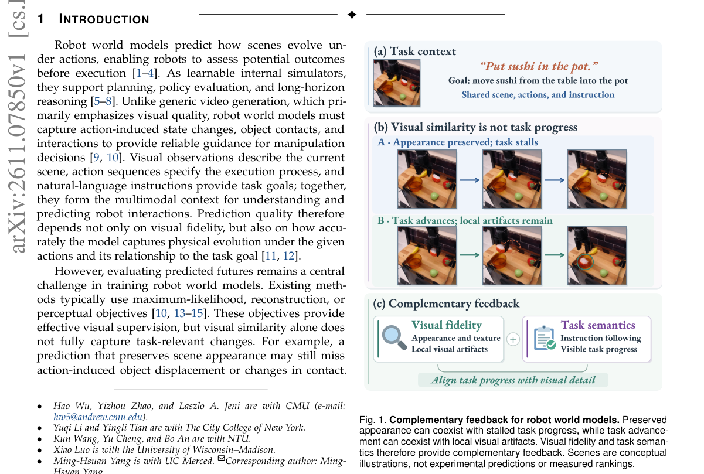

*Result - Multimodal adaptation and learning from complementary feedback in ROBOIMAGINE. Stage 1 learns dynamics-token prediction conditioned on observations, actions, and text. Stage 2 constructs diver*

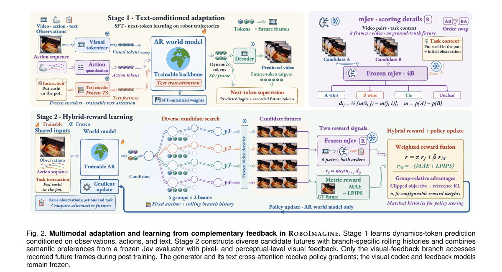

**Why this ranks #7**: 本线第 7 名：把自回归机器人世界模型的后训练改造成「候选未来比较」——冻结的多模态评价器按两种呈现顺序做成对视频比较给出语义偏好，再叠加像素级与感知级一致性反馈，用组相对优势驱动策略优化；在 RT-1 上 PSNR 相对持续监督微调提升 1.26 dB、LPIPS 降低 11.93%。

---

### 8. MOMASPLAT: Dynamic Novel-View Demonstration Augmentation for Mobile Manipulation

**arXiv**: [2611.08372](https://arxiv.org/abs/2611.08372) | **Score**: 9.0 (relevance 9 x 0.7 + quality 9 x 0.3) | **Tags**: embodied, novel-view-synthesis, gaussian-splatting, demonstration-augmentation, base-pose-robustness, University of Texas at Austin | **Categories**: cs.AI, cs.CV, cs.RO | **Pages**: 12

**Authors**: Sateesh Kumar; Arnav Balaji; Arpit Bahety; Skand Peri; Georgios Pavlakos; Roberto Martín-Martín

**Affiliation**: The University of Texas at Austin

**Abstract**

> Visuomotor policies trained through imitation learning are highly sensitive to changes in camera viewpoint. This is particularly problematic for mobile manipulation (MoMa), where robots rarely execute manipulation from the exact same base pose used during demonstration collection due to navigation uncertainty, localization drift, and environmental constraints. Recent approaches use novel-view synthesis (NVS) to augment demonstrations with unseen viewpoints, but they assume static scenes and therefore fail to re-render the manipulated object during the post-contact interaction phase, leaving the most critical parts of the demonstration unaugmented. We present MOMASPLAT, a novel-view demonstration augmentation framework for mobile manipulation that synthesizes full manipulation trajectories from unseen robot base poses, including dynamic object interactions. Our key insight is that standard MoMa data collection naturally provides the multiview observations needed to reconstruct both the static scene and the manipulated object in 3D. MOMASPLAT combines 3D Gaussian Splatting, feed-forward 3D foundation models, and kinematics-based action retargeting to separately reconstruct the scene and manipulated object, render them from novel viewpoints, and generate geometrically consistent synthetic demonstrations paired with transformed actions. We evaluate MOMASPLAT on five real-world mobile manipulation tasks involving both rigid and articulated objects across three scenes, and validate the fidelity of its synthesized demonstrations against ground truth in simulation. MOMASPLAT substantially improves robustness to unseen base poses, more than doubling the average success rate of the strongest baseline and maintaining non-trivial success at large base displacements where all baselines fail, while reducing the need for largescale real-world data collection.

**Key findings**

- **Finding**: MOMASPLAT 组合 3D 高斯泼溅、前馈 3D 基础模型与基于运动学的动作重定向，分别重建静态场景与被操作物体后从新视角渲染；在 PICK-PLACE BOTTLE 上 30 厘米偏移处仍有 33% 成功率、CLOSE LAPTOP 上 40 厘米处 50%，而所有基线在同处已归零。
- **Inference**: 常规新视角合成默认场景静态，因此接触之后的物体阶段根本得不到增强；把被操作物体单独重建再对齐，才补上了演示中最关键的那一段数据。
- **Recommendation**: 做移动操作数据增强的同学可复用「静态场景与动态物体分开重建」这一思路，并参考 10/50/90 条源演示对应 33%/42%/50% 成功率的量效关系来规划采集规模。

**Key figures**

*Framework - MOMASPLAT. Starting from mobile-manipulation data collected at the original base pose (white and red robot), MOMASPLAT synthesizes demonstrations from sampled novel base poses (yellow-outlined*

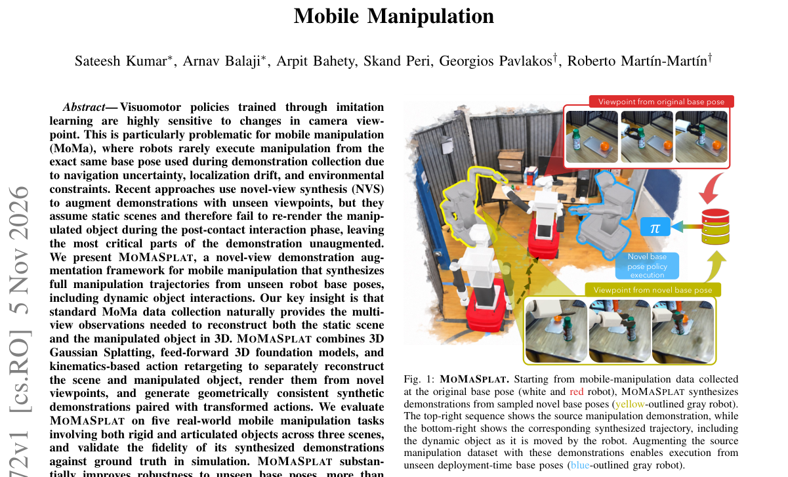

**Why this ranks #8**: 本线第 8 名：针对移动操作中「演示时的底盘位姿和执行时不一致」这一真问题，用 3D 高斯泼溅加前馈 3D 基础模型分别重建静态场景与被操作物体，再做运动学动作重定向生成新视角演示；在 5 个真实任务 3 个场景上把最强基线的平均成功率翻倍以上，30-40 厘米底盘偏移处基线全部归零而它仍有 33%-50%。

---

### 9. LMGN: A Unified Policy Learning Model for Last-Mile Grasp-Navigation

**arXiv**: [2611.07515](https://arxiv.org/abs/2611.07515) | **Score**: 8.7 (relevance 9 x 0.7 + quality 8 x 0.3) | **Tags**: embodied, grasp-reachability, mixture-of-experts, last-mile-navigation, quadruped, Hubei University | **Categories**: cs.RO | **Pages**: 9

**Authors**: Xuenmin Hu; Qingxue Qian; Wei Luo; Benyi Ma; Bo Tang; Long Chen

**Affiliation**: Hubei University; Worcester Polytechnic Institute; Institute of Automation, Chinese Academy of Sciences

**Abstract**

> Legged robots equipped with manipulators have shown significant potential in the fields of daily life and industry in complex environments. However, existing methods mainly focus on global navigation or manipulation independently, while overlooking the last-mile navigation problem, where the robot must jointly determine the base placement, approach direction, and grasp execution to achieve reliable object grasping, and different manipulation stages require distinct control behaviors. To address these challenges, we propose Last-Mile Grasp-Navigation (LMGN), a unified policy learning model for Quadruped robot loco-manipulation. An Explicit Distance and Directional Reachability (ED-DR) representation is first introduced to explicitly represent the features of grasp-compatible base placement and approach direction. We then develop a semantically aligned Hierarchical Mixture-of-Experts (HMoE) policy that models stage-aware behaviors across the stages of base adjustment, pre-grasp alignment and grasp execution, and object lift. Finally, a new optimization method that jointly aligns navigation and manipulation, stage-dependent expert routing, and action-level consistency is proposed to optimize the HMoE policy. Extensive experiments on the Habitat and Isaac Gym simulators demonstrate that LMGN consistently outperforms state-of-the-art methods, denoting that integrating grasp-aware reachability with stage-aware policy learning significantly improves the success rates of last-mile navigation and target grasp for robots.

**Key findings**

- **Finding**: LMGN 用显式距离与方向可达性表示（ED-DR）刻画可抓取的底盘位姿与接近方向，层次化混合专家按底盘调整、预抓取对齐、抓取执行、物体提升分阶段路由，并联合优化导航与操作；在 Habitat 上 GazeSR 73.9%、GraspSR 74.8%，相对 VBC 提高 4.9 与 22 个百分点。
- **Inference**: 抓取成功率提升 22 点远大于注视成功率的 4.9 点，说明主要增益来自阶段化策略表达，而不只是底盘位姿选得更准。
- **Recommendation**: 做腿式机器人最后一公里抓取的同学可先看 ED-DR 的几何构造，再注意联合优化里的 action-level consistency 是去掉后掉分最多的一块。

**Key figures**

*Framework - Overview of the proposed LMGN. The policy fuses grasp-guided reachability features, point-cloud observations, object pose, and proprioception, then uses a geometry-aligned hierarchical MoE p*

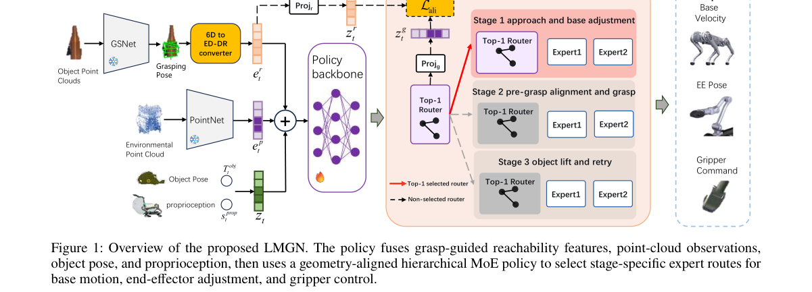

*Result - ED-DR representation.*

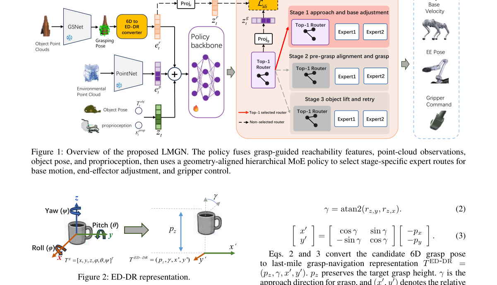

**Why this ranks #9**: 本线第 9 名：把「最后一公里抓取导航」作为统一问题，用 ED-DR 表示显式刻画可抓取的底盘位姿与接近方向，配合分阶段的层次化混合专家策略；在 Habitat 上取得 73.9% 注视成功率与 74.8% 抓取成功率，相对 VBC 分别提高 4.9 与 22 个百分点，相对 GAMMA 提高 7.6 与 10.3 个百分点。

---

### 10. GPWM: Modeling the World as 3D Particle Motion

**arXiv**: [2611.08338](https://arxiv.org/abs/2611.08338) | **Score**: 8.7 (relevance 9 x 0.7 + quality 8 x 0.3) | **Tags**: embodied, particle-world-model, flow-matching, diffusion-forcing, contact-planning, Carnegie Mellon University | **Categories**: cs.RO | **Pages**: 39

**Authors**: Robert Ren; Matthew Bronars; He Zhu; Yikai Tang; Jianing Zhang; Sergey Zakharov; Pavel Tokmakov; Katerina Fragkiadaki

**Affiliation**: Carnegie Mellon University; Toyota Research Institute

**Abstract**

> We introduce GPWM, a Generative Particle World Model that predicts how 3D scenes evolve by generating the motion of particles and rigid bodies over time. Unlike video world models that generate scene appearance, GPWM operates directly in 3D physical space. A single representation and architecture cover rigid, deformable, cloth, and granular materials, in both passive physics and robotic interaction. GPWM is an object-aware multi-resolution transformer that combines flow matching with diffusion forcing to generate coherent physical trajectories far beyond its training horizon. We train and evaluate GPWM on ParticleWorlds, a 25.5-million-frame corpus spanning diverse geometries, materials, interactions, and robot embodiments. GPWM outperforms the best prior learned-dynamics baseline in each of six physical domains, reducing prediction error by 31% on average. Breaking from the domain-specific setting of prior methods, a single Unified GPWM models these heterogeneous regimes with one set of weights, largely outperforming per-domain baselines and even surpassing our own specialist models in two domains. GPWM further generalizes to unseen geometries, physical properties, object counts, and rollout horizons. Beyond prediction, GPWM enables contact-rich planning by learning a generative prior over joint actuator-object motion. Instead of searching over unconstrained actions, planning searches the model's latent noise for interactions that achieve a desired object-space goal. With the same world model, noise-space planning substantially outperforms action-space search on pushing and picking, where complex contact sequences are hard to discover. Executed open-loop in simulation, the resulting plans achieve goal-directed manipulation without reference action trajectories or goal-specific policies.

**Key findings**

- **Finding**: GPWM 是对象感知的多分辨率 Transformer，把流匹配与 diffusion forcing 结合以生成超出训练时域的连贯物理轨迹；它在 2,550 万帧的 ParticleWorlds 语料上训练，六个物理域中预测误差平均比最好的已学动力学基线低 31%，单一统一模型在两个域上反超自家的专用模型。
- **Inference**: 既然一套权重能跨刚体、变形体、布料与颗粒统一，建模就不必按材料各训一个专用模型，这把物理建模的数据与工程成本压了下去。
- **Recommendation**: 需要可交互物理先验（尤其接触密集任务）的同学可关注它的噪声空间规划：在同一世界模型里搜潜噪声就能直接生成关节-物体运动，而不必在无约束动作空间里搜。

**Key figures**

*Framework - GPWM learns 3D particle dynamics across six physical domains. Top: samples from the six domains of Parti- cleWorlds. Middle: given the observed frames and a noisy future, a U-shaped multi-res*

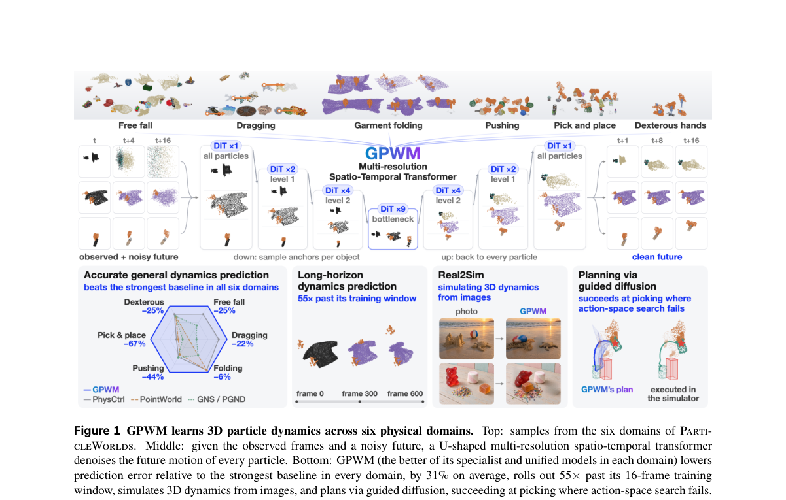

*Result - GPWM architecture. Noisy per-particle tokens, which embed displacement, actuator motion, geometry, physical parameters, and material, pass through a multi-resolution DiT. PointNet++ layers po*

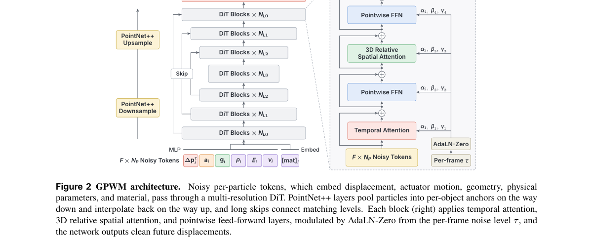

**Why this ranks #10**: 本线第 10 名：直接在三维物理空间里生成粒子与刚体运动，用一套架构与一套权重覆盖刚体、变形体、布料与颗粒介质，在 2,550 万帧的 ParticleWorlds 语料上六个物理域全面超过最好的已学动力学基线，平均预测误差降低 31%。

---

