# ArXiv Daily Digest - 2026-11-06 (生成式内容模型的 RL, 10 papers)

**Generated**: 2026-11-06 17:30 CST

**Source**: arXiv cs.CV, cs.SD, eess.AS, cs.CL, cs.AI, cs.RO, cs.LG submissions, listing day 2026-11-05 (announced 2026-11-06 00:00 UTC)

**Batch window**: 2026-11-04T18:00:00Z .. 2026-11-05T18:00:00Z（arXiv 公告批次横跨两个 UTC 日：前一日 18:00 UTC 起算，当日 17:59:59 UTC 截止）

**Track**: rl_aigc (top 10 of 510 papers scanned, 70 full reads)

**Scope**: 生成式内容模型的 RL：扩散 / 流匹配 RL、生成式奖励模型与推理期采样扩展

⚠️ **Wild-card**: 本线 10 篇中 6 篇为 wild-card 补位，硬相关的「生成模型 RL 后训练」论文本批次只有 4 篇。

严格命中本线的只有四篇：视频生成的可验证 artifact-as-rubric 奖励模型（ArtiVidRM）、少步扩散的 RL 微调（FewStepRL）、扩散语言模型的 block 级策略优化（PBPO），以及生成器对齐奖励建模 + 目标感知有界优化 + Flow-GRPO 改造（GARM/TABO/TA-GRPO）。其余 6 篇按生成模型后训练/蒸馏/评测的相邻方向补位：扩散 docking 的聚焦后训练监督、闭式 Fisher critic 扩散蒸馏、竞争式流匹配训练目标、区间积分 CFG、扩散模型优化式合并，以及文生图生成器的代理审计评测。每篇均在条目上标注具体补位理由。

---

## Top 10 - 生成式内容模型的 RL

### 1. ArtiVidRM: Verifiable Artifact-as-Rubric Reward Modeling for Explicit Quality Articulation in Video Generation

**arXiv**: [2611.07301](https://arxiv.org/abs/2611.07301) | **Score**: 10.0 (relevance 10 x 0.7 + quality 10 x 0.3) | **Tags**: rl-aigc, video-generation, reward-model, artifact-rubric, grpo, verifiable-reward, Southeast University | **Categories**: cs.CV | **Pages**: 18

**Authors**: Caorui Li; Yangguang Ji; Shuxia Lin; Yu Chen; YiCheng Xiao; Yongliang Wu; Zhenxiang Jiang; Licheng Tang; Deng Li; Zhuxuanzi Wang; Jiahao Sun; Chonghan Liu

**Affiliation**: Southeast University; Opus AI Research; Institute of Automation, Chinese Academy of Sciences; University of Illinois Urbana-Champaign; University of California, Los Angeles

**Abstract**

> Reinforcement learning has become an effective approach for improving video generation, but its success depends heavily on reliable reward models. Existing methods either map videos directly to opaque scalar scores or generate free-form rationales that are not explicitly optimized as the basis of the final judgment. We propose ArtiVidRM, a verifiable, artifact-as-rubrics video reward model that follows an observe-then-score paradigm. It first identifies visible generation artifacts and organizes them into a structured artifact list, then uses these artifacts as explicit rubrics for quality assessment. This intermediate representation grounds each score in concrete video-level evidence, making the reward more interpretable and informative for optimization. We further introduce a multi-reward reinforcement learning strategy to jointly optimize artifact prediction and quality assessment. The reward decomposes into complementary objectives that evaluate artifact prediction quality, including semantic coverage and prediction efficiency, together with a pairwise preference objective that supervises quality ranking through score differences. By jointly optimizing the intermediate artifact representation and the downstream preference prediction, the model learns to produce informative artifact lists while improving the accuracy of video quality assessment. Experiments show that ArtiVidRM achieves state-of-the-art performance on video preference benchmarks, provides effective signals for video diffusion optimization, and enables artifact-guided refinement of closed-source video generators.

**Key findings**

- **Finding**: 训练数据为 22,640 对视频，Qwen3-VL-32B 复核剔除 26.8% 的伪影候选，最终每个视频平均保留 6.11 条伪影，六位专家人工抽检的召回率 87.84%、精确率 84.37%、Fleiss κ 为 0.78。
- **Inference**: 把「缺陷种类」固化成可逐条核验的离散证据，比让模型直接输出一个不可分解的标量分更容易泛化到训练时没见过的缺陷类型，也让奖励可以按语义维度反向归因。
- **Recommendation**: 做视频生成奖励模型的同学优先读伪影清单构造与人工核验流程两节，再看 GRPO 多奖励怎么用 λf 0.15、λr 0.40、λp 0.45、λl 0.05 把伪影召回、预测效率与成对偏好拧在一起。

**Key figures**

*Framework - Overview of ArtiVidRM. By explicitly predicting structured artifact lists before quality scoring, ArtiVidRM enables (1) accurate video preference prediction, (2) reward-guided optimiza- tion*

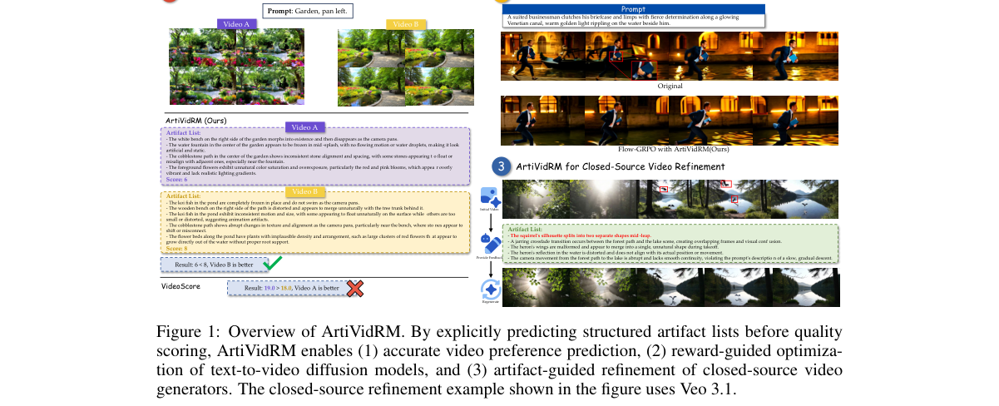

*Result - Overview of the artifact-augmented preference data construction pipeline.*

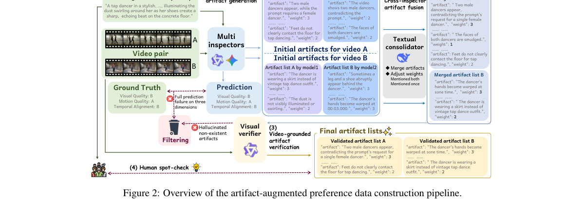

**Why this ranks #1**: 本线第 1 名，硬命中：把视频生成的伪影本身当成可核验的 rubric 来打分，是本批次生成模型奖励建模里最完整的一套方案。训练数据含 22,640 对视频，Qwen3-VL-32B 复核剔掉 26.8% 的伪影候选，最终每个视频平均留 6.11 条伪影，六位专家人工抽检的召回率 87.84%、精确率 84.37%、Fleiss κ 0.78；GenAI-Bench 去掉平局后成对准确率 0.753 超过 VisionReward 的 0.744，VBench-2.0 上 0.572 与 0.524 两项均为最佳，MonetBench 的 0.606 与 0.697 居次；用该奖励优化 Wan2.1-1.3B 后 VBench 运动平滑 97.41%→98.38%、成像质量 61.31%→63.85%，盲评中 60% 的对比偏好优化后的视频、14% 判平，还能把伪影清单转成自然语言反馈去二次精修闭源的 Veo-3.1。

---

### 2. Generator-Aligned Reward Modeling with Target-Aware Bounded Optimization for Visual Generation

**arXiv**: [2611.07648](https://arxiv.org/abs/2611.07648) | **Score**: 9.7 (relevance 10 x 0.7 + quality 9 x 0.3) | **Tags**: rl-aigc, reward-modeling, bounded-optimization, flow-matching, grpo, curriculum, Institute of Artificial Intelligence | **Categories**: cs.CV | **Pages**: 24

**Authors**: Ziqiao Weng; Yuanzhi Liang; Haibing Huang; Weidong Cai; Xuelong Li

**Affiliation**: Institute of Artificial Intelligence, China Telecom (TeleAI); The University of Sydney

**Abstract**

> Post-training aims to enhance desired attributes in visual generative models while preserving their general generation capabilities. Reward-guided post-training faces two challenges: real training data may mismatch the generator's output distribution, and attribute supervision may be confounded by unrelated content. Unbounded reward maximization can also cause overoptimization and degrade generation quality. We propose a framework combining Generator-Aligned Reward Modeling (GARM) and Target-Aware Bounded Optimization (TABO). GARM mitigates distribution mismatch through generator-support matching and reduces content confounding using content-matched real contrasts, yielding generator-relevant, attribute-focused reward supervision. TABO maps the learned reward to a smooth, upper-bounded function calibrated from real target-positive examples. This transformation is independent of the optimization algorithm and supports both direct reward-gradient and policy-based optimization. We further introduce Target-Aware GRPO (TA-GRPO), an adaptation of Flow-GRPO that combines fixed stage-wise advantage scaling, a generator-to-target curriculum, and timestep-balanced credit assignment for flow-based video optimization. Experiments show that GARM improves target-attribute expression while maintaining competitive generation quality. TABO better balances attribute enhancement and visual quality than unconstrained reward maximization, while TA-GRPO improves target enhancement over vanilla Flow-GRPO and reduces unintended attribute leakage on neutral prompts. These results highlight the importance of generator-aligned reward supervision and controlled, data-calibrated optimization for targeted visual generation.

**Key findings**

- **Finding**: GARM 构造五个互斥训练池（匹配正样本、覆盖正样本、内容匹配难负样本、匹配负样本、覆盖负样本），以二分类交叉熵训练奖励模型，目标属性覆盖复古褪色、油画、肌肉感与二次元动画四类。
- **Inference**: 奖励建模与奖励使用是两个可分离的故障源——前者要靠数据分布对齐解决，后者要靠目标感知的上界变换解决，把两者混在一起调参正是过优化的根因。
- **Recommendation**: 做视觉生成的奖励微调时，先查训练对的分布是否覆盖生成器的实际输出，再查奖励是否有上界约束；TA-GRPO 的课程设计与时间步平衡信用分配可直接借用到自己的 Flow-GRPO 改造里。

**Key figures**

*Framework - Targeted attribute enhancement with largely preserved general generation performance. Top: Base vs. Ours across four attributes (Vintage Faded, Oil Painting, Muscular, and 2D Japanese anime*

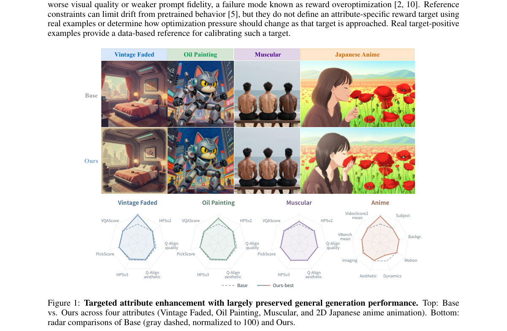

*Result - Overview of our framework. GARM aligns real supervision with the generator-relevant regions defined by paired Base/Target anchors and introduces content-matched negatives to form an attribut*

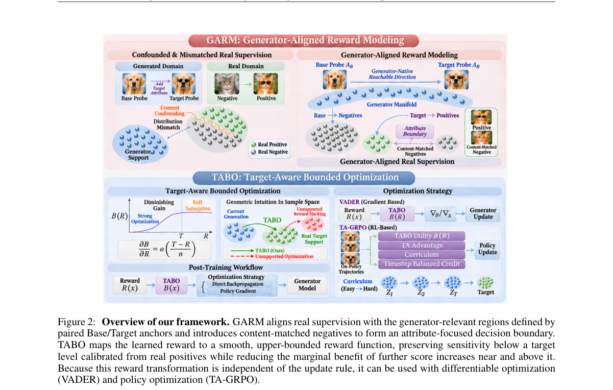

**Why this ranks #2**: 本线第 2 名，硬命中：把「奖励怎么学」与「奖励怎么用」当成两个独立问题分别解。GARM 用生成器支撑匹配加内容匹配的真实对比，构造出五个互斥训练池（匹配正样本、覆盖正样本、内容匹配难负样本、匹配负样本、覆盖负样本），让奖励既贴合生成器输出分布又把目标属性与无关内容解耦；TABO 把学到的奖励映射成由真实 target-positive 样本校准的平滑上界函数，从根上压住无约束奖励最大化的过优化，而且与优化算法解耦；TA-GRPO 再把 Flow-GRPO 改造成带固定分阶段优势缩放、生成器到目标的课程、时间步平衡信用分配的目标感知版本。实验覆盖图像与视频两类生成、复古褪色／油画／肌肉感／二次元动画四个目标属性，并分别用直接奖励梯度（VADER）与策略优化（TA-GRPO）两条路径验证，还检查中性提示词上的属性泄漏。

---

### 3. FewStepRL: Fine-tuning Few-step Diffusion Models with Reinforcement Learning

**arXiv**: [2611.08240](https://arxiv.org/abs/2611.08240) | **Score**: 9.7 (relevance 10 x 0.7 + quality 9 x 0.3) | **Tags**: rl-aigc, few-step-diffusion, reinforcement-learning, flow-grpo, objective-decomposition, few-step-distillation, Tencent Hunyuan | **Categories**: cs.CV, cs.LG | **Pages**: 86

**Authors**: Haitao Lin; Minsi Ren; Yang Li; Xingtong Ge; Zheyuan Hu; Peiyan Hu; Tailin Wu

**Affiliation**: Tencent Hunyuan; Westlake University; University of Chinese Academy of Sciences

**Abstract**

> Reinforcement learning (RL) has become a standard post-training method for diffusion models, but most RL objectives roll out the current policy at every iteration, and with a many-step sampler these rollouts typically dominate the cost of training. Few-step models cut this cost, yet they model an average velocity over an interval, whereas existing RL objectives are built for an instantaneous velocity with a many-step sampler. We adapt RL objectives to few-step models systematically in three phases, namely a transformation, a decomposition and an adaptation. The transformation to $x$-space expresses each objective we consider through a common policy prediction, at the clean end by default and at an explicitly marked level for transition or flow-map objectives, so that objectives stated over densities, velocities or rewards become comparable. The decomposition writes the gradient of each of these objectives as the sum of a self-regression toward a reference and a reward augmentation, so that a method reduces, at the gradient level, to a choice of anchors and weights. The adaptation computes each anchor from a few-step model at the end of its transport or along its tangent, with the instantaneous velocity recovered from the network itself or from an auxiliary network. This yields few-step versions of FlowGRPO, AWM, DiffusionNFT, DiffusionOPSD and ReFL in one modular codebase. In our experiments, reward-gradient-based methods are the most effective when the reward is differentiable and its gradient is affordable; otherwise DiffusionNFT-style methods generally reach high rewards in relatively few iterations despite a sometimes higher per-iteration cost. Extra inference steps show no systematic aggregate benefit in our experiments, although selected outputs visibly improve with two to four times as many sampling steps as in training.

**Key findings**

- **Finding**: 论文把每个 RL 目标的梯度统一拆成「自回归到参考」加「奖励增强」两部分，于是各方法在梯度层面只剩 anchor 与权重的差异，并在同一套代码里实现了 FlowGRPO、AWM、DiffusionNFT、DiffusionOPSD、ReFL 的少步版本。
- **Inference**: 少步模型建模的是区间平均速度而非瞬时速度，直接套用原目标会留下「该对哪次网络求导、参考策略怎么算、区间哪一段参与训练」三个未决选择，而这些选择本身就是不同方法效果差距的来源。
- **Recommendation**: 要在少步扩散上做 RL，先用本文的三阶段改造把目标对齐到 x 空间再谈算法选择；奖励可微且梯度负担可承受时奖励梯度类方法最有效，奖励不可微时 DiffusionNFT 式方法在较少迭代内拿到高奖励更实际。

**Key figures**

*Framework - Held-out GenEval2 against the RL iteration in the mixed-reward setting of §6.1, from the shared pre-RL few-step checkpoint. Dashed: the original objective applied to the distilled model with*

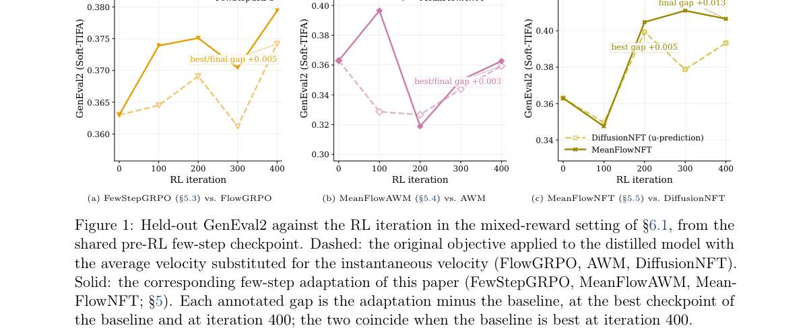

**Why this ranks #3**: 本线第 3 名，硬命中：系统性地把已有的扩散 RL 目标改造成少步模型能用的版本，分三步——先统一变换到 x 空间，再把每个目标的梯度拆成「自回归到参考」加「奖励增强」两项，最后在少步模型上重算各个 anchor 与权重。一次改动同时覆盖 FlowGRPO、AWM、DiffusionNFT、DiffusionOPSD、ReFL 五个目标、共七种实现，并在同一套 rollout／奖励／评测代码下横向比较。直接拿蒸馏模型的平均速度冒充原目标要的瞬时速度，三个案例的最好 GenEval2 都低于改造后的版本；改造后 FewStepGRPO 相对 FlowGRPO 最好-最终差 +0.005，MeanFlowAWM 相对 AWM +0.003，MeanFlowNFT 相对 DiffusionNFT 最好 +0.005、最终 +0.013。实验用 AnyFlow 蒸馏的 SD3.5-Medium 与 Wan2.1-T2V-1.3B，分别在不可微的 OCR 奖励与可微混合奖励下验证。

---

### 4. PBPO: Prefix-Block Policy Optimization for Diffusion Language Models

**arXiv**: [2611.07783](https://arxiv.org/abs/2611.07783) | **Score**: 9.0 (relevance 9 x 0.7 + quality 9 x 0.3) | **Tags**: rl-aigc, diffusion-language-model, policy-optimization, block-level, variance-control, token-clipping, Meta | **Categories**: cs.LG | **Pages**: 29

**Authors**: Katherine Tieu; Dongqi Fu; Si Zhang; Hanqing Zeng; Tianxin Wei; Chenglin Wei; Yinglong Xia; Hong Li; Jingrui He

**Affiliation**: Meta; University of Illinois Urbana-Champaign

**Abstract**

> Diffusion Large Language Models (dLLMs) commonly decode responses by proceeding autoregressively across blocks while iteratively denoising multiple tokens within each block. This structure makes block-level policy optimization a natural adaptation of autoregressive policy optimization. However, the exact likelihood of a completed block is intractable because it marginalizes over the intermediate states and reveal orders of the denoising process. To realize the block-level formulation, we construct a prefix-block state and use a single model evaluation to define a factorized one-step surrogate for the block likelihood. The resulting block surrogate ratio is a product of its token surrogate ratios, allowing variation at individual positions to propagate across the entire block before clipping. We therefore introduce Prefix-Block Policy Optimization (PBPO), which preserves block-level conditioning but applies surrogate importance weighting and clipping separately to each token. PBPO further diversifies repeated updates by resampling corrupted views of the prompt and revealed prefix, a design motivated by masked-dLLM pre-training. Under our analysis assumptions, block-product weighting amplifies the variance of gradient contributions relative to token-local weighting. Across two LLaDA-family initializations, six benchmarks, and three generation lengths, PBPO achieves competitive performance against existing dLLM RL methods.

**Key findings**

- **Finding**: PBPO 用一次模型前向构造 prefix-block 状态并给出因子化的一步块似然代理，块内每个 token 共享同一条件但单独做重要性加权与裁剪；论文分析指出块乘积权重相对 token 局部权重会放大梯度方差。
- **Inference**: 块级似然不可解析不只是实现细节，而是优化稳定性问题，保留块级条件同时对 token 分别裁剪，是在「用上块结构」与「别把方差乘出来」之间取的折中。
- **Recommendation**: 做扩散语言模型 RL 后训练可先复现本文的块乘积方差分析，再把 token 级裁剪接进自己的目标；评测时建议同时看任务准确率与有效生成长度，PBPO 在 29 个配置里产出最短或次短的回复。

**Key figures**

*Framework - Reward dynamics on MATH500, trained upon LLaDA-8B-Instruct. PBPO demonstrates stable training, while block-level objective collapses early during training.*

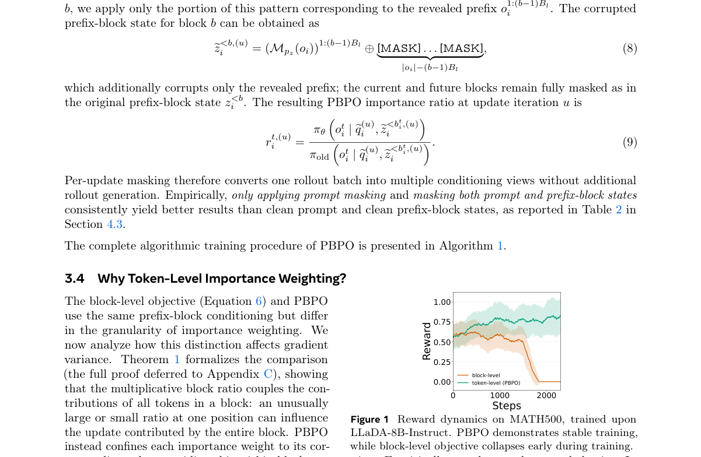

*Result - Reward dynamics during five RL post-training runs initialized from LLaDA-8B-Instruct. We report the mean and standard deviation over a rolling window of 50 training steps.*

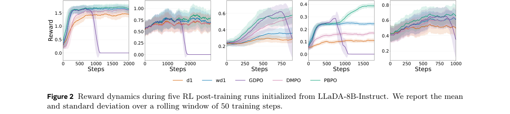

**Why this ranks #4**: 本线第 4 名，硬命中：把自回归的策略优化搬到扩散语言模型的块级解码上，核心是承认「一个完整块的似然无法解析求值」这一事实——用一次模型前向构造 prefix-block 状态，给出因子化的一步代理似然，让块内各 token 共享同一条件、却各自独立做重要性加权与裁剪，从而避开块乘积权重放大梯度方差的问题。在 LLaDA-8B-Instruct 与 LLaDA-1.5 两个初始化、六个基准、三种生成长度（128／256／512）上评测，30 组「基准 × 去噪配置」中 20 组最优、2 组并列、5 组次优、3 组第三；相对次优方法的平均领先幅度在 GSM8K、MATH500、Sudoku、HumanEval、MBPP 上分别为 2.00、2.20、9.63、0.20、3.11 个百分点。

---

### 5. Expanding the Quality-Coverage Frontier with Competitive Flow Matching

**arXiv**: [2611.07055](https://arxiv.org/abs/2611.07055) | **Score**: 8.3 (relevance 8 x 0.7 + quality 9 x 0.3) | **Tags**: rl-aigc, flow-matching, winner-take-all, quality-coverage, auxiliary-conditioning, image-generation, Cornell University | **Categories**: cs.CV | **Pages**: 40

**Authors**: Wenxuan Peng; Richard Zhang; Haitian Zheng; Jaskirat Singh; Tsai-Shien Chen; Eli Shechtman; Bharath Hariharan; Hadar Averbuch-Elor; Zongze Wu

**Affiliation**: Cornell University; Adobe Research

**Abstract**

> Flow matching (FM) generators often face a quality-coverage tradeoff. Inference-time techniques such as classifier-free guidance raise quality, but at the cost of coverage. We hypothesize this limitation stems from a basic property of the objective: an intermediate noisy image could correspond to many clean images, yet the model can only predict a single velocity, at best averaging over the multiple possibilities. To mitigate this, we introduce competition among predictions during training. We achieve this by augmenting the predictor with a randomly drawn low-dimensional conditioning code $z$. For each training example, we sample $K$ values of $z$ to produce $K$ candidate velocities that compete to explain the target, and apply the loss only to the best-matching candidate. This winner-take-all objective allows different modes to shape different predictions, rather than being averaged into a single compromise. Furthermore, this term naturally enables a new form of guidance, auxiliary conditioning scaling, which complements traditional guidance methods. Together, these two guidance mechanisms show that our method substantially improves the quality-coverage frontier. We validate on ImageNet-256, using two different testbeds, SiT and RAEv2. Given less than 3% of the original SiT pretraining compute for post-training, at the 67% Recall point, our method reduces $\mathrm{FD}_{r,6}$ from 19.22 to 5.91. On RAEv2, at the 70% Recall point, it reduces $\mathrm{FD}_{r,6}$ from 16.83 to 3.18.

**Key findings**

- **Finding**: 方法给预测器加一个低维高斯条件码 z，每个训练样本采 K 个 z 得到 K 个候选速度，只对 FM 回归误差最小的候选施加损失；SiT 上 K = 8、后训练 10 个 epoch，算力不到预训练的 3%，匹配 Recall 时 FD_r,6 从 19.22 降到 14.94、FID 从 11.17 降到 7.22。
- **Inference**: 标准流匹配回归只能给出一个平均速度，把多模态目标之间的竞争搬到训练时用 winner-take-all 化解，等于用「谁最匹配就谁负责」的局部选择替代不可分解的全局平均。
- **Recommendation**: 想在流匹配上扩覆盖率的同学可直接借它的辅助条件缩放做几乎零推理开销的引导调节，并从 K = 1 逐步加大候选数观察精度与覆盖率的位移；注意这篇是训练目标改造，不是 RL 后训练工作。

**Key figures**

*Framework - Our method expands the quality–coverage frontier toward high-coverage, high-quality generation. FDr,6–Recall Pareto frontiers reported on ImageNet-256, compare our method with recent strong*

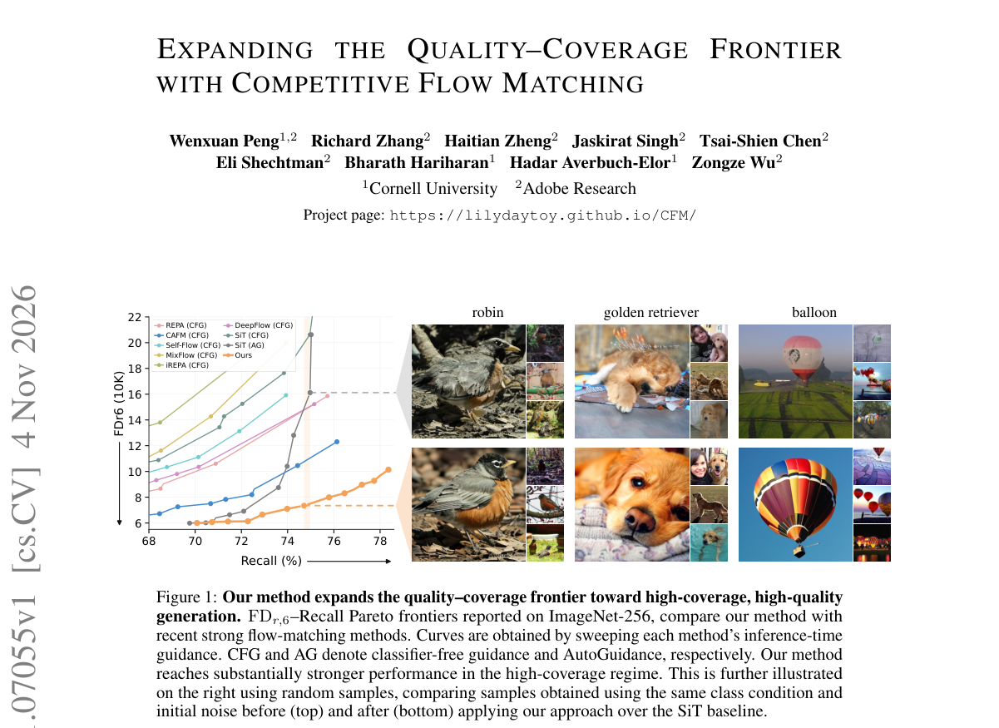

*Result - A 1D toy illustrating conflicting velocity targets in flow matching. (a) Transport from a unimodal source to an imbalanced bimodal target. (b) Standard FM produces off-support mass and incom*

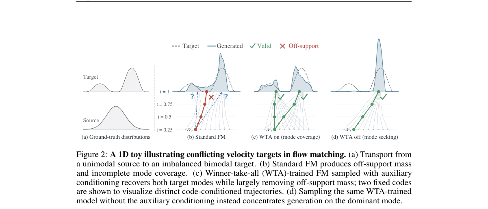

**Why this ranks #5**: 补位说明：这是流匹配训练目标与选择机制的工作，训练中让 K 个候选速度互相竞争、只对最优匹配者施加损失，没有策略梯度、奖励模型或偏好优化，属于本线的相邻方向而非 RL 硬供给。数据很硬：给预测器接一个低维高斯条件码 z，每个训练样本采 K 个 z 得到 K 个候选速度，只用 FM 回归误差最小者更新；SiT 上后训练 10 个 epoch、K = 8，算力不到预训练的 3%，在匹配 Recall（预训练 SiT 66.91%、本方法 66.83%）的无引导评测里 FD_r,6 从 19.22 降到 14.94、FID 从 11.17 降到 7.22，关掉辅助条件（λ = 0）时 FD_r,6 更低到 12.15（FID 4.59）；带引导时在 67% Recall 处 FD_r,6 从 19.22 降到 5.91、最高质量点为 4.44，RAEv2 上 70.32% Recall 处为 3.18、对应基线 16.83。  [wild-card=yes] 竞争式流匹配在训练中引入多候选速度并只对最优匹配者施加损失，属于流匹配训练目标与选择机制，与本线流匹配 RL 相邻。

---

### 6. Guidance Is a Field, Not a Scalar: Interval-Integrated Classifier-Free Guidance for One-Step Video Generation

**arXiv**: [2611.07566](https://arxiv.org/abs/2611.07566) | **Score**: 8.3 (relevance 8 x 0.7 + quality 9 x 0.3) | **Tags**: rl-aigc, classifier-free-guidance, one-step-generation, meanflow, video-generation, guidance-field, Peking University | **Categories**: cs.CV | **Pages**: 10

**Authors**: Zijie Meng; Xixin Cao

**Affiliation**: Peking University

**Abstract**

> One-step generators built on MeanFlow synthesize a video in a single function evaluation, yet inherit a rigid treatment of classifier-free guidance (CFG): the guidance scale is frozen during training or, at best, exposed as a single scalar. This conflicts with mounting evidence that the optimal guidance is not a constant but a field that varies with the noise level, with spatial content, and, for video, with frame position. Every existing remedy presupposes a multi-step sampler along which guidance can be re-scheduled--an assumption one-step models violate by construction. We resolve this tension through a single observation: because the MeanFlow target is an integral over a noise interval, an arbitrary guidance field can be absorbed into the target itself and compiled into one evaluation. We formalize this as the interval-integrated CFG identity, prove that the compiled guidance carries no schedule-discretization error and can thus match or exceed any finite multi-step sampler, and instantiate it as AGAVE, which equips the average-velocity field with a learnable temporal schedule, a free motion-saliency spatial modulation, and a frame-position asymmetry. Adding fewer than ten scalars at zero inference cost, AGAVE surpasses all one-step baselines on VBench, UCF-101 and MSR-VTT while matching multi-step guided sampling. Project repository: https://github.com/YMlinfeng/AGAVE.

**Key findings**

- **Finding**: 论文证明区间积分式 CFG 恒等式可把任意引导场编译进 MeanFlow 目标且没有调度离散误差；AGAVE 只加不到十个标量，在 14B 骨干上一步生成 VBench 85.2 比 iMF 的 84.0 高 1.2、动态程度 56.2 比 51.5 高 4.7，UCF-101 的 FVD 372 与四步 rCM 持平。
- **Inference**: 一步生成器没有多步轨迹可供重排引导，标量引导是结构性妥协而非实现偷懒，把引导当成可积分的场可以在不加推理开销的前提下换回质量。
- **Recommendation**: 做一步视频生成可直接复用 AGAVE 的三维调制（时间表、空间显著性、帧位置），先确认骨干是平均速度形式再套用；这篇属引导机制改造，不要当成 RL 后训练引用。

**Key figures**

*Framework - Overview of AGAVE. A single MeanFlow DiT uθ emits a conditional/unconditional velocity pair whose guidance gap ∆v is modulated along three axes – a learnable Beta schedule over noise level τ*

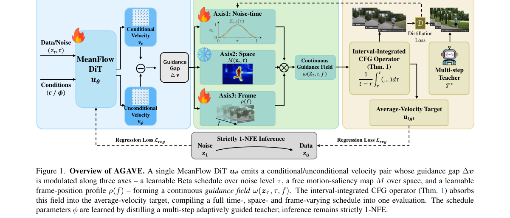

*Result - VBench 16-dimension radar (14B). AGAVE (filled) against the one-step baselines iMF, rCM and CFG-Zero⋆. The ad- vantage is broad rather than localized and is widest on the motion- related axe*

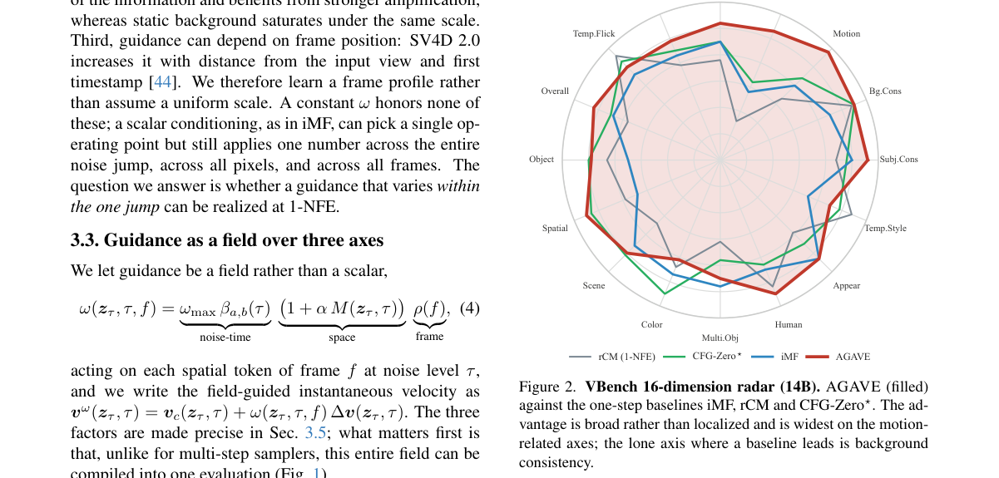

**Why this ranks #6**: 补位说明：这是把分类器自由引导从标量改写成「场」并编译进生成目标的推理侧工作，训练目标是对齐而非最大化奖励，不含 RL 或奖励模型，属于本线的相邻方向。核心观察是 MeanFlow 的目标是噪声区间上的积分，任意引导场都可以被吸收进目标本身并编译成一次前向，因此不存在多步采样器上的调度离散误差。AGAVE 只加不到十个标量：噪声水平上的可学习 Beta 时间表、动作显著性驱动的空间调制、帧位置上的不对称调制。在 Wan2.1 蒸馏出的 14B 骨干上一步生成 VBench 总分 85.2，比标量引导的 iMF 高 1.2，其中动态程度高 4.7（56.2 对 51.5）；1.3B 骨干上总分 82.4、比 iMF 高 1.6。UCF-101 的 FVD 372 与四步 rCM 持平、MSR-VTT 的 FVD 261 优于其 262，CLIP-T 0.309 最高，推理时延不变。  [wild-card=yes] 区间积分式分类器自由引导，改造 CFG 为场级积分并用于一步视频生成，属本线词表内的 CFG 优化方向。

---

### 7. FisherDistill: Diffusion Distribution Distillation via Closed-Form Fisher Critics

**arXiv**: [2611.07604](https://arxiv.org/abs/2611.07604) | **Score**: 8.3 (relevance 8 x 0.7 + quality 9 x 0.3) | **Tags**: rl-aigc, distillation, fisher-discriminant, distribution-gap, teacher-features, image-generation, University at Buffalo | **Categories**: cs.AI, cs.CV | **Pages**: 19

**Authors**: Mahesh Bhosale; Yuanhao Zhai; Siwei Lyu; Junsong Yuan; David Doermann; Defang Chen

**Affiliation**: University at Buffalo, SUNY; Meta; University of California, Berkeley

**Abstract**

> Recent advances in diffusion distillation have enabled high-quality image generation in only one or a few network function evaluations (NFEs). Despite their efficiency, aggressively distilled generators often retain a residual distribution gap from their multi-step teachers, motivating recent methods to introduce adversarial refinement with a learned discriminator. In this work, we ask whether such refinement necessarily requires a learned adversarial discriminator. We introduce \textbf{FisherDistill}, a simple alternative based on Fisher linear discriminant analysis. Using intermediate representations from the frozen teacher, we estimate the first- and second-order statistics of real and generated samples and derive a closed-form Fisher direction that maximally separates their feature distributions relative to within-class variation. This direction provides a lightweight refinement signal that complements the original distillation objective without requiring an additional adversarial discriminator or its optimization loop. Across multiple distillation frameworks, our approach consistently improves generation quality over their respective distilled baselines and substantially closes the gap to adversarially refined counterparts. Code: https://bhosalems.github.io/FisherDistill/

**Key findings**

- **Finding**: FisherDistill 用冻结教师的中间特征估计真实与生成样本的一二阶统计，推导出闭式 Fisher 方向作为精修信号，不需要额外的对抗判别器与 min-max 优化循环；ImageNet-64 上 DMD2 的 FID 从 1.42 降到 1.40、recall 从 0.60 升到 0.62。
- **Inference**: 少步生成器与多步教师之间的残差分布差在特征空间里是可线性判别的，因此对抗判别器这一整套优化负担未必必要，闭式方向已经能承担同样的分离作用。
- **Recommendation**: 做少步蒸馏精修时可以先试闭式 Fisher 方向这种免判别器的轻量方案再考虑上 GAN，并注意选对可分离的教师层；这篇属于蒸馏分布对齐，不是 RL 后训练工作。

**Key figures**

*Framework - Distribution gap in frozen teacher features on ImageNet-64. One-step DMD2 w/o GAN drifts away from the multi-step teacher, while our closed-form Fisher refinement brings it back to the teach*

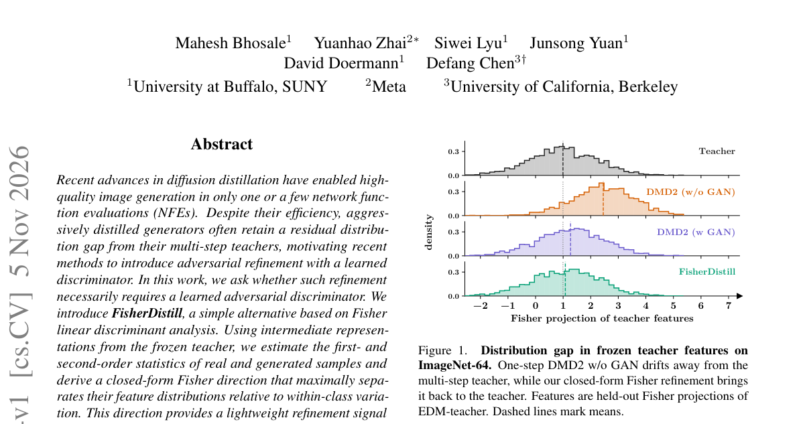

*Result - 1024×1024 samples generated by our 2-step FisherDistill built on 1.x-Distill Stage-I [25] and distilled from SD3-Medium [10].*

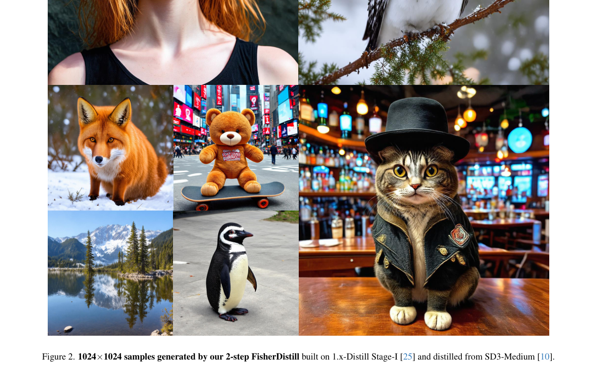

**Why this ranks #7**: 补位说明：这是扩散蒸馏的分布对齐改进，用闭式 Fisher 判别方向替代学出来的对抗判别器，不含 RL、奖励模型或偏好目标，属于本线相邻的生成模型蒸馏方向。做法是从冻结教师的中间特征里估计真实样本与生成样本的一二阶统计，推一个在类内方差意义下最大分离两者的 Fisher 方向，直接当轻量精修信号，不必再训练判别器也不必跑 min-max。效果可核验：ImageNet-64 类条件生成上 DMD2 的 FID 从 1.42 降到 1.40、recall 从 0.60 升到 0.62 且 precision 保持 0.74，相对 GAN-free 的 RealUID 是 FID 1.40 对 3.07；SiD 上 FID 从 1.54 降到 1.34、precision 从 0.74 升到 0.76。文本到图像侧 DMD2 的 FID 从 8.58 降到 8.46，1.x-Distill 从 28.94 降到 25.24。  [wild-card=yes] 基于闭式 Fisher critic 的扩散分布蒸馏，是生成模型蒸馏/后训练的相邻方法（与本线 FewStepRL 同属少步生成方向）。

---

### 8. Geometric Relevance Is Not Sufficient: Evaluating Focused Post-Training Supervision in Diffusion Docking

**arXiv**: [2611.08249](https://arxiv.org/abs/2611.08249) | **Score**: 8.3 (relevance 8 x 0.7 + quality 9 x 0.3) | **Tags**: rl-aigc, molecular-docking, diffusion, post-training, score-field, ablation-study, University of Central Florida | **Categories**: cs.LG, q-bio.BM | **Pages**: 17

**Authors**: Michael Brown; Maryam Rahimimovassagh; Mehdi Yazdani-Jahromi; Sanjeda Sara Jennifer; Ivan Garibay

**Affiliation**: University of Central Florida

**Abstract**

> Diffusion-based molecular docking requires learning a corrective score field across a broad corruption distribution, yet individual pose errors can differ substantially in their structural consequences. This creates a post-training conflict between preserving broad score-field coverage and concentrating supervision on corrections that appear more relevant to docking geometry. Using DiffDock, a fixed-budget study compares broad continuation with torsional supervision focused on Cartesian consequence or conditional target consistency, and with a broad/focused mixture. Evaluation separates fixed score fidelity, generated-pose quality, best-of-10 sampling capacity, and confidence-selected Top-1 docking performance. At <5 Angstrom, broad continuation had the highest mean Top-1 success among trained policies, and focused or mixed supervision showed no consistent advantage under the tested budget. The starting model had better fixed score fidelity, whereas the evaluated broad-continuation model had higher mean Top-1 success with the same aggregate best-of-10 recovery. Focusing supervision on structurally consequential or more consistently specified corrections did not consistently improve returned-pose success over broad continuation.

**Key findings**

- **Finding**: 在 DiffDock 上做五 epoch 的固定预算对照，宽覆盖续训在小于 5 埃阈值下的 Top-1 平均成功率最高，聚焦或混合的扭转监督没有一致优势；聚焦相对宽覆盖的 Top-1 差异置信区间为 −4.38 到 2.36 个百分点，包含零。
- **Inference**: 几何后果更严重的修正并不自动等于对最终对接更有用的监督信号，监督的结构「相关性」与打分场覆盖范围之间存在真实取舍，不能只按误差的结构重要性分配梯度。
- **Recommendation**: 做扩散后训练时建议把监督聚焦当作需要验证的假设而非既定前提，并像本文一样分四层评估（打分保真、生成质量、best-of-10 容量、Top-1 成功率）再下结论；这篇不含 RL。

**Why this ranks #8**: 补位说明：这是分子对接扩散模型的后训练监督研究，比较的是「宽覆盖续训」与「聚焦到扭转监督」的两种修正信号，训练中没有奖励模型、策略梯度或价值学习，属于本线相邻的生成模型后训练方向而非 RL 供给。动机很实在：扩散对接要在很宽的污染分布上学修正打分场，但不同位姿错误对对接几何的后果差别很大，于是产生「保覆盖」与「聚焦关键修正」的冲突。实验用 DiffDock 做固定预算对照，每个策略在同一个已训练检查点上再训五个 epoch，评估拆成固定打分保真度、生成位姿质量、best-of-10 采样容量与置信度选出的 Top-1 对接成功率四层。在小于 5 埃的阈值下，宽覆盖续训在所有已训策略里 Top-1 平均成功率最高，聚焦或混合监督在该预算下并无一致优势；聚焦相对宽覆盖的置信区间在生成成功率上是 −0.61 到 0.17 个百分点、Top-1 上是 −4.38 到 2.36 个百分点且包含零。  [wild-card=yes] 扩散模型 docking 的聚焦后训练监督评估，是生成模型后训练的直接相邻工作；本批次真正用 RL 做生成模型后训练的论文只有 4 篇。

---

### 9. A Proxy-Based Method for Measuring Racial Disparities in~Text-to-Image~Generators

**arXiv**: [2611.07132](https://arxiv.org/abs/2611.07132) | **Score**: 7.3 (relevance 7 x 0.7 + quality 8 x 0.3) | **Tags**: rl-aigc, bias-audit, text-to-image, demographic-proxy, skin-tone, legal-benchmark, University of Virginia | **Categories**: cs.CV, cs.LG | **Pages**: 12

**Authors**: Nia Mucher; Ngan Pham; Jason Chin; Aaron Brown; David Evans

**Affiliation**: University of Virginia

**Abstract**

> We present an automated method for auditing text-to-image generators for representational bias against ground-truth demographic benchmarks. Our approach adapts the racial proxy variables used in U.S. antidiscrimination law to provide a fine-grained comparative analysis of variations in racial representation in generated images. We classify each generated image by race and then compare the model's distribution to publicly available demographic benchmark data to identify patterns of over- and under-representation. We also measure skin tone using CIELAB values and calculate cosine similarity amongst groups of images in order to capture biases that don't show up in demographic comparisons such as differences in image quality across races and skin tones. We report on experiments testing three models (Imagen 4 Fast, Stable Diffusion 3.5 Large Turbo, and Flux Schnell) using three categories of proxies (geographic, occupational, and surname) and 50 variants within each category. We find notable variation across the models as well as by proxy category. For example, Imagen 4 Fast overrepresents white classified images more than the other models tested and produces images with lighter, more homogeneous skin tones. Imagen 4 Fast also had the largest representational disparity for Black demographics among surname and geographical prompts. Stable Diffusion 3.5 Large Turbo produces results that overall diverge most from census data but yield the most diverse range of skin tones. Our method yields a generalizable and legally-grounded auditing tool that surfaces detailed information about model outputs without relying on implicit normative definitions of fairness.

**Key findings**

- **Finding**: 方法用美国反歧视法的种族代理变量做自动审计，把生成图按种族分类后与人口普查数据比对，用总变差距离衡量偏离、用 CIELAB 肤色与嵌入余弦相似度补充质量维度；三个模型、三类代理、每类 50 个实例、每提示 100 张图，Flux Schnell 与 Imagen 4 Fast 的总体平均 TVD 为 0.310 与 0.312。
- **Inference**: 用法条里的代理变量替代无法直接观测的种族标签，可以让偏差审计既可复现又有法律依据，而肤色与图像相似度的补充测量专门覆盖了人口统计数字完全看不见的差异。
- **Recommendation**: 评估自研 T2I 系统的代表性偏差时可直接套用这套代理加总变差距离的流程，并把结果按单个提示词而不只按总体分布报告；这篇是评测方法，不是 RL 或奖励建模工作。

**Key figures**

*Framework - Proxy-based auditing text-to-image generators.*

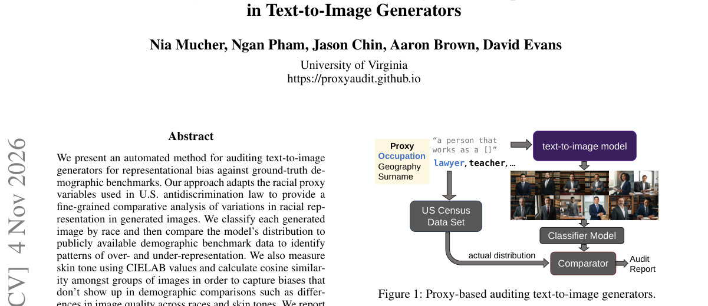

*Result - Difference between racial distribution of model outputs and demographic data by race.*

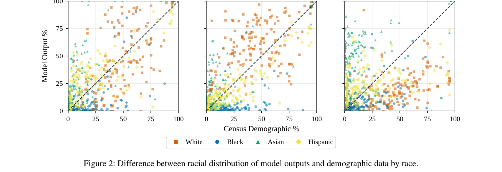

**Why this ranks #9**: 补位说明：这是文生图生成器的代表性偏差审计方法，纯评测工作，既没有奖励模型也没有 RL 后训练，属于本线词表内的 T2I 评测方向补位。方法把美国反歧视法中的种族代理变量搬来做自动化审计：先逐张分类生成图的种族归属，再与公开的人口统计数据比对，用总变差距离（0 到 1）量化偏离，同时用 CIELAB 颜色空间度量肤色并计算同组图像嵌入的余弦相似度，以捕捉人口统计数字看不出的质量差异。实验覆盖 Imagen 4 Fast、Stable Diffusion 3.5 Large Turbo 与 Flux Schnell 三个模型、三类代理（职业、地理、姓氏），每类取 50 个实例、每个提示生成 100 张图。结论是 Flux Schnell 与 Imagen 4 Fast 的总体平均 TVD 为 0.310 与 0.312，最接近人口普查数据，而 Stable Diffusion 3.5 Large Turbo 在所有代理类别上都偏离最远。  [wild-card=yes] 文生图生成器的种族差异代理审计方法，属本线词表内的 T2I 评测（GenEval/DrawBench 同族）方向。

---

### 10. OptIMerge: Optimization-Based Merging of Diffusion Models

**arXiv**: [2611.07543](https://arxiv.org/abs/2611.07543) | **Score**: 7.3 (relevance 7 x 0.7 + quality 8 x 0.3) | **Tags**: rl-aigc, model-merging, diffusion, low-rank, cayley-transform, multi-task, Google | **Categories**: cs.CV | **Pages**: 19

**Authors**: Viraj Shah; Ashwini Pokle; Peyman Milanfar; Mauricio Delbracio; Hossein Talebi

**Affiliation**: Google

**Abstract**

> The arithmetic merging of weights from multiple task-specific models fine-tuned from a shared base model, commonly known as model souping, has emerged as a popular strategy for multi-task learning without the computational overhead of joint retraining. However, naive scalar weight averaging frequently leads to severe performance degradation when the constituent models learn structurally divergent feature representations, leading to destructive parameter interference. We study this problem in a largely unexplored setting: merging image-to-image (I2I) diffusion models fine-tuned for dense, pixel-accurate tasks such as image restoration. Unlike the large language models (LLMs) and text-to-image (T2I) diffusion models for which most merging methods were developed, I2I experts encode conflicting spatial priors (e.g., anisotropic motion-blur vs. isotropic defocus-blur) in their convolutional filters, where both naive soup and LLM-style element-wise merging introduce visible artifacts. We introduce OptIMerge, a gradient-based optimization framework: instead of relying on heuristic scalars, OptIMerge learns highly expressive, yet parameter-efficient merger coefficients by minimizing a multi-task diffusion loss over a small set of 100-500 images. OptIMerge parameterizes the merge with architecture-aware transformations: for attention layers, a structured low-rank feature alignment with explicit channel biases; for convolutional layers, per-kernel merger coefficients, and a low-rank Cayley transform that aligns channels by orthogonal rotation without distorting the filters. By keeping the experts frozen and optimizing only these lightweight merger parameters (equivalent to <0.4% of the network footprint), OptIMerge achieves simultaneous multi-task capabilities that rival computationally expensive joint training and decisively outperform zero-shot model soups.

**Key findings**

- **Finding**: OptIMerge 冻结专家、只学合并系数，用一百到五百张校准图最小化多任务扩散损失，可训练参数约 3.2M、占 890M 网络不到 0.4%；运动去模糊与离焦去模糊合并时 LPIPS 0.2168、PSNR 22.72、SSIM 0.6190，而朴素权重汤为 0.2899、20.88、0.5601。
- **Inference**: 当专家把冲突的空间先验写进卷积核时，逐元素或标量权重平均无法协调通道语义，必须先用可微的正交旋转对齐通道再插值，参数化形式本身决定了合并的上限。
- **Recommendation**: 合并稠密像素任务的扩散专家时，先看任务是否在卷积核层面存在结构性冲突，再决定要不要引入低秩 Cayley 对齐；这篇是参数级后训练优化，不是 RL 工作。

**Key figures**

*Framework - Overview of OptIMerge. (a) Naive souping merges experts WA and WB with one scalar α shared by all layers. (b) OptIMerge learns a merger coefficient matrix Mℓper layer, as large as that layer*

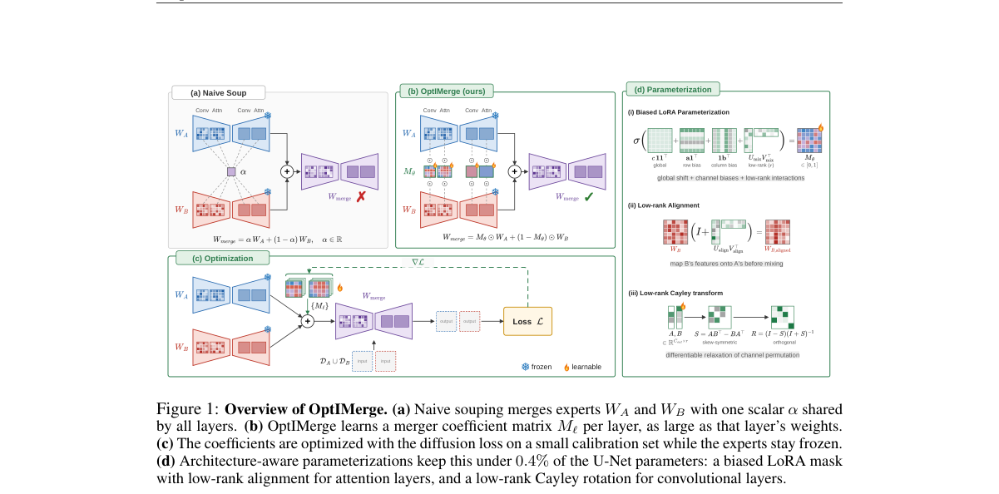

*Result - Qualitative comparison of pairwise model merging across restoration tasks: Each two-row block evaluates a single merged model on both of its constituent tasks: (a) Motion Deblur (OID) + Defo*

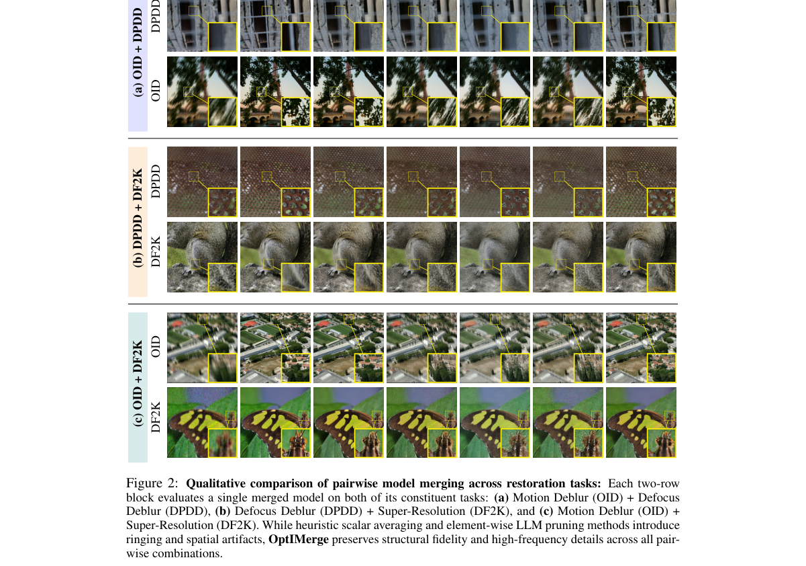

**Why this ranks #10**: 补位说明：这是扩散模型的参数级合并优化，冻结专家后用梯度下降学合并系数，训练目标是多任务扩散损失而非奖励最大化，没有奖励模型、策略梯度或偏好优化，属于本线相邻的生成模型参数后训练方向，只能占补位区末位。场景选得很偏——图像到图像的稠密像素任务专家（如运动模糊与离焦模糊）把冲突的空间先验编码进卷积核，朴素权重汤与 LLM 式逐元素合并都会出可见伪影。做法是按层架构设计合并参数化：注意力层用带通道偏置的低秩对齐，卷积层用逐核系数加低秩 Cayley 正交旋转，在一百到五百张校准图上最小化多任务扩散损失，可训练参数约 3.2M、占 890M 网络不到 0.4%。运动去模糊加离焦去模糊的合并上 LPIPS 0.2168、PSNR 22.72、SSIM 0.6190，明显好于朴素权重汤的 0.2899／20.88／0.5601，并与联合多任务训练的 0.2154／22.59／0.6173 相当。  [wild-card=yes] 扩散模型优化式合并（梯度学习合并系数、专家冻结），属生成模型的参数级后训练优化方向。

---

