# ArXiv Daily Digest - 2026-11-06 (核心强化学习, 10 papers)

**Generated**: 2026-11-06 17:30 CST

**Source**: arXiv cs.CV, cs.SD, eess.AS, cs.CL, cs.AI, cs.RO, cs.LG submissions, listing day 2026-11-05 (announced 2026-11-06 00:00 UTC)

**Batch window**: 2026-11-04T18:00:00Z .. 2026-11-05T18:00:00Z（arXiv 公告批次横跨两个 UTC 日：前一日 18:00 UTC 起算，当日 17:59:59 UTC 截止）

**Track**: rl_core (top 10 of 510 papers scanned, 70 full reads)

**Scope**: RL 算法与理论、多智能体 RL、sim-to-real 与离线 / 元 RL

---

## Top 10 - 核心强化学习

### 1. Reinforcement Learning Enables Scaling Generalist Robot Policy Improvement

**arXiv**: [2611.06905](https://arxiv.org/abs/2611.06905) | **Score**: 10.0 (relevance 10 x 0.7 + quality 10 x 0.3) | **Tags**: rl-core, robot-foundation-model, value-based-rl, generalist-improvement, online-rl, ETH Zurich | **Categories**: cs.LG, cs.RO | **Pages**: 57

**Authors**: Michal Korniak; Marco Bagatella; Ralf Römer; Michal Nauman; Yarden As; Pranav Vignesh; Manan Agarwal; Leander Diaz-Bone; Piotr Zalewski; Mikołaj Czarnecki; Lenart Treven; Shashwat Saxena

**Affiliation**: ETH Zurich; MPI for Intelligent Systems, Tubingen; Technical University of Munich; University of Warsaw; Nomagic; Carnegie Mellon University; UC Berkeley; Microsoft; Amazon FAR; Physical Intelligence

**Abstract**

> The introduction of generalist robot policies has enabled a single, large model to learn to perform a variety of tasks from a vast pre-training corpus. While these models often exhibit powerful zero-shot generalization capabilities, they typically require an adaptation phase to achieve sufficient performance in deployment. Iterated self-improvement via reinforcement learning (RL) has demonstrated promise in enabling this adaptation, yet such approaches have been largely explored in single-task settings - where the goal is to simply improve on a narrow deployment task - which lies in stark contrast to the multi-task capabilities of the base policy. In this work we ask whether generalist robot policies are capable of multi-task, generalist improvement in deployment - targeting many diverse tasks simultaneously - and what algorithmic recipe enables this. To answer this question, we first develop a set of structured evaluations to test generalist improvement capabilities, and systematically evaluate algorithmic and practical design choices regarding value estimation, policy extraction and resource allocation. We show that not only can generalist policies be improved online across diverse tasks, but that the right recipe can enable generalization and increase performance on tasks not considered during online training. We characterize when this generalization occurs and show that both the training task distribution and the use of value-based RL are critical. To the best of our knowledge, this is among the first evidence for online generalist improvement for robot foundation models.

**Key findings**

- **Finding**: 在 MolmoSpaces 上把训练任务数从 1 扩到 144，OGPO 多任务相对 FSFT 提升 43–50 pp，未见场景任务最高 +58 pp、未见物体 +39 pp。
- **Inference**: 通用策略的在线改进瓶颈不在策略容量，而在价值估计的稳定性与训练任务分布的覆盖度。
- **Recommendation**: 做机器人基础模型后训练的同学优先读其价值估计与策略抽取的消融，再看任务分布的扩展设计。

**Key figures**

*Framework - Scaling the number of RL training tasks enables generalist improvement of generalist robot policies. As training task diver- sity increases, critic-guided policy extraction (OGPO) or refinem*

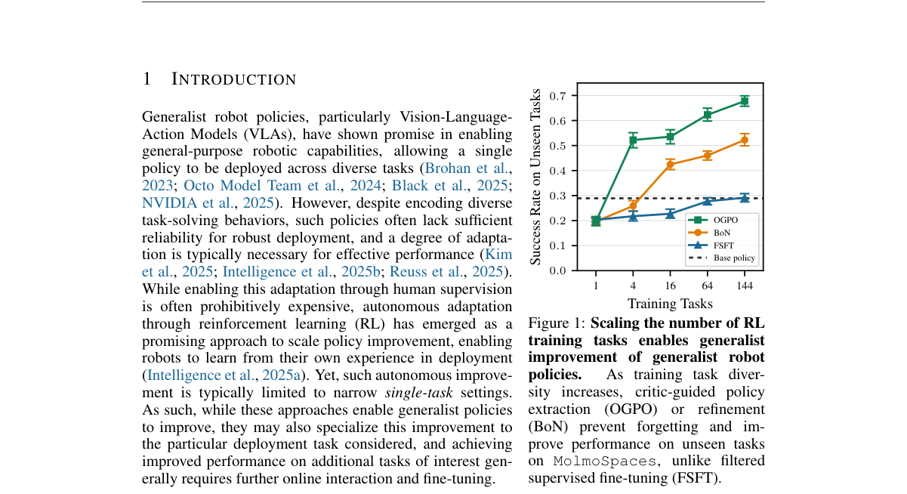

*Result - Generalist improvement and evaluation. (1) A generalist policy collects K rollouts τn,k across training tasks cn ∼ρtrain. (2) Task-specific experience is pooled in a shared replay buffer and*

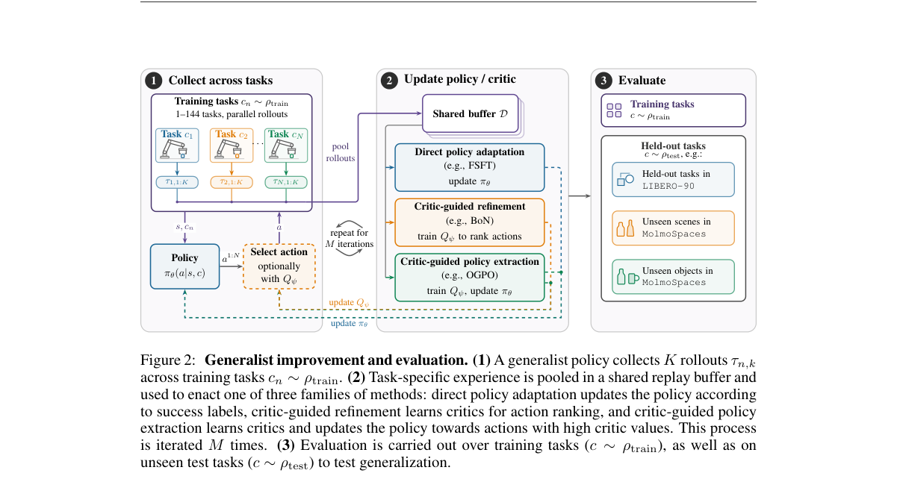

**Why this ranks #1**: 本线第 1 名：在 π0.5 VLA 上把在线 RL 从单任务推进到 1→144 个训练任务的多任务改进，OGPO 相对 FSFT 提升 43–50 个百分点，未见场景最高 +58 pp、未见物体 +39 pp，证明价值型 RL 与训练任务分布是泛化能否发生的关键。

---

### 2. Detecting Silent Faults at the Environment-Trainer Boundary in Reinforcement Learning

**arXiv**: [2611.08144](https://arxiv.org/abs/2611.08144) | **Score**: 9.3 (relevance 9 x 0.7 + quality 10 x 0.3) | **Tags**: rl-core, rl-infrastructure, fault-detection, silent-failure, reproducibility, Tsinghua University | **Categories**: cs.LG, cs.RO, cs.SE | **Pages**: 7

**Authors**: Zuo Gou; Chenhao Lu

**Affiliation**: Tsinghua University

**Abstract**

> Robot reinforcement learning increasingly runs environments outside the trainer: in another process, on another machine, in another language. Many faults at this boundary raise no error. We make the boundary a wire protocol and ask what notices a fault in it. On Pendulum, HalfCheetah, Hopper and a 7-joint arm (Pusher), we injected up to 23 faults into what crosses the wire and 2 into the trainer's log, from one value to every value. Unless every value was wrong, a learning-curve threshold caught at most one run in ten, and a comparison with ten fault-free seeds at most 21%. A clean evaluation of all 1,060 final policies agreed with the curves: of the 728 boundary-fault runs both curve checks passed, 723 scored no more than three standard deviations below fault-free seeds, though nearly all ended on other weights and, for reward faults, logged other returns. Checks of the run itself, not of its outcome, saw every fault. A step ledger kept on both sides and compared step by step caught and located every fault that crossed, on Pendulum, Hopper and Pusher on one machine and on Pendulum across two, with no fault-free run and, on Pendulum, a median 3% more training time. An episode record kept at the environment caught the faults in the trainer's log. We list such faults found in practice, in Gymnasium 1.3 and our own code and, reported by others, in five multi-agent libraries, and recommend a step ledger and episode counts kept at the environment.

**Key findings**

- **Finding**: 向线上传输注入最多 23 类故障、外加训练器日志 2 类，学习曲线阈值最多只发现十分之一运行，步骤账本却全部命中并定位。
- **Inference**: 靠最终回报或学习曲线判断 RL 运行是否出错本质不可靠，校验点必须放到环境与训练器两端逐帧比对。
- **Recommendation**: 搭大规模 RL 训练平台时按论文建议在环境侧保留步骤账本与 episode 计数，再去核对多智能体库的已知缺陷。

**Key figures**

*Result - Only the step ledger catches every boundary fault at every dose it ran; byte identity misses only Hopper’s 12 final observations, which training never read. The share of boundary-fault runs ea*

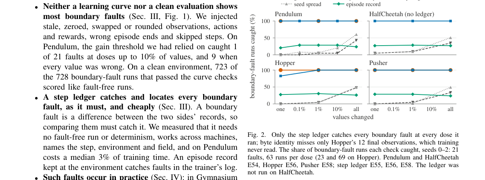

**Why this ranks #2**: 本线第 2 名：把环境—训练器边界做成线协议并注入最多 23 类故障，发现学习曲线阈值最多只抓到 1/10 的运行、与 10 个无故障种子对比也只覆盖 21%，而环境侧步骤账本在所有故障上全部命中并定位，代价仅是 Pendulum 上中位 3% 的额外训练时间。

---

### 3. Cooperative Multi-Agent Reinforcement Learning via Epigraph-Form Guided Exploration

**arXiv**: [2611.07066](https://arxiv.org/abs/2611.07066) | **Score**: 9.0 (relevance 9 x 0.7 + quality 9 x 0.3) | **Tags**: rl-core, multi-agent-rl, intrinsic-reward, epigraph-reformulation, cooperative-marl, Seoul National University | **Categories**: cs.AI, cs.MA | **Pages**: 34

**Authors**: Sungil Son; Hoseong Jung; Dahyun Oh; H. Jin Kim

**Affiliation**: Seoul National University

**Abstract**

> Discovering cooperative behavior in multi-agent reinforcement learning (MARL) is challenging due to the combinatorial complexity of joint state-action spaces, which hinders the emergence of coordinated behaviors from trial-and-error alone. Intrinsic rewards are often used to aid discovery, but naively combining them with team objectives can distort the learning signal, compromising task performance. In this paper, we propose EFXPLORER, a constrained exploration framework that maximizes exploration objectives subject to a constraint that preserves established task performance. We solve the resulting problem using an epigraph reformulation that introduces adaptive exploration budgets. This approach separates intrinsic rewards from task objectives and regulates exploration through task feasibility. To further encourage diverse and temporally extended exploration, we incorporate a successor distance-based intrinsic reward that captures long-horizon dependencies. Empirically, our method outperforms strong baselines and induces novel cooperative strategies across SMAX, VMAS, and MPE benchmark suites.

**Key findings**

- **Finding**: EFXPLORER 用上图（epigraph）重构把内在奖励与任务回报解耦，以自适应探索预算替代线性加权或拉格朗日对偶项。
- **Inference**: 协作探索真正需要的是可行性门控，而不是靠一个权重在任务与探索之间做线性折中。
- **Recommendation**: 做 cooperative MARL 探索的同学可直接对比其 epigraph 预算外环与线性合成、Lagrangian 两类基线的差异。

**Key figures**

*Framework - Cooperative balancing task with four agents transporting a payload on a rod to a target. (a) Naive linear reward combinations induce objective misalignment, destabilizing coordination. (b)*

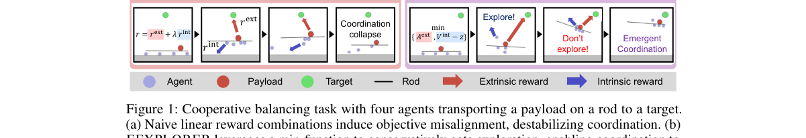

*Result - Overview of EFXPLORER. (a) Conservative exploration (Sec. 3.1): The epigraph objective uses a min operator to balance task progress and budget-adjusted exploration while an outer loop adapts*

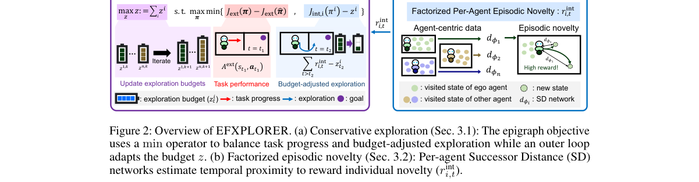

**Why this ranks #3**: 本线第 3 名：把协作 MARL 的探索改写成「任务回报不退化的约束下最大化内在奖励」的上图问题，用自适应探索预算取代敏感的对偶乘子，在 SMAX/VMAS/MPE 三套基准、5 个种子上全程领先 MAPPO、IPPO、DiCO、COIN、HASAC，并诱导出新的协作策略。

---

### 4. Finite-Time Convergence and Regret Guarantees for Neural Reinforcement Learning in POMDPs

**arXiv**: [2611.07069](https://arxiv.org/abs/2611.07069) | **Score**: 9.0 (relevance 9 x 0.7 + quality 9 x 0.3) | **Tags**: rl-core, pomdp, finite-memory, regret-bound, neural-approximation, policy-mirror-descent, Ohio State University | **Categories**: cs.AI, cs.LG | **Pages**: 33

**Authors**: Jingjuan Huang; Zhiyao Zhang; Alvaro Velasquez; Nathaniel D. Bastian; Jia Liu

**Affiliation**: Ohio State University; University of Colorado at Boulder; Johns Hopkins University

**Abstract**

> Reinforcement learning (RL) in Partially Observable Markov Decision Processes (POMDPs) is computationally challenging due to the curse of long-range dependence on history. Fortunately, recent studies have shown that a range of POMDPs that satisfy the filter stability assumption can be well approximated by a superstate Markov Decision Process (MDP) based on a truncated history in a finite-memory window, with a value gap that decays with the window length. However, existing finite-time convergence analyses on such superstate MDP surrogates are either limited to over-simplified linear function approximation or rely on an i.i.d. sampling oracle that is violated by POMDP trajectories, both of which severely limit the applicability of these theoretical results in practice. This motivates us to bridge the gap by investigating RL in POMDPs with nonlinear neural value function approximation. Our main contributions are threefold: i) We first establish a new finite-state MDP point-wise approximation error bound, which lays the foundation for our RL algorithm design and analysis in POMDPs; ii) By applying Temporal-Difference (TD) learning to POMDP-generated superstate transitions and targeting the Bellman fixed point of the superstate MDP, we prove a finite-time critic error bound with nonlinear neural value function approximation; and iii) By combining the neural critic function approximation error bound with the policy mirror descent framework, we obtain a finite-time sublinear regret against the optimal POMDP value. To the best of our knowledge, such a finite-time sublinear regret based on neural function approximation is the first in the literature for finite-memory POMDPs. Our numerical experiments also verify our theoretical results.

**Key findings**

- **Finding**: 定理层面给出 critic 误差界，含 NTK 架构误差、TD 误差与 (1-ρ)^ℓ 历史记忆项，并推出 Õ(N^{5/6}) 的次线性 regret。
- **Inference**: 有限记忆加非线性神经 critic 在 POMDP 上确实能拿到有限时间保证，代价是宽度需满足 m ≳ max{N^2, N^{p/12}}。
- **Recommendation**: 需要 POMDP 有限时间保证的读者优先看第 4.1 节的点到点近似误差界，以及推论 1、2 给出的超参取值条件。

**Key figures**

*Framework - Roadmap for our theoretical finite-time analysis of reinforcement learning in POMDPs with neural value function approximation.*

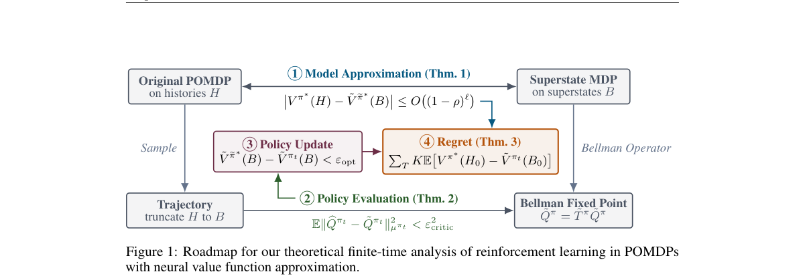

*Result - CheeseMaze.*

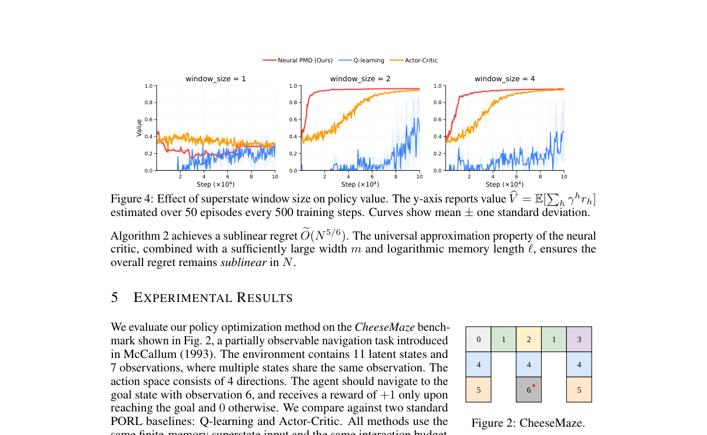

**Why this ranks #4**: 本线第 4 名：给出有限记忆 POMDP 下神经函数逼近的首个有限时间次线性 regret 界 R_N = Õ(N^{5/6})（取 K = N^{2/3}、T = N^{1/3}），critic 误差界 Õ(m^{-1/6} + m^{-4/p} + K^{-1/2} + (1-ρ)^ℓ) 同时含架构、TD 与历史三段误差，填补了此前只有线性逼近或依赖 i.i.d. 采样预言机的空缺。

---

### 5. RLGPA: A Reinforcement Learning-Guided Granularity Planning Attack for Decision-Based Sparse Adversarial Examples

**arXiv**: [2611.07512](https://arxiv.org/abs/2611.07512) | **Score**: 9.0 (relevance 9 x 0.7 + quality 9 x 0.3) | **Tags**: rl-core, adversarial-attack, sparse-attack, decision-based-blackbox, granularity-planning, South China Normal University | **Categories**: cs.CV, cs.LG | **Pages**: 11

**Authors**: Chao Zhou; Shenghua He; Jiaxin Mo; Qiangguo Yu; Fengchuang Xing

**Affiliation**: South China Normal University; Guangdong University of Education

**Abstract**

> Decision-based sparse attacks must reduce perturbation support using only the victim's predicted label. The best restoration strategy varies as support contracts: coarse removal works early, while tail states need finer, history-aware tests. We propose RLGPA, an online reinforcement learning method that schedules support-reduction executors and their granularity under a hard query budget. A masked Dueling Double DQN selects among seven stable policy--scale actions; each action produces support-relative restoration groups that are rebuilt after every macro decision. A feasibility-preserving executor commits only adversarial restorations and feeds support gain and query cost back to the planner. Under the matched top-1-label oracle, RLGPA reaches 61\% targeted ASR at sparsity 0.01 on CIFAR-10 (vs. 25\% SparseEvo, 0\% Pointwise), and 75.5\%/73.0\% on ResNet50/ViT at sparsity 0.005 (vs. 29.0\%/15.5\%). A fixed-probe test reduces median \(L_0\) from 165 to 23 after 40 images without any update. State-blind and state-shuffled controls degrade significantly, confirming that the learned policy uses attack state; the main gains come from state-conditioned executor scheduling and dynamic repartition. The source code is publicly available at https://github.com/Acui001/RLGPA.git.

**Key findings**

- **Finding**: 在 top-1 标签预言机下，RLGPA 在 CIFAR-10 稀疏度 0.01 达 61% 定向 ASR，ResNet50/ViT 在 0.005 稀疏度下分别为 75.5% 与 73.0%。
- **Inference**: 状态盲与状态打乱对照明显退化，说明增益来自按攻击状态条件化的执行器调度与动态重划分，而非额外查询预算。
- **Recommendation**: 研究决策型黑盒稀疏攻击的同学可先读其「掩码 Dueling Double DQN 规划器加硬标签验证执行器」的分工设计。

**Key figures**

*Framework - Overview of RLGPA. The planner selects a policy–scale action from the current attack state, PSSE performs hard- label-verified support restoration, and the observed support reduction and query*

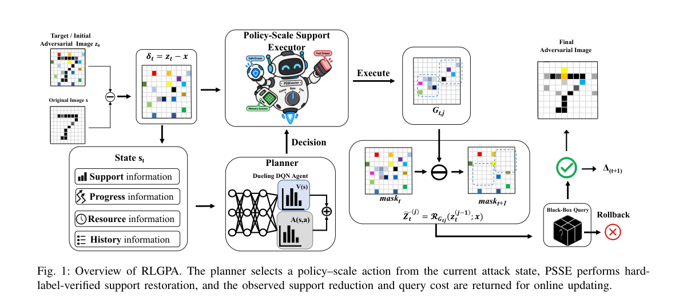

*Result - confirms that RLGPA leads in the low-sparsity region across all three settings and throughout the budget range. White-box references appear only in the ASR–Sparsity panels and are visually se*

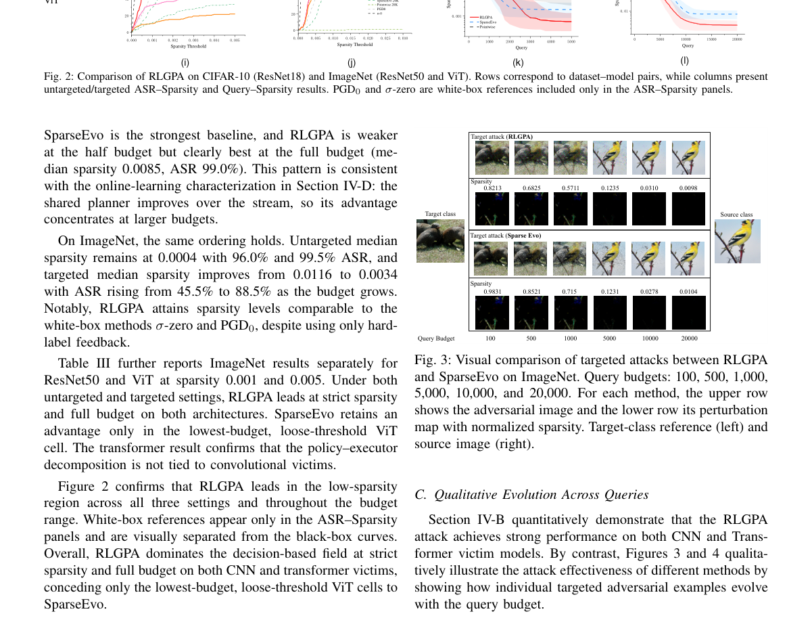

**Why this ranks #5**: 本线第 5 名：把决策型稀疏对抗攻击的支持集收缩做成在线 RL 调度问题，掩码 Dueling Double DQN 在七类策略—粒度动作间选择，CIFAR-10 稀疏度 0.01 下达到 61% 定向 ASR（SparseEvo 25%、Pointwise 0%），ResNet50/ViT 在 0.005 稀疏度下为 75.5%/73.0%，仅用固定探测已能把中位 L0 从 165 降到 23。

---

### 6. Monotone Viability Learning for Offline Safe Reinforcement Learning

**arXiv**: [2611.07616](https://arxiv.org/abs/2611.07616) | **Score**: 9.0 (relevance 9 x 0.7 + quality 9 x 0.3) | **Tags**: rl-core, offline-safe-rl, viability-kernel, hamilton-jacobi, action-certification, Tsinghua University | **Categories**: cs.LG | **Pages**: 16

**Authors**: Ziqian Wang; Zhen Zhang

**Affiliation**: Tsinghua University

**Abstract**

> Offline safe reinforcement learning requires reliable long-horizon safety estimates from fixed data. Learning Hamilton-Jacobi (HJ) viability in this setting calls for semantic preservation, convergence, and numerical stability. To address these challenges, we propose Monotone Viability Learning (MoViL), which learns viable sets from offline transitions through monotone finite-horizon set recursion. The recursion preserves finite-horizon safety semantics and converges to the infinite-horizon viability kernel. Binary supervision maintains a fixed target scale across horizons, avoiding discount-induced numerical attenuation. We further establish sufficient conditions for recovering behavior-supported viable subsets. The learned viability estimates are used to certify actions at deployment. Dubins car experiments validate the numerical accuracy of the learned viable sets. Evaluations on safe RL benchmarks demonstrate state-of-the-art reward-cost performance. MoViL satisfies the average cost constraint on every task and achieves the lowest average cost among the compared methods. These results highlight MoViL's potential to extend long-horizon HJ viability analysis to safety-critical systems where reliable dynamics models are unavailable and online exploration is unsafe.

**Key findings**

- **Finding**: 17 个离线安全 RL 任务上 MoViL 全部满足平均代价约束且平均代价最低；Dubins 车上近似精度与 FVI 相当，但训练时间约为其 1/65。
- **Inference**: 用二进制监督的可行集递推能在保持语义的同时避开折扣带来的数值衰减，长时域安全估计不必依赖在线探索。
- **Recommendation**: 关注离线安全 RL 的同学可重点看其动作级认证（双 Q 网络取最小值加阈值）与单调递归的收敛条件。

**Key figures**

*Framework - Monotone refinement of finite-horizon viable sets. As the horizon increases, the green sets Kk shrink toward K∞, progressively excluding states without sufficiently long safe continuations.*

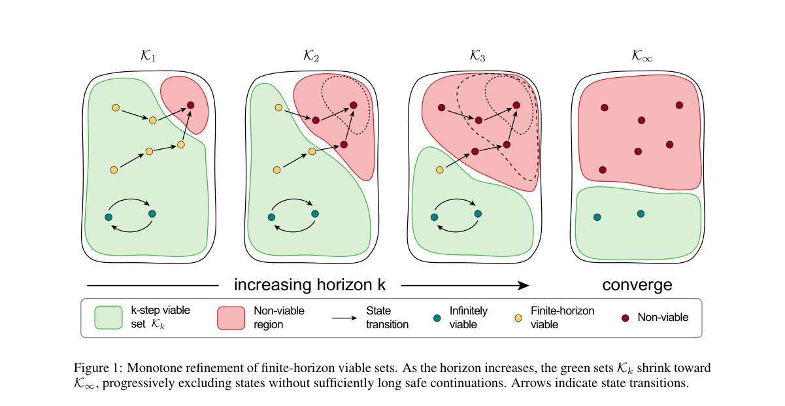

*Result - Viability approximation on the θ = 0 slice of the Dubins car state space. (a) MoViL (Ours), (b) FVI, and (c) FISOR. Colors represent the learned function values. Solid and dashed lines indic*

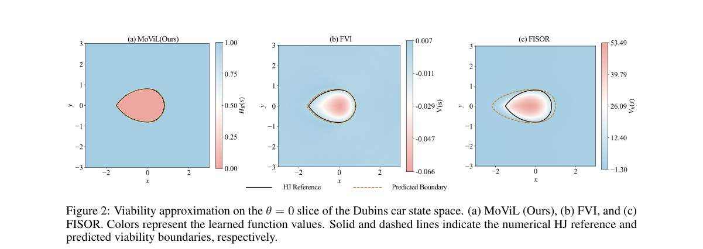

**Why this ranks #6**: 本线第 6 名：用单调有限时域集合递推从离线转移学习 Hamilton-Jacobi 可行集，既保持有限时域安全语义又收敛到无限时域可行核，在 17 个 Bullet-Safety-Gym 与 MetaDrive 任务上全部满足平均代价约束且平均代价最低，Dubins 车实验显示同等近似精度下比 FVI 省约 65 倍训练时间。

---

### 7. PhySA: Decoupling Aesthetic and Physical Rewards for Humanoid Locomotion

**arXiv**: [2611.07679](https://arxiv.org/abs/2611.07679) | **Score**: 9.0 (relevance 9 x 0.7 + quality 9 x 0.3) | **Tags**: rl-core, humanoid-locomotion, vlm-reward, reward-decoupling, physical-smoothness, Shanghai Jiao Tong University | **Categories**: cs.RO | **Pages**: 24

**Authors**: Yunwan Fu; Sicheng He; Jiageng Mao; Yue Wang

**Affiliation**: Shanghai Jiao Tong University; University of Southern California

**Abstract**

> Humanoid locomotion policies trained without an explicit smoothness objective tend to produce jerky, high-energy gaits that stress actuators. Vision-language models (VLMs) offer an appealing reward source: given a rendered rollout, a VLM returns an aesthetic quality score on [0,10] without task-specific feature engineering. We find, however, that aesthetic preference and physical smoothness point in opposite directions: across four production VLMs, clips with higher joint acceleration receive higher aesthetic scores (mean Pearson r=+0.66). We study PhySA (Physical Smoothness and Aesthetics), which keeps the two on separate, independently removable reward channels: a sparse, asynchronous VLM score and a phase-triggered correction channel that adjusts physical penalty weights from simulator state. Ablations attribute the smoothness gain to the correction channel. On MuJoCo Humanoid-v5 at 2.6M steps, PhySA lowers joint acceleration by 26 to 32% relative to vanilla PPO, Text2Reward, and Eureka (three seeds), at the cost of shorter episodes. In a single extended run it lowers joint acceleration by 59.5% relative to Prompt2Policy, while a three-seed replication shows a smaller, non-significant reduction (7.2%). The gain does not transfer to IsaacLab or the Unitree G1, even after rescaling the smoothness term.

**Key findings**

- **Finding**: 四个生产 VLM 上风格片段的关节加速度与美学分呈 Pearson r = +0.66 的正相关，说明 VLM 美学分与物理平滑目标方向相反。
- **Inference**: 把美学奖励与物理平滑奖励混进同一个标量会互相抵消，平滑增益必须来自独立的校正通道而非奖励加权和。
- **Recommendation**: 用 VLM 给机器人策略打分前先测这类冲突，并注意其增益未迁移到 IsaacLab 与 Unitree G1，三种子复现也只有 7.2%。

**Key figures**

*Framework - Left: In our main training run (a single run), PhySA reduces joint acceleration by 59.5% relative to Prompt2Policy at the same forward-velocity target; a three-seed replication gives a small*

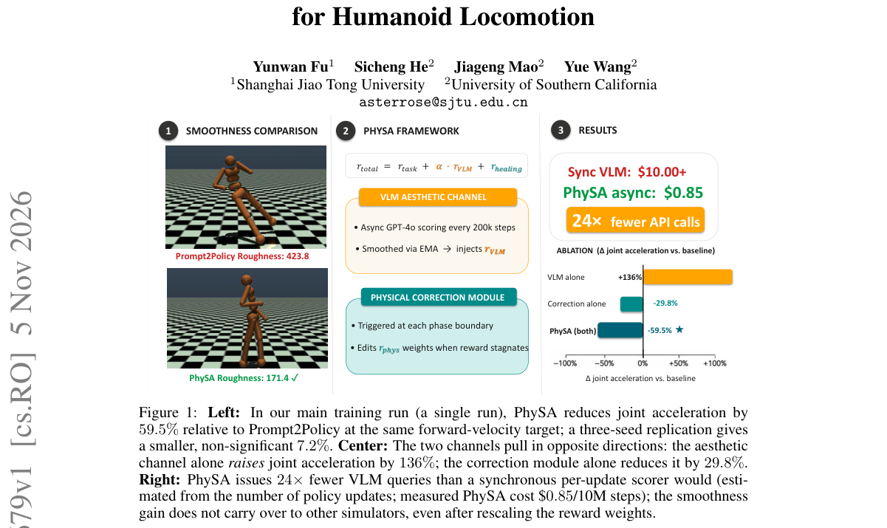

*Result - PhySA end-to-end architecture. Left: The PPO agent interacts with MuJoCo Humanoid- v5; the total reward is Eq. 1. Center top (amber): The aesthetic channel dispatches asynchronous GPT-4o sco*

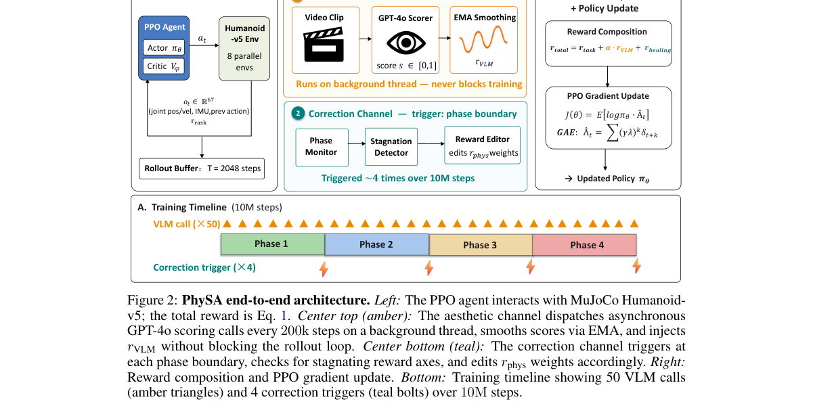

**Why this ranks #7**: 本线第 7 名：先用四个生产级 VLM 量化出「美学偏好与物理平滑方向相反」（关节加速度越高的片段美学分越高，Pearson r = +0.66），再把 VLM 稀疏异步打分与物理惩罚校正拆成两条可独立移除的奖励通道，在 MuJoCo Humanoid-v5 训练 2.6M 步后把关节加速度比 PPO、Text2Reward、Eureka 降低 26–32%。

---

### 8. Accelerating Safe Reinforcement Learning with Massive Parallelism

**arXiv**: [2611.08273](https://arxiv.org/abs/2611.08273) | **Score**: 9.0 (relevance 9 x 0.7 + quality 9 x 0.3) | **Tags**: rl-core, massively-parallel, safe-rl, cmdp, cost-estimation, gpu-simulator, Pusan National University | **Categories**: cs.AI, cs.LG | **Pages**: 19

**Authors**: Joonyoung Lim; Younghwan Yoo

**Affiliation**: Pusan National University

**Abstract**

> We investigate the problem of scaling safe reinforcement learning (safe RL) to massively parallel training regimes, where a large number of environments are exe- cuted with short rollout horizons. Although this setting improves data throughput and wall-clock efficiency, it creates a mismatch with constrained Markov decision processes (CMDPs), whose safety constraints are defined over full-episode cost returns. We address this mismatch by analyzing staggered environment resets as a phase-mixture distribution over short trajectory segments. This analysis charac- terizes the bias induced by phase coverage and motivates a phase-aggregated cost estimator that reconstructs episode-level cost estimates from short rollout batches. We further incorporate finite-sample uncertainty and distribution mismatch into a constraint-tightening framework, yielding a scalable Safe RL method compatible with on-policy optimization. Using an MJX-based implementation of Safety Gym, our experiments show that the proposed method achieves performance comparable to non-massively parallel implementations while substantially reducing wall-clock training time.

**Key findings**

- **Finding**: 8K 并行环境加约束收紧后，CPO 在 Car/Goal 达 29.57±0.70 奖励、21.06±0.70 代价（阈值 25），标准小批量 LR 为 15.13±9.94 奖励但代价 55.48±24.54 已越界。
- **Inference**: 安全 RL 迁到并行短 rollout 的关键不是算法本身，而是能否从相位混合批次里重建 episode 级代价及其偏差界。
- **Recommendation**: 用 MJX 与 MuJoCo Warp 做安全 RL 的同学可直接复用其错峰重置与 PIS-DICE 相位初始分布修正。

**Key figures**

*Framework - Wall-clock wise and total sample wise learning curves of all algorithms on the Goal task. Columns correspond to CPO, CRPO, and TRPO-Lag. Markers are shown every 100 epochs and report trailin*

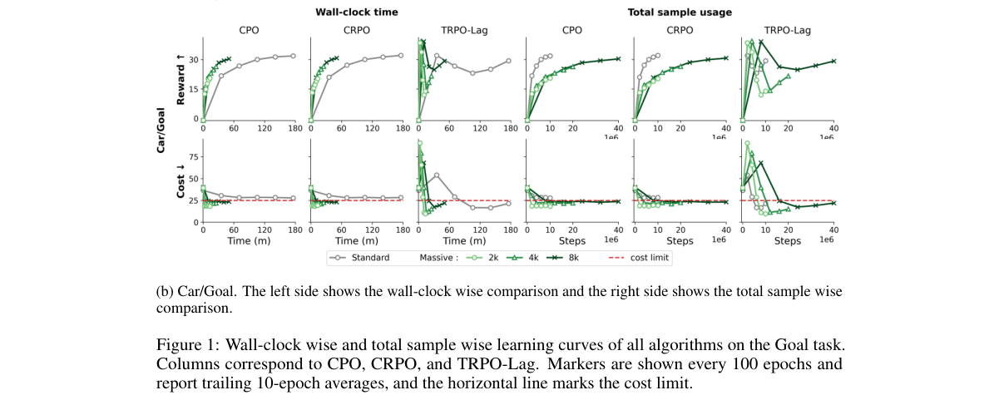

**Why this ranks #8**: 本线第 8 名：指出大规模并行下的短 rollout 与 CMDP 整段 episode 代价约束错配，把错峰重置建模成短轨迹段的相位混合分布并给出相位聚合代价估计器，8K 并行环境、8 个种子下 CPO 的 Car/Goal 拿到 29.57±0.70 奖励与 21.06±0.70 代价（低于 25 的阈值），而标准小批量 LR 只有 15.13±9.94 奖励却代价高达 55.48±24.54。

---

### 9. RM-VLM: From Natural-Language Task Descriptions to Vision-Grounded Reward Machines

**arXiv**: [2611.08308](https://arxiv.org/abs/2611.08308) | **Score**: 9.0 (relevance 9 x 0.7 + quality 9 x 0.3) | **Tags**: rl-core, reward-machine, vlm-grounding, non-markovian-task, dense-reward, Imperial College London | **Categories**: cs.AI, cs.LG | **Pages**: 20

**Authors**: Roko Parac; Christos Ziakas; Leo Ardon; Alessandra Russo

**Affiliation**: Imperial College London

**Abstract**

> Reward machines (RMs) have been proposed as a reward formulation in reinforcement learning (RL) to capture non-Markovian tasks where credit assignment depends on history. By representing reward functions as automata, RMs expose the task's temporal structure and allow such rewards to be handled within a Markovian framework. However, they assume a labelling function, a proposition-grounding oracle for observations, which must be manually engineered for each environment, limiting their wider applicability. In this work, we address this limitation by proposing RM-VLM, a novel approach in which a large language model (LLM) generates an RM from a natural-language task description, and a vision-language model (VLM) acts as the labelling function, grounding the RM's propositions over image-based observations during RM-guided policy learning. A VLM-based value function estimator is used to assess the agent's progress towards each RM transition and derive a dense reward signal. We evaluate RM-VLM on three domains covering non-Markovian grid-world navigation, robotic manipulation, and 3D object collection. Our experimental results show that RM-VLM consistently achieves higher task success rates than existing VLM-based reward methods across all tested domains.

**Key findings**

- **Finding**: GeoGrid 四个任务上 RM-VLM 成功率为 1.00/1.00/0.98/0.95，而行为克隆只有 0.22/0.34/0.00/0.10（5 个种子）。
- **Inference**: 让 VLM 判断整任务进度不如让它只标注奖励机的原子命题再由 RM 组合，时序信用分配因此能被写回标准 MDP。
- **Recommendation**: 做非马尔可夫长时序任务的同学可参考其「LLM 编译 RM、VLM 标注、GVL 价值估计出稠密奖励」三件套与 Close+Lock 失败分析。

**Key figures**

*Framework - The reinforcement learning loop considered in this work. An LLM compiles the language command into reward machines over atomic propositions, and a VLM grounds those propositions in image obs*

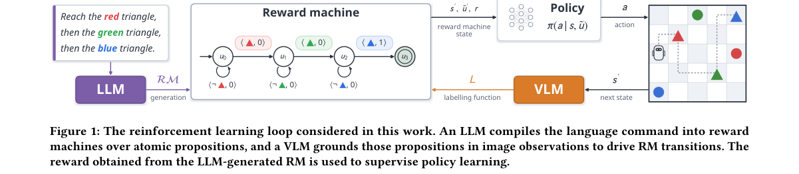

*Result - Online RL on GeoGrid. Ground-truth success rate during PPO training (mean ± std over 5 seeds).*

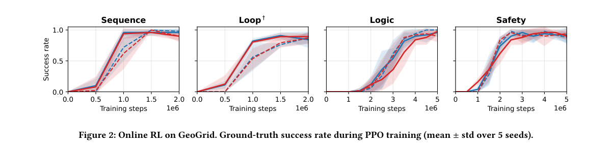

**Why this ranks #9**: 本线第 9 名：让 LLM 从自然语言任务描述编译奖励机、VLM 充当命题标注函数，把非马尔可夫任务的时序结构接回标准 RL，在 GeoGrid 四个任务上取得 1.00/1.00/0.98/0.95 的成功率（行为克隆只有 0.22/0.34/0.00/0.10），OGBench-Scene 上四个任务有三个超过 0.65，仅需检测关闭抽屉与窗户的 Close+Lock 掉到 0.53。

---

### 10. SHORE: Stability-Hybrid On-Policy Reinforcement Learning for Online Bin Packing

**arXiv**: [2611.08364](https://arxiv.org/abs/2611.08364) | **Score**: 9.0 (relevance 9 x 0.7 + quality 9 x 0.3) | **Tags**: rl-core, online-bin-packing, stability-modeling, on-policy-actor-critic, robot-packing, University of Texas at Austin | **Categories**: cs.LG, cs.RO | **Pages**: 15

**Authors**: Chang Shi; Ann Majewicz Fey

**Affiliation**: University of Texas at Austin

**Abstract**

> Online 3D bin packing with a processing buffer requires choosing which box to pack, its orientation, and its placement while keeping the stack stable under unknown future arrivals. A collapse ends the episode and forfeits the remaining volume. Existing methods use geometric rules or hard stability masks, limiting how risk can influence the joint choice of box, orientation, and placement. We propose Stability-Hybrid On-Policy Reinforcement Learning (SHORE), which combines a learned stability probability of a placement with an on-policy estimate of its return conditional on stability. A 3D U-Net learns stability from executed outcomes and simulated alternatives, revealing outcomes of actions underrepresented in early rollouts. A discrete on-policy actor--critic uses stability predictions in both its action values and policy prior, with gates that limit the effect of an untrained or changing model. In deployment, SHORE does not require additional search or simulation overhead. In Isaac Gym, SHORE reaches 73\% space utilization by 0.4M environment steps, while the same learner without stability modeling reaches that level at about 1M. On the expanded 60-box set, SHORE achieves 0.734 space utilization versus 0.588 for the GOPT state-of-the-art baseline, with a higher placement-failure frequency (1.03\% vs. 0.63\%), trading more risk for greater packed volume. The results show faster learning and higher utilization on the more demanding realistic box arrival set. Ablations suggest that simulated alternatives provide useful early supervision, while executed outcomes alone sustain later performance. We also demonstrate the method on a real robot to verify the simplicity of integrating the method to real bin packing pipelines.

**Key findings**

- **Finding**: SHORE 在 0.4M 环境步达到 73% 空间利用率而去掉稳定性建模的同学习器约需 1M；60 箱上 0.734 对 GOPT 的 0.588，失败率 1.03% 对 0.63%。
- **Inference**: 硬稳定性掩码把风险挡在策略之外，学到的稳定性概率配合 on-policy 价值估计才能让风险参与联合决策。
- **Recommendation**: 关注真实机器人装箱管线的同学可关注其 3D U-Net 用执行结果加模拟反事实做早期监督的做法与真机演示。

**Key figures**

*Framework - Illustration of the online bin packing setting with a finite processing buffer. The packing agent selects a box from the buffer, its orientation, and its placement while future arrivals remain*

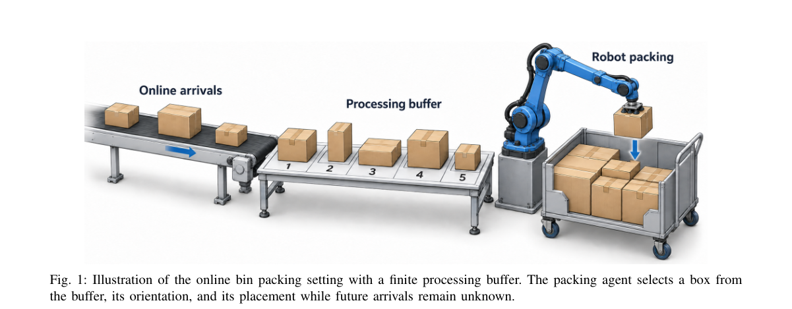

*Result - SHORE framework. The bin configuration Ct and the buffer dt are encoded as EMS tokens and (box, orientation) item tokens, and the rule-based mask m keeps the geometrically valid pairs. The act*

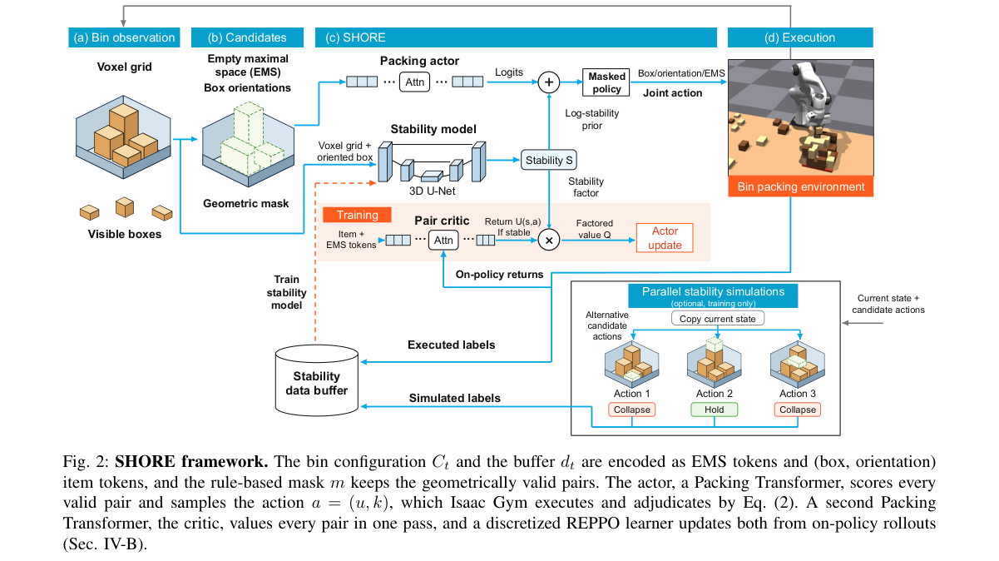

**Why this ranks #10**: 本线第 10 名：把在线 3D 装箱的堆叠稳定性学成概率模型，再与 on-policy 回报估计融合并用门控限制未训练模型的干扰，在 Isaac Gym 上 0.4M 环境步就达到 73% 空间利用率（去掉稳定性建模的同学习器约需 1M），60 箱设置下达 0.734 利用率对比 GOPT 的 0.588，代价是放置失败率从 0.63% 升到 1.03%。

---

