# ArXiv Daily Digest - 2026-11-06 (LLM 后训练 RL, 10 papers)

**Generated**: 2026-11-06 17:30 CST

**Source**: arXiv cs.CV, cs.SD, eess.AS, cs.CL, cs.AI, cs.RO, cs.LG submissions, listing day 2026-11-05 (announced 2026-11-06 00:00 UTC)

**Batch window**: 2026-11-04T18:00:00Z .. 2026-11-05T18:00:00Z（arXiv 公告批次横跨两个 UTC 日：前一日 18:00 UTC 起算，当日 17:59:59 UTC 截止）

**Track**: rl_llm (top 10 of 510 papers scanned, 70 full reads)

**Scope**: LLM 后训练的 RL：RLHF / DPO / GRPO / RLAIF / RLVR / on-policy 蒸馏与 RLVR 调度

---

## Top 10 - LLM 后训练 RL

### 1. $D^2$-OPD: Separating Direction and Distance in Extrapolative On-Policy Distillation

**arXiv**: [2611.07241](https://arxiv.org/abs/2611.07241) | **Score**: 10.0 (relevance 10 x 0.7 + quality 10 x 0.3) | **Tags**: rl-llm, on-policy-distillation, extrapolation, forward-kl, kl-constrained, Columbia University | **Categories**: cs.CL, cs.LG | **Pages**: 17

**Authors**: Bowen Fang; Dingmin Wang; Hengzhi Pei

**Affiliation**: Columbia University; AWS AI Lab; Amazon AGI

**Abstract**

> On-policy distillation (OPD) trains a student model to match a teacher's next-token distributions on student-generated prefixes. Extrapolative OPD further extends the teacher's log-probability shift relative to a reference policy to construct stronger learning targets. However, existing methods couple extrapolation direction and distance, allowing the magnitude of the teacher's shift to dictate how far the target moves. We propose $D^2$-OPD, decoupling these two factors: a per-prefix hard KL constraint bounds the target's distance from the teacher, while an adaptive combination of the teacher's post-training shift and the initial student--teacher gap determines the extrapolation direction. We optimize the student toward this target using forward KL, providing learning signals even for low-probability tokens. We evaluate three settings: where standard OPD performs well, where it struggles with base-model initialization, and where no teacher reference is available. On mathematical reasoning benchmarks, $D^2$-OPD attains the highest score in all three settings, outperforming the strongest baseline by up to 9.45 points. Ablations validate the contributions of each component.

**Key findings**

- **Finding**: Qwen3-8B→Qwen3-4B-Base 上 D²-OPD 的三项基准平均分 47.19，OPD 为 27.57，最强基线 TOP-D 为 37.74。
- **Inference**: 目标构造环节（方向与距离的耦合）是外推式 OPD 的主要瓶颈，解耦二者的收益大于更换 KL 形式。
- **Recommendation**: 想复现 OPD 的同学先读其硬 KL 半径与 bisection 求解，32,768 个前缀在单张 A100 上约 7.2 ms，含方向构造 9.3 ms。

**Key figures**

*Framework - Qwen3-8B →Qwen3-4B-Base distillation. Left: average score across AIME24, AIME25, and AMC23 using avg@16 (mean accuracy over 16 sampled responses per problem), with the initial student shown*

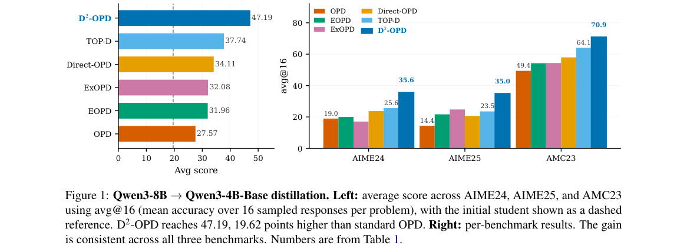

*Result - Distance-aware extrapolation direction. All quantities are shown at a fixed prefix h, with conditioning omitted. The distances from the teacher q+ to tref and π0 are σT and σπ, with correspo*

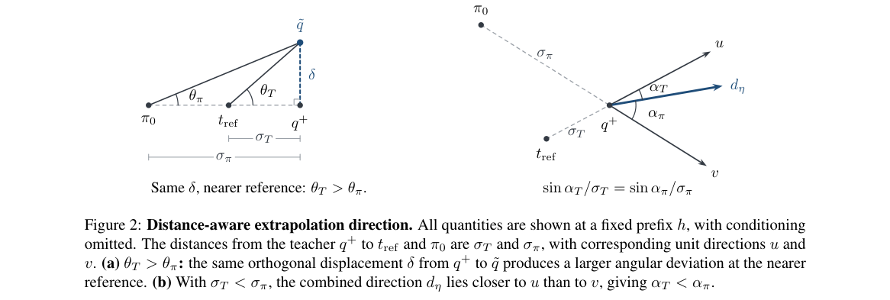

**Why this ranks #1**: 本线第 1 名，也是本批 on-policy 蒸馏主线的起点：指出外推式 OPD 把「目标往哪走」与「走多远」耦合在一起，用逐前缀硬 KL 约束限距、用教师后训练偏移与师生初始差距自适应定方向，在 Qwen3-8B→Qwen3-4B-Base 上把 AIME24/AIME25/AMC23 平均分从 OPD 的 27.57 提到 47.19（+19.62），比最强基线 TOP-D 高 9.45 分。

---

### 2. Reinforcing What the Student Has Learned: Teacher-Guided On-Policy Distillation

**arXiv**: [2611.07722](https://arxiv.org/abs/2611.07722) | **Score**: 9.7 (relevance 10 x 0.7 + quality 9 x 0.3) | **Tags**: rl-llm, on-policy-distillation, student-base-reference, feedback-masking, amplitude-disparity, State Key Lab of CAD & CG | **Categories**: cs.LG | **Pages**: 16

**Authors**: Bozhen Fang; Linhao Zhong; Xuehao Wang; Huanyi Zheng; Hao Chen; Chunhua Shen

**Affiliation**: State Key Lab of CAD & CG, Zhejiang University; Ant Group

**Abstract**

> On-policy distillation (OPD) improves language-model reasoning through dense teacher feedback on student-generated responses.We first observe an amplitude disparity in this feedback: on math reasoning responses, style-related positions exhibit 3.5 times the mean absolute teacher--student log-probability difference of mathematical positions.Scaling OPD updates by these discrepancies thus directs much of the update strength toward matching the teacher's expression. We instead take the student's own pretrained base as a reference: the student--base difference records the token preferences acquired during post-training and provides supervision that does not depend on the student's distance from the teacher. Building on this reference, we propose Student-Delta On-Policy Distillation (SD-OPD), which uses centered student--base differences as update coefficients, keeps each coefficient only when its sign agrees with centered teacher--student feedback, and recomputes the student signal every training round. Across 5 teacher--student configurations with Qwen3 students of 1.7B to 8B parameters, SD-OPD improves six-task mathematics average pass@1 (avg@16) over OPD by 7.76 to 10.37 percentage points. Code is available at https://github.com/aim-uofa/sd-opd.

**Key findings**

- **Finding**: 数学推理响应中风格相关位置的师生 log 概率绝对差是数学位置的 3.5 倍，学生与底座之差的风格/数学比更高达 4.1。
- **Inference**: 直接按师生差异幅度加权会把大部分更新强度花在模仿教师表达上，OPD 的推理收益因此被风格对齐吃掉。
- **Recommendation**: 做 OPD 的同学可参考其同号门控与逐轮重算学生信号的做法，并注意该方法压低风格幅度 40.3% 的同时会削掉部分数学幅度。

**Key figures**

*Framework - SD-OPD overview. Each round scores student-generated responses on shared prefixes. The student–base difference supplies the*

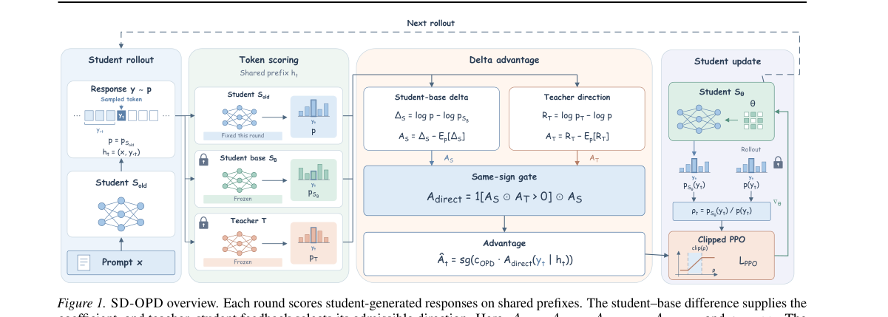

*Result - Feedback on the same student responses: raw (a) teacher–student rt and (b) student–base dt, and both after the same-sign mask*

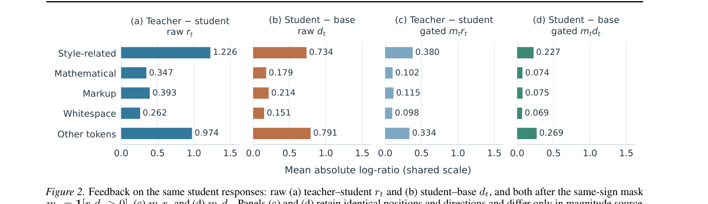

**Why this ranks #2**: 本线第 2 名：把「该学什么」与 D²-OPD 的「目标怎么构造」分开处理——实测风格位置的师生 log 概率差是数学位置的 3.5 倍，改用学生与其预训练底座之差做系数、只在符号一致时保留更新，在 5 组师生配置、1.7B–8B 的 Qwen3 学生上把六项数学基准 avg@16 相对 OPD 提升 7.76–10.37 个百分点。

---

### 3. CoRD: Coupled Rollouts Fill the Blind Spot of On-Policy Distillation

**arXiv**: [2611.07959](https://arxiv.org/abs/2611.07959) | **Score**: 9.7 (relevance 10 x 0.7 + quality 9 x 0.3) | **Tags**: rl-llm, on-policy-distillation, maximal-coupling, speculative-decoding, state-distribution, Tsinghua University | **Categories**: cs.CL, cs.LG | **Pages**: 15

**Authors**: Guhan Chen; Bohan Li; Jun Rao; Hejin Wang; Songtao Tian; Yexin Xie; Xiaojun Meng; Peng Yuan; Jiansheng Wei; Xuebo Liu; Zixiong Yu

**Affiliation**: Tsinghua University; Harbin Institute of Technology, Shenzhen; Nanjing University; Huawei Large Model Data Technology Lab

**Abstract**

> On-policy distillation trains a student on its own rollouts, so states the teacher would reach but the student does not are seldom supervised. We introduce CoRD (coupled-rollout distillation), which keeps the on-policy loss and moves only the distribution of training states toward the teacher, drawing rollouts from a geometric interpolation of student and teacher through the maximal coupling of speculative decoding. The coupling keeps the student's token wherever the two distributions agree and otherwise substitutes a token from the part of the target the student underweights, so interventions are as rare as any exact sampler allows and recede as the student learns. Across six base students from two model families (Qwen3 and Qwen3.5, 0.6B to 4B), CoRD raises average pass@1 over on-policy distillation by 0.9 to 2.0 points and pass@8 by 1.2 to 3.4 points on five public math benchmarks at equal steps and data. On frozen teacher-reached states, a 4B student trained with CoRD reaches in 16 steps a gap closure that on-policy distillation does not reach in 80, and substitution rules intervening at least as often in other directions fall short of CoRD.

**Key findings**

- **Finding**: 在冻结的教师到达状态上，4B 学生用 CoRD 训练 16 步闭合的差距，OPD 训练 80 步仍未闭合；40 步时 CoRD 采样器消掉 21.7% 的分歧而 OPD 只消掉 15.0%。
- **Inference**: OPD 的瓶颈是训练状态分布覆盖而非损失形式，耦合采样能以尽可能少的干预把分布拉向教师。
- **Recommendation**: 关注 OPD 采样分布的同学可先看其最大耦合实现，以及 OPD 训练两倍步数仍追不上 CoRD 的对照实验。

**Key figures**

*Framework - Overview of CORD. (i) Left (OPD’s blind spot): On-policy distillation trains only on student rollouts. Teacher-preferred reasoning paths that the student rarely or never visits therefore rec*

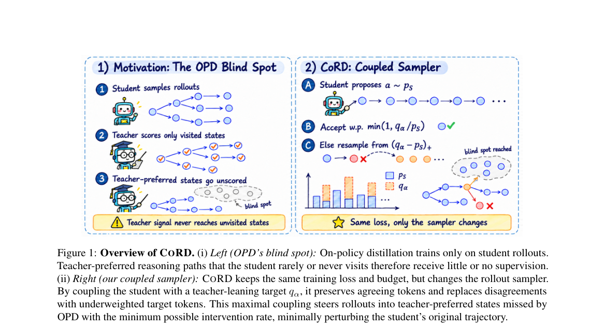

*Result - One-step coupled sampling. On a three- token vocabulary with α = 0.6, student proposals are kept whenever possible and replaced only when neces- sary, so the emitted token follows qα exactly*

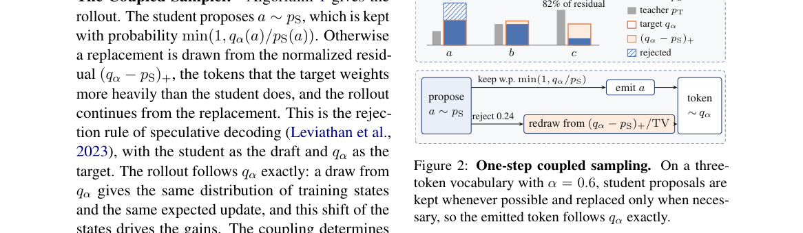

**Why this ranks #3**: 本线第 3 名：解决 OPD 的状态盲区——教师会走到但学生很少走的推理路径拿不到监督，用推测解码的最大耦合在师生分布之间做几何插值采样，4B 学生 16 步就能闭合 OPD 需要 80 步才闭合的差距，同预算下把六个 0.6B–4B 学生的平均 pass@1 相对 OPD 提升 0.9–2.0 分、pass@8 提升 1.2–3.4 分。

---

### 4. SAVeR$^2$: Reasoning-based Safety Alignment for Large Reasoning Models via Verifiable Rewards

**arXiv**: [2611.07482](https://arxiv.org/abs/2611.07482) | **Score**: 9.0 (relevance 9 x 0.7 + quality 9 x 0.3) | **Tags**: rl-llm, safety-alignment, reasoning-model, verifiable-reward, gradient-projection, State Key Laboratory of Blockchain and | **Categories**: cs.AI | **Pages**: 38

**Authors**: Yichen Sun; Qirui Liu; Yan Wang; Jianan Lin; Linbo Jiang; Shiyu Wang; Zhibo Wang; Zhixuan Chu

**Affiliation**: State Key Laboratory of Blockchain and Data Security, Zhejiang University; Chongqing Ant Consumer Finance; Independent Researcher; Alibaba Group

**Abstract**

> Large Reasoning Models (LRMs) have achieved impressive performance via explicit Chain-of-Thought (CoT) reasoning, yet this process introduces critical safety risks. We formalize LRM safety objectives as requiring non-malicious reasoning and answers, safety consistency, and explicit intent identification. We argue that existing alignment methods suffer from poor adversarial generalization, a significant ``safety tax'' on reasoning, and unfaithful coarse-grained rewards, primarily due to their neglect of the LRM's intrinsic reasoning capabilities for safety. To address these, we propose \textbf{SAVeR$^2$}, a novel \textbf{S}afety \textbf{A}lignment method via \textbf{R}ewards with \textbf{R}easoning capability. SAVeR$^2$ decomposes the safety objective into four fine-grained verifiable reward signals and utilizes a difficulty-aware data selection strategy to stabilize training. Crucially, we introduce a reasoning-preserving gradient projection mechanism that analytically resolves conflicts between safety and reasoning gradients, effectively eliminating the safety tax. Extensive experiments on models ranging from 1.5B to 671B demonstrate that SAVeR$^2$ achieves superior safety performance and significantly lower over-refusal rates across multiple benchmarks without compromising general reasoning capabilities.

**Key findings**

- **Finding**: SAVeR²-671B 在 BSA 上 Safe@1 98.80、Think@1 72.99、F 分数 78.40，原始 R1-671B 为 94.63/37.98/47.11，MMLU 85.29 对 86.63。
- **Inference**: 显式推理链带来的安全风险必须靠过程级奖励与梯度层面的冲突消解才能兼顾，只对齐最终答案不够。
- **Recommendation**: 做推理模型安全的同学可参考其四信号可验证奖励、难度感知数据选择与三阶段训练（R1-671B 用 1024 张 910B3 训 500 步）。

**Key figures**

*Framework - Comparison of SAVeR2 with exist- ing LRM safety alignment methods. SAVeR2 surpasses these methods on both safety datasets (red) and general datasets (blue).*

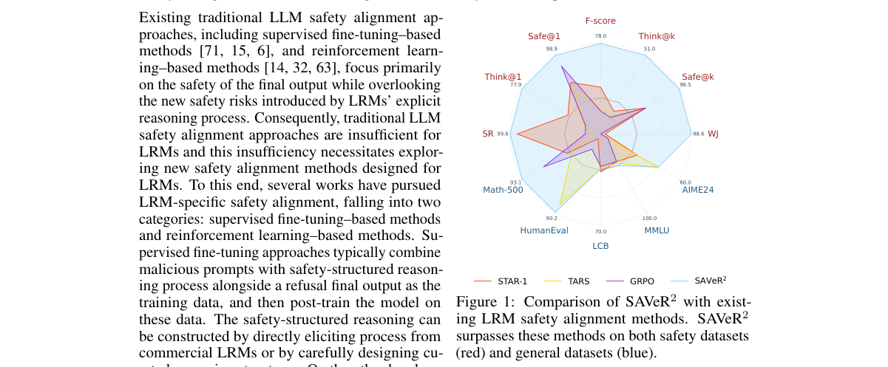

*Result - Overview of our proposed SAVeR2. SAVeR2 comprises three stages: safety reasoning warm-up which fine-tunes the base LRM to generate safety-aware reasoning process, difficulty-aware training d*

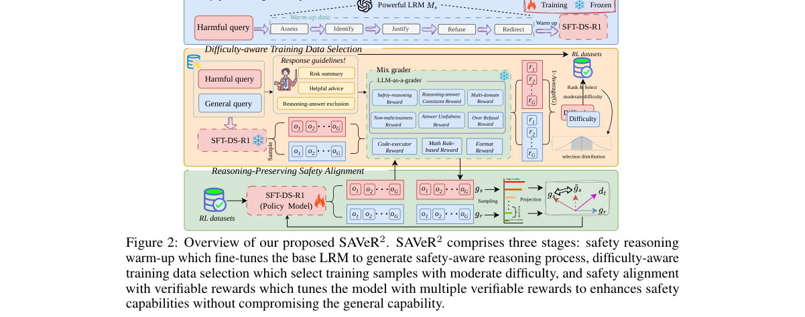

**Why this ranks #4**: 本线第 4 名：把大型推理模型的安全目标拆成四条可验证奖励信号，并用保推理的梯度投影解析解决安全梯度与推理梯度的冲突、把安全税降到最低，在 1.5B 到 671B 全尺度上 SAVeR²-671B 的 Safe@1 达 98.80、Think@1 达 72.99（F 分数 78.40），而未对齐的 R1-671B 分别为 94.63 与 37.98。

---

### 5. Learning Multi-Agent Orchestration:Higher-Order Interactions in Policy Improvement

**arXiv**: [2611.07495](https://arxiv.org/abs/2611.07495) | **Score**: 9.0 (relevance 9 x 0.7 + quality 9 x 0.3) | **Tags**: rl-llm, multi-agent-orchestration, policy-improvement, higher-order-interaction, certified-update, Emory University | **Categories**: cs.LG | **Pages**: 39

**Authors**: Kaixuan Liu; Guojun Xiong

**Affiliation**: Emory University; Shanghai Jiao Tong University

**Abstract**

> Learned orchestration has emerged as a promising paradigm for large language model (LLM)-based multi-agent systems, in which a central orchestrator selects agents and controls the information they receive throughout a task. Despite rapid empirical progress, existing methods train the orchestrator by crediting each decision with its own advantage, implicitly assuming that the other decisions in the episode stay fixed. This assumption fails in orchestration, where the contribution of each decision to the final outcome depends on the decisions preceding it, so the gain of a joint update is not the sum of its per-decision effects. To address this challenge, we introduce \textbf{IAPO}, an interaction-aware policy optimization framework that explicitly accounts for interactions among decisions. Specifically, IAPO exactly decomposes the performance difference between two policies into the effects of individual decisions and their interactions, which we prove can account for half of the attainable gain, and then optimizes both from sampled trajectories while certifying that every update is an improvement. On long-input versions of GSM8K, MATH, DROP, MBPP and HumanEval, against fifteen published multi-agent and workflow-search systems on the same 7B executor, IAPO's deployed plans reach the strongest system's accuracy with fewer tokens, and removing the interaction term costs 7 to 17 points of accuracy on code.

**Key findings**

- **Finding**: IAPO 给出策略性能差的精确交互展开并证明忽略交互会损失可达增益的一半，去掉交互项在两个代码基准上掉 7–17 个准确率点。
- **Inference**: 多智能体编排中一次联合更新的收益不等于各决策独立效应之和，用单决策 advantage 记账会系统性高估。
- **Recommendation**: 做 LLM 编排策略优化的同学可参考其二阶截断误差界，以及基于经验 Bernstein 界的认证式更新筛选。

**Key figures**

*Framework - Overview of IAPO. (a) Orchestration decisions depend on one another: a new earlier worker helps only if a later call may read its output, so neither change helps alone. (b) IAPO credits each*

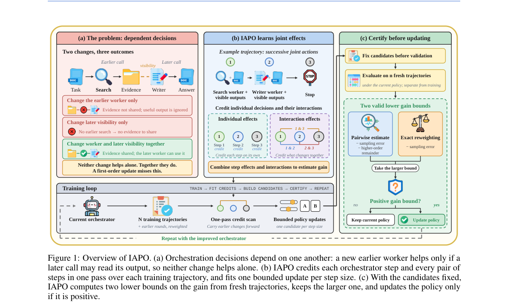

**Why this ranks #5**: 本线第 5 名：指出编排器把每个决策按自身 advantage 记账是错的——决策之间存在高阶交互，论文精确分解两套策略间的性能差并证明交互项可占可达增益的一半，在 GSM8K/MATH/DROP/MBPP/HumanEval 长输入版上对 15 个已发表多智能体与工作流搜索系统，抹掉交互项在两个代码基准上要损失 7–17 个准确率点。

---

### 6. Provable Zeroth-Order Safe Exploration for Reinforcement Learning from Human Feedback

**arXiv**: [2611.07561](https://arxiv.org/abs/2611.07561) | **Score**: 9.0 (relevance 9 x 0.7 + quality 9 x 0.3) | **Tags**: rl-llm, rlhf, safe-exploration, zeroth-order, log-barrier, human-feedback, Purdue University | **Categories**: cs.LG | **Pages**: 30

**Authors**: Weiqin Chen; Xinmeng Huang; Dongsheng Ding; Santiago Paternain

**Affiliation**: Purdue University; University of Pennsylvania; University of Tennessee, Knoxville; Rensselaer Polytechnic Institute

**Abstract**

> Safe reinforcement learning from human feedback (Safe-RLHF) seeks to improve helpfulness while satisfying harmlessness constraints. Existing primal-dual approaches can converge to feasible policies but do not prevent constraint violations during training. We study a stronger requirement, safe exploration for RLHF, under which every policy executed during training, including auxiliary exploration policies, remains feasible. We propose Zeroth-Order Log-Barrier Policy Gradient (ZO-LBPG), a reward-model-free method that optimizes a log-barrier objective using zeroth-order estimates derived directly from human preferences. To ensure safety under noisy feedback, we combine conservative constraint margin estimates with coupled rollouts and an adaptive step size that prevents updates from crossing constraint boundaries. We prove that, with high probability, all iterates and exploration policies remain strictly feasible, and that ZO-LBPG globally converges to an approximately optimal constrained policy. We establish a sample complexity of $\widetilde{\mathcal O}(\varepsilon^{-6}+d^3\varepsilon^{-5})$ trajectories and $\widetilde{\mathcal O}(\varepsilon^{-8}+d^5\varepsilon^{-7})$ human queries. Experiments on a synthetic CMDP and a language-model alignment task corroborate the training-time safety guarantees.

**Key findings**

- **Finding**: 定理 4.2 给出安全探索保证——每步迭代的所有约束余量至少 cη，每个探索策略的余量至少 cη/2，步长范数不超过 η/4。
- **Inference**: 用人类偏好做零阶估计时方差是关键，能否逐次认证更新安全取决于估计精度而非平均无偏。
- **Recommendation**: 关心 RLHF 训练期安全性的同学可先看其与 ZPGPD-HF 的对照：后者反复越过约束边界，前者保持严格可行。

**Key figures**

*Framework - Synthetic CMDP. ZO-LBPG keeps every it- erate strictly feasible, whereas ZPGPD-HF constantly violates the constraints and attains its smaller reward gap through infeasible policies. Curves s*

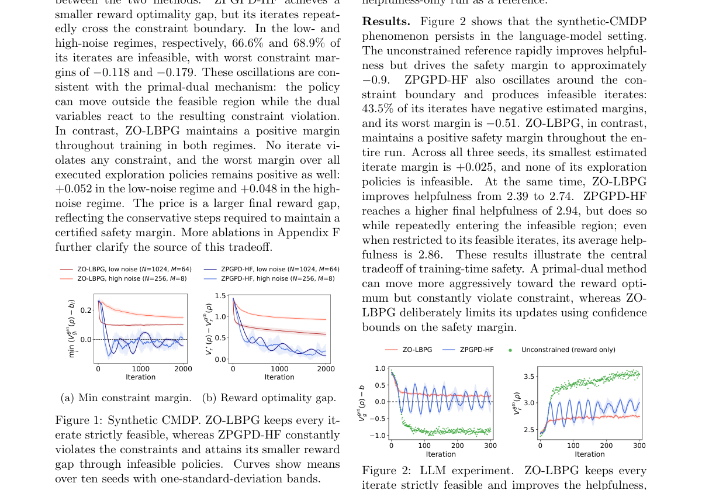

*Result - LLM experiment. ZO-LBPG keeps every iterate strictly feasible and improves the helpfulness, whereas ZPGPD-HF repeatedly crosses the constraint boundary. Means over three seeds with one-stand*

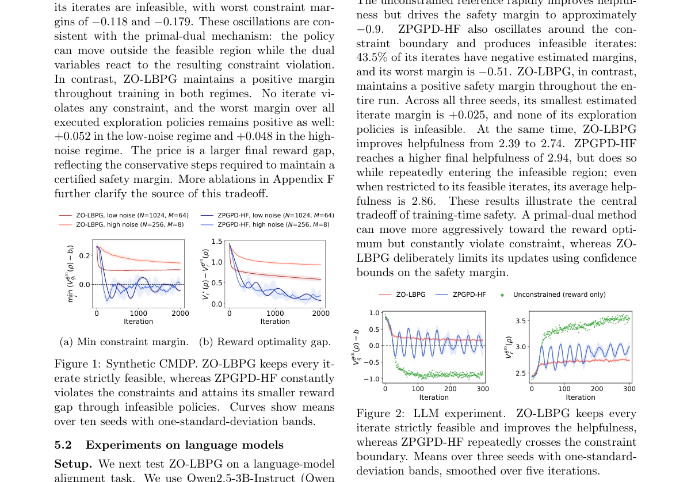

**Why this ranks #6**: 本线第 6 名：直指现有 primal-dual RLHF 在训练途中会违反无害性约束，用对数障碍目标加零阶梯度估计直接从人类偏好学习，并给出「所有迭代点与探索策略都严格可行」的高概率保证，样本复杂度 Õ(ε^{-6}+d³ε^{-5}) 条轨迹、Õ(ε^{-8}+d⁵ε^{-7}) 次人类查询，首项与策略维度无关。

---

### 7. Measuring the Marginal Value of Verifier-Based RL Beyond Supervised Fine-Tuning

**arXiv**: [2611.07639](https://arxiv.org/abs/2611.07639) | **Score**: 9.0 (relevance 9 x 0.7 + quality 9 x 0.3) | **Tags**: rl-llm, verifiable-reward, supervised-fine-tuning, ablation-study, reproducibility, Independent Researcher | **Categories**: cs.AI, cs.LG | **Pages**: 8

**Authors**: Amit Sagtani; Saloni Garg

**Affiliation**: Independent Researcher

**Abstract**

> Reinforcement learning from verifiable rewards (RLVR) is usually evaluated as an alternative to supervised fine-tuning (SFT), or as a stage that follows it, with the implicit assumption that the RL stage contributes gains of its own. We measure that contribution directly, in a controlled setting where both stages can be run to completion and compared exactly. We built gpu-train-debug, a deterministic benchmark of 1,877 synthetic GPU and LLM training failure diagnosis tasks across 30 archetypes, graded by a programmatic verifier with partial credit, and calibrated so that a mid-tier model scores in a 0.60 to 0.75 band. A pilot produced a surprise: 1,200 gold demonstrations nearly solved the benchmark (SFT 0.785 on the hard split), while 15 steps of GRPO from the base model did not move it (0.314 vs 0.311 base). We therefore amended the study, in writing and before the full run, to ask the sharper question: what does verifier-based RL add beyond demonstrations? At the pre-registered scale (60 GRPO steps, learning rate 1e-6), the answer is: no detectable improvement in-distribution (+0.22 points, 95% CI [-0.06, +0.51]), and a modest but measurable improvement under distribution shift (+0.33 points on a held-out OOD split, CI [+0.02, +0.68]). SFT accounted for most of the available improvement, while verifier-based RL produced only modest additional gains under distribution shift. The residual errors SFT leaves are mostly systematic, identical across samples, which likely reduces the within-group learning signal available to GRPO. A full 60-step cold-start GRPO arm confirms the pilot at the full horizon. The whole study cost $8.69 of compute and is fully reproducible from archived generations, frozen configs, and tagged code.

**Key findings**

- **Finding**: 试点发现 1,200 条示范在困难切分上 SFT 已达 0.785，而 15 步 GRPO 从基座只把 0.311 抬到 0.314，研究因此在跑满前改写问题。
- **Inference**: 验证器 RL 的增量收益容易被示范数据吃掉，且 SFT 残留错误多为跨样本一致的系统性问题，组内可学习信号因此很弱。
- **Recommendation**: 评测 RLVR 之前先测「示范能解决多少」，并照其做法把结论、冻结配置与生成样本全部归档以便复现。

**Key figures**

*Framework - The two-stage design. Stage 1 (pilot) compared SFT and short-horizon GRPO from the base model; its surprise (demonstrations nearly solve the benchmark) changed the question. Stage 2 (Amendme*

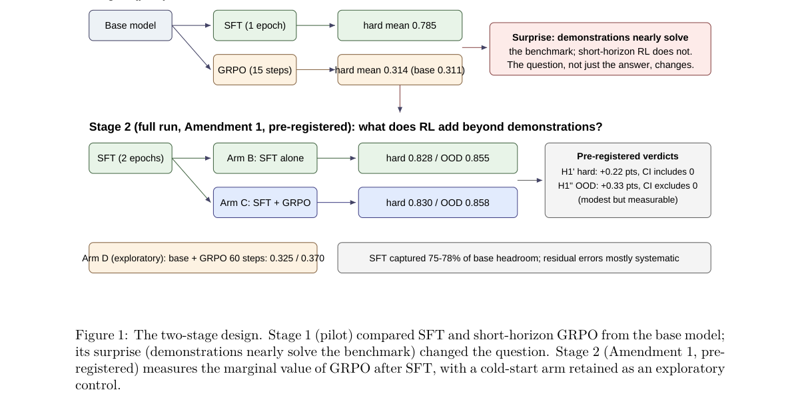

*Result - The study as a tree of gains on the OOD split: demonstrations contribute +51.5 points, the RL stage that follows them +0.33, and RL without demonstrations +3.0. On the hard split the same tr*

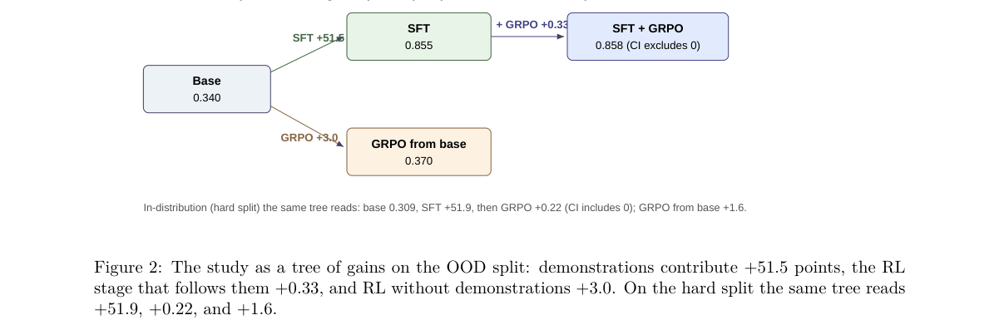

**Why this ranks #7**: 本线第 7 名：用一个 1,877 题、30 类架构的确定性 GPU 与 LLM 训练故障诊断基准直接测量「验证器 RL 相对 SFT 的边际价值」，预注册 60 步 GRPO、学习率 1e-6 下同分布提升只有 +0.22 分（95% CI [-0.06, +0.51]）、分布外 +0.33 分（CI [+0.02, +0.68]），1,200 条示范已拿到 0.785，整个研究只花了 8.69 美元算力。

---

### 8. O$^2$PD: Overlap-Gated On-Policy Distillation on Reliable Prefix

**arXiv**: [2611.07731](https://arxiv.org/abs/2611.07731) | **Score**: 9.0 (relevance 9 x 0.7 + quality 9 x 0.3) | **Tags**: rl-llm, on-policy-distillation, prefix-alignment, alpha-divergence, support-restriction, Renmin University of China | **Categories**: cs.AI, cs.CL | **Pages**: 19

**Authors**: Shuaishuai Zu; Jihao Zhao; Pengfei Li; Guanghuan Fang; Ben Feng; Yuhan Liu; Biao Qin; Baochuan Yang

**Affiliation**: Renmin University of China; Huawei Technologies

**Abstract**

> On-policy distillation (OPD) supplies dense token-level supervision by aligning a student to the teacher's next-token distribution on its own generated rollouts. Existing works mostly implement top-$k$ OPD, applying reverse Kullback-Leibler ($\RKL$) divergence between the teacher's and the student's renormalized distributions over teacher top-$k$ support. However, the teacher scores student-generated rollouts that are inherently off-policy for itself, leaving the reliability of its next-token guidance unclear. Restricting the divergence to the teacher top-$k$ support also discards the remaining mass outside that support. These gaps leave two questions implicit: 1) which tokens to align, and 2) how to align those tokens. To answer these questions, we propose Overlap-gated On-Policy Distillation (O$^{2}$PD). As for 1), we quantitatively analyze the reliability of teacher supervision and find that alignment on the student's trajectory prefix is more reliable than alignment on the full context. Therefore, our O$^{2}$PD is applied only to the 20\% prefix tokens of each student rollout. As for 2), we theoretically characterize two problems of top-$k$ OPD: the \emph{Teacher-support Uncovering} and the \emph{Dominant-Mode Mismatch}. Based on these analyses, we propose two support strategies: the \emph{Reset Support} strategy attaches a reset atom to every token, pooling mass outside the teacher top-$k$, and the \emph{Support Convergence} strategy converges the support to the already aligned intersection. Our O$^{2}$PD employs the designed overlap-gated $α$-divergence to interpolate between mode-covering and mode-seeking for per-token alignment, where the overlap is used as a gate to switch the support and adaptively modulate $α$.

**Key findings**

- **Finding**: MATH500 交叉前缀协议中学生 pass@1 为 73.8%、教师为 85.8%，且教师 pass@1 随学生前缀变长而下降，O²PD 只对 20% 前缀 token 施加损失。
- **Inference**: 教师对学生生成序列的指导天然不可靠且前缀最难匹配，把监督集中在前缀并按重叠切换支撑集比全程 top-k RKL 更有效。
- **Recommendation**: 做 top-k OPD 的同学可直接对比其 Reset Support 与 Support Convergence 两种支撑策略，以及重叠中位数处的支撑切换规则。

**Key figures**

*Framework - Framework of our O2PD: (a) Restricting alignment to the prefix, where teacher supervision is reliable. (b) Overlap-gated α-divergence with Reset Support and Support Convergence strategies.*

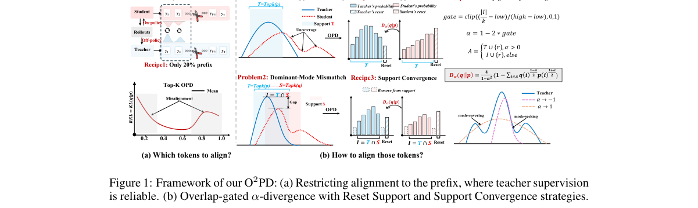

**Why this ranks #8**: 本线第 8 名：从「对齐哪些 token、怎么对齐」两问切入，量化出教师在自己 off-policy 的学生轨迹上可靠性更低，于是只对每条 rollout 前 20% 前缀做对齐，再用重叠度门控的 α-散度在模式覆盖与模式寻求之间切换支撑集，在七个基准、三组师生配对上相对 OPD 最高 +5.29 分（Qwen3-1.7B←Qwen3-4B-NTRL：45.29→50.58）。

---

### 9. Learning Dynamics of On-Policy Distillation

**arXiv**: [2611.08016](https://arxiv.org/abs/2611.08016) | **Score**: 9.0 (relevance 9 x 0.7 + quality 9 x 0.3) | **Tags**: rl-llm, on-policy-distillation, mechanistic-analysis, feedback-loop, offline-warmup, University of Oxford | **Categories**: cs.CL, cs.LG | **Pages**: 54

**Authors**: Guan Zhe Hong; Sumeet Ramesh Motwani; Liang Chen; Yangchen Pan; Junchi Yu; Jialin Yu; Philip Torr; Yi Ren

**Affiliation**: University of Oxford; EPFL; City University of Hong Kong

**Abstract**

> On-policy distillation (OPD) is emerging as an important paradigm for language-model post-training, combining dense teacher supervision with training on student-generated trajectories. This creates a feedback loop where each update changes the student and thereby the training distribution that generates subsequent updates. Yet, how this feedback shapes learning and generalization remains poorly understood. We conduct a mechanistic analysis of OPD's learning dynamics, distinguishing the two feedback loop stages: conversion of the distillation signal into parameter updates, and broadcast through which these updates change predictions across prefixes and reshape the rollout distribution. This framework helps us understand both limited student responsiveness despite substantial teacher-student disagreement, and degeneration when updates that improve local teacher agreement also increase the probability of unsuccessful continuations, exposing the student to unreliable supervision in subsequent rollouts. Finally, we show that offline distillation can prepare a student for OPD without significantly improving immediate held-out accuracy. While OPD alone may degrade generation, it can yield substantial accuracy gains after sufficient offline preparation. Together, our results connect teacher supervision, student geometry, and the evolving rollout distribution in determining the learning dynamics of OPD and its effects on downstream performance.

**Key findings**

- **Finding**: 7B 学生上健康请求的集体增益是停滞请求的 2.75–3.62 倍，1.5B 上约为 2–2.6 倍；健康运行第 50 步领先子空间重叠降到 0.77，停滞运行则在收缩。
- **Inference**: 学生对教师监督的响应性而非教师强度决定 OPD 能否推进，师生分歧大并不等于学得动。
- **Recommendation**: 用 OPD 后训练的同学在跑 OPD 前先做足离线蒸馏以稳定续写，并警惕局部 teacher 一致性改善却让 rollout 分布退化的情况。

**Key figures**

*Result - Initial/end AIME accuracy; dia- monds mark teachers. Red: sibling-taught; blue: larger-teacher taught.*

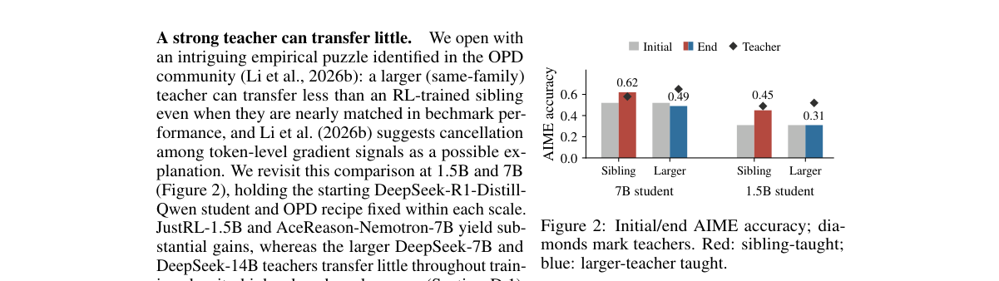

**Why this ranks #9**: 本线第 9 名：不做新方法而是解释 OPD 的反馈环，把「蒸馏信号转成参数更新」与「更新广播到其他前缀」拆成两段，指出教师越强学生反而越学不动（7B 上健康请求的集体增益是停滞请求的 2.75–3.62 倍），并给出关键处方：先用离线蒸馏备好续写能力，OPD 才能在 AIME 2024/2025 上把 pass@32 真正拉起来。

---

### 10. AttnSR: Attention Step Reward for Long-Horizon Agentic RL

**arXiv**: [2611.07932](https://arxiv.org/abs/2611.07932) | **Score**: 8.7 (relevance 9 x 0.7 + quality 8 x 0.3) | **Tags**: rl-llm, agentic-rl, step-reward, attention-interpretability, long-horizon, East China Normal University | **Categories**: cs.AI, cs.LG | **Pages**: 20

**Authors**: Mengsong Wu; Tianchen Zhou; Zhaochen Su; Zhenhua Liu; Zhe Cui; Aimin Zhou

**Affiliation**: East China Normal University; Shanghai Innovation Institute; Hithink Research; The Hong Kong University of Science and Technology

**Abstract**

> Long-horizon LLM agents make multi-step decisions, yet outcome-reward-only reinforcement learning provides little direct supervision for individual steps. We introduce AttnSR, a step-level reward augmentation method that derives reward allocations from policy attention extracted during training replay, without a separately trained reward model or additional rollouts. AttnSR traces backward through the policy model attention graph to estimate the relevance of earlier steps to the final response. The terminal step, measured relative to a running baseline, determines whether these rewards reinforce or penalize the selected steps. In a controlled Qwen2.5-7B-Instruct study, AttnSR consistently outperforms the PPO baseline across all evaluated checkpoints on ALFWorld, raising final held-out success from 91.2% to 97.1%. The ablation experiment shows that the benefit depends on how intermediate rewards are assigned, rather than simple accumulation of step rewards over time. AttnSR also improves ScienceWorld at every checkpoint while cutting environment interactions by 29.9%. These results support policy attention as a practical prior for step-level reward allocation in long-horizon agentic RL. Code is available at https://github.com/fairyshine/AttnSR .

**Key findings**

- **Finding**: ALFWorld 的 274 个留出任务（140 见过、134 未见）上，AttnSR 把最终成功率从 91.2% 提升到 97.1%，ScienceWorld 上少用 29.9% 环境步。
- **Inference**: 策略自身的注意力图可以作为步级信用分配的现成先验，不必另训过程奖励模型或追加 rollout。
- **Recommendation**: 做长时序 agentic RL 的同学可先读其反传衰减 ρ = 0.85 与分层几何平均融合，并注意消融显示收益来自中间奖励的分配方式而非简单累加。

**Key figures**

*Framework - Overview of ATTNSR. Actor replay supplies attention for a step graph. Backtracking from the terminal step, recency correction, and layer fusion yield an allocation, and confidence and the ce*

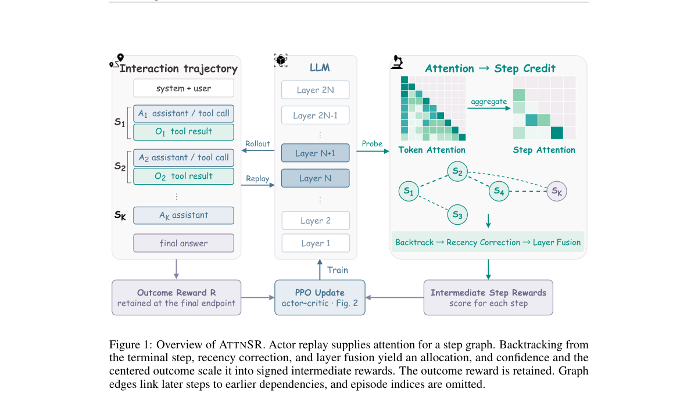

*Result - Integration of ATTNSR into actor–critic RL. (a) The PPO integration of ATTNSR adds intermediate rewards while retaining the outcome reward. (b) Detached actor attention supplies rewards, and*

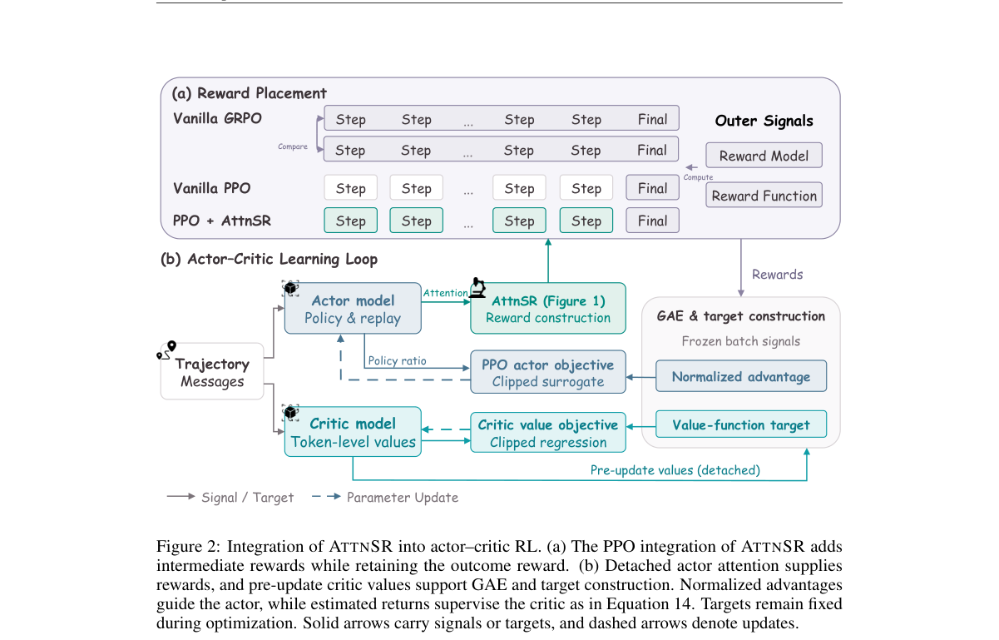

**Why this ranks #10**: 本线第 10 名：不额外训奖励模型也不用更多 rollout，直接从训练回放里的策略注意力反推每一步对终局的相关性来分配步级奖励，在 Qwen2.5-7B-Instruct 上把 ALFWorld 留出成功率从 91.2% 提到 97.1%，ScienceWorld 各检查点均提升且环境交互减少 29.9%。

---

