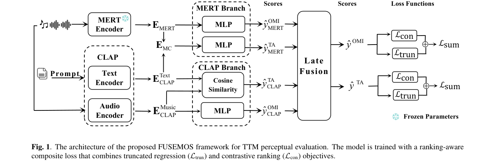
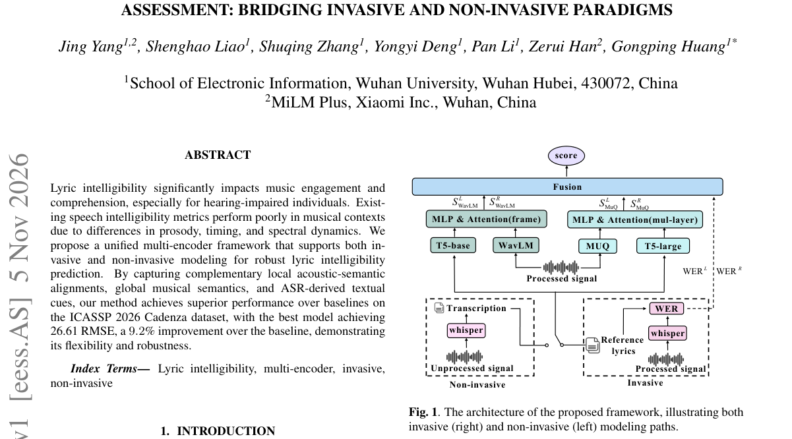

# ArXiv Daily Digest - 2026-11-06 (语音 LM 的强化学习, 2 papers)

**Generated**: 2026-11-09 17:30 CST

**Source**: arXiv cs.CV, cs.SD, eess.AS, cs.CL, cs.AI, cs.RO, cs.LG submissions, listing day 2026-11-05 (announced 2026-11-06 00:00 UTC)

**Batch window**: 2026-11-04T19:00:00Z .. 2026-11-05T19:00:00Z（arXiv 公告批次横跨两个 UTC 日：从前一日的美东 14:00 截止时刻起算（EDT 为 18:00Z，EST 为 19:00Z），到当日的同一时刻为止）

**Track**: speech_rl (top 2 of 535 papers scanned, 29 full reads)

**Scope**: 语音 / 音频大模型的 RL 与偏好优化：RLHF / GRPO / DPO、语音奖励模型、语音质量打分与可验证奖励

⚠️ **Wild-card**: 本批次 0 篇够格的语音 RL 论文，以下 2 篇全部为 wild-card。

对全批次 535 篇论文做过两轮关键词复扫（RL 词 × 语音词，同向与反向窗口各 140 字符），命中的只有视觉生成奖励模型、驾驶仿真在线 RL 与纯文本 LLM 对齐三类，无一属于语音 RL。按 skill「够格就发、发不满是正常结果」的规则，本线不填充凑数论文，只保留 2 篇在奖励建模 / 音频质量打分上与本线方法学同构的 wild-card，并在此显式声明「本线本批次为空」。

---

## Top 2 - 语音 LM 的强化学习

### 1. FUSEMOS: Perceptual Evaluation of Text-to-Music Generation with Dual-Encoder Fusion and Ranking-Aware Composite Loss

**arXiv**: [2611.07562](https://arxiv.org/abs/2611.07562) | **Score**: 6.6 (relevance 6 x 0.7 + quality 8 x 0.3) | **Tags**: speech-rl, reward-modeling, ranking-aware-loss, dual-encoder-fusion, music-quality-evaluation, mos-prediction, Wuhan University | **Categories**: eess.AS | **Pages**: 5

**Authors**: Jing Yang; Haoyu Wang; Ningning Pan; Zhao Wang; Jianxuan Yang; Gongping Huang

**Affiliation**: Wuhan University; Southwestern University of Finance and Economics; MiLM Plus, Xiaomi Inc.

**Abstract**

> Perceptual evaluation of generated music is essential for developing text-to-music (TTM) generation systems. Existing automatic music perceptual evaluation methods rely solely on the contrastive language audio pretraining (CLAP) model to extract both audio and text features for predicting human-annotated mean opinion scores (MOS), particularly for overall musical impression (OMI) and textual alignment (TA). However, CLAP is limited in capturing fine-grained musical attributes such as timbre and expressiveness \emph{etc}. To address this, we propose FUSEMOS, a dual-encoder fusion framework that integrates CLAP with MERT, a self-supervised model pretrained on large scale music audio, to better capture both high level semantic alignment and detailed musical characteristics for more accurate OMI and TA estimation. Furthermore, to overcome the limitations of conventional regression losses in measuring human preferred relative ranking of music segments, we design a novel ranking-aware composite loss function. Experiments conducted on the MusicEval benchmark demonstrate that our approach outperforms the existing SOTA methods in both mean squared error and rank correlation metrics by a large margin.

**Key findings**

- **Finding**: 在 MusicEval 基准上，FUSEMOS 把 OMI 的 U-MSE 从基线 0.560 降到 0.260（降 53.6%）、S-MSE 从 0.217 降到 0.027（降 87.6%），S-SRCC 达 0.977；文本对齐的 S-SRCC 也从 0.861 提升到 0.940，U-SRCC 从 0.495 提升到 0.644。
- **Inference**: 排序感知复合损失并非锦上添花——单独使用截断回归损失会把 OMI 的 S-SRCC 压到 0.867（TA 为 0.888），而只用对比排序损失虽保住 0.963 与 0.938 的 S-SRCC，却让 MSE 激增到 7.887 和 12.50，说明奖励模型必须同时兼顾绝对分数精度与序关系保真。
- **Recommendation**: 若要为语音或音频大模型构造 RL 奖励模型，可直接迁移这套范式：双编码器分别建模语义对齐与细粒度声学属性、在打分层做晚融合，并用截断回归加成对排序损失的复合目标训练，而非只优化单一 MSE。

**Key figures**

*Framework - The architecture of the proposed FUSEMOS framework for TTM perceptual evaluation. The model is trained with a ranking-aware composite loss that combines truncated regression (Ltrun) and contra*

**Why this ranks #1**: 方法学上与语音 RL 同构的可迁移参考：它把感知评估器做成奖励模型的形态——CLAP 语义对齐与 MERT 音乐结构双编码器在打分层晚融合，再用排序感知复合损失（对比排序损失加截断回归损失）直接拟合人类相对偏好排序；MusicEval 上 OMI 的 U-MSE、S-MSE 分别下降 53.6%、87.6%，S-SRCC 达 0.977。需要说明的是，它评估的是文本到音乐生成，并非语音 LM 的 RL 训练工作，但其打分器与排序损失正是语音 RL 奖励建模的原型。  [wild-card=yes] 该文为文本到音乐生成设计的双编码器感知评估器（CLAP + MERT 融合 + 排序感知复合损失），与语音质量奖励模型的建模方式同构，但领域是音乐生成而非语音；本批次无够格的语音 RL 论文，按 wild-card 预算收录，作为语音奖励建模的方法参考。

---

### 2. A Unified Multi-Encoder Framework for Music Lyric Intelligibility Assessment: Bridging Invasive and Non-Invasive Paradigms

**arXiv**: [2611.07485](https://arxiv.org/abs/2611.07485) | **Score**: 6.3 (relevance 6 x 0.7 + quality 7 x 0.3) | **Tags**: speech-rl, audio-quality-scoring, multi-encoder-fusion, lyric-intelligibility, wer-soft-supervision, hearing-impairment, Wuhan University | **Categories**: eess.AS | **Pages**: 3

**Authors**: Jing Yang; Shenghao Liao; Shuqing Zhang; Yongyi Deng; Pan Li; Zerui Han; Gongping Huang

**Affiliation**: Wuhan University; MiLM Plus, Xiaomi Inc.

**Abstract**

> Lyric intelligibility significantly impacts music engagement and comprehension, especially for hearing-impaired individuals. Existing speech intelligibility metrics perform poorly in musical contexts due to differences in prosody, timing, and spectral dynamics. We propose a unified multi-encoder framework that supports both invasive and non-invasive modeling for robust lyric intelligibility prediction. By capturing complementary local acoustic-semantic alignments, global musical semantics, and ASR-derived textual cues, our method achieves superior performance over baselines on the ICASSP 2026 Cadenza dataset, with the best model achieving 26.61 RMSE, a $9.2$\% improvement over the baseline, demonstrating its flexibility and robustness.

**Key findings**

- **Finding**: 在 ICASSP 2026 Cadenza 数据集验证集上，非侵入式模型 T013a 取得 26.61 RMSE 与 0.69 相关系数，优于 Whisper 基线的 29.32 RMSE 与 0.59，改善 9.2%；逐项消融显示去掉 Whisper 后 RMSE 恶化到 30.48，去掉 WavLM 为 28.03，去掉 MuQ 为 27.11，而 STOI 基线仅为 36.11。
- **Inference**: Whisper 转写提供的文本线索是这套打分器的语义主轴（移除后退化最大），WavLM 与 MuQ 则分别补上局部声学对齐与全局音乐上下文，说明多编码器互补而非冗余，这正是语音质量奖励建模可直接照搬的组合方式。
- **Recommendation**: 为语音大模型设计奖励模型时，可沿用「冻结预训练编码器 + 轻量融合头 + ASR 转写做软监督」的配方：本文 3.3B 总参数中仅约 6M 可训练，单张 A800、批大小 4 即可微调，便于在小规模偏好标注上快速迭代。

**Key figures**

*Framework - The architecture of the proposed framework, illustrating both invasive (right) and non-invasive (left) modeling paths.*

**Why this ranks #2**: 它属于音频质量评估范式，与语音 RL 的打分侧方法学同构：WavLM 负责帧级声学-语义对齐、MuQ 提供全局音乐语义、Whisper 转写与 WER 充当软监督，再经两阶段融合输出单一可懂度分数；在 ICASSP 2026 Cadenza 数据集上最优模型 RMSE 26.61，比 Whisper 基线改善 9.2%，且约 3.3B 总参数中仅约 6M 可训练。它并非语音 LM 的 RL 工作，而是一套可整体复用的语音/音乐质量打分方案。  [wild-card=yes] 该文用多编码器融合做歌词可懂度打分，属于音频质量评估范式，与语音奖励打分同源，但任务是音乐演唱而非语音 LM；本批次无够格的语音 RL 论文，按 wild-card 预算收录，作为语音质量评估 / 奖励打分的方法参考。

---

