# ArXiv Daily Digest - 2026-11-06 (具身智能与世界模型, 10 papers)

**Generated**: 2026-11-09 17:30 CST

**Source**: arXiv cs.CV, cs.SD, eess.AS, cs.CL, cs.AI, cs.RO, cs.LG submissions, listing day 2026-11-05 (announced 2026-11-06 00:00 UTC)

**Batch window**: 2026-11-04T19:00:00Z .. 2026-11-05T19:00:00Z（arXiv 公告批次横跨两个 UTC 日：从前一日的美东 14:00 截止时刻起算（EDT 为 18:00Z，EST 为 19:00Z），到当日的同一时刻为止）

**Track**: world_embodied (top 10 of 535 papers scanned, 29 full reads)

**Scope**: 具身智能与世界模型，含移动操作、人形控制、触觉反射、VLA 策略、世界动作模型与面向具身任务的强化学习

⚠️ **Wild-card**: 本线收录 1 篇 wild-card（另有 9 篇直接够格论文），共 10 篇。

wild-card 为 RM-VLM：它把 LLM 生成奖励机 + VLM 充当标注函数，属具身任务奖励建模的方法学外延，与本线「面向具身任务的强化学习」相邻，已在条目内标注收录理由。

---

## Top 10 - 具身智能与世界模型

### 1. La-JEPA: Compact Robot Policies with Latent World Modeling

**arXiv**: [2611.08156](https://arxiv.org/abs/2611.08156) | **Score**: 10.0 (relevance 10 x 0.7 + quality 10 x 0.3) | **Tags**: embodied, latent-action, world-action-model, compact-policy, vjepa-features, design-study, Huawei Technologies | **Categories**: cs.CV, cs.LG, cs.RO | **Pages**: 30

**Authors**: Mateo Clémente; George Z. Xue; Amin Abyaneh; Liheng Ma; Rui Heng Yang; Tongtong Cao; Zhanguang Zhang; Yingxue Zhang

**Affiliation**: Huawei Technologies Ltd.; University of Toronto; McGill University; Mila - Quebec Artificial Intelligence Institute

**Abstract**

> World-action models adapt pretrained video generators, and vision-language-action models build on pretrained vision-language backbones; both tie policy architecture and inference cost to large transformers designed for generation rather than control. It remains unclear how much these generation-oriented choices affect control. In this work, we introduce Latent Action JEPA (La-JEPA), a compact world-action model whose policy transformer is trained from scratch in the feature space of a pretrained V-JEPA 2.1 encoder. Following Fast-WAM, La-JEPA learns to predict future features jointly with actions during training and generates only actions at inference. Among policies without embodied pretraining, La-JEPA achieves state-of-the-art performance in clean and randomized RoboTwin 2.0 scenes and on LIBERO-Plus with correct instructions, while using far fewer parameters than the strongest competing policies. It runs substantially faster than Fast-WAM at comparable performance and outperforms the closest JEPA-based methods, LeapBot-WA and JEPA-WAM, on LIBERO-Plus and RoboTwin 2.0 without their pretrained policy backbones. On four real-robot tasks, its average success is comparable to pi0.5 and above non-embodied-pretrained baselines. Through a design study of the choices behind La-JEPA, we show that JEPA features outperform video VAE latents, most clearly out of distribution, and that training-time future prediction choices significantly impact the policy even when future prediction is skipped at inference. We correct the LIBERO-Plus instructions, as the officially released evaluator corrupts them for most variants, and re-evaluate several strong open baselines. Without a generative pretrained policy backbone, La-JEPA is better and faster than far larger policies, suggesting that robot foundation models may benefit from architectures designed for control rather than inherited from generation.

**Key findings**

- **Finding**: La-JEPA L 在 LIBERO-Plus 修正指令评测上成功率 88.0%（LIBERO 98.1%），部署参数 1.78B，而同表次优的 NowWAM 为 86.2% / 7.1B。
- **Inference**: 跳过生成式预训练骨干、改用 JEPA 特征空间从零训策略仍能超过更大模型，说明控制任务的架构取舍可以替代生成式预训练带来的收益。
- **Recommendation**: 自建机器人策略时优先试「冻结的 V-JEPA 类编码器 + 小策略 transformer」，并注意官方 LIBERO-Plus 评估器会污染指令，横向比较前须自行修正。

**Key figures**

*Framework - Success against deployed parameters, including frozen encoders, on LIBERO-Plus with corrected instructions (Section 5.2) and on RoboTwin 2.0, where the panel reports the equally weighted mea*

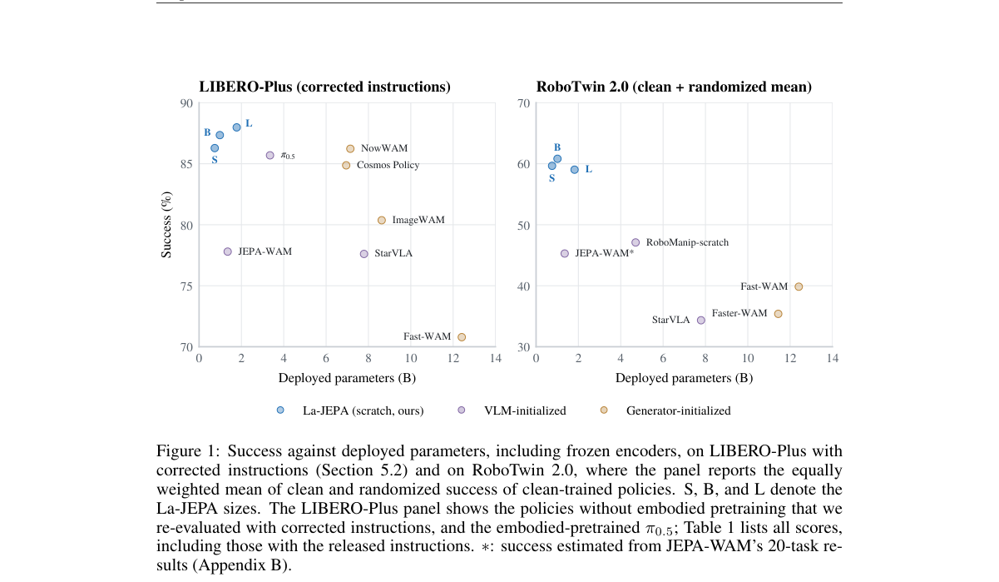

*Result - La-JEPA. Left: general architecture. Right: context and future encoding with V-JEPA 2.1.*

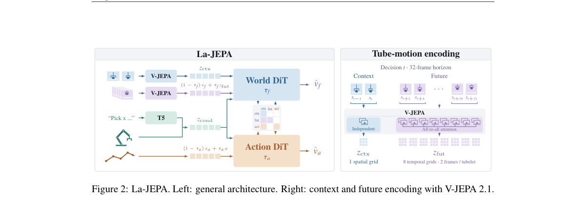

**Why this ranks #1**: 本线第 1。策略 transformer 在预训练 V-JEPA 2.1 特征空间里从零训练，LIBERO-Plus 修正指令下达 88.0%，部署参数 1.78B、约为次优 NowWAM（7.1B）的四分之一，速度最高可比 Fast-WAM 快 5 倍。

---

### 2. Meituan-Robotics-0: A Vision-Language-Action Foundation Model for Desktop Manipulation

**arXiv**: [2611.08577](https://arxiv.org/abs/2611.08577) | **Score**: 9.3 (relevance 9 x 0.7 + quality 10 x 0.3) | **Tags**: embodied, vla-foundation-model, desktop-manipulation, rollback-dagger, event-driven-agent, cross-embodiment, Meituan Robotics | **Categories**: cs.CV, cs.RO | **Pages**: 25

**Authors**: Meituan Robotics Team; Caicheng Wang; Chen Zhao; Chengpeng Jin; Duo Xu; Fengjiao Chen; Guanglu Wan; Heqing Yang; Jia Wang; Jiacong Zhou; Jie Hu; Jiyuan Ru

**Affiliation**: Meituan Robotics

**Abstract**

> We present Meituan-Robotics-0 (MR0), a vision-language-action foundation model and embodied-agent system for stationary-base desktop manipulation. MR0 combines 147 million vision-language samples with 15,060 hours of curated robot trajectories spanning 12 embodiments. A three-stage training recipe aligns multimodal representations with robot behavior through discrete action-token pre-training, transfers these priors to continuous cross-embodiment control through flow-matching mid-training, and adapts the policy through real-world post-training. We introduce Rollback, which pairs replaced policy segments with human corrections to provide positive and negative supervision for CFG-DAgger without value learning or advantage labeling. A unified end-effector interface supports heterogeneous embodiments, while asynchronous action-chunk merging maintains smooth execution under variable inference latency. An event-driven agent maintains persistent task events and reassesses plans when progress or feasibility changes, enabling cross-task retrieval and conditional task resumption. MR0 achieves 93.6% success on RoboTwin 2.0 and ranks fifth in the RoboDojo VLA track. Under matched HG-DAgger post-training, MR0 achieves higher average success rate and progress score than $π_{0.5}$ across three real-robot tasks. On Ethernet insertion, CFG-DAgger trained with Rollback data reaches 70% success and a progress score of 0.90. Qualitative agent deployments demonstrate cross-task event retrieval and recovery from temporarily unsatisfied task conditions.

**Key findings**

- **Finding**: MR0 用 147 million 视觉语言样本与 15,060 小时、跨 12 种本体的桌面操作轨迹做三阶段训练（动作 token 预训练、流匹配中训、真实后训），RoboTwin 2.0 平均成功率 93.6%，RoboDojo VLA 赛道排名第五。
- **Inference**: Rollback 把被替换的策略片段与人工纠正配对，等于在不做价值学习、不做优势标注的前提下同时拿到正负监督，使 CFG-DAgger 能用纯人类纠正数据训练。
- **Recommendation**: 做桌面操作 VLA 时可参考其「离散动作 token 预训练 → 连续流匹配中训」两段式迁移，并借鉴 Rollback 采集方式低成本地造出成对偏好数据。

**Key figures**

*Framework - Overview of Meituan-Robotics-0. The framework integrates large-scale multimodal data, three-stage VLA training, an event-driven embodied-agent system, and real-robot deployment. The RoboDojo*

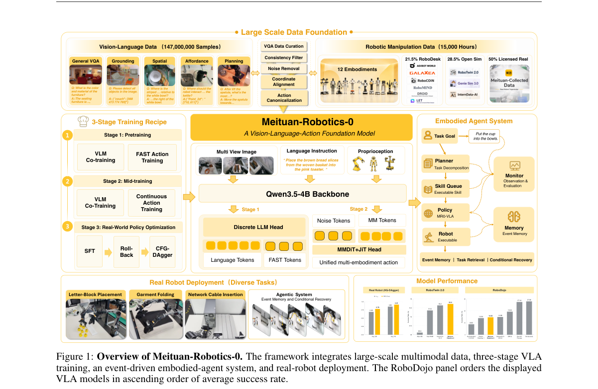

*Result - Vision-language dataset. The corpus contains approximately 147 million samples before training-time resampling, comprising 78% general and 22% embodied vision-language data. Representative e*

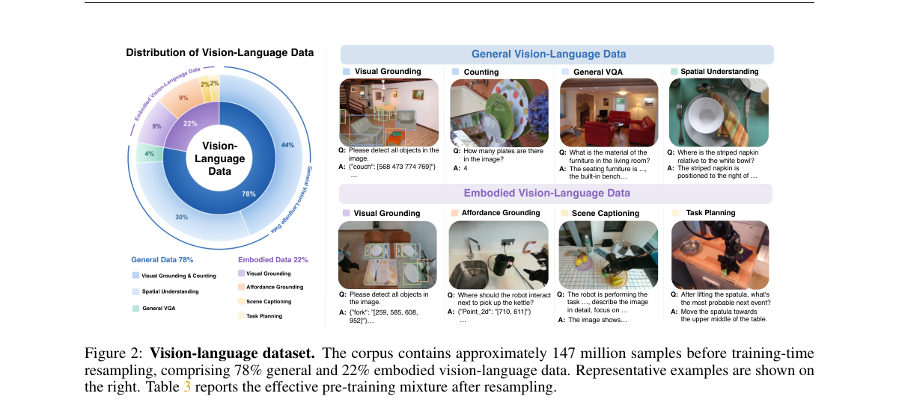

**Why this ranks #2**: 本线第 2。数据规模最大的一篇：1.47 亿视觉语言样本加 15060 小时、覆盖 12 种本体的机器人轨迹，RoboTwin 2.0 平均成功率 93.6%，RoboDojo VLA 赛道第五，网口插接上 CFG-DAgger 达 70% 成功率。

---

### 3. Spatial-UMI-Dream: Scaling World Action Models with Metric Geometry for UMI Manipulation

**arXiv**: [2611.07229](https://arxiv.org/abs/2611.07229) | **Score**: 9.0 (relevance 9 x 0.7 + quality 9 x 0.3) | **Tags**: embodied, world-action-model, metric-depth, umi-data, cross-embodiment-transfer, benchmark, USC Physical Superintelligence Lab | **Categories**: cs.RO | **Pages**: 10

**Authors**: Weiduo Yuan; Ze Yuan; Sihan Liu; Jionghao Wang; Liang Heng; Zhenyu Zhao; Yue Wang

**Affiliation**: USC Physical Superintelligence Lab; Carnegie Mellon University; Texas A&M University

**Abstract**

> The Universal Manipulation Interface (UMI) enables scalable demonstration collection independently of a specific robot. However, its moving, close-range gripper cameras entangle camera and object motion without a stable external view, leaving the metric geometry needed for precise manipulation implicit in RGB. We introduce Spatial-UMI-Dream, a 5B spatial World Action Model (WAM) pretrained on 605 hours of RGB-D UMI data through two-stage training -- world-only adaptation followed by joint world-action learning -- to jointly predict future RGB, fisheye-aligned metric depth, and actions. Stereo-derived depth makes scene scale and spatial relationships explicit within a unified dual-gripper RGB-D representation. Furthermore, evaluating UMI policies requires testing whether UMI's robot-independent demonstration collection translates into policy generalization across robot embodiments, alongside robustness to environmental changes. We introduce RoboTwin-UMI, a twenty-task simulation benchmark built on RoboTwin with UMI wrist-mounted fisheye observations, enabling controlled, repeatable evaluation of UMI policies under environment and embodiment changes separately and jointly without additional fine-tuning. On RoboTwin-UMI, Spatial-UMI-Dream achieves 79.10% in-domain success and 72.15% under combined embodiment and environment shifts, exceeding the strongest evaluated baseline in each setting by 4.65 and 10.30 percentage points, respectively. It also exhibits the smallest success-rate drop under embodiment transfer among the evaluated policies. In a matched pretraining ablation, RGB-only pretraining leads to a 5.75-percentage-point decrease in in-domain success compared with RGB-D pretraining. Across six real-world tasks, Spatial-UMI-Dream achieves 85.0% average success, exceeding the strongest baseline by 24.2 percentage points. Project page: https://weiduoyuan.com/spatial-umi-dream/

**Key findings**

- **Finding**: Spatial-UMI-Dream 是 5B 参数的世界动作模型，在 605 小时 RGB-D UMI 数据上两阶段预训练，RoboTwin-UMI 域内成功率 79.10%、本体与环境同时偏移下 72.15%，领先最强基线 4.65 与 10.30 个百分点，真实六任务平均 85.0%、高出最强基线 24.2 个百分点。
- **Inference**: 消融显示改用纯 RGB 预训练会使域内成功率下降 5.75 个百分点，说明 UMI 腕部鱼眼相机里隐含的度量几何必须显式建模才能跨本体迁移。
- **Recommendation**: 用 UMI 采集数据做策略时优先补齐公制深度通道（鱼眼对齐），并按 RoboTwin-UMI 那样把环境变化与本体变化分开测，避免只看域内数字。

**Key figures**

*Framework - Spatial understanding and cross-embodiment transfer for UMI policies. We introduce Spatial-UMI-Dream, a 5B world-action model that learns jointly from RGB, metric depth, and actions through 60*

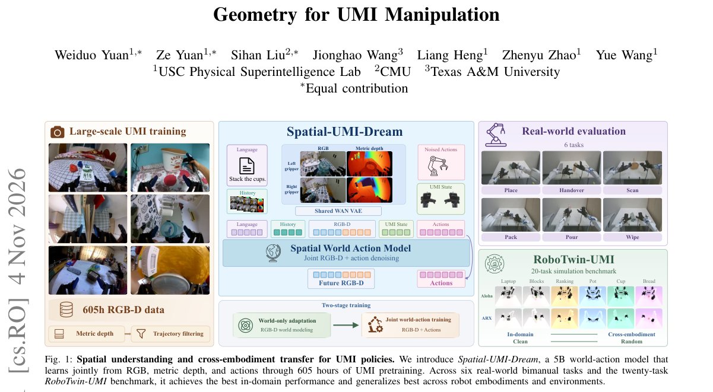

*Result - Model architecture and two-stage training of Spatial-UMI-Dream. In both stages, dual-gripper RGB and metric depth (Fig. 3) form a unified RGB-D canvas. The Wan VAE encodes observation history*

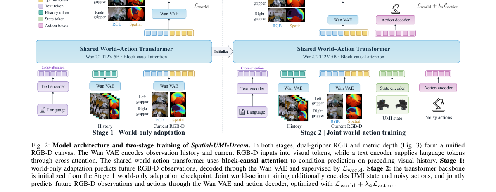

**Why this ranks #3**: 本线第 3。5B 世界动作模型用 605 小时 RGB-D UMI 数据预训练，RoboTwin-UMI 上域内 79.10%、本体与环境同时变化下 72.15%，分别领先最强基线 4.65 和 10.30 个百分点，真实六任务平均 85.0%。

---

### 4. Learning Robotic World Models with Semantic and Visual Feedback

**arXiv**: [2611.07850](https://arxiv.org/abs/2611.07850) | **Score**: 9.0 (relevance 9 x 0.7 + quality 9 x 0.3) | **Tags**: embodied, world-model, multimodal-judge, group-relative-advantage, candidate-search, rolling-history, City College of New York | **Categories**: cs.CV, cs.RO | **Pages**: 27

**Authors**: Hao Wu; Yuqi Li; Yizhou Zhao; Kun Wang; Xiao Luo; Yu Cheng; Bo An; Yingli Tian; Laszlo A. Jeni; Ming-Hsuan Yang

**Affiliation**: The City College of New York; Nanyang Technological University; University of Wisconsin-Madison; UC Merced

**Abstract**

> Robot world models predict action-conditioned future visual states to support robotic planning and decision making. However, visual reconstruction does not fully capture task progress, semantic evaluation alone provides limited constraints on fine-grained visual errors, and homogeneous predictions limit comparative feedback. We present RoboImagine, a framework for post-training autoregressive robotic world models through candidate-future comparisons with semantic and visual feedback. Diverse search promotes diversity among candidate trajectories under shared visual observations, action sequences, and task instructions. A frozen multimodal evaluator provides task-relevant semantic preferences through pairwise video comparisons in both presentation orders, complemented by pixel- and perceptual-level visual consistency feedback that constrains local structural and appearance errors. These signals drive policy optimization through group-relative advantages. Fixed initial context and branch-specific rolling histories support long-sequence generation with bounded context and consistent conditioning between candidate generation and policy optimization. Experiments with separately trained models on RT-1, BridgeV2, and RoboCasa cover real-world and simulated manipulation. On RT-1, under matched initialization, update counts, and evaluation protocols, RoboImagine improves PSNR by 1.26 dB and reduces LPIPS by 11.93% relative to continued supervised fine-tuning. Ablations show that diverse search improves prediction quality and that combined semantic and visual feedback yields higher external multimodal evaluation scores than visual feedback alone while maintaining comparable visual fidelity. Rolling histories further improve long-horizon prediction. These results support improving visual fidelity, task relevance, and long-horizon prediction through candidate comparison and complementary feedback.

**Key findings**

- **Finding**: 在 RT-1 上匹配初始化、更新次数与评测协议时，RoboImagine 相对继续做监督微调把 PSNR 提高 1.26 dB、LPIPS 降低 11.93%，实验覆盖 RT-1、BridgeV2 与 RoboCasa 三套数据。
- **Inference**: 消融显示纯视觉反馈在视觉指标上最强，而语义加视觉的组合反馈在外部多模态评测分数上更高、视觉保真度相当，说明两类反馈约束的是不同的失败模式。
- **Recommendation**: 想用偏好信号后训练机器人世界模型时，可直接照搬「多样候选未来 + 成对双向顺序比较 + 组相对优势」的三段式流程，并给长序列分支保留滚动历史。

**Key figures**

*Framework - Complementary feedback for robot world models. Preserved appearance can coexist with stalled task progress, while task advance- ment can coexist with local visual artifacts. Visual fidelity an*

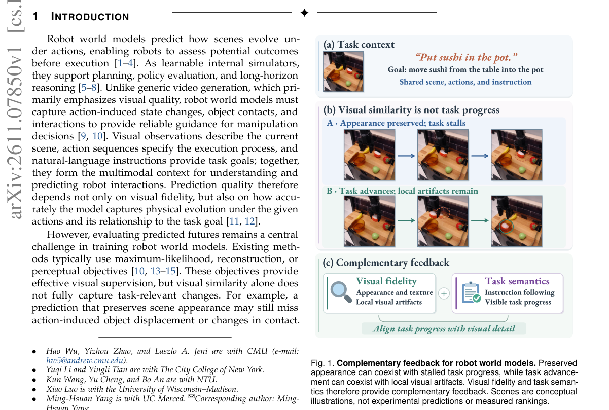

*Result - Multimodal adaptation and learning from complementary feedback in ROBOIMAGINE. Stage 1 learns dynamics-token prediction conditioned on observations, actions, and text. Stage 2 constructs diver*

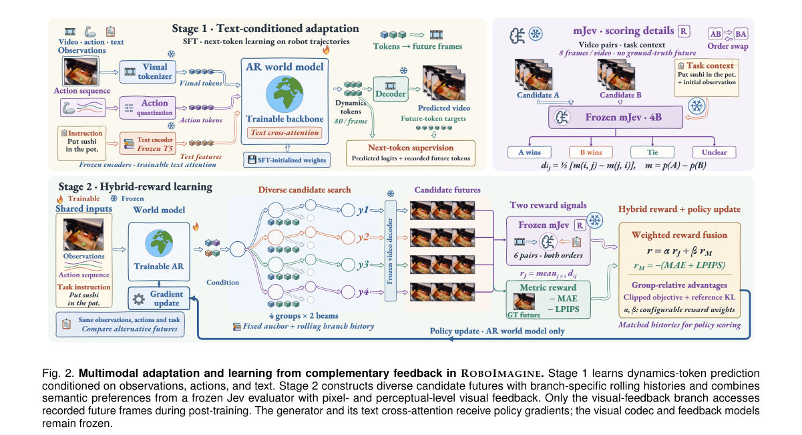

**Why this ranks #4**: 本线第 4。把「比较候选未来」变成自回归机器人世界模型的后训练信号，RT-1 上 PSNR 提升 1.26 dB、LPIPS 下降 11.93%，并证明语义偏好与视觉一致性两类反馈互补，长时序预测靠分支滚动历史维持。

---

### 5. TactileLab: Sim-to-Real Dexterous Robot Manipulation with Efficient Shear-Sensitive Tactile Simulation

**arXiv**: [2611.07881](https://arxiv.org/abs/2611.07881) | **Score**: 9.0 (relevance 9 x 0.7 + quality 9 x 0.3) | **Tags**: embodied, tactile-flow, rigid-body-simulation, sim-to-real, contact-rich-manipulation, isaaclab, Beijing Institute of Technology | **Categories**: cs.RO | **Pages**: 18

**Authors**: Yijiong Lin; Wenhao He; Toby Jack; Max Yang; Haoran Li; Nathan F. Lepora

**Affiliation**: Beijing Institute of Technology; University of Bristol; Xi'an Jiaotong-Liverpool University

**Abstract**

> Robotic simulators that represent shear within tactile sensing are becoming increasingly important for contact-rich manipulation. However, simulating contact shear with high-fidelity deformable or soft-body simulation is computationally demanding, limiting scalability to large-scale reinforcement learning. Here we introduce \textit{TactileLab}, a scalable multimodal tactile simulation framework built on IsaacLab, with a particular focus on a new optical-flow-based tactile representation termed \textit{simulated tactile flow}. Instead of relying on soft-body physics to model shear deformation, TactileLab uses rigid-body simulation to efficiently estimate dense tangential motion at the contact interface, producing tactile flow fields that encode shear-relevant contact dynamics. This flow field complements geometric features from a contact depth field. We further introduce a novel policy architecture for jointly processing long-horizon proprioceptive signals and rich tactile observations. Across multiple contact-rich tasks, policies trained using simulated tactile flow learn efficiently at scale and exhibit emergent contact-aware behaviours. To facilitate sim-to-real policy deployment, we then propose a novel real-to-sim tactile translation method that maps real tactile image streams to simulated tactile flow and depth fields, together with a new tactile data collection method, and validate it across diverse tactile sensor designs. Using this pipeline, we demonstrate real-world deployment on tasks encompassing dual-arm and dexterous in-hand manipulation. Overall, TactileLab provides an end-to-end sim-to-real framework for scalable tactile policy learning, enabling diverse shear-sensitive manipulation across heterogeneous tactile robotic systems.

**Key findings**

- **Finding**: TactileLab 建在 IsaacLab 上做 GPU 并行仿真，用刚体求解而非软体变形估计接触界面的稠密切向运动，得到 simulated tactile flow，并给出 PETS-Net 融合长时序本体感知与触觉观测的策略结构。
- **Inference**: 剪切信息可以绕开软体求解器由刚体接触几何近似得到，说明触觉 RL 的算力瓶颈主要在软体物理而非控制算法本身，因此用刚体近似换取可扩展性是可行的取舍。
- **Recommendation**: 触觉 sim-to-real 可按其「flow + depth 双模态 + 分别的 real-to-sim 翻译器」搭最小闭环，并先验证翻译器在自家触觉传感器上的流场一致性再训策略。

**Key figures**

*Framework - TactileLab is an end-to-end framework for efficient, shear-sensitive tactile robot learning. Built on IsaacLab, it integrates GPU- accelerated tactile simulation with a novel sensing modalit*

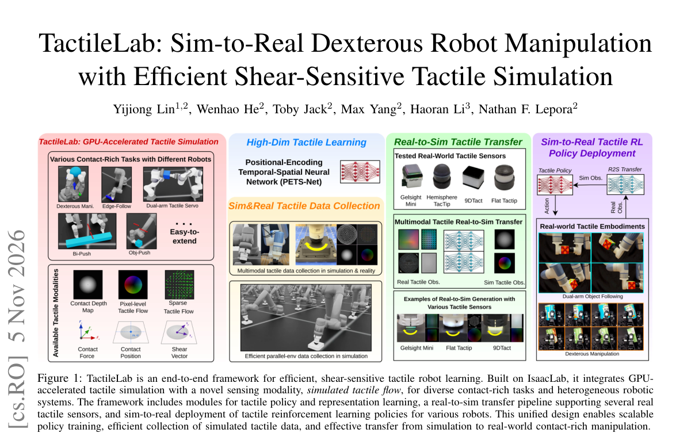

*Result - Overview of the TactileLab simulation framework and simulated tactile-flow computation. The rigid-body simulation pipeline computes contact geometry and generates low-dimensional contact des*

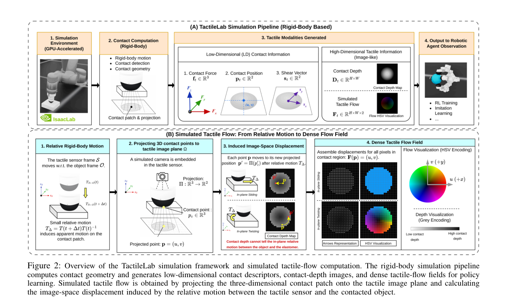

**Why this ranks #5**: 本线第 5。触觉线唯一入选：把触觉剪切从软体物理改成刚体求解加光流式切向运动估计（simulated tactile flow），支撑 GPU 并行的大规模触觉 RL，并用 real-to-sim 翻译器在多种触觉传感器上完成真实部署。

---

### 6. MOMASPLAT: Dynamic Novel-View Demonstration Augmentation for Mobile Manipulation

**arXiv**: [2611.08372](https://arxiv.org/abs/2611.08372) | **Score**: 9.0 (relevance 9 x 0.7 + quality 9 x 0.3) | **Tags**: embodied, novel-view-synthesis, gaussian-splatting, demonstration-augmentation, base-pose-generalization, action-retargeting, University of Texas at Austin | **Categories**: cs.AI, cs.CV, cs.RO | **Pages**: 12

**Authors**: Sateesh Kumar; Arnav Balaji; Arpit Bahety; Skand Peri; Georgios Pavlakos; Roberto Martín-Martín

**Affiliation**: The University of Texas at Austin

**Abstract**

> Visuomotor policies trained through imitation learning are highly sensitive to changes in camera viewpoint. This is particularly problematic for mobile manipulation (MoMa), where robots rarely execute manipulation from the exact same base pose used during demonstration collection due to navigation uncertainty, localization drift, and environmental constraints. Recent approaches use novel-view synthesis (NVS) to augment demonstrations with unseen viewpoints, but they assume static scenes and therefore fail to re-render the manipulated object during the post-contact interaction phase, leaving the most critical parts of the demonstration unaugmented. We present MOMASPLAT, a novel-view demonstration augmentation framework for mobile manipulation that synthesizes full manipulation trajectories from unseen robot base poses, including dynamic object interactions. Our key insight is that standard MoMa data collection naturally provides the multiview observations needed to reconstruct both the static scene and the manipulated object in 3D. MOMASPLAT combines 3D Gaussian Splatting, feed-forward 3D foundation models, and kinematics-based action retargeting to separately reconstruct the scene and manipulated object, render them from novel viewpoints, and generate geometrically consistent synthetic demonstrations paired with transformed actions. We evaluate MOMASPLAT on five real-world mobile manipulation tasks involving both rigid and articulated objects across three scenes, and validate the fidelity of its synthesized demonstrations against ground truth in simulation. MOMASPLAT substantially improves robustness to unseen base poses, more than doubling the average success rate of the strongest baseline and maintaining non-trivial success at large base displacements where all baselines fail, while reducing the need for largescale real-world data collection.

**Key findings**

- **Finding**: 在五个真实移动操作任务、三个场景的未见底座位姿评测中，MOMASPLAT 成功率 37%，超过最强基线 One Thousand Trajectories 的 17%，并达到 Source Only 6%、VISTA 8%、Action Augmentation 6% 的四到六倍；大位移下 PICK-PLACE BOTTLE 保持 33%、CLOSE LAPTOP 保持 50%，而所有基线归零。
- **Inference**: 移动操作数据天然包含多视角观测，使得静态场景与被操作物体可以分别重建，再配合运动学动作重定向，从而在几何一致的前提下合成完整操作轨迹而非只重渲染背景。
- **Recommendation**: 采集移动操作数据时应保留多机位观测以备新视角增广；增广合成后需同时变换动作，否则视角增强会引入动作与观测错配。

**Key figures**

*Framework - MOMASPLAT. Starting from mobile-manipulation data collected at the original base pose (white and red robot), MOMASPLAT synthesizes demonstrations from sampled novel base poses (yellow-outlined*

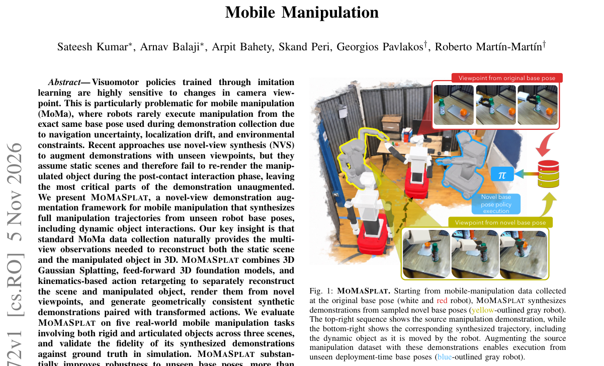

**Why this ranks #6**: 本线第 6。解决了移动操作数据增强里最关键的一环：不只重渲染静态场景，还重建并重渲染被操作物体，因此接触后阶段也能增广，未见底座位姿下成功率 37%，超过最强基线 One Thousand Trajectories 的 17%。

---

### 7. Latent RL Priors for Data-Efficient Dexterous Manipulation

**arXiv**: [2611.08458](https://arxiv.org/abs/2611.08458) | **Score**: 9.0 (relevance 9 x 0.7 + quality 9 x 0.3) | **Tags**: embodied, rl-prior, flow-matching-decoder, visual-adaptation, dexterous-manipulation, data-efficiency, University of California | **Categories**: cs.RO | **Pages**: 12

**Authors**: Yixiao Wang; Peiyi Chen; Mustafa Mukadam; Shreekant Gayaka; Masayoshi Tomizuka; Son Tran

**Affiliation**: University of California, Berkeley; Amazon

**Abstract**

> Learning dexterous manipulation from limited visual demonstrations is challenging because policies must acquire both perceptual grounding and precise control, while reinforcement learning (RL) in simulation can acquire rich control behaviors from large-scale interaction with privileged information. We introduce \textbf{Latent RL Prior}, a two-stage framework that reuses this control knowledge for data-efficient visual policy learning. During privileged pretraining, we distill large-scale RL rollouts into a flow-matching action decoder conditioned on proprioception and latent task context. During visual adaptation, we freeze the decoder and learn a visual interface that maps images to its latent context using action supervision alone, without privileged labels or latent targets. The same decoder can further be shared across arms by learning coordinated visual contexts for bimanual manipulation. Across three simulated tasks, our method outperforms full-parameter fine-tuning of $π_{0.5}$ and GR00T N1.7 in the low-data regime; on door lifting and bimanual assembly, it surpasses full-data baselines using $10\times$ and $5\times$ fewer demonstrations, respectively. Further analysis shows that direct visual-to-latent conditioning improves adaptation performance and training stability over routing visual predictions through the pretrained state encoder. Robustness to unseen mass variation and greater linear accessibility of contact-force information in decoder representations further provide evidence of retained RL-acquired control knowledge. Project website: https://yixiaowang7.github.io/latent-rl-prior-page/.

**Key findings**

- **Finding**: 在三个仿真灵巧操作任务上，该方法在低数据区优于 π0.5 与 GR00T N1.7 的全参数微调；开门任务只用 50 条示范就超过用 500 条数据的两个 VLA 基线（10 倍差距），双臂装配用 1,000 条超过全量基线（5 倍差距）。
- **Inference**: 视觉适应阶段冻结解码器、仅用动作监督学习视觉接口，说明预训练 RL 先验主要提供控制能力而非视觉表征，因此下游不需要特权标签或隐状态目标。
- **Recommendation**: 缺数据时优先复用已有策略的教师权重做 RL 先验蒸馏，再以冻结解码器加轻量视觉接口的方式适配，比直接全参数微调更省样本。

**Key figures**

*Framework - Latent RL Prior. (a) Privileged pretraining: a state tokenizer and Q-Former supply task context to an action decoder conditioned on flow time and single-arm proprioception. (b) Visual adapta*

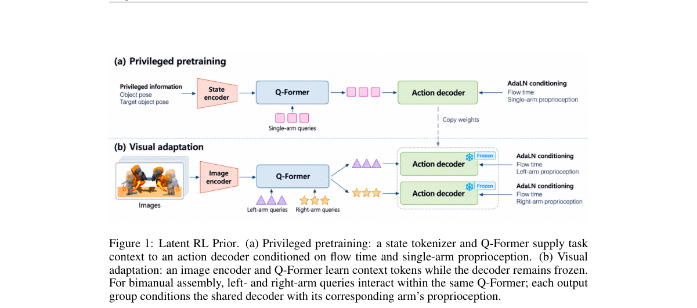

*Result - Pretraining and downstream tasks. Left: the pretraining task of target pose alignment with varied procedural objects; the inset shows example object templates. Right: the downstream tasks of*

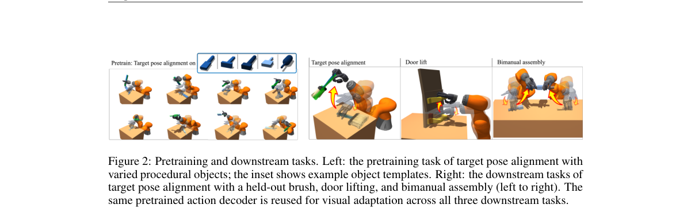

**Why this ranks #7**: 本线第 7。方法学上最干净的一篇：把大规模仿真 RL 的控制经验蒸馏成流匹配动作解码器，视觉适应阶段只学图像到隐任务上下文的映射，50 条示范即超过用 500 条数据的 π0.5 与 GR00T N1.7。

---

### 8. PhySA: Decoupling Aesthetic and Physical Rewards for Humanoid Locomotion

**arXiv**: [2611.07679](https://arxiv.org/abs/2611.07679) | **Score**: 8.7 (relevance 9 x 0.7 + quality 8 x 0.3) | **Tags**: embodied, vlm-reward, reward-decoupling, humanoid-locomotion, smoothness-penalty, phase-triggered-correction, Shanghai Jiao Tong University | **Categories**: cs.RO | **Pages**: 24

**Authors**: Yunwan Fu; Sicheng He; Jiageng Mao; Yue Wang

**Affiliation**: Shanghai Jiao Tong University; University of Southern California

**Abstract**

> Humanoid locomotion policies trained without an explicit smoothness objective tend to produce jerky, high-energy gaits that stress actuators. Vision-language models (VLMs) offer an appealing reward source: given a rendered rollout, a VLM returns an aesthetic quality score on [0,10] without task-specific feature engineering. We find, however, that aesthetic preference and physical smoothness point in opposite directions: across four production VLMs, clips with higher joint acceleration receive higher aesthetic scores (mean Pearson r=+0.66). We study PhySA (Physical Smoothness and Aesthetics), which keeps the two on separate, independently removable reward channels: a sparse, asynchronous VLM score and a phase-triggered correction channel that adjusts physical penalty weights from simulator state. Ablations attribute the smoothness gain to the correction channel. On MuJoCo Humanoid-v5 at 2.6M steps, PhySA lowers joint acceleration by 26 to 32% relative to vanilla PPO, Text2Reward, and Eureka (three seeds), at the cost of shorter episodes. In a single extended run it lowers joint acceleration by 59.5% relative to Prompt2Policy, while a three-seed replication shows a smaller, non-significant reduction (7.2%). The gain does not transfer to IsaacLab or the Unitree G1, even after rescaling the smoothness term.

**Key findings**

- **Finding**: 跨四个生产级 VLM，约 100 对配对回合显示关节加速度更高的片段获得更高美学评分，平均 Pearson r=+0.66，模型间 Spearman 一致性在 [+0.49, +0.94]、均值 +0.76。
- **Inference**: 在 MuJoCo Humanoid-v5 训练 2.6M 步、三随机种子下 PhySA 相对 vanilla PPO、Text2Reward 与 Eureka 把关节加速度降低 26% 到 32%，消融把该收益归因于相位触发的物理修正通道而非 VLM 美学分。
- **Recommendation**: 用 VLM 做奖励时先测美学分与物理指标的相关性，若如本文般方向相反，就务必把两类信号拆到可独立开关的通道，并按多种子复核而非只看单次运行。

**Key figures**

*Framework - Left: In our main training run (a single run), PhySA reduces joint acceleration by 59.5% relative to Prompt2Policy at the same forward-velocity target; a three-seed replication gives a small*

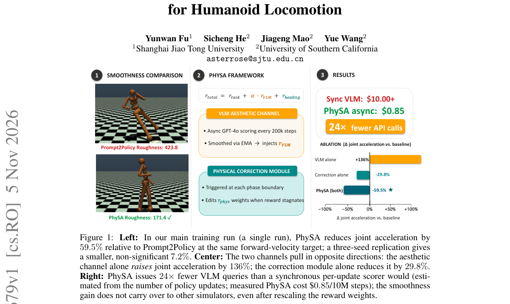

*Result - PhySA end-to-end architecture. Left: The PPO agent interacts with MuJoCo Humanoid- v5; the total reward is Eq. 1. Center top (amber): The aesthetic channel dispatches asynchronous GPT-4o sco*

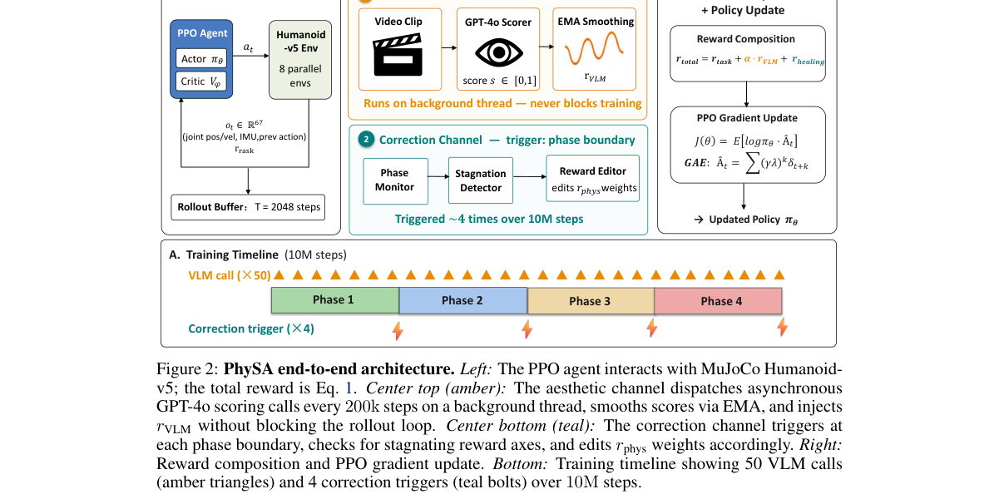

**Why this ranks #8**: 本线第 8。先证伪再设计：四个商用 VLM 上关节加速度越高美学评分越高（平均 Pearson r=+0.66），因此把美学分与物理平滑拆成两条独立可移除的奖励通道，MuJoCo Humanoid-v5 上关节加速度降低 26% 到 32%。

---

### 9. GPWM: Modeling the World as 3D Particle Motion

**arXiv**: [2611.08338](https://arxiv.org/abs/2611.08338) | **Score**: 8.3 (relevance 8 x 0.7 + quality 9 x 0.3) | **Tags**: embodied, particle-world-model, diffusion-forcing, flow-matching, multi-resolution-transformer, noise-space-planning, Carnegie Mellon University | **Categories**: cs.RO | **Pages**: 39

**Authors**: Robert Ren; Matthew Bronars; He Zhu; Yikai Tang; Jianing Zhang; Sergey Zakharov; Pavel Tokmakov; Katerina Fragkiadaki

**Affiliation**: Carnegie Mellon University; Toyota Research Institute

**Abstract**

> We introduce GPWM, a Generative Particle World Model that predicts how 3D scenes evolve by generating the motion of particles and rigid bodies over time. Unlike video world models that generate scene appearance, GPWM operates directly in 3D physical space. A single representation and architecture cover rigid, deformable, cloth, and granular materials, in both passive physics and robotic interaction. GPWM is an object-aware multi-resolution transformer that combines flow matching with diffusion forcing to generate coherent physical trajectories far beyond its training horizon. We train and evaluate GPWM on ParticleWorlds, a 25.5-million-frame corpus spanning diverse geometries, materials, interactions, and robot embodiments. GPWM outperforms the best prior learned-dynamics baseline in each of six physical domains, reducing prediction error by 31% on average. Breaking from the domain-specific setting of prior methods, a single Unified GPWM models these heterogeneous regimes with one set of weights, largely outperforming per-domain baselines and even surpassing our own specialist models in two domains. GPWM further generalizes to unseen geometries, physical properties, object counts, and rollout horizons. Beyond prediction, GPWM enables contact-rich planning by learning a generative prior over joint actuator-object motion. Instead of searching over unconstrained actions, planning searches the model's latent noise for interactions that achieve a desired object-space goal. With the same world model, noise-space planning substantially outperforms action-space search on pushing and picking, where complex contact sequences are hard to discover. Executed open-loop in simulation, the resulting plans achieve goal-directed manipulation without reference action trajectories or goal-specific policies.

**Key findings**

- **Finding**: GPWM 在 ParticleWorlds 的 25.5M 帧语料上训练，六个物理域中每个域都优于既有最强学习动力学基线、预测误差平均降低 31%，并把滚动长度推到 16 帧训练窗口之外的 55 倍。
- **Inference**: 同一套权重的 Unified GPWM 在多数域上超过逐域训练的专用模型、甚至在两个域上反超自己的专用模型，说明粒子加刚体的统一表示比按材料分域建模更可泛化。
- **Recommendation**: 需要接触操作规划时可直接在世界模型的隐噪声空间搜目标物体位形，而不是在动作空间搜，这样搜索会偏向物理上可信的交互轨迹。

**Key figures**

*Framework - GPWM learns 3D particle dynamics across six physical domains. Top: samples from the six domains of Parti- cleWorlds. Middle: given the observed frames and a noisy future, a U-shaped multi-res*

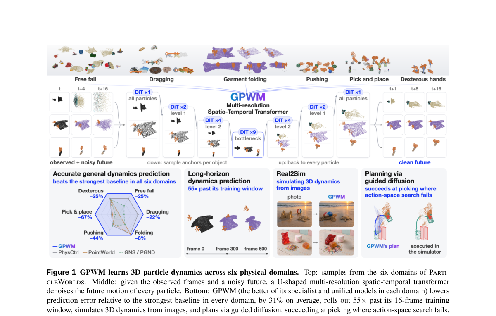

*Result - GPWM architecture. Noisy per-particle tokens, which embed displacement, actuator motion, geometry, physical parameters, and material, pass through a multi-resolution DiT. PointNet++ layers po*

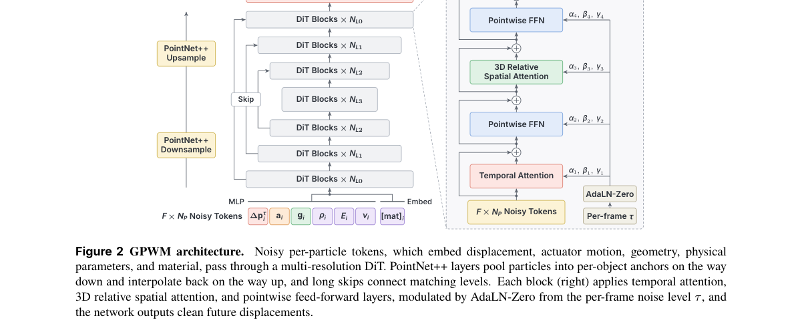

**Why this ranks #9**: 本线第 9。世界模型路线的代表作：在 2550 万帧 ParticleWorlds 的六个物理域上把预测误差平均降低 31%，统一模型在两个域上反超各自的专用模型，并能用同一模型在隐噪声空间规划接触操作。

---

### 10. RM-VLM: From Natural-Language Task Descriptions to Vision-Grounded Reward Machines

**arXiv**: [2611.08308](https://arxiv.org/abs/2611.08308) | **Score**: 7.3 (relevance 7 x 0.7 + quality 8 x 0.3) | **Tags**: embodied, reward-machine, vlm-labeling-function, non-markovian-rl, language-conditioned-reward, belief-updating, Imperial College London | **Categories**: cs.AI, cs.LG | **Pages**: 20

**Authors**: Roko Parac; Christos Ziakas; Leo Ardon; Alessandra Russo

**Affiliation**: Imperial College London

**Abstract**

> Reward machines (RMs) have been proposed as a reward formulation in reinforcement learning (RL) to capture non-Markovian tasks where credit assignment depends on history. By representing reward functions as automata, RMs expose the task's temporal structure and allow such rewards to be handled within a Markovian framework. However, they assume a labelling function, a proposition-grounding oracle for observations, which must be manually engineered for each environment, limiting their wider applicability. In this work, we address this limitation by proposing RM-VLM, a novel approach in which a large language model (LLM) generates an RM from a natural-language task description, and a vision-language model (VLM) acts as the labelling function, grounding the RM's propositions over image-based observations during RM-guided policy learning. A VLM-based value function estimator is used to assess the agent's progress towards each RM transition and derive a dense reward signal. We evaluate RM-VLM on three domains covering non-Markovian grid-world navigation, robotic manipulation, and 3D object collection. Our experimental results show that RM-VLM consistently achieves higher task success rates than existing VLM-based reward methods across all tested domains.

**Key findings**

- **Finding**: 在 GeoGrid、OGBench-Scene、MiniWorld-Pickup 三域用 IQL、5 个随机种子评测，RM-VLM 在每个任务上都优于 BC、GVL 与 VLM-SD：GeoGrid 序列任务 1.00 对 0.14，OGBench-Scene 的 Cube-in-Drawer 0.87 对 0.04，MiniWorld-Pickup 的 Alternation 0.93 对 0.44。
- **Inference**: 把奖励拆成原子命题再由奖励机组合，比直接让 VLM 判断整任务进度或成功更有效，说明非马尔可夫任务里显式的时序结构是性能增益的主要来源。
- **Recommendation**: 做长时序具身任务奖励设计时，先用 LLM 把任务编译成命题级奖励机并补上信念更新，再考虑让 VLM 只做观测标注而非直接打分。

**Key figures**

*Framework - The reinforcement learning loop considered in this work. An LLM compiles the language command into reward machines over atomic propositions, and a VLM grounds those propositions in image obs*

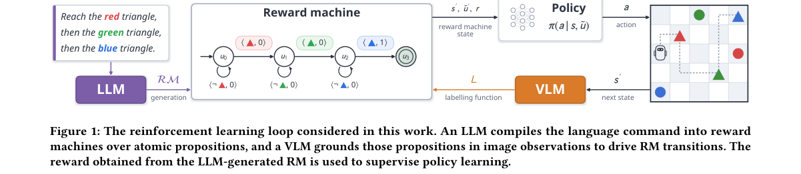

*Result - Online RL on GeoGrid. Ground-truth success rate during PPO training (mean ± std over 5 seeds).*

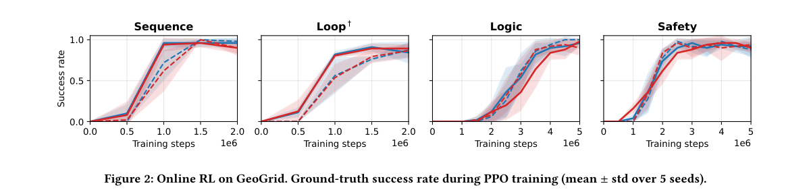

**Why this ranks #10**: 本线第 10，且属面向具身任务的奖励建模相邻方向：用 LLM 从自然语言描述生成奖励机、用 VLM 充当观测标注函数，在网格导航、机器人操作与三维收集三域全部超过既有 VLM 奖励方法，网格导航任务成功率从 0.14 提到 1.00。  [wild-card=yes] 该文让 LLM 从自然语言任务描述生成奖励机、并由 VLM 充当观测标注函数，属于具身任务奖励建模的方法学外延而非直接的世界模型或机器人策略工作；本线按 wild-card 预算补位收录。

---

