# Mine Arxiv Daily Digest - 2026-11-09 (AIGC 视觉生成与编辑 Axis, 15 papers)

**Generated**: 2026-11-09 17:30 CST

**Source**: arXiv cs.CV, cs.SD, eess.AS, cs.CL, cs.AI, cs.RO, cs.LG, cs.IR submissions, listing day 2026-11-06 (announced 2026-11-09 00:00 UTC)

**Batch window**: 2026-11-05T19:00:00Z .. 2026-11-06T19:00:00Z（arXiv 公告批次横跨两个 UTC 日：从前一日的美东 14:00 截止时刻起算（EDT 为 18:00Z，EST 为 19:00Z），到当日的同一时刻为止）

**Axis**: aigc_visual (15 papers, base 15, cap 20)

**Directions**: aigc_generation (9), aigc_editing (3), aigc_rl (3)

**Selection**: 15 papers ranked by relevance x quality, with 1 wild-card slot

**Day total**: 60 papers across 4 axes (target 60)

**Scope**: 图像 / 视频 / 3D / 4D 内容的生成与编辑，以及面向视觉生成的 RL / 偏好优化与奖励模型

⚠️ **Wild-card**: 本 axis 收录 1 篇 wild-card（另有 14 篇直接够格论文），共 15 篇。

**aigc_editing 是本批次最薄的方向**：真正的指令编辑 / 图像合成方法论文只有 AR-Edit 与 Paste2Place 两篇。按 skill「够格就发、发不满是正常结果」的规则，这里不凑数，它让出的 1 个名额被候选充裕的 aigc_generation 吸收（该方向由基准 8 篇增至 9 篇），补位的 1 篇 wild-card 是 Nano Banana 图像生成与编辑的使用侧实证，为该方向补上方法论文之外的那一半。

---

## AIGC 生成（图像 / 视频 / 3D / 4D） · `aigc_generation` (9 papers)

本方向 9 篇，主线是**「把生成的空间粒度与物理约束往下推」**。MS-pDiT 把空间尺度当作一种模态，在像素空间做多尺度并行扩散（ImageNet 256 的 FID 从 4.39 一路降到 1.43，GenEval 0.86）；Trajectory Forcing 让自回归视频生成复用上一段的去噪轨迹作为上下文（VBench 5 秒 85.15、30 秒超出训练视界 6 倍仍是最高质量）；InstaGen 把块稀疏注意力的选择重写成重要性采样，在 Wan2.1 上同密度多出 2–3.4 dB PSNR；UniRGBA、OmniLatent、Align3D、Video2Asset、MotionCore 则分别把生成能力推向透明通道、部件级可控 3D、图像条件化布局、持久化街景资产与刚体物理一致性，Emo-LiveSync 则把唇形同步做成实时、跨画风可用的通用视频生成框架。共同点是：生成不再只是「加一个条件」，而是重新设计表征的粒度、对齐的对象与物理约束的注入位置。

### 1. Scale as a Modality: Multi-Scale Pixel-Space Diffusion Transformers

**arXiv**: [2611.08802](https://arxiv.org/abs/2611.08802) | **Score**: 9.7 (relevance 10 x 0.7 + quality 9 x 0.3) | **Direction**: `aigc_generation` | **Tags**: AIGC-visual, pixel-space-diffusion, multi-scale, diffusion-transformer, scaling-dimension, text-to-image, TikTok | **Categories**: cs.CV | **Pages**: 18

**Authors**: Ruibo Chen; Kaishen Wang; Tianyi Xiong; Chenxi Liu; Yanshuo Chen; Heng Huang; Jian Du

**Affiliation**: TikTok; University of Maryland College Park

**Abstract**

> Latent diffusion models rely on pretrained autoencoders that introduce lossy compression and constrain spatial granularity. Pixel-space diffusion avoids this bottleneck and enables flexible tokenization at multiple spatial scales, yet existing approaches largely adopt two-level coarse-to-fine architectures with limited cross-scale interaction. We introduce MS-pDiT, a multi-scale pixel-space diffusion transformer that treats spatial scale as a modality. MS-pDiT tokenizes the same noisy image at multiple patch sizes, processes each scale in a dedicated transformer stream, and enables bidirectional information exchange through compacted MM-DiT-style joint attention, with attention cost independent of the finest patch size. This design establishes the number of scales as a new architectural scaling dimension. On ImageNet $256\times256$, increasing the number of scales from two to five consistently improves FID from 4.39 to 2.31, 2.26, and 2.19, while adding an intermediate scale substantially outperforms increasing depth under comparable parameter budgets. Further analysis highlights the importance of bidirectional cross-scale interaction and late introduction of fine-grained streams. MS-pDiT achieves FID scores of 1.43 and 1.44 on ImageNet $256\times256$ and $512\times512$, respectively, and naturally extends to text-to-image generation, achieving 0.86 on GenEval and 83.9 on DPG-Bench.

**Key findings**

- **Finding**: 在 ImageNet 256×256 上尺度数由 2 增到 3/4/5 时 FID 依次从 4.39 降到 2.31、2.26、2.19，最终 MS-pDiT-H 达到 1.43 FID、sFID 4.13、IS 319.2。
- **Inference**: 注意力代价与最细 patch 大小无关，因此尺度数是一条独立于深度的扩展轴，同等参数预算下把它用满比堆层数更划算。
- **Recommendation**: 自建 DiT 时把尺度数当一等超参单独扫一遍，并优先试 4×4 这一中间尺度（2.31 FID，优于 8×8 的 2.42 与 2×2 的 2.54），而不是先加深网络。

**Key figures**

*Framework - Overview of MS-pDiT. (a) The same noisy image is tokenized at multiple spatial scales and processed by scale-specific transformer streams, with finer streams introduced only in later layers.*

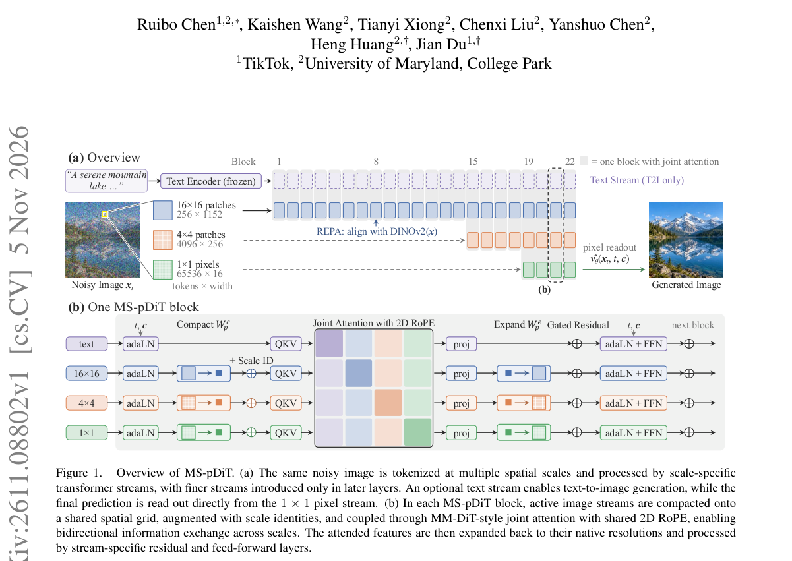

*Result - Qualitative generation results of MS-pDiT on class-conditional and text-to-image generation tasks.*

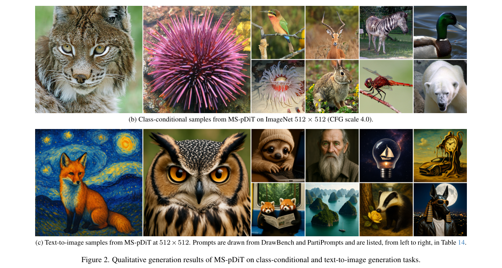

**Why this ranks #1**: 把空间尺度当作模态的多尺度像素空间扩散 Transformer，各尺度独立流加紧凑 MM-DiT 联合注意力实现双向交互；在 ImageNet 256 上尺度数从 2 增到 5，FID 由 4.39 降到 2.31/2.26/2.19，参数预算相当时加中间尺度明显优于加深网络。

---

### 2. InstaGen: Group-Shared Importance Sampling for Fast Video Generation

**arXiv**: [2611.08610](https://arxiv.org/abs/2611.08610) | **Score**: 9.0 (relevance 9 x 0.7 + quality 9 x 0.3) | **Direction**: `aigc_generation` | **Tags**: AIGC-visual, block-sparse-attention, importance-sampling, video-diffusion, attention-sparsity, psnr, IIT Bombay | **Categories**: cs.CV | **Pages**: 13

**Authors**: Kislay Aditya Oj; Kumar Krishna Agrawal; Sri Surya Varma Datla; Aditya Desai

**Affiliation**: IIT Bombay; UC Berkeley

**Abstract**

> Diffusion Transformers (DiTs) are the dominant architecture for video generation, but their quadratic attention complexity results in substantial computational cost and latency. Permuted block-sparse attention (PBSA) offers a promising approach to reducing this cost by selectively computing blocks of a semantically permuted attention matrix. However, existing approaches typically select only the top few key blocks for each query block, following a top-$p$ paradigm. We find that top-$p$ selection can be highly sample inefficient in high-entropy attention regimes, which are common in video generation. In these regimes, we show that sampling can provide substantially better approximations under the same computational budget. More generally, we cast block selection as importance sampling, where the top-scoring keys form an exact set that is computed in full and the remaining keys are represented by a sample drawn in proportion to their estimated attention and reweighted by inverse sampling probability. Building on this formulation, we present InstaGen, which can be parameterized by any PBSA method: it replaces the method's block selection with an exact set plus a weighted sample. Each query cluster draws one sample shared by all its queries, so the sampled keys form blocks amenable to efficient GPU execution. In this paper, we take the SVG family of PBSA methods and show that, on Wan2.1-T2V-1.3B and Wan2.1-T2V-14B, InstaGen parameterized by SVG2 improves PSNR over SVG2 by 3.4 dB and 2 dB, respectively, at matched attention density, and by 1.6 dB and 2.2 dB at matched wall-clock time. On Wan2.1-T2V-14B, InstaGen also beats SVG-EAR by 1.1 dB PSNR at nearly the same density while running faster (1.65x against 1.48x over dense).

**Key findings**

- **Finding**: InstaGen 在 Wan2.1-T2V-1.3B 与 14B 上同等注意力密度下 PSNR 分别比 SVG2 高 3.4 dB 和 2 dB，同等墙钟时间下高 1.6 dB 与 2.2 dB，14B 上还比 SVG-EAR 高 1.1 dB 且加速 1.65×（SVG-EAR 为 1.48×）。
- **Inference**: 视频生成的注意力熵高，固定取 top-k 块在同预算下覆盖不足，改成按估计注意力做重要性采样可用同样算力覆盖更广的键。
- **Recommendation**: 部署长视频 DiT 时可把现有 PBSA 换成精确集加加权抽样集，先在同密度下对比 PSNR 再上线，并注意 SVG2 前 30% 步的全注意力预热不可省。

**Key figures**

*Framework - Frames from a single Wan2.1-T2V-1.3B generation (720p, 81 frames, 50 steps). InstaGen achieves higher pixel fidelity, reaching a PSNR of 25.50 dB at a lower attention density of 32% when com*

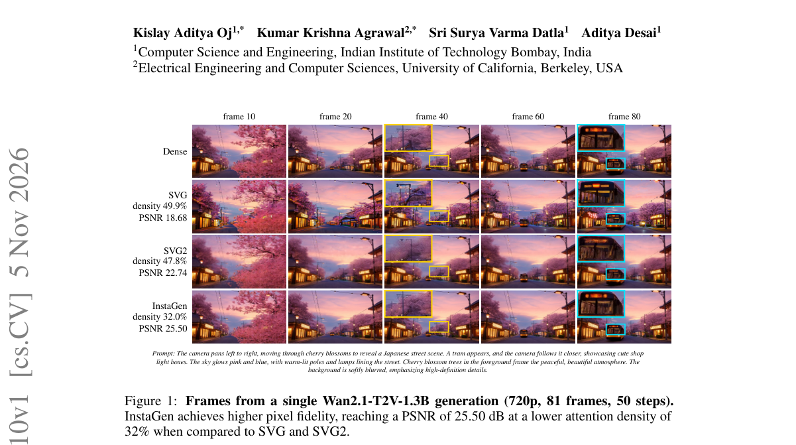

*Result - InstaGen gives higher quality than SVG2 at both matched density and matched latency on Wan2.1-T2V-1.3B. Left: PSNR against generation time per video. Right: PSNR against attention density, t*

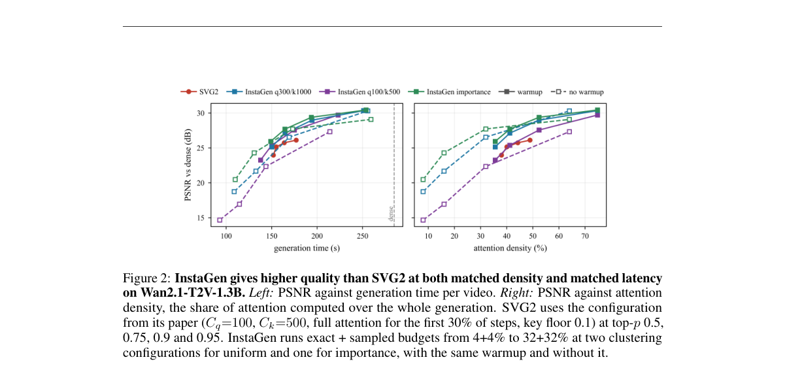

**Why this ranks #2**: 把 PBSA 的块选择重述为重要性采样：高分块精确计算、其余按估计注意力比例抽样并按逆采样概率重加权；在 Wan2.1-T2V-1.3B 与 14B 上同等注意力密度下 PSNR 分别比 SVG2 高 3.4 dB 与 2 dB，14B 上加速达 1.65×。

---

### 3. Trajectory Forcing: Exploiting Diffusion Trajectories for Autoregressive Long Video Generation

**arXiv**: [2611.09096](https://arxiv.org/abs/2611.09096) | **Score**: 9.0 (relevance 9 x 0.7 + quality 9 x 0.3) | **Direction**: `aigc_generation` | **Tags**: AIGC-visual, autoregressive-video, long-video, trajectory-conditioning, vbench, streaming, Huawei Noah Research Institute | **Categories**: cs.CV | **Pages**: 16

**Authors**: Bohan Wang; Shuo Chen; Yunzhi Li; Zhaozheng Chen; Junzhe Zhang; Hanwang Zhang

**Affiliation**: Huawei Noah Research Institute

**Abstract**

> Autoregressive (AR) modeling is arguably the only way to extend a fixed-length video diffusion model to longer or even streaming videos. However, existing AR diffusion methods use only the previously predicted chunk as context for the next, discarding the intermediate predictions that constitute the chunk's generation history. In contrast, conventional AR models such as LLMs condition on the entire history of preceding tokens. To this end, we propose Trajectory Forcing (TraF), an AR diffusion method that exploits the denoising trajectories of previous video chunks as context. TraF operates under two training regimes: (1) with ground-truth videos, where pseudo-trajectories are constructed from Gaussian interpolations and re-predicted by the model, and (2) with a teacher model, where real trajectories are obtained from the student's own denoising rollout. The first regime naturally provides a strong initialization for the second. On the 5-second VBench benchmark, TraF achieves a Total score of 85.15, outperforming Self Forcing (+0.84) and Causal Forcing (+1.11), with Quality and Semantic improving simultaneously. On 30-second generation---6$\times$ the training horizon---TraF achieves the highest overall quality among all compared methods.

**Key findings**

- **Finding**: 5 秒 VBench（946 条提示、16 个维度）上 TraF 总分 85.15、Quality 85.89、Semantic 82.20，较 Self Forcing 提升 0.84、较 Causal Forcing 提升 1.11；30 秒生成分 6 段共 73.98。
- **Inference**: 轨迹级条件让自回归扩散像 LLM 一样看到全部历史，因而在远超训练时长的外推上误差累积更慢，Quality 与 Semantic 才能同时上涨。
- **Recommendation**: 需要外推 30 秒以上视频时，采用先用高斯插值造伪轨迹预训练、再切教师模式取真实轨迹的两阶段配方，而不是直接改采样器。

**Key figures**

*Framework - Standard AR vs. AR diffusion. (a) In standard AR (Eq. 1), each token is atomic and requires no further generation. The next token is naturally conditioned on all preceding tokens. (b) In AR*

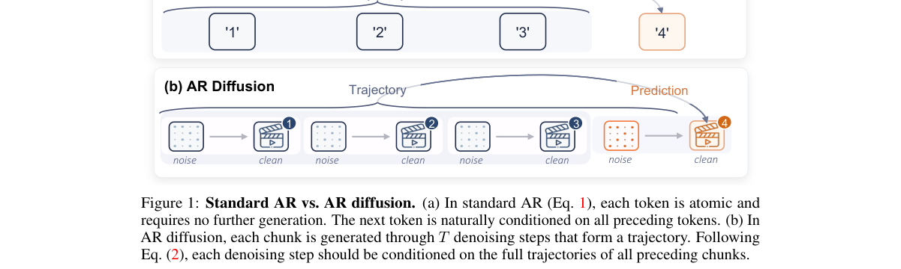

*Result - Trajectory conditioning and γ ablation. Left: Each denoising step of the current chunk conditions on the preceding chunk’s trajectory. γ determines the selected position (γ→∞: endpoint- only*

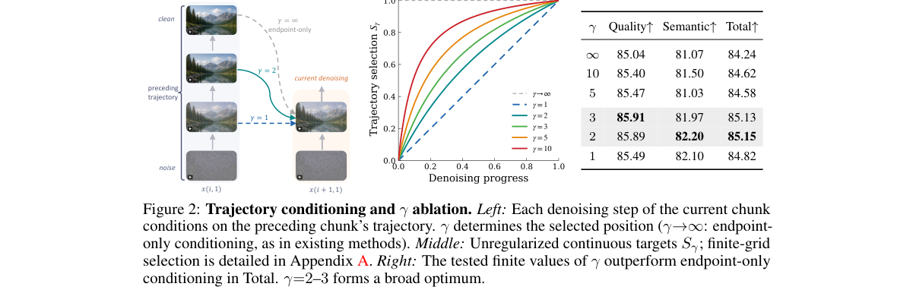

**Why this ranks #3**: 自回归视频扩散此前只把上一个 chunk 当作上下文，TraF 让模型同时条件化前一 chunk 的完整去噪轨迹；5 秒 VBench 总分 85.15，比 Self Forcing 高 0.84、比 Causal Forcing 高 1.11，30 秒长视频（6 倍训练时长）取得 73.98 的最高总分。

---

### 4. MotionCore: A Latent Neural Simulator for Video Generation with Rigid-Body Dynamics

**arXiv**: [2611.08904](https://arxiv.org/abs/2611.08904) | **Score**: 8.3 (relevance 8 x 0.7 + quality 9 x 0.3) | **Direction**: `aigc_generation` | **Tags**: AIGC-visual, rigid-body-dynamics, neural-simulator, physics-consistency, video-control, latent-operator, University of Tokyo | **Categories**: cs.CV | **Pages**: 18

**Authors**: Zheng Wang; Zhengwei Gong; Yuanzhi Liang; Chi Zhang

**Affiliation**: University of Tokyo; Shanghai Jiao Tong University; China Telecom TeleAI

**Abstract**

> Video generation models can produce highly realistic videos while generating physically inconsistent object motion. This limitation suggests that visual modeling alone may not provide a transferable representation of physical dynamics. We introduce MotionCore, a framework for learning physical dynamics via a learnable partial differential equation solver and focuses on rigid-body motion. We introduce a latent neural simulator learning to predict the evolution of object-level physical states from observed motion. Its predictions are then converted into spatially aligned latent controls for a controllable video diffusion model. The generator serves as a visual interface: it provides appearance and scene detail, while the learned dynamics model specifies the physical trajectory. To preserve this trajectory through the interface, MotionCore combines a diffusion-matching objective with a low-capacity decodability constraint on object identity and position. We evaluate MotionCore on public physical-consistency benchmarks and on paired data with known trajectories. Results indicate that MotionCore improves physical consistency and trajectory obedience in the evaluated rigid-body settings, while maintaining comparable visual quality. A controlled ablation protocol compares learned dynamics with an analytic prior and studies the choice of latent evolution processor.

**Key findings**

- **Finding**: 在 27 个场景、三视角共 81 个 5 秒片段的 Physics-IQ-Verified 严格子集上，R2 球体模型 IQ 分 28.14±0.41、ST-IoU 0.3734±0.0117、RGB MSE 0.008633±0.000268（四个扩散种子）。
- **Inference**: 消融中完整动力学（LNO，1.283M 参数）测试 ADE/Req 0.5181、FDE/Req 0.9699，而解析先验为 0.5204/0.9823，差距很小，说明当前预算下学到的动力学增益有限。
- **Recommendation**: 引用该文的物理一致性提升时应作为趋势性证据，并同时注明 20 个原生 VACE 回退样本对聚合分数的稀释。

**Key figures**

*Framework - Overview of MotionCore. (a) Stage 1 pretrains the occupancy autoencoder and the surface operator. Stage 2 freezes them and trains the neural simulator on rollouts of K frames. At inference t*

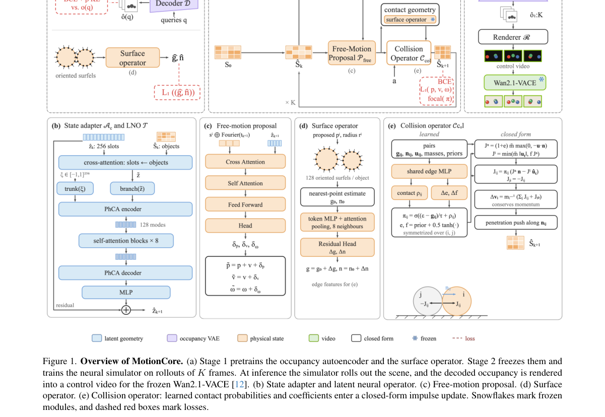

*Result - Qualitative comparison on three Physics-IQ-Verified scenes. Blocks show (a) collision, (b) falling, and (c) rolling. Each block compares the reference video, MotionCore, native VACE-1.3B, Wa*

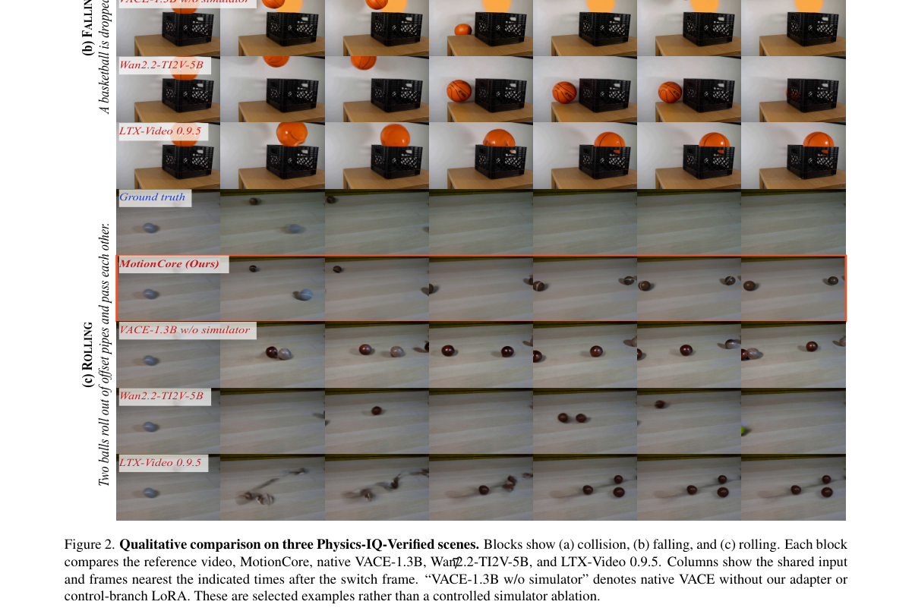

**Why this ranks #4**: 把刚体动力学拆成隐空间神经模拟器与可控视频扩散两部分，模拟器预测物体级物理状态再转成空间对齐的潜变量控制信号；Physics-IQ-Verified 严格子集上 IQ 分 28.14±0.41，但作者自陈 81 个样本中含 20 个原生 VACE 回退，结论应谨慎引用。

---

### 5. Align3D: Image-Structure Co-Aligned 3D Scene Generation with Observability-Aware Fidelity-Preserving Guidance

**arXiv**: [2611.08861](https://arxiv.org/abs/2611.08861) | **Score**: 8.0 (relevance 8 x 0.7 + quality 8 x 0.3) | **Direction**: `aigc_generation` | **Tags**: AIGC-visual, scene-layout, image-conditioned, confidence-calibration, 3d-front, co-alignment, [unverified] | **Categories**: cs.CV | **Pages**: 15

**Authors**: Chenliang Zhou; Yifan Wang; Andrzej Banburski-Fahey

**Affiliation**: [unverified]

**Abstract**

> We present Align3D, an image-conditioned diffusion model that generates 3D indoor layouts that are both faithful to a single input photograph and physically plausible beyond the observed view. From the photograph we infer a confidence-calibrated scene graph and train a set-diffusion layout denoiser with image-structure co-alignment where confidence-weighted modality fusion balances image and scene-graph alignment using predicted confidences, while observability-aware fidelity-preserving guidance projects conflicting scene-quality gradients and reweighs them with an object-level confidence mask so under-observed degrees of freedom absorb physical priors without undoing the image-graph match. On 3D-FRONT, Align3D improves image-alignment and scene-quality metrics over recent baselines; once trained, it maps previously unseen photographs to layouts in a single feed-forward pass.

**Key findings**

- **Finding**: 3D-FRONT 主表上 Align3D 的 CD 0.019、F-Score 88.7、IoU 0.558、CLIP 0.925、DINO 0.843、FID 20.8、HP-Align 57.2、HP-Scene 56.1，推理 10 秒/场景快于 SceneGen 的 125 秒。
- **Inference**: 只用通用布局先验能把 CLIP/DINO 推到 0.896/0.816 但 IoU 仅 0.516，说明结构对齐必须由显式场景图监督，图像特征不能替代。
- **Recommendation**: 用单张照片反推 3D 布局时，先做置信度校准的场景图再融合图像特征，比直接把图像特征投影进扩散过程更稳。

**Key figures**

*Framework - Align3D couples an image signal and a confidence-calibrated structure signal via image- structure co-alignment; Observability-aware fidelity-preserving guidance completes under-observed regi*

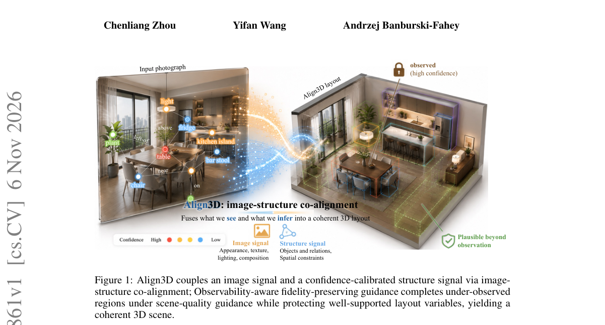

*Result - Align3D pipeline, including scene graph inference, fused image-graph conditioning, and set-diffusion layout prediction. Training uses image-structure co-alignment and observability-aware fid*

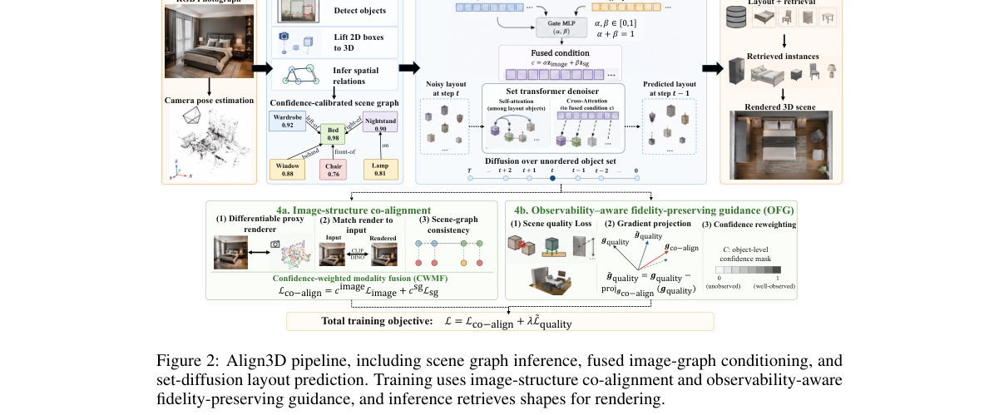

**Why this ranks #5**: 图像条件的室内布局扩散模型，核心是按预测置信度在图像与场景图之间做共对齐，并用可观测性引导让欠观测自由度吸收物理先验；3D-FRONT 上 CLIP 0.925、DINO 0.843、F-Score 88.7，训练 60 小时、推理 10 秒/场景为对比方法中最快。

---

### 6. OmniLatent: Unified Latent for 3D Part Modeling

**arXiv**: [2611.09055](https://arxiv.org/abs/2611.09055) | **Score**: 8.0 (relevance 8 x 0.7 + quality 8 x 0.3) | **Direction**: `aigc_generation` | **Tags**: AIGC-visual, part-segmentation, unified-latent, 3d-part-modeling, point-prompt, amodal-completion, University of Hong Kong | **Categories**: cs.CV | **Pages**: 16

**Authors**: Yunhan Yang; Yunfei Zhao; Zeqiang Lai; Jiachen Xu; Minxiu Wang; Xintong Han; Xiangyu Yue; Xihui Liu; Chunchao Guo

**Affiliation**: University of Hong Kong; Tencent; Chinese University of Hong Kong; Nanjing University

**Abstract**

> 3D part decomposition is a central capability for editable asset creation, yet existing workflows typically segment a completed mesh as a post-processing step, making the result sensitive to geometric artifacts, texture ambiguity, and limited part-level annotations. We present OmniLatent, a unified latent modeling framework for 3D part decomposition. Instead of predicting part labels in isolation, OmniLatent learns a shared latent space that jointly encodes geometry, deformation, appearance, and binary part IDs, allowing data-rich geometric and visual priors to support data-scarce part learning. Given a single input image, the base model generates geometry, deformation, texture, and surface part IDs in one pass, producing a part-aware 3D asset without a separate segmentation stage. We further tune the pretrained model for two extensions: a point-prompt adapter that maps arbitrary 3D point prompts with binary part IDs into latent tokens for full segmentation, refinement, and part subdivision, and an amodal part completion model that completes partial surface masks into a coherent full-object decomposition through dynamic per-part token allocation, cross-attention to the given geometry latent, and alternating part-local and global attention. Extensive experiments show that OmniLatent produces semantically meaningful part segmentations with precise boundaries, supports interactive part editing, and completes partial part observations while preserving global object consistency.

**Key findings**

- **Finding**: PartObjaverse-Tiny-wt 表面部件分割上 OmniLatent 达 74.18 mIoU，最强基线为 56.01；在水密真值表面上无掩码引导仍达 62.42 mIoU，点提示分割为 67.32 mIoU（交互式 55.75 mIoU）。
- **Inference**: 数据密集的几何与纹理模态可以反哺数据稀缺的部件 ID 学习，说明共享潜空间比各任务独立建模更适合部件建模。
- **Recommendation**: 做可编辑 3D 资产时优先选统一潜空间路线，并善用点提示适配器，其 67.32 mIoU 已接近掩码引导水平且交互成本更低。

**Key figures**

*Framework - OmniLatent generates geometry, deformation, appearance, and coherent surface part IDs from a single image in a unified latent space.*

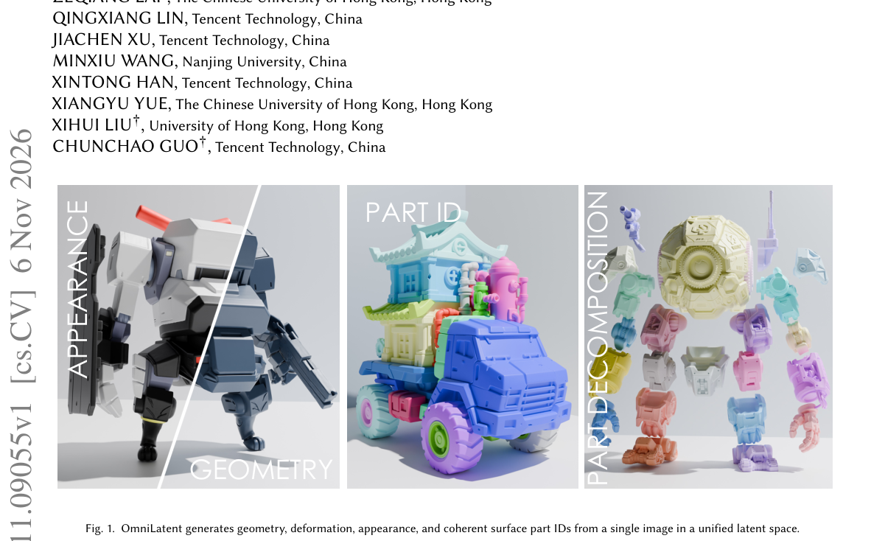

*Result - Unified Latent Modeling and Pretraining. OmniLatent performs 3D part decomposition through unified latent modeling. Geometry, deformation, appearance, and binary part IDs are encoded into a sh*

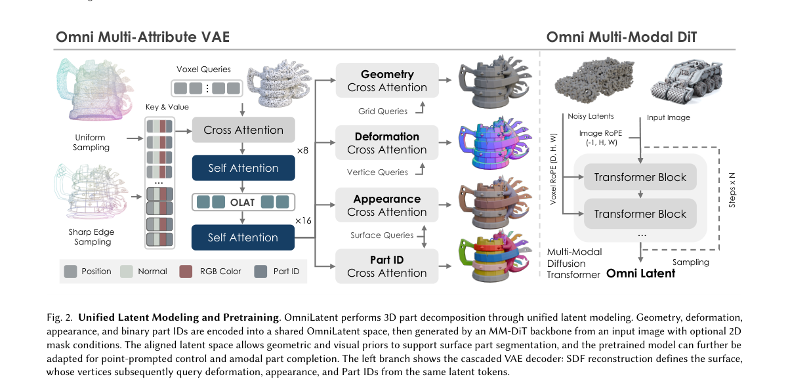

**Why this ranks #6**: 3D 部件分解不再是网格的后处理步骤，而是把几何、形变、外观与二值部件 ID 一起编码进统一潜空间，单图一次前向即产出带部件的资产；PartObjaverse-Tiny-wt 上达 74.18 mIoU，而最强基线仅 56.01。

---

### 7. UniRGBA: Unifying RGB and Alpha in Pretrained Video Diffusion Models

**arXiv**: [2611.09069](https://arxiv.org/abs/2611.09069) | **Score**: 8.0 (relevance 8 x 0.7 + quality 8 x 0.3) | **Direction**: `aigc_generation` | **Tags**: AIGC-visual, rgba-video, alpha-channel, video-vae, dora, latent-expansion, ByteDance | **Categories**: cs.AI, cs.CV | **Pages**: 18

**Authors**: Lei Xu; Zhuo Li; Yongyi Jin; Aoyu Wang

**Affiliation**: ByteDance

**Abstract**

> Recent advances in video diffusion models have achieved remarkable photorealistic RGB synthesis, yet generating videos with a native alpha channel remains an open challenge. Existing approaches often rely on matting-style data and non-native RGBA designs, causing them to specialize in real-object scenes and to degrade severely on visual-effect content whose semi-transparency is spatially non-local and non-elliptical. We present UniRGBA, a unified framework whose key insight is that RGBA generation does not require a dedicated alpha encoder or complex latent-space restructuring---a minimal, targeted extension of the existing RGB pathway is sufficient. UniRGBA-VAE extends a causal video VAE to 4-channel RGBA via zero-initialized channel expansion, symmetric selective layer unfreezing (5% trainable), and a six-term progressive reconstruction loss anchored by a KL reference loss that prevents latent drift, followed by a two-stage schedule that introduces a lightweight GAN objective. We then apply standard DoRA to the pretrained DiT, reusing the unified 4-channel latent without any alpha-specific architectural changes. On a visual-effect RGBA benchmark, UniRGBA substantially outperforms Wan-Alpha on RGBA reconstruction while preserving RGB fidelity. For generation, UniRGBA outperforms Wan-Alpha on RGBA text-to-video tasks and matches or surpasses the original pretrained Wan2.1 backbone on RGB-only metrics, demonstrating that native alpha support can be integrated without compromising the underlying RGB prior or the model's architectural versatility.

**Key findings**

- **Finding**: 对比 Wan-Alpha，UniRGBA-VAE 的 PSNR 从 25.00 提升到 29.16、SSIM 从 0.891 到 0.932，其中 PSNR_rgb 24.42→29.75、PSNR_alpha 30.50→34.45；训练只解冻 2+2 层编解码器（约 5% 参数）并加 0.02 权重的轻量 GAN 目标。
- **Inference**: KL 锚定的渐进重建损失让新学的 alpha 表征不漂移，原有 RGB 先验被保留，因此无需为 alpha 改造 DiT 架构即可直接复用预训练权重。
- **Recommendation**: 要给现有视频模型加透明通道，可按零初始化扩通道加对称解冻少量层的思路改 VAE，再对 DiT 做 DoRA 适配，避免另起非原生 RGBA 架构。

**Key figures**

*Framework - Overview of UniRGBA-VAE. UniRGBA-VAE extends the Wan2.1 VAE to 4-channel RGBA through zero-initialized channel expansion at Conv_in/Conv_out with selective layer fine- tuning (orange = train*

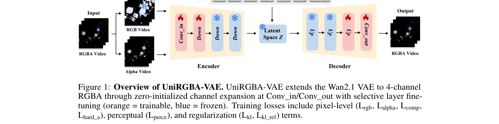

*Result - Overview of Alpha-aware downstream adaptation. For T2V, frozen umT5 text features and timestep embeddings condition adapter-tuned DiT blocks, whose denoised latents are decoded by UniRGBA-VA*

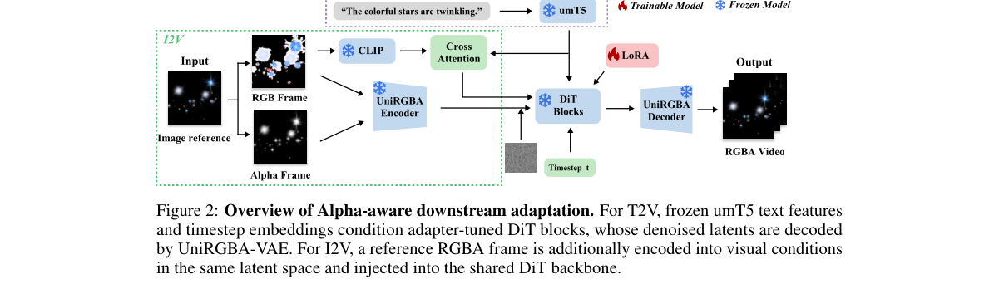

**Why this ranks #7**: 给视频扩散加原生 alpha 通道只需最小改动：Wan2.1 因果 VAE 零初始化扩到 4 通道、仅微调最外侧 2+2 层（约 5% 参数），下游 DiT 直接套标准 DoRA；相比 Wan-Alpha，PSNR 从 25.00 升到 29.16、SSIM 从 0.891 升到 0.932。

---

### 8. Emo-LiveSync: Real-Time Universal Lip Synchronization with Explicit Emotion Control

**arXiv**: [2611.09074](https://arxiv.org/abs/2611.09074) | **Score**: 8.0 (relevance 8 x 0.7 + quality 8 x 0.3) | **Direction**: `aigc_generation` | **Tags**: AIGC-visual, lip-sync, real-time, latent-motion, emotion-control, portrait-animation, Klleon AI Research | **Categories**: cs.CV | **Pages**: 23

**Authors**: Sangjoon Yu; Seungeun Lee; JoonHeyok Shin; Ji-Su Kang

**Affiliation**: Klleon AI Research; Sungkyunkwan University

**Abstract**

> Lip synchronization, the task of generating realistic lip movements synchronized with audio signals, is fundamental to applications such as film dubbing, virtual avatars, and digital content creation. Recent GAN-based methods offer computational efficiency but often lack visual fidelity, while diffusion-based approaches achieve high-quality results at the cost of substantial computational overhead. Moreover, most existing methods are limited to photo-realistic human faces, restricting their applicability to stylized characters and non-human entities. In this paper, we propose an efficient universal lip-sync video generation framework that achieves high-quality results without compromising computational efficiency. We build on LivePortrait, a warp-based portrait animation model, and introduce a training strategy that aligns audio signals to an implicit motion space by distilling knowledge from a pre-trained video-to-motion model. This enables real-time inference while maintaining high visual fidelity, and naturally generalizes to diverse stylistic characters beyond photo-realistic humans. Furthermore, we introduce an expressive control gate that enables explicit manipulation of emotional expressions for content enrichment. Extensive experiments demonstrate that our method achieves state-of-the-art performance in both visual quality and lip-sync accuracy while ensuring real-time inference.

**Key findings**

- **Finding**: UniVox-Bench 含 34 个主体，其中 46% 为真人、54% 为卡通/动漫/动物等非人类角色，语音横跨英语、中文、法语、意大利语、日语、韩语、西班牙语 7 种语言；模型输入 512×512、16 kHz 音频，隐式运动空间含 21 个关键点。
- **Inference**: 用变形而非扩散做生成、并把音频映射到蒸馏来的隐式运动空间，是同时拿到实时速度与跨风格角色泛化的关键。
- **Recommendation**: 选型时优先看风格化角色与跨语言场景，因为多数唇同步基线只在真人英语数据上验证，容易高估其泛化能力。

**Key figures**

*Framework - We present an universal model that generates lip-synchronized video on stylistic humans and characters corresponding to driving audio sequences. Our method ensures com- putational efficiency*

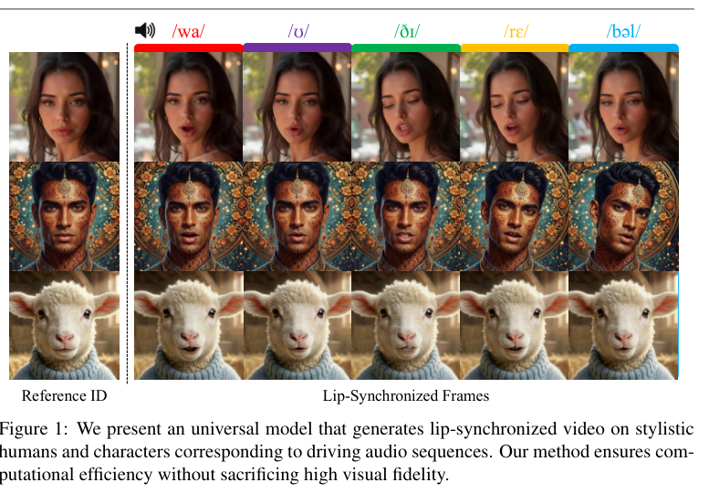

*Result - Comparison of lip-sync accu- racy (LMD) versus computational time (FPS) against existing methods with model size. Our approach ensures lip-sync generation without compromising between visual*

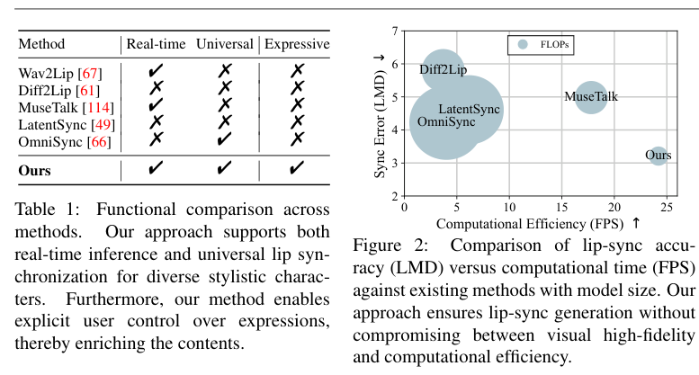

**Why this ranks #8**: 基于 LivePortrait 的变形式肖像动画框架，把音频对齐到由预训练视频到运动模型蒸馏来的隐式运动空间，从而兼顾实时推理并天然泛化到风格化角色；新评测集 UniVox-Bench 含 34 个主体（46% 真人、54% 卡通/动漫/动物）、覆盖 7 种语言。

---

### 9. Video2Asset: Online Construction of Persistent 3D Street-Scene Assets

**arXiv**: [2611.09661](https://arxiv.org/abs/2611.09661) | **Score**: 8.0 (relevance 8 x 0.7 + quality 8 x 0.3) | **Direction**: `aigc_generation` | **Tags**: AIGC-visual, 3d-assets, multi-view-video, online-reconstruction, identity-tracking, occupancy, Cooperative Medianet Innovation Center | **Categories**: cs.CV | **Pages**: 10

**Authors**: Zihan Zheng; Chunlei Cai; Zhenlong Wu; Linjun Li; Yichen Gong; Xiaoyun Zhang; Qiang Hu

**Affiliation**: Cooperative Medianet Innovation Center; Shanghai Jiao Tong University

**Abstract**

> Online 3D street-scene asset construction turns multi-view video into a continually updated scene of independently editable objects. The central challenge is to accumulate partial, intermittent observations under motion and occlusion without fragmenting identities or mixing evidence across objects. To address this challenge, we propose Video2Asset, an online framework for constructing persistent 3D assets from multi-view video. Using occupancy as an intermediate representation, we construct identity-aware observations with Historical Carrier Guidance for instance decoding and an identity encoder fusing instance-aligned 3D features with multi-view appearance. Accumulated-Evidence Association compares current observations with identity, geometric, and appearance evidence accumulated within asset records to determine identity inheritance and update world-coordinate states. We instantiate meshes from an asset library using these states and combine them with an occupancy-derived static background to support scene visualization, mesh replacement, object deletion, and trajectory editing. Experiments on several datasets demonstrate improvements in temporal identity consistency and asset quality across multiple occupancy models, including a 15.4% reduction in asset fragmentation on nuScenes with SGE.

**Key findings**

- **Finding**: 在 nuScenes 上配合 SGE 占用模型，视频 2 资产方案的资产碎片率下降 15.4%；在 CarlaOcc 上 LaGS 相对基座模型分别提升 1.50 与 8.75 个点；评测用的 nuScenes 含 1,000 个真实场景。
- **Inference**: 把身份、几何与外观证据累积进资产记录后再判定身份继承，比逐帧独立实例化解了遮挡与间歇观测下的身份碎片问题。
- **Recommendation**: 搭在线街景管线时把身份编码器与累积证据关联当标配，不要每帧重新做实例分割，否则碎片化无法避免。

**Key figures**

*Framework - Persistent and editable street-scene assets from video. Left: Video2Asset converts multi-view video into an evolving 3D scene with persistent object identities, supporting mesh replacement,*

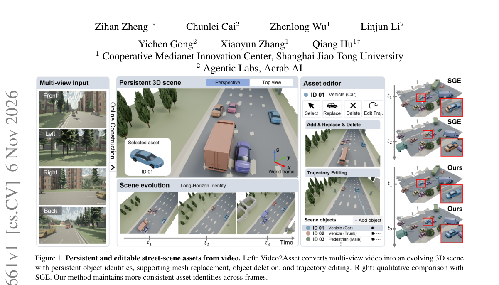

*Result - Overview of Video2Asset. (a) Multi-view video is converted into identity-aware observations through occupancy modeling. The observations are associated with persistent asset records to updat*

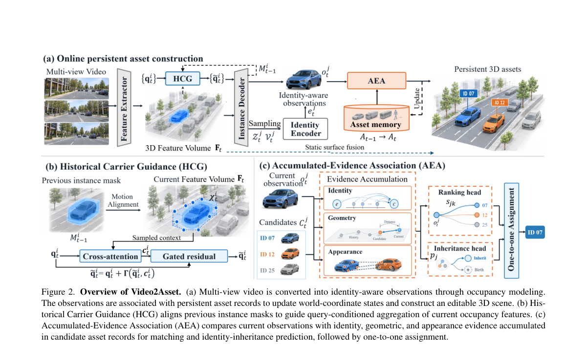

**Why this ranks #9**: 以占用率为中间表示在线把多视角视频累积成持久、可独立编辑的 3D 街景资产，用历史载体引导与累积证据关联在运动和遮挡下守住身份；nuScenes 上配合 SGE 占用模型把资产碎片率降低 15.4%，并支持网格替换、物体删除与轨迹编辑。

---

## AIGC 编辑（指令编辑 / 修补 / 个性化） · `aigc_editing` (3 papers)

本方向只有 2 篇够格的方法论文，外加 1 篇 wild-card 使用侧实证——这是本批次最薄的一条。AR-Edit 从 DMD 蒸馏自回归视频扩散模型的自注意力动力学里挖出一个不对称性（query/key 跨去噪步稳定、value 承载演化内容），由此做成**训练无关、无需反演**的实时流式视频编辑；Paste2Place 把「贴图到贴合」定义成带 albedo-shading-residual 分解的物理引导单步流模型，并配了 86,273 对训练数据与 1,500 例基准。补位的 wild-card 则从方法侧换到使用侧：Nano Banana 的 210 万条对话在严格差分隐私下被聚成 5 类使用场景，补上「谁在用、怎么用」这一维。

### 10. AR-Edit: Training-Free Autoregressive Video Editing without Inversion

**arXiv**: [2611.09795](https://arxiv.org/abs/2611.09795) | **Score**: 9.0 (relevance 9 x 0.7 + quality 9 x 0.3) | **Direction**: `aigc_editing` | **Tags**: AIGC-visual, video-editing, training-free, streaming, self-attention, inversion-free, Team ARAI | **Categories**: cs.CV | **Pages**: 31

**Authors**: Hovhannes Margaryan; Quentin Bammey; Christian Sandor; Vicky Kalogeiton

**Affiliation**: Team ARAI, Universite Paris-Saclay, CNRS, LISN; LTCI Telecom Paris; LIX Ecole Polytechnique

**Abstract**

> Editing a video stream in real time, without access to future frames, is essential for interactive applications. Existing training-free video editing methods, however, assume full offline access to the entire sequence, while streaming approaches either rely on additional training or are limited to specific editing techniques. We show that this limitation can be removed by analyzing the self-attention dynamics of DMD-distilled autoregressive (AR) video diffusion models. We uncover a key asymmetry: queries and keys remain stable and aligned with their source counterparts across denoising timesteps, while values diverge and encode the evolving content. Inherited from the non-distilled bidirectional teacher, this asymmetry is strongest at high noise, where few-step streaming models operate. The resulting mechanism is simple: a single forward pass suffices to capture source identity in the value features, which can be reused throughout generation. Starting from pure Gaussian noise and injecting only these source values reconstructs the input with fidelity matching or surpassing inversion-based methods, effectively eliminating inversion. Based on this insight, we introduce AR-Edit, a training-free, inversion-free method that caches source values once and selectively injects them during denoising. Across multiple AR backbones, AR-Edit enables real-time streaming editing with superior source preservation and tonal fidelity at minimal overhead.

**Key findings**

- **Finding**: 在 Wan 2.1 DMD 蒸馏学生的全部 30 个自注意力块上，Q 与 K 对干净锚点（t=0）的平均余弦相似度分别为 0.68 和 0.73，即使在最高噪声 t=1000 时仍保持高位，而 V 显著发散；该学生的训练时间步满足 t≥625。
- **Inference**: 源身份已编码在 V 中，因此缓存一次 t=0 的干净前向 V 并全程复用，就能替代反演把编辑锚定到源内容上。
- **Recommendation**: 实时流式改视频可直接试该免反演方案，但务必复用同一份 V 缓存，逐时间步重新采 V 会让 LPIPS 恶化约 1.5 倍。

**Key figures**

*Framework - Training-free video editing paradigms. Inversion-based methods [60, 10] (left) invert the source to noise and denoise under the target prompt; inversion-free methods [31, 32] (middle) direct*

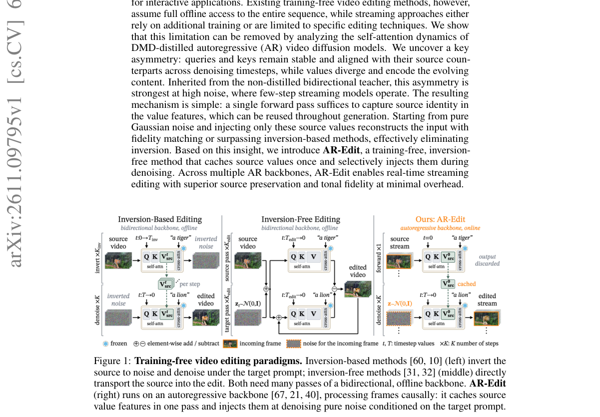

*Result - Q and K are timestep-stable; V is not. Cosine similarity of Q, K, and V to their clean (t=0) counterparts at each self-attention block of Reward Forcing [40]. Q and K retain high similarity*

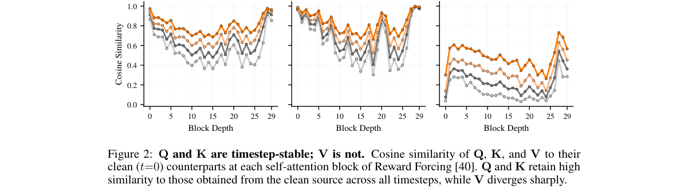

**Why this ranks #10**: 分析 DMD 蒸馏自回归视频扩散的自注意力，发现 Q/K 跨时间步稳定而 V 发散，于是只需一次前向缓存源视频的 V 并在去噪中选择性注入，即可免训练、免反演地做流式视频编辑，源保真与色调表现优于反演类方法。

---

### 11. A Bridge from Paste to Place: Physics-Guided One-Step Image Composition via Object-Scene Interaction

**arXiv**: [2611.09387](https://arxiv.org/abs/2611.09387) | **Score**: 8.0 (relevance 8 x 0.7 + quality 8 x 0.3) | **Direction**: `aigc_editing` | **Tags**: AIGC-visual, image-composition, one-step, flow-matching, physics-guided, relighting, Transsion | **Categories**: cs.CV | **Pages**: 10

**Authors**: Hongzhen Li; Youwei Pan; Yingfang Zhu; Sen Zhu; Fengjie Zhu; Leilei Cao

**Affiliation**: Transsion

**Abstract**

> Realistic image composition must make a pasted object appear naturally present in a scene while preserving the fine details of both foreground and background. Reference-based insertion methods can change object pose and appearance, while foreground harmonization methods and shadow-specific synthesis methods each address only part of this task. An efficient, unified solution to this task remains an open challenge. We introduce Paste2Place, an end-to-end, physics-guided flow-based model that learns a direct, one-step latent bridge from pasted inputs to realistic composites, guided by explicit albedo-shading-residual decomposition and recomposition within the model. To support model training and evaluation, we develop a Blender rendering and validation pipeline to generate paired composites with physical annotations, and construct real-scene pairs from open-source object-removal data. This effort yields 86,273 training pairs and a 1,500-example benchmark. Extensive qualitative and quantitative experiments demonstrate that Paste2Place achieves substantial advantages in image composition quality and inference speed. Overall, our work provides a clear task definition and an effective solution for image composition, and fills a gap in large-scale, high-quality datasets and benchmarks for training and evaluating image composition.

**Key findings**

- **Finding**: P2P-Data 含 86,273 对训练样本、P2P-Bench 含 1,500 例评测样本；相比 MV-CoLight，其 PSNR 高 6.48 dB、LPIPS 低 40.4%，其中 PSNR 从 22.07 dB 升到 29.68 dB、LPIPS 从 0.0493 降到更低。
- **Inference**: 一步潜空间桥接加显式反照率-着色-残差分解重合成，能同时保住前景细节与背景一致性，比把协调化和阴影合成拆成两步更统一。
- **Recommendation**: 做商品图或广告合成可直接用其开源基准做对照，评测时把前景身份保真与光照合理性分开打分，避免单一总分掩盖问题。

**Key figures**

*Framework - Realistic image composition in one step. Paste2Place jointly relights pasted objects and generates their scene effects while preserving object identity and fine details. Examples cover (a) c*

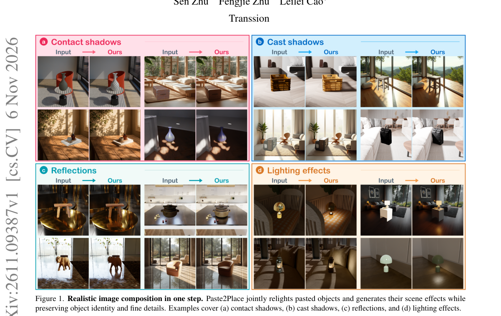

*Result - Different objectives in object placement. Visual com- parison of three related but distinct tasks: image composition, reference-based insertion, and foreground relighting.*

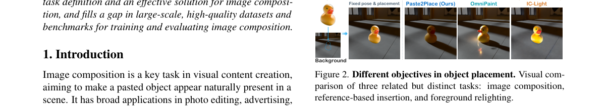

**Why this ranks #11**: 面向「从粘贴到放置」的真实合成任务，用物理引导的流匹配模型一步完成重光照与场景效果生成，并配套 Blender 渲染管线产出 86,273 对训练数据与 1,500 例基准；相比 MV-CoLight，PSNR 高 6.48 dB、LPIPS 低 40.4%。

---

### 12. How are viral trends different from educational and commercial uses of LLM image generation and editing? A privacy-preserving descriptive analysis

**arXiv**: [2611.08749](https://arxiv.org/abs/2611.08749) | **Score**: 6.6 (relevance 6 x 0.7 + quality 8 x 0.3) | **Direction**: `aigc_editing` | **Tags**: AIGC-visual, usage-analysis, differential-privacy, prompt-clustering, image-editing, nano-banana, Google Behavioral Economics | **Categories**: cs.AI, cs.CY | **Pages**: 32

**Authors**: Will Tucker-Ray; Marika Swanberg; Alexander Knop; Marvin Chow; Eric Culbertson; Julian Jacobs; Pritish Kamath; Ravi Kumar; Jason Mothersill; Mikhail Pravilov; Eugene Quan; Yurii Sushko

**Affiliation**: Google Behavioral Economics; Google Research; Google Marketing; Google DeepMind

**Abstract**

> Gemini's Nano Banana models, first introduced in late 2025, led to a shift in the capabilities and use of image generation and editing. We utilize Urania, a Google-developed framework for generating insights about LLM chatbot interactions with rigorous differential privacy (DP) guarantees, to analyze use cases and intents, techniques and ways of prompting, without ever looking at a single image or individual prompt. We select a subsample of 2.1M conversations in early 2026 which utilized Nano Banana models, into roughly 800 clusters in five categories: (1) Social & Viral Sharing, (2) Brand & Marketing Collateral, (3) Educational & Technical Information Media, (4) Product Visualizations & E-commerce, and (5) Architectural & Spatial Designs. We then compare these clusters on 21 features of use, measuring aspects of prompts' (a) editing techniques, (b) artistic style requests, (c) composition, and (d) chatbot interactions. This allows us to describe a baseline of how people are using image generation and editing tools for different use cases---(including growing and emergent use cases which were not possible before Nano Banana)---in a privacy-preserving manner.

**Key findings**

- **Finding**: 研究选取 210 万条 Nano Banana 对话聚成约 800 个簇（病毒社交 375、品牌营销物料 191、建筑与空间设计 66 等），在 21 项使用特征上比较，总隐私预算 ε≤0.04，小于 50 条对话的簇被剔除。
- **Inference**: 编辑能力带来的新兴用法只有建立在真实使用分布上才会被基准与训练数据捕捉，研究者自定题目容易系统性漏掉这些场景。
- **Recommendation**: 设计图像编辑基准或构造偏好数据前，先参考这类差分隐私聚类结论定位高频真实场景，并注意社交传播类簇占比最高这一事实。

**Key figures**

*Framework - Visualization (generated by Nano Banana) of Urania framework for summarizing chatbot conversations.*

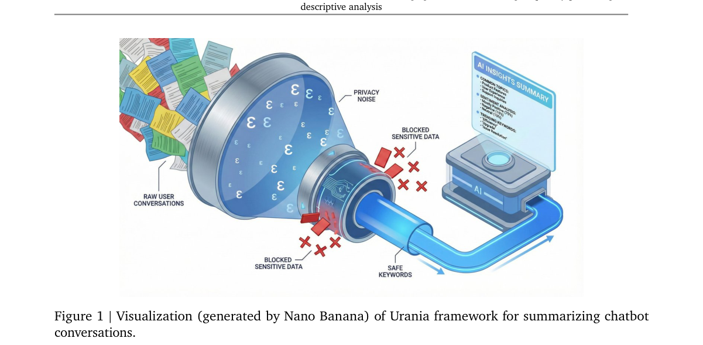

*Result - The framework’s data flow. Yellow nodes denote non-DP data, green nodes represent operations that are either DP or per conversation, light blue nodes denote private data, and dark blue node*

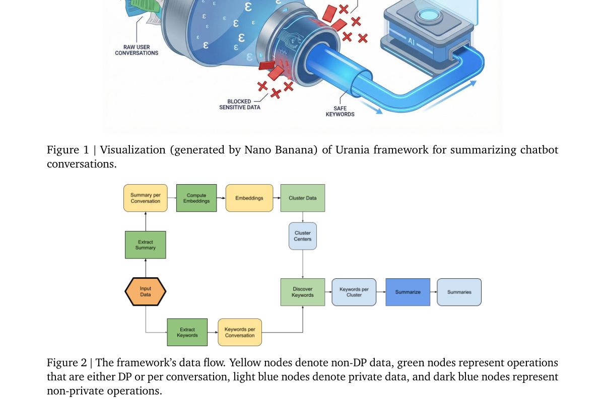

**Why this ranks #12**: 它提供的不是新方法而是使用侧的大规模实证：2026 年初 210 万条使用 Nano Banana 的对话被聚成约 800 个簇、5 个大类，再在 21 项使用特征上对比编辑技巧、风格与构图，全程差分隐私预算 ε≤0.04，不看任何单张图像或单条 prompt。  [wild-card=yes] 本批次 aigc_editing 只有 2 篇够格的方法论文（AR-Edit 的免反演自回归视频编辑、Paste2Place 的物理引导单步合成），方向供给明显不足。按 skill「够格就发、发不满是正常结果」的规则这里不凑数，它让出的 1 个名额流向候选最充裕的 aigc_generation；补位的这篇改从使用侧切入——用 210 万条真实对话在严格差分隐私下分析 Nano Banana 的图像生成与编辑使用场景，补上方法论文之外的「谁在用、怎么用」这一维，属邻接选题补位。

---

## 面向视觉生成的 RL 与奖励模型 · `aigc_rl` (3 papers)

本方向 3 篇，都是把强化学习真正接进生成管线的做法。SIFR 是本批最完整的一篇：它指出迭代式奖励微调只给正奖励权重、缺少「卸载」信号且会因反复重加权而分布坍缩，于是用带符号优势补上卸载信号、并用带漂移预算的拉格朗日乘子约束速度场漂移，在 SD3.5 Medium、FLUX.2 Klein 到 Cosmos 3 Super Text2Image（64B）共 12 组骨干-奖励对上追平或超过既有流式 RL 方法且更早到达峰值。PhyCAD 把 GRPO 用到文本到 CAD，靠「程序执行 + 几何检查 + 有限元分析」的可验证工程反馈训练，并用分层优势保住「几何与物理约束同时满足」的优先级。Video-Coder 则让代码 agent 自己写并执行代码搭 3D 场景当结构信号，配合执行奖励 + 视频奖励的双反馈做 agentic RL。

### 13. SIFR: Stable Signed Flow Reinforcement

**arXiv**: [2611.09175](https://arxiv.org/abs/2611.09175) | **Score**: 9.3 (relevance 9 x 0.7 + quality 10 x 0.3) | **Direction**: `aigc_rl` | **Tags**: AIGC-visual, flow-matching, reinforcement-learning, signed-advantage, drift-constraint, reward-fine-tuning, NVIDIA | **Categories**: cs.AI, cs.CV, cs.LG | **Pages**: 33

**Authors**: Runlong Liao; Xingqian Xu; Lizhang Chen; Baiyu Su; Yufan Huang; Zhonghao Wang; Akash Gokul; Ming-Yu Liu; Qiang Liu; Yogesh Balaji

**Affiliation**: NVIDIA; UT Austin

**Abstract**

> Reward-based fine-tuning of flow models requires effectively promoting high-reward and suppressing low-reward samples, while maintaining training stability over many rounds of iterative updates. Iterative reward fine-tuning provides a simple starting point, but the positive reward weights give no explicit unfitting signal, and repeated reweighting concentrates the distribution and causes collapse. We propose Stable Signed Flow Reinforcement (SIFR), which replaces the reward weights by signed advantages to supply the missing unfitting signal, and constrains the velocity drift from a reference model to stabilize the updates, with a Lagrange multiplier that adapts the regularization strength to a prescribed drift budget. We further show that existing flow RL methods fall within this framework: they implicitly minimize the signed loss, differing in their regularization choices. We validate SIFR on SD3.5 Medium (2.5B) and FLUX.2 Klein (9B) and scale it to Cosmos 3 Super Text2Image (64B): across all 12 backbone--reward pairs with preference and rule-based rewards, it matches or exceeds existing methods, reaches their peak rewards much faster, and keeps improving over long training where they plateau or collapse.

**Key findings**

- **Finding**: 在 SD3.5 Medium（2.5B）、FLUX.2 Klein（9B）与 Cosmos 3 Super Text2Image（64B）的 12 组骨干-奖励组合上，SIFR 全部持平或优于已有方法，约 4 倍更快达到基线的峰值奖励；训练 2000 轮时 93.5% 的提示同时优于两条基线。
- **Inference**: 现有流 RL 方法其实都在隐式最小化同一个带符号损失，差别只在正则化方式，把正则显式写成速度漂移约束即可统一框架并稳住长程训练。
- **Recommendation**: 做流模型奖励微调时改用带符号优势并显式设定漂移预算，避免重加权导致的分布集中与模式崩塌，同时保留 EMA 权重平均。

**Key figures**

*Framework - SIFR on Cosmos 3 Super Text2Image. (a) Held-out PickScore during single-reward training; SIFR reaches the baselines’ plateau 4× sooner and keeps improving. (b) Per-prompt gains at round 2000*

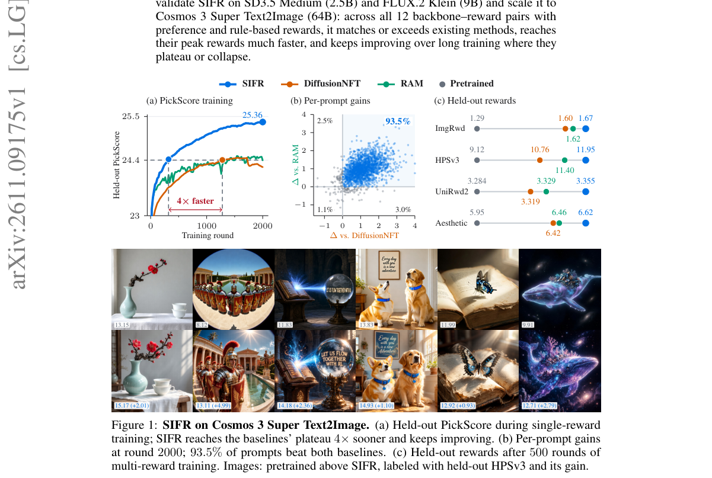

*Result - Preference-reward training across model scales. Test on held-out prompts.*

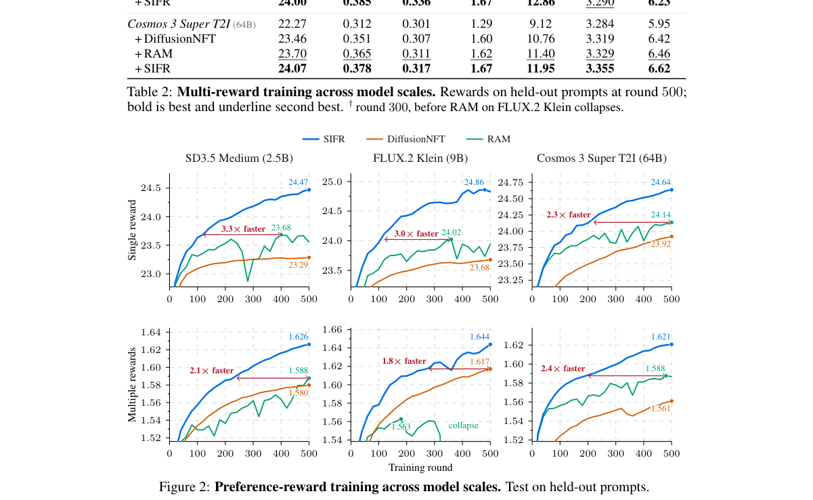

**Why this ranks #13**: 把流模型的在线奖励微调写成带约束的优化问题：奖励权重换成带符号优势以补上负样本缺失的「解拟合」信号，再用拉格朗日乘子把相对参考模型的速度漂移限制在给定预算内；12 组骨干-奖励组合全面持平或更优，且快约 4 倍到达基线峰值并能继续提升。

---

### 14. PhyCAD: Physics-Aware Text-to-CAD Generation via Hierarchical Reinforcement Learning

**arXiv**: [2611.09401](https://arxiv.org/abs/2611.09401) | **Score**: 8.0 (relevance 8 x 0.7 + quality 8 x 0.3) | **Direction**: `aigc_rl` | **Tags**: AIGC-visual, text-to-cad, grpo, physics-verification, finite-element-analysis, hierarchical-reward, USTC | **Categories**: cs.AI | **Pages**: 15

**Authors**: Yuxin Cui; Weijie Zheng; Zhengyang Li; Han Wang; Wenjie Feng; Qiyu Kang

**Affiliation**: USTC

**Abstract**

> Language-driven computer-aided design (CAD) generation enables the creation of editable parametric models from text, yet geometric correctness alone does not ensure physical feasibility. We present PhyCAD, a framework for physics-aware Text-to-CAD generation that trains language models to produce executable CadQuery programs under geometric and physical constraints. To support this setting, we construct a Text-to-CAD dataset that links parametric CAD models with geometric specifications, loading conditions, and physical constraints. We further develop an automated CAD--CAE verifier that combines program execution, geometric checks, and finite element analysis to provide feedback for model training. A key learning challenge is to prioritize joint satisfaction of geometric and physical constraints while retaining informative feedback on partial progress. A flat aggregation of heterogeneous rewards can obscure this priority, allowing improvements in individual criteria to compensate for unmet design requirements. We therefore introduce a Hierarchical Balanced Advantage for Group Relative Policy Optimization, grouping candidates into levels according to their verification status and combining between-level progress with objective-wise peer ranking within each level. This formulation preserves cross-level priority in the training signal while providing fine-grained feedback for satisfying constraints and improving feasible designs. Experiments across multiple language models show that PhyCAD consistently improves joint geometric and physical constraint satisfaction. These results demonstrate the value of verifiable engineering feedback for advancing language-driven CAD generation beyond geometric reconstruction toward physics-aware design.

**Key findings**

- **Finding**: 训练使用 11,024 条 SFT 样本与 66,043 条 GRPO 任务；联合成功率经 SFT 后为 21.76%–37.36%，经 GRPO 后升到 39.49%–58.05%；非分层 GRPO 虽达 98.40% 合法率，却把联合可行性从 21.76% 压到 18.80%，直接分层 GRPO 为 98.55% 合法率与 39.49% 联合可行性。
- **Inference**: 扁平聚合异质奖励会让单项几何指标的提升抵消物理约束的失败，分层优势才能保住几何与物理同时满足的优先级。
- **Recommendation**: 用可执行验证器做 RL 时请按验证阶段分组再算优势，否则合法性指标会变好看但物理可行性反而下滑，还需额外 RL 阶段才能追回。

**Key figures**

*Framework - Physics-aware CAD optimization. (A) A source CAD model is annotated with FEM conditions and responses. (B) Its exact dimensions are redacted to form an inverse-design task with physical cons*

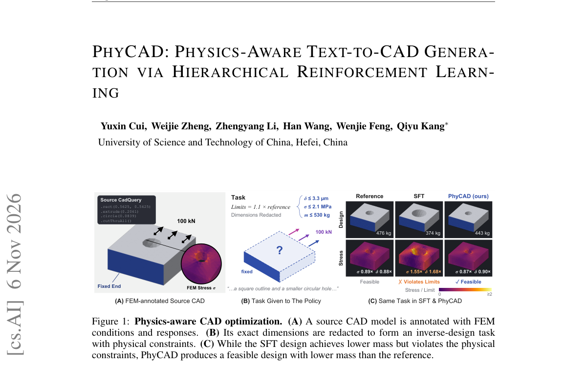

*Result - Overview of our framework. The LLM policy generates candidate CAD programs from a physics-conditioned prompt containing geometric requirements, design-domain constraints, loads, and physical*

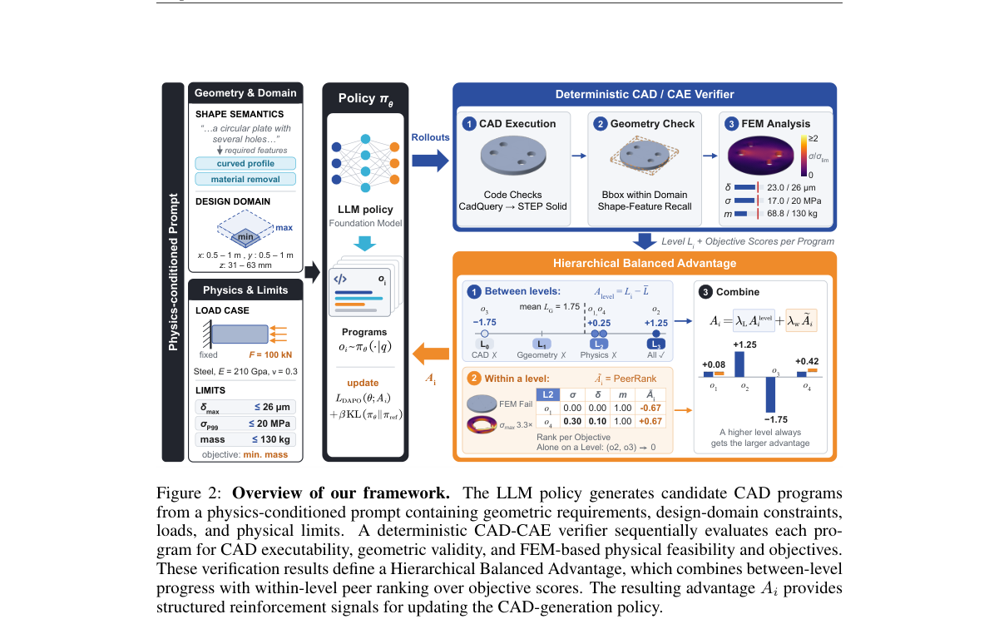

**Why this ranks #14**: 让语言模型在几何与物理约束下输出可执行 CadQuery 程序，用自动 CAD-CAE 验证器（程序执行、几何检查、有限元分析）提供反馈；训练上提出分层平衡优势的 GRPO，按验证状态分层、层间比进度、层内比单项排名，联合可行性从 SFT 的 21.76%–37.36% 提升到 39.49%–58.05%。

---

### 15. Video-Coder: Reinforcing Agentic Coding for Video Generation

**arXiv**: [2611.09894](https://arxiv.org/abs/2611.09894) | **Score**: 8.0 (relevance 8 x 0.7 + quality 8 x 0.3) | **Direction**: `aigc_rl` | **Tags**: AIGC-visual, agentic-coding, video-generation, reinforcement-learning, 3d-scene, reward-annealing, University of Central Florida | **Categories**: cs.CV | **Pages**: 16

**Authors**: Chaoyang Wang; Sicheng Gao; Junan Hu; Kunyang Li; Dongyang Chen; Yiyang Zhou; Huaxiu Yao; Yong Jae Lee; Radu Timofte; Yuzhang Shang

**Affiliation**: University of Central Florida; University of Wurzburg; Microsoft Research; Tsinghua University

**Abstract**

> Recent years have witnessed remarkable progress in video generation in terms of visual quality and temporal consistency. However, generating videos with precise spatial structure, coherent motion dynamics, and controllable scene composition remains challenging. In this paper, we introduce Video-Coder, the first attempt to train a code-driven video generation agent, which autonomously writes and executes code to construct a dynamic 3D scene (Draft Video) that provides structure and motion signals to downstream video generators. To support this paradigm, we design a dedicated data pipeline and curate two high-quality datasets, Video-Coder-SFT-6k and Video-Coder-RL-2k, which contain diverse prompts and ground-truth reference videos. We further develop the Video- Coder Harness, a unified interactive environment integrating code execution, 3D scene rendering, and execution feedback for agent training and inference. We then train Video-Coder with SFT fol- lowed by harness-native agentic reinforcement learning with dual reward feedback, which combines execution-based and video-based rewards. Additionally, we design an annealing training strategy that gradually reduces the execution reward over time, allowing the model to rely more on the video reward in the later training stages. Experiments show that Video-Coder achieves significant gains, improving Minimax-H3 by approximately 7 points on PhyGenBench and 24 points on VBench-2.0. We hope this work can serve as an open foundation for coding agents in video generation, and we fully open-source our data, models, and code

**Key findings**

- **Finding**: 公开 Video-Coder-SFT-6k（6k 样本）与 Video-Coder-RL-2k（2k 对提示-参考视频）两个数据集；经 SFT 加 harness 原生智能体强化学习后，MiniMax-H3 在 PhyGenBench 提升约 7 分、在 VBench-2.0 提升 24 分，RL rollout 用 16 张 H100。
- **Inference**: 显式构造 3D 场景比直接生成视频更可控，因为结构与运动信号在代码里被确定，渲染器只负责还原外观这一层。
- **Recommendation**: 做可控视频生成时先把三维场景交给代码生成再渲染，并用退火策略让智能体后期更依赖视频奖励而非单纯的程序可执行性。

**Key figures**

*Framework - Overview of our proposed Video-Coder. Unlike direct video generation, Video-Coder writes and executes code to build a 3D scene and renders a draft video, which guides the downstream video ge*

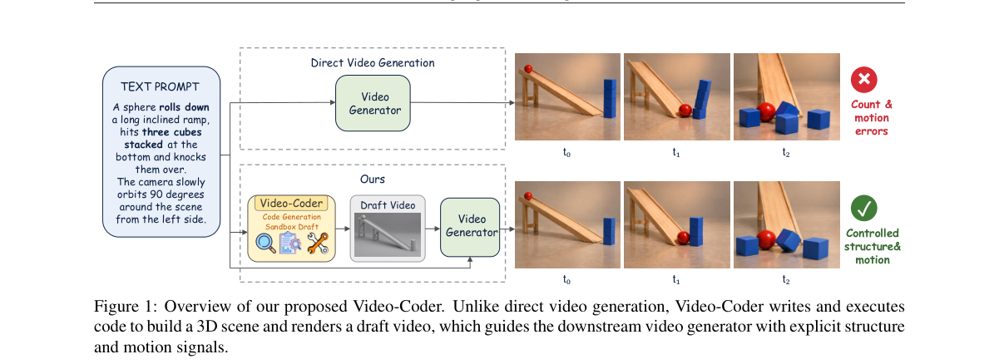

*Result - Overview of our data construction pipeline. It consists of four stages: text prompt construction, agentic trajectory generation, ground-truth video synthesis, and data cleaning and filtering*

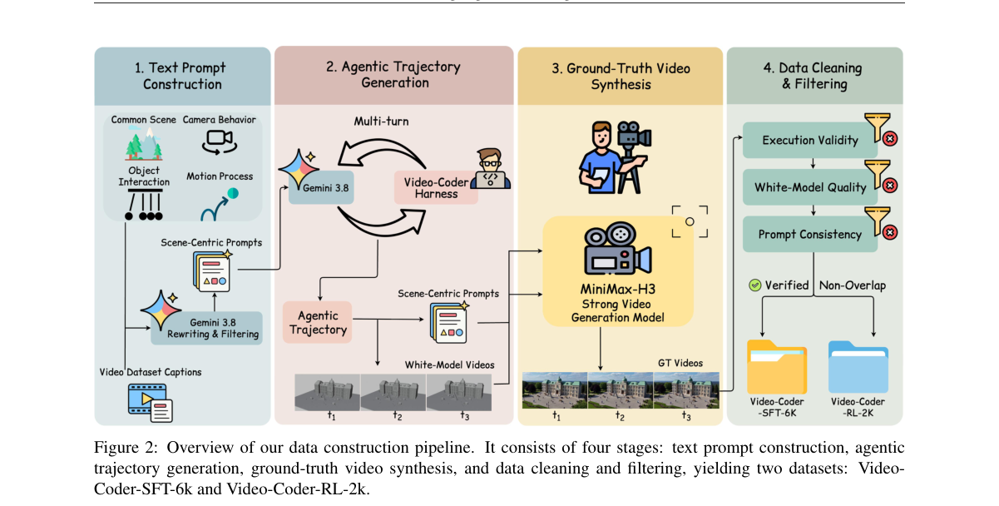

**Why this ranks #15**: 让智能体自己写代码搭 3D 场景并渲染草稿视频，再把结构与运动信号交给下游视频生成器；配套 Video-Coder Harness 做交互训练，配合退火策略逐步降低执行奖励，MiniMax-H3 在 PhyGenBench 提升约 7 分、在 VBench-2.0 提升 24 分。

---

## Footer

- Total papers reviewed across all 4 axes: 60
- aigc_visual axis final count: 15
- Wild-cards in this axis: 1
- Figure assets: 2026-11-09/res/

Generated by `mine-arxiv-daily-digest` skill. Sister file: `2026-11-09_aigc_visual_entry.md`.
