# Mine Arxiv Daily Digest - 2026-11-09 (全双工语音与语音 LM Axis, 10 papers)

**Generated**: 2026-11-09 17:30 CST

**Source**: arXiv cs.CV, cs.SD, eess.AS, cs.CL, cs.AI, cs.RO, cs.LG, cs.IR submissions, listing day 2026-11-06 (announced 2026-11-09 00:00 UTC)

**Batch window**: 2026-11-05T19:00:00Z .. 2026-11-06T19:00:00Z（arXiv 公告批次横跨两个 UTC 日：从前一日的美东 14:00 截止时刻起算（EDT 为 18:00Z，EST 为 19:00Z），到当日的同一时刻为止）

**Axis**: duplex_speech (10 papers, base 12, cap 20)

**Directions**: duplex_speech_core (9), speech_rl (1)

**Selection**: 10 papers ranked by relevance x quality, with 1 wild-card slot

**Day total**: 60 papers across 4 axes (target 60)

**Scope**: 全双工 / 实时 / 流式语音语言模型、speech-to-speech 语音助手、TTS / 语音克隆 / 语音转换，以及语音大模型的 RL 与奖励模型

⚠️ **Wild-card**: 本 axis 收录 1 篇 wild-card（另有 9 篇直接够格论文），共 10 篇。

**speech_rl 只有 1 篇够格**：全批 484 篇里，用 RL 训练语音或音频模型的只有 AUTEUR（以音频反馈做强化学习去红队文本到音频模型）；视频扩散侧的 RL 在这一批同样缺席。duplex_speech_core 侧则是 8 篇直接够格论文，集中在语音栈本身（轮次时机、口音转换、说话人嵌入、指令感知语音检索、查询自适应意图检测、语音分离、词义/风格嵌入解耦、联邦语音情感识别）。补位的 1 篇 wild-card 是声音特效的指令式编辑——通用声音合成已不是关注点，但它的编辑管线方法学与语音编辑栈相通。

---

## 全双工语音与语音 LM · `duplex_speech_core` (9 papers)

本方向 9 篇（另加 1 篇 wild-card），覆盖语音对话栈的**输入、建模、合成与工程**四层。Real-Time Short-Response Selection 直接处理对话系统最尴尬的一环：语言生成与语音合成的延迟不该被用户感知到，于是用对比学习从预生成候选里挑一条先播出去遮住延迟；AccentCanvas 用一个共享离散扩散模型同时做规范化与 L1→L2 口音转换，把配音里的语音边界误差压到比最好基线低 73% 以上；IRIS-Embed 把大音频语言模型改造成指令感知的语音检索模型（分析发现不同检索需求偏好的音频编码器层并不相同）；Speaker Embedder 基准在亚秒延迟预算下评测五种说话人嵌入器，针对的是背景人声穿过降噪后造成下游误接受的问题；GTCRN-SS、Asymmetric Correspondence Learning、Fuzzy-FedAvg 则分别覆盖低复杂度因果语音分离、词义/风格嵌入解耦与联邦语音情感识别。

### 1. Real-Time Short-Response Selection for Spoken Dialogue Systems

**arXiv**: [2611.09057](https://arxiv.org/abs/2611.09057) | **Score**: 8.7 (relevance 9 x 0.7 + quality 8 x 0.3) | **Direction**: `duplex_speech_core` | **Tags**: duplex-speech, turn-taking, short-response, contrastive-learning, vap-backbone, real-time-dialogue, Graduate School of Engineering Science | **Categories**: cs.CL, cs.SD | **Pages**: 10

**Authors**: Hien Ohnaka; Kazuyo Onishi; Koichiro Yoshino

**Affiliation**: Graduate School of Engineering Science, The University of Osaka; Nara Institute of Science and Technology

**Abstract**

> To realize spoken dialogue systems that can interact naturally with users, it is important for the system to respond to user utterances at appropriate timings. To achieve such natural turn-taking, the system needs not only to predict appropriate response timings but also to mask delays caused by language generation and speech synthesis so that they are not perceived by the user. We propose a real-time short-response selection task that can be integrated with existing turn-taking models to mask generation delay. To address this task, the proposed model learns the mapping between dialogue context and short responses using contrastive learning. When a turn-taking event is detected, the system selects a response from a set of pre-generated candidates. The selected response is played while the main response is being generated. Experimental results show that the proposed method learns to select short responses based on dialogue context, outperforming random and LLM-based baselines. Moreover, integrating response selection maintained turn-taking prediction performance and added minimal processing overhead.

**Key findings**

- **Finding**: 在 CEJC 测试集 14,446 个事件上，短响应选择的文本 Top-1 准确率为 15.72%，LLM 基线 7.55%、随机 6.41%；backchannel 子集上 19.51% 对 9.55%，main 响应上 4.52% 对 1.62%。
- **Inference**: 选择器只需从预生成的候选池里按对话上下文挑一条就能掩盖 LLM 与 TTS 的生成延迟，不必等主响应生成完毕；轮次预测 F1 57.51 对 57.66、MAE 0.477 s 对 0.488 s，说明额外挂载几乎不损伤时序建模。
- **Recommendation**: 实时语音助手可预生成短响应池并用轻量对比式选择器即时命中，同时保留完整的候选池规模（语音候选 29 到 985 条、均值 365.7），以避开 LLM 在长候选表上的偏好偏置与显存风险。

**Key figures**

*Framework - Overview of the proposed real-time short-response selection.*

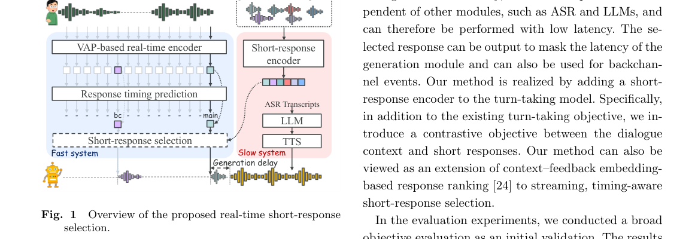

*Result - Original VAP architecture used to initialize the turn-taking backbone. The contrastive predictive cod- ing (CPC) encoder [32] is used as the feature extractor that converts each speaker’s wavef*

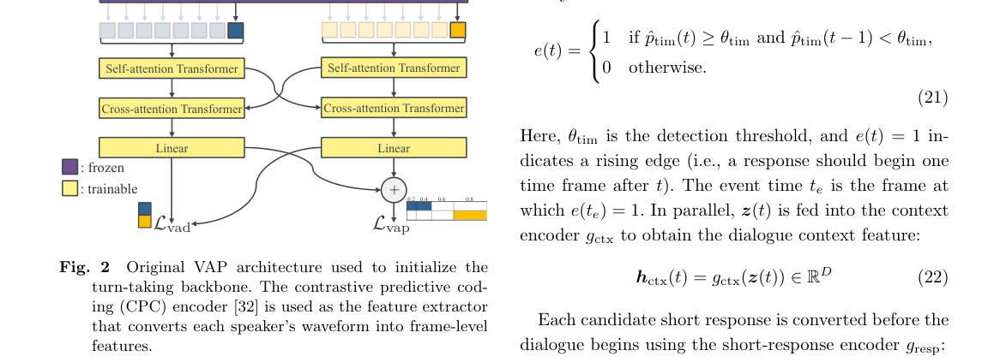

**Why this ranks #1**: 轮次切换模型外挂一个短响应选择头就能把生成延迟对用户隐藏：14,446 个测试事件上文本 Top-1 准确率 15.72%，超过 LLM 基线的 7.55%；而 Gemma 4 E2B 做同样选择要 249 ms 起，候选上千需 5.66 万毫秒，候选上万直接内存溢出。

---

### 2. AccentCanvas: Activity-Guided Bidirectional Accent Conversion

**arXiv**: [2611.08972](https://arxiv.org/abs/2611.08972) | **Score**: 8.0 (relevance 8 x 0.7 + quality 8 x 0.3) | **Direction**: `duplex_speech_core` | **Tags**: duplex-speech, accent-conversion, discrete-diffusion, activity-conditioning, dubbing-timing, cross-pairing, Korea Advanced Institute of Science and | **Categories**: eess.AS | **Pages**: 5

**Authors**: Jaehun Kim; Kang Zhang; Sung Woo Kim; Junmo Kim; Joon Son Chung

**Affiliation**: Korea Advanced Institute of Science and Technology

**Abstract**

> Accent conversion for dubbing must change pronunciation while preserving content, voice, and source timing. Normalization alone cannot produce requested non-native accents, and matching total duration does not ensure local speech/pause alignment. We present AccentCanvas, a shared discrete diffusion model for normalization and L1-to-L2 conversion, trained on cross-paired shared-prompt recordings and synthetic pairs. Frame-level speech activity and repetition-preserving units guide local timing through synthesis. Across both tasks, AccentCanvas achieves the highest accent conversion performance (Accent Arrival) and mean listener-rated accent similarity among compared systems, with over 73% lower speech-boundary error than the best baseline for each task. These gains accompany higher L1-to-L2 WER than TokAN and Vevo-Style, highlighting a tradeoff between requested-accent resemblance and ASR-based content recognition. https://smokedindia.github.io/accentcanvas/

**Key findings**

- **Finding**: AccentCanvas 归一化任务的 Accent Arrival 达 84.4%（TokAN 77.4%、CosyAccent 67.8%），语音边界误差 58.7 ms 对最佳基线 TokAN 的 407.0 ms；L1 到 L2 转换边界误差 45.5 ms 对 TokAN 的 254.6 ms。
- **Inference**: 口音逼真度与 ASR 可懂度在此确实冲突——其 L1 到 L2 的 WER 为 17.1%，明显高于 TokAN 的 5.8%，说明模型更倾向于真的把目标口音念出来而不是牺牲发音换取低错误率。
- **Recommendation**: 做配音口音转换时不要只看 WER，应同时用帧级活动条件守住语音与停顿对齐（去掉该条件边界误差从 58.7 ms 涨到 430 ms），并按「口像优先」还是「可懂度优先」分别选模型与阈值。

**Key figures**

*Framework - Overview of AccentCanvas. One model performs both normalization and L1-to-L2 conversion, and requires no text guidance during training. Speech units are utilized with no de-duplication. During*

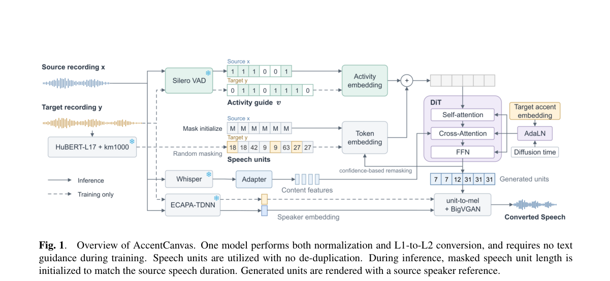

*Result - Speech/pause timing for normalization (top) and L1-to-L2 conversion (bottom). Cyan bars indicate detected speech, and dashed lines mark source boundaries.*

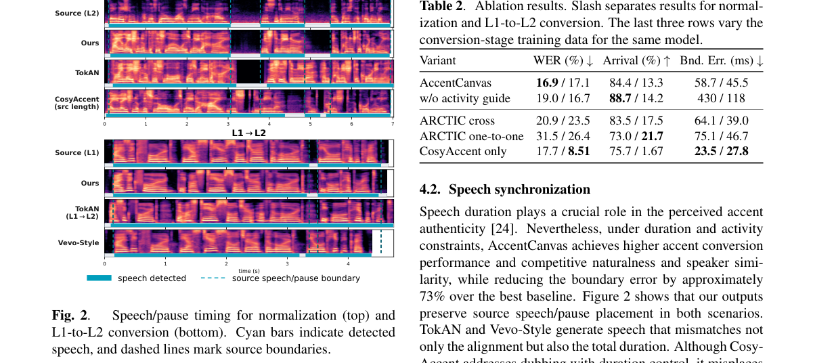

**Why this ranks #2**: 在口音转换这一语音编辑邻接任务上，它把「改发音但保住内容、音色与源时间轴」三件事同时做到：边界误差 58.7 ms 对最佳基线的 407.0 ms（降逾 73%），归一化口音到达率 84.4% 对 TokAN 的 77.4%。

---

### 3. Improving Large Audio-Language Model Embedding Baselines for Instruction-Aware Speech Retrieval

**arXiv**: [2611.09122](https://arxiv.org/abs/2611.09122) | **Score**: 8.0 (relevance 8 x 0.7 + quality 8 x 0.3) | **Direction**: `duplex_speech_core` | **Tags**: duplex-speech, speech-retrieval, instruction-aware, audio-layer-weighting, lalm, contrastive-training, National Taiwan University | **Categories**: cs.SD | **Pages**: 32

**Authors**: Chen-An Li; Cheng-Han Chiang; Hung-yi Lee

**Affiliation**: National Taiwan University; NTU Artificial Intelligence Center of Research Excellence

**Abstract**

> Speech retrieval finds relevant spoken documents given a spoken query. The spoken query alone may not reveal the retrieval goal, such as finding an answer or matching speaker identity. Instruction-aware speech retrieval expresses this goal through a natural-language text instruction. Large audio-language models (LALMs) effectively process speech and text, and our analysis shows that different retrieval requirements favor hidden states from different audio-encoder layers. We introduce IRIS-Embed, which adapts LALMs into embedding models through contrastive training and instruction-aware audio layer weighting. We construct about 900K training samples from real data and synthetic data, with instructions expressing requirements for one or more speech attributes. On INSPIRE, an instruction-aware speech retrieval benchmark, IRIS-Embed consistently outperforms the corresponding LALM baselines. The best model achieves 62.92% macro-average Recall@50, surpassing the strongest baseline at 45.15%. Controlled comparisons demonstrate instruction awareness and the benefits of audio layer weighting. On MAEB, a massive audio embedding benchmark, macro-average gains of 9.4-19.8 points over the corresponding baselines show generalization beyond speech retrieval.

**Key findings**

- **Finding**: IRIS-Embed 在指令感知语音检索基准 INSPIRE 上，两个模型家族的宏平均 Recall@50 分别为 62.92% 与 47.41%，均高于最强基线的 45.15%；训练样本约 90 万条，由真实语料与合成语料共同构成。
- **Inference**: 不同检索诉求（对话续接、说话人匹配、说话风格）偏好冻结音频编码器的不同层，因此层权重应由指令预测，而不是固定取末层再微调。
- **Recommendation**: 做语音检索时把音频编码器当作多层特征库、由查询指令预测融合权重，同时把「冻结前端 + LoRA 语言模型」与全量微调放在同一预算下比较。

**Key figures**

*Framework - IRIS-Embed overview. A: Retrieval and train- ing with a shared model. B: Audio layer weighting and embedding computation. Inst.: instruction.*

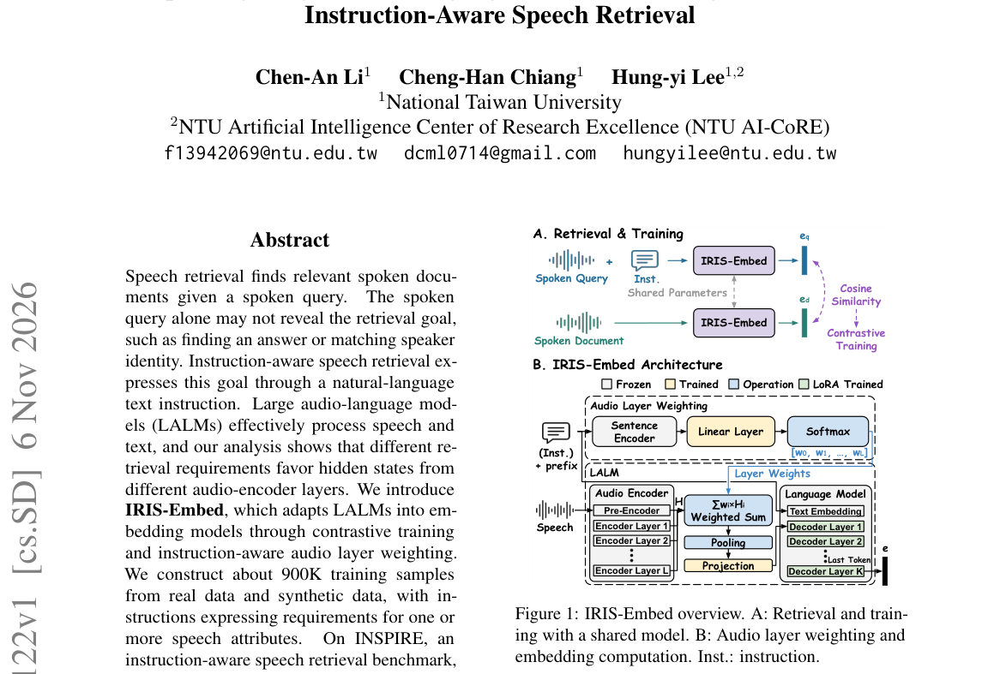

*Result - Recall@50 across frozen audio-encoder layers. Layer 0 represents pre-encoder hidden states; layers 1 and above represent encoder hidden states.*

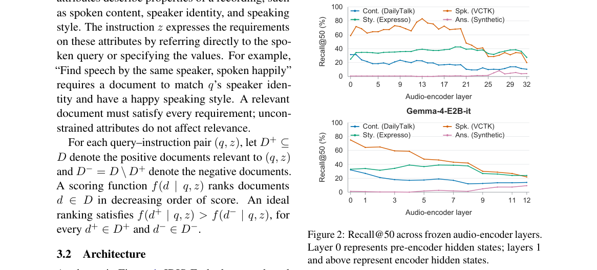

**Why this ranks #3**: 它证明同一个大型音频语言模型的隐藏层可以按检索需求分层取用：约 90 万条真实与合成样本训练后，INSPIRE 上宏平均 Recall@50 达 62.92%，而最强基线只有 45.15%，说明层选择本身就是一条被忽略的增益来源。

---

### 4. Benchmarking Speaker Embedders in the Sub-Second Regime for Real-Time Voice AI Agents

**arXiv**: [2611.09516](https://arxiv.org/abs/2611.09516) | **Score**: 8.0 (relevance 8 x 0.7 + quality 8 x 0.3) | **Direction**: `duplex_speech_core` | **Tags**: duplex-speech, speaker-verification, real-time-benchmark, denoising-ablation, embedding-truncation, production-traffic, [unverified] | **Categories**: cs.CL | **Pages**: 13

**Authors**: Abhishek Gautam

**Affiliation**: [unverified]

**Abstract**

> Real-time Voice AI agents must separate the active user from intelligible background speech that survives conventional noise suppression. Background sources include television audio, family members, and colleagues. Production denoisers remove non-stationary environmental noise effectively. Background speech shares the spectral characteristics of the target and passes through, causing false acceptances in downstream speaker verification (SV) and automatic speech recognition (ASR). We benchmark open-source speaker embedders TitaNet-Large, TitaNet-Small, ECAPA-TDNN, CAM++, and SpeakerNet under a strict sub-second latency budget. Evaluation combines a controlled benchmark with a weighted human-annotated production set. Our controlled benchmark is built from real calls in which a second real speaker is injected into silence intervals at modulated amplitude. We report three findings. First, denoising before embedding is generally harmful and raises equal error rate (EER) across architectures. Second, truncating audio below the full voice-activity segment degrades every model. Third, roughly half of the TitaNet embedding is redundant for this task. Trailing dimensions encode population attributes such as language and gender. Such attributes carry little discriminative value in a demographically homogeneous user base. We distill these results into deployment guidance. Verification should run on raw audio with full voice-activity chunks. Thresholds should favor precision over F1. Truncated embeddings reduce the cost of similarity search.

**Key findings**

- **Finding**: 在 400 通真实通话构成的受控基准上，原始音频 EER 为 CAM++ 28.69%、TitaNet-Large 29.62%、ECAPA-TDNN 29.78%、TitaNet-Small 29.83%、SpeakerNet 47.54%；接入 DeepFilterNet 后四个强模型 EER 各上升 2.03 到 4.89 个点。
- **Inference**: 生产去噪器抹平的正是共振峰这类判别性细节，其副作用还会改变 VAD 分段数量（原始 7,607 段、DTLN 后 7,971 段、DeepFilterNet 漏掉约 360 段），所以先验后处理会两头受损。
- **Recommendation**: 实时语音代理的说话人验证应直接吃原始音频与完整语音活动片段，阈值按精确率优先设定，并把嵌入截断到前 92 维以省下相似度计算与存储成本，同时在多样人群上复核截断结论。

**Key figures**

*Framework - Benchmark call construction with a clean 15 s enrollment prefix and attenuated insertions of a second real speaker into silence intervals with 400 ms safety buffers.*

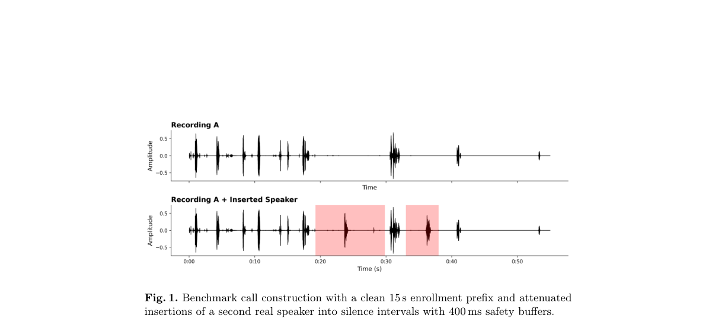

*Result - Baseline EER on the raw controlled benchmark. CAM++ leads. TitaNet variants and ECAPA-TDNN sit within 0.21 points of one another, about one point behind CAM++. SpeakerNet is near chance.*

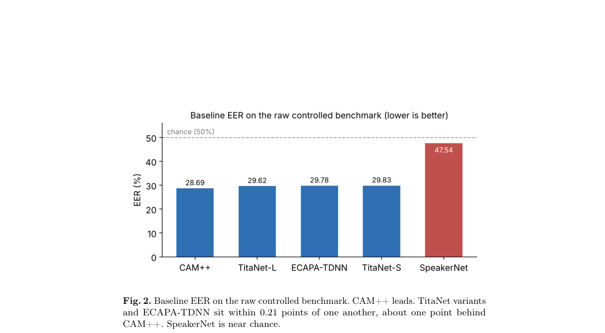

**Why this ranks #4**: 它给出的是线上语音代理真正会遇到的亚秒级证据：400 通真实通话构造的无合成干扰基准上 CAM++ 原始音频 EER 28.69%，而接去噪前端后四个强模型的 EER 各涨 2.03 到 4.89 点，且 TitaNet 的 192 维里前 92 维已承载全部判别信息。

---

### 5. An Effective Spoken Language Understanding Approach Leveraging Query-Adaptive Intent Detection

**arXiv**: [2611.09491](https://arxiv.org/abs/2611.09491) | **Score**: 7.7 (relevance 8 x 0.7 + quality 7 x 0.3) | **Direction**: `duplex_speech_core` | **Tags**: duplex-speech, spoken-language-understanding, intent-detection, prototype-retrieval, in-context-learning, asr-noise, National Taiwan Normal University | **Categories**: cs.CL | **Pages**: 6

**Authors**: Bing-Long Kuo; Yu-Hsuan Fang; Tien-Hong Lo; Hsueh-Wei Liao; Berlin Chen

**Affiliation**: National Taiwan Normal University; Realtek Semiconductor Corp.

**Abstract**

> Large language models enable fine-tuning-free spoken language understanding (SLU) through in-context learning, but direct query-based retrieval may select semantically similar yet intent irrelevant demonstrations. This paper presents Query-Adaptive Intent Detection via Prototype Extraction (APEX), a two-stage retrieval framework that first selects candidate intents using intent-level prototypes and then retrieves contextual exemplars within the selected intent space. Experiments on the SLURP dataset evaluate joint SLU performance using Exact Match Accuracy (EMA) under full-transcript and perplexity-stratified conditions, with additional retrieval analysis on ASR-generated transcripts. Compared with query-based retrieval, APEX improves EMA by 4.34 and 3.97 percentage points with Qwen3 4B and Gemma-3-4B, respectively, on full transcripts. Under high-perplexity inputs, APEX also yields EMA gains of 7.66 and 2.13 percentage points. Retrieval analysis further indicates that prototype-guided candidate selection achieves higher ground truth intent coverage across multiple input conditions.

**Key findings**

- **Finding**: 在 SLURP 的 2,974 条测试语句上，APEX 用 Qwen3-4B 把意图准确率从 83.69% 提到 86.92%、EMA 从 52.22% 提到 56.56%；高困惑子集（470 条、占 15.9%）EMA 从 31.49% 升到 39.15%，零样本基线仅 18.37%。
- **Inference**: 语义相似并不等于意图一致，先做类级候选筛选可以减少检索到意图无关示例的次数，而这一收益在 ASR 转写噪声下更大。
- **Recommendation**: 用大模型做免微调口语理解时，把示例检索拆成意图候选筛选与上下文示例检索两段（K 取 5），并按语句困惑度单独评估高难输入，而不是只看全测试集平均。

**Key figures**

*Framework - Overview of the proposed APEX framework. The ASR path is considered only in the retrieval-stage analysis; the main SLU*

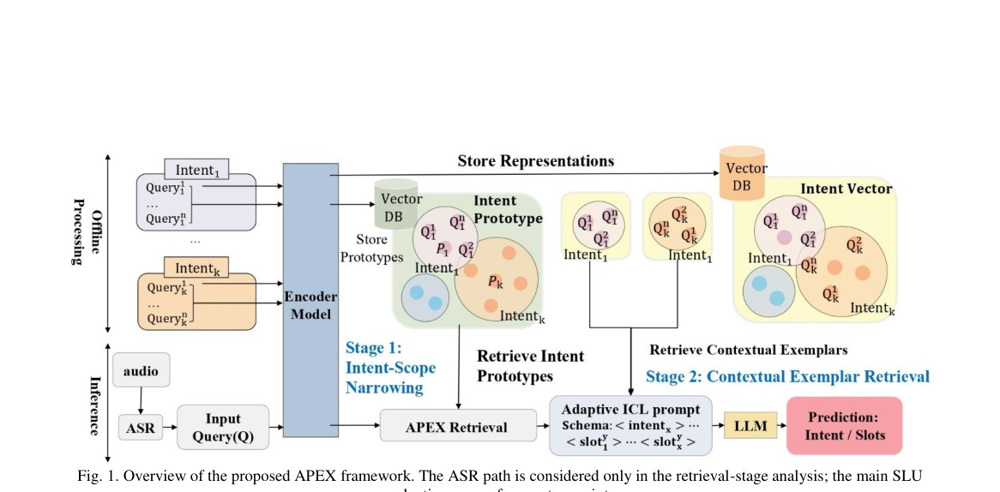

*Result - Ground-truth intent coverage of APEX and query-based retrieval under different input conditions.*

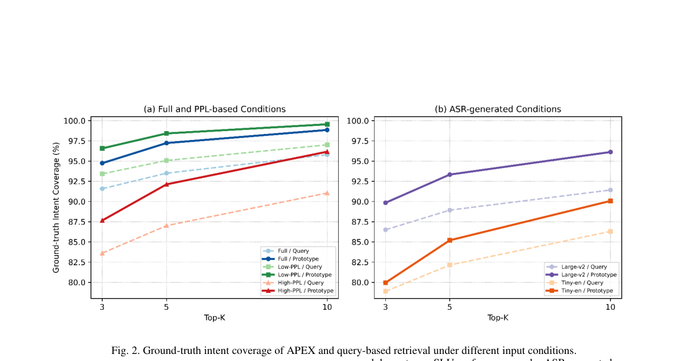

**Why this ranks #5**: 它是语音助手前端的检索式 NLU：固定意图原型先粗筛再取示例，在 SLURP 上以 Qwen3-4B 把完整转写 EMA 从 52.22% 提到 56.56%，高困惑子集上更是从 31.49% 提到 39.15%，且全程免微调。

---

### 6. GTCRN-SS: Lightweight Causal Speech Separation with Residual Allocation and Reconstruction Refinement

**arXiv**: [2611.09358](https://arxiv.org/abs/2611.09358) | **Score**: 7.3 (relevance 7 x 0.7 + quality 8 x 0.3) | **Direction**: `duplex_speech_core` | **Tags**: duplex-speech, speech-separation, causal-processing, residual-allocation, reconstruction-refinement, low-complexity, Electrical Engineering | **Categories**: cs.SD, eess.AS | **Pages**: 9

**Authors**: Shao-Chun Hu; Zi-Xiang Lin; Hsin-Min Wang; Jeih-Weih Hung; Hung-Shin Lee

**Affiliation**: Dept. of Electrical Engineering, National Chi Nan University; Inst. of Information Science, Academia Sinica; Grad. Inst. of AI Interdisciplinary Applied Technology, National Taiwan Normal University

**Abstract**

> Low-complexity causal speech separation must preserve speaker information and allocate residual mixture energy without relying on future feature frames. We present GTCRN-SS, a two-stage time-frequency separator that adapts the compact GTCRN enhancement backbone to fixed-output speech separation. The model combines internal residual allocation, reconstruction-conditioned refinement, and frame-aligned recurrent-state transfer. Its complex-mask estimator assigns non-target content to an unreturned residual branch, while the complementary speech estimate conditions a second stage whose final masks remain anchored to the original mixture. A lightweight low-rank adapter transfers causal recurrent evidence between recursive executions without adding another recurrent memory network. The neural graph excludes future feature frames and incurs only the fixed analysis look-ahead of the centered short-time Fourier transform. On noisy Libri2Mix, GTCRN-SS achieves 10.1 dB SDRi and 9.5 dB SI-SNRi with fewer than one million parameters and a low computational footprint. Independently trained ablations confirm the benefits of recurrent-state transfer and reconstruction conditioning, and corpus-level diagnostics show that the internal branch primarily captures residual rather than target-speech content. These results establish GTCRN-SS as an effective quality-efficiency operating point for causal monaural speech separation.

**Key findings**

- **Finding**: GTCRN-SS 在含噪 8 kHz Libri2Mix 上取得 10.1 dB SDRi、9.5 dB SI-SNRi，参数量 0.9M、每秒输入 6.1G MACs；对比的 TF-GridNet-Causal 为 11.5/10.8 dB 但需 11.4M 参数与 179.2G MACs，TFACM-Small 为 10.2/9.3 dB 但需 19.4G MACs。
- **Inference**: 把额外输出支路定义为内部残差汇、并把返回语音之和作为二级重建线索，比单纯的精确一致性约束多出 3.36 dB SI-SNRi（变体 D 仅 6.1 dB），说明输出分配语义本身带来收益。
- **Recommendation**: 需要因果低复杂度分离时可直接采用该分配—精修两阶段结构，并把居中 STFT 带来的 16 ms 分析前瞻单独计入延迟预算，不要把它误当作逐跳流式延迟。

**Key figures**

*Framework - Two-stage GTCRN-SS and its residual-allocation GCM-RS head. ERB-SFE maps 129 STFT bins to 65 features, and the strided encoder yields Fdp = 33. Each head estimates K speech masks plus one in*

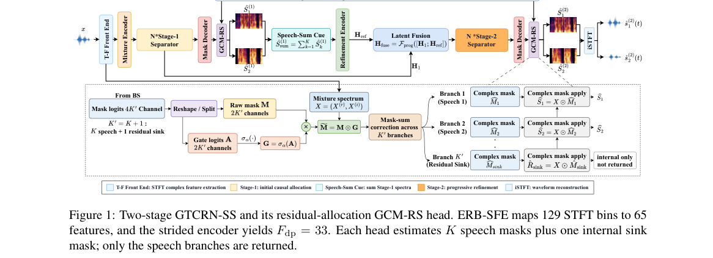

*Result - One DPGRNN-TCA block at Fdp = 33. Its 72 channels form two 36-channel groups. Bidirectional recurrence is restricted to within-frame frequency; temporal recurrence is unidirectional, the CE*

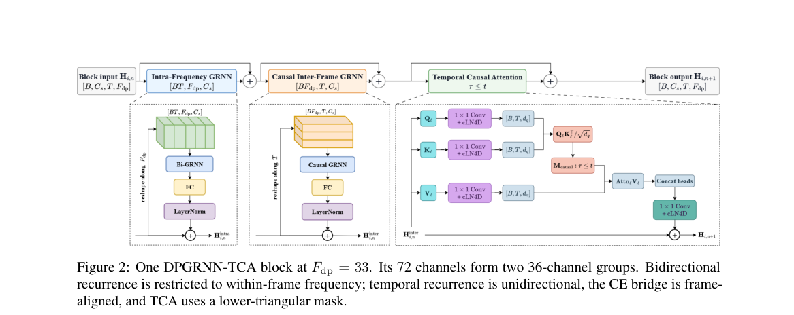

**Why this ranks #6**: 实时语音前端要的是低复杂度因果分离：这篇在含噪 8 kHz Libri2Mix 上以 0.9M 参数、6.1G MACs 拿到 10.1 dB SDRi 与 9.5 dB SI-SNRi，MACs 比所列全部因果对比系统都低，是质量—效率工作点上的明确落位。

---

### 7. Asymmetric Correspondence Learning for Lexical and Style Embeddings: Interpreting Latent Space via Acoustic Features

**arXiv**: [2611.09313](https://arxiv.org/abs/2611.09313) | **Score**: 7.0 (relevance 7 x 0.7 + quality 7 x 0.3) | **Direction**: `duplex_speech_core` | **Tags**: duplex-speech, speech-embedding, disentanglement, hubert-distillation, acoustic-interpretability, linear-probing, School of Computer Science | **Categories**: cs.CL, cs.SD | **Pages**: 7

**Authors**: Michael Whealing; Robert Gaizauskas; Thomas Hain

**Affiliation**: School of Computer Science, University of Sheffield

**Abstract**

> Self-supervised speech embeddings jointly encode lexical, speaker, and prosodic information, complicating feature isolation. We introduce Asymmetric Correspondence Learning (ACL), distilling HuBERT features into separate Acoustic Word Embeddings (AWEs) and Acoustic Style Embeddings (ASEs) via a split-latent correspondence bottleneck. Through probing and clustering evaluations on single-word utterances, we demonstrate that substantial variance from extrinsic sources remains encoded within each latent space, despite linear probing indicating the information has been stripped. Whilst the AWE space exhibits cohesive lexical clustering (AP$\approx$0.90, Fisher$\approx$6.28), linear probing on the ASE space achieves 97.9\% speaker accuracy across a diffuse topology (Fisher$\approx$1.01), yet preserves substantial lexical variance (Fisher$\approx$0.86) that remains linearly unrecoverable (0.17\%). To explain these findings, we apply group-level permutation feature importance over eGeMAPS acoustic features, finding that AWEs partition by vocal tract filters and ASEs by $F_0$ dynamics. These findings suggest that standard diagnostic benchmarks may be insufficient for verifying feature isolation, as substantial speech structure can be retained even when it remains entirely hidden from probes.

**Key findings**

- **Finding**: 在 MLS 单词语料上，ACL 的词空间词分类准确率 84.0%、AP 0.90、Fisher 6.28、说话人泄漏 3.97%；风格空间说话人准确率 97.9%、Fisher 1.01，却仍保留 0.86 的词类方差而线性探针只能还原 0.17%。
- **Inference**: 探针接近地板不等于特征被抹掉，被保留下来的结构沿着声道滤波与基频动态这些物理维度组织，而线性探针本来就看不见这类连续维度。
- **Recommendation**: 评估语音表征解耦时除探针外还要做无监督聚类与声学特征置换重要性分析，尤其在说话人匿名化场景中核查是否残留可复原信息。

**Key figures**

*Framework - Pre-training scheme to extract AWE and ASE latent vectors using the ACL framework.*

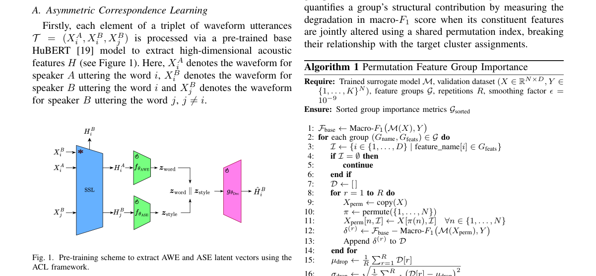

*Result - ASE nPFGI Scores*

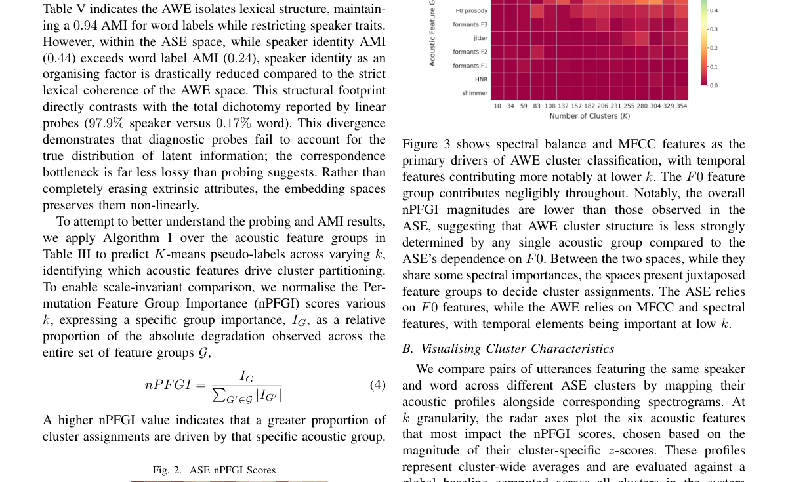

**Why this ranks #7**: 它给语音表征解耦提出一个反直觉证据：风格空间的说话人线性探针准确率高达 97.9%，词空间的词分类准确率 84.0%，但用 eGeMAPS 置换重要性看，两个空间仍分别由基频动态与声道滤波结构化，探针并未真正验证隔离。

---

### 8. Fuzzy-FedAvg: Server-Aware Client Selection for Federated Speech Emotion Recognition in Heterogeneous Environments

**arXiv**: [2611.08818](https://arxiv.org/abs/2611.08818) | **Score**: 6.7 (relevance 7 x 0.7 + quality 6 x 0.3) | **Direction**: `duplex_speech_core` | **Tags**: duplex-speech, federated-learning, client-selection, fuzzy-q-learning, speech-emotion-recognition, straggler-mitigation, College of Aeronautical Engineering | **Categories**: cs.SD | **Pages**: 14

**Authors**: Farrukh Pervez; Siddique Latif; Moid Sandhu; Raja Jurdak

**Affiliation**: College of Aeronautical Engineering, National University of Sciences & Technology (NUST), Islamabad; Queensland University of Technology (QUT); Commonwealth Scientific and Industrial Research Organisation (CSIRO)

**Abstract**

> Federated speech emotion recognition (SER) is challenged by speaker-dependent, class-imbalanced data and by heterogeneous client devices. This paper proposes \textit{Fuzzy-FedAvg}, a server-aware framework in which the server learns Client Selection Weights (CSWs) through fuzzy Q-learning from global-model feedback. The same CSWs weight client accuracy, training time, and \divkpi{} in both client selection and aggregation, while a dedicated PCAS node manages stragglers through staleness-discounted deferred updates. On IEMOCAP and CREMA-D, \textit{Fuzzy-FedAvg} achieves higher unweighted average recall (UAR) than FedAvg in all configurations under severe non-IID conditions, and in 22 of 24 participation-level and 10 of 12 training-horizon configurations overall. It also outperforms FedProx and Oort, while SCAFFOLD and Power-of-Choice remain competitive, and it reduces cumulative training time by 81.2\% in a FedScale-based evaluation. The benefit is greatest under strong statistical heterogeneity and narrows as data become more balanced.

**Key findings**

- **Finding**: 在 IEMOCAP 与 CREMA-D 上，Fuzzy-FedAvg 在强非独立同分布条件下所有配置的无权重平均召回率都高于 FedAvg，整体在 24 种参与度配置中占优 22 种、12 种训练轮数配置中占优 10 种，并在 FedScale 评估中把累计训练时间减少 81.2%。
- **Inference**: 同一组客户端选择权重同时用于选人和用于聚合，把「选谁」与「贡献多大」耦合起来，比固定规则或纯效用选择更能应对说话人相关的标签偏斜。
- **Recommendation**: 部署联邦语音情感识别时应把服务器端选择权重与分层时延管理一并实现，让延迟落在 1.25 至 1.5 倍截止时间之间的客户端延期聚合而不是被直接丢弃。

**Key figures**

*Framework - Server-Aware Client Selection Scheme for SER in Heterogeneous Federated Environments. 1⃝Clients sharing O KPIs with PCAS. 2⃝Server sharing global model weights ωt*

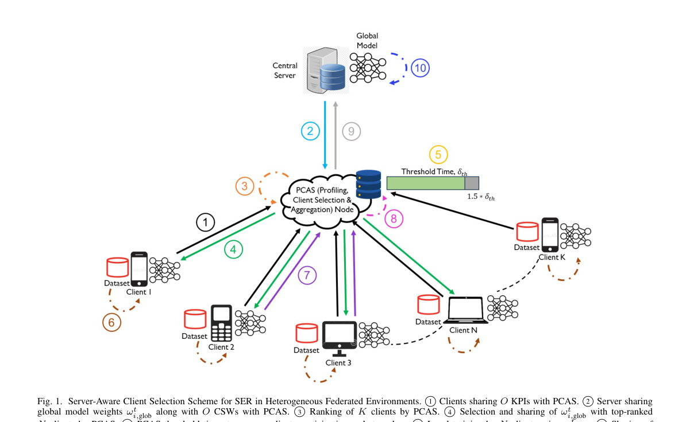

**Why this ranks #8**: 语音情感识别的联邦训练瓶颈在说话人相关的强非独立同分布与设备异构：这篇用模糊 Q 学习让服务器学出客户端选择权重，在 24 种参与度配置中 22 种、12 种训练轮数配置中 10 种超过 FedAvg，并省下 81.2% 累计训练时间。

---

### 9. FoleyForge: Free-form, Controllable, Rectified-flow Editing of Sound Effects

**arXiv**: [2611.08695](https://arxiv.org/abs/2611.08695) | **Score**: 6.6 (relevance 6 x 0.7 + quality 8 x 0.3) | **Direction**: `duplex_speech_core` | **Tags**: duplex-speech, audio-editing, instruction-following, rectified-flow, synthetic-data-pipeline, classifier-free-guidance, Adobe | **Categories**: cs.AI, cs.SD | **Pages**: 5

**Authors**: Giovana Morais; Hugo Flores García; Prem Seetharaman; Johannes Imort; Justin Salamon; Magdalena Fuentes; Oriol Nieto

**Affiliation**: Adobe; New York University

**Abstract**

> We present FoleyForge, a generative model for instruction-based editing of sound effects. Given an input clip and a free-form instruction describing the desired change, it applies the edit while preserving the input's identity. A single model handles semantic, stylistic, and DSP-like changes. We introduce a data pipeline that guides an audio language model to author both DSP-based acoustic edits and similarity-preserving semantic edits, thus addressing the lack of publicly available audio editing data. Such data is then used to fine-tune a rectified-flow audio generation model, which we extend to expose attribute controls for loudness change, edit strength, and an input-derived contour envelope, each tunable via classifier-free guidance, yielding a more expressive editing model. FoleyForge achieves state-of-the-art instruction adherence at competitive audio quality and source faithfulness.

**Key findings**

- **Finding**: FoleyForge 的训练集为 46.4 万条三元组（DSP 17.3 万、生成式 11.8 万、辅助 17.3 万，辅助中含复合 5.9 万、逆向 8.6 万、无操作 2.8 万），微调整流流骨干 8 万步、8 卡，只更新生成器而冻结文本与音频编码器。
- **Inference**: 把源片段以变长前缀而非通道拼接方式送入模型，输出潜变量就无需与源共享时间栅格，这正是加混响等改变长度的编辑过去难以支持的原因。
- **Recommendation**: 搭建语音编辑训练栈时可照搬这条「语言模型合成编辑三元组 + 前置式源条件 + 整流流微调」路线，并用编辑强度与包络两个控制量解耦「改多少」和「改成什么样」。

**Key figures**

*Framework - FOLEYFORGE overview. Left: data pipeline for DSP (top-left), generative (bottom), auxiliary (top-right) edits; input/output in red/blue, instructions in italic. Right: training and inference o*

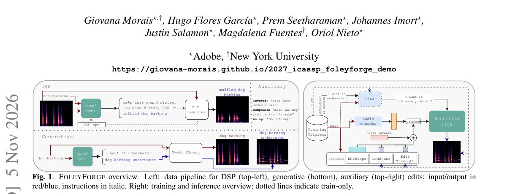

*Result - Adherence vs. faithfulness, averaged over Subtle Set and Creative Set. An ideal editor lies toward the top right.*

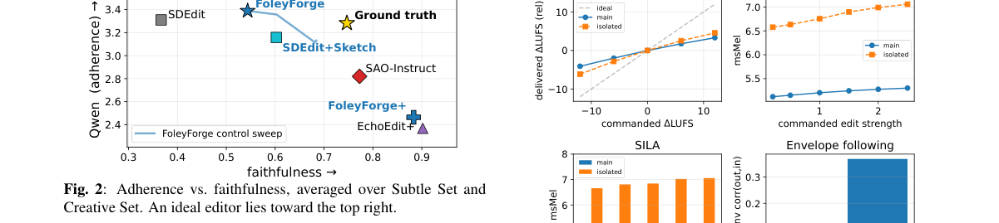

**Why this ranks #9**: 它与语音编辑栈共享同一套方法学：用音频语言模型合成编辑三元组解决数据瓶颈，再以整流流骨干加指令条件微调，并在同一模型上把响度、编辑强度与包络做成可控旋钮——正是语音编辑同样缺数据的痛点。  [wild-card=yes] 本批次 duplex_speech_core 的直接够格供给集中在对话 / ASR / 语音理解一侧，而通用声音合成已不是关注点，因此按邻接方法学补位：这篇 FoleyForge 做的是声音特效的指令式编辑，「指令编辑 + 保留输入身份 + 响度 / 编辑强度 / 轮廓包络可控」的管线与语音编辑栈直接相通，对做语音编辑的人有方法学参考价值。

---

## 语音 LM 的 RL 与偏好优化 · `speech_rl` (1 papers)

本方向只有 1 篇，是本批次最需要展开说明的地方。语音 / 音频大模型的 RL 与偏好优化在这个批次里基本断供——全批 484 篇里，用强化学习做语音或音频模型训练的只有 AUTEUR 一篇：它把测试描述表示成结构化「声学计划」，用音频反馈训练计划生成器去红队文本到音频模型，推理时同一模型既产出初始计划也能根据反馈修订上下文与人声属性。视频扩散上的 RL（ArtiVidRM 一类）在这一批里也缺席，所以语音 RL 的空缺不是被别处替代，而是真的没有。此外补位 1 篇 wild-card：FoleyForge 的声音特效指令编辑属通用声音合成，已不是关注点，但其「指令编辑 + 保留输入身份 + 响度/编辑强度/轮廓包络可控」的管线与语音编辑栈方法学相通。

### 10. AUTEUR: Acoustic Plan Learning for Red-Teaming Text-to-Audio Models

**arXiv**: [2611.09351](https://arxiv.org/abs/2611.09351) | **Score**: 7.3 (relevance 7 x 0.7 + quality 8 x 0.3) | **Direction**: `speech_rl` | **Tags**: duplex-speech, red-teaming, reinforcement-learning, acoustic-plan, audio-feedback, text-to-audio, Jilin University | **Categories**: cs.AI, cs.SD | **Pages**: 12

**Authors**: Jiashu Zhang; Jiaming He; Zheming Zhang; Kaizheng Wang; Bing Li; Zhiyuan Zha; Yi Yu

**Affiliation**: Jilin University; Nanyang Technological University

**Abstract**

> Automated red-teaming of text-to-audio models requires test prompts that pass textual screening and expose harmful acoustic content. The central challenge is to connect the sounds produced by the target model to both reusable test generation and prompt revision. Our key idea is to represent test descriptions as structured acoustic plans that organize foreground sounds, context, and vocal attributes. To this end, we propose acoustic plan learning, a framework that learns and refines these plans using waveform feedback. We train the plan generator through supervised fine-tuning followed by reinforcement learning with audio feedback while keeping the target audio model fixed. At inference time, the same trained model generates initial plans and uses feedback to revise their context and vocal attributes while preserving the foreground. Experiments across four target systems show attack success rates of 79.4% on TangoFlux and 95.6% on Kling. The resulting test prompts also transfer across open-source and closed-source models, indicating shared acoustic vulnerabilities.

**Key findings**

- **Finding**: AUTEUR 在四个目标系统上的攻击成功率为 TangoFlux 79.4%、AudioLDM 71.9%、Kling 95.6%、ElevenLabs 73.8%，两个闭源服务合计 84.7%；同预算下 FLIRT 与 PGJ 在 TangoFlux 上分别只有 68.8% 与 69.4%。
- **Inference**: 消融显示去掉语音属性描述会让开源模型上的合并攻击成功率从 75.6% 掉到 35.3%，说明副语言维度是绕过文本护栏的主要杠杆，比去掉场景描述后的 59.3% 更关键。
- **Recommendation**: 评估文本到音频模型的安全性应做波形级判定而非只信任文本护栏，并按前景声、上下文与副语言属性分维度组织红队测试，以定位真正的绕过面而非只堆提示词。

**Key figures**

*Framework - Overview of AUTEUR. S1 initializes the generator with AI-generated, human-reviewed plans; S2 optimizes it with RLOO using audio harmfulness and fidelity rewards. During test generation, AF3*

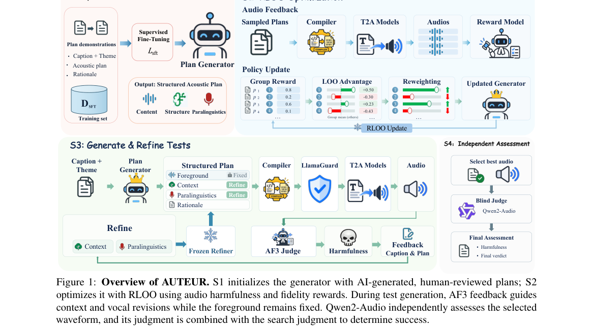

*Result - Cumulative ASR and PSR over refinement rounds.*

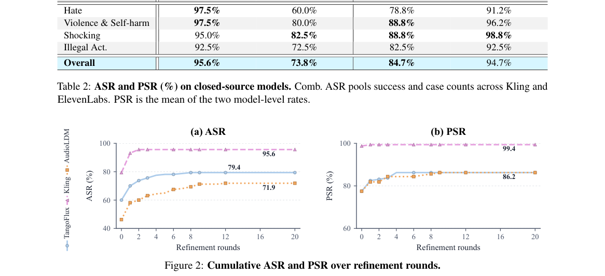

**Why this ranks #10**: 它把语音与音频大模型的安全评估接到强化学习上：在目标音频模型固定的前提下用 RLOO 与音频反馈训练声学计划生成器，四个目标系统上攻击成功率分别达 TangoFlux 79.4%、Kling 95.6%、AudioLDM 71.9%、ElevenLabs 73.8%。

---

## Footer

- Total papers reviewed across all 4 axes: 60
- duplex_speech axis final count: 10
- Wild-cards in this axis: 1
- Figure assets: 2026-11-09/res/

Generated by `mine-arxiv-daily-digest` skill. Sister file: `2026-11-09_duplex_speech_entry.md`.
