# Mine Arxiv Daily Digest - 2026-11-09 (具身智能与世界模型 Axis, 15 papers)

**Generated**: 2026-11-09 17:30 CST

**Source**: arXiv cs.CV, cs.SD, eess.AS, cs.CL, cs.AI, cs.RO, cs.LG, cs.IR submissions, listing day 2026-11-06 (announced 2026-11-09 00:00 UTC)

**Batch window**: 2026-11-05T19:00:00Z .. 2026-11-06T19:00:00Z（arXiv 公告批次横跨两个 UTC 日：从前一日的美东 14:00 截止时刻起算（EDT 为 18:00Z，EST 为 19:00Z），到当日的同一时刻为止）

**Axis**: world_embodied (15 papers, base 15, cap 20)

**Directions**: world_model (7), embodied_ai (8)

**Selection**: 15 papers ranked by relevance x quality, with 0 wild-card slots

**Day total**: 60 papers across 4 axes (target 60)

**Scope**: 世界模型、学习型模拟器与具身智能，含移动操作、人形控制、触觉反射、VLA 策略与面向具身任务的强化学习

**Wild-card**: 0（本 axis 本批次够格供给充足，未启用补位名额）

---

## 世界模型与学习型模拟器 · `world_model` (7 papers)

本方向 7 篇，问题是**「世界模型到底该学什么、该在什么时候学」**。MDF++ 指出世界动作模型普遍依赖冻结的重建式预训练编码器，而重建式表征未必适合控制，于是用扩散骨干端到端学视觉-触觉的潜在表征，并用跨模态相关性做多任务策略防止特征坍缩；TT-MBRL 干脆把「长期记忆」这件事从架构设计挪到测试时——用梯度下降把这一回合的观察编码进世界模型参数，让每个 episode 拥有各自的世界模型；S-JEPA 指出此前所有 JEPA 实例都把辅助变量 z 固定成一个确定性 token，从而把真正多模态的补全分布压成点估计，改成学习到的后验 + 上下文条件先验；LEF-JEPA 用目标引导的潜在恢复加相对能量约束强化空间结构；JEPAhead 把 V-JEPA1 从双向潜在补全微调成动作无关的因果预测（CARLA Town12 上 591 个候选中检索正确率 69.0%，对比持久性基线 55.3%）；FATHOM 用世界模型给稀疏光标 AUV 跟踪提供信念；EGT 则把崎岖地形可通行性定义为「控制器能否执行这条路径」的概率，用潜空间流匹配预测闭环轨迹分布。

### 1. MDF++: Visuo-Tactile World Action Model with End-to-end Representation Learning

**arXiv**: [2611.09293](https://arxiv.org/abs/2611.09293) | **Score**: 9.0 (relevance 9 x 0.7 + quality 9 x 0.3) | **Direction**: `world_model` | **Tags**: embodied, world-action-model, visuo-tactile, diffusion-backbone, feature-collapse, contact-rich-manipulation, Robotics | **Categories**: cs.RO | **Pages**: 19

**Authors**: Zixuan Huang; Jinhao Yu; Zachary Charlick; Dmitry Berenson

**Affiliation**: Department of Robotics, University of Michigan

**Abstract**

> Recently, world-action models (WAMs) have emerged as a powerful framework for robot manipulation. By jointly modeling action generation and future observation prediction, WAMs can act and anticipate the outcomes of the actions. However, existing WAMs typically rely on frozen pretrained encoders trained with reconstruction, which may not produce representations well suited for robot control. In this paper, we tackle the problem of learning physicallygrounded, control-relevant representations for WAMs. We propose MDF++, a visuo-tactile world-action model that learns latent representations of multisensory observations end-to-end with a diffusion backbone. While naive joint training can lead to feature collapse, MDF++ introduces a multi-task learning strategy that leverages cross-modal correlations to learn task-relevant representations. We evaluate MDF++ on a suite of contact-rich manipulation tasks, including realworld bolt screwing and nut mating, and show that it outperforms WAMs built on frozen pretrained representations by up to 50%. Additional videos are available on our website: jointmdf.github.io.

**Key findings**

- **Finding**: 五个仿真视触觉操作任务（每方法 150 次试验）上 MDF++ 平均成功率 86.9%，而冻结 ViT / 冻结 Sparsh / UWM 分别为 58.7%、58.9% 和 74.2%；朴素全梯度端到端只有 64.1%，加 SIGReg 正则也只有 58.1%。
- **Inference**: 朴素微调时触觉特征有效秩只有 5.99（MDF++ 为 33.34）、线性探针误差 0.520（MDF++ 为 0.043），说明编码器与扩散骨架「共适应」出易去噪但对控制无用的潜变量，问题在梯度流而非正则强度。
- **Recommendation**: 给 WAM 接视觉/触觉编码器时不要全量反传，先把策略、世界-动作、前向动力学、逆动力学做成多任务查询并只保留跨模态梯度，同时用线性探针误差而不是重建损失来监控表征是否退化。

**Key figures**

*Framework - Existing WAMs typically predict future observations encoded by a frozen pretrained encoder opti- mized for visual generation or semantic understanding, which maybe suboptimal for robot manip*

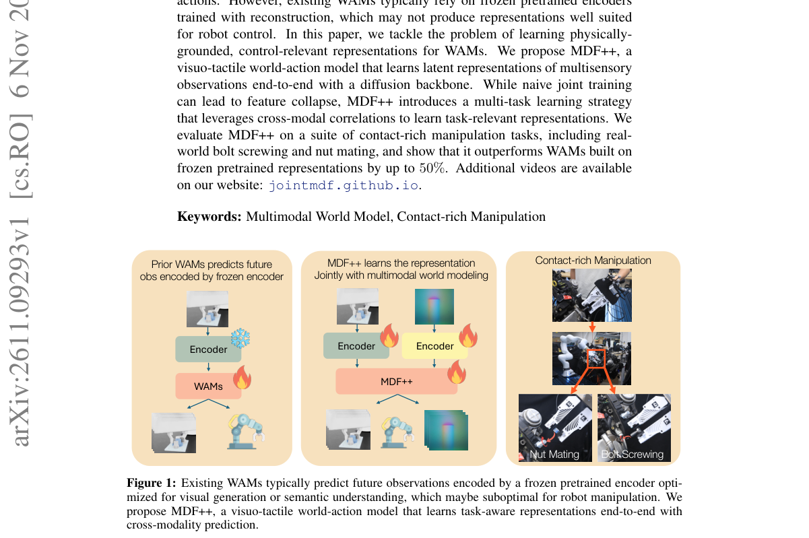

*Result - MDF++ training overview. MDF++ jointly trains observation encoders with a latent diffusion world-action model. During training, it samples structured 2D noise patterns for control-relevant t*

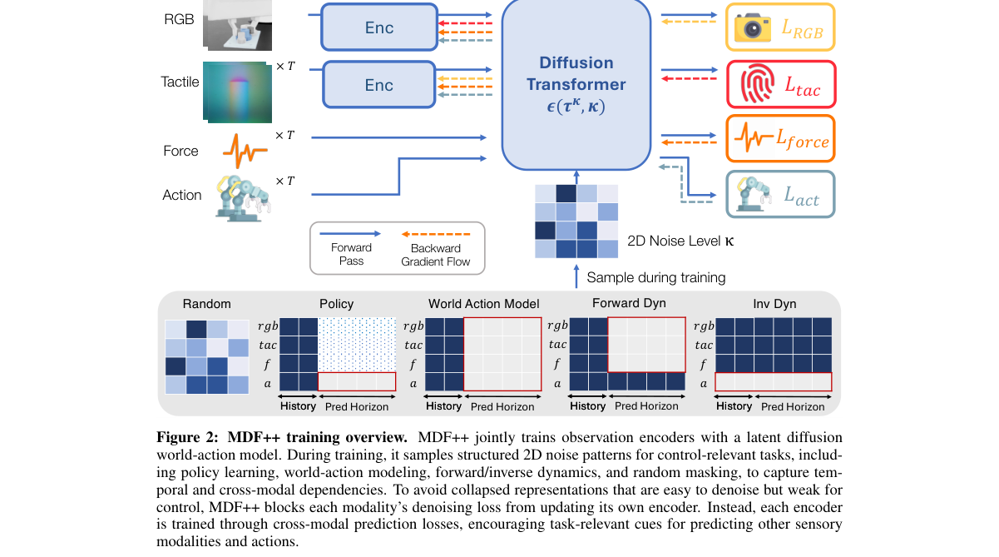

**Why this ranks #1**: 让世界-动作模型的观测编码器端到端学出对控制有用的潜表征，并用多任务扩散强制与跨模态选择性梯度流规避特征坍塌；五个仿真视触觉任务平均成功率 86.9%，比冻结编码器的适配版 MDF（68.4%）高 18.5 个百分点，真机螺栓拧紧 80%（16/20）、螺母啮合 40%（8/20）也全面超过 UWM。

---

### 2. Encoding Memory in World Models with Test-Time Model-Based Reinforcement Learning

**arXiv**: [2611.09625](https://arxiv.org/abs/2611.09625) | **Score**: 9.0 (relevance 9 x 0.7 + quality 9 x 0.3) | **Direction**: `world_model` | **Tags**: embodied, test-time-training, world-model, long-term-memory, memory-maze, dreamerv3, Computer Vision Lab | **Categories**: cs.AI, cs.CV, cs.LG | **Pages**: 34

**Authors**: Maxime Burchi; Fayaz Ali Dharejo; Radu Timofte

**Affiliation**: Computer Vision Lab, CAIDAS & IFI, University of Wurzburg

**Abstract**

> Model-based reinforcement learning (MBRL) approaches have demonstrated strong performance across diverse domains in recent years, learning accurate world models from agent trajectories. However, despite this progress, current approaches still struggle to surpass human performance on tasks that require long-term memory and planning. In this work, we address the problem of long-term memory in MBRL by moving beyond the commonly studied paradigm of architecture design. We introduce Test-Time Model-Based Reinforcement Learning (TT-MBRL), using gradient descent at test time to encode the memory of episode observations into world model parameters. This enables the agent to learn a distinct world model for each episode, improving memory capabilities compared to traditional approaches that solely rely on contextual memory. We first establish a proof of concept on a simplified two-dimensional variant of the Memory Maze environment, which we refer to as Memory Maze 2D, showing consistent improvements across different world model architectures. We then demonstrate the effectiveness of TT-MBRL in the 3D domain, achieving new state-of-the-art results on the Memory Maze benchmark. Finally, we show that TT-MBRL maintains strong performance on non-memory benchmarks such as DeepMind Control and Atari 100k.

**Key findings**

- **Finding**: Memory Maze 15×15 上 R2I 得分从 42.0 提升到 54.1（人类 67.7），13×13 上从 60.1 提升到 63.0；测试时累积 4000 环境步后，每步获得奖励相对提升 53.7%。
- **Inference**: 记忆指标同时改善——R2I 的世界模型 KL 从 61.3 降到 38.3、FVD 从 114.1 降到 85.2，说明增益来自记忆被写进参数而非只靠上下文窗口，且幅度随测试时累积观测持续增长。
- **Recommendation**: 遇到长时记忆任务时，除了堆上下文长度和 SSM 结构，还可以把「每回合重建一次世界模型」作为额外方案实测，论文在 DreamerV3 / TWISTER / R2I 三种架构上都拿到增益，代价是每回合多一遍梯度更新。

**Key figures**

*Framework - Performance improve- ments brought by TT-MBRL on Memory Maze 2D and Memory Maze.*

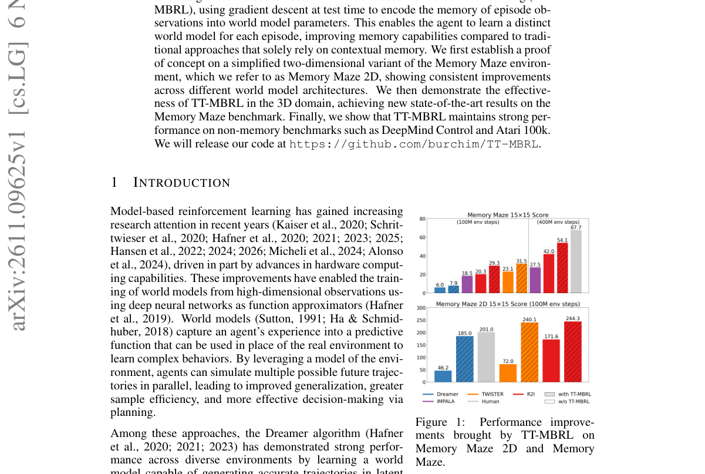

*Result - DreamerV3 failure case where the world model predicts an incoherent future after returning to the original position in Memory Maze.*

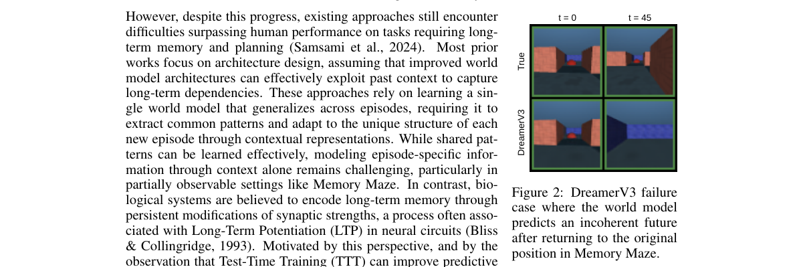

**Why this ranks #2**: 跳出「改架构」的思路，在测试时用梯度下降把每个回合的观测记忆直接写进世界模型参数，Memory Maze 15×15 上把 R2I 从 42.0 抬到 54.1（人类基线 67.7），13×13 上从 60.1 到 63.0，创下该基准新纪录且不损伤 DeepMind Control 与 Atari 100k 的表现。

---

### 3. JEPAhead: From Inpainting to Causal Forecasting for Urban Driving

**arXiv**: [2611.08657](https://arxiv.org/abs/2611.08657) | **Score**: 8.0 (relevance 8 x 0.7 + quality 8 x 0.3) | **Direction**: `world_model` | **Tags**: embodied, v-jepa, causal-forecasting, latent-prediction, driving, carla, Eldorado Research Institute | **Categories**: cs.AI, cs.CV | **Pages**: 7

**Authors**: Daniel G. P. Petrini; Davi Pincinato; Fabio Grassiotto; Pedro L. F. Prado; Alexandre F. S. Osorio; Raphael V. Ramos; Felipe Pamboukian

**Affiliation**: Eldorado Research Institute; University of Campinas (Unicamp)

**Abstract**

> We fine-tune a pre-trained V-JEPA1 predictor from bidirectional latent inpainting to action-free causal forecasting while keeping the encoder frozen. Using contiguous past observations, horizon-aligned targets, and group-level causal attention, the model forecasts eight future token groups, corresponding to sixteen frames, in one forward pass. On CARLA Town12, it retrieves the correct future among 591 candidates in 69.0% of cases, compared with 55.3% for persistence, with greater gains at longer horizons and on tokens exhibiting greater change. It also outperforms a compact predictor trained from scratch with six times fewer parameters. Semantic analysis indicates driving-relevant information in predicted features: a fixed linear probe trained on real encoder tokens achieves 0.16 mIoU on patches undergoing semantic-class changes, versus 0.13 for persistence. Vehicle-conditioned retrieval improves over persistence by 15 percentage points at the longest horizon. Pixel-space evaluation shows modest L1 gains but little improvement under LPIPS, motivating direct evaluation through latent and semantic measures alongside an oracle reconstruction reference. These findings support further investigation of latent forecasting for driving perception, while downstream utility remains unverified.

**Key findings**

- **Finding**: CARLA Town12 上预测 token 在 591 个候选中检索到正确未来的 top-1 为 69.0%、top-5 为 84.8%，持久性基线分别只有 55.3% 与 74.2%；全局余弦相似度 0.8478 对 0.7814，动态 token 上的相对优势达 39.3%。
- **Inference**: 预测结果保留了目标分布 98.4% 的离散度（紧凑模型 93.4%、持久性最低），说明提升来自排序能力而非表征坍塌；而 LPIPS 几乎无改善，说明收益只在潜空间与语义层面可见。
- **Recommendation**: 评测潜空间世界模型时不要只看像素指标，这篇在 LPIPS 上几乎没有差别却能被检索与语义探针分开；建议直接用候选检索 top-1/top-5 加语义 mIoU，并配一个 oracle 重建参考来区分预测误差与解码误差。

**Key figures**

*Framework - Causal future prediction in the frozen V-JEPA latent space (adapted from [2]). Only the predictor Pφ is trained, with latent loss L between ˆsy and sy. (I) Context: 32 frames (16 temporal gr*

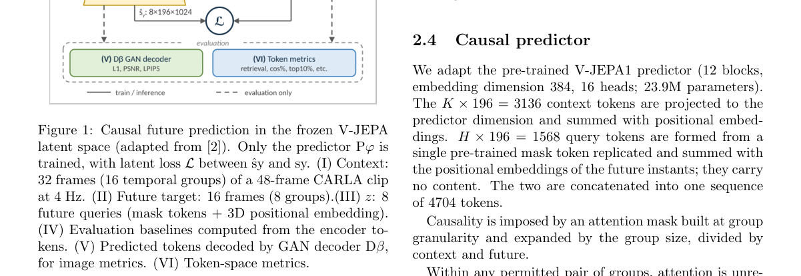

*Result - Linear-probe IoU and class-conditioned re- trieval@1 gains over persistence at h=4,8. Retrieval inter- vals show 95% route-bootstrap confidence intervals (1,000 resamples; seed-42 predictors*

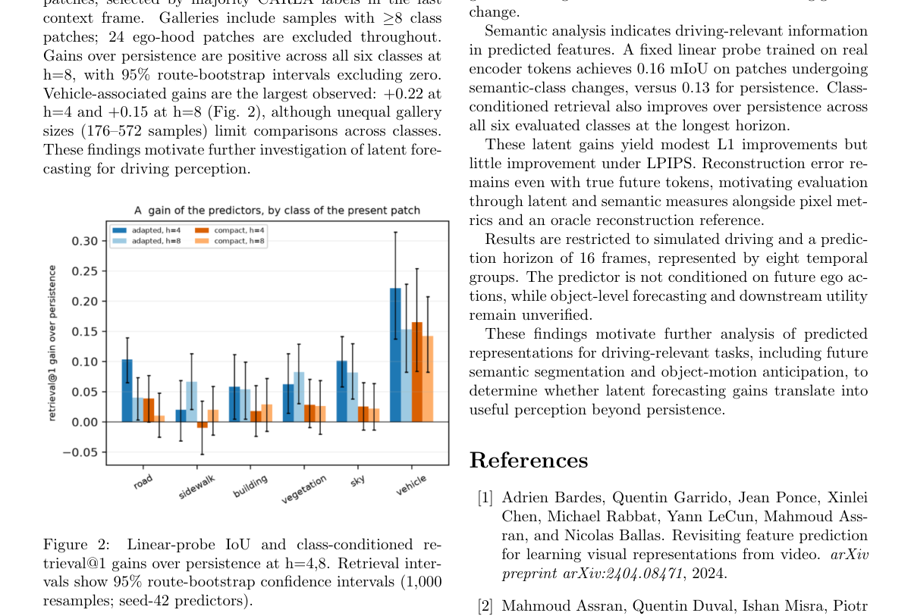

**Why this ranks #3**: 把预训练 V-JEPA1 预测器从双向 latent 修补改造成无动作的因果预测、编码器全程冻结，在 CARLA Town12 上从 591 个候选里检索到正确未来的 top-1 命中率 69.0%（持久性基线 55.3%），且线性探针在语义变化块上 mIoU 0.16 对 0.13。

---

### 4. FATHOM: World-Model-Guided Diffusion Action-Trajectory Selection for Sparse-Marker AUV Tracking

**arXiv**: [2611.08898](https://arxiv.org/abs/2611.08898) | **Score**: 8.0 (relevance 8 x 0.7 + quality 8 x 0.3) | **Direction**: `world_model` | **Tags**: embodied, auv-tracking, world-model, diffusion-prior, sparse-marker-perception, receding-horizon, Robotics and Control Laboratory | **Categories**: cs.RO | **Pages**: 18

**Authors**: Xiaorui Wang; Zeyu Sha; Mingyang Yang; David Chen Wang; Feitian Zhang

**Affiliation**: Robotics and Control Laboratory, School of Advanced Manufacturing and Robotics, Peking University; State Key Laboratory of Turbulence and Complex Systems, Peking University

**Abstract**

> Reliable relative tracking is fundamental to cooperative autonomous underwater vehicles (AUVs), yet remains challenging under nonlinear vehicle dynamics and degraded underwater visual conditions. Active light markers improve robustness to appearance variation, but provide deliberately sparse observations that can become incomplete or corrupted by occlusion, reflections, and detection noise during dynamic motion. To address the resulting partial-observation control problem, this paper proposes FATHOM, a world-model-guided diffusion action-trajectory selection framework for sparse-marker AUV tracking. FATHOM first integrates structured marker observations, inertial measurements, action history, and temporal dynamics into a predictive tracking belief using a multimodal task-supervised recurrent state-space model. A diffusion action prior then generates multiple expert-like multi-thruster trajectories, whose future tracking consequences are predicted through the learned latent dynamics. Rather than directly executing a generated trajectory, FATHOM selects the most favorable candidate under an explicit receding-horizon objective and continually updates the decision from onboard observations. Extensive offline analyses verify the learned predictive belief, multi-step world-model prediction, diffusion trajectory generation, and predictive selection. More importantly, comprehensive real-AUV experiments, including strong pose-based comparisons and component ablations, demonstrate robust autonomous tracking across nominal and challenging motions with naturally occurring partial marker visibility, while maintaining real-time onboard operation without motion-capture feedback.

**Key findings**

- **Finding**: 数据采集覆盖 5 档 PID 增益 × 9 个期望相对位姿 × 标称与挑战两种运动各 6 次，共 540 条真实双 AUV 轨迹；试验在 4.2×2.2×1.2 m 水池内完成，机载算力为 Jetson AGX Orin（64 GB 内存）。
- **Inference**: 论文给出多步预测误差到在线选优退化的上界，把「世界模型准不准」直接翻译成「选出来的轨迹好不好」，因此扩散只当轨迹先验、决策权交给世界模型选优。
- **Recommendation**: 在部分观测控制里用扩散策略时，别让扩散样本直接执行，把扩散当轨迹先验、配一个能预测状态后果的动力学模型做递推时域筛选，并在稀疏观测上加结构化编码器做补全。

**Key figures**

*Framework - Conceptual overview of FATHOM for sparse-marker AUV tracking. Active LEDs provide distinctive but potentially incomplete observations. Visual– inertial histories and past actions form a predic*

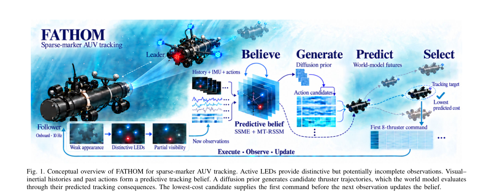

*Result - Dual-AUV hardware. (a) Follower with eight thrusters, a monocular camera, and five motion-capture markers. (b) Leader with a four-LED array and five motion-capture markers. (c) Rear view showi*

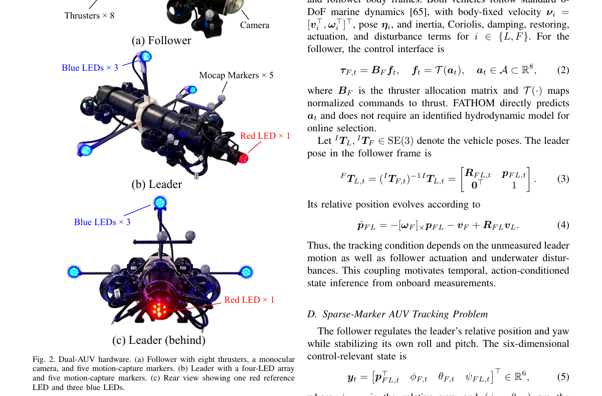

**Why this ranks #4**: 用 SSME 与多模态任务监督循环状态空间模型把稀疏 LED 标记、惯性与动作历史融成预测信念，再让扩散先验生成多推力器轨迹、由世界模型预测后果后按递推时域目标择优；真机在 4.2×2.2×1.2 m 水池里采了 5 档 PID 增益 × 9 个期望位姿共 540 条双 AUV 轨迹。

---

### 5. LEF-JEPA: Denoising-Trained Latent Energy Fields for Spatial Representation Learning

**arXiv**: [2611.08989](https://arxiv.org/abs/2611.08989) | **Score**: 8.0 (relevance 8 x 0.7 + quality 8 x 0.3) | **Direction**: `world_model` | **Tags**: embodied, jepa, latent-energy-field, ising-solver, spatial-representation, pretraining, Qinous Technology Co. | **Categories**: cs.AI, cs.CV | **Pages**: 14

**Authors**: Zhiyuan Liu; Zhihao Xu; Sicheng Liu; Huanhuan Huang

**Affiliation**: Qinous Technology Co., Ltd; Tsinghua University

**Abstract**

> A joint-embedding predictive architecture (JEPA) that applies prediction supervision only at masked positions struggles to clearly capture object shapes and boundaries in its latent representations. We further observe that some existing methods improve spatial structure while also retaining rich variations in texture and color. However, preserving more low-level visual information does not necessarily make representations better suited to prediction and action. This raises a key question: how can we strengthen the spatial structure in latent representations that supports prediction and action without over-encoding these details? We introduce LEF-JEPA, which learns spatial structure through target-guided latent recovery and transfers this supervision to the visual encoder through a relative-energy constraint; the energy module is used only during pretraining and adds no inference overhead. To reduce the cost of energy optimization during pretraining, we further construct a conditional Ising Hamiltonian that allows low-energy-state search to be performed by specialized Ising solvers. On physical hardware, we validate the feasibility of achieving lower forward latency with fewer local updates. Under a unified CIFAR-10 pretraining and frozen-encoder evaluation protocol, both realizations outperform V-JEPA2.1 in image classification, foreground segmentation, and visual planning.

**Key findings**

- **Finding**: ViT-B 上 LEF-JEPA 相对 V-JEPA2.1 在分类准确率、前景 IoU 与视觉规划成功率上分别提升 3.40、3.97 和 7 个点；LEF-JEPA-CIM 前景 IoU 最高 72.11%，连续能量场版本在 ViT-S 上达 70.04%。
- **Inference**: Ising 硬件版本只需 K=1 步局部更新就拿到最强分类与规划结果，连续能量场则 K=3 时前景 IoU 最好、K=5 只再涨分类，说明收益来自结构引导而非迭代次数。
- **Recommendation**: 想给 JEPA 补上稠密空间结构时，可以试目标引导的潜能量场，并把能量模块限制在预训练阶段、推理侧保持零开销；同时注意能量系数对分类、分割、规划三项任务的最优值并不重合，需要按任务单独调。

**Key figures**

*Framework - Recognizable object structure within coherent spatial regions. In the PCA visualizations, V-JEPA2 produces relatively coarse-grained representations in which object shapes and boundaries are*

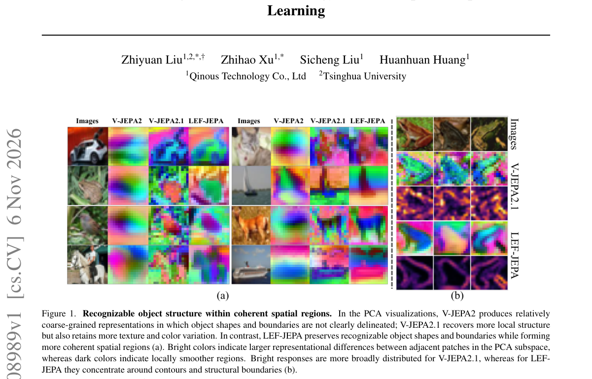

*Result - Overview of LEF-JEPA. (a) Visible tokens from the online encoder are partitioned into disjoint candidate and anchor sets. The anchors condition the latent energy landscape over perturbed can*

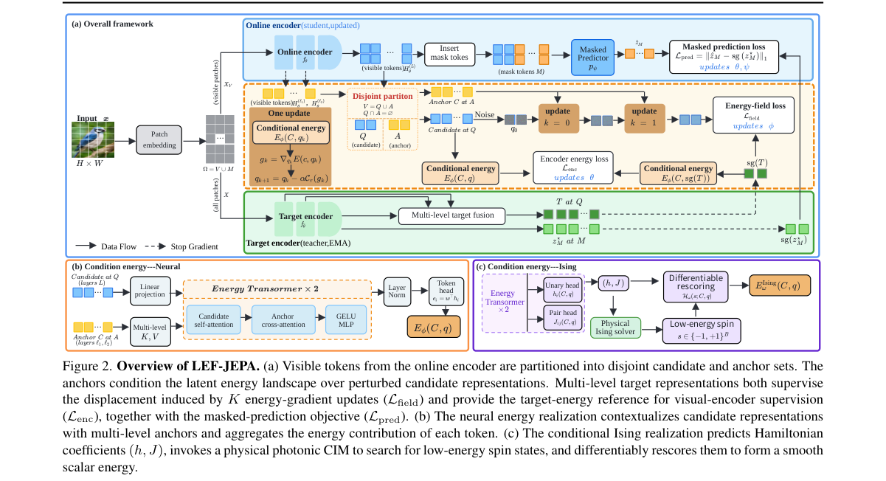

**Why this ranks #5**: 通过目标引导的潜变量恢复训练相对能量场，再用相对能量约束把稠密空间结构监督传给视觉编码器，能量模块只在预训练期使用、不带来推理开销；ViT-B 上分类准确率、前景 IoU 与规划成功率分别比 V-JEPA2.1 高 3.40、3.97 与 7 个点。

---

### 6. EGT: Execution-Grounded Traversability through Learned Closed-Loop Trajectory Distributions

**arXiv**: [2611.09270](https://arxiv.org/abs/2611.09270) | **Score**: 8.0 (relevance 8 x 0.7 + quality 8 x 0.3) | **Direction**: `world_model` | **Tags**: embodied, traversability, flow-matching, closed-loop, rough-terrain, receding-horizon-planning, Institute of Technology | **Categories**: cs.RO | **Pages**: 8

**Authors**: Chinmay Mundane; Amith Manoharan; Arun Kumar Singh

**Affiliation**: Institute of Technology, University of Tartu

**Abstract**

> Rough terrain traversability is often estimated through point-wise roll, pitch, or force-angle margins along a planned path. However, these metrics are often inaccurate and overly conservative because they ignore how terrain disturbances and low-level controller corrections can affect the vehicle's motions. To overcome these limitations, we introduce Execution-Grounded Traversability (EGT), defined as the probability that a vehicle-controller pair can execute a candidate path while meeting trajectory-level tracking and progress requirements. We estimate EGT by predicting the distribution of closed-loop trajectories using a latent-space flow matching (FM) model conditioned on multi-resolution terrain features and 3D vehicle attitude and wheel-ground contact points prior. Across 650 simulated trials on unseen terrains, EGT reduces safe-path rejection to 2.2% (versus 11.4%-39.5% for pose-margin and force-angle baselines) and unsafe acceptance to 7.7%. Integrated into a receding-horizon sampling-based planner, EGT reduces navigation failure rates by 24-42 and 30-44 percentage points over [1] and [2], respectively, while cutting goal-reaching time by up to 20.5% and 45%. Finally, we demonstrate zero-shot transfer of our simulation-trained model to real-world outdoor experiments.

**Key findings**

- **Finding**: 650 次未见地形仿真试验中，EGT 的保守拒判率 2.2%、不安全接受率 7.7%、总体准确率 97.4%；位姿裕度基线拒判 11.4%-35.3% 却误接受 13.5%-63.5%，力角基线拒判高达 39.5%。
- **Inference**: 接入递推时域采样规划后，三种地形上的失败率降到 4%、4%、2%，而 GP-navigation 为 26%-46%、TAL 为 34%-48%，同时平均到达时间比 TAL 低 36%-45%，说明闭环成功率比静态裕度更接近真实可执行性。
- **Recommendation**: 越野可通行性别再用逐点俯仰/力角阈值，改成「闭环执行成功率」的概率预测，并把它作为风险项接进带 CVaR 执行代价的采样规划器；去掉位姿-接触先验时准确率会掉到 89.8%，该先验要保留。

**Key figures**

*Framework - Real-world EGT tests across three terrain trials. Each trial shows (1) the robot motion, (2) the initial camera view, and (3)–(4) the candidate reference paths (cyan) with their FM-predicted c*

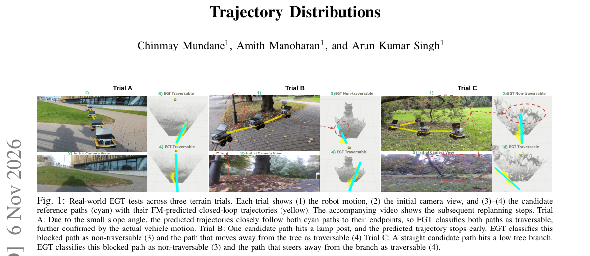

*Result - Overview of the conditional latent flow matching architecture. Terrain FPN and path-fusion features, kinematic pose–contact features, and planner–goal context form conditioning tokens C. A sha*

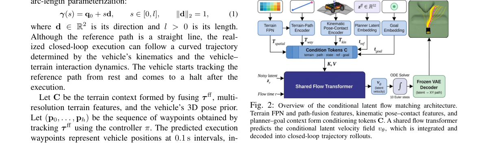

**Why this ranks #6**: 把可通行性重新定义为「车辆-控制器对能否执行候选路径」的概率，用条件潜空间流匹配预测闭环轨迹分布；650 次未见地形试验中保守拒判降到 2.2%（位姿裕度与力角基线为 11.4%-39.5%），不安全接受 7.7%，总体分类准确率 97.4%。

---

### 7. A Stochastic Latent Variable Generalization of Joint-Embedding Predictive Architectures

**arXiv**: [2611.09302](https://arxiv.org/abs/2611.09302) | **Score**: 8.0 (relevance 8 x 0.7 + quality 8 x 0.3) | **Direction**: `world_model` | **Tags**: embodied, jepa, stochastic-latent, cvae, masked-prediction, uncertainty-estimation, Imperial College London | **Categories**: cs.AI, cs.CV, cs.LG | **Pages**: 31

**Authors**: Nikos Giakoumoglou; Paschalis Giakoumoglou; Tania Stathaki

**Affiliation**: Imperial College London; Information Technologies Institute, CERTH

**Abstract**

> Joint-Embedding Predictive Architectures (JEPAs) predict the latent embedding of a target signal from a context signal, with an auxiliary variable z conditioning the predictor. Despite its prominent role in the original JEPA blueprint, the content of z has been carried by a fixed deterministic token in every prior instantiation, collapsing the genuinely multi-modal distribution over plausible completions to a point estimate. We present S-JEPA, which realises z as a proper stochastic latent variable for masked image prediction: a learned posterior infers z from context and target during training, while a learned context-conditioned prior approximates the distribution of plausible completions at inference, with no decoders and no reconstruction. In its deterministic limit the objective reduces to the I-JEPA loss in functional form, generalising that objective rather than strictly containing the I-JEPA model. Our central finding is that stochasticity adds capabilities, error-correlated predictive uncertainty and diverse completions, at no cost to representation quality: under matched architectures and schedules S-JEPA improves over the deterministic I-JEPA baseline and exceeds LeJEPA at matched architecture, while additionally producing spatially structured uncertainty maps and semantically diverse completions, neither of which the deterministic predictor produces.

**Key findings**

- **Finding**: ImageNet-1K 用 1% 标签（每类约 12-13 张）全量微调，S-JEPA 的 ViT-L/16 达 89.4%、ViT-B/16 达 83.1%，对应 I-JEPA 的 85.6% 与 82.2%；参数增幅仅 1.01 倍，FLOPs 与单次前向延迟与基线无显著差异。
- **Inference**: 确定性极限下目标在函数形式上退化为 I-JEPA 损失，说明这是对原 JEPA 目标的推广而非替换，随机性额外买到了与误差相关的不确定性图与语义多样的补全。
- **Recommendation**: 需要「多种合理补全」的表征时别只堆一个确定性 token，改用后验-先验随机潜变量；但要清楚代价——不确定性图需要 N 次预测器前向，多样补全还得另训一个扩散解码器。

**Key figures**

*Framework - JEPAs are trained to predict the representation of an in- put y from the representation of another input x. The additional variable z provides the predictor with information about the trans-*

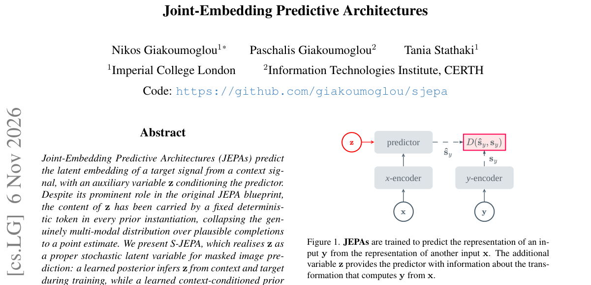

*Result - S-JEPA overview. The posterior network qψ(z | sx, sy) infers z from both context and target representations; the prior network pθ(z | sx) infers z from context alone. The sampled z is inject*

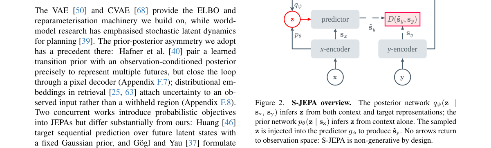

**Why this ranks #7**: 把 JEPA 里的辅助变量 z 从固定确定性 token 换成真正的随机潜变量（后验推断 + 上下文条件先验），在匹配架构与训练计划下超过 I-JEPA、匹配架构时超过 LeJEPA，参数只增加约 1.01 倍，FLOPs 与单次前向延迟都落在测量噪声内。

---

## 具身智能与机器人学习 · `embodied_ai` (8 papers)

本方向 8 篇，涵盖策略、仿真、硬件与评测四个层面，而且有一条明显的反直觉结论。On Agentic Manipulation Policies（Apple）显示通用 AI 模型直接指挥机械臂，比专门的 VLA 与世界动作模型策略更可靠：RoboLab-120 上零样本成功率 85.6%，而领先的 VLA 与 WAM 只有 49.2% 与 42.9%，且不需要任何演示或任务专门训练；Computer-Use Agents Are Embodied Generalists 则进一步论证具身任务可以被表述为「与数字软件的交互」，用同一套截图与键鼠操作在四场 ECCV 工坊赛上拿到第一、第二、第三与第六名且不做竞赛专门调优。仿真侧 RevoSim 为 BrainCo Revo3 手联合建模 285 个压阻式 taxel 与 5 个视触觉指尖、单卡 RTX 5090 支持 4096 并行环境，Lodos 则正面处理网格碰撞带来的吞吐瓶颈。STRIDE 用仅需机载 IMU 的加速度奖励让人形机器人在几分钟样本内学会运动；PRISM 揭示预训练 VLA 的每技能低秩更新占据可稳健区分的子空间；Goodhart in the Planner 测出更激进的采样式 MPC 搜索会让真实回报下降最多 76%，而留出标签准确率仍有 0.75–0.97；VLA Handover 则在 LIBERO 上用失败预测把成功率抬高 11–22 个百分点。

### 8. On Agentic Manipulation Policies

**arXiv**: [2611.09892](https://arxiv.org/abs/2611.09892) | **Score**: 9.3 (relevance 9 x 0.7 + quality 10 x 0.3) | **Direction**: `embodied_ai` | **Tags**: embodied, agentic-manipulation, generalist-model, zero-shot, code-execution, persistent-memory, Apple | **Categories**: cs.AI, cs.CV, cs.LG, cs.RO | **Pages**: 31

**Authors**: Chen Chen; Omid Bagherieh; Naveen Nikamanth Appiah Balaji; Jesse T. Gonzalez; Negin Heravi; Fahad Islam; Xueting Li; Jean-Baptiste Regli; Kejia Ren; Petr Švec; David J. Yoon; Matthias Müller

**Affiliation**: Apple

**Abstract**

> Recent work on robot manipulation has focused on specialist policies trained on demonstrations. We show that generalist AI models can control manipulators more reliably than specialist policies such as vision-language-action models (VLAs) and world-action models (WAMs). We systematically analyze agentic manipulation policies (AMPs), in which a generalist AI model commands the manipulator directly, adapting its actions as the task unfolds. We present AMP1, a reference harness that runs unchanged across single-arm, bimanual, and mobile manipulation. AMP1 achieves state-of-the-art results on the RoboLab-120 and CaP-Gym benchmarks, with no demonstrations or task-specific training. On RoboLab-120, AMP1 reaches an 85.6\% success rate zero-shot, compared to 49.2\% and 42.9\% for leading VLA and WAM policies. The agent succeeds zero-shot in 104 of 108 real-world trials spanning twelve tasks and three robot instances, reducing failure rates by 20x and 15x relative to strong VLA and WAM baselines. The basic harness supplies no grasping, pushing, or placing skills; the agent develops its own strategies, such as searching for hidden objects, using objects as tools, and calibrating its cameras. With the addition of a persistent memory store, the agent can also learn from experience: an augmented harness with a memory representation that is carried across episodes lowers the failure rate on RoboDojo bimanual manipulation tasks by 4.6x relative to zero-shot deployment. Our analysis suggests that AMPs are substantially more general and robust than specialist manipulation policies, providing a promising foundation for robot manipulation.

**Key findings**

- **Finding**: RoboLab-120 上 AMP1 零样本成功率 85.6%（95% CI 83.5-87.5），最强 VLA 与 WAM 分别为 49.2% 和 42.9%；真机 108 次试验成功 104 次，失败率较 π0.5 与 FLUX 3 Action 分别低 20 倍和 15 倍。
- **Inference**: 去掉深度或相机标定后，Opus 5.5 成功率从 82.8% 掉到 75.8%，Haiku 5.5 更从 51.6% 崩到 10.7%，说明弱模型无法补偿被贫化的感知，瓶颈在输入而非推理能力。
- **Recommendation**: 用通用模型做操作时优先投资感知通道（深度、相机标定）而不是一味换更大模型，并接上跨回合的记忆存储——论文在 RoboDojo 双臂任务上用记忆把失败率再降到 1/4.6。

**Key figures**

*Framework - Zero-shot real-world manipulation with AMP1. AMP1 solves diverse, long-horizon manipulation tasks directly in the real world from a natural language instruction without task-specific fine-tuni*

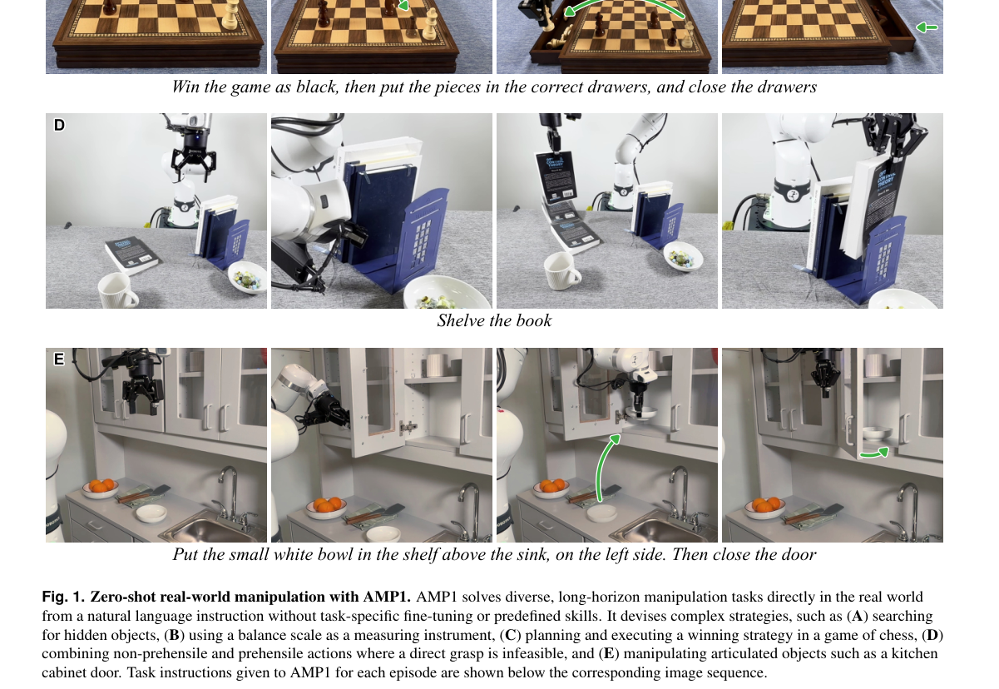

**Why this ranks #8**: 提出 AMP1 参考 harness，让通用大模型直接操控机械臂而无需任何示范或任务特定训练：RoboLab-120 零样本成功率 85.6%，远高于当时最强 VLA 的 49.2% 与最强 WAM 的 42.9%，真机 12 个任务 3 台机器人 108 次试验成功 104 次。

---

### 9. STRIDE: Learning Humanoid Locomotion in Minutes with Acceleration-Based Rewards

**arXiv**: [2611.08857](https://arxiv.org/abs/2611.08857) | **Score**: 9.0 (relevance 9 x 0.7 + quality 9 x 0.3) | **Direction**: `embodied_ai` | **Tags**: embodied, humanoid-locomotion, acceleration-reward, off-policy-rl, imu-only, sample-efficiency, Technical University of Darmstadt | **Categories**: cs.LG, cs.RO | **Pages**: 6

**Authors**: Nico Bohlinger; Jan Peters

**Affiliation**: Technical University of Darmstadt; Robotics Institute Germany (RIG); German Research Center for AI (DFKI)

**Abstract**

> Learning locomotion directly on a humanoid robot is a promising direction to avoid the sim-to-real gap. However, locomotion rewards in Reinforcement Learning (RL) typically track the base velocity, which cannot be measured onboard without an external motion capture system or well-calibrated state estimator. This is why we introduce \method{}, which learns humanoid locomotion from minutes of samples with a reward that only requires the onboard Inertial Measurement Unit (IMU). Instead of tracking the base velocity, STRIDE rewards the robot for following a commanded acceleration profile. To learn efficiently from this reward, we use the off-policy RL algorithm XQC and combine a high gain setting for the joint position controllers with left-right symmetry augmentation. In simulation, STRIDE learns to walk on the Unitree G1 and Booster T1 humanoids within 14 minutes of samples. Compared to learning without these two components, it reduces the falls during training by 81%, while without them the robot learns only in over an hour.

**Key findings**

- **Finding**: 仿真中 Unitree G1 与 Booster T1 均在 14 分钟样本内学会行走、最终速度 0.48 m/s；去掉高增益与对称增强后跌倒从平均 2000 多次降到 440 次（-81%），且只有一半运行能在 83 分钟预算内学会走路。
- **Inference**: 单独去掉对称增强时 G1 从 13 分钟增到 21 分钟，单独用低增益设置时 G1 需 22 分钟、T1 需 66 分钟，说明两个组件买的是样本效率而不是最终性能上限，99% 的跌倒都发生在学会走之前。
- **Recommendation**: 真机人形训练优先换成 IMU 就能测的加速度型奖励，同时开高增益位置控制与左右对称增强；采样预算按 25 万步换算（约 83 分钟）来规划，并预留 250k 转换的采集量。

**Key figures**

*Framework - The Booster T1 (left) and the Unitree G1 (right) walk with policies that STRIDE learned in 14 minutes worth of collected samples.*

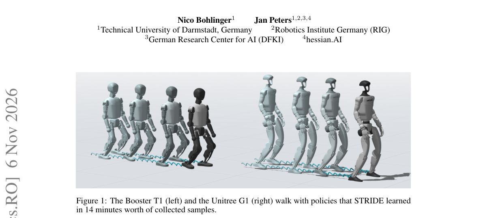

*Result - Forward velocity and number of falls during training for STRIDE and its ablations, shown as mean and standard deviation over all runs. The dashed line shows the commanded velocity.*

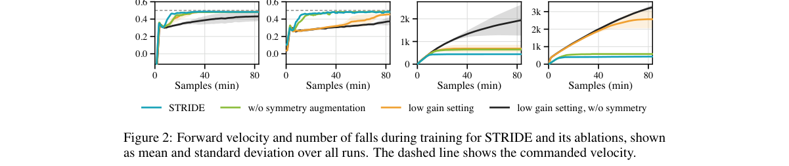

**Why this ranks #9**: 用只依赖机载 IMU 的加速度奖励替代无法在线测量的基座速度跟踪，配合高增益关节位置控制与左右对称增强，Unitree G1 与 Booster T1 都只用 14 分钟样本就学会走路，去掉两个组件后训练平均跌倒从 2000 多次降到 440 次。

---

### 10. PRISM: Primitive Routing via In-context Skill Mixing for Retentive VLA Adaptation

**arXiv**: [2611.08917](https://arxiv.org/abs/2611.08917) | **Score**: 9.0 (relevance 9 x 0.7 + quality 9 x 0.3) | **Direction**: `embodied_ai` | **Tags**: embodied, vla, skill-retention, lora-primitives, router, long-horizon-composition, University of Illinois Chicago | **Categories**: cs.RO | **Pages**: 19

**Authors**: Jiachen Tao; Gengyu Zhang; Haoxuan Wang; Bing Liu; Yan Yan

**Affiliation**: University of Illinois Chicago

**Abstract**

> Vision-Language-Action (VLA) models promise a single language-conditioned policy adaptable to many manipulation behaviors, yet deployment additionally requires skill retention and long-horizon composition: a policy must retain previously acquired skills and reuse them inside composite tasks whose behavior changes across phases. The standard recipe absorbs every new task into one shared update, which provides neither a parameter-level locus for reusable skills nor a mechanism for invoking each skill along the trajectory. We observe that this missing structure is latent rather than absent: per-skill low-rank updates of a pretrained VLA occupy a robustly distinguishable, low-dimensional subspace, and a single composite-task LoRA concentrates roughly half of its Frobenius energy in this subspace, against a near-zero matched random-rotation control. Building on this geometry, we introduce PRISM, which represents reusable skills as parameter-level primitives: each skill family is stored as a dedicated low-rank action-expert adapter in a primitive bank, primitives are augmented with skill-specific low-rank residuals and composed at inference by a per-chunk VLM-conditioned router that reads the prefix representation to track task progress, and the router is supervised by per-chunk labels from a deterministic, task-conditioned, action-derived oracle. During composite training, the vision encoder, the language LoRA, the skill residuals, the router, and the shared action projections and time MLP are updated; every primitive is held frozen, so the base per-skill action-expert adapters are preserved by construction. On RoboCasa365, PRISM achieves 56.43% atomic-skill success and reaches 20.00% on long-horizon composite tasks, while a standard $π_{0.5}$-LoRA two-stage fine-tune reaches 17.86% atomic and 17.50% composite success. We additionally validate PRISM on an AgileX PIPER real-robot setup.

**Key findings**

- **Finding**: 复合任务 LoRA 有约 56% 的 Frobenius 能量落在逐技能更新张量的张成空间内（N=6 时 0.560、N=11 时 0.567），而匹配的随机旋转对照约为 0%；同一技能族内的 LoRA 塌缩到近 1 维子空间（ρ1=0.948）。
- **Inference**: RoboCasa365 上 PRISM 的原子技能成功率 56.43%、复合任务 20.00%，相对带 replay 的 LoRA（49.82%、10.25%）分别提升 6.61 和 9.75 个百分点，说明冻结原语保住了技能不被复合训练冲掉。
- **Recommendation**: 做 VLA 的技能保持时，别把新任务都吸进同一个 LoRA；先给每个技能族留一个低秩适配器、训练时冻结，路由器的监督用确定性动作派生的 oracle，并用运动学规则而非 VLM 判定切换点（20.00 对 MLP 13.75）。

**Key figures**

*Framework - Within-skill LoRAs concentrate; across-skill LoRAs spread across N. (a) Cumulative singular energy ρ≤k vs k/T: within-PP saturates at the first component, while cross-skill rises along the u*

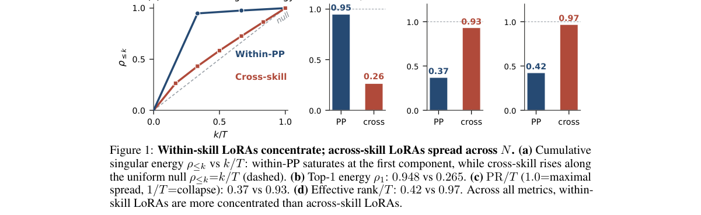

*Result - Skill geometry, N=6 bank. Pair- wise cosine cij between layer-wise-flattened per-skill update tensors ∆Wi. Five manip- ulation skills form a coherent cluster (0.05– 0.16); navigation is a cl*

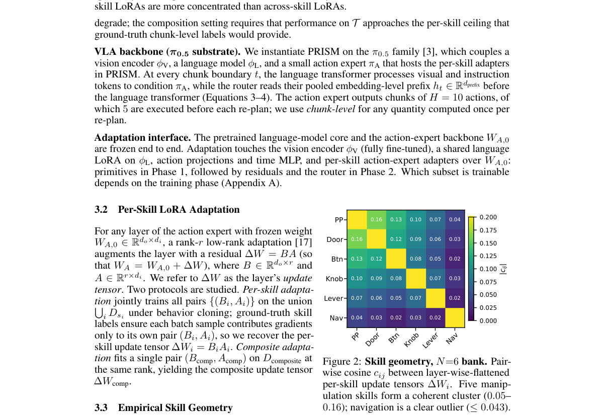

**Why this ranks #10**: 把可复用技能做成参数级原语（每个技能族一个低秩动作专家适配器）并用 VLM 条件路由逐块调用，复合训练时冻结所有原语；RoboCasa365 上原子技能成功率 56.43%、长时程复合任务 20.00%，而标准 π0.5-LoRA 两阶段微调只有 17.86% 与 17.50%。

---

### 11. RevoSim: Scalable Multimodal Tactile Simulation for Dexterous Manipulation

**arXiv**: [2611.08939](https://arxiv.org/abs/2611.08939) | **Score**: 9.0 (relevance 9 x 0.7 + quality 9 x 0.3) | **Direction**: `embodied_ai` | **Tags**: embodied, tactile-simulation, visuotactile, dexterous-hand, gpu-parallel, sim-to-real, HKUST(GZ) | **Categories**: cs.RO | **Pages**: 4

**Authors**: Ke Zhang; Lixin Xu; Ziyi Wang; Xiyue Dong; Jie Tan; Lianghu Shao; Xianpeng Wang; Chuanyu Li; Renjing Xu

**Affiliation**: HKUST(GZ); BrainCo; Georgia Tech

**Abstract**

> We present RevoSim, a scalable and high-fidelity multimodal tactile simulator for the BrainCo Revo3 hand that jointly models 285 piezoresistive taxels and five visuotactile fingertips. RevoSim efficiently generates synchronized pressure, depth, RGB, and marker-displacement observations; on a single RTX 5090, its depth-conditioned marker-displacement configuration supports up to 4,096 parallel environments. We train in-hand manipulation and grasping policies entirely in simulation, establishing a foundation for future sim-to-real transfer. Project page: https://braincotech.github.io/RevoSim-web/.

**Key findings**

- **Finding**: RevoSim 联合建模 285 个压阻式 taxel 与 5 个视触觉指尖，单张 RTX 5090 上深度条件化标记位移配置可支持 4096 个并行环境；1024 个纯深度环境时占用 9.2 GiB，比 TacMap 的 30.6 GiB 少约 70%。
- **Inference**: 几何感知的压力模型加自适应接触采样是显存与速度提升的来源，使「先在仿真里训好触觉策略再做 sim-to-real」在单卡上成为可行路线。
- **Recommendation**: 做触觉策略训练时优先把仿真器扩展到数千并行环境的量级，把触觉观测（压力、深度、RGB、标记位移）设计成同步输出，可显著压缩后续真机采数成本。

**Key figures**

*Framework - RevoSim observations and tactile-learning tasks.*

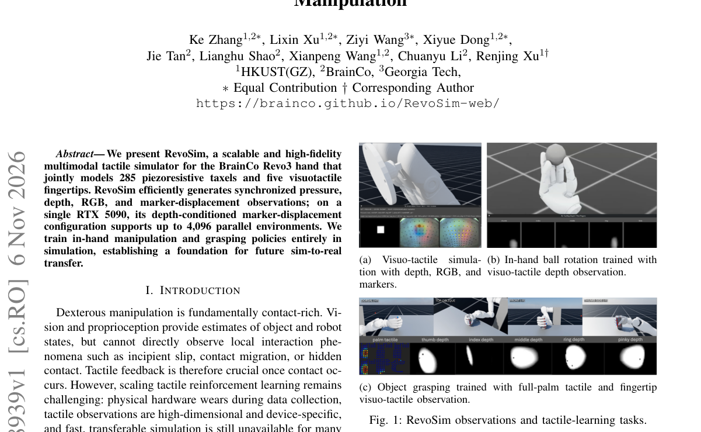

*Result - GPU-memory scalability of RevoSim.*

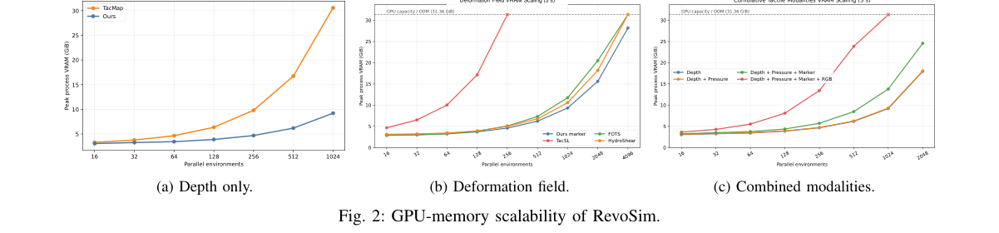

**Why this ranks #11**: 为 BrainCo Revo3 手构建多模态触觉仿真器，联合建模 285 个压阻式触觉单元与 5 个视触觉指尖，在单张 RTX 5090 上把深度条件化的标记位移配置跑到 4096 个并行环境，直接支撑纯仿真训练手内操作与抓取策略。

---

### 12. Goodhart in the Planner: Sampling-Based Control Exploits Rewards Learned from Human Preferences

**arXiv**: [2611.09670](https://arxiv.org/abs/2611.09670) | **Score**: 8.3 (relevance 8 x 0.7 + quality 9 x 0.3) | **Direction**: `embodied_ai` | **Tags**: embodied, goodhart, mppi, reward-model, preference-labels, best-of-n, Walker Department of Mechanical | **Categories**: cs.AI, cs.LG, cs.RO | **Pages**: 19

**Authors**: Soovadeep Bakshi; Apurba Bose

**Affiliation**: Walker Department of Mechanical Engineering, The University of Texas at Austin; Independent researcher

**Abstract**

> Robots increasingly choose actions by searching against a reward model learned from human preferences, in model-predictive control or best-of-$N$ selection; we measure what this does to the true objective. On HalfCheetah and Hopper with crowd-sourced labels, and on Meta-World drawer-open and plate-slide with synthetic labels and blind labels from the two authors, harder MPPI search cuts true return by up to 76%: with human labels the drawer opens in 0 of 20 runs against 10 of 10 for the cloned policy the planner starts from, while held-out label accuracy stays at 0.75-0.97. On plate-slide human labels are exploited less than synthetic ones, and on window-open search helps. True return roughly follows how far the planner's weights move from its proposals ($\sqrt{\mathrm{KL}}$) for both weighting rules we test, and best-of-$N$ with a verifier from synthetic labels falls below a single noisy action. We prove that $χ^2$-regularized MPPI at a temperature set by the scorer's error spread on the proposals is worst-case optimal, that no positive gain can be certified once that spread exceeds the scorer's own, and that an episode's return splits exactly into per-step terms, of which the guarantee covers the selection terms. Calibrated from 100 proposal pairs ranked by true return (an oracle) on start states the evaluation never uses, this rule is the safest fix we test: with each of five independent sets it succeeds in every arm run and keeps on average 86-94% of the cloned policy's return on plate-slide and drawer-open, though it is cautious where search helps. Calibration from a person's comparisons cannot detect a bias the scorer learned from that person; correcting for the pairs people cannot tell apart, or a second person, limits the damage.

**Key findings**

- **Finding**: 人类标签下 drawer-open 的激进 MPPI（λ=0.01）让抽屉 20 次运行中打开 0 次，而规划器起始的克隆策略 10/10 全部打开；同时留出标签准确率保持在 0.75-0.97，单步相关性最高 0.91，完全看不出异常。
- **Inference**: 真实回报大致随规划器权重偏离提案的程度（√KL）变化，且 best-of-N 用合成标签的验证器甚至低于单个带噪动作，说明留出精度不足以预测这类失效，必须约束搜索强度本身。
- **Recommendation**: 把奖励模型接进规划器前，先用按真实回报排序的提案对做校准并把温度设在评分器自身误差散布上，论文用 100 个 oracle 对校准后每个臂都保住克隆策略 86%-94% 的回报。

**Key figures**

*Result - One drawer start under three planners (true returns).*

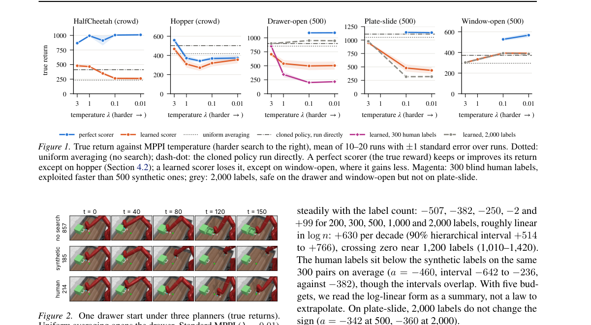

**Why this ranks #12**: 量化「用人类偏好学出的奖励模型做采样式控制」会把真实目标带偏多少：在 drawer-open 上加大 MPPI 搜索强度会让真实回报最多掉 76%，20 次运行里抽屉一次都没打开（起始克隆策略 10/10 全开），而留出集标签准确率仍有 0.75-0.97 毫无异常。

---

### 13. Computer-Use Agents Are Embodied Generalists

**arXiv**: [2611.09847](https://arxiv.org/abs/2611.09847) | **Score**: 8.3 (relevance 8 x 0.7 + quality 9 x 0.3) | **Direction**: `embodied_ai` | **Tags**: embodied, computer-use-agent, embodied-ai, gui-agent, eccv-workshop, generalization, Carnegie Mellon University | **Categories**: cs.LG, cs.RO | **Pages**: 14

**Authors**: Pranjal Aggarwal; Sean Welleck

**Affiliation**: Carnegie Mellon University

**Abstract**

> In many areas of AI, general-purpose models have increasingly replaced handcrafted methods and specialized architectures. We argue that embodied AI is poised for a similar shift. Our key claim is that embodied tasks can be formulated as interaction with digital software. Specifically, we build software that renders an agent's view of a physical environment on a screen and provides controls for acting in it. A computer-use agent (CUA) can then perform embodied tasks through the same screenshots and keyboard and mouse actions that it uses to operate ordinary software. Using a single CUA design and changing only the software, our entries win first-, second-, third-, and sixth-place prizes across four ECCV workshop competitions, without any competition-specific agent tuning. These results suggest that the skills CUAs learn on software, such as visual grounding, precise clicking, and exploration, already carry over to embodied tasks, giving CUAs a far broader scope in embodied AI than previously realized. We therefore advocate that computer-use agents can be embodied generalists. Further, we advocate that, by following the training strategy that made computer-use agents general, embodied AI can converge on a single general model as well, ushering in a new era of general embodied AI. Website: https://pranjal2041.github.io/cua-embodied

**Key findings**

- **Finding**: 同一套 CUA 仅替换软件环境即取得 OpenSUN3D 第一（AP50 25.88，最佳其他 21.45）、MeViSv2-Text 第二（Final 86.72）、DialNav 第三（端点成功率 65.26）、VLNVerse 第六（Avg SR@3 87.30，最佳其他 90.70）。
- **Inference**: GUI 通道与 API 通道的差距在各赛事上只有 -4.0 到 +1.4 个百分点，说明视觉定位、精确点击、探索这类软件技能在渲染的物理任务上直接迁移，具身任务不必另训专用策略。
- **Recommendation**: 想复用 CUA 能力做具身任务时，优先把环境包装成「渲染视角 + 动作接口」的软件而不是从头训专用策略；但要注意纯视觉模型在导航上只匹配 π0.5 的 56%（对比 59%，1000 个未见实例）。

**Key figures**

*Framework - Computer-use agents can operate any software through keyboard and mouse actions while observing the screen. We argue that physical environments are no different. Once exposed through softwar*

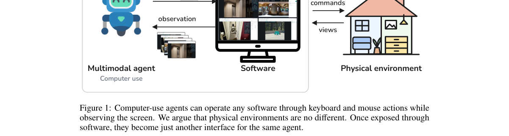

*Result - The shared computer-use agent operates four software applications through keyboard and mouse actions. Each application provides task-specific controls and displays the outcomes.*

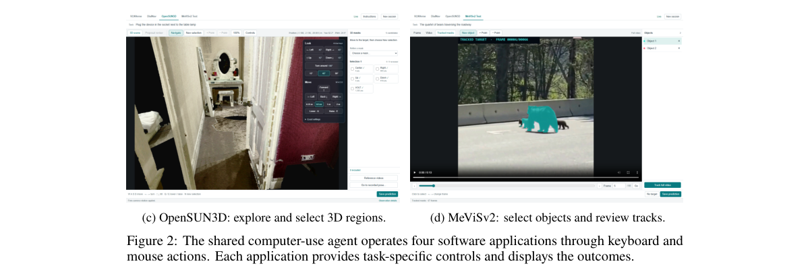

**Why this ranks #13**: 把物理环境渲染成屏幕上的软件接口、用同一套截图加键鼠动作的计算机使用智能体去操作，只换软件不改智能体，就在四场 ECCV 工作坊赛事中拿到第一、第二、第三与第六名，证明 CUA 技能可直接迁移到具身任务。

---

### 14. Lodos: A Lightweight Simulator Designed for Contact-Rich Interactions with Detailed Meshes

**arXiv**: [2611.08872](https://arxiv.org/abs/2611.08872) | **Score**: 8.0 (relevance 8 x 0.7 + quality 8 x 0.3) | **Direction**: `embodied_ai` | **Tags**: embodied, rigid-body-simulation, mesh-collision, signed-distance-field, gpu-parallel, contact-rich, University of Tubingen | **Categories**: cs.RO | **Pages**: 8

**Authors**: Onur Beker; Andreas René Geist; Georg Martius

**Affiliation**: University of Tubingen; Max Planck Institute for Intelligent Systems

**Abstract**

> In recent years, massively parallelized rigid-body simulation has played a central role in robotics research, enabling rapid progress in areas such as reinforcement learning, stochastic optimal control, and randomized smoothing-based trajectory optimization. Particularly in contact-rich settings, the scalability of such simulations in large part depends on well-optimized representations of collision geometry, often requiring a coarse approximation of the underlying surfaces using primitives such as spheres, capsules, cylinders, and boxes. Whenever the complexity of the surfaces or the precision demands of the application render such approximations insufficient, it is instead necessary to employ mesh-mesh collisions, which impose a significant reduction in throughput. This paper proposes a simulation framework designed from scratch to address this bottleneck, with novel routines for broadphase and narrowphase collision detection as well as the subsequent contact dynamics computation. As experimentally validated, the framework matches existing well-established simulators in terms of physical faithfulness, and can achieve approximately an order of magnitude higher throughput in the detailed mesh-mesh collision setting that it specializes in. The source code is available at https://github.com/martius-lab/lodos.

**Key findings**

- **Finding**: 20 个各 451 顶点、100 球的甲虫网格下落场景中，Lodos-MJ-1/2 相对 MJWarp 的整体步进加速为 21.7×/24.8×，仅接触管线加速 14.8×/16.7×；Sharpa Wave 灵巧手重定向场景中整体加速为 9.19×/14.0×。
- **Inference**: MJWarp 依赖 GJK+EPA 的接触点在平行面碰撞时会跳变并产生可见滑移，而 Lodos 的摩擦修正方案在前 114 ms 精确给出 120 N 摩擦力、仅滑移 5.97 mm 后即稳定粘着，说明加速没有牺牲接触物理。
- **Recommendation**: 要用精细网格做接触密集训练可以先试球-SDF 加盒约束 QP 这条路线；Lodos 与主流模拟器接口兼容，MJWarp 上训的 Microduck 策略能零样本迁移过去，替换成本低。

**Key figures**

*Framework - A Microduck getting up and rolling, simulated in MJWarp and Lodos. The policy is trained in MJWarp and transferred zero-shot.*

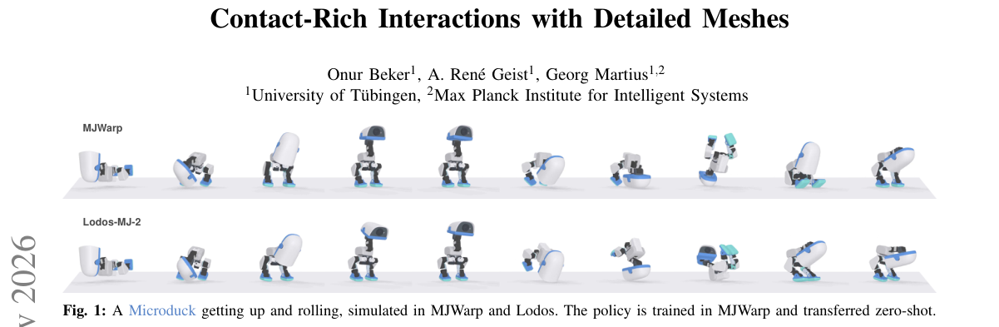

*Result - Left: Cubic spline interpolation. In 1D, evaluating the spline s(t⋆) requires accessing only four entries in the coefficient array (more generally 4N in N-D). Right: A collision geometry is re*

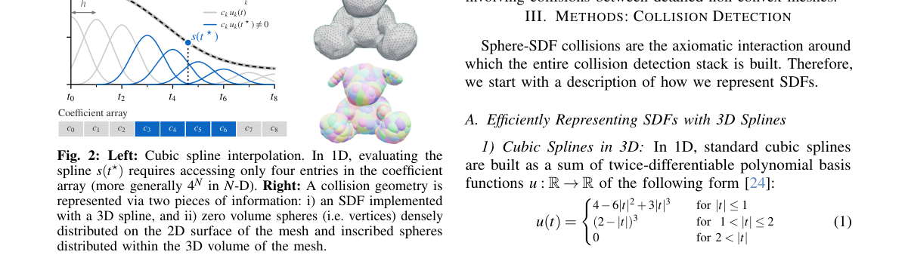

**Why this ranks #14**: 从零设计轻量级刚体仿真框架，用 3D 样条 SDF、球-SDF 窄相与盒约束二次规划的接触求解把碰撞检测彻底 GPU 化，在 20 个复杂网格下落场景中相对 MJWarp 取得 21.7×/24.8× 的整体步进加速，且物理保真度与既有成熟仿真器相当。

---

### 15. VLA Handover: Failure-Prediction-Based Switching from On-Robot to Server VLA Models

**arXiv**: [2611.08987](https://arxiv.org/abs/2611.08987) | **Score**: 8.0 (relevance 8 x 0.7 + quality 8 x 0.3) | **Direction**: `embodied_ai` | **Tags**: embodied, vla, remote-inference, failure-prediction, libero, edge-cloud, School of Engineering | **Categories**: cs.LG, cs.NI, cs.RO | **Pages**: 6

**Authors**: Takayuki Nishio

**Affiliation**: School of Engineering, Institute of Science Tokyo

**Abstract**

> Large vision-language-action (VLA) models generalize well but are difficult to run in real time on a robot, and small VLAs that run there fail more often. Remote inference over beyond-5G and 6G networks lets a robot use a large VLA on a server, but querying the server for every action chunk limits the number of robots per server. We propose VLA handover: the robot runs a small VLA (S-VLA) and switches to a large VLA (L-VLA) on a server only when the S-VLA is likely to fail. We formulate the switching as minimizing the request cost under a required success probability and, since this problem cannot be solved directly, propose a heuristic framework that retrains neither VLA. In simulation with SmolVLA and $π_{0.5}$ on three of the four LIBERO suites, VLA handover raised the success rate by 11-22 percentage points over the S-VLA alone and sent 49-77% fewer requests than server-only control at a 2-4 percentage-point lower success rate, and its completion time grew less with the network latency.

**Key findings**

- **Finding**: LIBERO-Object 上 VLA handover 成功率 94.4%，比纯本地控制高 10.6 个点、比纯服务器低 2.4 个点，每回合仅 3.40 次请求（比纯服务器少 77.3%），按 π0.5 的 4.4 次推理/秒折算单服务器可支撑约 12 台机器人，纯服务器方案只有约 2 台。
- **Inference**: LIBERO-Long 上退化为 63.6%（纯服务器 93.2%），因为小 VLA 在该套件只成功 35%、71% 的回合被切换而大 VLA 只完成其中 49%，说明切换策略的收益取决于小模型的基础成功率。
- **Recommendation**: 部署大 VLA 时用「失败预测触发切换」而不是定步长切换——定步长在 LIBERO-Object 上是 91.6% 且丢 25 个回合，而 VLA handover 只切换 28 个回合且一个没丢。

**Key figures**

*Framework - VLA handover. Top: system model; the handover manager decides when to hand control from the S-VLA to an L-VLA and to which of the K servers (K = 1 in Sec. III). Bottom: an episode; the S-VLA s*

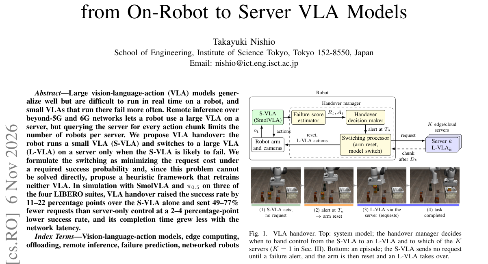

*Result - Control timelines (conceptual; D = 0.5 s for visibility, H = 50 steps, alert at 4 s, arm reset omitted). Thick bars: model in control (lighter: L-VLA actions computed from older observations);*

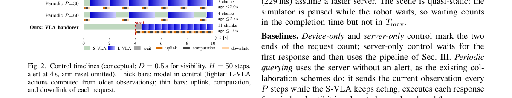

**Why this ranks #15**: 让机器人常驻小 VLA、只在预测小模型将失败时切换到服务器大 VLA：LIBERO 三个套件上成功率比纯本地控制高 11-22 个百分点，比纯服务器方案少发 49%-77% 的请求，代价只是成功率低 2-4 个百分点，且完成时间随网络延迟增长更慢。

---

## Footer

- Total papers reviewed across all 4 axes: 60
- world_embodied axis final count: 15
- Wild-cards in this axis: 0
- Figure assets: 2026-11-09/res/

Generated by `mine-arxiv-daily-digest` skill. Sister file: `2026-11-09_world_embodied_entry.md`.
