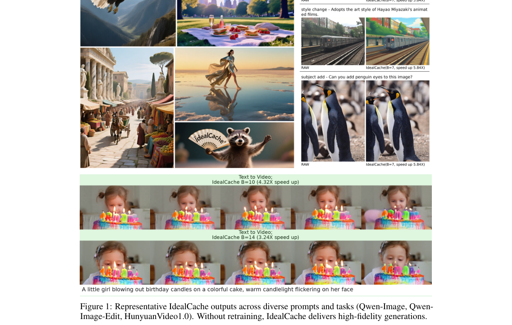
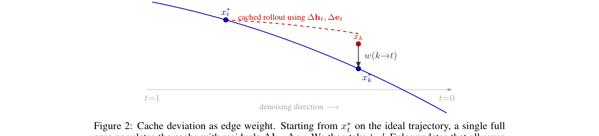
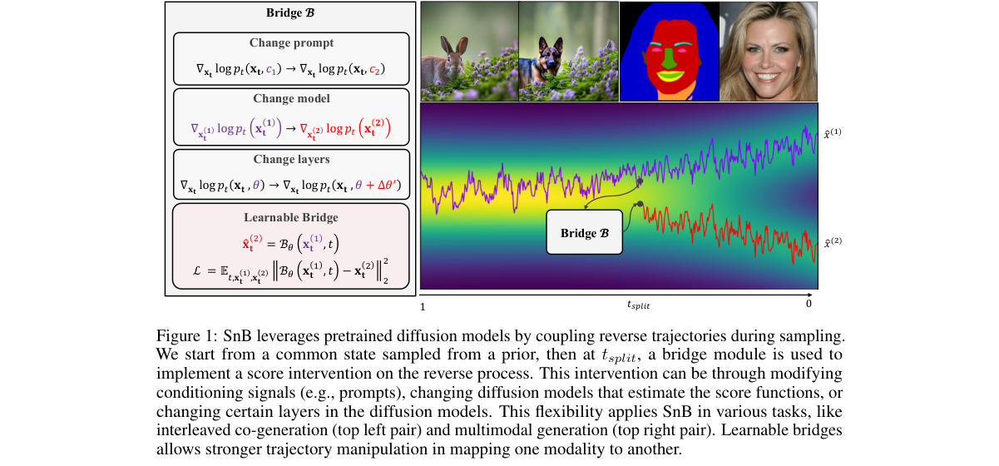
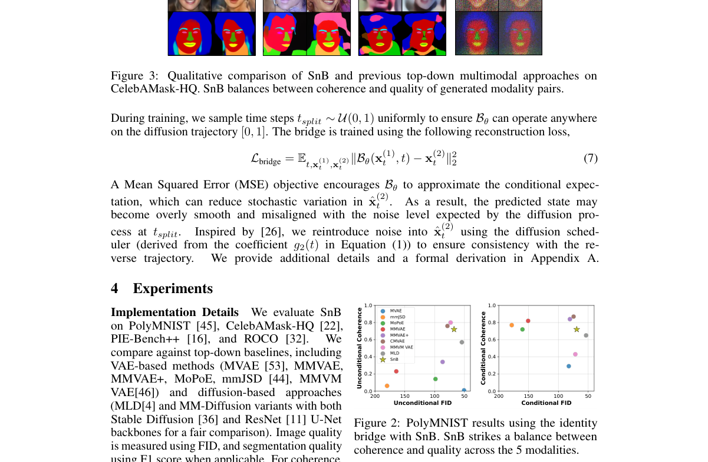
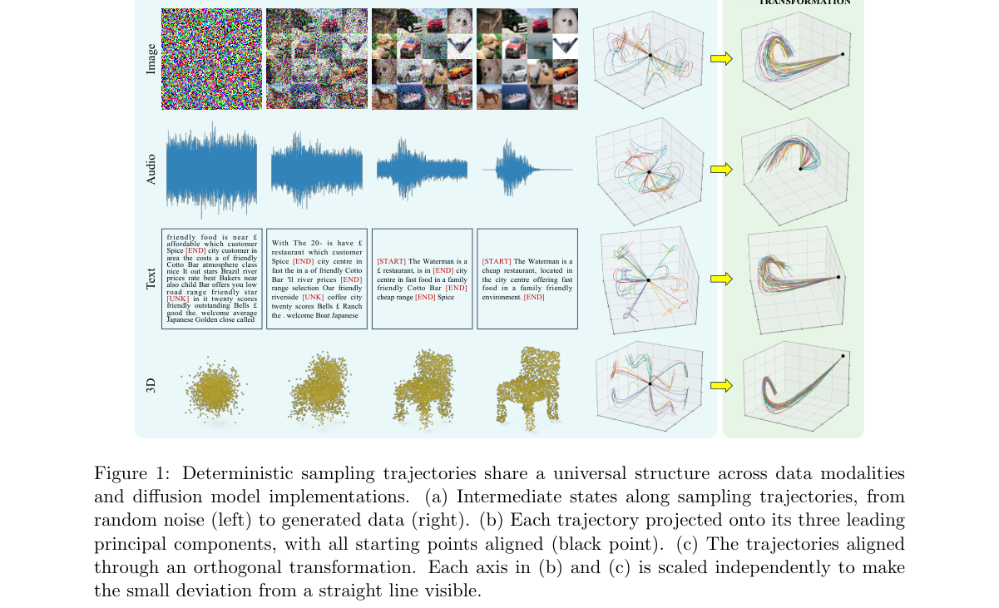
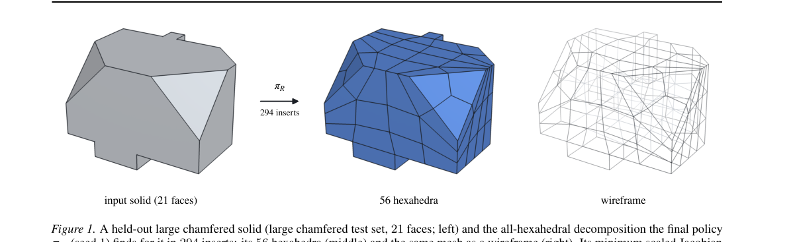
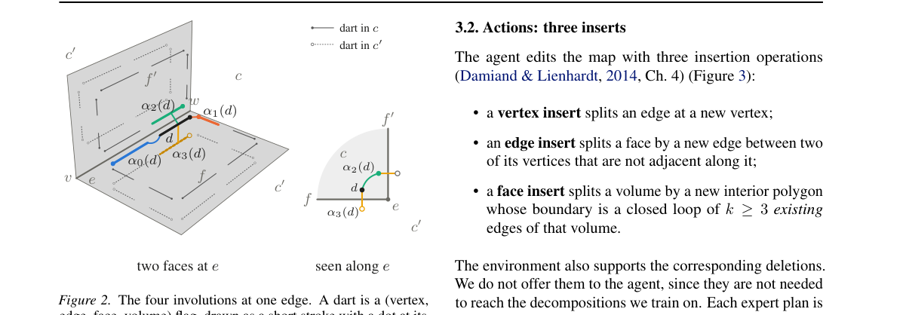

# Mine Arxiv Daily Digest - 2026-11-10 (AIGC 视觉生成与编辑 Axis, 5 papers)

**Generated**: 2026-11-10 17:30 CST

**Source**: arXiv cs.CV, cs.SD, eess.AS, cs.CL, cs.AI, cs.RO, cs.LG, cs.IR submissions, listing day 2026-11-07 (announced 2026-11-10 00:00 UTC)

**Batch window**: 2026-11-06T19:00:00Z .. 2026-11-07T19:00:00Z（arXiv 公告批次横跨两个 UTC 日：从前一日的美东 14:00 截止时刻起算（EDT 为 18:00Z，EST 为 19:00Z），到当日的同一时刻为止）

**Axis**: aigc_visual (5 papers, base 15, cap 20)

**Directions**: aigc_generation (4), aigc_editing (0), aigc_rl (1)

**Selection**: 5 papers ranked by relevance x quality, with 1 wild-card slot

**Day total**: 39 papers across 4 axes (target 60)

**Scope**: 图像 / 视频 / 3D / 4D 内容的生成与编辑，以及面向视觉生成的 RL / 偏好优化与奖励模型

⚠️ **Wild-card**: 本 axis 收录 1 篇 wild-card（另有 4 篇直接够格论文），共 5 篇。

**aigc_visual 是本批次最薄的方向**：真正的图像 / 视频 / 3D 生成与编辑方法论文只有 3 篇，编辑方向（aigc_editing）**一篇都没有**，RL 方向（aigc_rl）只有 HexIt 一篇把强化学习用在三维网格生成上。按 skill「够格就发、发不满是正常结果」的规则这里不凑数，它让出的名额流向候选最充裕的 `llm_vlm`；补位的 1 篇 wild-card 从方法侧换到使用侧（通用生成式图像模型作为医学影像合成训练数据源的临床评估）。

**供给说明**：本批次 aigc_visual 全部候选仅 24 篇，其中真正的生成 / 编辑方法论文只有 3 篇；编辑方向完全断供，本 axis 因此只发 5 篇，而不是基准配额 15 篇。

---

## AIGC 生成（图像 / 视频 / 3D / 4D） · `aigc_generation` (4 papers)

本方向 4 篇（含 1 篇 wild-card），是本批次最薄的方向之一。IdealCache 直面 DiT 推理加速里的一个隐含假设——现有特征缓存方法都把「标准参考去噪轨迹」当成优化目标，于是把参考路径的输出质量当成天花板；它改为先为每个输入构造一组理想轨迹的集成，把它们的几何聚成一张图，再用约束最短路去找最优的非均匀缓存调度，从而打破对参考过程的模仿。Split and Bridge 走的是「不联合训练、直接在采样阶段耦合预训练单模态扩散模型」的路子：沿同一条共享扩散轨迹走到分裂点，再由一个 bridge 模块分叉到各模态的专属轨迹，从而让图像与分割掩码这类互补模态可以即插即用地协同生成，不必为多模态从头联合训练。On the universal structure in deterministic generative diffusion 给出了确定性采样轨迹的普适几何结构，并用一个基于最优线性去噪器的可精确求解模型来解释它——这为「扩散模型内部到底在走一条什么样的路径」提供了一个可以闭式分析的理论视角。补位的 wild-card 从方法侧换到使用侧：一篇多模态回顾性研究评估了 Nano Banana 这一通用图像生成与编辑模型能否作为医学影像模型的合成训练数据来源，横跨胸部 X 光、眼底、CT 与颈动脉超声四种模态，用纯合成数据训练再外部验证。

### 1. IdealCache: Rethinking Cache Scheduling in Diffusion Transformers via Ideal Trajectories

**arXiv**: [2611.10340](https://arxiv.org/abs/2611.10340) | **Score**: 8.0 (relevance 8 x 0.7 + quality 8 x 0.3) | **Direction**: `aigc_generation` | **Tags**: AIGC-visual, diffusion-transformer, feature-caching, inference-acceleration, shortest-path-scheduling, training-free, Independent Researcher | **Categories**: cs.AI | **Pages**: 17

**Authors**: Shang Xue; Li Zhu; Ping Chen

**Affiliation**: Independent Researcher, Santa Clara, California; Independent Researcher, Mountain View, California; University of Electronic Science and Technology of China

**Abstract**

> Feature caching accelerates Diffusion Transformers by reusing intermediate computations across denoising timesteps, yet existing methods share a fundamental blind spot: they treat the standard reference denoising trajectory as the optimisation target, approximating its per-step states and thus inheriting its output as an implicit quality ceiling. We argue that this target is arbitrary -- what truly matters is the ideal result, not the intermediate path taken to reach it. We propose IdealCache, a training-free framework that abandons step-wise imitation of the reference trajectory. Instead, it anchors caching on a per-input ensemble of ideal trajectories constructed from candidate target results, aggregates their geometry into a single graph, and discovers optimal non-uniform schedules via a constrained shortest path on this graph. By decoupling from the reference process, IdealCache breaks the performance bottleneck of trajectory-approximation; our schedules can attain near-lossless fidelity in generation and even surpass on task-specific metrics (e.g., maintaining higher semantic consistency in image editing). Without retraining, IdealCache achieves 6.35x speedup on Qwen-Image, 5.84x on Qwen-Image-Edit, and 4.32x on HunyuanVideo, with competitive or superior quality across tasks.

**Key findings**

- **Finding**: 不重训即可在 Qwen-Image 上加速 6.35×（FLOPs 7.07×），ImageReward 1.1068（相对 50 步基线 −8.47%）、SSIM 0.666，同预算下 HyCa(N=8) 仅 1.0419（−13.83%）。
- **Inference**: 把缓存误差定义为到理想轨迹的偏离并当作有向无环图的边权做最短路，可一次性算出逐输入的非均匀刷新日程，因此质量-预算前沿优于按固定 K 步刷新的既有缓存方法。
- **Recommendation**: 做 DiT 推理加速时优先试这类免训练的日程搜索方法，重点记录逐预算档位的 ImageReward 与 SSIM 曲线，而不是只汇报一个平均加速比。

**Key figures**

*Framework - Representative IdealCache outputs across diverse prompts and tasks (Qwen-Image, Qwen- Image-Edit, HunyuanVideo1.0). Without retraining, IdealCache delivers high-fidelity generations.*

*Result - Cache deviation as edge weight. Starting from x∗*

**Why this ranks #1**: IdealCache 无需重训，在 Qwen-Image 上取得 6.35× 墙钟加速（FLOPs 7.07×）、Qwen-Image-Edit 5.84×、HunyuanVideo 4.32×，把缓存刷新从固定间隔改为理想轨迹图上的约束最短路搜索，是本 direction 里推理侧加速收益最直接的一篇。

---

### 2. Split and Bridge: Multimodal Generation via Diffusion Bridging

**arXiv**: [2611.10441](https://arxiv.org/abs/2611.10441) | **Score**: 8.0 (relevance 8 x 0.7 + quality 8 x 0.3) | **Direction**: `aigc_generation` | **Tags**: AIGC-visual, diffusion-bridging, multimodal-generation, bottom-up-coupling, zero-shot-editing, image-mask-pair, Computer Science | **Categories**: cs.AI, cs.CV, cs.LG | **Pages**: 36

**Authors**: Ahmad Arrabi; Xiaohan Zhang; Xingyu Li; Safwan Wshah

**Affiliation**: Department of Computer Science, University of Vermont; Center for Excellence in Brain Science and Intelligence Technology

**Abstract**

> Visual data are often expressed through multiple complementary modalities (e.g., images and segmentation masks), each capturing different aspects of the same underlying structure. Most existing multimodal methods adopt a top-down paradigm, learning a shared latent variable through joint training from scratch, which limits scalability. We propose Split and Bridge (SnB), a bottom-up framework for multimodal generation that couples pretrained unimodal diffusion models at sampling time. Rather than learning a unified latent space, SnB generates coherent multimodal samples by following a shared diffusion trajectory up to a split point and then branching into modality-specific trajectories guided by a bridge module. This design enables plug-and-play reuse of powerful pretrained models without joint training, making it scalable and easily adaptable. Across standard benchmarks (PolyMNIST, CelebAMask-HQ) and more complex settings (PIE-Bench++, ROCO), SnB achieves a strong balance between sample quality and coherence. We show that SnB naturally extends to downstream zero-shot tasks such as interleaved co-generation, image editing, and style coupling/decoupling. Our results demonstrate that bottom-up generation provides a practical framework that complements existing top-down multimodal approaches. Code is available at https://github.com/AhmadArrabi/SnB

**Key findings**

- **Finding**: CelebAMask-HQ 上 SnB 各分裂点设置的无条件 FID 为 59.22~60.84，而 MoPoE 为 151.23、MLD 为 121.69、MMVAE 为 358.21；一致性随分裂点推后从 0.49 升到 0.78。
- **Inference**: 分裂点越靠后、共享潜变量共同演化的时间越长，跨模态结构对齐越好，说明在采样期做自底向上的轨迹耦合足以替代共享潜空间的联合训练。
- **Recommendation**: 手上已有强单模态模型时先试采样期桥接而不是重训多模态联合模型，分裂点从 60%~70% 起扫，并同时验收 FID 与一致性两个指标。

**Key figures**

*Framework - SnB leverages pretrained diffusion models by coupling reverse trajectories during sampling. We start from a common state sampled from a prior, then at tsplit, a bridge module is used to impl*

*Result - PolyMNIST results using the identity bridge with SnB. SnB strikes a balance between coherence and quality across the 5 modalities.*

**Why this ranks #2**: 在 CelebAMask-HQ 上 SnB 的无条件 FID 随分裂点只在 59.22~60.84 之间波动，明显优于 MoPoE 的 151.23、MLD 的 121.69 与 MMVAE 的 358.21；分裂点取 70% 时联合一致性达 0.78，且全程无需联合训练、直接复用 SDXL/FLUX 等预训练单模态扩散模型，是本 direction 里可扩展性最强的一篇。

---

### 3. On the universal structure in deterministic generative diffusion

**arXiv**: [2611.10338](https://arxiv.org/abs/2611.10338) | **Score**: 7.0 (relevance 7 x 0.7 + quality 7 x 0.3) | **Direction**: `aigc_generation` | **Tags**: AIGC-visual, trajectory-geometry, gaussian-flow, principal-component-analysis, hyperbolic-structure, sampling-theory, UC Berkeley | **Categories**: cond-mat.stat-mech, cs.CV, cs.LG, stat.ML | **Pages**: 14

**Authors**: Defang Chen; Zhenyu Zhou; Can Wang; Zeyu Zheng; Siwei Lyu

**Affiliation**: UC Berkeley; Zhejiang University; University at Buffalo

**Abstract**

> Diffusion-based generative modeling has emerged as a general computational framework for simulating high-dimensional, structured data across various domains. Understanding its generative mechanisms is paramount for advancing model training and inference in a principled way. Here, we demonstrate that deterministic sampling trajectories share a universal geometric structure invariant to data modalities and diffusion model implementations. This structure can be largely explained by an exactly solvable model based on the optimal linear denoiser.

**Key findings**

- **Finding**: 图像、音频、文本、3D 点云四类模型的确定性采样轨迹经正交变换后形状近似重合，第一主成分解释轨迹 99% 以上方差，偏离直线的部分落在由特征值间隙定义的一族嵌套双曲线上。
- **Inference**: 以 LMMSE 线性去噪器替代网络去噪器得到的高斯流在高维下可精确求解并给出双曲结构，对齐后与真实轨迹的偏差降到 0.1148~0.3419，说明该规律是扩散传输分布的内在性质而非某个数据集的统计巧合。
- **Recommendation**: 调试扩散采样异常时可先用高斯流轨迹作参照形状，检查采样轨迹在主成分平面上的残差是否偏离双曲族，再去怀疑去噪器本身的权重或条件信号。

**Key figures**

*Framework - Deterministic sampling trajectories share a universal structure across data modalities and diffusion model implementations. (a) Intermediate states along sampling trajectories, from random n*

**Why this ranks #3**: 该文证明确定性采样轨迹在不同数据模态与不同扩散实现下共享同一种几何形状：第一主成分即解释轨迹 99% 以上方差，正交对齐后真实轨迹与高斯流的形状偏差在图像模态只有 0.1148（对齐前 0.5600），给 aigc 生成侧提供了罕见的通用理论基线。

---

### 4. Can General-Purpose Generative AI Supply Training Data for Medical Vision Models? A Multimodal Retrospective Study

**arXiv**: [2611.10484](https://arxiv.org/abs/2611.10484) | **Score**: 6.6 (relevance 6 x 0.7 + quality 8 x 0.3) | **Direction**: `aigc_generation` | **Tags**: AIGC-visual, synthetic-medical-images, data-augmentation, model-auditing, calibration-analysis, wild-card, University of Oxford | **Categories**: cs.AI, cs.CV | **Pages**: 43

**Authors**: Jiachuan Peng; Kyle Lam; Jierui Qu; Lin Li; Haining Zheng; Bang Zheng; Aniruddha Agarwal; Zaki Almallah; Min Chen; Vicente Grau; Hagai Rossman; Eran Segal

**Affiliation**: University of Oxford; Imperial College London; Peking University; Cleveland Clinic

**Abstract**

> Background: Well-annotated, diverse medical imaging datasets remain a major constraint for vision-based medical AI. We evaluated Nano Banana, a general-purpose image generation and editing model, as a source of synthetic medical images for model training, subgroup augmentation, and model auditing. Methods: In this retrospective study across four imaging modalities, chest radiography, fundus photography, and CT models were trained only on synthetic images and externally validated on real-world data against real-data-trained models. Carotid ultrasound models were trained on a private Human Phenotype Project cohort (aged 40-75 years) with and without synthetic augmentation. Clinicians rated image plausibility. Evaluation used AUROC, AUPR, calibration, and decision curve analysis. Findings: Synthetic-only models achieved AUROCs of 0.877 (95% CI 0.843-0.910) for pneumonia (n=14863), 0.963 (0.948-0.975) for retinal detachment (n=1149), and 0.711 (0.600-0.823) for renal calculus (n=4122), comparable to real-data-trained models, but their calibration and net benefit were not consistently more favorable. With mixed synthetic-real training, a carotid ultrasound model produced an ordinal vascular age index that stratified 633 external subjects into subgroups differing in BMI and glucose (both p<0.01), linking vascular aging to cardiometabolic health. To stress-test shortcut learning, editing a moderate tessellated pattern into fundus photographs reduced the true-class probability for central serous chorioretinopathy from 0.996 to 0.822. Clinician-guided editing raised low-quality CT plausibility from 3.10/5 to 4.30/5. Interpretation: Synthetic data can complement real data in model training, subgroup representation, and model testing via controlled editing, but its clinical value should be assessed with calibration, decision curve analysis, and clinician review, not discrimination alone.

**Key findings**

- **Finding**: 仅用合成数据训练的模型在肺炎识别 AUROC 0.877（95% CI 0.843–0.910，n=14863）、视网膜脱离 0.963（0.948–0.975，n=1149）、肾结石 0.711（0.600–0.823，n=4122），与真实数据训练模型相当，但校准与决策曲线净收益并未一致更优。
- **Inference**: 通用生成模型能补上亚组表示与训练数据缺口，其临床价值却取决于校准、决策曲线与医生复核而非单一 AUROC，因此它是生成能力的下游使用证据而非新的生成方法。
- **Recommendation**: 用通用生成模型扩充医疗影像数据时，必须同时汇报 AUPRC、校准曲线、决策曲线与医生 1–5 分合理性评分，并保留真实外部验证集做对照。

**Why this ranks #4**: 以补位身份入选：本 direction 该批供给偏薄，此篇提供的是使用侧实证而非生成方法。它用通用生成与编辑模型造合成医学影像，纯合成训练模型在肺炎、视网膜脱离、肾结石上 AUROC 分别为 0.877、0.963、0.711（n=14863/1149/4122），与真实数据训练模型相当，且编辑能把真实类别概率从 0.996 压到 0.822 用于模型审计。  [wild-card=yes] 本批次 aigc_visual 的真实生成方法论文只有 3 篇（Split and Bridge、IdealCache、确定性扩散的普适结构），该方向供给明显不足。按 skill「够格就发、发不满是正常结果」的规则这里不凑数，它让出的名额流向候选更充裕的方向；补位的这篇改从使用侧切入——把一个通用图像生成与编辑模型当作医学影像模型的合成训练数据来源来做多模态回顾性评估，横跨四种影像模态、纯合成训练再外部验证、临床医生评图像可信度，补上了「生成模型在真实下游管线里到底能不能用」这一维，属邻接选题补位。

---

## 面向视觉生成的 RL 与奖励模型 · `aigc_rl` (1 papers)

本方向只有 1 篇。HexIt 把「把一个多面体实体分解成少量形状良好的六面体块」——网格生成里一个长期悬而未决的问题——重写成 3 维广义组合图上的序贯决策：智能体用三种插入操作依次切分边、面与体直到每个胞元都是六面体且网格通过质量阈值，策略则在图的 involution 上做卷积来选择每次插入。它从构造好的分解里克隆策略再用专家迭代改进，在留出的倒角实体上最终策略 20 次采样内平均解出 94.4%，而专家迭代把大件倒角实体上的 best-of-20 求解率从 0.203 提到 0.355。它也是本批次唯一一篇把强化学习用在三维几何生成上的论文。

### 5. HexIt: Learning Hexahedral Block Decomposition with Expert Iteration on Combinatorial Maps

**arXiv**: [2611.10433](https://arxiv.org/abs/2611.10433) | **Score**: 7.3 (relevance 7 x 0.7 + quality 8 x 0.3) | **Direction**: `aigc_rl` | **Tags**: AIGC-visual, expert-iteration, combinatorial-map, hexahedral-meshing, rejection-sampling, policy-gradient-baseline, University of California | **Categories**: cs.AI, cs.CG, cs.LG | **Pages**: 21

**Authors**: Arjun Narayanan; Per-Olof Persson

**Affiliation**: University of California, Berkeley

**Abstract**

> Decomposing a polyhedral solid into a few well-shaped hexahedral blocks is a long-standing open problem in mesh generation. We cast it as a sequential decision problem on a 3-dimensional generalised map: an agent splits edges, faces and volumes with three insert operations until every cell is a hexahedron and the mesh passes a quality threshold, and a policy that convolves over the map's involutions chooses each insert. A successful decomposition takes over a hundred decisions, and a uniformly random policy never finds one. We clone a policy from constructed decompositions and improve it by expert iteration. On held-out chamfered solids that share no boundary topology with the cloning data, the final policy solves an expected $94.4\%$ in $20$ samples, and expert iteration raises the best-of-20 solve rate on large chamfered solids from $0.203$ to $0.355$. At matched compute, PPO, GRPO and VinePPO updates all make the cloned policy worse.

**Key findings**

- **Finding**: 最终策略在留出的小倒角实体上 20 次采样平均解出 94.4%、直角实体 99.4%，但一次成功分解需上百个决策（中位数 153 步，十分之一超过 296 步），均匀随机策略在任何测试集上都未成功。
- **Inference**: 在稀疏终局奖励下，专家迭代依靠逐实体归档持续补充新解，比 PPO、GRPO、VinePPO 这类同算力下反而把克隆策略改差的策略梯度更适合此类长程组合优化。
- **Recommendation**: 面对长程稀疏奖励的几何构造任务，先做克隆加专家迭代并保留 per-sample 归档做对照实验，不要默认 GRPO 或 PPO 是更省事的起点。

**Key figures**

*Framework - A held-out large chamfered solid (large chamfered test set, 21 faces; left) and the all-hexahedral decomposition the final policy*

*Result - The four involutions at one edge. A dart is a (vertex,*

**Why this ranks #5**: 作为 aigc_rl 仅有的供给，本文提供的是一个关键反例：专家迭代把大倒角实体的 best-of-20 求解率从 0.203 提升到 0.355，留出小倒角实体 20 次采样平均解出 94.4%，而同算力下 PPO、GRPO、VinePPO 全部让克隆策略变差。

---

## Footer

- Total papers reviewed across all 4 axes: 39
- aigc_visual axis final count: 5
- Wild-cards in this axis: 1
- Figure assets: 2026-11-10/res/

Generated by `mine-arxiv-daily-digest` skill. Sister file: `2026-11-10_aigc_visual_entry.md`.
