# Mine Arxiv Daily Digest - 2026-11-10 (具身智能与世界模型 Axis, 14 papers)

**Generated**: 2026-11-10 17:30 CST

**Source**: arXiv cs.CV, cs.SD, eess.AS, cs.CL, cs.AI, cs.RO, cs.LG, cs.IR submissions, listing day 2026-11-07 (announced 2026-11-10 00:00 UTC)

**Batch window**: 2026-11-06T19:00:00Z .. 2026-11-07T19:00:00Z（arXiv 公告批次横跨两个 UTC 日：从前一日的美东 14:00 截止时刻起算（EDT 为 18:00Z，EST 为 19:00Z），到当日的同一时刻为止）

**Axis**: world_embodied (14 papers, base 15, cap 20)

**Directions**: world_model (2), embodied_ai (12)

**Selection**: 14 papers ranked by relevance x quality, with 0 wild-card slots

**Day total**: 39 papers across 4 axes (target 60)

**Scope**: 世界模型、学习型模拟器与具身智能，含移动操作、人形控制、触觉反射、VLA 策略与面向具身任务的强化学习

**Wild-card**: 0（本 axis 本批次够格供给充足，未启用补位名额）

**配额说明**：world_model 方向本批次只有 2 篇够格（WMPA 的硬件-算法协同设计、远程机器人团队部署后多目标适应的世界模型定位），其余 12 篇集中在 embodied_ai，因此本 axis 发 14 篇（基准 15，world_model 让出 5 个名额）。

---

## 世界模型与学习型模拟器 · `world_model` (2 papers)

本方向只有 2 篇，而且两篇都不是「再训一个世界模型」——一篇问世界模型该跑在什么硬件上，一篇问世界模型在部署之后还有什么用。WMPA 从信息论与布尔电路复杂性出发，推导潜状态转移所需的算术操作数与 CMOS 动态能耗下界，并对 DreamerV3 风格的 RSSM 做剖析，发现每次 rollout 都受内存带宽限制，一块 GPU 消耗的能耗至少是 CMOS 能耗下限的 5.9×10^10 倍，而持续 back-to-back rollout 在热层面同样不可行。Multi-Objective Adaptation After Deployment 讨论的是部署后环境、硬件与编队变化让既有策略退化的场景：目标漂移可以靠从既有 Pareto 前沿里另选一个解来处理，但部署条件漂移会重排整个前沿，于是需要在不真正执行每个候选策略的前提下重新评估它们——这正是世界模型的用武之地，前提是预测性能的变化幅度要足够可信。

### 1. The World Model Planning Accelerator (WMPA): Hardware-Algorithm Co-Design for Embedded AI in Robotics

**arXiv**: [2611.10316](https://arxiv.org/abs/2611.10316) | **Score**: 9.0 (relevance 9 x 0.7 + quality 9 x 0.3) | **Direction**: `world_model` | **Tags**: embodied, world-model, hardware-accelerator, dreamer-rssm, energy-bound, thermal-design, American University of Sharjah | **Categories**: cs.AR, cs.LG, cs.RO | **Pages**: 7

**Authors**: Prerana Ramkumar; Suhas Suresh Bharadwaj; Fazal Hameed

**Affiliation**: American University of Sharjah; BITS Pilani - Dubai Campus

**Abstract**

> Embedded AI is moving from perception to prediction. Robots now use world models$\unicode{x2014}$learned simulators that predict the outcome of candidate actions in a compressed latent space before any is executed. Every predicted step must be computed on board within a tight power and thermal budget, yet the energy these steps fundamentally require, and how far real hardware sits from it, have not been characterized. We derive lower bounds on the arithmetic operations and the CMOS dynamic energy of a latent state transition from information theory and Boolean circuit complexity. Profiling a DreamerV3-style Recurrent State Space Model (RSSM) shows that every rollout operation is memory-bandwidth bound and that a GPU consumes at least $5.9\times10^{10}$ times the CMOS energy floor. Transient 3D thermal simulations show that this inefficiency is also a thermal one, since sustained back-to-back planning heats a millimeter-scale silicon tile to 556 K even behind an ideal copper heat spreader. Guided by this chain from bound to bottleneck, we propose the World Model Planning Accelerator (WMPA), a chip architecture for embedded world model planning that combines near-memory computation, real-time entropy estimation, variable-precision rollout units, and copy-on-write latent scratchpads. With a design target of 40x lower power, the same tile stays near ambient at 306 K in simulation, pointing toward practical planning on thermally constrained robots.

**Key findings**

- **Finding**: T4 板级实测功耗 68.19 W，已接近 70 W 额定 TDP；而 H=20 时单次规划能耗比 12nm CMOS 动态开关下限高 5.91×10^10 倍，horizon 更短时差距升到 6.08×10^10 倍。
- **Inference**: rollout 全部落在访存带宽受限区间、算力单元大部分闲置，说明瓶颈是数据搬运而不是算力不足。
- **Recommendation**: 要把世界模型规划搬上机器人本体，先用同样的 roofline 与能耗下限方法量出自家负载的差距，再决定近存计算与可变精度单元怎么配比。

**Key figures**

*Framework - Roofline projection of the rollout operations on three GPU generations (FP16 Tensor Core path). Ridge points are 203.5 (T4), 153.0 (A100), and 295.2 FLOPs/byte (H100), all for dense FP16. All*

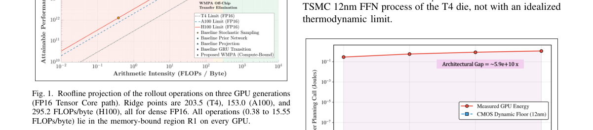

*Result - Dynamic activation sparsity (values < 0.01) under the analytic softmax-temperature-decay stress test, a synthetic proxy and not a trained- policy measurement. Sparsity stabilizes at 14.0% for*

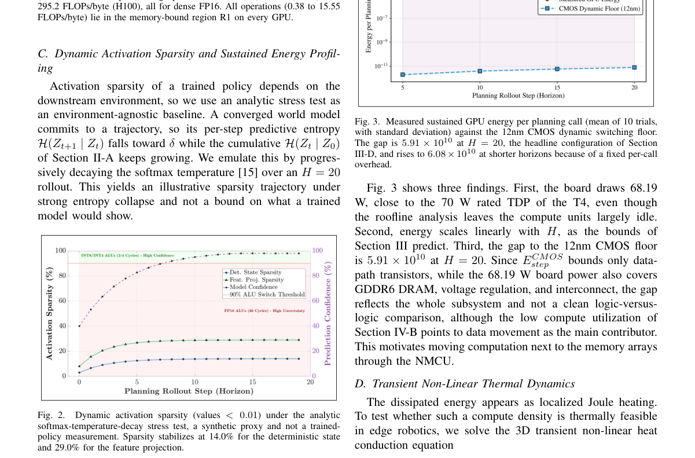

**Why this ranks #1**: 剖析 DreamerV3 式 RSSM 后测得单次规划调用中 GPU 能耗比 12nm CMOS 动态能耗下限高 5.91×10^10 倍，1 mm×1 mm 硅片在理想铜散热下仍升到 556.07 K，问题正落在世界模型部署链路上，故列本方向首位。

---

### 2. Multi-Objective Adaptation After Deployment: A Position on World Models for Remote Robot Teams

**arXiv**: [2611.10435](https://arxiv.org/abs/2611.10435) | **Score**: 8.0 (relevance 8 x 0.7 + quality 8 x 0.3) | **Direction**: `world_model` | **Tags**: embodied, position-paper, world-model, multi-robot-teams, post-deployment-adaptation, multi-objective, Collaborative Robotics and Intelligent | **Categories**: cs.RO | **Pages**: 6

**Authors**: Jamie Santos; Kagan Tumer

**Affiliation**: Collaborative Robotics and Intelligent Systems (CoRIS) Institute, Oregon State University

**Abstract**

> Autonomous robot teams deployed in remote, unstructured environments may face changes in the environment, hardware, and team composition that degrade previously effective policies. Shifting mission objectives can be handled by selecting a different solution from an existing Pareto set, but shifting deployment conditions can reorder the set itself, making previously dominated policies competitive or new policies necessary. However, evaluating these policies in new contexts while minimizing risk to the hardware remains an open problem. We argue that, although largely untested in this domain, world models merit investigation for post-deployment multi-objective adaptation. By predicting policy outcomes under updated estimates of current conditions, world models could enable teams to re-evaluate existing policies without physically executing each candidate, provided predicted performance changes reflect those realized on deployed systems. We identify research priorities for model-based policy re-evaluation, validation of predicted against realized performance, and incorporating shared information into world models to support coordinated team adaptation.

**Key findings**

- **Finding**: 论文主张世界模型可用于部署后的多目标适应，并列出三项研究优先级——模型化策略重评估、预测性能与实测性能的对照验证、把共享信息并入世界模型；同时以 Spirit 火星车右前驱动轮失效后改用倒驶、卡住的轮子挖沟发现蛋白石硅沉积为例，说明硬件失效会改变可用行为的支配关系。
- **Inference**: 由于该领域尚无「预测的性能变化能可靠映射到实测变化」的证据，这一思路目前仍属未经检验的假设。
- **Recommendation**: 做远程机器人自适应时应同步记录每次策略更新的预测收益与实测收益，并在同一批多目标指标上逐条对照，而不是只看单条轨迹。

**Key figures**

*Framework - This is a proposed pipeline for maintaining a shared, current representation of the world using world models after deployment. Distributed agents collect local observations, model predic- ti*

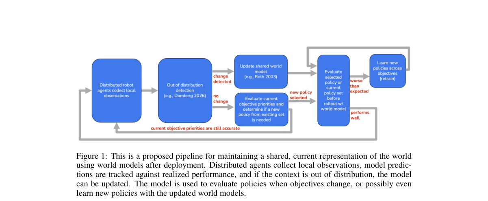

**Why this ranks #2**: 作为 CoRL 2026 的 6 页立场论文，它用 Spirit 火星车轮子失效导致倒驶的实例说明部署条件会重排 Pareto 解集，并给出三项研究优先级；因只立议程而无验证实验，排在 world_model 方向第二位。

---

## 具身智能与机器人学习 · `embodied_ai` (12 papers)

本方向 12 篇，覆盖策略学习、触觉、VLA、导航、失败诊断与评测六个层面。SimDuoReal 问了一个很直接的问题：复杂的双臂灵巧能不能从简单的物体中心目标里自己长出来——结果策略自己发现了预抓取、抓取与再抓取、手内调整到交接的全套行为，再用 DAgger 与强化学习把专家蒸馏成单一策略，真机上 80 次试验成功 61 次（76.3%）。SPARK-VLA 解决了 VLA 里的一个矛盾：要么推理时依赖显式几何输入，要么只有一条视觉通路，它用「保留-特化-路由」框架把 3D 理解从一个冻结的 3D 专家蒸馏进 LoRA 适配的视觉分支，再用一个轻量知识路由器只把与动作相关的视觉 token 转发下去。GUARD 则正面处理生成式机器人策略在闭环执行中的协变量偏移：它用策略自己的训练分布构造稠密的失败预警信号，与稀疏任务奖励一起过学到的 Q 函数，再用梯度在去噪过程中同时推高回报、推离支撑不足的区域，不需要人工干预或手工奖励。CPNav 用保形预测校准 VLM 的动作打分，给出用户指定风险水平下的有限样本保证，而且这层校准与具体 VLM 无关，可以套在任何 VLM 策略外面；触觉替代腕部相机的结论同样反直觉——两个低成本触觉阵列就能让策略在不训练也不部署时使用腕部图像的条件下追回腕部相机的性能优势；Grip, Trace, Write 把「手写」还原成真正的抓握-落笔耦合问题，用双分支 actor 分离持笔稳定性与臂腕书写；MIND 用稀疏自编码器打开机器人策略的内部特征，解释它到底是在哪里失败的；EmbodiedIntentBench 则把移动机器人的运行时适应评测改写成意图契约（覆盖、时间证据、汇报、紧急度、资源）下的因果资源核算执行。

### 3. GUARD: Anomaly-Informed Q-Steering for Generative Robot Policies in Dexterous Manipulation

**arXiv**: [2611.10343](https://arxiv.org/abs/2611.10343) | **Score**: 9.0 (relevance 9 x 0.7 + quality 9 x 0.3) | **Direction**: `embodied_ai` | **Tags**: embodied, diffusion-policy, dexterous-manipulation, q-steering, anomaly-detection, sim-to-real, Stanford University | **Categories**: cs.RO | **Pages**: 8

**Authors**: Aryaman Gupta; Xiaoyue Wu; Rana Soltani Zarrin; Mark Van der Merwe

**Affiliation**: Stanford University; Honda Research Institute USA

**Abstract**

> Generative robot policies based on diffusion and flow matching can model complex, multimodal behaviors, but remain susceptible to covariate shift during closed-loop execution. Existing approaches mitigate such failures through additional demonstrations, policy fine-tuning, or test-time guidance, but often require human intervention, engineered rewards, or other task-specific signals. We introduce GUARD, an anomaly-informed Q-steering framework that leverages the policy's training distribution to construct a dense, failure-anticipatory steering signal. GUARD pairs sparse task rewards with dense anomaly scores learned from policy training data and propagates both through a learned Q-function. Its gradients then steer the denoising process toward actions that improve task return while preventing trajectories from entering poorly supported regions, without directly modifying the pretrained policy. Across four Adroit dexterous manipulation tasks, GUARD achieves average success rates of $96.0\%$ and $80.0\%$ under nominal and perturbed dynamics, outperforming the strongest baseline by $21.0$ and $20.0$ percentage points while maintaining the lowest anomaly score. GUARD further demonstrates direct sim-to-real transfer on in-hand screwdriver rotation and reorientation tasks, achieving $40$ and $25$ percentage-point gains in success rate. These results demonstrate that anomaly signals can serve not only for failure monitoring but also to complement sparse task rewards as effective supervision for robust policy steering.

**Key findings**

- **Finding**: 每个任务评测 100 条回合、3 个随机种子，GUARD 在四个 Adroit 任务上名义平均成功率 96.0%（比 BC 高 36.0 个百分点、比 DynaGuide 高 21.0 个百分点），扰动动力学下 80.0%（分别高 39.0 与 20.0 个百分点），并取得最低的 RND 状态异常分数。
- **Inference**: 把策略自身训练分布上学到的异常分数当作稠密监督信号，可以在不改动预训练生成式权重的前提下同时缓解奖励稀疏与协变量偏移。
- **Recommendation**: 给扩散或流匹配策略做在线加固时，优先复现「异常分数加稀疏奖励 → Q 函数 → 去噪梯度」这条链路，并按真实硬件的接触分布重新校准异常度量。

**Key figures**

*Framework - We propose GUARD, a method for steering pretrained generative policies away from failures. GUARD learns a Q- function from sparse task rewards and dense anomaly signals, thus anticipating the*

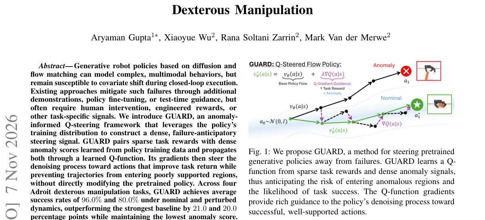

*Result - A qualitative visualization of steering with GUARD in the Adroit Pen task. (Left) unsteered BC policy forms a loose grasp of the pen and fails to properly reorient it, as indicated by low Q-va*

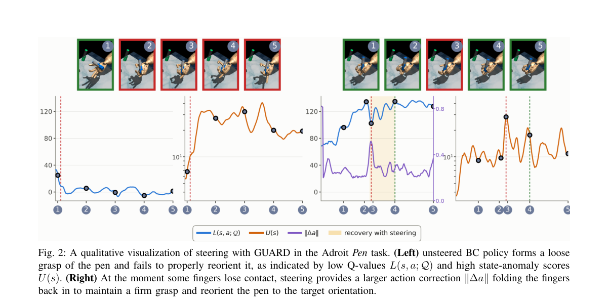

**Why this ranks #3**: 在 D4RL Adroit 的四个灵巧任务上，GUARD 名义与扰动动力学下平均成功率分别为 96.0% 与 80.0%，比最强基线高 21.0 与 20.0 个百分点，且不需人工标注或改造奖励，属于生成式策略在分布偏移下的直接改进，排本方向首位。

---

### 4. SimDuoReal: Object-Centric Bimanual Policy for Emergent Dexterity

**arXiv**: [2611.10410](https://arxiv.org/abs/2611.10410) | **Score**: 9.0 (relevance 9 x 0.7 + quality 9 x 0.3) | **Direction**: `embodied_ai` | **Tags**: embodied, bimanual-manipulation, object-centric-reward, rl, dagger-distillation, sim-to-real, Amazon FAR | **Categories**: cs.RO | **Pages**: 9

**Authors**: Qiyang Yan; Yulin Liu; Akash Sharma; Haozhi Qi; Guanya Shi; C. Karen Liu

**Affiliation**: Amazon FAR; UCSD; University of Chicago; CMU

**Abstract**

> Bimanual dexterous manipulation requires coordinated arm and hand control, yet specifying such coordination manually is challenging and often task-specific. In this work, we explore whether complex bimanual dexterity can emerge from a simple object-centric learning objective. We train reinforcement learning policies under a shared object-centric reward, varying their training environments rather than tuning separate rewards for each behavior. We find that the policies discover pre-grasp manipulation, grasping and regrasping, in-hand adjustment and handover to reach object-pose goals without hand-designed motion sequences. We then refine the experts on transition states and use DAgger and reinforcement learning to distill them into a single policy that composes these behaviors for diverse bimanual tasks. On real hardware, the same policy succeeds in 61 of 80 trials (76.3\%) across four tasks with unseen objects and no task-specific fine-tuning. In simulated barcode scanning, our policy achieves 85.0\% success, compared with 60.4\% for two single-arm policies without handover. These results suggest that this objective provides a simple and scalable interface for learning general bimanual dexterity, shifting the burden from manually designing robot coordination to specifying what should happen to the object.

**Key findings**

- **Finding**: 真机上同一策略在四个任务、80 次试验中成功 61 次（76.3%）；仿真条码扫描任务成功率 85.0%、进度 90.8%、耗时 8.6±3.9 s；去掉跨工作空间专家后成功率跌到 60.4%，去掉转移状态精修为 79.4%，完整教师链为 84.3%。
- **Inference**: 把协调难度从「手写动作序列」转移到「物体位姿目标」之后，双臂交接与重抓这类技能可以从训练环境设计中自发涌现。
- **Recommendation**: 试双臂任务时可先只设计物体目标采样与工作空间约束，让专家在共享奖励下自行分化，再用 DAgger 与强化学习蒸馏成单一策略。

**Key figures**

*Framework - SimDuoReal is a single object-centric policy that controls two dexterous arm-hand systems from a stream of desired object configurations. The same policy, transferred zero-shot from simulation*

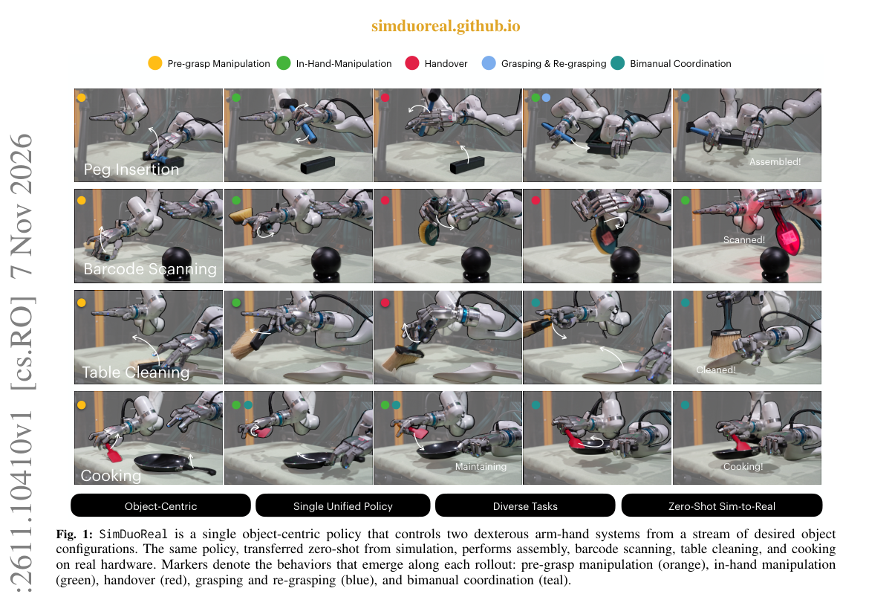

*Result - System overview (A) Three experts are trained in simulation under a shared object-centric representation and reward, with different goal-sampling regimes: the left and right experts πL and πR*

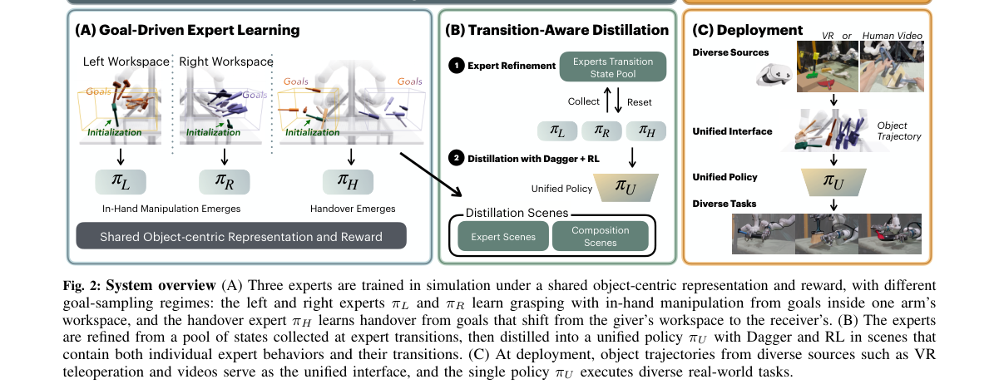

**Why this ranks #4**: 只用共享的物体中心奖励、不为每种行为单独设计奖励，策略就自发涌现预抓取、抓取与重抓、双手交接，真机在四个任务 80 次试验中成功 61 次（76.3%），条码扫描仿真 85.0% 对单臂基线 60.4%，凭这种涌现式灵巧入选。

---

### 5. Spatial Representation Distillation and Knowledge Routing for Vision-Language-Action Models

**arXiv**: [2611.10443](https://arxiv.org/abs/2611.10443) | **Score**: 9.0 (relevance 9 x 0.7 + quality 9 x 0.3) | **Direction**: `embodied_ai` | **Tags**: embodied, vla, spatial-representation, knowledge-routing, lora, parameter-efficiency, DGIST | **Categories**: cs.RO | **Pages**: 24

**Authors**: Jungin Park; Chaoran Zhu; Changjae Oh; Kwanghoon Sohn

**Affiliation**: DGIST; Yonsei University; Queen Mary University of London

**Abstract**

> Understanding three-dimensional physical structure has become essential for vision-language-action models (VLAs). However, existing approaches either rely on explicit geometric inputs at inference time or adopt a single visual pathway, potentially compromising the visual-semantic knowledge inherited from pre-trained models. We present SPARK-VLA, Spatial Representation distillation and Knowledge routing for VLAs, a preserve-specialize-route framework for spatially adapting VLAs without requiring external 3D inputs or experts at inference. SPARK-VLA consists of two key components: (1) spatial representation distillation, which transfers 3D understanding from a frozen 3D expert to a LoRA-adapted visual branch by aligning attention responses while preserving the original visual pathway, and (2) a lightweight knowledge router, which selectively forwards action-relevant visual tokens to the language model using routing supervision derived from action-loss gradients. Across LIBERO, LIBERO-Plus, CALVIN, and real-world manipulation, SPARK-VLA achieves strong performance with only a 0.5B language backbone and approximately 53M trainable parameters, providing an effective and parameter-efficient approach to 3D-aware VLA learning. Code is available at https://github.com/park-jungin/spark-vla.

**Key findings**

- **Finding**: SPARK-VLA 用 0.5B 语言骨干与 53M 可训练参数在 LIBERO 上取得 98.5% 平均成功率，与 VLA-Adapter 相同而可训练参数少约 11 倍、比 Evo-1 高 3.7% 且参数少 14 倍；LIBERO-Plus 扰动下为 78.6%（高出 VLA-Adapter 19.6%），CALVIN 的 ABCD→D 平均长度 4.61。
- **Inference**: 把三维理解蒸馏进 LoRA 分支并用梯度监督的知识路由筛掉无关视觉 token，可以在不牺牲原有视觉语义能力的前提下补上空间几何。
- **Recommendation**: 给现有 VLA 补三维能力时，优先保留原视觉通路另开 LoRA 空间分支，而不是换成推理期需要外部深度或点云的方案。

**Key figures**

*Framework - We depict (a) the averaged success rate for LIBERO and (b) the average length for CALVIN, with respect to the total number of parameters. The center point and the size of circles indicates t*

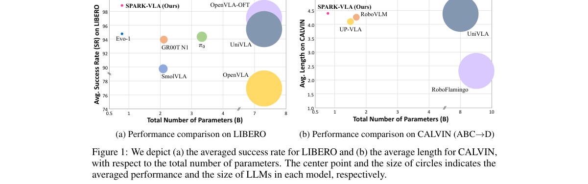

*Result - Overview of SPARK-VLA. Trainable mod- ules are represented in the red boxes.*

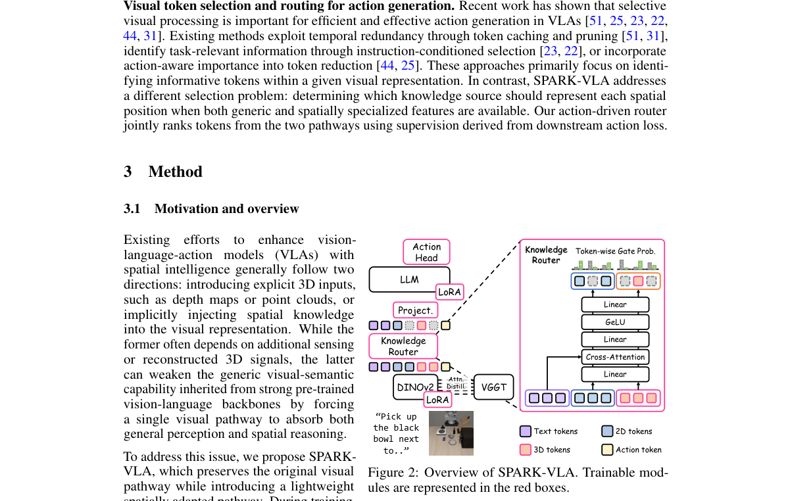

**Why this ranks #5**: 以 0.5B 语言骨干加约 53M 可训练参数在 LIBERO 上取得 98.5% 平均成功率，与 VLA-Adapter 相当却少约 11 倍可训练参数，LIBERO-Plus 扰动下还有 78.6%，是本方向参数效率最高的一篇 VLA 改造工作。

---

### 6. CPNav: Calibrated Vision-Language Navigation for Object-Goal Search in Unseen Environments

**arXiv**: [2611.10366](https://arxiv.org/abs/2611.10366) | **Score**: 8.3 (relevance 8 x 0.7 + quality 9 x 0.3) | **Direction**: `embodied_ai` | **Tags**: embodied, visual-navigation, conformal-prediction, calibration, object-goal-search, map-free, University of California | **Categories**: cs.AI, cs.RO | **Pages**: 9

**Authors**: Qizhao Chen; Yuanhong Zeng; Shoh Nishino; Anushri Dixit

**Affiliation**: University of California, Los Angeles

**Abstract**

> Directing a robot to locate a target object in unseen environments remains a central challenge in embodied AI. Vision-Language Model (VLM)-based methods provide rich semantic reasoning but often produce uncalibrated and overconfident action decisions. We introduce CPNav, a navigation framework that combines collision-aware planning with statistically calibrated VLM action scoring for map-free object-goal navigation. From RGB-D input, CPNav constructs a navigability map, generates collision-free motion primitives, and queries two VLMs for goal detection and action scoring. The resulting scores are calibrated offline via conformal prediction (CP) using oracle actions obtained through a tree-structured exploration procedure with backtracking, providing finite-sample guarantees at a user-specified risk level. The CP layer is model-agnostic and can wrap any VLM policy. Online, calibrated VLM scores guide action selection, while a tree-structured exploration history records alternative actions and allows backtracking. We evaluate CPNav in both simulation and real-world hardware settings. In AI Habitat simulation, compared with the uncalibrated baseline method, CPNav achieves relative SR and SPL improvements of 6.2% and 11.4% on HM3D v0.2, and 12.4% and 8.8% on MP3D, respectively. In real-world deployment on a modified Hiwonder MentorPi robot, the corresponding improvements in SR and SPL are 24.9% and 15.2%, respectively. Code is available at https://github.com/practice-lab-ucla/CPnav.

**Key findings**

- **Finding**: 在 AI Habitat 的 HM3D v0.2 上 CPNav 成功率达 86.0%，相对未校准基线成功率与 SPL 分别提升 6.2% 与 11.4%，平均行进距离缩短 17.5%，并比最优启发式阈值变体高 12.1% 的相对成功率；MP3D 上相对提升 12.4% 与 8.8%；真机成功率从 66.7% 升到 83.3%，SPL 相对提升 15.2%，平均距离缩短 30.0%。
- **Inference**: VLM 的动作打分本身并不可靠，但把它当作可校准的统计量再叠加碰撞感知规划，就能把过度自信转成可量化的风险控制。
- **Recommendation**: 把 VLM 接到机器人导航时，先用带回溯的树搜索收集 oracle 动作做保形校准，并把校准层作为可插拔模块接在任意 VLM 策略外侧。

**Key figures**

*Framework - Overview of the CPNAV pipeline. (a) The action proposer constructs candidate actions from RGB-D input, prioritizing unexplored regions while enforcing collision safety. (b) The threshold obtai*

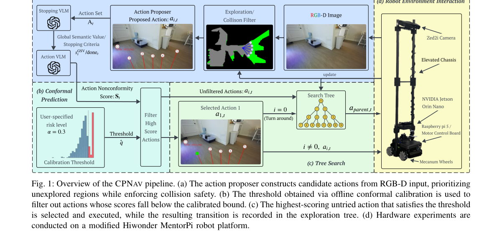

*Result - The action proposer uses the RGB-D observation to identify newly discovered regions and generate collision-free candidate actions toward them.*

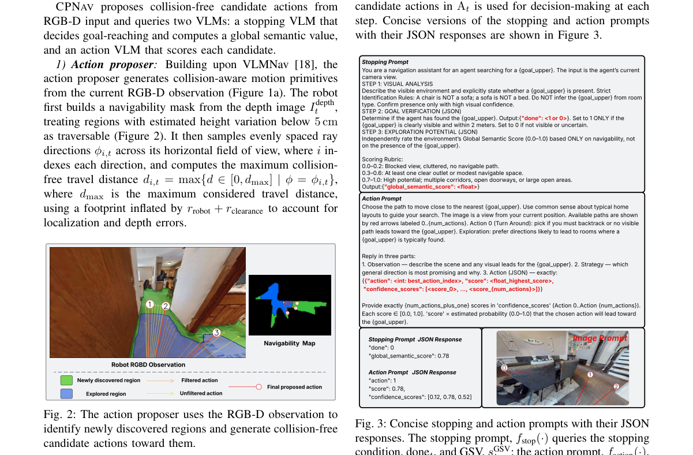

**Why this ranks #6**: 把 VLM 的动作打分经保形预测离线校准后再选动作，在 HM3D v0.2 上成功率 86.0%、相对提升 6.2% 且路径平均缩短 17.5%，真机 Hiwonder MentorPi 上成功率从 66.7% 提到 83.3%，是导航方向少见的带有限样本保证的校准方案。

---

### 7. Grip, Trace, Write: Force-Aware Imitation and Reinforcement Learning for High-DoF Robotic Handwriting

**arXiv**: [2611.10451](https://arxiv.org/abs/2611.10451) | **Score**: 8.3 (relevance 8 x 0.7 + quality 9 x 0.3) | **Direction**: `embodied_ai` | **Tags**: embodied, dexterity, force-aware, imitation-learning, reinforcement-learning, tool-use, Daxo Robotics | **Categories**: cs.RO | **Pages**: 18

**Authors**: Rongqian Chen; Yiding Chen; Jijie Zhou; Tom Z. Jiahao

**Affiliation**: Daxo Robotics

**Abstract**

> Most robotic handwriting rigidly mounts the pen and reduces writing to trajectory tracking. A freely held pen instead couples grasp stability, tip motion, and contact force. We present Grip, Trace, Write, a force-aware simulation environment and learning framework for high-DoF handwriting. A two-branch actor separates pen retention from arm-wrist writing while preserving their closed-loop coupling. Training learns a grasp controller, initializes writing from inverse-kinematics demonstrations by behavior cloning, and improves writing through reinforcement learning with rewards on ink, force, time, and retention. Across diverse tasks, the policy improves completion, precision, force regulation, and efficiency over behavior cloning and inverse kinematics, and generalizes without fine-tuning to unseen English and Chinese content. These results establish force-aware handwriting as a testbed for dexterous tool use.

**Key findings**

- **Finding**: 手部模型有 25 个手指关节、2 个腕关节与 7 个手臂关节，八个主任务各 50 个匹配种子上，最终 RL 把平均完成率提到 94.8%（BC 91.3%、IK 92.0%），精度从 79.0% 升到 87.6%，接触力 MAE 从 0.773 N 降 53% 到 0.362 N，耗时从 8.19 s 降到 7.67 s。
- **Inference**: 把稳住工具与用工具画拆成两个分支再保持闭环耦合，比直接对整条轨迹做模仿或逆解稳健得多。
- **Recommendation**: 做持物精细操作时，先单独训练并迁移抓握分支，再用逆解演示做广覆盖初始化，最后用结果导向的强化学习精修，而不是一步到位端到端。

**Key figures**

*Framework - Hand kinematics and two-branch actor. (a)(b) Spheres mark the finger joints, colored by finger, with rods along the hinge axes; the skin is rendered translucent. The hand has 25 finger joint*

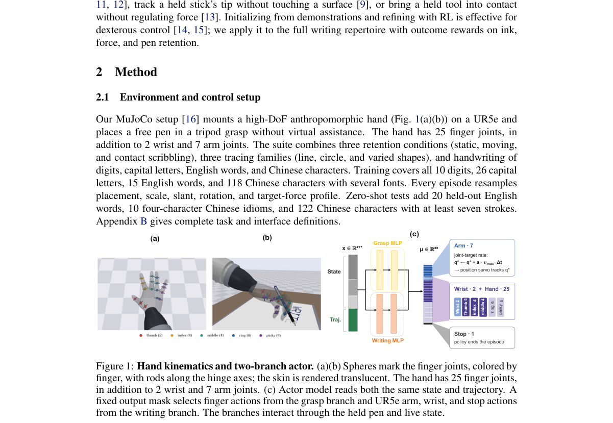

*Result - Training pipeline. Panels 1–3 correspond to the three stages in Sec. 2.3: grasp BC and hold RL, all-task writing BC with the learned grasp, and full-task outcome RL on the composed policy.*

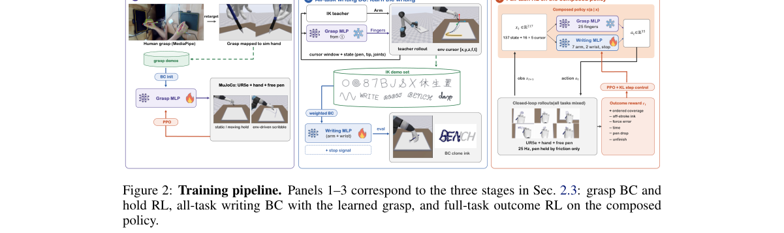

**Why this ranks #7**: 自由持笔的手写把抓握稳定性、笔尖轨迹与接触力耦合起来，这套双分支策略在 25 指关节的高自由度手上把平均完成率从 BC 的 91.3% 提到 94.8%，接触力误差从 0.773 N 降到 0.362 N，是灵巧工具使用的干净测试床。

---

### 8. Tactile Sensors Are an Effective Substitute for Wrist Cameras in Contact-Rich or Occluded Manipulation

**arXiv**: [2611.10490](https://arxiv.org/abs/2611.10490) | **Score**: 8.3 (relevance 8 x 0.7 + quality 9 x 0.3) | **Direction**: `embodied_ai` | **Tags**: embodied, tactile-sensing, act-policy, contact-rich, sensor-substitution, real-robot, Toyota Research Institute | **Categories**: cs.RO | **Pages**: 12

**Authors**: Aijia Yang; Arsh Tangri; Sergey Zakharov; Krishna Murthy Jatavallabhula

**Affiliation**: Toyota Research Institute; UC San Diego

**Abstract**

> Learned manipulation policies often rely on wrist-mounted cameras for close-range visual feedback that complements external views of the workspace. However, contact-rich manipulation requires establishing and maintaining contacts that can remain hidden even from wrist cameras. Tactile sensors mounted on fingers can reliably and directly measure contact, without needing visual access. In this work, we show that this feedback enables policies to recover the performance advantage of wrist cameras using scene and egocentric vision together with touch. Our approach incorporates two low-cost tactile arrays into a visuotactile ACT policy, without wrist images during training or deployment. We evaluate six real-world task families spanning placement, insertion, occluded retrieval, and sustained-contact tool use. On three contact-rich tasks, we independently vary wrist-camera and tactile availability while keeping the demonstrations, policy architecture, and optimization settings fixed. Adding wrist cameras improves success by 18.3-28.3 percentage points over vision without wrist images. Adding tactile sensing instead improves success by 31.7-60.0 percentage points and yields higher observed success than vision-only policies with wrist cameras on all three tasks, with significant advantages on two under Holm-corrected tests. These results support finger-mounted tactile sensing as an effective alternative to wrist cameras in the evaluated contact-rich settings.

**Key findings**

- **Finding**: 在 YAM 机械臂上挂两片低成本 FlexiTac 压阻阵列做视触觉 ACT 策略，T4–T6 三个接触密集任务上加腕部相机使纯视觉策略成功率提升 28.3、18.3、25.0 个百分点，而加触觉则提升 31.7–60.0 个百分点；无腕部图像的视触觉策略成功率分别为 81.7%、46.7%、71.7%，在三个任务上全部高于带腕部相机的纯视觉策略。
- **Inference**: 建立与保持接触的信息本来就存在于指尖而不是画面里，因此在场景与第一人称视觉仍在的前提下腕部相机是冗余的。
- **Recommendation**: 预算受限时优先把两片指尖触觉阵列接到现有 ACT 流水线上做开关式 A/B 对照，再决定是否保留腕部相机。

**Key figures**

*Framework - System and evaluation tasks. Two FlexiTac pads are mounted on the inner gripper surfaces and recorded alongside scene, egocentric, and wrist RGB observations. Panels d–i show tasks T1–T6, sp*

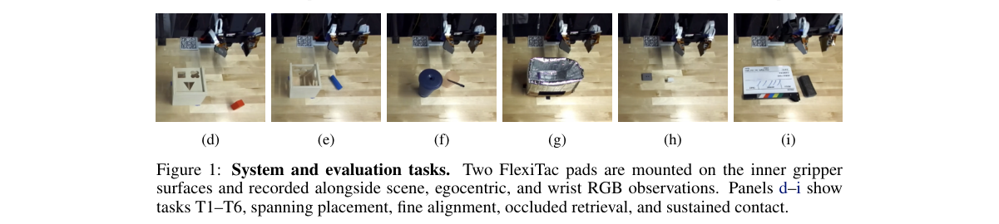

*Result - Customized station design*

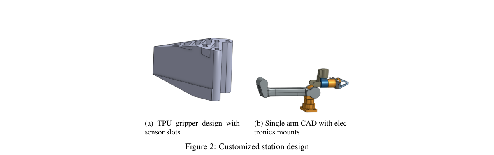

**Why this ranks #8**: 在固定演示、固定策略与固定优化设置的对照实验中，手指触觉带来的成功率增益为 31.7–60.0 个百分点，高于腕部相机的 18.3–28.3 个百分点，且三个接触密集任务上无腕部图像也优于有腕部相机的纯视觉策略，是触觉替代腕相机的受控实证。

---

### 9. Detecting and Explaining Robot Policy Failures from Sparse Internal Features

**arXiv**: [2611.10400](https://arxiv.org/abs/2611.10400) | **Score**: 8.0 (relevance 8 x 0.7 + quality 8 x 0.3) | **Direction**: `embodied_ai` | **Tags**: embodied, mechanistic-interpretability, sparse-autoencoder, failure-detection, vla, runtime-monitoring, CARL Lab | **Categories**: cs.RO | **Pages**: 24

**Authors**: Riad Ahmed; Sujosh Nag; Moniruzzaman Akash; Momotaz Begum

**Affiliation**: CARL Lab, Department of Computer Science, University of New Hampshire

**Abstract**

> Visuomotor policies can handle many robot manipulation tasks, but understanding their failures remains difficult. Unfamiliar conditions and small action errors can lead to failure, yet watching the robot alone tells us little about what went wrong inside the policy. We introduce MIND (Mechanistic Interpretability for Neural Diagnosis), a method that looks inside a trained policy to detect failures during execution and identify the internal concepts involved. MIND uses a sparse autoencoder to break down the policy's internal activations into features that can be studied individually. We give meaning to these features by linking their activity to the robot's position, movement, and surroundings, and by steering their activations to examine how they affect the robot's actions. From successful and failed executions, we learn how the features behave on the way to a failure. During execution, MIND flags deviations from these patterns and uses the meaningful features contributing most to the change to describe the problem. Experiments in simulation and on a physical robot show that changes in these internal features help detect and explain failures. By using the same features for detection and diagnosis, MIND connects failure signals to understandable changes inside the policy.

**Key findings**

- **Finding**: MIND 在 OpenVLA、π0.5 与 LingBot-VLA 上用命名基特征做失效检测，AUROC 达 0.991（π0.5 上 0.988）且误报减半；在 π0.5 上抓住 99% 的失败而对照为 95%，报警中位滞后失败起点 10 步而非 25 步；闭环夹紧具名基特征时，14 个运动概念中有 12 个把「按该概念方向运动」的步占比从不超过 0.25 抬到至少 0.92。
- **Inference**: 逐 token 拟合 SAE、用固定规则命名并在留出回合上复核，这一构造方式本身就决定了能否抽出可泛化的通用基特征。
- **Recommendation**: 给已训练策略做失效归因时，先按 token 级拟合 SAE 并在留出轨迹上验证命名，再让检测器与解释器共用同一套基特征，避免两套特征互不对齐。

**Key figures**

*Framework - MIND end to end. The policy runs untouched (1–2), and a sparse autoencoder turns one of its activations into a sparse code (3–5). Top: a basis feature is named only if a recorded fact holds*

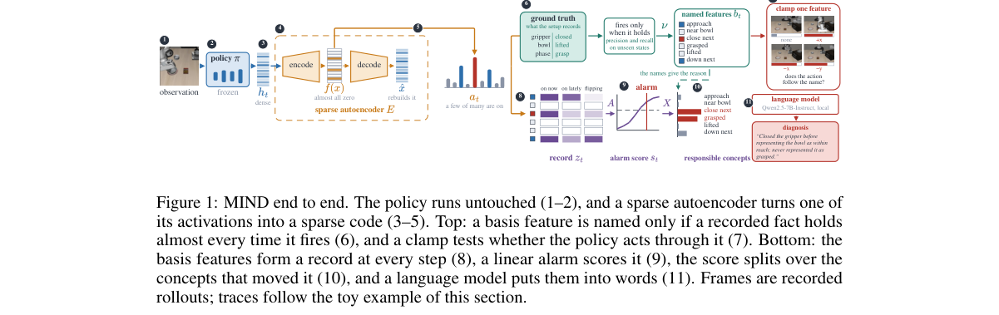

*Result - Two recorded attempts at one task: frames at the marked steps and, beneath, the six concepts of the toy vector, shaded by how strongly each basis feature is on (timing recorded, shading illu*

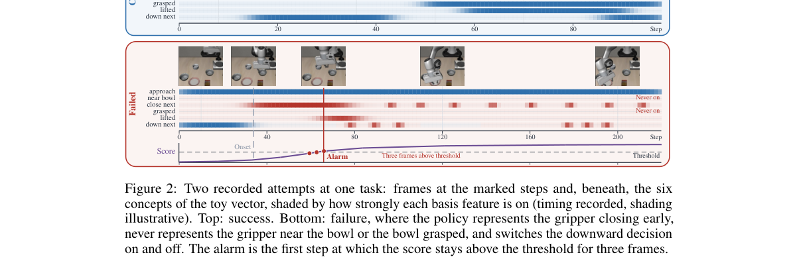

**Why this ranks #9**: MIND 用逐 token 拟合的稀疏自编码器把策略内部激活拆成人可读概念，在三个策略上取得 0.991 的 AUROC，并在 π0.5 上以一半误报抓住 99% 的失败，比先前「SAE 特征多为记忆」的结论更正面，是策略失效可解释性的代表工作。

---

### 10. Look Only Where You Plan for Real-Time End-to-End Urban Driving

**arXiv**: [2611.10264](https://arxiv.org/abs/2611.10264) | **Score**: 7.3 (relevance 7 x 0.7 + quality 8 x 0.3) | **Direction**: `embodied_ai` | **Tags**: embodied, autonomous-driving, bev-free, query-based, real-time, closed-loop, University of Georgia | **Categories**: cs.RO | **Pages**: 10

**Authors**: Haohua Que; Tianle Zhu; Qianyi Wu; Zhipeng Bao; Handong Yao

**Affiliation**: University of Georgia

**Abstract**

> Dense bird's-eye-view (BEV) construction accounts for 60% of the parameters in a strong recent driving planner. This paper presents LOWP, a planner that looks only where it plans: two sets of sixteen learnable queries read the cameras through the known calibration, one by sampling image features at projected 3D anchors and one by attending to features labeled with their viewing rays, so no dense BEV is built and no object or map is supervised. Evaluations on open-loop nuScenes, pseudo-simulated NAVSIM and closed-loop Bench2Drive show competitive planning with a compact representation. On nuScenes, average L2 changes from 0.302 to 0.296 m with 53% of the dense counterpart's parameters and 1.7 times its speed on the same GPU; the anchor-based reader performs better on turns than the global reader. On NAVSIM, scoring the planner's own trajectories alongside a vocabulary gives 85.9 PDMS without retraining. The closed-loop control configuration scores 65.5 on 218 routes, with a brake-induced standstill failure whose release rule has an inconclusive aggregate benefit. We distinguish measured latency from hardware-transferred estimates, which do not establish a common-hardware ranking.

**Key findings**

- **Finding**: LOWP 用两组各 16 个可学习查询直接读相机、不建密集 BEV，nuScenes 平均 L2 从 0.302 m 降到 0.296 m，参数为密集对手的 53%、同卡速度为其 1.7 倍；锚点式读头把 3 秒碰撞从 24 次降到 7 次并把转弯段 MAX L2 压低 0.10 m；NAVSIM 上把规划器自身轨迹与词表一起打分、无需重训即得 85.9 PDMS，Bench2Drive 闭环 218 条路线得分 65.51。
- **Inference**: 密集 BEV 的参数与算力大多花在无人使用的高密度表征上，改成稀疏查询能让端到端规划真正进入实时预算。
- **Recommendation**: 做车载端实时规划时先统计自家模型的 BEV 参数占比，并按「只在会规划的视锥内采样」的思路改造相机读取方式。

**Key figures**

*Framework - LOWP reads a scene through 32 queries and builds no BEV (nuScenes, a left turn). Red: the deformable reader’s last-layer sampling points (area: attention weight) and attention per camera; a*

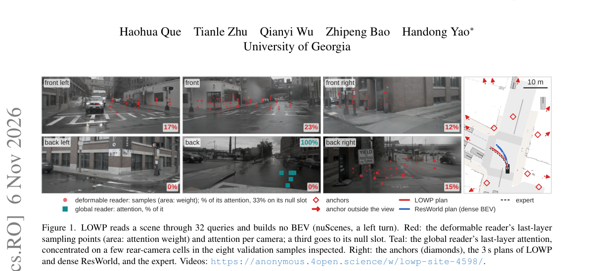

*Result - LOWP. Left: a ResNet trunk turns the camera images into stride-16 features F, and no dense BEV is built. Two experts plan from F, each a reader of 16 queries (three layers) and a planning he*

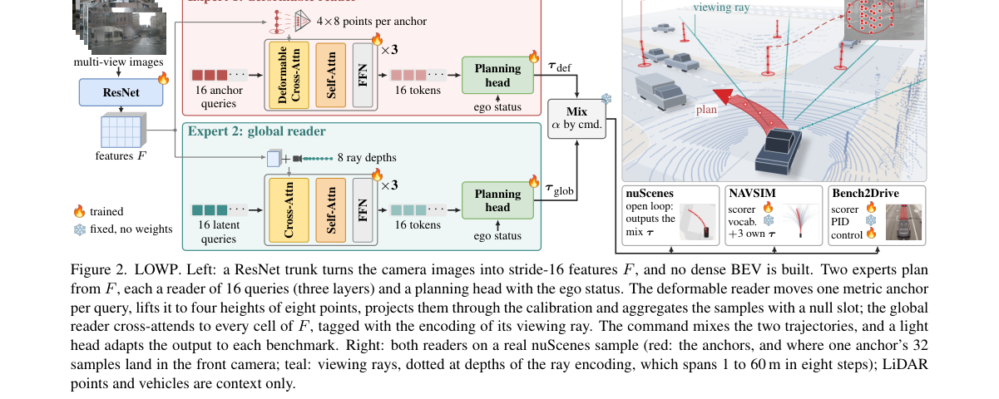

**Why this ranks #10**: 把密集 BEV 换成两组各 16 个可学习查询后，nuScenes 平均 L2 只从 0.302 变到 0.296 m，却用密集对手 53% 的参数和 1.7 倍速度，Bench2Drive 闭环拿到 65.51 分，是「少建图、只看向要规划处」这一路线的代表作。

---

### 11. Who Taught the Robot That? Removing One User's Corrections from a Robot Policy That Learns Online

**arXiv**: [2611.10280](https://arxiv.org/abs/2611.10280) | **Score**: 7.3 (relevance 7 x 0.7 + quality 8 x 0.3) | **Direction**: `embodied_ai` | **Tags**: embodied, machine-unlearning, human-corrections, continual-learning, shared-control, privacy, University of Illinois Urbana-Champaign | **Categories**: cs.HC, cs.RO | **Pages**: 11

**Authors**: Eshika Pathak; Leela Krishna

**Affiliation**: University of Illinois Urbana-Champaign; Centific

**Abstract**

> A robot that keeps learning after deployment is corrected by several people in turn, and one of them may later ask to be removed. We show that whether the robot can forget that person depends on how people correct it. The goal of removal is the robot that would exist if the person had never been there, which we compute exactly in two simulated tasks with scripted users. When users correct the robot by taking over control, an ordered log of training updates is enough: retraining on the remaining sessions in their original order gives a robot as close to the goal as training noise allows. Deleting the person's data and retraining in one pass does not, even when the other users' corrections do not depend on the removed person, because it loses the order of training. When users only nudge the robot's action, the other users' corrections carry the removed person's influence, and no method we tested recovers the goal robot. Continuing to train without the person removes most of their habits, but not what their data in the training buffer keep alive. The log can identify one clearly harmful user, but not rank users by influence better than counting their corrections.

**Key findings**

- **Finding**: 机器人先模仿 200 条演示学得基础策略，每位用户每次会话 10 回合、结束后微调 200 步，批次由当前会话 50%、历史回放 25%、原始演示 25% 组成，三名用户各 4 次会话；接管式纠错下按原顺序重训剩余会话可达到训练噪声允许的接近程度，一次性删数据重训则不行；轻推式纠错下 20%–60% 的纠偏强度都超出噪声可解释范围，全体剩余用户反对的习惯只能降到初始的 15%，删除其旧数据则降到 2%；日志在 85%–95% 的运行中能识别出三名用户里那个明显有害者。
- **Inference**: 在线机器人学习的「删除贡献者」不同于固定数据集上的机器遗忘，因为后者的其他用户纠正是被前者塑造过的，影响会渗透进别人的数据。
- **Recommendation**: 若要支持用户撤回同意，必须保留训练更新的有序日志并按原序重放，否则任何一次性重训都无法恢复「该用户从未存在」的策略。

**Key figures**

*Framework - The two tasks. Top: Delivery2D, seen from above. (a) The robot picks up an object on the left, passes through the low or the high gap in a wall, and puts the object down in the goal band on*

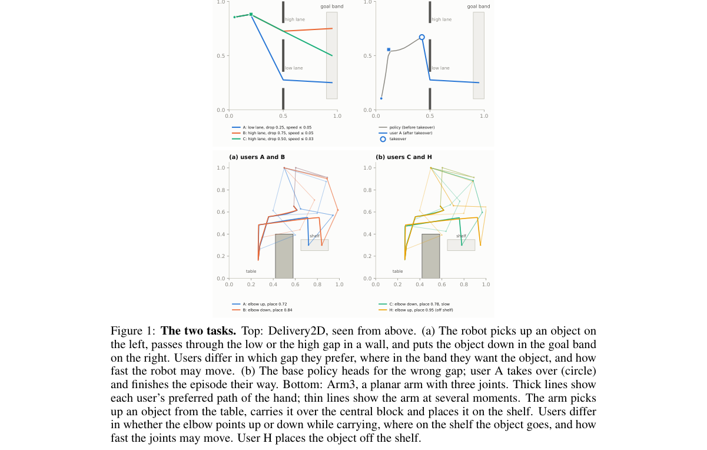

*Result - Where retrain’s error comes from, Delivery2D, takeover users. Each group of bars is one schedule (k is the block length). Blue: total distance from retrain to the counterfactual policy π−u.*

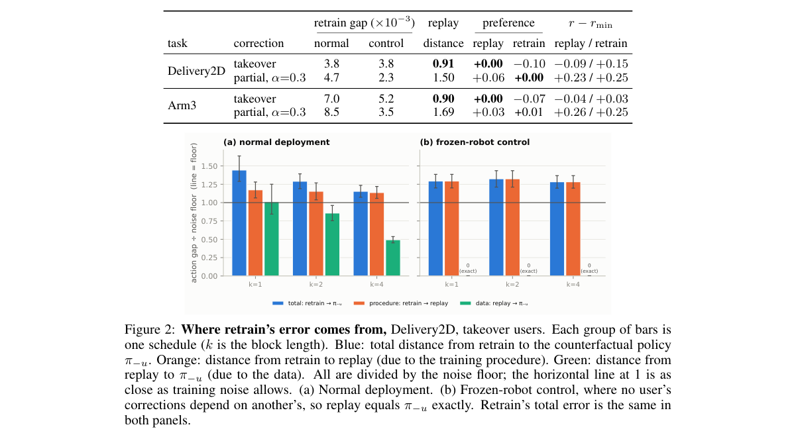

**Why this ranks #11**: 论文在两个仿真任务上精确算出「该用户从未出现」的机器人，发现接管式纠错只要保留有序更新日志就能近似复现目标机器人，而单纯轻推式纠错用测试过的方法都恢复不了，这种把机器遗忘与人机纠错方式绑定的实证排本方向中段。

---

### 12. SituRecBench: Evaluating Frontier Models as Situated Recommendation Assistants in 3D Environments

**arXiv**: [2611.10349](https://arxiv.org/abs/2611.10349) | **Score**: 7.3 (relevance 7 x 0.7 + quality 8 x 0.3) | **Direction**: `embodied_ai` | **Tags**: embodied, benchmark, situated-assistant, 3d-environment, vlm-evaluation, recommendation, Hong Kong Polytechnic University | **Categories**: cs.AI, cs.CL, cs.CV, cs.IR, cs.LG | **Pages**: 31

**Authors**: Jingtong Yang; Dongding Lin; Jian Wang; Wenjie Li

**Affiliation**: The Hong Kong Polytechnic University; Sichuan University

**Abstract**

> Recommender systems are transitioning from static retrieval engines into interactive assistants grounded in physical environments. However, current studies largely neglect the combined complexities of spatial navigation, visual grounding, and multi-turn social interaction. To bridge this gap, we introduce SituRecBench, an interactive benchmark for evaluating frontier vision-language models (VLMs) as situated recommendation assistants within high-fidelity 3D environments. We reformulate recommendation as a situated assistance process in which an assistant interacts with a user while sharing the user's egocentric view. Our benchmark simulates real-world shopping environments (e.g., supermarkets and home furnishings stores), requiring assistants to elicit preferences, ground recommendations in the environment, and guide the user to relevant locations through dialogue. The benchmark evaluates dialogue quality, recommendation utility, and navigation effectiveness through a unified interactive protocol. Extensive experiments reveal persistent challenges in spatial grounding and preference elicitation, highlighting limitations in their ability to integrate global contextual information with local observations. SituRecBench provides a rigorous foundation for advancing the development of situated assistants in the real world.

**Key findings**

- **Finding**: 基准在两个 UE5 场景（超市、家居店）评测 Claude Opus 5、Gemini 3.1 Pro、GPT-4o、GPT-5.6 Sol、Qwen3.6-Plus、Qwen3-VL-8B 与 Gemma 4 E4B 七个模型，超市场景成功率从 Gemma 4 E4B 的 28.0% 到 Gemini 3.1 Pro 的 80.0%，家居店从 Qwen3-VL-8B 的 29.0% 到 66.0%；GPT-5.6 Sol 在超市的动作跟随率 89.0%、局部导航对齐 53.5%，在家居店为 82.2% 与 88.8%。
- **Inference**: 空间定位与偏好澄清同时不达标，说明模型难以把全局场景上下文与局部观测整合成一致的行动建议。
- **Recommendation**: 评测具身对话助手时除成功率外要同时报告动作跟随率、局部导航对齐与 R@5、NDCG@10，否则单看购物完成率会掩盖 grounding 失败。

**Key figures**

*Framework - Our SituRecBench aims to (1) provide rich 3D interactive environments (e.g., supermarkets, home furnishings stores); (2) share the same egocentric view with the user and provide sufficient s*

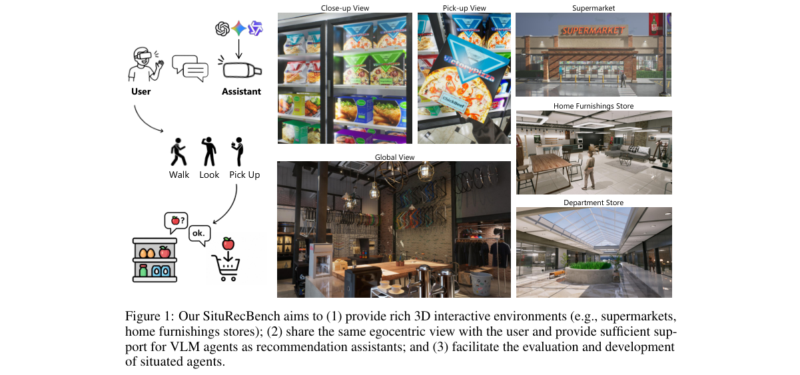

*Result - Overview of SituRecBench. (a) Situated 3D shopping environment construction; (b) User simulation with profiles, goals, and physical actions; and (c) Interactive evaluation of VLM-based recom*

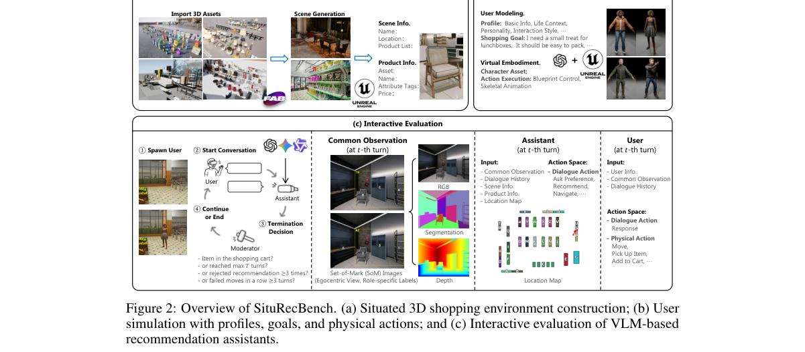

**Why this ranks #12**: 基准在 UE5 搭的超市与家居店场景里让 7 个前沿 VLM 与用户共享第一人称视角做多轮购物推荐，超市场景成功率从 Gemma 4 E4B 的 28.0% 到 Gemini 3.1 Pro 的 80.0%，并用 50 条真人轨迹对照 500 条模拟轨迹，是具身推荐方向目前最完整的一版评测。

---

### 13. Deploying Physically and Epistemically Compliant Agents by Distilling Belief-Space Task and Motion Planners

**arXiv**: [2611.10430](https://arxiv.org/abs/2611.10430) | **Score**: 7.3 (relevance 7 x 0.7 + quality 8 x 0.3) | **Direction**: `embodied_ai` | **Tags**: embodied, belief-space-planning, policy-distillation, reinforcement-learning, compliance, llm-command, MIT CSAIL | **Categories**: cs.AI, cs.RO | **Pages**: 9

**Authors**: Phillip J. K. Christoffersen; Rachel Ma; Patrick Barragán; Dylan Hadfield-Menell

**Affiliation**: MIT CSAIL

**Abstract**

> In this work, we train agents to act under uncertainty according to specified, belief-dependent rules. Deep reinforcement learning (RL) can in theory train agents to follow rules if encoded into well-designed rewards, but in practice, RL fails to perfectly optimize these rewards, leading to ineffective or noncompliant agent behavior. Belief-space planners by construction produce behavior in line with developer specification, but require hand-programming online planners and belief-state estimators, adding significant engineering complexity at scale. We combine the two: we plan offline to generate a dataset of sample trajectories and then distill the plans into a policy that acts on raw observations. We propose two changes to planner distillation that address problems specific to history-based policies: Dual Averaging, a loss that combines per-timestep predictive loss and average loss on task changes, and $ρ$-Optimal Reinforcement, a feedback mechanism that reinforces the policy's own successful rollouts when these are near-optimal. We provide a sufficient condition under which static search problems with noiseless observation models is complete, and show that maximum-likelihood-observation planning implies this condition in static search with continuous beliefs. We create a challenging new domain, Scavenger, where an agent needs to gain information in order to succeed. We evaluate our distilled policy in two versions of Scavenger, one where information is provided visually and one where it is provided as a command in natural language. In either case, the learned policy attains a success rate above 90% in Scavenger, compared with at most 5% for RL. We also find that distilled planners transfer with greater than 60% success to following unseen and intentionally vague commands and greater than 75% success to following floorplans larger than those seen in training.

**Key findings**

- **Finding**: 蒸馏策略在 Scavenger 上成功率 94%（47/50），两种 RL 变体都不超过 5% 且已获得至少 24 小时挂钟算力与稠密奖励；外推到留出指令为 92%（46/50）、故意含糊的指令为 62%（31/50）；训练只见 3–6 个房间，8 个房间（2 倍均值）成功率 80%（40/50）、12 个房间（2 倍最大）为 50%（25/50）、18 个房间（3 倍最大）为 36%（18/50）。
- **Inference**: 规则合规行为与其靠奖励塑形逼近，不如让信念空间规划器先生成轨迹再蒸馏，RL 的问题不在算力而在奖励无法被完美优化。
- **Recommendation**: 需要按开发者规则行动时，先用带信念状态的规划器离线生成示范并蒸馏，再用结果导向 RL 做微调，同时留意含糊指令与更大地图下的成功率下滑。

**Key figures**

*Framework - A worked example, where the robot must obey the epistemic rule: “ensure the user leaves their home, and has what they need when they leave”, while being physically safe. The robot should be co*

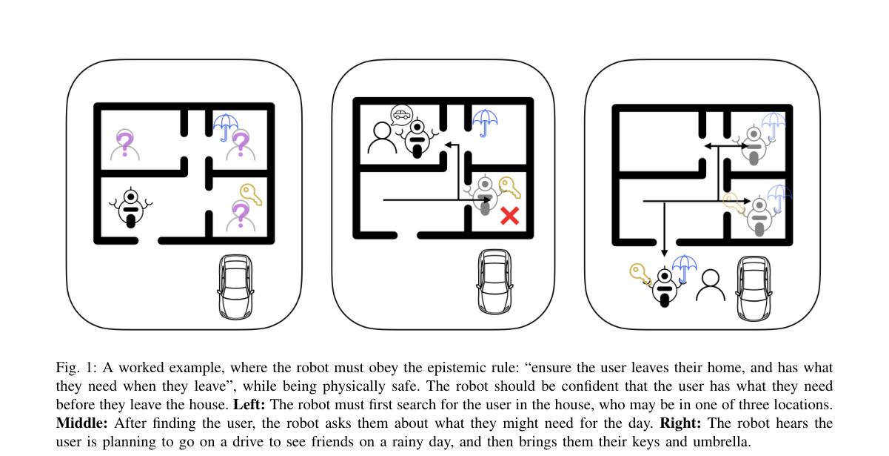

*Result - An overview of the Scavenger domain. (a) The agent starts in a random room for a procedurally generated floorplan, with a set of visual markers, a geometry visualizing connectivity between roo*

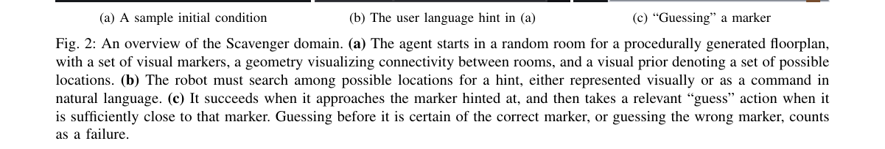

**Why this ranks #13**: 把信念空间任务与运动规划器离线蒸馏成只看原始观测的策略后，Scavenger 上成功率达 94%，而给足 24 小时挂钟算力与稠密奖励的 RL 基线最高只有 5%；论文还给出完备性充分条件，是「规则合规智能体」路线难得的定量结论。

---

### 14. EmbodiedIntentBench: Benchmarking Intent-Driven Runtime Adaptation for Mobile Robotic Missions

**arXiv**: [2611.10498](https://arxiv.org/abs/2611.10498) | **Score**: 7.3 (relevance 7 x 0.7 + quality 8 x 0.3) | **Direction**: `embodied_ai` | **Tags**: embodied, mobile-robot, uav, runtime-adaptation, benchmark, resource-aware, University of California | **Categories**: cs.AR, cs.CV, cs.DC, cs.LG, cs.RO | **Pages**: 16

**Authors**: Rajat Bhattacharjya; Changwoon Lee; Hyeonjong Ju; Sing-Yao Wu; Hamidreza Alikhani; Zhuoyi Yang; Ian Harris; Nalini Venkatasubramanian; Nikil Dutt

**Affiliation**: University of California, Irvine; Yonsei University

**Abstract**

> Mobile robotic sensing systems must adapt to operator requirements, limited resources, changing connectivity, and observation opportunities shaped by physical motion. Evaluating runtime strategies therefore requires assessing whether their decisions fulfill mission objectives, beyond isolated perception accuracy or execution efficiency. We present EmbodiedIntentBench, a benchmark for intent-driven runtime adaptation in mobile robotic missions. It represents mission intent through structured contracts for coverage, temporal evidence, reporting, urgency, and resources, and couples simulated unmanned aerial vehicle (UAV) workloads with causal, resource-accounted execution. Computation decisions affect mission time, resource use, and which observations can contribute evidence. We evaluate fixed and adaptive perception strategies in multi-phase missions and under changing urgency, connectivity, and battery conditions. In the multi-phase Depot study, a configuration with 87.5% full-bank target recall across visible target observations completes only 1 of 16 missions, whereas a lower-recall configuration completes 14. In an ablation, ignoring execution-induced observation loss increases aggregate mission success and reverses the ordering of two runtime strategies. Replays using Jetson AGX Orin CPU and GPU profiles change the relative success of local and remote strategies. In selected Jetson GPU-profile replays, intent-driven adaptation reduces modeled task energy by up to 28% with unchanged mission success. EmbodiedIntentBench provides an extensible framework for evaluating runtime decisions against mission fulfillment under physical and resource constraints.

**Key findings**

- **Finding**: Depot 上九种固定感知配置里，双视角 Mask R-CNN 合并的全库召回率最高为 0.875，却只完成 16 个任务中的 1 个、完成 22/64 个必需阶段且只在 8/16 条件下满足电量预留；切块 YOLO11s 召回率 0.807 却完成 14/16、60/64 阶段与 16/16 预留；动态紧迫度研究中紧迫感知的路由器在 48 个匹配条件上完成 25/48，晚到的感知请求从 90 次降到 0，模型板载任务能耗从 198 J 降到 168 J。
- **Inference**: 单帧召回率之外的时序证据、报告时限与算力电量约束共同决定任务成败，脱离执行条件评估感知会系统性高估。
- **Recommendation**: 评测移动机器人感知时必须把推理延迟、通信与电量计入证据链，用任务级完成度而不是单帧准确率来挑配置。

**Key figures**

*Framework - Motivation and overview of EmbodiedIntentBench. (a) Operator- specified missions impose requirements for target coverage, evidence ver- ification, timeliness, and resource use. (b) Local, sp*

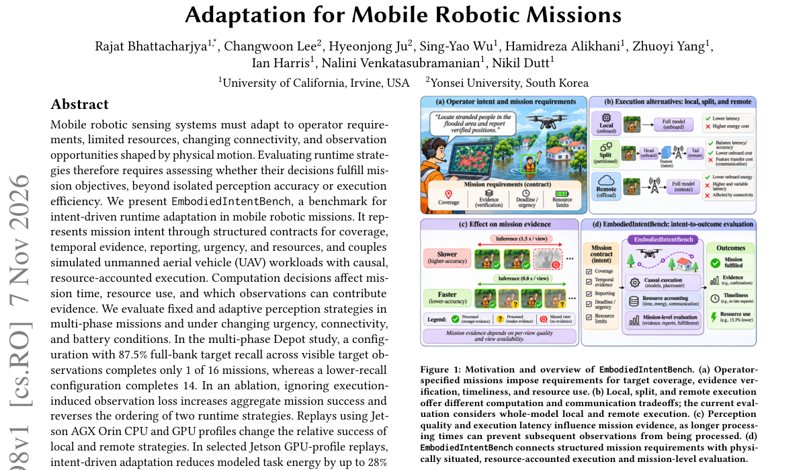

**Why this ranks #14**: 同一批 Depot 任务上，全库召回率最高的 Mask R-CNN 组合（0.875）只完成 16 个任务中的 1 个，召回率更低的切块 YOLO11s（0.807）却完成 14 个；论文用这个反例说明感知指标无法代表任务达成，是无人机运行时决策评测的重要修正。

---

## Footer

- Total papers reviewed across all 4 axes: 39
- world_embodied axis final count: 14
- Wild-cards in this axis: 0
- Figure assets: 2026-11-10/res/

Generated by `mine-arxiv-daily-digest` skill. Sister file: `2026-11-10_world_embodied_entry.md`.
