# Mine Arxiv Daily Digest - 2026-11-12 (AIGC 视觉生成与编辑 Axis, 15 papers)

**Generated**: 2026-11-12 01:26 CST

**Source**: arXiv cs.CV, cs.SD, eess.AS, cs.CL, cs.AI, cs.RO, cs.LG, cs.IR submissions, listing day 2026-11-10 (announced 2026-11-11 00:00 UTC)

**Batch window**: 2026-11-09T19:00:00Z .. 2026-11-10T19:00:00Z（arXiv 公告批次横跨两个 UTC 日：从前一日的美东 14:00 截止时刻起算（EDT 为 18:00Z，EST 为 19:00Z），到当日的同一时刻为止）

**Axis**: aigc_visual (15 papers, base 15, cap 20)

**Directions**: aigc_generation (11), aigc_editing (4), aigc_rl (0)

**Selection**: 15 papers ranked by relevance x quality, with 0 wild-card slots

**Day total**: 60 papers across 4 axes (target 60)

**Scope**: 图像 / 视频 / 3D / 4D 内容的生成与编辑，以及面向视觉生成的 RL / 偏好优化与奖励模型

**Wild-card**: **Wild-card**: 0 —— 本 axis 未启用任何 wild-card 名额。`aigc_rl` 让出的 3 个名额由 `aigc_generation` 内**同方向**的够格论文吸收，没有需要用邻接选题补位的空位。

**本 axis 出现一个供给断供的方向**：面向视觉生成的 RL / 偏好优化（`aigc_rl`）在本批次一篇都没有——全批 501 篇中「RL / GRPO / DPO / 奖励模型」与「图像 / 视频 / 视觉 / 扩散 / 3D / 流匹配」在 150 字符窗口内共现的只有 4 篇，唯一真正属于视觉 RL 的 2611.14436（Metric-Aligned GRPO）按方法学归属改落在 `llm_vlm_rl` 的 `Multimodal_GRPO`。按 skill「薄方向让出名额而不是被填充」的口径，`aigc_rl` 让出 3 个名额，全部由候选充裕的 `aigc_generation` 吸收（该方向由基准 8 篇增至 11 篇）。

---

## AIGC 生成（图像 / 视频 / 3D / 4D） · `aigc_generation` (11 papers)

本方向 11 篇，主线是**把生成的瓶颈从「多步采样」换成「表征与数值」**。APEX 把 DMD 的独立 fake-score 网络换成 condition shifting，让少步流式视频生成不再需要额外训练内存，评测一路推到 180 秒；FlashMotion 同时打掉 3D 动作生成的两个瓶颈——采样步数与每步计算——覆盖 text/music/speech-to-motion 三个入口；前向值离散化（Forward-Value Discretization）则给出一个反直觉的定理：**随机采样器即使采用高阶近似也仍然只是一阶收敛**，所以与其加高阶项，不如改评估点。前沿一侧，UGG 把 4D 场景生成与几何预测统一成单一模型，TaoMate-R1 用「时间角色特化」给流式多参考视频生成分配适配参数，UniWeaver 用模型无关的规划—生成—反馈框架把交错图文生成做成可训练任务。数值与表征一侧，鲁棒 Flow Matching 把目标污染与标签噪声统一写成「残差→样本权重」的映射（TRS 时间残差分数），RB-LDC 按解码器敏感度重新分配扩散潜码各方向的 log-SNR，PnP-ADMM 用辅助变量与对偶更新把流匹配先验拉回测量模型的一致性上。最后两篇把「可控」写成几何问题：几何 token 编码让 T2I 学会指针角度（而四个预训练 T2I 中不到 1% 能把两根指针都落在请求时刻 6° 内），RF3DGS 则用几何先验与多视角光度先验合成干净透射伪标签做反射去除。

### 1. Few-Step Streaming Video Generation via Condition Shifting

**arXiv**: [2611.14033](https://arxiv.org/abs/2611.14033) | **Score**: 9.0 (relevance 9 x 0.7 + quality 9 x 0.3) | **Direction**: `aigc_generation` | **Tags**: AIGC-visual, few-step-sampling, streaming-video, condition-shifting, distillation, Tsinghua University | **Categories**: cs.AI, cs.CV | **Pages**: 30

**Authors**: Deyuan Liu; Jungang Li; Kaiwen Zheng; Kai Jiang; Jintao Chen; Yaole Wang; Ming Lin; Tao Lin; Jianfei Chen; Jun Zhu; Jintao Zhang

**Affiliation**: Tsinghua University; Shengshu Technology; Westlake University

**Abstract**

> Few-step sampling reduces the cost of streaming video generation. Distribution Matching Distillation (DMD) supervises few-step generators with a separate fake-score network, which adds training memory and computation and must track the evolving generator. We extend APEX to streaming video by using condition shifting to estimate the velocity field of the generated distribution within the generator. The original text condition selects generation, while a shifted condition selects fake estimation using the same parameters. This removes the independent fake network while retaining S2-Avatar's frozen reference teacher, Self-Replay Forcing, and perceptual regularization. We evaluate APEX on 180-second videos using three backbone evaluations per block and a one-step spatial Refiner, with a 70-case human study and a 320-case StreamAV-Bench comparison. Compared with S2-Avatar, APEX achieves higher video instruction fulfillment on the Progressive track (3.856 versus 3.831) and higher visual aesthetics across both tracks (0.641898 versus 0.632606). Human raters favor APEX most strongly on instruction following, with +30.0% net preference, followed by consistency and video quality at +4.3% each. Motion quality favors S2-Avatar, audiovisual synchronization is predominantly tied, and usability is unchanged. Separate measurements under matched training settings show 4.4% lower peak allocated GPU memory per GPU and 9.2% shorter mean iteration time than DMD.

**Key findings**

- **Finding**: 论文在 180 秒视频上用 3 次骨干 NFE 加一步 2× 空间 Refiner 生成，StreamAV-Bench 共 320 个场景（Progressive 与 Interactive 各 160），Progressive 轨指令达成 3.856 对 3.831，两轨视觉美感 0.641898 对 0.632606，人评指令跟随净偏好 +30.0%。
- **Inference**: 独立 fake 网络被移除后少步采样仍能保持并略微超过 S2-Avatar 的指令跟随与美感，说明在这类流式任务上假分布估计与生成器共参数并不会成为精度瓶颈。
- **Recommendation**: 做流式视频蒸馏时可直接复用 condition shifting 思路，把假分数网络并入生成器，再配合冻结参考教师与感知正则来压低训练显存与迭代时间。

**Key figures**

*Framework - APEX streaming generation and interaction. Top: Progressive (left) and Interactive (right) StreamAV-Bench samples (3 NFE, 2× Refiner). The lower four rows show object interaction, turning, da*

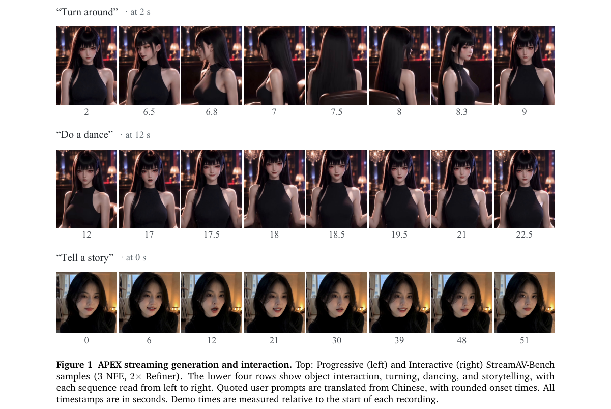

*Result - DMD and APEX in Self-Replay Forcing. DMD uses independent fake parameters η; APEX shares generator and fake parameters θ and, by default, AdamW states. Teacher parameters ϕ are frozen. Left:*

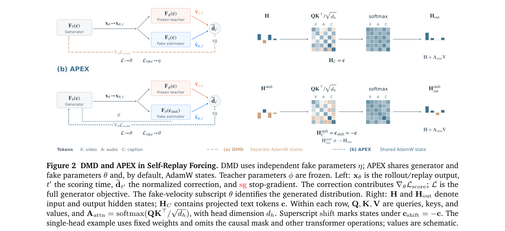

**Why this ranks #1**: 本 direction 最高分 9.0：用 condition shifting 让同一套参数同时承担生成与假分布估计，去掉 DMD 的独立 fake 网络，训练峰值每卡显存降 4.4%、平均单次迭代时间短 9.2%，180 秒长视频只用 3 次骨干 NFE 加一步 2× Refiner。

---

### 2. UGG: Unified Generative Geometry Model

**arXiv**: [2611.14440](https://arxiv.org/abs/2611.14440) | **Score**: 9.0 (relevance 9 x 0.7 + quality 9 x 0.3) | **Direction**: `aigc_generation` | **Tags**: AIGC-visual, unified-geometry, 4d-scene, diffusion-forcing, depth-estimation, Harvard University | **Categories**: cs.CV, cs.LG, cs.RO | **Pages**: 31

**Authors**: Amani Kiruga; Zhiyi Li; Ruojin Cai; Hansen Lillemark; Xiaoshan Wu; Ayush Tewari; Yilun Du

**Affiliation**: Harvard University; University of Cambridge

**Abstract**

> Understanding 4D scenes is a core challenge in visual intelligence, requiring models to jointly capture scene geometry, appearance, and dynamics from partial observations. However, existing approaches are subdivided into feedforward models for direct geometric prediction, and generative models for visual synthesis. We introduce UGG, a unified framework for 4D scene understanding that jointly models RGB video and geometric representations such as depth and camera pose. By assigning different noise levels across modalities and time, UGG formulates visual generation and geometric prediction as conditional completion within a single generative model. This flexible formulation enables the model to learn from diverse, heterogeneous datasets with different subsets of geometric and visual annotations. Furthermore, our generative formulation enables inference-time search over multiple plausible scene hypotheses, using geometric evidence extracted from observed RGB frames to improve geometric prediction without ground truth geometry. We demonstrate UGG's effectiveness over non-unified baselines across camera-controlled video generation, depth estimation, and camera pose prediction, including in challenging sparse observation settings. Code and visualizations are available at https://ugg-model.github.io/

**Key findings**

- **Finding**: ScanNet++ 上 UGG 稠密深度 Abs Rel 0.073、δ<1.25 0.952，Geo4D 为 0.106 与 0.894；稠密位姿 ATE 由 Geo4D 的 0.190 降到 0.087，稀疏设置下五个数据集的 tAE 与 RPEr 也最低。
- **Inference**: 把几何预测表述成生成模型的补全查询，能在同一套架构里复用只有部分标注的异构数据集，并把推理时的多场景假设纳入搜索空间。
- **Recommendation**: 需要同时做相机可控生成与深度、位姿估计时，可按跨模态 token 分配不同噪声级的条件补全统一建模，再用光度重投影一致性从多个候选中挑选。

**Key figures**

*Framework - A unified model for generation and prediction. We formulate visual generation and geometric prediction as conditional completion in a single joint model over RGB, depth, and camera pose. Giv*

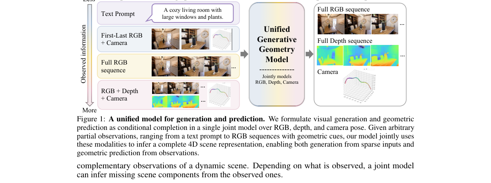

*Result - Generative-predictive transformer. We model RGB, depth, and camera pose as spatially aligned tokens, with camera pose represented as dense ray maps. Partial observations are zero-noise conte*

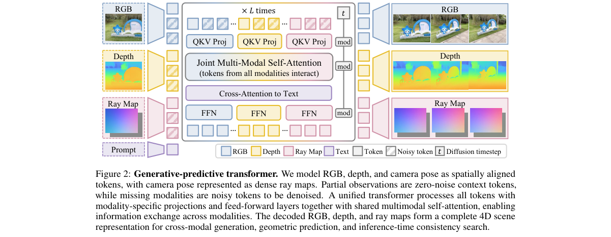

**Why this ranks #2**: 把 RGB 视频、深度与相机位姿建模成同一个生成模型的条件补全，ScanNet++ 稠密深度 Abs Rel 0.073、δ<1.25 0.952，稠密位姿 ATE 从 Geo4D 的 0.190 降到 0.087，并支持推理期多假设搜索。

---

### 3. Continuous Angular Control in Text-to-Image Generation via Geometric Token Encoding

**arXiv**: [2611.13172](https://arxiv.org/abs/2611.13172) | **Score**: 8.7 (relevance 9 x 0.7 + quality 8 x 0.3) | **Direction**: `aigc_generation` | **Tags**: AIGC-visual, geometric-control, angle-encoding, text-to-image, controllable-generation, Bilkent University | **Categories**: cs.CV | **Pages**: 17

**Authors**: Furkan Güzelant; Basavaraj Sunagad; Aysegul Dundar; Adam Kortylewski

**Affiliation**: Bilkent University; CISPA Helmholtz Center for Information Security; University of Freiburg

**Abstract**

> Text-to-image diffusion models can render a photorealistic analog clock but cannot control the time it displays. Across four pretrained models, fewer than 1% of generated clocks place both hands within 6 degrees of the requested time; the models instead collapse onto visually dominant configurations such as the canonical 10:10 pose. The same failure appears when a specific fraction of a circular object is requested, where models return complete or conventionally sliced objects. We observe that these two failures share a geometric structure: both target quantities can be parameterized by angular variables. We introduce a geometric token encoding framework that conditions generation directly on these angles. Each angular component is encoded as a periodic sine-cosine feature and projected into a role-specific token embedding that is injected into the prompt before a frozen text encoder. To spatially ground these tokens without requiring localization input at inference, we introduce Stochastic Localization Relaxation (SLR), which stochastically relaxes attention supervision from component-level to object-level to unconstrained localization during training. For clocks, we additionally introduce a hand-swap preference objective that discourages assigning the correct angles to the wrong hand roles. On analog clocks our method reaches 63-78% Acc@6 degrees across evaluation methods, compared with below 1% for the baselines. On circular-fraction generation, it achieves 89.5% Acc@0.10, while maintaining 88.8% on unseen object categories and 84.9% on unseen target values, compared with roughly 20% for pretrained baselines.

**Key findings**

- **Finding**: SD 2.1、SDXL、SD 3.5 与 Flux.1 四个模型上双指针落在 6 度内的比例不足 1%（提示词工程仅 0.3%–0.8%），本方法提升到 63%–78%；圆形分数任务 Acc@0.10 为 89.5%，未见类别 88.8%、未见目标值 84.9%，而预训练基线约 20%。
- **Inference**: 失败根因是模型缺少连续角度量的显式接口，提示词里写时间无法约束几何，周期特征 token 补上接口后控制类指令才真正可执行。
- **Recommendation**: 遇到时钟、指针、扇形比例这类角度可控需求时，优先注入角色专属的角度 token，而不是指望提示词工程或纯文本微调。

**Key figures**

*Framework - Continuous geometric control for clocks and fractions. Existing text-to-image models often fail to follow the requested geometric quantity, producing common or canonical configurations inste*

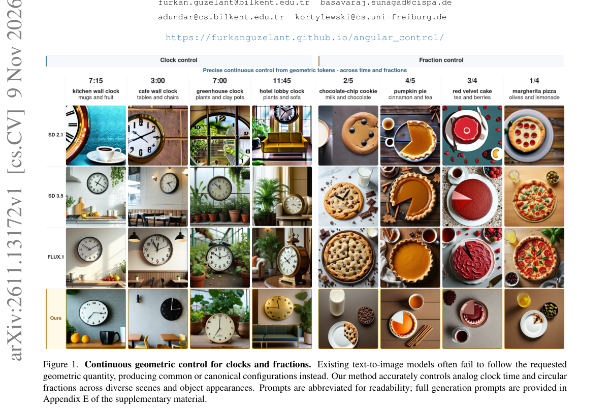

*Result - Left: Overview of our geometric token encoding framework, illustrated for clock-time control. The target clock time (h, m) or fraction-sector boundaries are encoded as sinusoidal pairs and m*

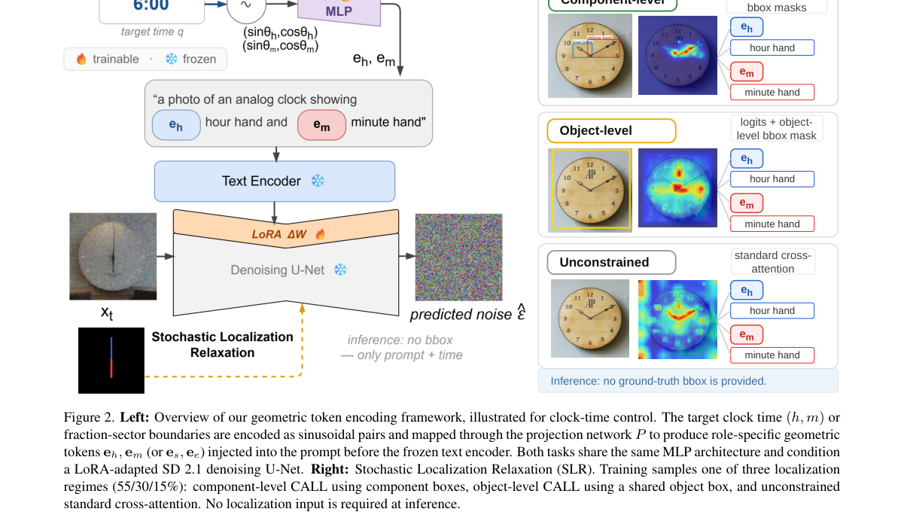

**Why this ranks #3**: 把钟表时间、扇形比例这类角度量编码成正弦余弦对再投影成角色专属 token 注入提示，四个预训练模型上双指针 6 度内命中率原本不足 1%，本方法做到 63%–78%，分数生成 Acc@0.10 达 89.5%。

---

### 4. Robust Flow Matching under Target Corruption and Label Noise

**arXiv**: [2611.13324](https://arxiv.org/abs/2611.13324) | **Score**: 8.7 (relevance 9 x 0.7 + quality 8 x 0.3) | **Direction**: `aigc_generation` | **Tags**: AIGC-visual, robust-flow-matching, label-noise, target-corruption, sample-reweighting, KTH Royal Institute of Technology | **Categories**: cs.CV, cs.LG | **Pages**: 37

**Authors**: Mert Can Kurucu; Erik Englesson; Hossein Azizpour

**Affiliation**: KTH Royal Institute of Technology; Istanbul Technical University; University of Cambridge; Science for Life Laboratory

**Abstract**

> Flow Matching (FM) is a strong framework for generative modeling due to its stable training and efficient sampling. However, FM assumes clean target data and labels, an assumption often violated in practice. We formulate FM training as a time-dependent regression problem over conditional vector fields and analyze how the two corruption types affect the objective: i) target corruption adds a time-dependent residual term that grows with time, ii) label noise causes updates to the wrong class-conditional vector field. Based on this analysis, we propose to improve FM robustness by mapping corruption-specific residual scores to sample weights. For target corruption, we propose the Temporal Residual Score (TRS), which emphasizes residual magnitudes at intermediate-to-late FM times, where clean and corrupted samples are more separable. For label noise, we propose the Comparative Conditional Score (CCS), which compares the residual of the observed class-conditional vector field against alternative class-conditional vector fields for the same trajectory and velocity target. Experiments across controlled corruption settings and real-world noisy labels show that the proposed methods improve robustness over standard FM and robust-training baselines, supporting corruption-specific residual structure as a practical basis for robust FM.

**Key findings**

- **Finding**: 相对 OT-FM，FM-TRS 把 W2 从 1.199 降到 0.434、MMD 从 0.279 降到 0.048，相对 FM-DeepGUM 仍分别低约 40% 与 63%；FM-CCS 在对称 20%、对称 40%、非对称 40% 标签噪声下类均 W2 分别下降约 82%、87%、42%。
- **Inference**: 两类噪声的残差在流匹配时间轴上形态不同，因此用晚期偏置的时间残差打分和类间对比打分，比通用鲁棒回归或通用噪声样本选择更贴合问题结构。
- **Recommendation**: 训练流匹配模型前先判定数据属于目标被污染还是标签错标，前者用晚期偏置残差权重，后者比较同类与异类条件速度场的残差再重加权。

**Key figures**

*Framework - Robust Flow Matching under target data corruption and label noise. (a) Target corruption changes both the interpolation state and the velocity target, ˜xt = xt+t∆1 and ˜u = u+∆1, making resi*

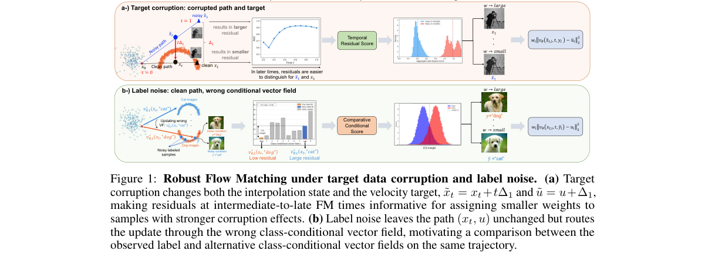

*Result - 2D results. (a)-(c) Under target corruption, FM-TRS downweights the off-manifold outliers; (d)-(f) under label noise, FM-CCS reduces cross-class mixing and improves class-aligned spirals.*

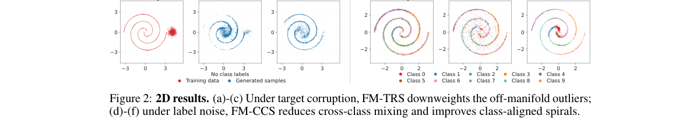

**Why this ranks #4**: 把流匹配训练看成时间依赖的回归问题，分解出目标污染与标签噪声两类残差结构并给出 TRS 与 CCS 两种重加权：目标污染下 W2 由 1.199 降到 0.434、MMD 由 0.279 降到 0.048，标签噪声下类均 W2 最多再降 87%。

---

### 5. UniWeaver: Harnessing Unified Multimodal Models for Interleaved Text-Image Generation

**arXiv**: [2611.13530](https://arxiv.org/abs/2611.13530) | **Score**: 8.7 (relevance 9 x 0.7 + quality 8 x 0.3) | **Direction**: `aigc_generation` | **Tags**: AIGC-visual, unified-multimodal, interleaved-generation, planning-harness, visual-feedback, Ohio State University | **Categories**: cs.CV | **Pages**: 17

**Authors**: Hongxu Chen; Zixuan Zhong; Donghao Zhou; Haodong Li; Xiaomin Yu; Tianhao Li; Shiyao Yu; Zhongwei Wan; Pheng-Ann Heng

**Affiliation**: Ohio State University; University College London; Chinese University of Hong Kong; HKUST (Guangzhou)

**Abstract**

> Unified multimodal models (UMMs) have opened up new possibilities for generating rich interleaved text-image content. However, they generally lack native support for coordinating the two modalities, and translating coarse user requests into coherent multimodal compositions also requires explicit planning. We propose UniWeaver, a structured, model-agnostic harness framework that integrates multimodal planning, generation, and visual feedback to produce coherent interleaved outputs. To train UMMs for this task, we construct UniWeaver-10K, a dataset of 10,000 tasks across 20 task families, paired with execution trajectories guided by UniWeaver. We also introduce UniWeaver-Bench, a task-oriented benchmark systematically assessing text coverage, writing quality, visual coverage, and image-text alignment. Experiments show that UniWeaver achieves state-of-the-art performance and improves interleaved text-image generation across multiple UMM backbones.

**Key findings**

- **Finding**: 120 任务 UniWeaver-Bench 上，最小逐步 harness 的 BAGEL、OmniGen2、TokenFlow 总分分别为 27.7、27.9、39.2，接入 UniWeaver 后升到 58.9、52.7、60.5；评测覆盖 7 个统一多模态骨干，训练数据 UniWeaver-10K 含 1 万条任务、20 个任务族。
- **Inference**: 交错生成的主要瓶颈是缺少高层结构规划与生成后的视觉校验，而不是骨干模型本身的能力上限，外置流程即可补上这块缺口。
- **Recommendation**: 需要自动生成图文混排内容时，把规划、逐段生成与视觉反馈做成外置 harness，即可复用现有统一多模态模型而不必重训或改权重。

**Key figures**

*Framework - Paradigms of interleaved text-image gen- eration. (a) Existing UMMs generate text and images sequentially. (b) UniWeaver structures multimodal plan- ning, generation, and local visual verifi*

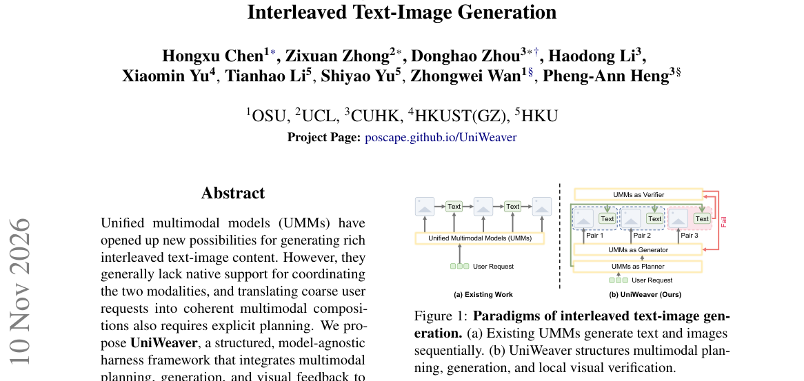

**Why this ranks #5**: 交错图文生成在统一多模态模型上长期缺少模态协同与显式规划，UniWeaver 用规划、生成、视觉反馈三段式模型无关框架，在 120 任务评测集上把 BAGEL 从 27.7 提到 58.9、OmniGen2 从 27.9 提到 52.7，且无需参数更新。

---

### 6. FlashMotion: Ultra-Fast Long-Term 3D Motion Generation

**arXiv**: [2611.13626](https://arxiv.org/abs/2611.13626) | **Score**: 8.7 (relevance 9 x 0.7 + quality 8 x 0.3) | **Direction**: `aigc_generation` | **Tags**: AIGC-visual, motion-generation, meanflow, bimamba, few-step-sampling, Tencent IEG Motus Group | **Categories**: cs.CV | **Pages**: 14

**Authors**: Kaixing Yang; Xulong Tang; Ronghui Li; Xiangyue Zhang; Ziqiao Peng; Mingshuang Luo; Chenxi Zhao; Haoyu Wu; Ju Fan; Hongyan Liu; Puwei Wang; Zijiao Zeng

**Affiliation**: Tencent IEG Motus Group; Tsinghua University; The University of Texas at Dallas; Wuhan University

**Abstract**

> 3D human motion generation plays a crucial role in game development, extended reality (XR), digital humans, and embodied simulation. Beyond motion generation, practical pipelines include rigging, retargeting, and rendering, making ultra-fast long-term 3D motion generation without compromising quality valuable for real-time interactive applications. Despite promising progress, high-quality long-horizon motion generation under tight inference budgets remains challenging, owing to 2 coupled bottlenecks: (1) generative strategies that require many sampling steps for high-quality 3D motion generation and (2) model architectures with substantial per-step computational and memory costs for long sequences. We present FlashMotion, a co-designed framework for high-quality long-horizon 3D motion generation under a strict inference budget, covering text-to-motion, music-to-dance, and speech-to-gesture tasks. To enhance trajectory-level efficiency, we introduce a 3D motion-space MeanFlow formulation with kinematic and dynamic consistency constraints for few-step generation, together with an Adaptive Soft masking mechanism for temporally coherent motion editing. To improve per-step efficiency, we design a lightweight non-autoregressive BiMamba architecture with condition-guided state selection and AdaIN-based condition fusion mechanism, enhancing cross-modal alignment and generalization to longer motion sequences. Extensive experiments demonstrate that FlashMotion achieves overall state-of-the-art performance in both quality and efficiency across text-to-motion, speech-to-gesture, and music-to-dance generation. Code is available at FlashMotion (https://github.com/Sun-Happy-YKX/FlashMotion).

**Key findings**

- **Finding**: BABEL 长序列文本动作生成上 FlashMotion 4 步的 R@3 为 29.134、FID 0.907、FPS@10K 46303，1 步 FPS@10K 达 173172；同表 MMM、MoMask、ST2M 的 FPS@10K 分别为 1350、1014、3417，BAMM 为 152、DART 为 75。
- **Inference**: 只压采样步数或只换轻量骨干都不够，把两者联立设计才能同时拿到动作质量与长序列吞吐，交互式应用的瓶颈其实是端到端延迟而非单步算力。
- **Recommendation**: 做实时交互动作生成时，走少步生成策略加非自回归状态空间骨干的路线，并用长序列吞吐这类指标而不是单步延迟来评估。

**Key figures**

*Framework - FlashMotion generates physically plausible, semantically expressive motion at leading throughput with a compact ∼60M-parameter model. Top: quality–throughput comparisons with representative ba*

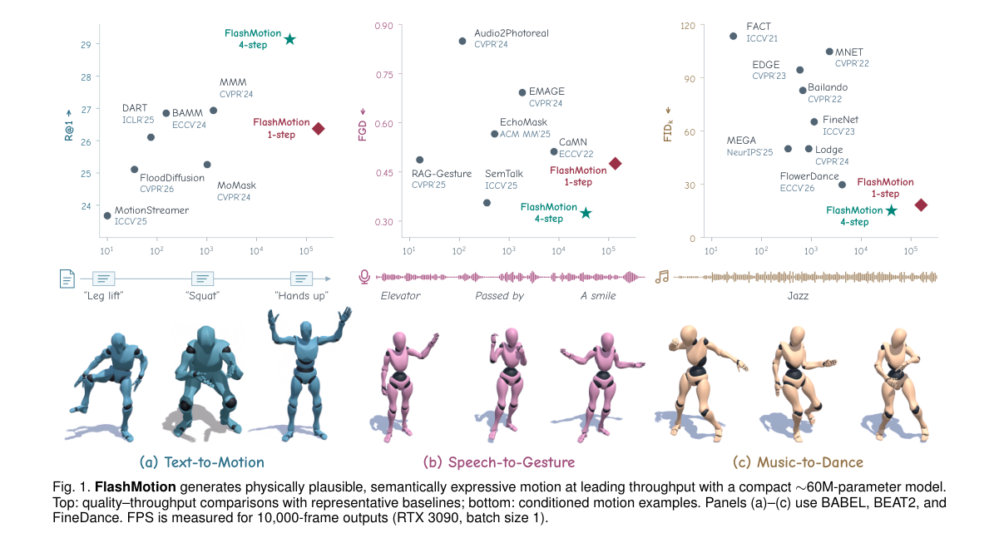

*Result - Overview of FlashMotion. (a) Inference flow with clean-motion prediction and MeanFlow updates. (b) Training model inputs and output: noisy motion, conditions, and timesteps are mapped to the c*

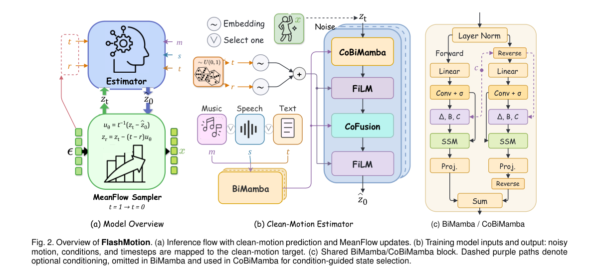

**Why this ranks #6**: 在 3D 动作生成上同时优化采样步数与单步成本：3D 运动空间 MeanFlow 配运动学与动力学一致性约束做到 1 步或 4 步采样，轻量非自回归 BiMamba 骨干约 60M 参数，BABEL 上 4 步结果 FPS@10K 达 46303，远超 MMM 的 1350。

---

### 7. Plug-and-Play ADMM for Inverse Problems with Flow Matching Denoiser

**arXiv**: [2611.13742](https://arxiv.org/abs/2611.13742) | **Score**: 8.7 (relevance 9 x 0.7 + quality 8 x 0.3) | **Direction**: `aigc_generation` | **Tags**: AIGC-visual, plug-and-play, inverse-problems, admm, flow-matching, TH Wurzburg-Schweinfurt | **Categories**: cs.LG | **Pages**: 31

**Authors**: Dibyanshu Kumar; Magda Gregorova

**Affiliation**: TH Wurzburg-Schweinfurt, CAIRO; University of Wurzburg

**Abstract**

> Plug-and-Play (PnP) methods with generative priors have achieved strong performance in inverse problems, with recent flow matching models enabling fast and scalable reconstruction. However, a key challenge in PnP methods is maintaining consistency between data fidelity updates and the learned generative prior, as data-consistency steps can move iterates away from the flow trajectory. We propose an ADMM-based PnP framework for flow matching priors that enforces stronger consistency between the measurement model and the prior through auxiliary variables and dual updates. In addition, we introduce a trajectory correction mechanism that restores consistency with the flow via a combination of deterministic and stochastic projections. Our method provides a more principled integration of flow priors within PnP frameworks, achieving high-quality reconstructions with reduced computational cost.

**Key findings**

- **Finding**: AFHQ-Cat 超分任务上 PnP-ADMM 单批 4 图耗时 12.81 秒、峰值显存 1.79GB，OT-ODE 为 27.63 秒与 9.52GB，Flow Priors 为 75.59 秒与 34.21GB，D-Flow 为 85.80 秒与 51.37GB；CelebA 上 PnP-ADMM 为 7.46 秒与 0.55GB。
- **Inference**: 即插即用框架里先验与数据一致性的冲突主要来自迭代点跨轨迹漂移，ADMM 的一致性约束叠加确定性与随机投影组合能以很低代价修正漂移。
- **Recommendation**: 用流匹配先验做图像逆问题时，把 ADMM 拆分与轨迹修正当作默认组件，并按数据集固定惩罚参数（AFHQ-Cat 500、CelebA 1000）而不做逐任务调参。

**Key figures**

*Framework - Comparison of projection using stochastic (left) and deterministic (right) components of ϵk. Stochastic projection using ϵR could shift the iterate across trajectories, while deterministic p*

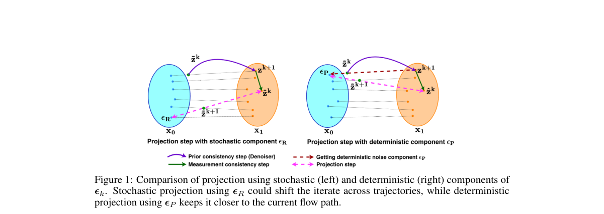

*Result - Comparison of image restoration methods on random inpainting and super-resolution tasks, with additional qualitative results in appendix G. Our method produces visually sharp and structurall*

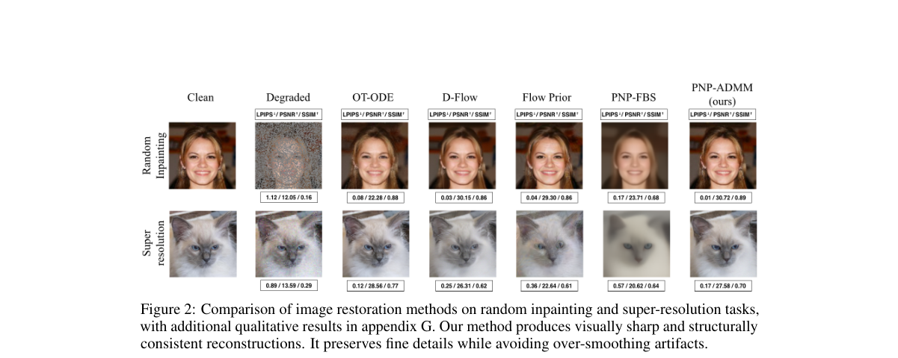

**Why this ranks #7**: 把流匹配先验接入即插即用逆问题求解时，数据一致性更新会让迭代点脱离流轨迹，该文用 ADMM 辅助变量加轨迹修正把一致性拉回，AFHQ-Cat 超分单批 4 图只要 12.81 秒、1.79GB 显存，远优于 Flow Priors 的 75.59 秒、34.21GB。

---

### 8. TaoMate-R1: Temporal Role Specialization for Streaming Multi-Reference Video Generation

**arXiv**: [2611.14307](https://arxiv.org/abs/2611.14307) | **Score**: 8.7 (relevance 9 x 0.7 + quality 8 x 0.3) | **Direction**: `aigc_generation` | **Tags**: AIGC-visual, streaming-video, multi-reference, lora-adapter, temporal-role, Alibaba Group | **Categories**: cs.CV | **Pages**: 17

**Authors**: Qijun Gan; Chenwei Zhang; Xinyang Li; Meiguang Jin; Junfeng Ma

**Affiliation**: Alibaba Group

**Abstract**

> Streaming multi-reference video generation establishes a scene from specified people and objects, then continues it under changing instructions. We introduce TaoMate-R1, a streaming multi-reference generator that organizes adaptation parameters through temporal role specialization. It assigns separate low-rank adapters to scene establishment and continuation on a frozen backbone. Each adapter performs both denoising and context writing for its role; Self Gradient Forcing jointly trains the roles through the history they construct. This allocation contrasts with operation-based specialization, which separates denoising from context writing across all chunks. A fixed-replay gradient analysis characterizes the update directions admitted by the two sharing schemes. On 32 multi-reference cases, we compare the schemes at the same two-adapter budget. Across ten approximately two-minute streams with changing instructions and shared teacher-audio conditioning, TaoMate-R1 reduces the mean boundary luminance jump from 1.96 to 0.613, with higher boundary feature similarity. It also achieves higher mean CLIP and DINO temporal similarity across short interactions, long streams, and public reference compositions. These results support grouping adaptation parameters by scene establishment and continuation for streaming multi-reference generation. Our code and model are released at https://github.com/TaoLiveAIGC/TaoMate-H3.

**Key findings**

- **Finding**: 评测覆盖 32 个多参考用例（10 条短人物交互、10 条约两分钟长流、12 条公开参考组合），同样两个 rank-128 适配器预算下，操作划分方案的边界平均亮度跳变是 1.96，时间角色划分降到 0.613，相邻边界帧的 CLIP 与 DINO 相似度也更高。
- **Inference**: 固定回放分析给出局部下降之差正比于两种对比向量的范数差，建立与续写之间的梯度对比范数大于去噪与上下文写入的对比，因此按时间角色共享适配器收益更大。
- **Recommendation**: 做流式多参考生成时，把适配参数按场景建立与续写分组，而不是按去噪与上下文写入分组，可直接降低长流的指令边界不连续。

**Key figures**

*Framework - Streaming multi-reference video generation. (a) Multiple references guide scene establishment and continuation under changing instructions (conceptual illustration). (b) Each colored group s*

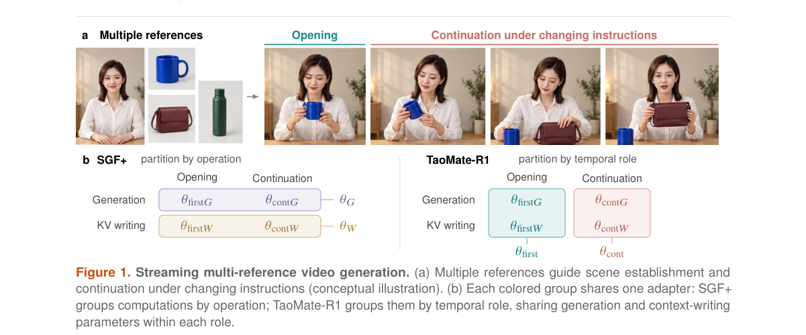

*Result - TaoMate-R1: generation and context writing through temporal role specialization. The absolute chunk index selects an adapter for both denoising and clean-context writing. The resulting audio*

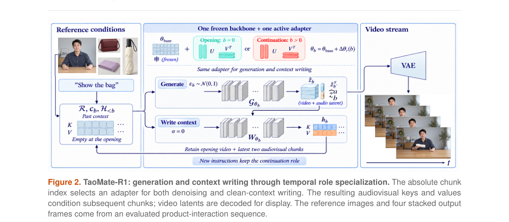

**Why this ranks #8**: 流式多参考视频生成里把适配参数按时间角色而非按操作划分：同样两个 rank-128 低秩适配器的预算下，十条约两分钟长流的指令边界亮度跳变从 1.96 降到 0.613，且 CLIP 与 DINO 时序相似度更高。

---

### 9. Forward-Value Discretization: Faster Stochastic Diffusion Sampling Without High-Order Approximation

**arXiv**: [2611.14328](https://arxiv.org/abs/2611.14328) | **Score**: 8.7 (relevance 9 x 0.7 + quality 8 x 0.3) | **Direction**: `aigc_generation` | **Tags**: AIGC-visual, diffusion-sampler, forward-value, first-order-convergence, training-free, Chinese University of Hong Kong | **Categories**: cs.AI, cs.LG, stat.ML | **Pages**: 76

**Authors**: Yuchen Jiao; Na Li; Changxiao Cai; Yuting Wei; Gen Li

**Affiliation**: Chinese University of Hong Kong; University of Michigan, Ann Arbor; Wharton School, University of Pennsylvania

**Abstract**

> Stochastic diffusion samplers often require substantially more neural function evaluations (NFEs) than deterministic samplers to achieve comparable sample quality. Although higher-order discretization accelerates deterministic sampling, its benefits for stochastic sampling remains unclear. We establish matching upper and worst-case lower bounds showing that stochastic samplers with higher-order approximations remain first-order convergent, even with exact score functions. Thus, increasing the approximation order does not generally improve the convergence order. Motivated by this limitation, we introduce forward-value discretization, a training-free framework that evaluates the data/noise prediction model at a lookahead estimate constructed from previous predictions. For deterministic sampling, the resulting Forward DPMSolver (F-DPMSolver), improves sample quality at low NFE budgets through its DDIM-based variant, despite remaining first-order convergent. For stochastic sampling, we develop Forward DDPM (F-DDPM), which evaluates the model at a cleaner lookahead point adjusted for subsequent noise injection. This estimate reuses both the previous model prediction and the previously injected noise. Both variants admit first-order convergence guarantees with one model evaluation per iteration. Across CIFAR-10, ImageNet, FFHQ, and LSUN, F-DDPM consistently achieves lower FID than the evaluated stochastic baselines at matched NFE budgets. With 1.5 times as many NFEs as deterministic baselines, it achieves competitive sample quality, narrowing the practical efficiency gap between stochastic and deterministic sampling. Code is available at https://github.com/Na-Li66/F-DDPM.

**Key findings**

- **Finding**: 论文给出匹配的上界与最坏情形下界，证明带高阶近似的随机采样器仍是阶收敛；F-DDPM 每次迭代仅一次模型评估，在 CIFAR-10、ImageNet、FFHQ、LSUN 上同 NFE 下 FID 一致低于被测随机基线，用确定性基线 1.5 倍的 NFE 即可达到相当或更好的质量。
- **Inference**: 随机采样的效率瓶颈不是逼近阶数不够高，而是每步的评估点位置不佳，把评估点前移到更干净的时刻比堆高阶项更有效且无需训练。
- **Recommendation**: 需要给扩散模型换采样器时，优先试训练无关的前瞻值评估，复用上一次的模型预测与已注入噪声，而不是先去做高阶求解器改造。

**Key figures**

*Framework - Stable Diffusion samples at different NFEs for the cat and rodeo prompts described in the text. In these examples, SDE-DPMSolver++1 and SDE-DPMSolver++2 depict the cat and human figures more*

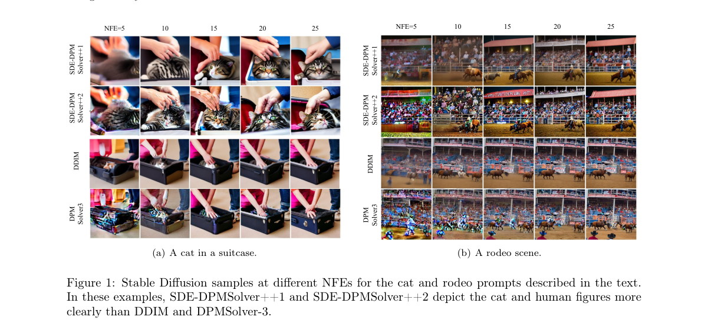

*Result - FID comparison of DDIM, DPMSolver-2, and a forward-value discretization on CIFAR-10 (EDM- uncond) and ImageNet-64 (EDM2-S), versus the number of outer iterations M. The forward-value discret*

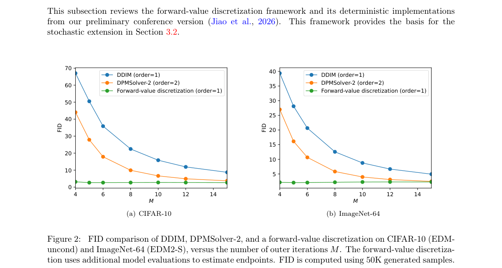

**Why this ranks #9**: 证明随机扩散采样器即便用高阶近似仍是一阶收敛，于是改走训练无关的前瞻值离散化：在每次迭代只做一次模型评估的前提下把评估点挪到更干净的前瞻位置，跨 CIFAR-10、ImageNet、FFHQ、LSUN 同 NFE 下 FID 全面更低。

---

### 10. RB-LDC: Redundancy-Balanced Latent Coding for Noise-Robust Diffusion Latents

**arXiv**: [2611.13955](https://arxiv.org/abs/2611.13955) | **Score**: 8.4 (relevance 9 x 0.7 + quality 7 x 0.3) | **Direction**: `aigc_generation` | **Tags**: AIGC-visual, latent-coding, tokenizer-robustness, log-snr, diffusion-latents, DGIST | **Categories**: cs.CV, cs.LG | **Pages**: 35

**Authors**: Hyunseok Jeong; Jaeho Jeon; Young-Sik Kim

**Affiliation**: DGIST; Daegu, Republic of Korea

**Abstract**

> Latent diffusion models decode approximately correct latents, making decoder sensitivity to perturbations relevant to image quality. After whitening, forward diffusion corrupts every direction at the same signal-to-noise ratio (SNR), despite unequal decoder sensitivities. We study an invertible linear layer between the encoder and diffusion process that shifts each direction's log-SNR. Its linear minimum mean-square-error (LMMSE) recovery risk has an exact spectral expression for any whitened latent distribution. Under an energy budget and a floor ensuring invertibility, minimizing decoder-sensitivity-weighted LMMSE risk integrated over the diffusion schedule yields a unique optimal allocation. The layer aligns with the decoder's expected pullback metric and equalizes marginal risk reduction across directions, computed by a deterministic spectral solver. At large budgets, the allocation follows a power law in sensitivity whose exponent is determined by the low-SNR tail of the loss weighting: one half for noise prediction and two thirds for data prediction under the cosine schedule, with a crossover on truncated schedules. We instantiate this principle as RB-LDC using Jacobian-based sensitivity estimates. On ImageNet at 256 x 256 resolution with SD-VAE and VA-VAE, trained RB-LDC improves reconstruction from noisy latents over budget-matched isotropic coding in all four metrics and five coding configurations, averaged over 15 SNRs and three pipeline seeds. It reduces average perturbed FID by 17.1 for VA-VAE block-local coding while preserving clean reconstruction. We also report intermediate SNRs where perturbed FID worsens. With a frozen diffusion model, RB-LDC yields lower FID point estimates in all 12 tested combinations of sampling progress and channel SNR under corruption during sampling.

**Key findings**

- **Finding**: ImageNet 256×256 上用 SD-VAE 与 VA-VAE，RB-LDC 相对预算相同的各向同性编码在四种指标、五种编码配置上全面更优（对 15 个 SNR 与 3 条管线种子的平均），VA-VAE 块局部编码的平均扰动 FID 降低 17.1；冻结扩散模型时 12 组采样进度与通道 SNR 组合的 FID 点估计全部更低。
- **Inference**: 既然解码器敏感度沿各方向不等，把比特预算按敏感度重分配就能用同样的编码成本换回更高的噪声鲁棒性，最优分配在余弦调度下对噪声预测是二分之一次幂、对数据预测是三分之二次幂。
- **Recommendation**: 做噪声鲁棒的潜变量编码时，在编码器与扩散之间插入一个按解码器敏感度分配 log-SNR 的可逆线性层，并优先在块局部编码配置上验证收益。

**Key figures**

*Result - Seed-42 per-SNR differences between RB-LDC and isotropic coding on the primary configuration (VA-VAE, block-local, k = 128). Arrows indicate the direction of improvement. The shaded range ma*

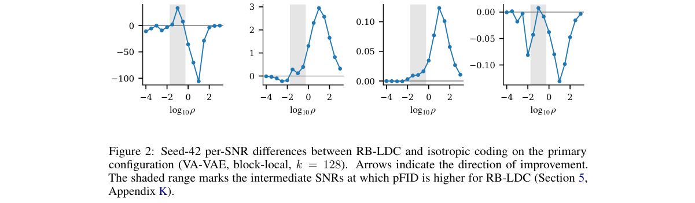

**Why this ranks #10**: 白化后前向扩散对各方向施加同一信噪比，但解码器对各方向敏感度不同；该文在编码器与扩散之间插一层可逆线性层重新分配各方向 log-SNR，ImageNet 上平均扰动 FID 降低 17.1 且干净重建保持不变。

---

### 11. RF3DGS: Reflection-Free 3D Gaussian Splatting with Self-Priors

**arXiv**: [2611.13772](https://arxiv.org/abs/2611.13772) | **Score**: 8.0 (relevance 8 x 0.7 + quality 8 x 0.3) | **Direction**: `aigc_generation` | **Tags**: AIGC-visual, 3d-gaussian-splatting, reflection-removal, self-supervision, benchmark, Hong Kong University of Science and | **Categories**: cs.CV | **Pages**: 10

**Authors**: Qiang Wen; Guotao Meng; Junhong Ruan; Hongyu Liu; Chenyang Lei; Qifeng Chen

**Affiliation**: The Hong Kong University of Science and Technology; Huawei Research

**Abstract**

> 3D reflection removal is crucial in applications demanding high-fidelity visualization, such as museum exhibitions. In this work, we propose Reflection-Free 3D Gaussian Splatting (RF3DGS), a novel method for superior reflection removal. RF3DGS exclusively leverages a widely-adopted photometric prior for reflection removal: that the minimum pixel intensity across multi-view images corresponding to the same 3D point strongly correlates with reflection-free information. However, generalizing this principle to a 3D Gaussian Splatting within a multi-view context is non-trivial. To address this, RF3DGS first optimizes a vanilla 3DGS model using a geometric prior to estimate a coarse, reflection-free depth map for each view. Leveraging these depth maps and photometric prior, a 3D warping process aggregates reflection-free information from auxiliary views to construct a clean transmission pseudo-label for a given reference view. This pseudo-label provides a robust self-supervised signal for optimization. We further introduce an Adaptive Twin Rendering (ATR) loss to synergistically utilize this pseudo-label while preserving high-frequency details from the original, reflection-degraded images. By adeptly fusing these internal 3D self-priors with the ATR loss, RF3DGS demonstrates state-of-the-art reflection removal performance across both synthetic and real-world scenarios. Furthermore, we establish the first 3D reflection removal benchmark, based on the Unity rendering engine, for rigorous quantitative evaluation.

**Key findings**

- **Finding**: 论文用 Unity 渲染引擎构建首个 3D 去反射基准，覆盖透明度 88–92%、玻璃厚度 1–7 毫米、反射强度 12–135 的配置共 45 个样例，而此前真实基准 TNeRF 仅有 4 个场景；方法先用几何先验估每视角粗深度，再经 3D warping 聚合辅助视角构造干净透射伪标签，并以自适应双渲染损失联合监督。
- **Inference**: 单视角去反射无法利用跨视角一致性，把光度先验搬到 3D 表示上并用伪标签做自监督，才能同时保住高频细节与三维一致性。
- **Recommendation**: 处理真实场景的玻璃反射时优先考虑在 3D 表示上去反射，并按该基准的透明率、厚度与反射强度参数去设计自己的评测覆盖。

**Key figures**

*Framework - Given a monocular video captured in a real-world scenario, the proposed method demonstrates its effective and efficient reflec- tion removal performance. Compared with vanilla 3DGS [17], the p*

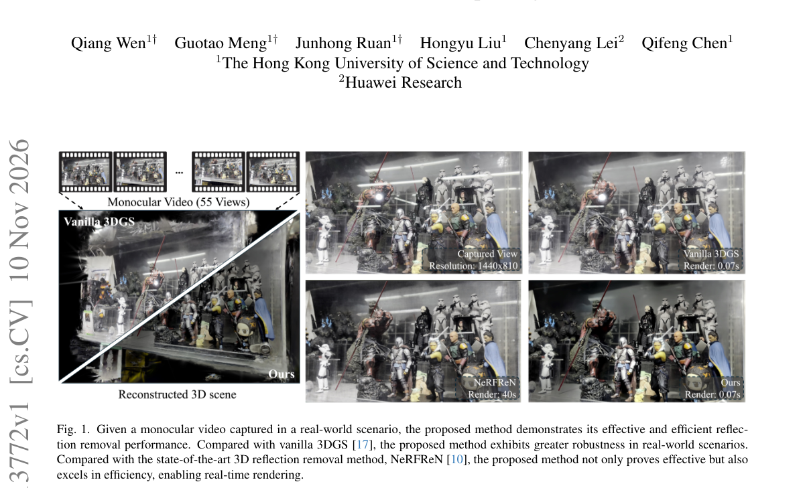

**Why this ranks #11**: 3D 高斯泼溅做去反射时沿用多视角同点最小像素强度这一光度先验：用几何先验估粗深度后做 3D warping 构造干净透射伪标签，并以自适应双渲染损失联合监督，同时给出首个基于 Unity 的 3D 去反射基准，含 45 个评测样例。

---

## AIGC 编辑（指令编辑 / 修补 / 个性化） · `aigc_editing` (4 papers)

本方向 4 篇，共同点是把**「定位」从生成模型的前提改成模型的输入**。HintErase 面对的是视频去字幕/去水印里最常见的失败链——检测器给的那块 mask 既是漏的也是多的：它把定位当成 hint 而不是洞，训练时按真实定位器的失效方式腐蚀 hint（漏笔画、漏光晕、误盖背景与真场景文字），监督仍跟真实 overlay 走，于是同一个模型既能补上 hint 漏掉的部分，也能保住 hint 误盖的背景。DroneSegEdit 把同一思路搬到无人机分割上，用语言接地的空间验证器从冻结 MLLM 主干读出层级状态，把掩码渲染与指代表达选错实例的「Grounding-Rendering Gap」显式补上，RIS-LAD 上 52.78 mIoU、领先 7.16 点。SEAL 反过来守身份：只改 5% 空间位置的稀疏对抗保护，在冻结 VAE 编码器的潜方差上做扰动，阻止下游个性化复现真人的脸。Multimodal Judges 则把评审流程产品化——视觉、语音、语言三类裁判把发现归档到六个固定问题下，人只做接受/拒绝与补充，每个确认的问题再路由到对应的编辑工具。

### 12. Hint, Not Hole: Localization-Robust Video Overlay Removal

**arXiv**: [2611.13711](https://arxiv.org/abs/2611.13711) | **Score**: 8.7 (relevance 9 x 0.7 + quality 8 x 0.3) | **Direction**: `aigc_editing` | **Tags**: AIGC-visual, video-inpainting, overlay-removal, hint-channel, streaming-pipeline, Malanshan Audio & Video Laboratory | **Categories**: cs.CV | **Pages**: 7

**Authors**: Dongyang Zhang; Wei Zhang; Renjie Zou; Zhiwei Huang

**Affiliation**: Malanshan Audio & Video Laboratory

**Abstract**

> Video overlay removal recovers the scene beneath burned-in subtitles, karaoke lyrics, titles, credits, logos and watermarks. Generative video models now fill a known region convincingly, but in practice the region comes from a detector or a segmenter, and it is wrong in both directions: it misses strokes, halos, whole frames and whole objects, and it covers background between characters, around boxes and on genuine scene text. Erasers that treat the mask as a hole, regenerating inside and copying outside, inherit every one of these errors. We present HintErase, which treats localization as a hint, not a hole. The model sees the full, unmasked video together with a hint channel; during training the hint is corrupted the way real localizers fail, while supervision follows the true overlay. The result is a single model that removes overlay the hint missed, keeps background the hint wrongly covered, and is trained to keep genuine scene text even when the hint lands on it. For full-length releases, a streaming pipeline handles interlaced sources, shot cuts, missed and jittering hints, paste-back and audio, with memory independent of the length of the video. This report describes the approach, the pipeline that turns it into full-length deliveries, and qualitative results; video results, with input, hint and output side by side, are on the project page.

**Key findings**

- **Finding**: 论文指出定位掩码双向出错（漏笔画、漏整帧与整物体、误盖人物间背景与真实场景文字），并把掩码改读为提示：模型看完整未遮挡视频加一条提示通道，训练时按真实定位器的失败方式污染提示而监督始终跟随真实叠加层；交付侧用 81 帧窗口流式处理，内存只由窗口长度决定。
- **Inference**: 把定位当洞会让定位误差直接变成生成误差并被忠实放大，当成带噪观测则模型有机会自行补漏与去除误盖。
- **Recommendation**: 做字幕或台标擦除时，用完整帧加提示通道的生成式模型替换经典的掩码重绘，并在训练中主动注入漏框与误框样本。

**Key figures**

*Framework - One model for the overlays in a release. HINTERASE removes karaoke lyrics with countdown dots over a crowded street, a multi-line title card together with the label logo, theme-song lyrics o*

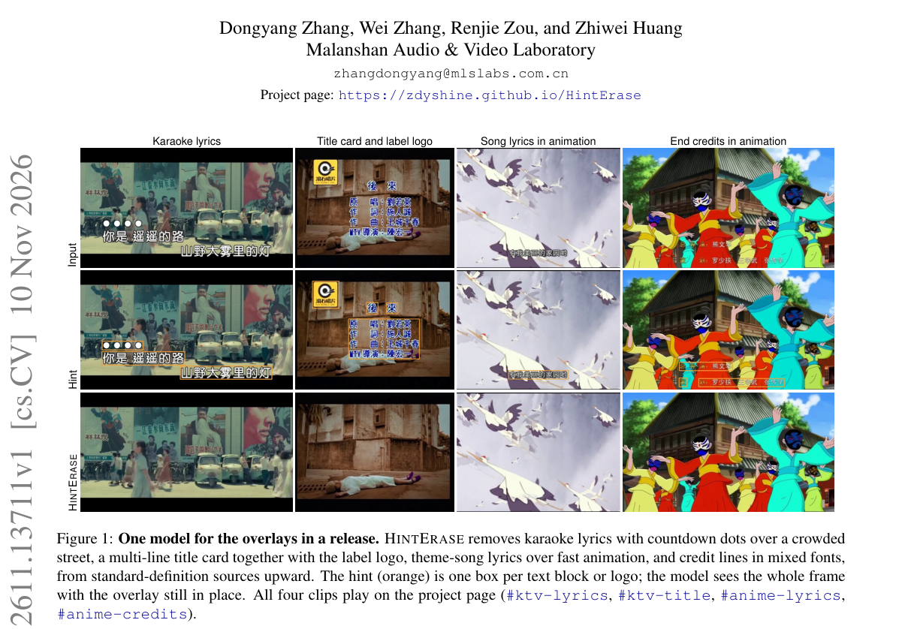

*Result - Three ways to localize the same title card. (a) and (b) are too large and too small when read as a hole; (c) is coarser than both, yet sufficient when read as a hint. Red: text; blue: logo.*

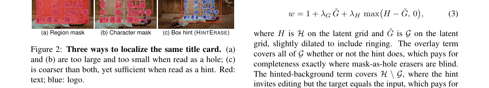

**Why this ranks #12**: 视频叠加层擦除里，检测器给的掩码本就有漏笔画、糊边与误盖背景，把掩码当洞去重生成会连背景一起丢；该文把定位当成提示而非洞，训练时按真实定位器失败方式污染提示，交付侧用 81 帧窗口流式处理且内存与视频长度无关。

---

### 13. DroneSegEdit: Adapting Pretrained Generative Editors for UAV Segmentation with Language-Grounded Verification

**arXiv**: [2611.13890](https://arxiv.org/abs/2611.13890) | **Score**: 8.0 (relevance 8 x 0.7 + quality 8 x 0.3) | **Direction**: `aigc_editing` | **Tags**: AIGC-visual, uav-segmentation, generative-editor, lora, language-grounded-verification, Fudan University | **Categories**: cs.CV | **Pages**: 18

**Authors**: Dehua Chen; Long Xin; Jiangtao Wei

**Affiliation**: Fudan University

**Abstract**

> Recent work has shown that pretrained image generators can support diverse visual tasks. Yet directly applying them to language-guided unmanned aerial vehicle (UAV) segmentation exposes a key limitation: a plausible mask may correspond to the wrong instance among small and repeated objects. We call this mismatch between mask rendering and expression-level target selection the Grounding-Rendering Gap. We present DroneSegEdit, which combines RGB proposal rendering with language-grounded, proposal-constrained verification to select supported foreground while retaining rendered geometry. DroneSegEdit adapts the open-weight LongCat-Image-Edit model using task-specific LoRA and fixed color-to-label decoding. For referring segmentation, a Language-Grounded Spatial Verifier (LGSV) reads hierarchical states from the frozen multimodal large language model backbone to derive expression-conditioned spatial evidence, which is mapped back to the rendered proposal without introducing foreground outside it. On RIS-LAD, DroneSegEdit reaches a new state of the art at 52.78 mIoU, 7.16 points above the previous best. It remains competitive overall on UAVid-RIS and VDD-RIS, with its clearest class-wise gains on compact, application-relevant categories, notably vehicles and humans. A separate verifier-free experiment extends the RGB interface to full-scene parsing: a task-specific adapter jointly renders all classes from one task-level instruction without enumerating class names or palette colors.

**Key findings**

- **Finding**: RIS-LAD 上 DroneSegEdit 达 52.78 mIoU 与 54.01 oIoU，比配对的原编辑器高 5.42 与 6.92 点、比 ReSaP-8B 高 7.16 与 0.57 点；P@0.5 从 46.83 升到 54.83、P@0.9 从 23.13 升到 29.13；验证步骤把精度从 52.93 提到 62.10，召回仅从 81.04 变为 80.57。
- **Inference**: 生成式模型渲出的掩码形状可信但可能选错实例，用语言接地的空间证据在提案内部做筛选即可只删多余前景而不破坏几何。
- **Recommendation**: 用生成式编辑器做指代分割时，让渲染与确定性解码只负责出提案，把实例选择交给语言验证器，并把验证严格约束在提案范围内以免引入框外前景。

**Key figures**

*Framework - DroneSegEdit architecture. (a) The adapted editor renders an RGB proposal, deterministic decoding yields Mraw, and LGSV removes expression-unsupported regions. Green and red contour overlays*

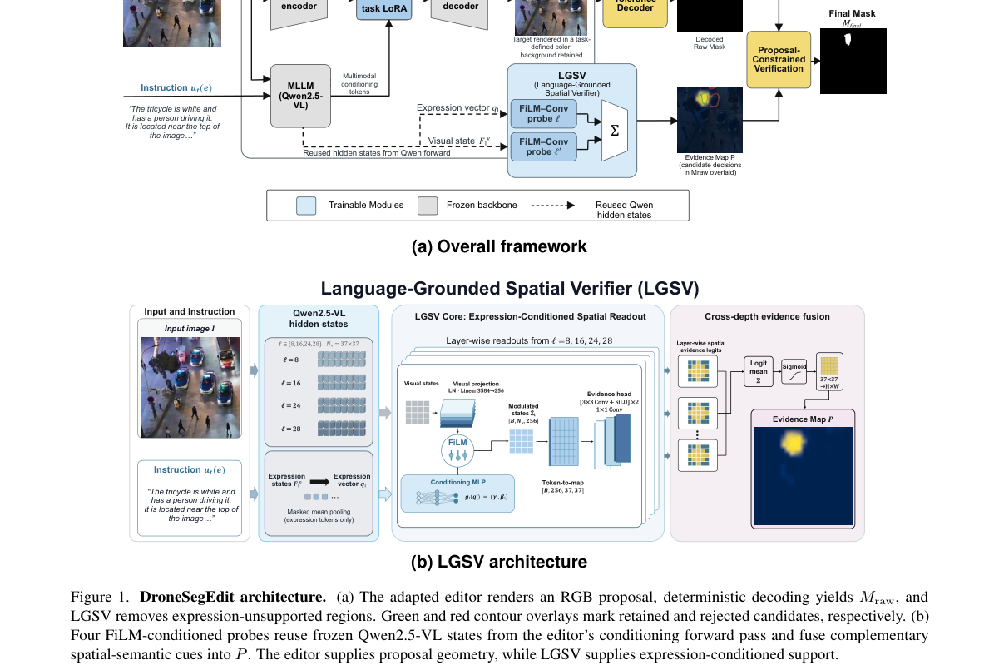

*Result - Proposal-constrained verification on RIS-LAD. (a) Car; (b) truck. All panels for each example use the same target-centered visualization crop. The evidence panels display P ⊙Mraw, with conto*

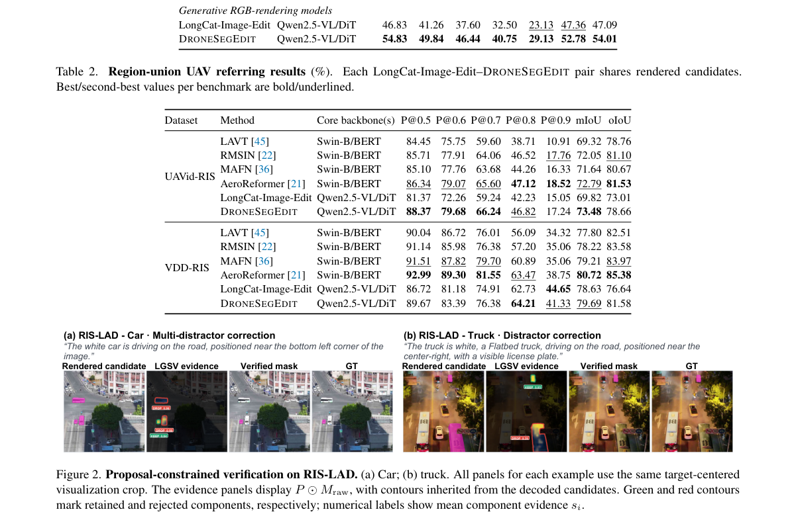

**Why this ranks #13**: 把预训练生成式编辑器改造成无人机分割工具：先渲染 RGB 掩码提案再由语言接地验证器在提案内筛选，RIS-LAD 上取得 52.78 mIoU、54.01 oIoU，比此前最好方法高 7.16 个点，验证把精度从 52.93 提到 62.10 而召回几乎不变。

---

### 14. Location Matters: Sparse Latent-Variance Attacks for Face Privacy against Diffusion Personalization

**arXiv**: [2611.14254](https://arxiv.org/abs/2611.14254) | **Score**: 8.0 (relevance 8 x 0.7 + quality 8 x 0.3) | **Direction**: `aigc_editing` | **Tags**: AIGC-visual, face-privacy, adversarial-protection, diffusion-personalization, sparse-perturbation, National University of Singapore | **Categories**: cs.CR, cs.CV | **Pages**: 16

**Authors**: Shuting Yang; Shuxin Li; Linyan Dai; Xinwei Zhang; Dong Huang; Renyang Liu; See-Kiong Ng

**Affiliation**: National University of Singapore; Nanyang Technological University; The Hong Kong Polytechnic University

**Abstract**

> Text-to-image diffusion models can learn and reproduce an individual's identity from only a few reference photos, creating risks of unauthorized and misleading content generation. Proactive defenses address this risk by adding adversarial perturbations to facial images before release, thereby disrupting identity acquisition during downstream personalization. However, existing methods typically rely on dense $L_\infty$-bounded perturbations, whose accumulated distortions can become visible around facial structures. Recent methods improve protected-image quality, but often at the cost of reduced protection effectiveness. In this paper, we propose Sparse Encoder Attack on Latent Variance (SEAL), a sparse adversarial protection framework that modifies only 5% of the spatial locations in a facial image. SEAL combines a differentiable top-k masking scheme that jointly optimizes perturbation locations and values with a variance-oriented objective over the frozen VAE encoder's latent distribution to disrupt identity-consistent representations. A saliency-guided dispersion penalty further discourages perturbation concentration in perceptually salient facial regions. Experiments on CelebA-HQ and VGGFace2 show that SEAL achieves the best protected-image quality among the compared methods, exceeding 41 dB PSNR with 0.97 SSIM and at most 0.07 LPIPS, while reducing identity similarity to at most 0.15 after diffusion personalization. These results demonstrate that sparse location optimization enables strong identity protection while preserving high visual quality. Code and data are available at https://github.com/Lvxan/SEAL

**Key findings**

- **Finding**: SEAL 只修改人脸图像 5% 的空间位置，在 CelebA-HQ 与 VGGFace2 上保护图质量为对比方法中最佳，PSNR 超过 41dB、SSIM 0.97、LPIPS 至多 0.07，扩散个性化后的身份相似度降至 0.15 以下。
- **Inference**: 身份线索集中在 VAE 潜空间的少数方向上，稀疏但针对性地扰动潜变量方差就足以破坏身份一致性，而对像素外观的破坏极小。
- **Recommendation**: 发布人脸素材前可加一层稀疏对抗扰动，只动约 5% 的像素并以潜变量方差而非像素损失为目标，能同时守住画质与隐私。

**Key figures**

*Framework - By modifying only a small fraction of pixels, SEAL preserves the visual appearance of the protected face image while disrupting identity reproduction after diffusion person- alization. Compa*

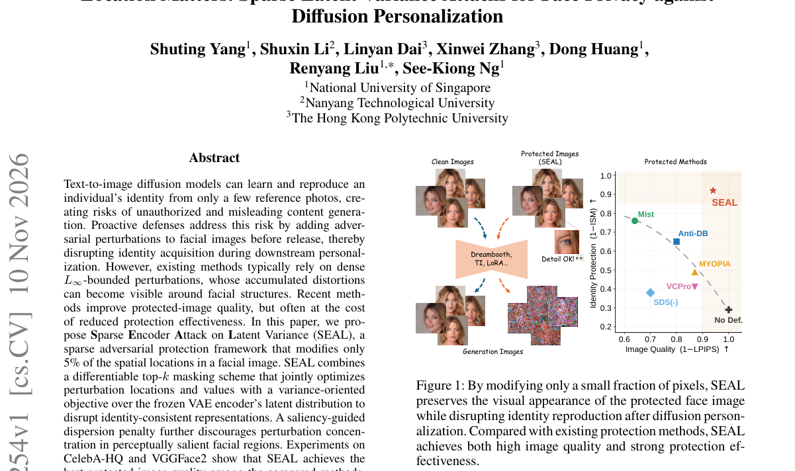

*Result - Overview of SEAL. Given a clean image x, SEAL jointly optimizes a sparse binary mask m and a bounded perturbation δ to disrupt the VAE latent variance. A saliency-guided dispersion regulariz*

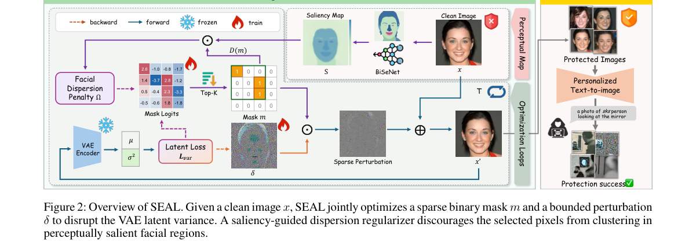

**Why this ranks #14**: 扩散个性化只需少量参考图就能复现人脸身份，SEAL 只改人脸图像 5% 的空间位置，靠可微 top-k 掩码联合优化位置与幅度并打击 VAE 潜变量方差，个性化后身份相似度降到 0.15 以下，同时 PSNR 超过 41dB、SSIM 0.97、LPIPS 不超过 0.07。

---

### 15. Multimodal Judges Flag, Humans Decide: A Review-and-Edit Framework for AI-Generated Product Video Ads

**arXiv**: [2611.13178](https://arxiv.org/abs/2611.13178) | **Score**: 7.7 (relevance 8 x 0.7 + quality 7 x 0.3) | **Direction**: `aigc_editing` | **Tags**: AIGC-visual, video-ad-review, multimodal-judge, human-in-the-loop, review-and-edit, Anoki | **Categories**: cs.CV, cs.HC, cs.MM | **Pages**: 22

**Authors**: Anoubhav Agarwaal; Sukesh Perla; Karthikeyan Mohanraj; Susmita Ghose

**Affiliation**: Anoki Inc.

**Abstract**

> Generative pipelines can now turn every product page of an e-commerce catalog into a short video ad, but deciding whether such an ad is usable is not one good-or-bad call. We describe how we operationalized the review and editing of these ads so that both can keep pace with generation: reviewers go through each ad scene by scene and answer six questions, on the product, scene quality, pronunciation, script, sound and captions; judges built from vision-language, speech and language models file each finding under the matching question, and reviewers accept or reject each finding and add what the judges missed. Each confirmed issue then opens an edit tool matched to it. The questions and the routing from a finding to its fix do not depend on the models that generate the ad. Across 120 ads from our pipeline, reviewed with judge findings on screen, reviewers marked the product wrong on 60% of scenes, and script, caption or sound problems on under 10% each. On 60 of these ads, they marked the product wrong on 58% of scenes, far more than the 26% marked by two reviewers who later saw the ads with the judges hidden; one reviewer who saw the ads both ways marked 57% with judge findings and 19% without. On 120 blind-labeled scenes, a product judge that watches the clip with the catalog photos reached AUC 0.84, while video-quality and photo-similarity scores were close to chance. We tune the judges for recall: the product judge catches nearly all defects but also flags many clean scenes, so reviewers decide; together, the judges widen what reviewers mark and reviewers add what the judges miss. Without judge findings, one reviewer's marking faded over a session. We release a review-portal template and our review data (120 ads and 562 scenes with judge findings and human marks, plus 120 blind-labeled scenes with baseline scores) at https://github.com/anoubhav/ad-review-and-edit.

**Key findings**

- **Finding**: 120 条广告共 562 个场景、20 个产品，有判官线索在场时人工把产品判错的比例为 60%，而两位后续在隐藏判官条件下复审的广告只有 26%，同一评审者两种顺序下分别为 57% 与 19%；产品判官在 120 个盲标场景上 AUC 0.84，而视频质量与照片相似度分数接近随机。
- **Inference**: 判官高召回但会误报，其价值在于把人工注意力集中到少数真实问题上并放大整体审出率，因此只能当线索而不能当结论。
- **Recommendation**: 做生成内容审核流水线时，为每个问题单独建判官并把判官结论当线索而非结论，人工逐条确认后再触发对应的编辑工具。

**Key figures**

*Framework - A review-and-edit framework for AI-generated product video ads, built to run at catalog scale. AI judges and the reviewer work on the same six axes, each shown beside the part of the ad it j*

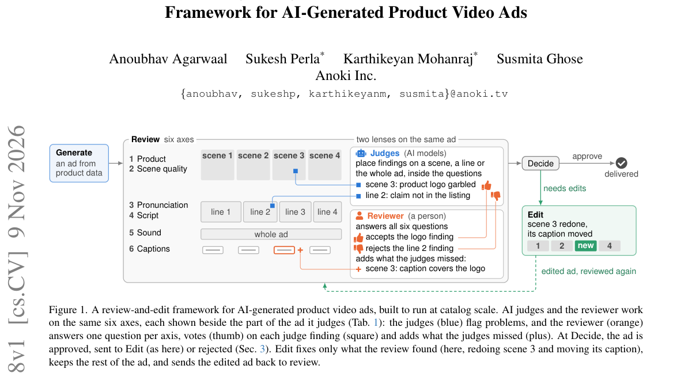

*Result - One generated 15 s ad (video in our release) as judges and reviewers reviewed it, one row per question. Reviewers accepted the judges’ product findings and rejected nearly all of their pronu*

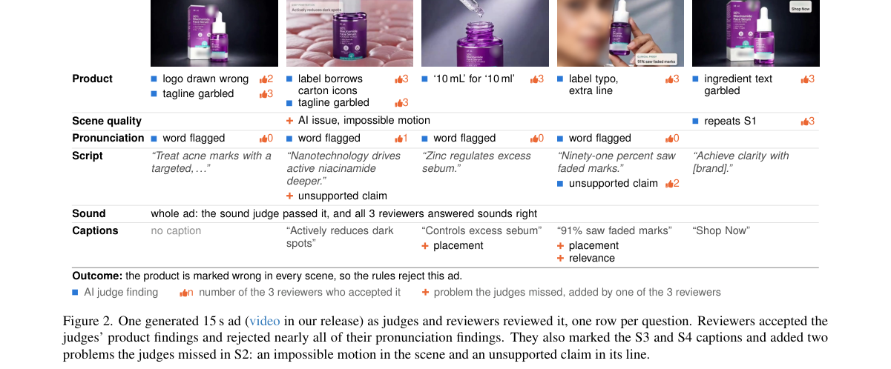

**Why this ranks #15**: 电商目录页批量生成的产品短视频需要逐场景审核，论文把审片拆成产品、场景质量、发音、脚本、声音、字幕六个问题，让多模态判官按问题归类线索并由人工逐条裁决：120 条广告 562 个场景里人工判定产品错误占 60%，产品判官 AUC 0.84。

---

## Footer

- Total papers reviewed across all 4 axes: 60
- aigc_visual axis final count: 15
- Wild-cards in this axis: 0
- Figure assets: 2026-11-12/res/

Generated by `mine-arxiv-daily-digest` skill. Sister file: `2026-11-12_aigc_visual_entry.md`.
