# Mine Arxiv Daily Digest - 2026-11-12 (全双工语音与语音 LM Axis, 12 papers)

**Generated**: 2026-11-12 01:26 CST

**Source**: arXiv cs.CV, cs.SD, eess.AS, cs.CL, cs.AI, cs.RO, cs.LG, cs.IR submissions, listing day 2026-11-10 (announced 2026-11-11 00:00 UTC)

**Batch window**: 2026-11-09T19:00:00Z .. 2026-11-10T19:00:00Z（arXiv 公告批次横跨两个 UTC 日：从前一日的美东 14:00 截止时刻起算（EDT 为 18:00Z，EST 为 19:00Z），到当日的同一时刻为止）

**Axis**: duplex_speech (12 papers, base 12, cap 20)

**Directions**: duplex_speech_core (12), speech_rl (0)

**Selection**: 12 papers ranked by relevance x quality, with 0 wild-card slots

**Day total**: 60 papers across 4 axes (target 60)

**Scope**: 全双工 / 实时 / 流式语音语言模型、speech-to-speech 语音助手、TTS / 语音克隆 / 语音转换，以及语音大模型的 RL 与奖励模型

**Wild-card**: **Wild-card**: 0 —— 本 axis 未启用任何 wild-card 名额。`speech_rl` 让出的 4 个名额由 `duplex_speech_core` 内**同方向**的够格论文吸收，没有需要用邻接选题补位的空位。

**语音 RL 方向（`speech_rl`）本批次断供**：对全批 501 篇做双向扫描，没有任何一篇论文同时出现 RL/奖励优化类词与语音/音频类词（140 字符窗口内共现数为 0）。按 skill「薄方向让出名额而不是被填充」的口径，`speech_rl` 本批次发 0 篇、不凑数，让出的 4 个名额全部由同轴的 `duplex_speech_core` 吸收（该方向由基准 8 篇增至 12 篇），本 axis 合计 12 篇，正好等于 axis 基准 12 篇。

---

## 全双工语音与语音 LM · `duplex_speech_core` (12 papers)

本方向 12 篇，覆盖从**流式识别到语音基础模型再到端侧合成**的整条链路。Earlybird 用 29M 参数做预测式流式识别（4bit 量化后 16.8 MB），在 LibriSpeech test-clean 上，说话人还没说完时中位词比答案早 90ms 就能预测正确，而已发布的流式模型普遍晚 90–400ms。Walrus 是 8B 的语音+音频基础模型（Gemma 4 初始化、三阶段数据课程），生成低码率离散语音 token 再用轻量 token→waveform 解码器还原。Omni-JEV 把全双工对话拆成 5 类交互动作预测（文本 + 双流语音），交叉熵微调后再用 RLCD 强化。合成侧两条土耳其语线各有分工：Alania-2 是 488M 的 VoxCPM 架构、18,195 小时训练数据（90% 合成）、带文本归一化；Antalia-2 Mini 只有 7,620,931 个参数，在 M5 CPU 上跑到 41 倍实时，WER 1.09% / CER 0.22%，训练数据全部来自 VoxCPM2 教师。DialInstruct-TTS 把多轮对话的交互式表达性 TTS 做成「Qwen planner 出 TemporalPlan → 时序声学控制情绪/语速/音量/音色」的管线；Emilia2 则是 229K 小时的多语长篇语音数据集，单说话人长篇时长占 50.0%、对话占 66.8%，含 477 万条自然语言指令与 93.3 万条非语言标注。工程侧还有 GigaEdge Spench 的流式语音增强 SDK、AVCC 的 31 小时音视频语料（865 hold / 865 shift 事件 + 人类参考）、ESDCodec 的超低码率语音编解码、Swanada 的 sub-30 MB 端侧 ASR，以及尼泊尔-英语混合语 ASR 的数据与微调实践。

### 1. Walrus Technical Report

**arXiv**: [2611.13689](https://arxiv.org/abs/2611.13689) | **Score**: 9.0 (relevance 9 x 0.7 + quality 9 x 0.3) | **Direction**: `duplex_speech_core` | **Tags**: duplex-speech, speech-foundation-model, data-curriculum, multilingual-asr, code-switching-asr, speech-translation, Sony Group | **Categories**: cs.CL, eess.AS | **Pages**: 30

**Authors**: Alkis Koudounas; Osamu Take; Hayato Futami; Quentin Jodelet; Emiru Tsunoo

**Affiliation**: Sony Group Corporation

**Abstract**

> We present Walrus, a unified 8B speech-and-audio foundation model handling speech recognition (including code-switching and multi-talker speech), speech-to-text and speech-to-speech translation, text-to-speech, emotion recognition, audio captioning, and general audio understanding. Our main contribution is not a new architecture but a data-centric training recipe; we use a standard decoder-only backbone initialized from Gemma 4, so that gains can be traced to the data. For speech generation, Walrus predicts low-bitrate discrete speech tokens, and a lightweight token-to-waveform decoder converts them into high-fidelity audio. The recipe is a three-stage data curriculum that moves from broad multilingual data to multi-talker, code-switching, and domain-specific data. At each stage, task-aware and dataset-aware weighting balances tasks with very different token budgets and protects core skills from forgetting. Trained on over 600M samples covering more than 20 tasks and 100 languages, Walrus leads on most multilingual, multi-talker, and code-switching ASR, speech translation, and audio understanding benchmarks, outperforming both open speech language models of comparable size and dedicated task-specific models. On most benchmarks, it even matches or surpasses the $4\times$ larger Qwen3-Omni's performance. Results suggest that data engineering is a primary driver of quality in multi-task speech and audio modeling.

**Key findings**

- **Finding**: Walrus 保持 Gemma 4 E4B 解码器骨干（有效参数约 4B，含嵌入约 8B）不变，用 USM 编码器接入语音，在 600M+ 样本、20+ 任务变体、100+ 语言上做三阶段数据课程训练，耗时约 30 天、128 张 H100，约 92000 GPU 小时。
- **Inference**: 固定架构只改数据配比就能在多语 ASR、代码切换、多说话人上全面领先，说明该方向当前的瓶颈是数据工程而不是网络结构。
- **Recommendation**: 想复现多任务语音基座时，先照搬它的三阶段课程与任务级权重（ASR 权重最高），而不是先换骨干模型。

**Key figures**

*Framework - Overview of Walrus, our most capable SpeechLLM yet. Input speech is encoded by the USM encoder into continuous representations, which are passed to the decoder-only Gemma 4 back- bone togeth*

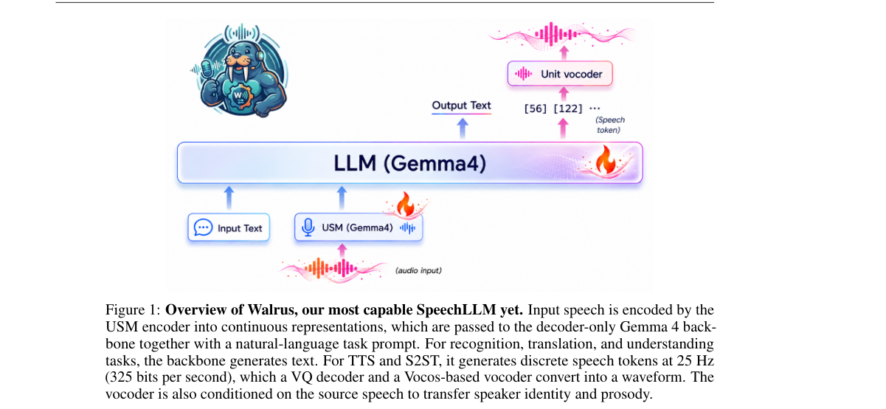

*Result - Walrus against the best previous system (among AF3, Gemma4, Qwen2.5-Omni- 7B, Phi4-MM) across recognition, translation, and understanding benchmarks. Scores are normalized so that higher is*

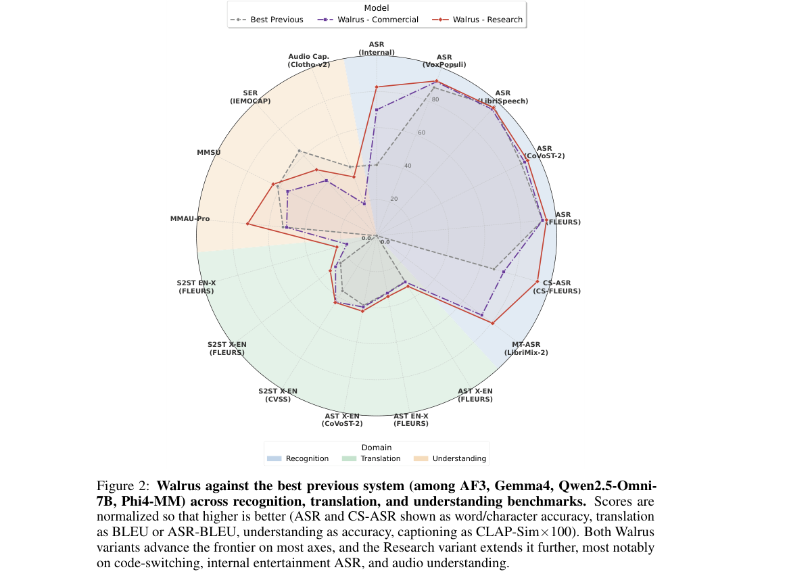

**Why this ranks #1**: 8B 参数的 Gemma 4 E4B 解码器骨干加 USM 编码器，覆盖 20+ 任务变体、100+ 语言、600M+ 样本；CS-FLEURS 字符准确率 92.8%，比 Gemma 4 的 67.7% 高 25 个点，LibriMix 多人混说 cpWER 19.32 约为 Qwen3-Omni-30B 的一半，是本批次覆盖面最广的多任务语音基座。

---

### 2. Alania-2: Turkish text-to-speech with instant and fine-tuned voice cloning

**arXiv**: [2611.13845](https://arxiv.org/abs/2611.13845) | **Score**: 9.0 (relevance 9 x 0.7 + quality 9 x 0.3) | **Direction**: `duplex_speech_core` | **Tags**: duplex-speech, turkish-tts, voice-cloning, synthetic-data, text-normalization, low-latency-tts, PatientDesk AI | **Categories**: cs.CL, cs.SD | **Pages**: 21

**Authors**: Sezgin Saygili; Emre Kaplaner; Oncel Ozgul; Fikri San Koktas

**Affiliation**: PatientDesk AI

**Abstract**

> We present Alania-2, a Turkish text-to-speech (TTS) system with two built-in voices, voice design from text descriptions, and two kinds of voice cloning. Alania-2 is a 488M-parameter model with the VoxCPM architecture, which generates continuous audio latents with a diffusion head on top of a language-model backbone. We train it from scratch on 18,195 hours of Turkish speech, 90% of which is synthetic speech produced by a larger teacher model and filtered automatically. A text normalizer rewrites numbers, abbreviations and foreign names into the words a Turkish speaker would say; without it, none of 96 test sentences with digits kept all its critical parts, such as an amount or a date, through synthesis and speech recognition, against 86 with it. On Freya-TR-Eval, a public benchmark of 495 Turkish sentences scored with automatic speech recognition, Alania-2 reaches a word error rate of 1.44%, compared with 5.99% for our previous system. On its built-in voices, it comes within half a point of character error rate of a 2.3B-parameter model at under a quarter of the size, and a 7.6M-parameter single-voice model trained with the same recipe matches the most intelligible systems we measured, which suggests that training data matters more for intelligibility than model size. We also report practical findings on voice cloning: conditioning on the reference audio alone, rather than continuing it, cuts skipped words from 21.9% to 1.7%; 20-30 seconds of reference audio works best; and a low-rank adapter trained in about two minutes raises speaker similarity well above instant cloning. Finally, we describe inference-engine changes that bring first audio down to 32 ms for a single stream. We release our evaluation harness and three Turkish speech and text datasets.

**Key findings**

- **Finding**: Alania-2 采用 VoxCPM 架构（488M 参数，语言模型骨干加扩散头输出连续音频潜变量），在 18195 小时土耳其语音频上从零训练，其中 1772 小时真人录音、16423 小时为大教师模型合成。
- **Inference**: 同一配方下的 7.6M 单音色模型可懂度已与最优系统相当，且 488M 模型在 495 句 Freya-TR-Eval 上拿到 1.44% WER、0.28% CER，接近 2.3B 模型的水平，说明可懂度主要由数据而非参数量决定。
- **Recommendation**: 做中资源语言 TTS 时先补齐文本正规化规则——该文 96 句含数字的测试中，加正规化后 86 句能在合成加识别后保留金额、日期等关键信息。

**Key figures**

*Framework - Overview of Alania-2. Text is first rewritten into the words a speaker would say (Section 4); the model then generates 48 kHz audio in the requested voice (Sections 5 and 8).*

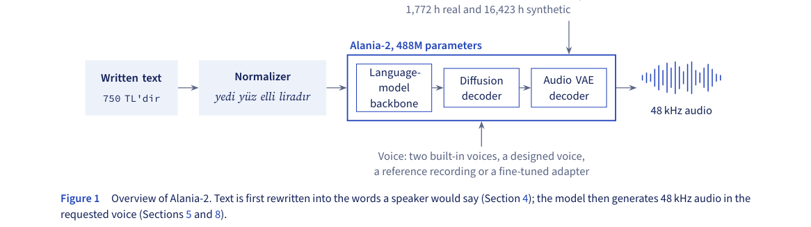

*Result - Training data. The base mix is 90% synthetic speech; a short second stage adds voice design and style instructions.*

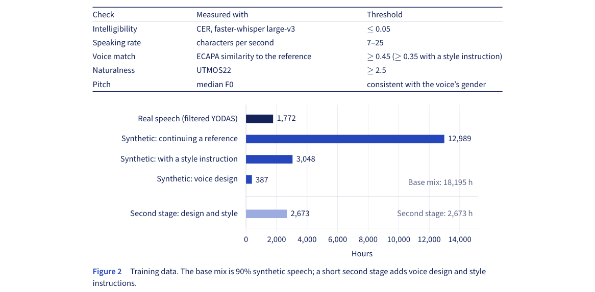

**Why this ranks #2**: 488M 参数的 VoxCPM 扩散头模型在 18195 小时土耳其语（90% 为教师模型合成）上从零训练，Freya-TR-Eval 上 WER 1.44%（前代 5.99%）；克隆改为条件编码参考音频后跳词率从 21.9% 降到 1.7%，单流首包音频压到 32 ms。

---

### 3. Earlybird: Predictive Streaming Speech Recognition in 29M Parameters

**arXiv**: [2611.14421](https://arxiv.org/abs/2611.14421) | **Score**: 9.0 (relevance 9 x 0.7 + quality 9 x 0.3) | **Direction**: `duplex_speech_core` | **Tags**: duplex-speech, predictive-asr, streaming-asr, edge-deployment, quantization, calibrated-confidence, [unverified] | **Categories**: cs.CL, cs.SD, eess.AS | **Pages**: 9

**Authors**: Sahil Mahendrakar

**Affiliation**: [unverified]

**Abstract**

> Streaming speech recognizers output a word only after the speaker has finished it, typically 90-400 ms later. For a voice agent every millisecond counts: the sooner the words are outputted, the sooner the agent can start a search or plan its reply. We present Earlybird, a 29M-parameter streaming recognizer (16.8 MB at 4 bits). Earlybird learns from audio cut off at random points, including partway through a word, and is asked to predict every word that is due by then in full, plus a guess of the next two words. Its raw token probabilities give a confidence for every word including the one still being spoken. On clean audiobook speech (LibriSpeech test-clean), the median word is predicted correctly 90 ms before the speaker finishes it, while released streaming models get it 90 to 400 ms after it ends. Earlybird is the earliest on all six test sets we time, covering audiobooks, TED talks, public speech, earnings calls, and synthetic speech. On the same audiobooks, 69% of words are predicted correctly before they end, against 3-25% for the other models. For words still being spoken, confidence is calibrated, with an expected calibration error (ECE) of 3.7 to 5.5. On the eight English Open ASR Leaderboard sets, it is more accurate than Moonshine Tiny on every set and roughly ties Whistle, a model of the same size.

**Key findings**

- **Finding**: Earlybird 从 Moonshine streaming Tiny 出发把词表裁到 19007 个 token 得到 29M 参数，在随机截断（含词中截断）的音频上训练，要求输出到期词全文并猜测后两个词；加入静音填充帧把中位词从 -50 ms 提前到 -90 ms。
- **Inference**: 提前输出的代价是改写变多——LibriSpeech clean 上每个词被回收 1.3 次，明显高于 Whistle 的 0.2 次和 Whisper base 的 0.4 次，所以必须配合置信度阈值使用。
- **Recommendation**: 需要抢首字延迟的语音代理可直接用其 4 bit 版本（Open ASR 八个集合平均 WER 12.6，与 16.9 MB 的 Whistle 基本持平），但要先接置信度门限再触发下游动作。

**Key figures**

*Framework - Word latency against accuracy; lower left is better. WER is the mean over the full Open ASR sets (Whistle: about 200 clips per set), with Earlybird at 4 bits. Latency is on the same 67 Libri*

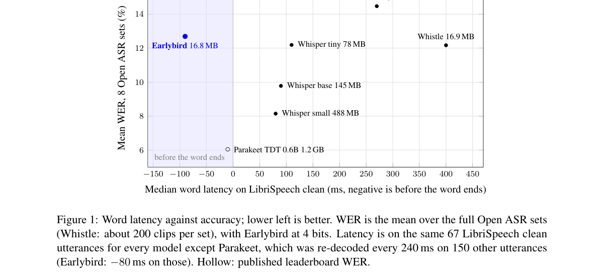

*Result - Size against accuracy (left) and against word latency (right); lower left is better. Full-precision models are shown at their 16-bit size, Nemotron (streaming, 80 ms chunks) at its int8 size*

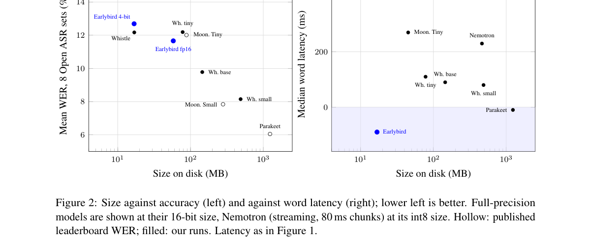

**Why this ranks #3**: 29M 参数（4 bit 权重 16.8 MB）的流式识别器在 LibriSpeech clean 上把中位词提前 90 ms 正确输出，而 Moonshine Tiny 运行时是延后 270 ms、Whistle 延后 400 ms；同批音频提前正确率 68.8% 对 3.4% 与 9.1%，对未说完的词 ECE 仅 3.7 到 5.5。

---

### 4. Emilia2: A Large-Scale Dataset for Controllable Long-Form Speech Generation

**arXiv**: [2611.13614](https://arxiv.org/abs/2611.13614) | **Score**: 8.7 (relevance 9 x 0.7 + quality 8 x 0.3) | **Direction**: `duplex_speech_core` | **Tags**: duplex-speech, long-form-tts, multilingual-dataset, speaker-diarization, instruction-control, nonverbal-vocalization, Chinese University of Hong Kong | **Categories**: cs.SD, eess.AS | **Pages**: 28

**Authors**: Qinke Ni; Dekun Chen; Junwen Qiu; Huan Liao; Xu Li; Xingwen Han; Wan Lin; Kunyu Feng; Yuxiang Wang; Yusheng Mu; Chaoren Wang; Yingda Shen

**Affiliation**: The Chinese University of Hong Kong, Shenzhen

**Abstract**

> Generating long-form speech requires models to keep content, speaker identity, turn-taking, and expressive style consistent over time. Yet most open training corpora contain examples lasting only tens of seconds and open long-form benchmarks cover at most two speakers per recording. We introduce Emilia2, a 229K-hour multilingual dataset for controllable long-form speech generation. From in-the-wild data, Emilia2 constructs short utterances, single-speaker long-form speech, and multi-speaker dialogues, preserving transcripts, speaker identities, pauses, and acoustic transitions. Examples longer than five minutes account for 50.0% of single-speaker long-form hours and 66.8% of dialogue hours. To support expressive control, Emilia2 provides natural language instructions for 4.77M examples and nonverbal-vocalization tags for 933K examples. We also introduce Emilia2-testset, 23 hours of bilingual recordings of up to 30 minutes and four speakers, each speaker paired with reference audio. We train autoregressive (AR) and non-autoregressive (NAR) models on Emilia2. Our 0.6B-backbone NAR model achieves the lowest Chinese CER and English WER on TTSD-Eval (5.27%/9.93%) among compared systems, while our AR model is on par with Qwen3-TTS-12Hz-VD on InstructTTSEval (zh/en: 76.2/78.3 vs. 77.1/77.9). These results validate Emilia2 as a comprehensive data foundation for long-form speech generation and minute-scale expressive control. Demo: https://charlesnii.github.io/Emilia2-demo/.

**Key findings**

- **Finding**: Emilia2 去重后含 20497038 条音频、229388 小时、41 种语言；超过 5 分钟的样本占单人长音频时长的 50.0%、多说话人对话时长的 66.8%，指令标注覆盖 4766441 条样本共 25053 小时（其中长音频与对话占 79.6%），非语言发声标注覆盖 933006 条。
- **Inference**: 长音频视图与对话视图切分自同一批源录音，说明分钟级生成真正缺的是带说话人结构与表达标注的长样本，而不是更多短句。
- **Recommendation**: 训练分钟级可控 TTS 时优先复用该数据的指令标注与非语言发声标签，并在 Emilia2-testset 上做带参考音频的跨说话人评测。

**Key figures**

*Framework - Pipeline overview of EMILIA2-PIPE. In-the-wild recordings are enhanced, diarized, transcribed, and merged into single-speaker or multi-speaker audio. Segments are annotated with natural lang*

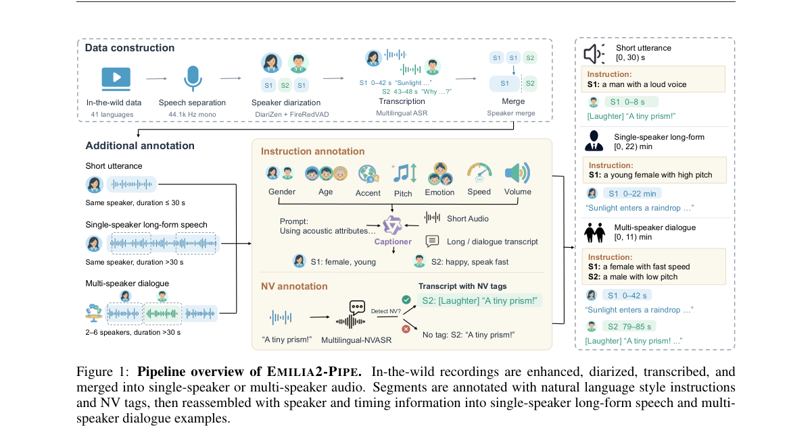

*Result - Language distribution of EMILIA2-SHORT. The 34 remaining languages are grouped as Other.*

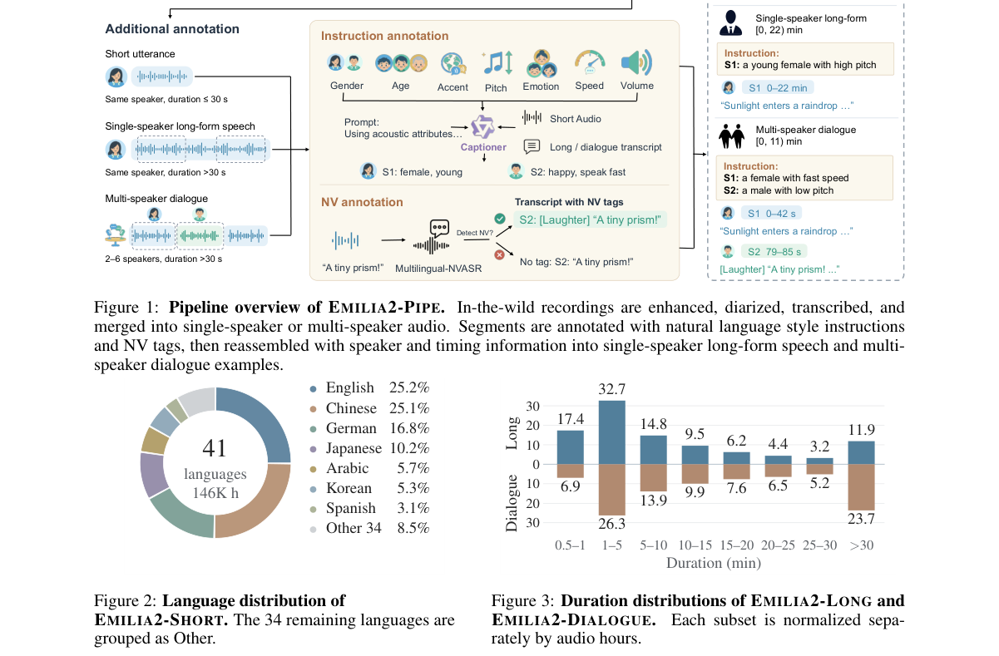

**Why this ranks #4**: 229388 小时、41 语言的 Emilia2 是目前长文本语音生成体量最大的开源语料之一，超过 5 分钟的样本占单人长音频 50.0%、对话音频 66.8%；配套 23 小时 Emilia2-testset（最长 30 分钟、4 说话人）让 0.6B 骨干的 NAR 模型在 TTSD-Eval 上拿到中英 5.27%/9.93% 的最低错误率。

---

### 5. Omni-JEV: Text and Dual-Stream Speech Decisions

**arXiv**: [2611.13777](https://arxiv.org/abs/2611.13777) | **Score**: 8.7 (relevance 9 x 0.7 + quality 8 x 0.3) | **Direction**: `duplex_speech_core` | **Tags**: duplex-speech, full-duplex, turn-taking-policy, candidate-probability, rlcd, dual-stream-audio, Merit Interactive Research Institute | **Categories**: cs.LG | **Pages**: 23

**Authors**: Shengzhou Kong

**Affiliation**: Merit Interactive Research Institute

**Abstract**

> A user utterance does not uniquely determine the next action in full-duplex dialogue: its consequences depend on the assistant's response state and interaction history. Speech activity, utterance completion, and interruption intent provide related evidence, whose implications for a response require an explicit action policy. We formulate this task at collected-segment endpoints and introduce Omni-JEV, which maps text or role-indexed user and assistant-reference speech to probabilities over five interaction actions. An aligned speech-to-speech understanding backbone encodes the acoustic roles separately and shares its candidate readout with text inputs. Bilingual weak supervision supports cross-entropy fine-tuning followed by reinforcement learning for probability-sensitive decisions (RLCD). We compare Gaussian-logit and categorical Choice RLCD from the same supervised initialization under matched training exposure, observing different trade-offs between classification and probability quality. Gaussian Omni-JEV achieves test accuracies of 84.08% for audio and 96.55% for text. This common action interface supports decisions about when a full-duplex voice assistant should respond, preserve ongoing speech, interrupt, or resume an interrupted response.

**Key findings**

- **Finding**: Omni-JEV 用共享的 SenseVoice（动作适配时冻结）与前端分别编码用户语音和助手参考语音成角色片段，再与文本拼成同一提示交给继承自 MiniMind-O 的 Thinker；前端与 Thinker 共 597625856 个可训练参数，hidden 宽度 1024。
- **Inference**: 同一监督初始化的两种 RLCD 方案里，高斯 logit 版音频宏 F1 为 76.00%、分类式 Choice 版为 75.23%，但后者概率误差更低，说明分类精度与概率校准必须分开评估。
- **Recommendation**: 做全双工助手时把动作空间做成候选概率接口而非直接分类，这样既能选动作，也能用阈值控制抢话与静默。

**Key figures**

*Framework - Interaction decisions at collected-segment endpoints. Acknowledgment and interruption can both overlap assistant speech but require different actions. Both role tracks share the source-speci*

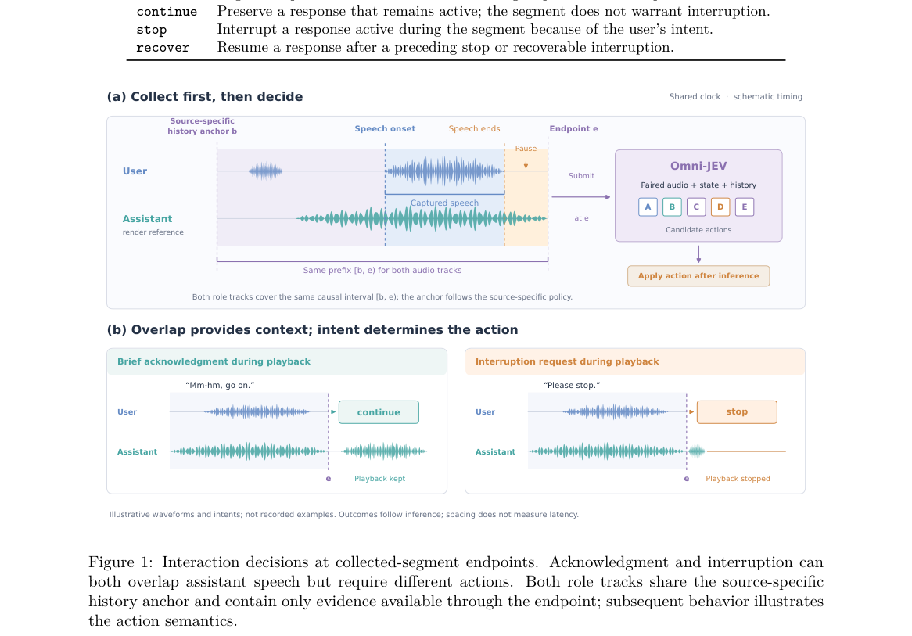

*Result - Omni-JEV architecture. User and assistant-reference audio are independently encoded with shared SenseVoice and frontend parameters, then serialized with text into one prompt. The STS- initia*

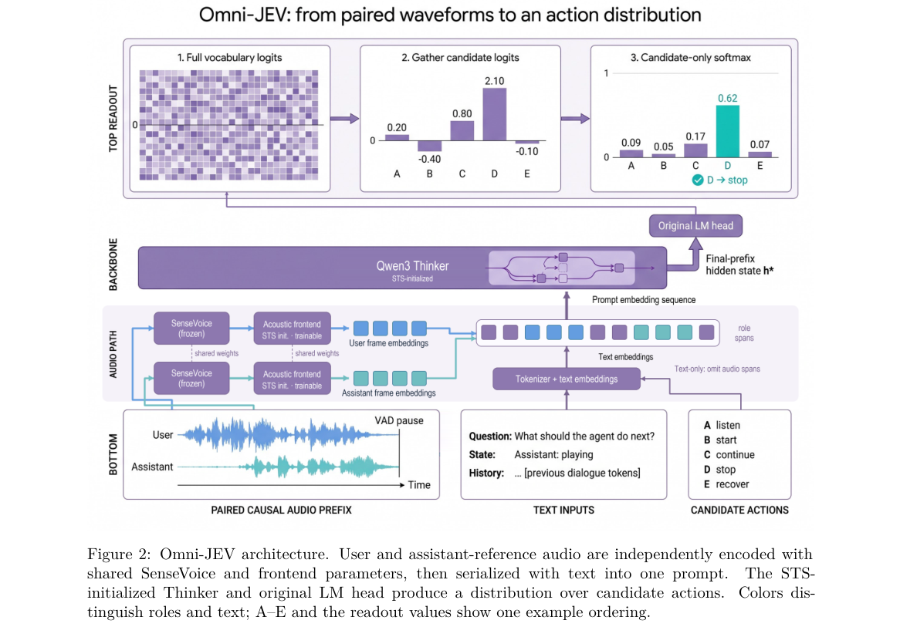

**Why this ranks #5**: 把全双工交互决策统一成 listen、start、continue、stop、recover 五个动作，高斯 logit 版 RLCD 在音频上准确率 84.08%、文本上 96.55%；前端加 Thinker 约 5.98 亿参数、hidden 宽度 1024，是本批次唯一直接优化全双工响应时机的工作。

---

### 6. DialInstruct-TTS: Interactive Expressive Speech Generation via Multi-Turn Dialogue with Fine-Grained Temporal Control

**arXiv**: [2611.13875](https://arxiv.org/abs/2611.13875) | **Score**: 8.7 (relevance 9 x 0.7 + quality 8 x 0.3) | **Direction**: `duplex_speech_core` | **Tags**: duplex-speech, multi-turn-dialogue, temporal-control, non-target-preservation, instruction-following, japanese-tts, Nara Institute of Science and Technology | **Categories**: eess.AS | **Pages**: 23

**Authors**: Wangzixi Zhou; Bagus Tris Atmaja; Sakriani Sakti

**Affiliation**: Nara Institute of Science and Technology

**Abstract**

> Existing instruction-based TTS systems primarily support one-shot, utterance-level control, where a single instruction determines the speaking style of an entire utterance. As a result, even minor refinements require rewriting the instruction and regenerating the full utterance, limiting fine-grained interactive control. We propose DialInstruct-TTS, an interactive multi-turn expressive TTS framework that enables users to iteratively refine generated speech through natural-language dialogue until the desired style is achieved. At each dialogue turn, a Qwen-based planner integrates the dialogue history and latest user instruction into a complete TemporalPlan, while a temporal acoustic control module provides fine-grained control over emotion, speaking rate, volume, and phonation. Reference-latent revision preserves non-target regions across turns, allowing users to modify only the requested attributes or temporal spans while retaining previously satisfactory speech. Subjective evaluations demonstrate improved global instruction following, accurate local style realization, and effective non-target preservation. Compared with conventional one-shot interaction requiring full instruction restatement and utterance regeneration, DialInstruct-TTS substantially improves perceived convenience and interaction comfort. Audio samples are available at https://anonymous.4open.science/w/eacl-demo-17C5/.

**Key findings**

- **Finding**: DialInstruct-TTS 用本地部署且不更新参数的 Qwen3-8B 作对话修订规划器，输出全局 caption、delta plan 与完整 TemporalPlan；Temporal Acoustic Control Module 挂在冻结的 RF-DiT 流匹配骨干和 DACVAE 解码器上，只训练新增模块。
- **Inference**: 去掉非目标锁定后第 5 轮当前非目标 mel 距离从 4.19 dB 升到 23.48 dB（18 组配对样本，差 19.28 dB，95% CI 17.65 到 20.89），说明参考潜变量钳制是多轮编辑不破坏已满意片段的关键。
- **Recommendation**: 要改一段而不重生成整句时务必保留上一轮参考潜变量、只施加区间级控制；用户研究里 29 比 1 的最终偏好也支持这种增量改法。

**Key figures**

*Framework - Overview of DialInstruct-TTS*

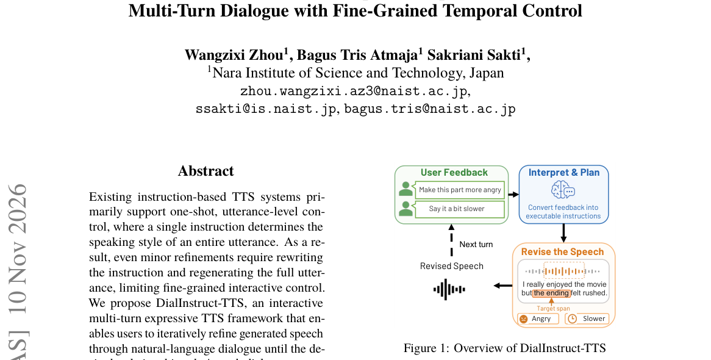

*Result - Architecture of DialInstruct-TTS*

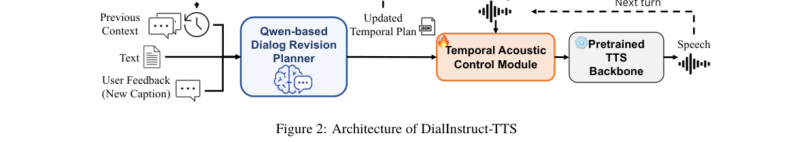

**Why this ranks #6**: 用本地部署且不更新参数的 Qwen3-8B 规划器把多轮反馈折成 TemporalPlan，对冻结的流匹配骨干做情感、语速、音量、音色的区间级控制；五轮消融中非目标锁定把 mel 距离从 23.48 dB 压到 4.19 dB，人评最终偏好 29 比 1 选多轮。

---

### 7. GigaEdge Spench: An SDK for Practical Streaming Speech Enhancement

**arXiv**: [2611.13243](https://arxiv.org/abs/2611.13243) | **Score**: 8.0 (relevance 8 x 0.7 + quality 8 x 0.3) | **Direction**: `duplex_speech_core` | **Tags**: duplex-speech, streaming-denoiser, cross-platform-sdk, onnx-runtime, webassembly, cpu-deployment, SberDevices | **Categories**: cs.LG, eess.AS | **Pages**: 16

**Authors**: Artem Sokolov; Artem Khaidarov; Yana Lysova; Alexander Gladkikh; Vitaliy Yulis

**Affiliation**: SberDevices; Sberbank

**Abstract**

> We present GigaEdge Spench, an open-source SDK for streaming speech enhancement on CPU servers, mobile devices, and in browsers. Applications can build enhancement channels from neural denoising, normalization and dynamics blocks, sample-rate conversion, and acoustic echo cancellation where supported. These stages can be combined, while normalization can also run without a neural model. The release includes an 8 kHz INT8 denoiser and discriminative and hybrid 48 kHz FP32 models. A shared C++ core supports ONNX Runtime and TensorFlow Lite through native interfaces, Android and iOS SDKs, and WebAssembly integration. Independent stream contexts share model resources, and consecutive frames from one stream can be processed in a single inference call. We evaluate the released models on EARS-WHAM v2 and compare their quality and processing costs with RNNoise and DPDFNet2. All tested native and Web configurations process files faster than real time, although larger chunks require more time to collect input. We also measure how many streams a shared model can process on a CPU. Our contribution is a configurable deployment system and an experimental study of how model choice, chunk size, and execution environment affect its use. All reported SDK timing uses ONNX Runtime. Index Terms: speech enhancement, streaming inference, cross-platform deployment, temporal frame grouping, computational efficiency

**Key findings**

- **Finding**: GigaEdge Spench 的共享 C++ 内核负责采样率转换、频谱处理与每流模型状态，可选拼接神经降噪、归一化、动态处理块与声学回声消除；发布模型含 8 kHz INT8 降噪器以及判别式与混合式两个 48 kHz FP32 模型。
- **Inference**: 混合式 48 kHz 模型的收益主要在感知质量而非参考重建——SI-SDR 只高 0.24 dB，但 DNSMOS P.808、SIGMOS OVRL、NISQA MOS 分别高 0.26、0.46、0.51，说明算力预算宽裕时才值得换模型。
- **Recommendation**: 在浏览器或移动端做实时降噪时按 16、32、64、128 ms 分块实测，块越大吞吐越高但要等更久收齐输入，且该文所有原生与 Web 配置都能快于实时处理文件。

**Key figures**

*Framework - An example enhancement channel. Stages can be omitted, while normalization can itself combine selected DSP blocks. This is one possible order; available stages and controls depend on the pla*

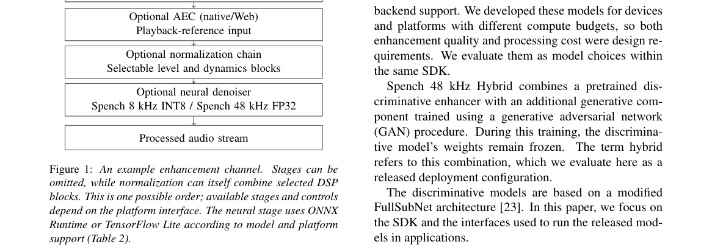

**Why this ranks #7**: 面向 CPU 服务器、移动端与浏览器的开源流式增强 SDK，共享 C++ 内核同时接 ONNX Runtime 与 TensorFlow Lite；在 EARS-WHAM v2 的 886 对配对音频上，48 kHz 混合模型把 SIGMOS OVRL 预测分提高 0.46，8 kHz INT8 模型 SI-SDR 比下采样 RNNoise 高 1.96 dB。

---

### 8. Antalia-2 Mini: A 7.6-million-parameter Turkish text-to-speech model trained entirely on synthetic speech

**arXiv**: [2611.13811](https://arxiv.org/abs/2611.13811) | **Score**: 8.0 (relevance 8 x 0.7 + quality 8 x 0.3) | **Direction**: `duplex_speech_core` | **Tags**: duplex-speech, tiny-tts, synthetic-data-distillation, on-device-tts, turkish-tts, vocoder-finetuning, PatientDesk AI | **Categories**: cs.CL, cs.SD | **Pages**: 38

**Authors**: Sezgin Saygili; Emre Kaplaner; Oncel Ozgul; Fikri San Koktas

**Affiliation**: PatientDesk AI

**Abstract**

> Antalia-2 Mini is a single-voice Turkish text-to-speech model with 7,620,931 parameters. It reads characters and produces 48 kHz audio at 41 times real time on an Apple M5 laptop CPU (2 threads). Its training audio came only from VoxCPM2 (the teacher), about 300 times larger, cloning one synthetic clip; automatic checks kept about 1,790 h. Fine-tuning the vocoder on the acoustic model's own mel spectrograms cut the word error rate (WER) of Whisper's transcripts from a mean of 3.89% to 1.75% at adjacent pre-release checkpoints. The teacher corrupts the start of a clip when the first word begins with ö, the student learned this, and a spoken prefix we cut from the output hides it. On the 495-sentence Freya-TR-Eval benchmark, where we tuned settings, version 1.0.1 has WER 1.09% and character error rate 0.22% on our public harness. A paired bootstrap cannot distinguish these from EMA Lightning, an 8.6M Turkish model, which scores higher on full-band UTMOS, an English-trained quality proxy. No human listening test exists. Weights, inference code and the benchmark harness are public under Apache-2.0; training code and data are not.

**Key findings**

- **Finding**: Antalia-2 Mini 的训练音频全部由未经修改的 VoxCPM2（2.29B 参数）克隆同一段 9.88 秒合成参考生成，1361734 条里自动检查保留 1325846 条、约 1790 小时，但 Whisper 只核查了 444437 条短音频中的 7500 条。
- **Inference**: 用声码器在声学模型自己的 mel 上微调把相邻预发布检查点的 WER 从均值 3.89% 降到 1.75%，而冻结声码器时仍停在 3.63% 到 4.14%，说明学生的误差主要来自声码器与 mel 分布不匹配。
- **Recommendation**: 只有几百万参数预算时优先把训练数据与声码器的 mel 分布对齐，并注意教师缺陷会被继承——教师在首词以 ö 开头的 12554 行中只有 26% 首词正确，学生虽用前缀遮住却并未消除该缺陷。

**Key figures**

*Framework - The whole model on one real sentence (version 1.0.1, seed 0). The normalizer writes the numbers out, the encoder and duration predictor plan the timing, the generator draws a mel spectrogram*

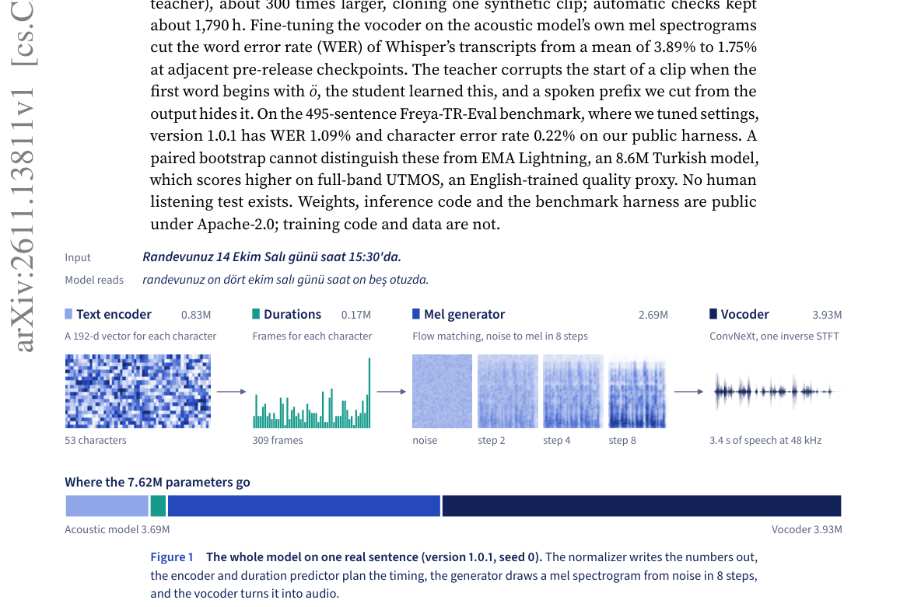

*Result - All training audio came from unmodified VoxCPM2 cloning one synthetic clip, and the vocoder was fine-tuned on the acoustic model’s own mels. Bars are proportional within each node; generated*

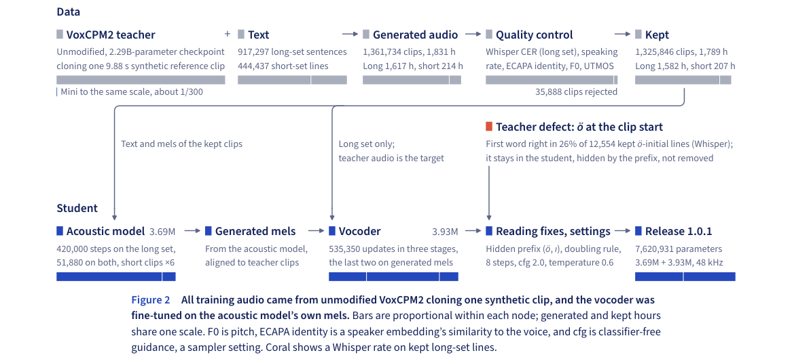

**Why this ranks #8**: 7620931 参数的单音色土耳其语 TTS，训练音频全部来自约大 300 倍的 VoxCPM2 合成（1361734 条中自动筛出约 1790 小时），在 Apple M5 CPU 双线程上跑到 41 倍实时；Freya-TR-Eval 上 WER 1.09%、CER 0.22%，与 8.6M 的 EMA Lightning 已无法用配对自助法区分。

---

### 9. AVCC: Audio-Visual Conversation Corpus for Turn-Taking Prediction with a Human Benchmark

**arXiv**: [2611.13957](https://arxiv.org/abs/2611.13957) | **Score**: 8.0 (relevance 8 x 0.7 + quality 8 x 0.3) | **Direction**: `duplex_speech_core` | **Tags**: duplex-speech, turn-taking, next-speaker-prediction, audio-visual-corpus, human-benchmark, social-robot, KTH Royal Institute of Technology | **Categories**: cs.CL, cs.HC, cs.SD | **Pages**: 5

**Authors**: Haotian Qi; Gabriel Skantze

**Affiliation**: KTH Royal Institute of Technology

**Abstract**

> } Predicting who will speak next, and when, is a prerequisite for conversational agents and social robots that take turns without waiting for silence. Multiparty next-speaker prediction (NSP) has been studied on corpora with per-speaker sensors, each with its own event definitions. No public benchmark covers the single camera and microphone a robot has, and no model has been compared against how well people perform the same prediction. We turn AVCC, a 31-hour audio-visual corpus of two- and three-speaker online conversation recorded with a single static camera and microphone, into a public NSP benchmark. We add a speaker-disjoint seven-video test partition with 865 hold and 865 shift events at mutual-silence gaps, word-level forced-aligned transcripts for the whole corpus, and a human reference benchmark collected at the same events. We score an audio-only Role-Relative VAP model (RoleVAP) and the multimodal MuVAP model. Labels, transcripts, per-response human data, and the scripts that reproduce every number are released.

**Key findings**

- **Finding**: AVCC 含 29 段无剪辑在线视频、31 小时音频（两说话人 18 段共 16 小时 52 分、三说话人 11 段共 14 小时 07 分），新增说话人不重叠的 7 段视频测试分区共 1730 个互默间隙事件，并配 154 名参与者的逐事件人工参考。
- **Inference**: NSP 口径下人类平均只有 59.5%（两人 63.1%、三人 57.0%），多数票 67.7%；多模态 MuVAP 拿到 63.3% NSP 与 67.9% hold/shift，加上视频只比纯音频多 1.4 个点，说明单麦克风场景下视觉收益有限。
- **Recommendation**: 评估对话轮次模型时把人类锚点一起报出来，并用 hold/shift 与 NSP 两种口径分别汇报，否则只看一个百分比容易误判模型强弱。

**Key figures**

*Framework - The study interface. Participants watch a clip of up to 10 s with face labels (0, 1, 2 for three-speaker clips) drawn on every frame, then choose the next speaker and rate their confidence.*

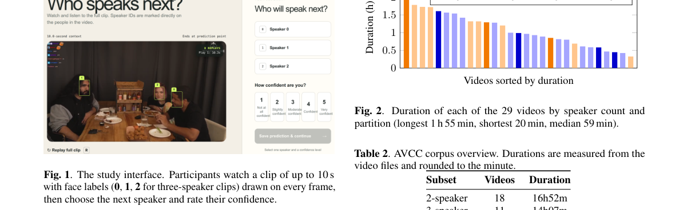

*Result - Duration of each of the 29 videos by speaker count and partition (longest 1 h 55 min, shortest 20 min, median 59 min).*

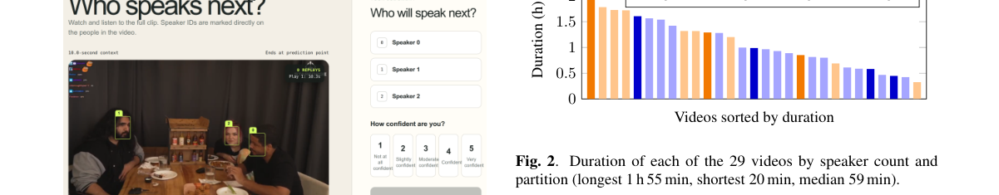

**Why this ranks #9**: 把 31 小时、单相机加单麦克风录制的两三人在线对话整理成公共轮次预测基准，测试分区 7 段视频含 865 个 hold 与 865 个 shift 事件；音频版 RoleVAP 在 hold/shift 上 66.5%，比人类平均水平 64.0% 高 2.5 个点、比多数票 70.1% 低 2.8 个点。

---

### 10. ESDCodec: Ultra-Low Bitrate Speech Codec with Enhanced Semantic Disentanglement and Subband Decoding

**arXiv**: [2611.14043](https://arxiv.org/abs/2611.14043) | **Score**: 8.0 (relevance 8 x 0.7 + quality 8 x 0.3) | **Direction**: `duplex_speech_core` | **Tags**: duplex-speech, speech-codec, semantic-disentanglement, ultra-low-bitrate, subband-decoder, frozen-codebook, WeChat | **Categories**: eess.AS | **Pages**: 5

**Authors**: Nan Xu; Kecan Mao; Xin Gu; Yi Zhao; Zhi Gong

**Affiliation**: WeChat, Tencent Inc.

**Abstract**

> Despite recent advances in neural speech codecs, achieving highfidelity speech reconstruction at low bitrates remains a formidable challenge. To address this limitation, we propose ESDCodec, a speech codec that integrates a thoroughly enhanced semantic quantizer and a conditioned decoder network. Specifically, we employ a randomly initialized and frozen codebook, followed by a lightweight projector, to encode semantic details entirely within a linear space while enhancing codebook utilization. To further improve perceptual quality, we design a condition network that explicitly injects prior subband knowledge into the upsampling decoder. Taking the de-quantized feature as input, this network predicts subband signals, thereby providing fine-grained guidance for waveform reconstruction. Extensive experimental results show that ESDCodec achieves superior reconstruction performance at an ultra-low bitrate of 0.85kbps. For LLM-based speech generation tasks, ESDCodec also consistently outperforms existing codec models.

**Key findings**

- **Finding**: ESDCodec 用随机初始化并冻结的码本加轻量投影器在纯线性空间编码语义，剩余声学码由残差量化产生；配置为 25 Hz、0.85 kbps、码本 16384/1024、3 个量化器，模型 89.78M 参数，其中子带条件网络仅 9.6M。
- **Inference**: 消融显示条件机制才是主要收益来源——去掉后 PESQ 从 2.49 降到 2.42、WER 从 4.18% 升到 6.38%，而只把语义换成 VQ 方案只降到 2.43 与 4.43%，说明语义解耦的价值远小于子带引导。
- **Recommendation**: 在 0.85 kbps 量级做神经语音编码时优先投入条件解码器而不是更复杂的语义量化器；主观听测（10 人、LibriSpeech 随机 15 句）也确认 ESDCodec 得 88.2 分，高于 DualCodec 的 85.8。

**Key figures**

*Framework - The overall architecture of the proposed ESDCodec. In the subfigure (a), the enhanced semantic quantizer is shown and generates the single semantic code q0. The remaining acoustic codes are en*

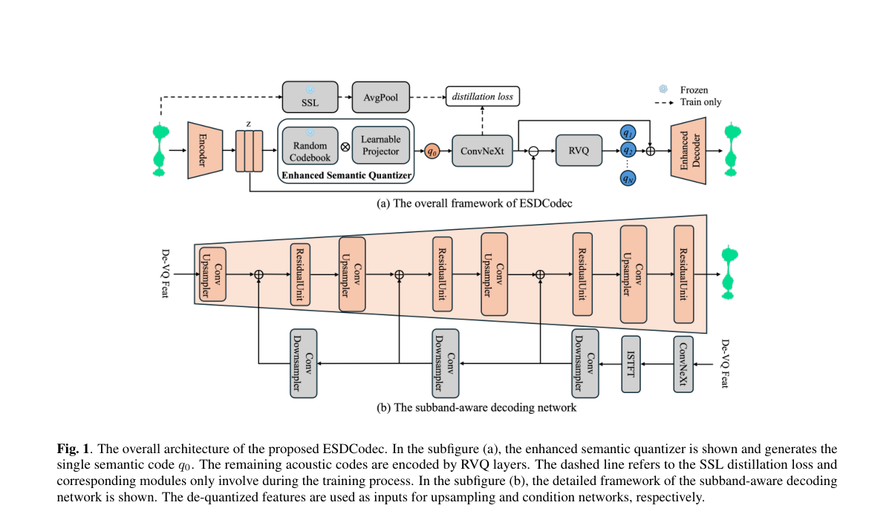

*Result - The ablation experiment results of different semantic code- book sizes on LibriSpeech test-clean subset.*

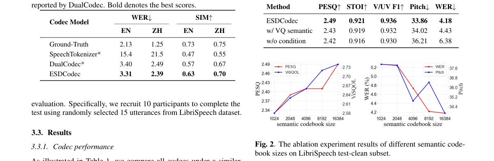

**Why this ranks #10**: 在 0.85 kbps 超低码率上做语义与声学双流解耦：冻结随机初始化码本加轻量投影器编码语义，条件网络只增加 9.6M 参数就向解码器注入子带先验；LibriSpeech test-clean 上 PESQ 2.49、ViSQOL 2.74、WER 4.18%，均优于同码率 DualCodec 的 2.32、2.61、4.70%。

---

### 11. Nepali-English Code-Mixed Speech Recognition: Data Preparation and Adaptation of a Speech Foundation Model

**arXiv**: [2611.13512](https://arxiv.org/abs/2611.13512) | **Score**: 7.7 (relevance 8 x 0.7 + quality 7 x 0.3) | **Direction**: `duplex_speech_core` | **Tags**: duplex-speech, code-mixed-asr, nepali, text-normalization, foundation-model-adaptation, numeric-speech, AI Lab Pvt. | **Categories**: cs.AI | **Pages**: 9

**Authors**: Jeevan Neupane; Janardan Bhetwal; Kshitiz Paudel; Anup Aryal; Bipin Bashyal

**Affiliation**: AI Lab Pvt. Ltd., Nepal

**Abstract**

> Nepali speakers regularly mix English words into conversation, but multilingual speech recognisers often struggle with language switches and the writing script used for English words. We study how to adapt SraVaani, a 449M-parameter hybrid TDT-CTC model, using a 172.8-hour corpus covering six Nepali speech domains. Its pretrained tokenizer does not support digits and several common symbols. Rather than replace it or discard these recordings, we generate Nepali and English readings for numbers and use zero-shot ASR output to select a plausible form. Full fine-tuning reduces test word error rate (WER) from 48.6% to 17.1%; a 12-epoch run reaches 16.3%, compared with 16.4% for fine-tuned Whisper large-v3-turbo. Freezing the encoder increases WER to 25.5%, while excluding numeric clips raises WER on numeric test speech from 14.3% to 21.3%. We also evaluate on FLEURS using both its original references and mixed-script alternatives. The comparison shows that transcription conventions explain part, but not all, of the out-of-domain performance loss.

**Key findings**

- **Finding**: 语料共 115107 条音频、172.8 小时（训练 105448 条、152.91 小时），43.8% 的片段含至少一个英文词，英文占参考词的 24.2%；数字读法用规则同时生成尼泊尔语与英语两种候选，再用零样本 ASR 输出挑最接近的一种。
- **Inference**: 去掉含数字的训练片段后总体 WER 从 17.1% 升到 19.8%，数字测试片段从 14.3% 升到 21.3%，数字词错误率从英文 4.9%、尼泊尔语 6.4% 涨到 16.6% 与 29.8%，说明口语数字数据比替换 tokenizer 更关键。
- **Recommendation**: 迁移预训练语音模型到混合语种时优先保留原 tokenizer 并把数字转成词形，同时解冻编码器；只按官方方案冻结编码器微调会多留 8.4 个 WER 点。

**Key figures**

*Framework - YouTube speech collection: video selection, audio process- ing, segmentation and transcript verification.*

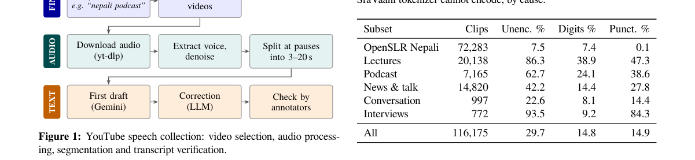

*Result - Spelling out numbers, on a real lecture clip. Rules propose a Nepali and an English reading for each number. We romanise the candi- dates and the base model’s output, which writes English in*

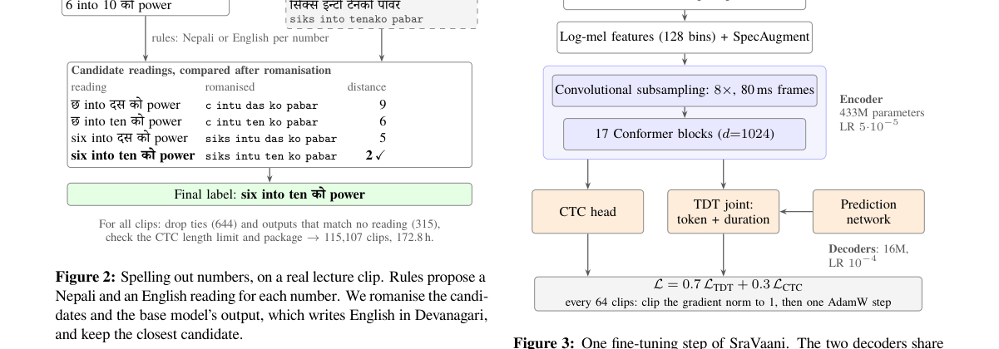

**Why this ranks #11**: 用 172.8 小时六域混合语料全量微调 449M 的 SraVaani（TDT-CTC 混合），测试 WER 从 48.6% 降到 17.1%（12 轮 16.3%），与微调后的 Whisper large-v3-turbo 16.4% 相当；冻结编码器则退化到 25.5%，说明必须更新编码器。

---

### 12. Swanada: Split-Encoder Capability-Routed Conformer CTC and Sub-30 MB On-Device Speech Recognition Across Twelve Scripts

**arXiv**: [2611.13814](https://arxiv.org/abs/2611.13814) | **Score**: 7.7 (relevance 8 x 0.7 + quality 7 x 0.3) | **Direction**: `duplex_speech_core` | **Tags**: duplex-speech, on-device-asr, webassembly, multi-script-asr, quantized-ctc, language-routing, [unverified] | **Categories**: cs.AI, cs.SD | **Pages**: 7

**Authors**: Hemanth HM

**Affiliation**: [unverified]

**Abstract**

> Client-side automatic speech recognition (ASR) across Indic and Classical scripts eliminates cloud transcription costs, network tail latency, and server-side audio retention, yet neural exports face four systems bottlenecks in browsers and mobile runtimes: (1) monolithic per-language Conformer checkpoints require ~177 MiB per script (> 2.1 GiB across 12 scripts), exhausting CacheStorage quotas; (2) static relative positional encoding tables embed 10.2-20.5 MB of FP32 constants while 1x1 Conv1d layers trigger slow or unsupported ConvInteger kernels in WebAssembly SIMD; (3) sliding-window CTC flickers on boundary tokens; and (4) mobile WebAudio pipelines suffer 44.1/48 kHz sample-rate mismatches and silent AudioWorklet stalls under iOS WKWebView. We present Swanada, an open-source 16 kHz streaming ASR system spanning Classical Sanskrit, Indian English, and ten Indian languages (sa, en, hi, kn, mr, bn, ta, te, ml, gu, pa, or) across browser WebAssembly, Node.js, and Python. Swanada pairs capability-routed shared INT8 Conformer encoders (a 17-layer 177.38 MiB Studio tier at $d = 512$ for desktop/servers and a distilled 14-layer 25.35 MiB Mobile tier at $d = 256$ for phones) with twelve hot-swappable 515.0 KiB native-script linear CTC heads ($257 \times 512$), cutting 12-language storage by $11.6\times$ (183.4 MiB) and $67.8\times$ (31.39 MiB; 25.85 MiB first load). Runtime protobuf tail surgery exposes the shared representation in $< 2$ ms, while dynamic positional synthesis, MatMul pointwise convolutions, and post-quantization QInt8 head calibration preserve sub-30 MB accuracy. Across $N = 480$ held-out and $N = 1,280$ open public test clips (FLEURS, LibriSpeech, GLOBE, AMI, wild Sanskrit), Swanada achieves 5.43% held-out and 8.87% 12-language open CER on Studio (18.56% and 19.23% on Mobile) at $0.0097\times$-$0.0264\times$ RTF, with 30.6 ms median TTFT and 0.00% committed-prefix churn.

**Key findings**

- **Finding**: Swanada 用 17 层 d=512 的 177.38 MiB Studio 编码器与蒸馏出的 14 层 d=256、25.35 MiB Mobile 编码器，配 12 个 515.0 KiB（257×512）原生文字线性 CTC 头；切换语言只替换该头缓冲，耗时不到 20 ms，与整图的最大绝对 logit 偏差小于 10^-5。
- **Inference**: 压缩到 Mobile 档（声学主干压缩 7.0 倍）后四线程 RTF 从 0.0264 降到 0.0097，但 12 语言开放集 CER 从 8.87% 涨到 19.23%，说明省体积的代价主要落在跨语言泛化而非实现本身。
- **Recommendation**: 在浏览器或手机端做多语言识别时，共享编码器加可插拔 CTC 头是可行的省空间路径，但要按 31.39 MiB 的 Mobile 档准备，并接受其 CER 约为 Studio 的两倍。

**Key figures**

*Framework - Swanada split-encoder decomposition and cross-capacity distillation: the 17-layer Studio Conformer-Large (d = 512, 177.38 MiB QInt8) distills into a 14-layer Mobile Conformer-Small (d = 256,*

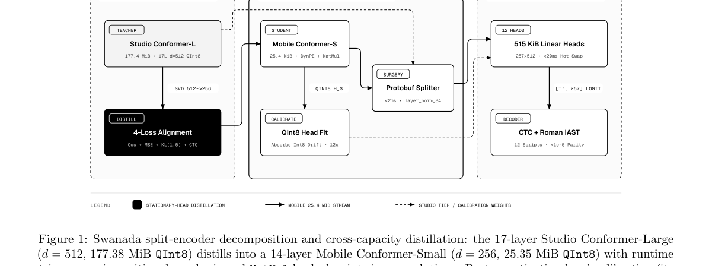

*Result - Swanada end-to-end capability-routed streaming architecture: 44.1/48 kHz microphone or file audio is resampled to 16 kHz PCM with a 900 ms ScriptProcessor watchdog fallback, enhanced via cau*

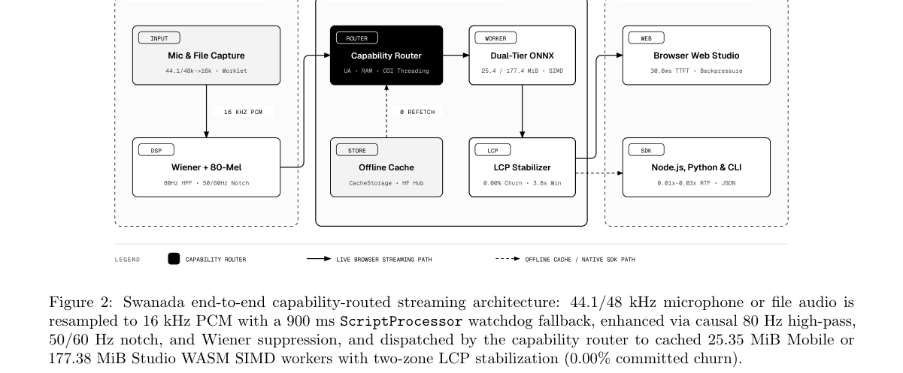

**Why this ranks #12**: 用能力路由的共享 INT8 Conformer 编码器加 12 个可热插拔的 515.0 KiB 原生文字 CTC 头，把 12 语言部署体积从 2128.5 MiB 压到 183.4 MiB（11.6 倍）与 31.39 MiB（67.8 倍）；Studio 层在 480 句留出集上 CER 5.43%，流式首字 30.6 ms，前缀改动率 0.00%。

---

## Footer

- Total papers reviewed across all 4 axes: 60
- duplex_speech axis final count: 12
- Wild-cards in this axis: 0
- Figure assets: 2026-11-12/res/

Generated by `mine-arxiv-daily-digest` skill. Sister file: `2026-11-12_duplex_speech_entry.md`.
