# Mine Arxiv Daily Digest - 2026-11-12 (LLM / VLM 与其强化学习 Axis, 18 papers)

**Generated**: 2026-11-12 01:26 CST

**Source**: arXiv cs.CV, cs.SD, eess.AS, cs.CL, cs.AI, cs.RO, cs.LG, cs.IR submissions, listing day 2026-11-10 (announced 2026-11-11 00:00 UTC)

**Batch window**: 2026-11-09T19:00:00Z .. 2026-11-10T19:00:00Z（arXiv 公告批次横跨两个 UTC 日：从前一日的美东 14:00 截止时刻起算（EDT 为 18:00Z，EST 为 19:00Z），到当日的同一时刻为止）

**Axis**: llm_vlm (18 papers, base 18, cap 20)

**Directions**: llm_core (7), vlm_core (5), llm_vlm_rl (6)

**Selection**: 18 papers ranked by relevance x quality, with 0 wild-card slots

**Day total**: 60 papers across 4 axes (target 60)

**Scope**: 大语言模型与视觉语言模型的设计、推理、agent、效率与上下文工作，以及面向 LLM / VLM 的 RL 与偏好优化、奖励模型

**Wild-card**: **Wild-card**: 0 —— 本 axis 未启用任何 wild-card 名额。`llm_core` 让出的 1 个名额由 `llm_vlm_rl` 内**同方向**的够格论文吸收。

**轴内做了一个小调整**：`llm_core` 本批次只有 7 篇够格论文（基准 8 篇），让出的 1 个名额按两级弹性分配规则流向候选更充裕的 `llm_vlm_rl`（基准 5 篇 → 实际 6 篇）。本 axis 合计 18 篇，正好等于 axis 基准 18 篇，未触及 20 篇上限。

---

## LLM 核心（架构 / 推理 / agent / 效率 / 上下文） · `llm_core` (7 papers)

本方向 7 篇，主线是**在「权重变了」和「上下文太长」这两件事上继续抠常数**。两篇直接打在同一个热点上：DeepSeek-V4-Flash 的 KV cache 跨模型更新复用给出结论——缓存能保住任务信息，却保不住更新后模型的行为（检索准确率在四次更新间从接近原生掉到大幅损失），已有源缓存时中位 TTFT 加速 2.10–5.08 倍，于是作者提出 Functional Cache Divergence 来刻画这层行为差；另一篇针对 DeepSeek-V4.1 的 Engram n-gram 表（203 GB，占 4-GPU 推理进程 223 GiB 中的 190 GiB），把放置位置按每层预取截止时间（0.3 ms 与 9.3 ms 相差 30 倍）重排。投机解码这一支有两篇：REAL Loss 直指「现有 block 级目标只是 EAL 的代理」，论文把期望接受长度写成了真正的目标；ForeSpark 则处理并行 drafter 下「验证多少 token」与「起草多少 token」分开控制导致的算力浪费。Hybrid 模型的推理侧由 SinkState 处理——线性注意力的 Q/K/V 集中在稳定的低维子空间，对循环状态做在线 SVD 即可省下缓存；MoE 推理侧由单边 all-to-all 把 MoE 层的一次 dispatch/combine 通信省掉一次；最后 OpticalRAG 换了个模态来做上下文压缩——渲染后的整页文本用视觉编码器压到约一百个视觉 token，语义损失很小。

### 1. Can KV Cache Be Reused Across Model Updates? A DeepSeek-V4-Flash Case Study

**arXiv**: [2611.14051](https://arxiv.org/abs/2611.14051) | **Score**: 9.7 (relevance 10 x 0.7 + quality 9 x 0.3) | **Direction**: `llm_core` | **Tags**: LLM-VLM, kv-cache, model-update, cross-version-reuse, niah-retrieval, ttft, Rank Computing | **Categories**: cs.AI, cs.DC | **Pages**: 30

**Authors**: Zhikun Tao; Fangyong Jin; Junping Zhao

**Affiliation**: Rank Computing

**Abstract**

> Reusing key--value (KV) caches across language model updates could avoid repeated computation of shared context, but changes in model weights raise a fundamental question about what these caches preserve. We investigate direct cache reuse across four model updates, with a detailed study of DeepSeek-V4-Flash to Flash-0731. Our central finding is that caches can retain useful task information without faithfully reproducing the updated model's behavior. Retrieval accuracy varies substantially across updates, ranging from near-native performance to large losses. With source caches already available, reuse achieves median time-to-first-token speedups of $2.10$--$5.08\times$ on three longer-prefix QA benchmarks. To characterize the behavioral differences behind these outcomes, we introduce Functional Cache Divergence, which compares next-token distributions under reused and native caches. Direct KV cache reuse better preserves native model behavior in natural-text continuation, whereas compatibility degrades with increasing prefix length in single-token retrieval tasks. Answer-margin analyses help explain how correct retrieval decisions survive substantial internal state changes. Yet even agreement on the first generated token does not ensure agreement in answer content or stopping behavior. These findings establish task utility and fidelity to native inference as distinct criteria for evaluating cross-version KV cache reuse.

**Key findings**

- **Finding**: 四组模型更新的单 token NIAH 上，GLM-5.2→5.3 复用把 32K 前缀准确率从 86.46% 提到 90.62%，DeepSeek-V4.1-Flash→Flash-1017 两者同为 97.92%，而 Qwen3-30B-A3B 复用后从 55.21% 跌到 13.02%。
- **Inference**: 复用是否安全取决于新旧权重对缓存状态的敏感度，跨版本 KV 复用不能默认当作无损加速。
- **Recommendation**: 上线复用前先在同一批次跑 NIAH 准确率对比，并把论文提出的 Functional Cache Divergence 当作行为一致性的门禁指标。

**Key figures**

*Framework - Needle-in-a-Haystack (NIAH) (Hsieh et al., 2024) retrieval accuracy across four model pairs and prefix lengths in the original sweep. Each prefix contains lots of key-value records, with ea*

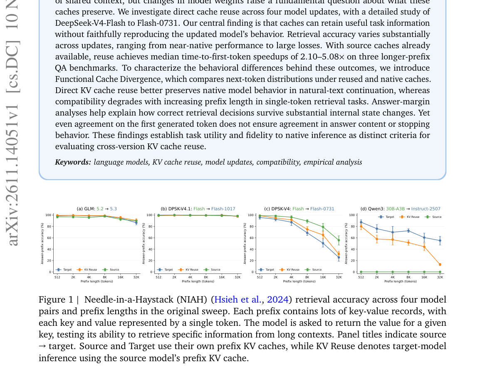

*Result - Three inference configurations on the same prefix and question. Target and Source use one model throughout. KV Reuse combines the source-produced prefix cache with target-model continuation*

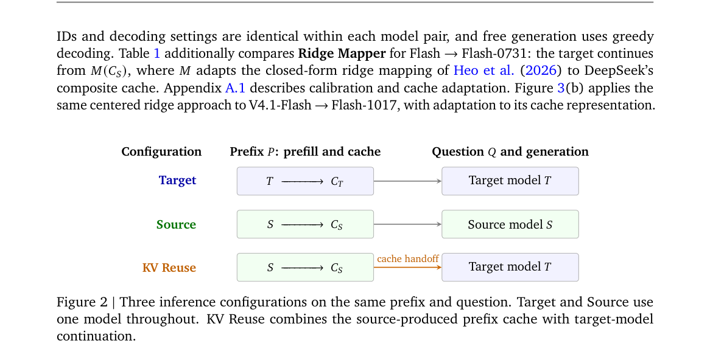

**Why this ranks #1**: 跨 4 组模型更新直接复用 KV 缓存：32K 前缀 NIAH 上 GLM 复用把准确率从 86.46% 提到 90.62%，而 Qwen3-30B-A3B 从 55.21% 掉到 13.02%，已有源缓存时首 token 延迟中位数加速 2.10–5.08 倍，正好落在 llm_core 的 KV_Cache 主线上。

---

### 2. REAL Loss: Optimizing Real Expected Acceptance Length for Speculative Decoding

**arXiv**: [2611.14399](https://arxiv.org/abs/2611.14399) | **Score**: 9.7 (relevance 10 x 0.7 + quality 9 x 0.3) | **Direction**: `llm_core` | **Tags**: LLM-VLM, speculative-decoding, acceptance-length, training-loss, drafter, variance-reduction, University of Hong Kong | **Categories**: cs.CL, cs.LG | **Pages**: 19

**Authors**: Yu Tian

**Affiliation**: The University of Hong Kong

**Abstract**

> Speculative decoding accelerates LLM inference by having a draft model propose multiple tokens for the target model to verify in one pass. The speedup is governed by the expected acceptance length (EAL), yet standard training objectives such as cross-entropy, KL divergence, and total variation focus only on distribution matching or single-step overlap. Recent studies instead propose block-level training objectives, aiming to optimize EAL directly. However, these objectives remain surrogates rather than exact formulations of EAL. For example, some average later acceptance over target-distributed continuations rather than the verification branches selected by accepted tokens, introducing a covariance gap that can reverse the gradient direction. We analyze this gap and derive REAL, a real EAL training loss that uses path weights for unbiased estimation and Rao-Blackwellization for variance reduction. In a controlled loss-level comparison with a Qwen3.6-35B-A3B target and a Domino drafter, REAL outperforms WTV, VSD, DBLast, and the static LK baseline on probabilistic serving acceptance length across 9 task subsets and 5 evaluation seeds. These gains require only a change to the training loss, with no modification to the drafter architecture or inference procedure, demonstrating the practicality of real EAL training. A reference implementation of the REAL loss is available at https://github.com/King-ty/speculators/tree/real-loss.

**Key findings**

- **Finding**: REAL 用路径权重做无偏估计并叠加 Rao-Blackwell 化降方差，在 9 个任务子集、5 个评测种子上取得 4.792 的概率式接受长度，对比基线区间为 4.657–4.749；贪心 serving 下静态 LK 为 4.544，REAL 为 4.537。
- **Inference**: 现有块级训练目标只是 EAL 的代理，平均了未被验证分支选中的后续接受率，这一协方差差足以让梯度方向反转。
- **Recommendation**: 训练 draft 模型时把目标换成真实 EAL 期望，论文报告的收益不需要改动 drafter 架构与推理流程即可兑现。

**Key figures**

*Framework - Two-step illustration of branch dependence. The surrogate averages before multiplying, while the exact objective multiplies before averaging.*

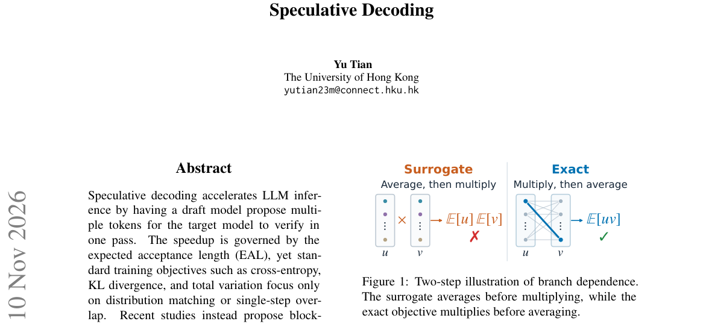

*Result - The two-step counterexample. (a) The ex- act objective weights each branch by its propose-and- accept mass, while the WTV surrogate redistributes that mass by target proportions. (b) As a fu*

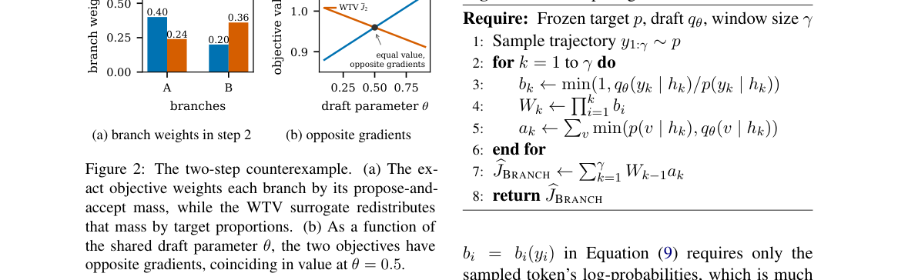

**Why this ranks #2**: 以 Qwen3.6-35B-A3B 为 target、Domino 为 drafter，REAL 损失把概率式 serving 的期望接受长度做到 4.792，高于 WTV/VSD/DBLast/LK 的 4.657–4.749，且 9 个任务子集、5 个评测种子一致，是 speculative decoding 训练目标层面的直接突破。

---

### 3. Placing LLM Lookup Tables by Per-Layer Prefetch Deadlines

**arXiv**: [2611.13413](https://arxiv.org/abs/2611.13413) | **Score**: 9.0 (relevance 9 x 0.7 + quality 9 x 0.3) | **Direction**: `llm_core` | **Tags**: LLM-VLM, sglang, lookup-table, prefetch-deadline, nvme, rdma, Microsoft | **Categories**: cs.AI, cs.DC, cs.LG | **Pages**: 15

**Authors**: Wen Huang; Jack Liu

**Affiliation**: Microsoft; Independent Researcher

**Abstract**

> DeepSeek-V4.1's 203 GB of Engram n-gram tables sit in host DRAM today, taking 190 of the 223 GiB a 4-GPU serving process uses. Row indices depend only on input tokens, so reads can start with each step and overlap earlier layers. V4.1's two Engram layers have windows that differ by 30x (0.3 vs. 9.3 ms). We show that this deadline, together with session reuse and contention on a shared device, decides which tier each table can use and which layers need cache, and we give a model that predicts the resulting slowdown from measured read times. Agent and chat traffic reuse rows within sessions, and static hot sets transfer poorly. We build SlackTier, a table tier for SGLang that issues all lookups at step start. It reads the short-window layer first and splits a small GPU row cache across layers. The path runs inside the decode CUDA graph and is bit-exact with the original gather. Layer 14's table can go to NVMe uncached with no measurable decode cost. With both tables on four NVMe disks, mean time per output token on agent and chat replays rises at most 1.4% over unmodified SGLang, and host memory falls from 212 to 34 GiB. Both tables need no cache when read over RDMA (remote direct memory access) from another node's memory; one copy serves two instances. On a KV-constrained agent workload, using the freed memory as host KV cache at the same memory budget raises median throughput by 36% and cuts median p90 time to first token from 38 to 24 s.

**Key findings**

- **Finding**: layer 1 与 layer 14 的查表窗口相差 30 倍（0.3 ms 对 9.3 ms）；把两块表放到 4 块 NVMe 上后，agent 与 chat 回放的平均每输出 token 时间最多只升 1.4%，host 内存从 212 GiB 降到 34 GiB，且读路径与原 gather bit-exact。
- **Inference**: 查表开销由每层的预取截止期而非表体积决定，因此分层放置能几乎不牺牲延迟地换回内存。
- **Recommendation**: 自建服务时把 n-gram 表按层拆到 NVMe 或 RDMA 远端内存，并把释放出的内存用作 host KV cache，本文报告吞吐 +36%、p90 首 token 延迟从 38 秒降到 24 秒。

**Key figures**

*Framework - One V4.1 decode step at 128 sessions. Both Engram lookups are issued at the start of the step. Layer 1 needs its rows after about 0.3 ms, and layer 14 after about 9.3 ms. An uncached NVMe re*

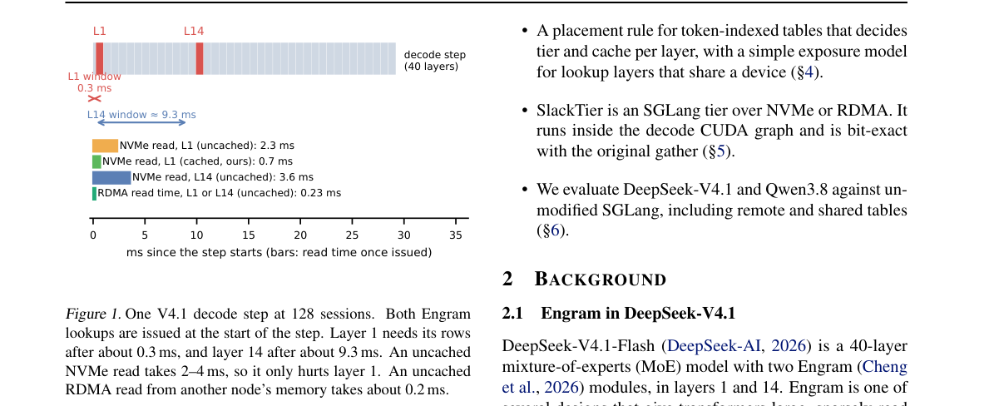

*Result - One decode step. All host nodes, copies and events sit on a side stream inside the decode CUDA graph. Layer 1’s reads are submitted before layer 14’s; each gather waits only for its own laye*

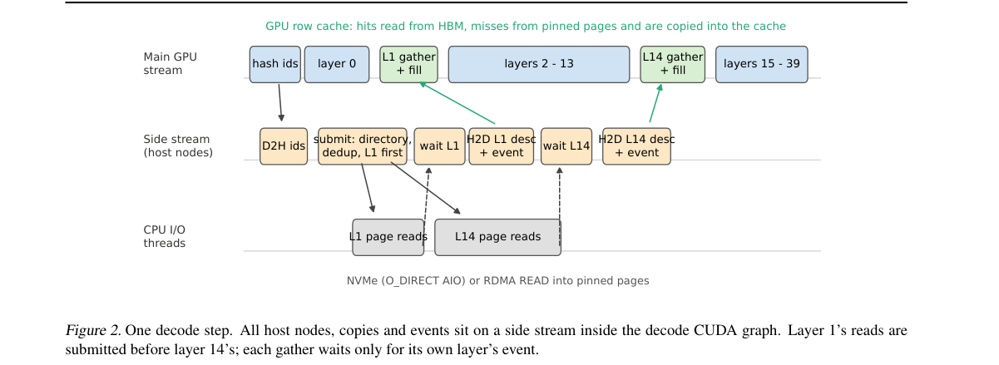

**Why this ranks #3**: DeepSeek-V4.1 的两块 Engram 查表共 203 GB，占掉 4 卡 serving 进程 223 GiB 中的 190 GiB；SlackTier 按每层预取截止期分层放置，host 内存从 212 GiB 降到 34 GiB，每输出 token 时间最多只涨 1.4%，是典型的推理效率工作。

---

### 4. ForeSpark: Joint Draft and Verification Budget Scheduling for Parallel Speculative Decoding

**arXiv**: [2611.13442](https://arxiv.org/abs/2611.13442) | **Score**: 9.0 (relevance 9 x 0.7 + quality 9 x 0.3) | **Direction**: `llm_core` | **Tags**: LLM-VLM, parallel-speculative-decoding, work-conserving, goodput, scheduling, vllm, Meta | **Categories**: cs.AI, cs.DC, cs.LG | **Pages**: 21

**Authors**: Jaeyong Song; Daniel Wang; Pratyush Patel; Jonny Kong; Preyas Shah; Shobhit Kanaujia

**Affiliation**: Meta; Seoul National University

**Abstract**

> Parallel drafters accelerate LLM decoding by proposing a whole block of draft tokens in a single forward pass, making them attractive for LLM serving. Recent systems optimize goodput (i.e., accepted tokens per second) because rejected drafts steal compute from other requests. However, these systems control only how many tokens are verified, so every request still drafts a full block. At high serving load, we find that drafting consumes up to 40% of step time, of which a majority is discarded because it is never verified. Yet, draft-length control from autoregressive drafters does not carry over, because a parallel drafter commits to its length before its single pass. Moreover, draft and verification lengths are coupled across the batch, so they must be selected jointly for every request while keeping the decision computationally cheap at every step. In this paper, we propose work-conserving speculation (WCS), a design that jointly allocates draft and verification budgets per request in LLM serving, and present ForeSpark as its prototype. ForeSpark realizes WCS with (i) a context-aware pre-draft estimator that predicts acceptance for every candidate length from the target model's context features, (ii) a lightweight joint draft-verify scheduler that selects both lengths through a global sort, and (iii) a post-draft budget distribution that spends verification on the most promising tokens. Implemented on vLLM, ForeSpark improves throughput by up to 1.77x over the state-of-the-art DSpark and by 2.49x over autoregressive decoding at a matched per-request generation rate, without changing the output distribution. It also tolerates higher load, sustaining up to 1.51x the request rate of DSpark under latency service level objectives (SLOs).

**Key findings**

- **Finding**: DSpark 的 drafting 最多占每输出 token 时间的 40%，且并行 drafter 一次前向就锁定草稿长度，自回归式长度控制无法迁移；在 vLLM 上 ForeSpark 吞吐较 DSpark 最高 1.77 倍、较自回归 2.49 倍，且在 SLO 下可承载 DSpark 的 1.51 倍请求率。
- **Inference**: 高负载下的瓶颈不是验证算力而是被丢弃的无效草稿，draft 与 verify 预算因此必须在整批请求上联合分配。
- **Recommendation**: 用上下文感知的预草稿预估器给每个候选长度打接受率分，再经全局排序同时分配验证预算，可在不改变输出分布的前提下提吞吐。

**Key figures**

*Framework - Qwen3-14B on ShareGPT-E2E. (a) Total through-*

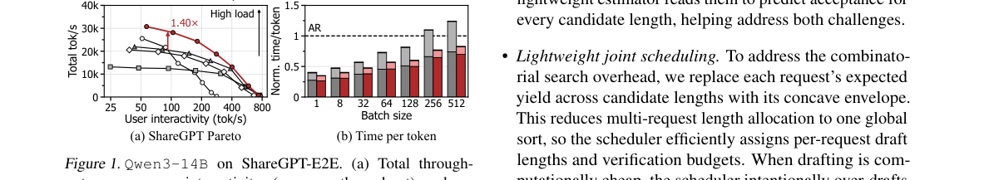

*Result - Parallel speculative decoding example with DSPARK.*

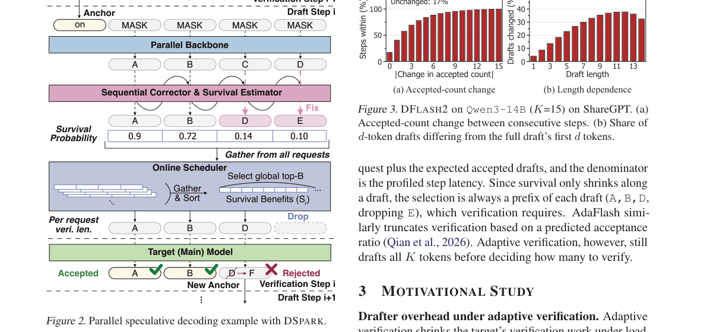

**Why this ranks #4**: 实测高负载下 draft 最多占用 40% 步时间且大部分从未被验证；ForeSpark 在 vLLM 上联合调度 draft 与 verify 长度，吞吐较 SOTA 的 DSpark 最高 1.77 倍、较自回归 2.49 倍，属于投机解码服务侧的调度突破。

---

### 5. OpticalRAG: Pixel-Space Compression for Token-Efficient Retrieval-Augmented Generation

**arXiv**: [2611.13675](https://arxiv.org/abs/2611.13675) | **Score**: 9.0 (relevance 9 x 0.7 + quality 9 x 0.3) | **Direction**: `llm_core` | **Tags**: LLM-VLM, pixel-space-compression, retrieval-augmented-generation, visual-tokens, long-context, document-compression, Renmin University of China | **Categories**: cs.CL | **Pages**: 32

**Authors**: Senhao Liu; Yuheng Zhang; Chunyu Wei; Yueguo Chen; Xinran Zhang

**Affiliation**: Renmin University of China; Claremont McKenna College

**Abstract**

> Retrieval-augmented generation (RAG) is bottlenecked by the token budget of large language models: feeding long documents into the context window is expensive, while aggressive textual compression discards fine-grained information that is irreversibly lost in a one-dimensional token sequence. We argue that this bottleneck is not fundamental to information density but to the choice of compression \emph{modality}. Modern visual encoders can pack the contents of a rendered text page into roughly a hundred visual tokens with little semantic loss, opening a new compression-fidelity tradeoff that purely textual methods cannot reach. We present \textbf{OpticalRAG}, a framework that renders documents as page images, encodes them with a frozen vision encoder, and distills the retrieved visual tokens into as few as $16$ injected tokens before passing them to the LLM. Two ingredients make this work without expensive cross-modal training: (i) \emph{Encoder-Bridged Retrieval}, which projects text-query states into the visual feature space of the frozen encoder, through a projection shared with the compressor, to retrieve visual tokens from a text query, with no contrastive training; and (ii) \emph{Query-Driven Distillation}, a lightweight cross-attention compressor that condenses the retrieved visual tokens into a small set of query-conditioned prefix tokens. On LongBench-v2, BAMBOO, and LooGLE-v2, OpticalRAG achieves the best compression-aware accuracy (CAP) on all three benchmarks while injecting only $16$ tokens, and improves the closed-book Qwen2.5-7B-Instruct backbone by $5.17$ points on LongBench-v2.Code is available at https://github.com/brighterr/OpticalRAG.

**Key findings**

- **Finding**: 检索到的视觉 token 经查询驱动的交叉注意力压缩器蒸馏为 16 个注入 token，仅注入 16 token 就在 LongBench-v2、BAMBOO、LooGLE-v2 上取得最佳压缩感知准确率，LongBench-v2 比闭卷 Qwen2.5-7B-Instruct 高 5.17 分。
- **Inference**: RAG 的 token 预算瓶颈来自压缩模态而非信息密度，页面图像比一维文本序列能承载更细粒度、也更难被摘要丢掉的内容。
- **Recommendation**: 需要把长文档塞进上下文时，先试页面渲染加视觉编码的路线，而不是继续对文本做更激进的剪枝或摘要。

**Key figures**

*Framework - Illustration of OpticalRAG. (a) Token-space methods prune or summarize the 1D text sequence, causing permanent information loss at high compression ratios. (b) Dense-vector methods squeeze e*

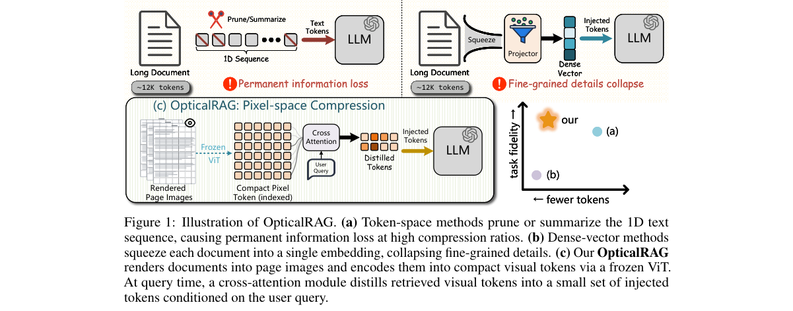

*Result - OpticalRAG framework overview. ①Optical Encoding: document chunks are rendered as page images and encoded by a frozen VLM encoder into visual tokens; each visual token is indexed individuall*

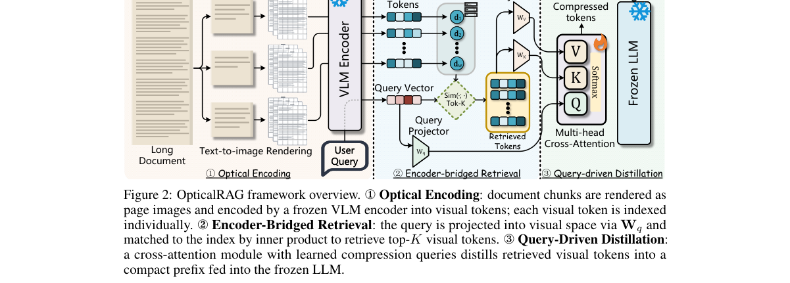

**Why this ranks #5**: 把文档渲染成页面图像、用冻结视觉编码器压到约 100 个视觉 token，再蒸馏成 16 个注入 token，LongBench-v2/BAMBOO/LooGLE-v2 三个基准的压缩感知准确率均为最佳，LongBench-v2 比闭卷 Qwen2.5-7B-Instruct 高 5.17 分，是 RAG 压缩模态的转向。

---

### 6. SinkState: On-the-Fly SVD of Recurrent States for Efficient Hybrid LLM Serving

**arXiv**: [2611.14246](https://arxiv.org/abs/2611.14246) | **Score**: 8.7 (relevance 9 x 0.7 + quality 8 x 0.3) | **Direction**: `llm_core` | **Tags**: LLM-VLM, recurrent-state, low-rank, linear-attention, serving, online-svd, Rutgers University | **Categories**: cs.LG | **Pages**: 16

**Authors**: Haolin Jiang; Weihang Li; Zhongzhu Zhou; Jinwen Pan; Santosh Pandey; Hang Liu

**Affiliation**: Rutgers University; University of Sydney; University of South Florida

**Abstract**

> Hybrid models combine softmax attention with linear attention, which compresses history into fixed-size recurrent states to balance model quality and inference efficiency. However, linear attention has not pushed this compression to its limit: we find that the queries, keys, and values of linear layers concentrate in a stable, low-dimensional subspace, a phenomenon we call the linear attention sink, so each state is effectively low-rank, with a rank that varies across states. Yet existing serving systems keep these redundant states dense, reading and rewriting them in full at every decoding step, so their memory traffic grows with the batch size and dominates the decoding cost. Thus SinkState stores each recurrent state in an adaptive low-rank form throughout inference with buffered updates and a local SVD restricted to the top subspace. SinkState further consolidates the remaining components asynchronously on the CPU. On four hybrid models with Mamba-2 and Gated DeltaNet (GDN) layers, from 4B to 120B parameters, SinkState reduces the peak memory of recurrent states by up to 2.6x (1.9x on average) and speeds up decoding by up to 1.58x (1.25x on average) over Mamba-SSM and FLA, while maintaining accuracy.

**Key findings**

- **Finding**: Qwen3.8-2.4T-A95B 的典型设置下 recurrent state 每 token 占用达 KV cache 的 6144 倍；批量 128 时对 Nemotron-3-Nano-4B 全部状态做 SVD 需要 4000 ms，比常规解码步长两个数量级。
- **Inference**: 状态本身有效秩低却仍被稠密存储，内存带宽而非算力才是混合模型解码的主导成本，因此必须边解码边压缩。
- **Recommendation**: 部署 Mamba-2/GDN 类混合模型时按 top 子空间做在线低秩化并异步合并残余分量，不要把全量 SVD 放在关键解码路径上。

**Key figures**

*Framework - profiles Qwen3.5-9B (GDN), Nemotron-3-Nano- 4B (Mamba2), and Kimi-Linear-48B (KDA) on 32 se- quences of 64k tokens (1k = 1024) from PG-19 and from random tokens. For each state, we stack all*

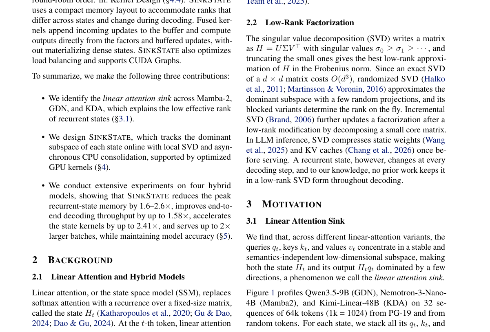

*Result - Fractions of Ht’s energy and output Htqt retained when*

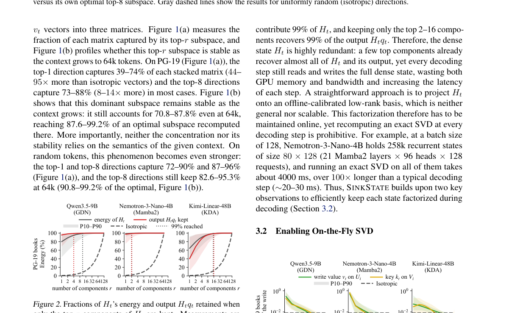

**Why this ranks #6**: 发现线性注意力层的查询/键/值集中在稳定低维子空间（linear attention sink），SinkState 用自适应低秩存 recurrent state 并异步合并残余分量，在 4B–120B 四个混合模型上峰值内存最多降 2.6 倍、解码最多快 1.58 倍，属于混合式状态空间模型的服务侧压缩。

---

### 7. One-Sided Expert-Parallel All-to-All for Mixture-of-Experts Inference over NVLink

**arXiv**: [2611.13188](https://arxiv.org/abs/2611.13188) | **Score**: 8.0 (relevance 8 x 0.7 + quality 8 x 0.3) | **Direction**: `llm_core` | **Tags**: LLM-VLM, moe, all-to-all, nvlink, expert-parallel, inference-serving, NVIDIA | **Categories**: cs.CL, cs.DC, cs.LG, cs.PF | **Pages**: 19

**Authors**: Bo Li; Chulian Zhang; Or Biri; Anthony Chang; Anton Korzh; Noam Duvdevani; XingFei Xi; Daniel Stokes; Zhenhuan Chen; Ludwig Schneider; Artem Y. Polyakov; Julien Demouth

**Affiliation**: NVIDIA

**Abstract**

> Expert parallelism (EP) shards the experts of a Mixture-of-Experts (MoE) layer across GPUs, so every MoE layer requires two all-to-all communications, namely dispatch and combine. Compared with training, inference processes relatively few tokens per GPU at a time, and at small batch sizes fixed costs that do not grow with the number of tokens, rather than data movement, dominate the latency. We present NVLinkOneSided, a one-sided EP all-to-all for GPUs within a single NVLink domain. Each source rank pushes its tokens, without first exchanging metadata, into rank-major buffers on the target GPUs, and the grouped GEMMs read them in place instead of from a per-expert copy. We provide two protocols for the synchronization that the communication requires, namely Fence and Sentinel, for high-throughput and low-latency scenarios respectively. On Blackwell GPUs, NVLinkOneSided completes dispatch and combine 1.2-3.0$\times$ faster than DeepEP, with the largest speedups at small batch sizes. The resulting MoE layer is up to 2.4$\times$ faster than DeepEP with DeepGEMM. It even outperforms the fused DeepGEMM MegaMoE at up to 128 tokens per GPU, making it still competitive for decoding. We expose NVLinkOneSided through a modular interface, so that it is agnostic to the activation quantization format, decoupled from the MoE compute backend and easy to integrate into inference frameworks.

**Key findings**

- **Finding**: 源 rank 不预先交换元数据，直接把 token 写入目标 GPU 的 rank-major 缓冲区、grouped GEMM 就地读取；在 Blackwell 上 dispatch 与 combine 比 DeepEP 快 1.2–3.0 倍，MoE 层配合 DeepGEMM 最多快 2.4 倍，在每 GPU 128 token 以内仍优于融合的 DeepGEMM MegaMoE。
- **Inference**: 推理每 GPU token 数少，固定开销而非数据搬运主导延迟，省掉元数据交换比优化搬运路径更有效。
- **Recommendation**: 单 NVLink 域内的 MoE 推理可先试单边 all-to-all，小批量场景收益最大，并按吞吐或延迟需求选 Fence 与 Sentinel 同步协议。

**Key figures**

*Framework - Example used throughout the paper: two ranks, experts*

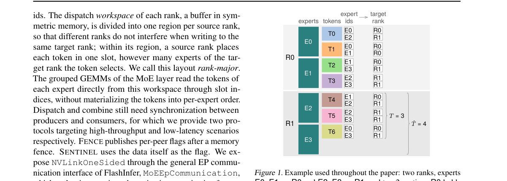

*Result - Data path for the routing of Figure 1, with the FENCE synchronization protocol. Dispatch: each source rank stores its tokens*

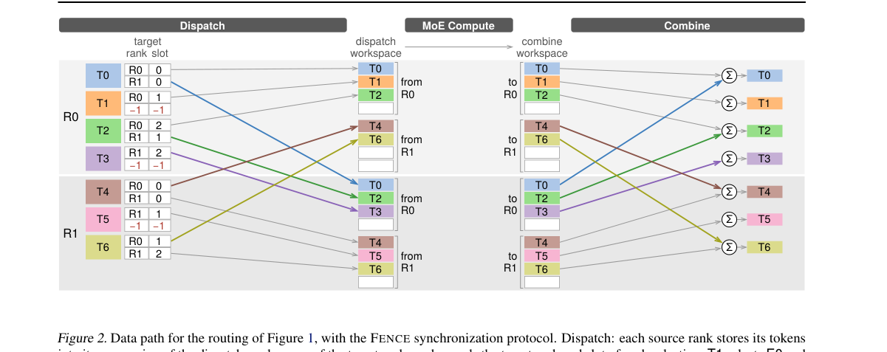

**Why this ranks #7**: MoE 推理每层要跑 dispatch 与 combine 两次 all-to-all，推理侧每 GPU token 数少、固定开销主导；NVLinkOneSided 在 Blackwell 上比 DeepEP 快 1.2–3.0 倍，配合 DeepGEMM 后整个 MoE 层最多快 2.4 倍，是 MoE 推理通信的系统级改造。

---

## VLM 核心（多模态架构 / 理解 / 视频 / GUI agent） · `vlm_core` (5 papers)

本方向 5 篇，主题是**「模型到底看了哪里」与「位置信息从哪来」**。Sckwoky 针对共享任务 SHROOM-visions 的字符级幻觉 span 检测，用冻结的 Gemma-4-12B-it 加约 10.7M 参数 LoRA，针对因果解码器「单份答案无法关注后续 token」的结构问题，把候选答案在 prompt 里重复一遍、从第二次出现处抽特征来近似双向注意力，覆盖英/法/意/中四种语言。VIGOR 把「答对了」拆成「答对且有对应的像素证据」，用概念-像素级配对标注评测 MLLM 的视觉依据是否真的被说中。左右方向那篇做了很干净的反事实：镜像 ViT 的宽度位置编码，在 Qwen2.5-VL-7B / Qwen3-VL-4B / InternVL3-2B 上能复现 84.3–93.2% 的翻转图答案，说明左右判断主要来自视觉塔的位置码而不是语言侧；MRoPE 那篇则指出 MRoPE 给本无空间结构的文本 token 也分配了高宽坐标，把跨模态空间效应注入了文本-视觉注意力。EVAThink 则把「要不要多想一会儿」变成可训练目标：在固定帧预算下，先挖掘「证据密集 / 证据稀疏」的成对视频视图，再按证据是否充分决定直接作答还是展开推理。

### 8. VIGOR: Benchmarking Visual Rationale Correctness in Multimodal Large Language Models

**arXiv**: [2611.13150](https://arxiv.org/abs/2611.13150) | **Score**: 8.7 (relevance 9 x 0.7 + quality 8 x 0.3) | **Direction**: `vlm_core` | **Tags**: LLM-VLM, visual-grounding, benchmark, rationale-correctness, pixel-annotation, mllm, University of Virginia | **Categories**: cs.CV, cs.LG | **Pages**: 38

**Authors**: Yanlin Chen; Tang Li; Xi Peng

**Affiliation**: University of Virginia; University of Delaware

**Abstract**

> Multimodal large language models (MLLMs) are typically evaluated by whether they produce correct answers, but correctness alone does not reveal whether their outputs are supported by the right visual evidence. We introduce VIGOR, a benchmark for evaluating VIsually GrOunded Rationales in MLLMs. VIGOR represents visual rationales as explicit concepts paired with pixel-level groundings, covering multiple abstraction levels including low-level visual properties, intermediate structures, objects, parts and high-level motion, relations. To construct VIGOR at scale, we develop an automatic annotation framework that reuses existing dense supervision when available and generates missing concept groundings through proposal-based annotation followed by conservative multimodal verification. Using VIGOR, we evaluate whether MLLMs "look at what they say" by comparing model-derived visual evidence for each expressed concept against annotated ground-truth rationales. Our results show that current MLLMs exhibit limited visual rationale correctness and reveal distinct grounding failures across concept levels. VIGOR provides a benchmark and scalable data construction pipeline for studying whether MLLM outputs are supported by appropriate visual evidence. Code is available at https://github.com/deep-real/VIGOR

**Key findings**

- **Finding**: VIGOR 覆盖低层视觉属性、中间结构、物体与部件、高层运动与关系四个抽象层级，含 1000 张图、3011 个概念、平均每图 31.4 个掩码与 31433 个像素级标注，最佳模型仅拿到 31.2% AP 与 38.7% Pointing Accuracy。
- **Inference**: 答案正确不等于视觉理由正确，「对答案错证据」在现有输出级评测里完全不可见，因此需要一个概念级落地基准。
- **Recommendation**: 评测多模态模型时在答案准确率之外补一层概念级像素落地核对，并复用 proposal 生成加保守多模态验证的自动标注流程扩充数据。

**Key figures**

*Framework - Illustration of the double cor- rectness problem. Although the model produces a correct description by mention- ing “traffic lights,” its visual rationale is misaligned with the actual traff*

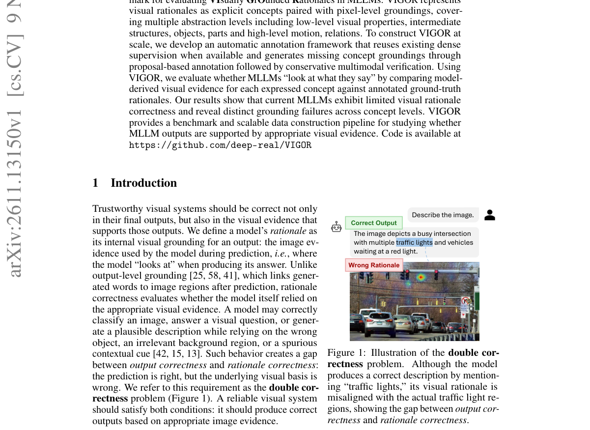

*Result - Overview of the VIGOR annotation pipeline. VIGOR builds a hierarchical concept vocabulary from heterogeneous source data, proposes masks with multiple annotation tools when source masks are*

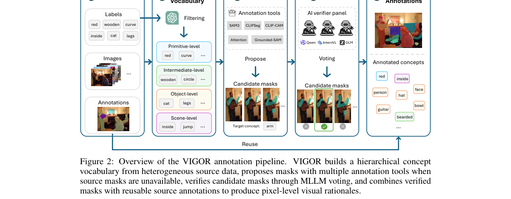

**Why this ranks #8**: VIGOR 用 1000 张图、3011 个概念、平均每图 31.4 个掩码构成像素级视觉理由基准，最佳模型也只有 31.2% AP 与 38.7% Pointing Accuracy，直接暴露「答对但看错地方」的 MLLM 失败模式，属多模态理解的评测基准工作。

---

### 9. Disentangling Multimodal Rotary Positional Embedding in Vision-Language Models

**arXiv**: [2611.13334](https://arxiv.org/abs/2611.13334) | **Score**: 8.7 (relevance 9 x 0.7 + quality 8 x 0.3) | **Direction**: `vlm_core` | **Tags**: LLM-VLM, mrope, positional-embedding, visual-grounding, rope, ablation, University of Maryland | **Categories**: cs.AI | **Pages**: 18

**Authors**: Zhaoyi Liu; Haichuan Zhang; Xiaochuan Gong; Yancheng Zhu; Bowei Tian; Wanghao Ye; Yufan Zhang; Ang Li

**Affiliation**: University of Maryland, College Park; University of Utah

**Abstract**

> Vision-language models widely adopt Multimodal Rotary Position Embedding (MRoPE), an extension of Rotary Position Embedding (RoPE) that incorporates temporal, height, and width axes to encode the spatial structure of visual tokens. However, MRoPE also assigns height and width coordinates to text tokens that lack inherent spatial structure, introducing spatial positional effects into text-vision attention. Existing MRoPE variants explore different frequency allocations and coordinate layouts, with their designs suggesting different intuitions about these cross-modal effects: they may provide useful spatial references for associating language with visual regions, or introduce unnecessary positional preferences that hinder text-vision interactions. In this work, we disentangle intra-visual spatial structure from cross-modal spatial effects to investigate this question. We identify a constraint of shared coordinate layouts that prevents eliminating cross-modal spatial effects while preserving intra-visual spatial encoding, and develop controlled experiments to isolate their respective contributions. Our results across multiple model scales, MRoPE variants, and benchmarks show that cross-modal spatial effects provide little additional benefit as spatial references and can even impair model performance, while intra-visual spatial encoding remains useful for fine-grained grounding.

**Key findings**

- **Finding**: 去掉模态内空间编码后，RefCOCO 家族 ACC@0.5 在 2B/4B/8B 上分别从 82.4%、87.1%、86.1% 掉到 18.5%、16.3%、5.3%；而只去掉跨模态空间效应反而让空间理解均值提升 1.2%/1.3%、grounding ACC@0.9 提升 1.2%/1.2%。
- **Inference**: 给无空间结构的文本 token 分配高宽坐标带来的跨模态位置偏置并没有提供有用的空间参考，反而会挤占细粒度落地能力。
- **Recommendation**: 改造 MRoPE 时把高度/宽度坐标优先留给视觉 token，并为跨模态与模态内两种空间效应设计可独立开关的坐标分配再验证。

**Key figures**

*Framework - Illustration of different coordinate layouts for vanilla- RoPE and representative MRoPE variants in the temporal-height- width (t, h, w) space. Blue dots (•) represent text tokens, orange sq*

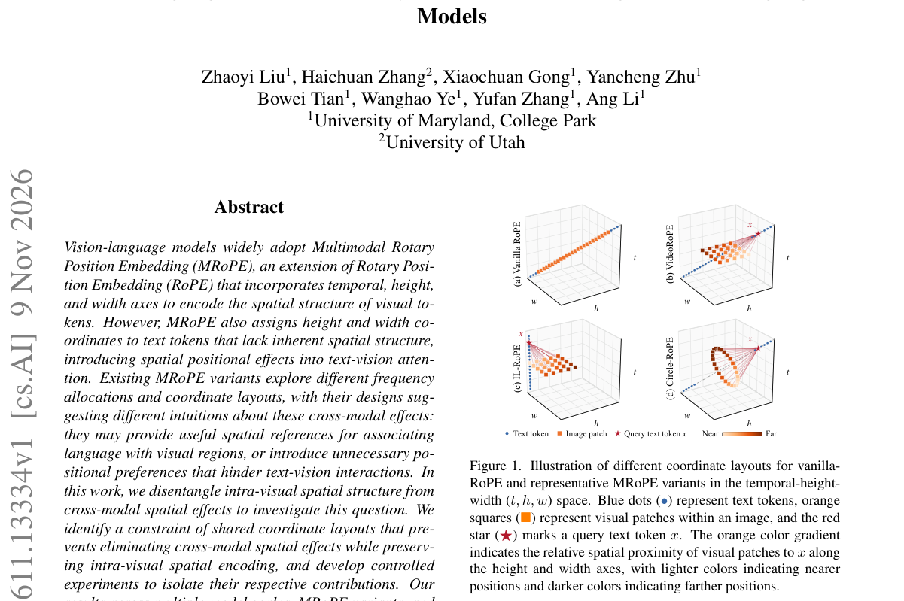

**Why this ranks #9**: 用注意力粒度的坐标分配解耦 MRoPE 的跨模态与模态内空间效应，在 Qwen3-VL-2B/4B/8B、10 个视觉与 4 个空间基准上发现：去掉模态内空间编码使 RefCOCO ACC@0.5 从 82.4% 崩到 18.5%，只去掉跨模态效应反而更好，是 VLM 位置编码设计的系统结论。

---

### 10. EVAThink: Evidence Sufficiency-Guided Training for Adaptive Thinking in Video Understanding

**arXiv**: [2611.13907](https://arxiv.org/abs/2611.13907) | **Score**: 8.7 (relevance 9 x 0.7 + quality 8 x 0.3) | **Direction**: `vlm_core` | **Tags**: LLM-VLM, video-understanding, adaptive-thinking, frame-budget, evidence-sufficiency, reinforcement-learning, East China Normal University | **Categories**: cs.CV | **Pages**: 18

**Authors**: Changti Wu; Ruizhe Fan; Bin Wang; Lei Zhang; Yuxiang Zhang

**Affiliation**: East China Normal University; Zhongguancun Academy; Huawei Technologies Co., Ltd.

**Abstract**

> Under a fixed frame budget, video understanding with vision-language models (VLMs) depends on whether the sampled frames provide sufficient evidence for the question. Sufficient frame evidence supports direct answering, whereas less informative observations may benefit from reasoning that connects the available cues. We introduce EVAThink, which enhances video understanding through evidence sufficiency-guided training for adaptive thinking. First, Recoverable Evidence Gap Mining constructs evidence-dense and evidence-sparse video views that share the same question and answer under an identical frame budget. It retains pairs where sparse views yield lower direct-answer accuracy than dense views but benefit from explicit reasoning, providing supervision for response-mode selection. Second, Evidence-Guided Two-Stage Reinforcement Learning uses stage-specific rewards to guide training with evidence-based mode preferences and then refine response efficiency, while first-token advantage regularization mitigates mode collapse. Trained on only 6.7K curated samples, EVAThink consistently improves upon the base model across video understanding benchmarks under both 32- and 64-frame budgets, while outperforming strong baselines on average. The code, model, and datasets are available at \href{https://github.com/ChangtiWu/EVAThink}{EVAThink}.

**Key findings**

- **Finding**: 只用 6.7K 样本（对比 VideoAuto-R1 的 83K）训练的 EVAThink，32 帧下平均准确率 63.5%、64 帧下 65.6%，分别领先 Qwen3-VL-8B-Instruct 0.6 与 1.4 个百分点、领先 VideoAuto-R1-Qwen3 1.7 与 2.6 个百分点。
- **Inference**: 该「想还是不该想」应由采样帧的证据是否充分决定，所以监督信号应来自证据稠密与稀疏视图之间的直接回答准确率差。
- **Recommendation**: 先用裁剪或拼接造出同题同答的证据对比对，再以证据引导的两阶段 RL 训练响应模式选择，并用首 token 优势正则抑制模式坍塌。

**Key figures**

*Framework - Motivation for evidence sufficiency-guided training for adaptive thinking. For the same question and frame budget, suf- ficient frame evidence supports direct answering, while thinking can h*

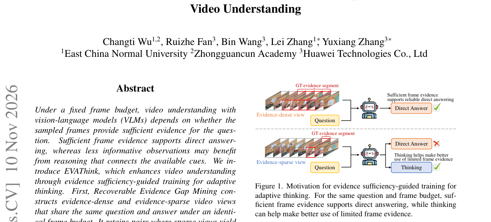

*Result - Overview of EVAThink. Recoverable Evidence Gap Mining constructs the evidence-contrastive pairs through video cropping or concatenation, retaining pairs with a direct-answer accuracy gap and*

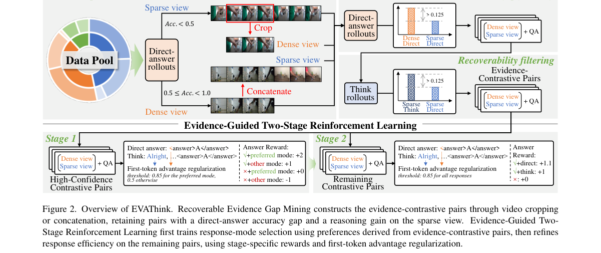

**Why this ranks #10**: 仅用 6.7K 精选样本训练，EVAThink 在 32 帧预算下平均准确率 63.5%、64 帧 65.6%，比 Qwen3-VL-8B-Instruct 高 0.6 与 1.4 个点，输出长度比 think-only 少 62%，属视频多模态理解的自适应推理。

---

### 11. Where Do Vision-Language Models Get Left and Right? Position-Code Counterfactuals in Qwen2.5-VL, Qwen3-VL and InternVL3

**arXiv**: [2611.14060](https://arxiv.org/abs/2611.14060) | **Score**: 8.7 (relevance 9 x 0.7 + quality 8 x 0.3) | **Direction**: `vlm_core` | **Tags**: LLM-VLM, left-right-reasoning, position-code, counterfactual, vit, vlm-probing, Changzhou University | **Categories**: cs.CV, cs.LG | **Pages**: 25

**Authors**: Enhao Cui; Junzhi Yang; Yaoshun Lin; Yuhan Feng; Zijian Chen

**Affiliation**: Changzhou University

**Abstract**

> A vision-language model may take left-right direction from the orientation of image content within patches, its vision transformer's (ViT) position code, or token positions and order in its language model (LLM). Ablations show the ViT code is necessary; we test sufficiency by mirroring only a position code. In Qwen2.5-VL-7B, Qwen3-VL-4B and InternVL3-2B, mirroring ViT width positions reproduces the flipped-image answer on 84.3-93.2% of CV-Bench left-right questions (Qwen2.5-VL-3B: 87.5%, partly a left fallback). With two options, this also counts disruption; a half-grid shift flips most answers too. With the ViT code intact, LLM-side id and token-order mirrors change few left-right answers in all three series (a weak id test in Qwen2.5-VL). In Qwen2.5-VL-7B the effect sits in the global-attention ViT blocks, mostly the last. On What'sUp, flipping content and token order, not the position code, keeps more on/under than left-right answers at the flipped-image answer. Post hoc analyses qualify these results. On CV-Bench items with located objects, random permutations flip 18.9-31.0 points more answers when reversing the objects' order than when keeping it. On What'sUp, in Qwen2.5-VL and Qwen3-VL, the share of the left-right changes made by random permutations that land on the mirror relation is mostly below chance. Counted as returns to the original answer, the What'sUp contrast of support with left-right relations is clear only in InternVL3-2B. Most remaining errors give the same relation whichever object is asked about, suggesting that repair may target relation binding, object localization or use of the reference object.

**Key findings**

- **Finding**: 只镜像 ViT 宽度位置码即可在 84.3–93.2% 的 CV-Bench 左右题上复现翻转图答案（Qwen2.5-VL-3B 为 87.5%）；ViT 位置码保留时，LLM 侧 id 与 token 顺序镜像在三个系列上都几乎不改变左右答案。
- **Inference**: 模型的左右判断主要由视觉塔的宽度位置码承载，语言侧的 token 顺序与位置 id 只是冗余通道。
- **Recommendation**: 修 VLM 的左右与空间错误时优先改视觉塔的位置编码及其全局注意力块（Qwen2.5-VL-7B 上效应集中在最后几个块），而不是在 prompt 或 LLM 侧做文章。

**Key figures**

*Framework - Position-only counterfactuals keep every pixel and mirror only a position code. Rows: real horizontal flip (H-flip, reference); ViT-W: width index w →W −1 −w of each patch in the ViT; LLM-W:*

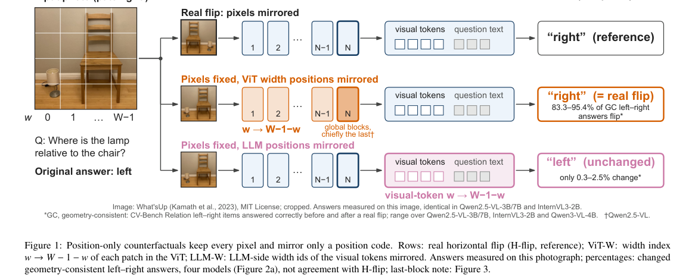

*Result - Mirroring the ViT width positions flips most left–right answers; mirroring the LLM-side positions changes almost none of them. Share of geometry-consistent items whose answer changes, with 9*

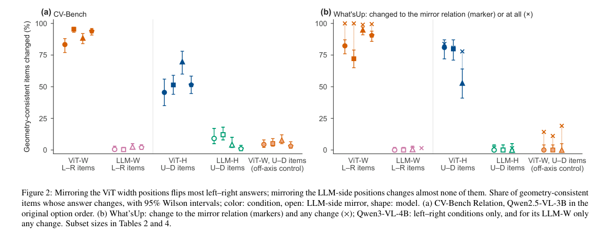

**Why this ranks #11**: 在 Qwen2.5-VL-7B、Qwen3-VL-4B、InternVL3-2B 上只镜像 ViT 宽度位置码，就能复现 84.3–93.2% 的 CV-Bench 左右翻转答案，而 LLM 侧镜像几乎不改变答案，是 VLM 左右/空间推理来源的定位工作。

---

### 12. Sckwoky at SHROOM-Visions: Character-Level Hallucination-Span Detection in Image-Conditioned VLMs via Dual-Prompted LoRA Decoders

**arXiv**: [2611.14100](https://arxiv.org/abs/2611.14100) | **Score**: 8.7 (relevance 9 x 0.7 + quality 8 x 0.3) | **Direction**: `vlm_core` | **Tags**: LLM-VLM, hallucination-detection, span-detection, lora, shared-task, character-iou, Novosibirsk State University | **Categories**: cs.CL | **Pages**: 7

**Authors**: Mikhail Kulakov; Ruslan Solikhov; Ivan Bondarenko

**Affiliation**: Novosibirsk State University

**Abstract**

> We present our system for the SHROOM-visions 2026 shared task on character-level hallucination span detection in image-conditioned vision-language model (VLM) responses, evaluated across English, French, Italian, and Chinese. The detector is built on a frozen Gemma-4-12B-it backbone with trainable LoRA adapters (approximately 10.7M parameters). Because the backbone is a causal decoder, hidden states read from a single copy of an answer cannot attend to subsequent tokens; we therefore repeat the candidate answer within one prompt and extract features from its second occurrence, giving every position approximate bidirectional context in a single non-autoregressive pass. A character-level locator combines intermediate hidden states to predict hallucination probabilities, BIO boundaries, and a response-level abstention score, while separate language-specific classifiers assign one of five hallucination types to each predicted span. On the closed test set, our system reaches a macro-averaged character IoU of 0.4404, more than doubling the official baseline (0.1854), and ranks 5th-6th on IoU across the four languages. On the English tuning split, controlled ablations attribute a gain to the repeated answer that is comparable to that of LoRA adaptation (its held-out gain is smaller and concentrated on hallucinated answers), and they show that the detector relies on the image-answer pairing: shuffling images across examples drives IoU down to the level of the predict-nothing floor or below it in every language. In deployments where the same Gemma-4-12B-it model also generates answers, its base weights can be reused, making the approach practical for local question-answering systems that cannot run a separate verifier.

**Key findings**

- **Finding**: 闭测集上字符级宏平均 IoU 达 0.4404，超过官方基线 0.1854 一倍以上，在英、法、意、中四种语言上 IoU 排名第 5–6；英文调参集消融显示「重复答案」带来的增益与 LoRA 适配本身相当。
- **Inference**: 因果解码器单次读取答案看不到后续 token，重复一次候选答案换取近似双向上下文，比单纯加大 LoRA 容量更划算。
- **Recommendation**: 要给图文模型做字符级幻觉检测可直接复用「答案重复 + 双提示 + LoRA」结构；同时注意打乱图文配对会把 IoU 压到接近全预测为空的水平。

**Key figures**

*Framework - High-level overview of our hallucination de- tection pipeline, showing the information flow from multimodal input to final labeled spans.*

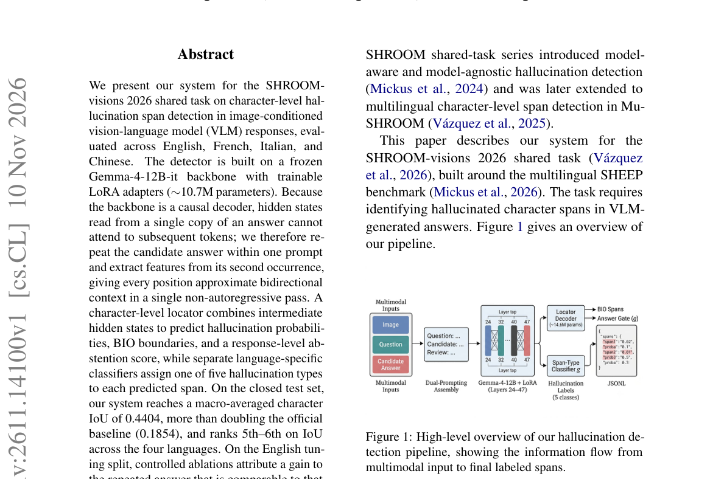

*Result - Conceptual visualization of our dual- prompting strategy. By duplicating the answer, tokens in the “Review Copy” can attend to the complete pre- ceding copy of the candidate answer under the*

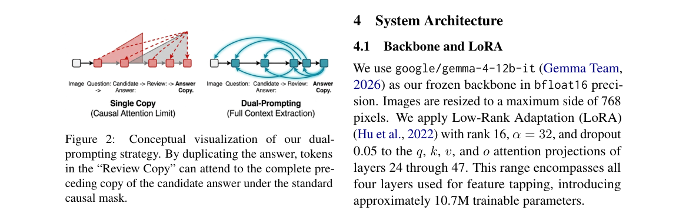

**Why this ranks #12**: SHROOM-Visions 2026 共享任务方案：用冻结 Gemma-4-12B-it 加约 10.7M 参数 LoRA，靠在提示里重复一次候选答案拿到近似双向上下文，闭测集字符级宏平均 IoU 0.4404，是官方基线 0.1854 的两倍多，属多模态幻觉检测。

---

## LLM / VLM 的 RL 与偏好优化 · `llm_vlm_rl` (6 papers)

本方向 6 篇，主线是**信用分配到底该落在哪个 token 上，以及奖励黑客到底从哪来**。最尖锐的一篇把两种关于 RLVR 与不完美验证器的说法放在一起对撞：在可以精确计算整个响应分布的小环境里，改变「同一条错误响应被多少 prompt 接受」的普适性与验证器静态假正率，结论是**在 KL 正则最优点上 RLVR 只是一个过滤器——它重排接受集合而不改变其组成，奖励黑客率被原样继承**。另外两篇直接改 GRPO 的信用分配：MCPO 用 top-2 边际衡量「模型在哪里犹豫」，把信用压到犹豫点上；稠密奖励那篇则按每次训练更新对齐，比较稠密过程奖励与 GRPO 每 token 均分是否真的划算。Metric-Aligned GRPO 把多模态 GRPO 用到可解释深度伪造检测上，先由视觉基础模型集成做判别，再让 Qwen3-VL-8B 生成可对齐到检测指标的解释。个性化记忆 rubric 那篇把信用分配落到「每用户该记什么」——以终局问答准确率做单一反馈太粗，而记忆更新的效用本来就是用户相关的。眼动增强的奖励建模那篇则引入心理物理学的注意力分配作为额外监督信号。

### 13. Wrong the Same Way: Cross-Prompt Sharing Both Suppresses and Amplifies Reward Hacking in RLVR

**arXiv**: [2611.13218](https://arxiv.org/abs/2611.13218) | **Score**: 9.7 (relevance 10 x 0.7 + quality 9 x 0.3) | **Direction**: `llm_vlm_rl` | **Tags**: LLM-VLM, reward-hacking, rlvr, parameter-sharing, leak-universality, verifier-false-positive, Carnegie Mellon University | **Categories**: cs.AI, cs.LG | **Pages**: 21

**Authors**: Michael Li; Rohan Pandey; Ray Chen

**Affiliation**: Carnegie Mellon University; University of Washington

**Abstract**

> Two accounts of how reinforcement learning with verifiable rewards (RLVR) interacts with an imperfect verifier coexist: in one, reward hacking is inherited from the base model; in the other, RL amplifies it. We study both in a controlled environment small enough to compute the entire response distribution exactly. We vary the universality of a leak, or the fraction of prompts that accept the same wrong response, and the verifier's static false-positive rate. At its KL-regularized optimum, RLVR acts as a filter that reweights the accepted set without altering its composition, so the hack rate is inherited exactly. Taking that as a null model, a known decomposition writes the drift from it as a sum over prompts of covariances between reward and the empirical tangent kernel. The terms from other prompts vanish without parameter sharing. With sharing, every prompt that accepts a wrong answer pushes it up and every prompt that rejects it pushes it down through the baseline, in proportion to the model's probability of producing it there. A shared-parameter policy thus drives a leak that few prompts accept below the base rate and amplifies one that most prompts accept. At every convergent learning rate under Adam, SGD, and sampled GRPO, hacking ends higher at high universality than at low, but whether either end crosses the base rate depends on the step size. Independent per-prompt copies remove the dependence. The direction of this push depends on neither the verifier's error rate nor universality alone, but on how much of the model's kernel-weighted probability of a wrong answer falls on prompts that accept it, which frozen base model controls support. Verifier fixes should target the mistakes the model repeats across prompts: two patches that remove equally many errors differ by up to 38 points of true accuracy. We propose this alignment as a hypothesis for why earlier studies disagree.

**Key findings**

- **Finding**: 固定静态假阳性率后只改变「多少 prompt 接受同一个错误答案」，共享参数策略的 hack fraction 从 u=1/64 时的 0.025±0.005 升到 u=1 时的 0.160±0.050，基线模型为 0.128，真实准确率相应从 0.974 降到 0.840。
- **Inference**: 漂移完全来自跨 prompt 参数共享这一条通道——接受该错误串的 prompt 推高它、拒绝的 prompt 通过 baseline 压低它，所以普适度高的泄漏被放大、低的被抑制，改成每个 prompt 独立副本后依赖性消失。
- **Recommendation**: 审计验证器时先查模型是否跨 prompt 重复犯同一个错，而不是只统计错误总数：两个消除同样多错误的补丁在 3e-3 学习率下真实准确率相差 38±9 个点，静态审计无法区分这两者。

**Key figures**

*Framework - The environment and the mechanism. Left: the N = 64 prompts, colored by whether the verifier accepts a designated wrong answer h; every prompt accepts exactly one wrong string, so sweeping u*

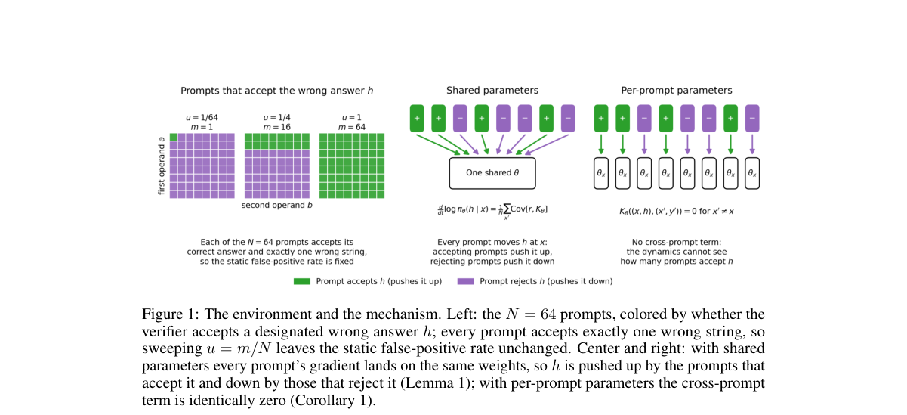

*Result - At a fixed false-positive rate, the more prompts share the wrong answer, the less the shared policy suppresses it, and at u = 1 the suppression disappears. Left: arrows from each condition’s*

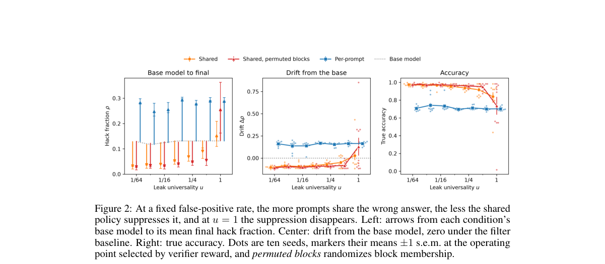

**Why this ranks #13**: 在 N=64 个 prompt 的两位数乘法环境里精确枚举整个响应分布，把 RLVR 奖励黑客化归因到跨 prompt 参数共享：泄漏普适度 u 从 1/64 升到 1 时共享策略的 hack fraction 从 0.025 升到 0.160（基线 0.128），真实准确率从 0.974 掉到 0.840，是当天对 reward hacking 机制解释最完整的一篇。

---

### 14. Are Dense Rewards Worth Their Tokens in GRPO?

**arXiv**: [2611.13560](https://arxiv.org/abs/2611.13560) | **Score**: 9.0 (relevance 9 x 0.7 + quality 9 x 0.3) | **Direction**: `llm_vlm_rl` | **Tags**: LLM-VLM, matched-compute, dense-reward, grpo, preregistration, rlvr, Case Western Reserve University | **Categories**: cs.AI, cs.CL | **Pages**: 59

**Authors**: Vikash Singh; Weicong Chen; Debargha Ganguly; Yanyan Zhang; Mohsen Hariri; Sreehari Sankar; Wang Yang; Chaoda Song; Alexander Nemecek; Osama Zafar; Yuting Shao; Kai Ye

**Affiliation**: Case Western Reserve University

**Abstract**

> RLVR trains language models to reason by rewarding correct final answers. A widely used algorithm, group-relative policy optimization (GRPO), gives every token of a solution the same credit, so dense process rewards have been proposed to credit intermediate steps, for example with a Monte-Carlo reward that scores each step by sampling continuations from it. Comparing such a reward with GRPO per training update, or vetting it with a gradient test on a single batch, leaves out what it costs: in our setting, the continuations alone take 91% of all generated tokens. We introduce a matched-compute protocol that gives every training intervention the same budget, measured in generated tokens and training GPU-hours, and tests it in preregistered studies with controls for side effects. Across 1,668 runs on six models, matching compute reverses the ranking. On Qwen2.5-1.5B, the Monte-Carlo reward leads standard GRPO per update, yet ends 14.3 percentage points lower at equal tokens and 7.8 points lower at equal training time, and none of four dense-reward variants outperforms GRPO even with as much training time. A per-token gradient test orders these rewards as training does but overestimates each by one to two points, as much as the gains it is meant to detect. In contrast, training on the prompts whose predicted success is nearest 1/2 improves accuracy at matched compute, by 1.7 points on Qwen3-0.6B and 0.8 on Qwen2.5-1.5B. These gains replicate on fresh seeds and unseen problems, and a simple rule, that the candidate prompts are predicted to fail more often than not, predicted where they appear in five of six preregistered tests. Both gains come early in training, and standard GRPO with twice the initial learning rate comes within half a point of them. We argue that training interventions should be validated at matched compute, which overturns some apparent gains and confirms others.

**Key findings**

- **Finding**: 蒙特卡洛稠密奖励在 k=4 时用 5 个切点各采 4 条续写，续写吃掉 91% 的生成 token，同样 token 预算下 outcome-only GRPO 能做 584 次更新而它只能做 50 次，最终准确率反而低 14.3 个点、等训练 GPU 小时低 7.8 个点。
- **Inference**: 单看每次更新或单批梯度测试会系统性高估稠密奖励，梯度测试把它排在第一却把每个奖励的收益高估 1 到 2 个点，与实测增益同量级，因此「每更新更优」不等于「每 token 更优」。
- **Recommendation**: 评测任何 RL 训练干预都要在同等 token 与 GPU 小时预算下做预注册对比，并同时报告梯度测试结论；被该协议确认的收益来自挑选预测成功率接近 1/2 的提示（+1.7 / +0.8 个点），而非更复杂的奖励。

**Key figures**

*Framework - Counting every token changes which intervention wins. Four ways to train Qwen2.5-1.5B-Instruct with GRPO on MATH,*

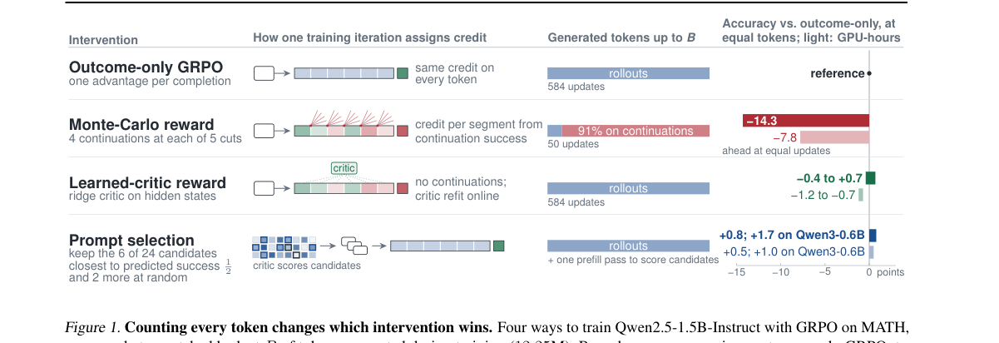

*Result - The gradient test ranks the Monte-Carlo reward first per update and last per generated token, the same order training*

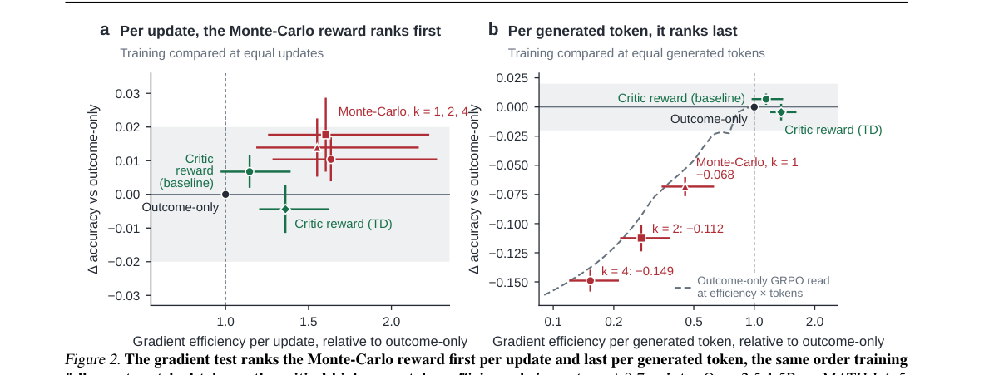

**Why this ranks #14**: 在 1,668 次运行、六个模型上引入按生成 token 与 GPU 小时双口径对齐的预注册评测协议，证明稠密过程奖励的排名会反转：蒙特卡洛奖励的续写占全部生成 token 的 91%，等 token 时比标准 GRPO 低 14.3 个点、等训练时长低 7.8 个点，对 RLVR 评测口径有直接方法论价值。

---

### 15. Margin-Guided Token Credit for Reinforcement Learning with Verifiable Rewards

**arXiv**: [2611.14015](https://arxiv.org/abs/2611.14015) | **Score**: 9.0 (relevance 9 x 0.7 + quality 9 x 0.3) | **Direction**: `llm_vlm_rl` | **Tags**: LLM-VLM, token-credit-assignment, rlvr, top-2-margin, math-reasoning, grpo, PayPal.AI | **Categories**: cs.AI, cs.LG | **Pages**: 12

**Authors**: Chi Liu; Xin Chen; Yuchuan Weng; Srinivasan Manoharan

**Affiliation**: PayPal.AI

**Abstract**

> In reinforcement learning with verifiable rewards, a language model is rewarded for a correct final answer, and GRPO passes that reward to every token of the solution in equal measure. We instead place the credit where the model hesitated, in a method we call MCPO (Margin-Credit Policy Optimization). We measure hesitation by the top-2 margin $M=p_1-p_2$ of the policy's next-token distribution, map it to a score with two fixed thresholds, and spread each solution's advantage over its tokens so that the mean stays unchanged. The margin is read from a forward pass the trainer already performs, so the method needs no extra model evaluation and no batch statistics. We train MiniCPM5-2B-Base with LoRA for 200 steps on 2,048 DAPO-Math problems and evaluate on six competition-math benchmarks. MCPO beats an unmodified GRPO baseline for all five data seeds, by 6.55 points of macro avg@32 on average (95\% CI $[4.1, 9.0]$), and a Qwen3-4B-Base replication improves for all three seeds ($+4.75$). The gain is largest on problems that GRPO solves only some of the time and grows with $k$ in pass@$k$, reaching 13.8 points at pass@32. MCPO models also write two to three times longer answers, and runs that write longer score higher; our experiments do not separate the two effects.

**Key findings**

- **Finding**: 在 2,048 道 DAPO-Math 题、200 步 LoRA 训练上，把 top-2 margin M=p1−p2 经 0.9 与 0.3 两个固定阈值映射成信用分后，MiniCPM5-2B-Base 的 5 个种子全部优于 GRPO，macro avg@32 平均 +6.55 点（95% CI [4.1, 9.0]，p=0.004），Qwen3-4B-Base 三个种子均提升 +4.75。
- **Inference**: 增益集中在 GRPO 只能部分解出的中等难度题上，且随采样预算增大到 pass@32 时达到 13.8 点，说明 reward 该压在决策分叉的 token 上，而不是像 GRPO 那样均匀摊给整条解答。
- **Recommendation**: 落地时直接复用 trainer 已经跑的 old-policy 前向 logits 计算 margin，不需要额外前向或 batch 统计；但 MCPO 答案长 2 到 3 倍且长答案得分更高，复现时必须同时报告长度以排除这一混淆因素。

**Key figures**

*Framework - Overview. (a) Relative to the GRPO baseline, the method changes only the token-level advantages; the new components are orange. The old-policy forward pass that the trainer already runs also*

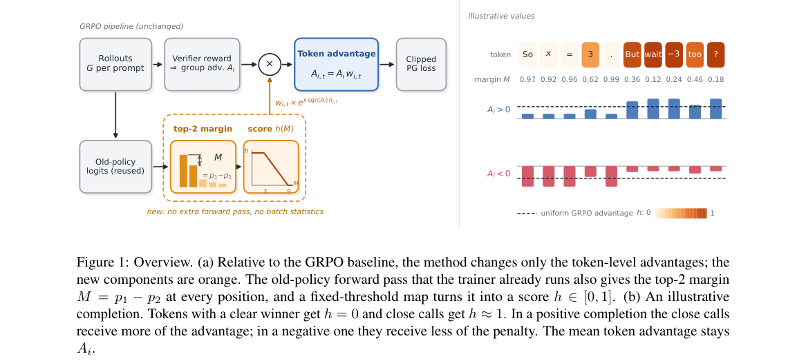

*Result - Entropy vs. top-2 margin for 4,000 synthetic next-token distributions (random Gaussian logits over 2,000 tokens with 0–3 boosted candidates; not model outputs). Dotted lines: the thresholds*

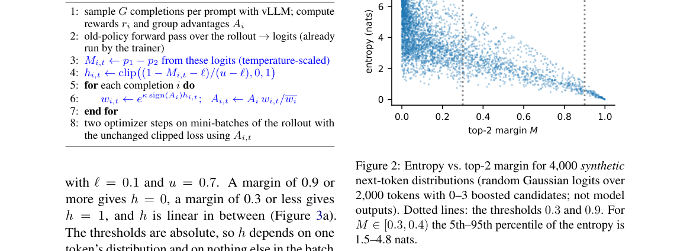

**Why this ranks #15**: 用策略 next-token 分布的 top-2 margin 代替 GRPO 的 token 均匀信用，把 credit 放到模型犹豫的位置，在 MiniCPM5-2B-Base 上五个数据种子全部优于未改动的 GRPO，macro avg@32 平均高 6.55 点（95% CI [4.1, 9.0]），且不需要任何额外模型评估。

---

### 16. Personalized Memory Rubrics: Learning What to Remember per User via Rubric-Guided Credit Assignment

**arXiv**: [2611.14017](https://arxiv.org/abs/2611.14017) | **Score**: 8.7 (relevance 9 x 0.7 + quality 8 x 0.3) | **Direction**: `llm_vlm_rl` | **Tags**: LLM-VLM, memory-agent, credit-assignment, personalization, rubric-learning, grpo, University of Science and Technology of | **Categories**: cs.AI | **Pages**: 11

**Authors**: Yupeng Han; Kai Zhang; Shuochen Liu; Ze Liu; Xianquan Wang; Zhihong Pan; Xiangyu Zhao; Qi Liu; Enhong Chen

**Affiliation**: University of Science and Technology of China; City University of Hong Kong; State Key Laboratory of Cognitive Intelligence

**Abstract**

> Long-horizon personalized agents maintain an evolving memory by continuously deciding what to add, modify, or discard. However, learning an optimal update policy remains challenging. Conventional training relies solely on terminal question-answering accuracy, yielding a coarse feedback signal that treats all intermediate updates identically. Furthermore, update utility is inherently user-specific, as identical memory actions may yield opposite effects across different user personas. Existing methods fail to address this heterogeneity, relying on globally shared evaluation standards with at most a single scalar intermediate reward. To address these challenges, we propose \textbf{Personalized Memory Rubrics} (\textbf{PMR}), a framework that translates terminal feedback into fine-grained, per-step, and per-user credit assignment. PMR decomposes evaluation into a universal layer capturing cross-persona failure patterns and a per-user adaptive layer modeling individual traits as a specialized delta over the universal baseline. Through \textbf{Rubric-Guided Credit Assignment}, PMR redistributes credit at the token level, selectively amplifying validated decisions on successful trajectories while falling back to standard policy optimization on failed ones to avoid unreliable attribution. The rubric and memory policy \textbf{co-evolve} in a closed loop with anti-circularity guarantees. Crucially, PMR incurs zero inference overhead, operating without any rubric or external judge during deployment. Extensive experiments across four benchmarks demonstrate consistent gains over strong memory-augmented baselines.

**Key findings**

- **Finding**: 在 PersonaMem 32K/128K 与 PrefEval、PersonaBench、PERMA 共 12 个设置上全面领先：32K 准确率 76.76，超 MemCoE 9.29 点、超 MemAgent 15.32 点，128K 下差距扩大到 10.78 点，PrefEval 显式/隐式为 87.60 与 70.70。
- **Inference**: 消融显示去掉 rubric 幅度调制在 32K/128K 分别掉 14.6 和 16.6 点，去掉「只在成功轨迹上放大」的非对称设计则从 76.76 掉到 57.23，说明收益来自 token 级信用重分配本身而非更大模型或额外算力。
- **Recommendation**: 复刻时把 rubric 拆成跨用户通用层加每用户残差层，并让它只调节信用幅度、把方向留给真实 QA 结果；这样失败轨迹可安全回退到标准 GRPO，同时避免噪声 rubric 反向操纵策略。

**Key figures**

*Framework - Long-horizon memory learning involves multiple updates but only a terminal QA reward, making fine-grained credit assignment difficult. Hand-crafted methods use fixed, non-personalized rules,*

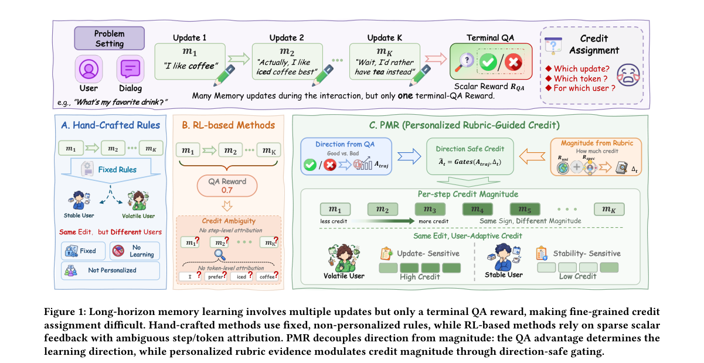

*Result - Overview of PMR. PMR first induces a personalized rubric 𝑅𝑢from shared cross-user patterns and residual per-user failures, and then uses it to shape direction-safe, per-step credit while pre*

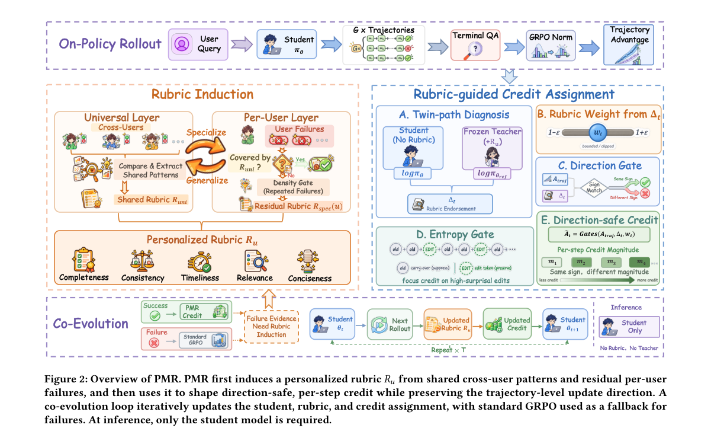

**Why this ranks #16**: 把稀疏的终端 QA 奖励翻译成每步、每用户、token 级的信用分配：rubric 拆成跨用户通用层与每用户残差层，PMR 在 PersonaMem 32K 上取得 76.76 准确率，比最强基线 MemCoE 高 9.29 点、比 RL 类 MemAgent 高 15.32 点，且推理时不需要 rubric 与外部评委、零额外开销。

---

### 17. Metric-Aligned Group Relative Policy Optimization for Explainable Deepfake Detection

**arXiv**: [2611.14436](https://arxiv.org/abs/2611.14436) | **Score**: 8.7 (relevance 9 x 0.7 + quality 8 x 0.3) | **Direction**: `llm_vlm_rl` | **Tags**: LLM-VLM, multimodal-grpo, deepfake-detection, explainability, vlm, metric-aligned-reward, University of Ljubljana | **Categories**: cs.CV | **Pages**: 5

**Authors**: Luka Dragar; Peter Peer; Vitomir Štruc; Borut Batagelj

**Affiliation**: University of Ljubljana

**Abstract**

> Deepfake detectors are commonly evaluated on real/fake classification alone, but real-world applications require explanations of the visual evidence behind each prediction. Joint vision-language models struggle with authenticity assessment, producing "real" narratives for manipulated images. To address this, we propose a decoupled predict-then-explain pipeline as our submission to the ACM Multimedia 2026 Explainable Deepfake Detection Challenge, with methods trained and evaluated on the XPlainVerse benchmark. A vision-foundation-model ensemble first classifies the image, then a Qwen3-VL-8B model generates a decision-conditioned explanation of the visual evidence. For fake images, a second Qwen3-VL-8B compresses that text into a short non-expert summary without using the image. We further apply metric-aligned Group Relative Policy Optimization (GRPO) to optimize both explainers against the challenge criteria. Under matched conditions, GRPO raises complex BERTScore-F1 from 0.686 to 0.712 and also improves grounding (entity and evidence F1); our submission ranked first on complex BERTScore-F1 and seventh overall.

**Key findings**

- **Finding**: 在 10,000 张打分测试图上做只替换解释器 adapter 的对照，GRPO 把复杂解释 BERTScore-F1 从 0.686 提到 0.712，实体 F1 从 0.362 提到 0.387、证据 F1 从 0.259 提到 0.296，grounding 从 0.310 提到 0.341。
- **Inference**: 奖励只含 BERTScore-F1 与格式项，grounding 却同步上升，说明序列级指标奖励能带动未被直接奖励覆盖的语义覆盖面；但官方简单解释分数的提升主要来自 SLE，输出更短也更多重复，语言多样性反而下降。
- **Recommendation**: 多模态 RL 后训练优先把评测指标直接写成奖励（复杂解释用 BERTScore-F1 加 0.3 格式项，简单解释用 0.7 BERTScore-F1 加 0.3 SLE），同时警惕先预测后解释的解耦会把检测器错误传导给解释器。

**Key figures**

*Framework - Visualization of our architecture.*

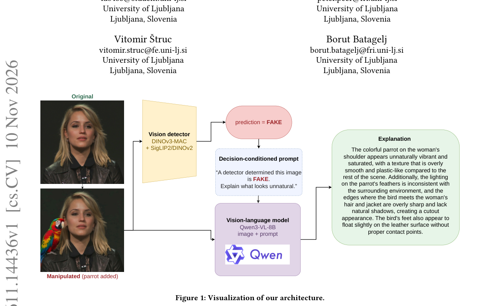

**Why this ranks #17**: 把评测指标本身写成 GRPO 的标量奖励来优化 VLM 解释器，在同样图像、检测判决与提示下把复杂解释 BERTScore-F1 从 0.686 提到 0.712、grounding 从 0.310 提到 0.341，复杂解释项在 ACM MM 2026 可解释深伪检测挑战赛上排名第一，是多模态 RL 后训练的少样本实用配方。

---

### 18. Leveraging Psychophysical Attentional Distribution for Gaze-Augmented Reward Modeling

**arXiv**: [2611.13477](https://arxiv.org/abs/2611.13477) | **Score**: 8.0 (relevance 8 x 0.7 + quality 8 x 0.3) | **Direction**: `llm_vlm_rl` | **Tags**: LLM-VLM, gaze-features, reward-modeling, eye-tracking, rlhf, psychophysics, KAIST | **Categories**: cs.AI, cs.CL, cs.HC, cs.LG | **Pages**: 15

**Authors**: Chaeho Lee; Junyup Kim; Wansoo Kim; Young Min Jung; Sang Ho Lee

**Affiliation**: KAIST

**Abstract**

> Integrating human feedback into language models has gained increasing attention as a means to align model outputs with human preferences, with Reinforcement Learning from Human Feedback (RLHF) serving as a prominent framework for preference-based alignment. Recent studies have incorporated eye-tracking (ET) data as an additional supervisory signal for reward model training, grounding reward learning in human reading behavior. Building on this approach, we extend prior fixation-centric models by leveraging established findings from cognitive psychology on human letter recognition. Specifically, we model visual attention as a spatially graded distribution centered on the current gaze location and incorporate this representation into reward model training. Our results show that the reward model trained with the proposed gaze distribution achieves higher preference prediction accuracy than a baseline model. Moreover, some results from our experiments are qualitatively consistent with established findings on human attention during reading, suggesting that they potentially capture cognitively meaningful aspects of human attention allocation.

**Key findings**

- **Finding**: 用 6 个随机种子在 OASST1 上评测，把总阅读时长按非对称高斯重分配到邻近 token 后，Llama-3-8B（GazeConcat）的偏好预测准确率从 69.23±4.92 升到 74.81±1.32（相对 +8.06%），UltraFeedback 上从 65.65 升到 74.20（相对 +13.02%）。
- **Inference**: 学到的 sigma 在多数设置下右侧大于左侧（GazeConcat 下 sigma_left=0.80、sigma_right=3.47），方向上与左到右阅读时视幅向右延伸 14–15 个字母、向左仅 3–4 个的心理物理结论一致，说明学到的分布捕捉到了真实注意力结构。
- **Recommendation**: 消融显示可学习的对称高斯已达 74.19，与非对称的 74.81 差距小于种子间波动，因此落地时先做对称版本即可，不必强求左右不对称；数据侧则可直接复用公开的眼动预测模型生成 TRT。

**Key figures**

*Framework - A schematic illustration of visual attention allocation during each fixation while reading.*

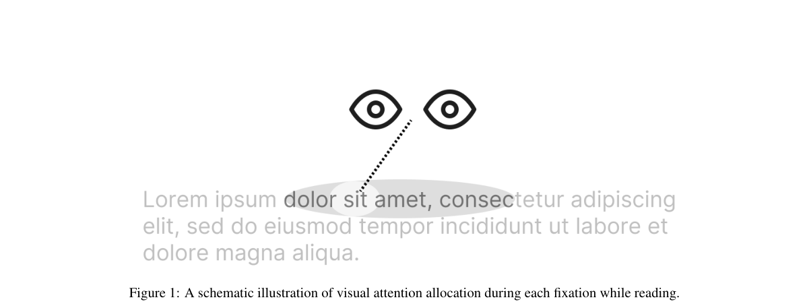

*Result - An overview of the GazeReward framework with our redistribution module. First, we obtain original TRT values for a given sentence and redistribute them using an asymmetric Gaussian kernel wi*

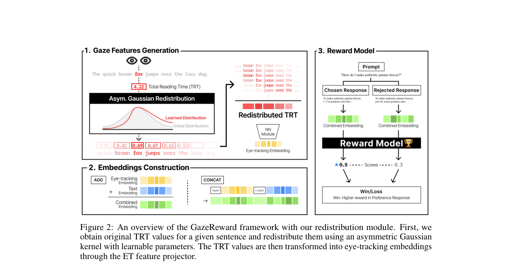

**Why this ranks #18**: 把眼动注视从离散的 token 特征改写成以注视点为中心、可学习的非对称高斯空间分布，再注入奖励模型：在 OASST1 上把 Llama-3-8B 的偏好预测准确率从 69.23 提到 74.81（相对 +8.06%），在 UltraFeedback 上从 65.65 提到 74.20，是 reward model 引入认知信号的实证尝试。

---

## Footer

- Total papers reviewed across all 4 axes: 60
- llm_vlm axis final count: 18
- Wild-cards in this axis: 0
- Figure assets: 2026-11-12/res/

Generated by `mine-arxiv-daily-digest` skill. Sister file: `2026-11-12_llm_vlm_entry.md`.
