# Mine Arxiv Daily Digest - 2026-11-12 (具身智能与世界模型 Axis, 15 papers)

**Generated**: 2026-11-12 01:26 CST

**Source**: arXiv cs.CV, cs.SD, eess.AS, cs.CL, cs.AI, cs.RO, cs.LG, cs.IR submissions, listing day 2026-11-10 (announced 2026-11-11 00:00 UTC)

**Batch window**: 2026-11-09T19:00:00Z .. 2026-11-10T19:00:00Z（arXiv 公告批次横跨两个 UTC 日：从前一日的美东 14:00 截止时刻起算（EDT 为 18:00Z，EST 为 19:00Z），到当日的同一时刻为止）

**Axis**: world_embodied (15 papers, base 15, cap 20)

**Directions**: world_model (7), embodied_ai (8)

**Selection**: 15 papers ranked by relevance x quality, with 0 wild-card slots

**Day total**: 60 papers across 4 axes (target 60)

**Scope**: 世界模型、学习型模拟器与具身智能，含移动操作、人形控制、触觉反射、VLA 策略与面向具身任务的强化学习

**Wild-card**: **Wild-card**: 0 —— 本 axis 两个 direction 都正好达到基准（7 + 8），没有名额让渡，因此没有 wild-card 补位需求。

**本 axis 两个 direction 都正好达到基准**：`world_model` 7 篇（基准 7）、`embodied_ai` 8 篇（基准 8），合计 15 篇，等于 axis 基准 15 篇，没有发生轴内或轴间的名额让渡。

---

## 世界模型与学习型模拟器 · `world_model` (7 papers)

本方向 7 篇，覆盖**「动作从哪来」「表征怎么压缩」「潜模型怎么在线改」「生成的世界模型可不可信」**四条线。OnlyAct 直接拆掉视频世界模型的动作监督瓶颈——动作标签稀缺、分散、规格互不兼容，它让动作编码器去压连续帧之间的潜动作，同时保留「能重建下一帧」这一约束，避免潜动作退化成无关表征。Building World Models from Intrinsic Motivation 把无外在奖励时的好奇、玩耍等内在动机与世界模型表征学习接上，回答多种内在动机如何共同支撑泛化。Meta-Frames 给世界动作模型一个统一的帧—机器人潜接口，LaST0.5 则主张 WAM 不该把全局物理表征直接搬给动作生成，而要改用交互为中心的潜推理来突出局部机器人-物体交互。Few-Shot Residual Adaptation 处理的是部署后物理参数漂移：冻结预训练权重，只从潜预测误差里自监督学出残差修正，修正同时作用于潜空间与输出。Koopman MBRL 用随机 Koopman 算子把未知非线性动力学线性化后直接优化近似策略目标；Evaluating LLM-Generated World Models 则质疑另一件事——LLM 生成的偏可观测随机博弈即使机械上合法，是否真的忠实表达了原本的决策问题。

### 1. Building World Models from Intrinsic Motivation

**arXiv**: [2611.13113](https://arxiv.org/abs/2611.13113) | **Score**: 9.0 (relevance 9 x 0.7 + quality 9 x 0.3) | **Direction**: `world_model` | **Tags**: embodied, intrinsic-motivation, dreamer-world-model, curiosity, zero-shot-control, representation-learning, Carnegie Mellon University | **Categories**: cs.AI, cs.LG | **Pages**: 27

**Authors**: Reece Keller; Declan Kutscher; Xaq Pitkow; Aran Nayebi

**Affiliation**: Carnegie Mellon University; University of Maryland, College Park

**Abstract**

> In the absence of extrinsic rewards or task supervision, human behavior is guided by intrinsic motivation---neural signals that drive curiosity, creativity, play, and other essential facets of intelligence. Intrinsic motivation plays an important developmental role in building robust world models that enable generalization and adaptation. Yet existing studies leave open how a broad range of intrinsic motivations interacts with world-model representation learning to support downstream control. This limits our understanding of which intrinsically collected experiences build reusable models. To address these gaps, we integrate 24 intrinsic objectives, including established methods and explicit variants spanning curiosity, entropy, and competency, into a common model-based reinforcement learning framework. We evaluate the world models they build through zero-shot, few-shot, and multi-task control in locomotion, manipulation, and open-ended gaming environments, using three representation-learning strategies: observation reconstruction, latent prediction, and redundancy reduction. Curiosity-driven exploration with observation reconstruction yields the strongest aggregate family profile, although the best individual pairing depends on the experiment. In compositional vision-based tasks, intrinsic motivation derived from both episodic and lifelong novelty---providing a complementary memory to the world model's generic recurrent state---achieves the best zero-shot transfer and few-shot adaptation. These findings motivate designing intrinsic motivation and representation learning jointly. Our results demonstrate world models as a powerful tool for measuring the quality of intrinsically motivated experience, and positions intrinsic motivation as a key ingredient for building world models autonomously.

**Key findings**

- **Finding**: 论文把 24 个内在目标整合进统一的 DreamerV3 模型式强化学习框架，配合观察重建（DreamerV3）、下一嵌入预测（NE-Dreamer）、当前嵌入冗余缩减（R2-Dreamer）三种表征策略，在 DMC 全部 25 个任务与 Craftax Classic 上评测。
- **Inference**: Craftax 视觉设定下最好的预训练组合只到 51%，而 DMC 本体感知设定普遍饱和到 100%，说明内在动机的收益高度依赖环境是否存在可被世界模型利用的动力学结构。
- **Recommendation**: 选内在预训练目标时先固定 DreamerV3 这类单一 backbone 做受控对比，再按环境是否物理可建模来挑好奇、熵或能力族，不要跨论文比较不同强化学习算法。

**Key figures**

*Framework - Three families of intrinsic motivation. Our comparison spans curiosity (blue), entropy (orange), and competency (pink). Leaves illustrate representative objectives and estimator families; in*

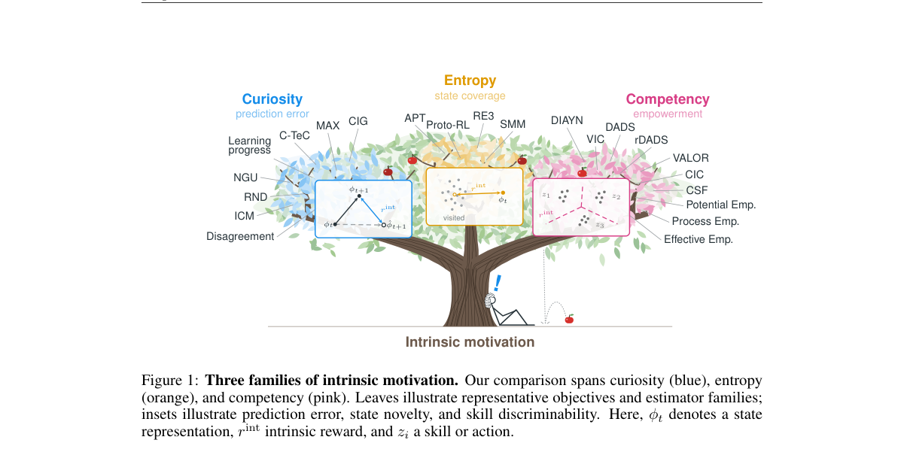

*Result - Intrinsically motivated Dreamer agents. (a) Exploration experience trains a shared re- current world model using reconstruction (DreamerV3), next-embedding prediction (NE-Dreamer), or curren*

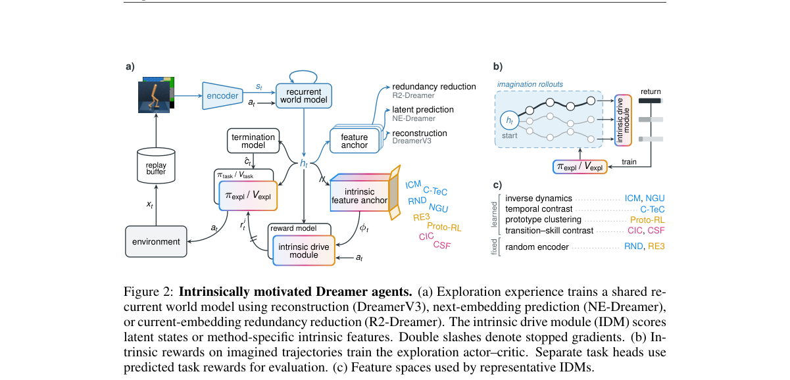

**Why this ranks #1**: 把 24 个内在目标（好奇、熵、能力三族）与 3 种表征学习策略统一塞进 DreamerV3 框架做受控对比，覆盖 DMC 全部 25 个任务与 Craftax，是 world_model 方向里唯一系统回答「何种内在经验能造出可复用世界模型」的工作。

---

### 2. OnlyAct: Extracting Action Representations from Foundation Models for World Models

**arXiv**: [2611.14420](https://arxiv.org/abs/2611.14420) | **Score**: 9.0 (relevance 9 x 0.7 + quality 9 x 0.3) | **Direction**: `world_model` | **Tags**: embodied, v-jepa-2, contrastive-learning, action-representation, scene-invariance, video-world-model, University of Oxford | **Categories**: cs.CV | **Pages**: 29

**Authors**: Runjia Li; Minghao Chen; Junyu Xie; Philip Torr; Andrea Vedaldi; Tomas Jakab

**Affiliation**: University of Oxford

**Abstract**

> Video world models promise general-purpose interactive simulators, but their training is limited by action supervision: action labels are scarce, fragmented across incompatible specifications, and do not scale with the unlabeled video pretraining corpus. A common workaround jointly trains an action encoder to compress consecutive frames into a latent action and a decoder to reconstruct the next frame from the previous frame and that latent, forcing the latent to capture only new information. This has two limitations: learning the action space from scratch can limit generalization to unseen domains, and the bottleneck trades expressiveness for separation, with tighter settings losing nuance and looser ones risking scene leakage under domain shifts. We argue for a different starting point: rather than learning actions from scratch, we start from a pretrained foundation model (V-JEPA 2), whose embeddings of a frame pair already carry substantial action information after large-scale, diverse video pretraining. The remaining challenge is to extract the action while discarding the scene. We propose a label-free contrastive adaptation framework that pulls together frame pairs sharing the same motion under a different scene and pushes apart pairs from the same scene with different motion, reshaping the geometry of the pretrained space without imposing a reconstruction bottleneck. We introduce a unified evaluation protocol along three axes (action expressiveness, scene invariance, and action-conditioned video generation quality) across robot manipulation, camera navigation, game, and driving benchmarks, most of which are unseen during adaptation. Compared with annotation-free latent-action methods, our representations are substantially more expressive while matching their scene invariance, and they yield world models that transfer demonstrated actions to new scenes more faithfully.

**Key findings**

- **Finding**: 在 13 个基准（12 个连续动作数据集加 Procgen 的 15 个离散动作）上，OnlyAct 在 11 个上超过隐式动作基线，平均线性探针 R² 从 0.211 提升到 0.490，其中对比适配本身贡献 0.347 到 0.490。
- **Inference**: 冻结的 V-JEPA 2 编码器虽自带动作信息，但平均 LPIPS 仅 0.275、泄露场景最多；对比适配后 LPIPS 升到 0.304，说明动作表达力与场景不变性必须显式解耦才能同时拿到。
- **Recommendation**: 自建动作表征时优先复用大规模视频预训练好的时序编码器，再用「同运动不同场景拉近、同场景不同运动推远」的对比目标剥离场景，而不是直接加重建瓶颈。

**Key figures**

*Framework - OnlyAct: an unlabeled action representation learning framework builds on a pretrained foundation model to extract expressive and transferable action representations, keeping only the action*

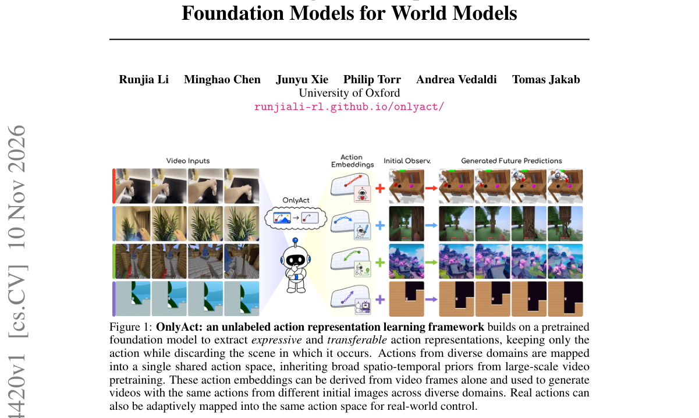

**Why this ranks #2**: 不从零学动作空间，而是从 V-JEPA 2 冻结表征里用对比学习剥离场景：在 13 个基准上把平均线性探针 R² 从最强隐式动作模型的 0.211 拉到 0.490 并追平其场景不变性，是 world_model 方向少见的复用基础模型而非重建瓶颈的路线。

---

### 3. Few-Shot Residual Adaptation of Pretrained Latent World Models

**arXiv**: [2611.13592](https://arxiv.org/abs/2611.13592) | **Score**: 8.7 (relevance 9 x 0.7 + quality 8 x 0.3) | **Direction**: `world_model` | **Tags**: embodied, few-shot-adaptation, latent-world-model, dynamics-shift, residual-correction, self-supervised, Karlsruhe Institute of Technology | **Categories**: cs.RO | **Pages**: 8

**Authors**: Jakub Suliga; Pankhuri Vanjani; Nisarga Nilavadi; Wolfram Burgard; Rudolf Lioutikov

**Affiliation**: Karlsruhe Institute of Technology; University of Technology Nuremberg

**Abstract**

> Pretrained latent world models can support visual planning and control, but their predictions may fail when physical dynamics change at deployment. We study whether such models can adapt from only a few interactions without modifying their pretrained weights or identifying the changed physical parameters. We introduce a few-shot residual adaptation approach that learns self-supervised corrections from latent prediction errors. The corrections are applied both inside the latent predictor and directly to its predicted latent state, while the pretrained world model remains frozen. We evaluate the approach in simulation and on a real robot under center-of-mass and friction shifts. These changes reduce the success of the frozen model to near zero. Using three interaction episodes for adaptation, our dual-site approach recovers 90\% success under the center-of-mass shift and 100\% under the modified friction on the real robot. Ablations show that correcting both locations outperforms single-site adaptation. Our diagnostics further suggest that much of the learned correction reduces a general prediction mismatch, while successful control also depends on shift-specific information captured during adaptation.

**Key findings**

- **Finding**: 动力学变化会让冻结的 DUET-DINO 世界模型在质心偏移下成功率从 85.3% 掉到 0.0%（真机摩擦变化只剩 3.3%），而用 3 段交互做双点残差校正后恢复到 90.0% 与 100.0%。
- **Inference**: 通用动力学适配器只能共享 95.3% 的侧视误差下降，在质心偏移下只有 6.0% 成功率（特定偏移适配器为 72.0%），说明只压低预测误差不足以支撑控制。
- **Recommendation**: 部署前物理参数可能漂移的场景，直接给冻结世界模型加「内部适配器加输出端校正」的双点残差，不要指望只降预测误差的通用校正。

**Key figures**

*Framework - Dual-site latent correction in a frozen world model. The frozen predictor rolls out sampled actions, corrected inside every block and once more on its output. The CEM controller ranks the co*

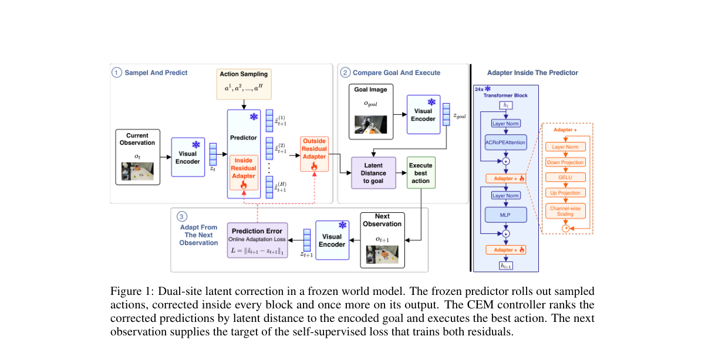

*Result - The pushing task in simulation and on the real robot, each shown at the start of an episode and after a successful push.*

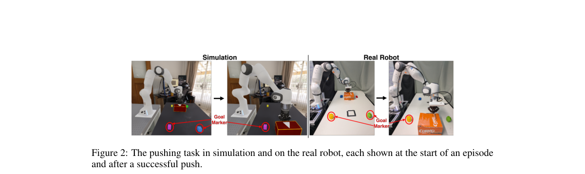

**Why this ranks #3**: 只给 3 段交互（共 24 帧）且不改预训练权重，就能把冻结世界模型在质心偏移下 0% 的成功率救回 90%、摩擦变化下救回 100%，可训练参数仅占冻结预测器的 4.53%，是 world_model 方向里样本效率最高的少样本适配之一。

---

### 4. LaST0.5: A Generalist World Action Model with Interaction-Centric Latent Reasoning

**arXiv**: [2611.14048](https://arxiv.org/abs/2611.14048) | **Score**: 8.7 (relevance 9 x 0.7 + quality 8 x 0.3) | **Direction**: `world_model` | **Tags**: embodied, world-action-model, mixture-of-transformers, interaction-centric, latent-reasoning, robot-pretraining, Peking University | **Categories**: cs.RO | **Pages**: 16

**Authors**: Xuheng Zhang; Yiming Zhang; Jialin Gao; Hao Chen; Jiaming Liu; Ji Li; Runzhong Huang; Yinxi Wang; Chenyang Gu; Zihan Yang; Yaowei Liu; Zhonghao Yan

**Affiliation**: Peking University; The Chinese University of Hong Kong

**Abstract**

> World Action Models (WAMs) have recently emerged as a promising paradigm for robotic manipulation, endowing policies with strong capabilities for modeling temporal and physical dynamics. Existing WAMs, encompassing both video-first action prediction and joint video-action modeling, directly transfer global physical representations from world models to action generation. However, global scene representations may underemphasize local robot-object interactions, creating a mismatch between representations optimized for world evolution and those required for manipulation. To bridge this gap, we propose LaST0.5, a novel WAM that introduces an interaction-centric physical representation between world modeling and action generation. Specifically, LaST0.5 learns a compact interaction-centric latent space under the supervision of visual interaction cues between the robot and the environment. This reasoning space is instantiated as a latent expert that bridges the world expert and the action expert within a Mixture-of-Transformers architecture. Furthermore, LaST0.5 performs adaptive world-to-action transfer by jointly predicting future representations and progress values, using progress consistency to adjust action execution and trigger future resampling. Finally, we pretrain LaST0.5 on a large-scale robotic data corpus comprising over 14k hours of data, establishing interaction-centric physical reasoning as a scalable and effective paradigm. LaST0.5 achieves 99.5% on LIBERO, surpasses the previous state of the art on ten evaluated RLBench tasks, and demonstrates robust long-horizon execution and precise dexterous manipulation in real-world experiments.

**Key findings**

- **Finding**: LaST0.5 把世界专家、隐空间专家、动作专家串成视频到交互再到动作的推理链，LIBERO 平均 99.5%（Spatial 99.7%、Object 100.0%），RLBench 十个任务 88.0%，真机双臂任务 63.8%。
- **Inference**: 去掉世界专家成功率从 99.6% 掉到 96.0%、去掉隐空间专家掉到 97.8%，说明世界动态先验与交互中心表征两者都不可省，而不是二选一。
- **Recommendation**: 做世界动作模型时不要只搬全局场景表征，显式插入一层交互中心的紧凑隐空间，并让它成为独立专家而非附加损失项，才吃得到长时序与灵巧操作的收益。

**Key figures**

*Framework - Overview. Existing WAMs directly transfer representations of global scene dynamics to action prediction, poten- tially overlooking the localized robot–environment interactions required for m*

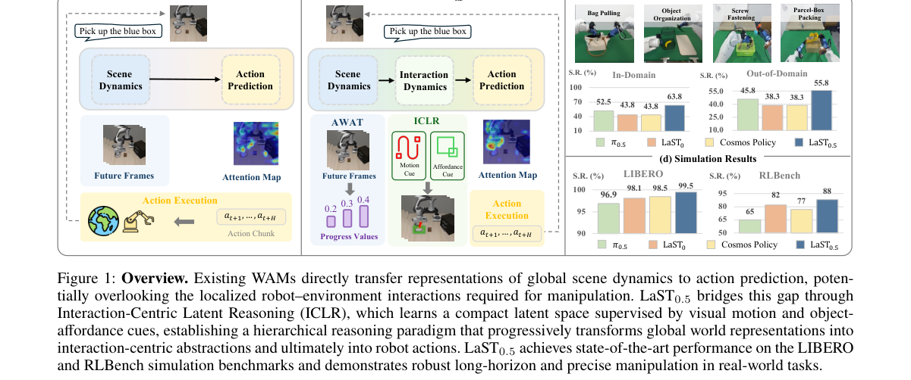

*Result - The LaST0.5 Framework. (a) LaST0.5 unifies a World Expert, Latent Expert, and Action Expert within a Mixture- of-Transformers (MoT) architecture. To bridge global scene dynamics and precise*

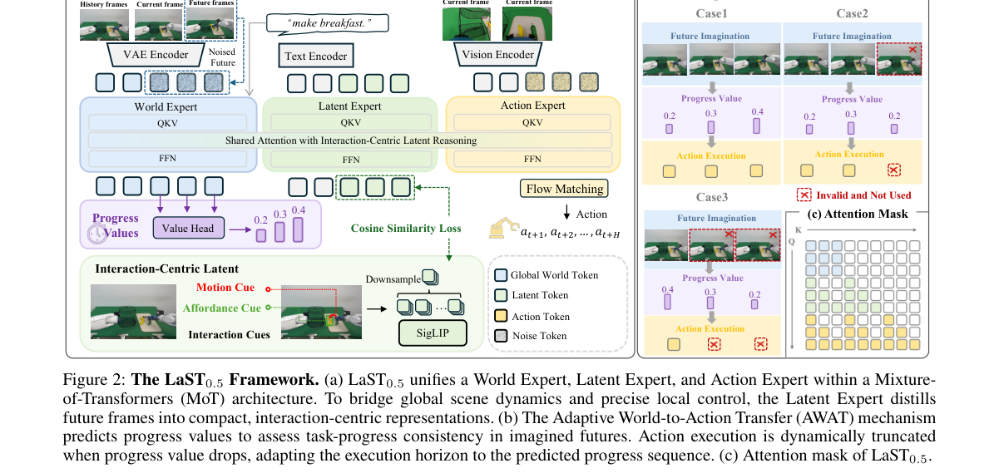

**Why this ranks #4**: 在 14k 小时机器人数据上预训练，用交互中心的紧凑隐空间在 Mixture-of-Transformers 里桥接世界专家与动作专家，LIBERO 达 99.5%、RLBench 十个任务 88.0%、真机双臂 63.8%，是 world_model 方向把全局世界表征换成局部交互表征的代表工作。

---

### 5. From Video Frames to Robot Meta-Frames: A Unified Latent Interface for World Action Models

**arXiv**: [2611.14365](https://arxiv.org/abs/2611.14365) | **Score**: 8.7 (relevance 9 x 0.7 + quality 8 x 0.3) | **Direction**: `world_model` | **Tags**: embodied, world-action-model, meta-frame, frequency-domain, dct-encoding, video-diffusion, National University of Singapore | **Categories**: cs.CV, cs.RO | **Pages**: 18

**Authors**: Guoqiang Liang; Yiqi Lin; Yanzhe Chen; Kevin Yuchen Ma; Mike Zheng Shou

**Affiliation**: National University of Singapore; NUS Guangzhou Research Translation and Innovation Institute

**Abstract**

> Pretrained video diffusion models (VDMs) offer a powerful foundation for World Action Models (WAMs), which jointly predict robot actions and future observations. Building such models requires injecting low-dimensional robot signals (e.g. proprioception, actions, and values) into a latent space shaped by natural videos, and a key design choice is the interface through which these signals enter: existing schemes treat it as a formatting detail, spending a separate latent frame on each signal or bolting on dedicated encoders and decoders. We argue that signal injection is instead a distribution-alignment problem: how well a representation matches the prior of the pretrained VDMs during denoising. Using the relative reconstruction error of a frozen VDM denoiser as a probe, we find that conventional spatial encodings sit far off this prior, whereas frequency-domain packing yields latents that the denoiser corrects far less. Motivated by this diagnostic result, we propose MetaWAM, which folds all robot signals into a single unified meta-frame: each signal is assigned to a disjoint frequency-domain channel band and lifted to the spatial latent by an inverse DCT, yielding a decodable interface aligned with the pretrained VDM prior without any added module or architectural change. A fixed band layout together with slot-aware routing lets the same meta-frame support policy, world-model, and value prediction over a shared set of robot variables. On RoboCasa, MetaWAM reaches 68.9% success while collapsing the per-signal frames into one and cutting inference latency by 39%, and attains 85.0% success on three real-world Franka tasks. Code and models are available at https://github.com/showlab/MetaWAM

**Key findings**

- **Finding**: 以冻结 VDM 去噪器的相对重建误差作探针，噪声水平 1.0 时统一 meta-frame 为 0.5613，优于 Meta-Quadrants 的 0.6730、Meta-Compact 的 0.6234 与分离空间复制注入的 0.6178。
- **Inference**: 每个信号各占一帧或外挂编解码器，本质是让表示偏离预训练去噪器的先验；频域打包几乎不需要修正，因此接口压缩与精度提升可以同时拿到。
- **Recommendation**: 在视频扩散底座上接机器人信号时，先用冻结去噪器的相对重建误差测一次与先验的对齐度再决定注入方式，别直接沿用「每个信号占一帧」的惯例。

**Key figures**

*Framework - MetaWAM packs robot signals into one distribution-aware meta-frame. (a) Disjoint DCT bands route signals as inputs or denoising targets for policy, world-model, and value prediction. (b) Fro*

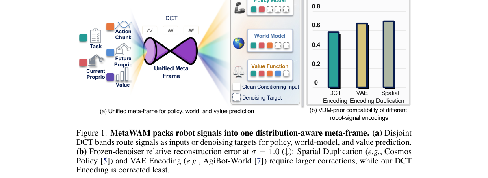

*Result - Robot-signal injection schemes used in the diagnostic study. (a–c) Single-signal en- codings compare Spatial Duplication, VAE Encoding, and DCT Encoding. (d–g) Multi-signal pack- ings compar*

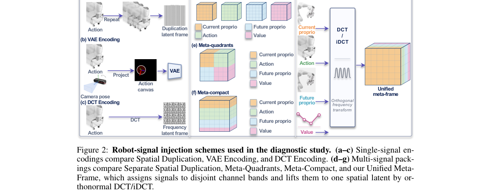

**Why this ranks #5**: 把机器人信号注入重新表述为与预训练视频扩散先验的分布对齐问题，用互不重叠的频域 DCT 打包成单帧 meta-frame，RoboCasa 68.9%、LIBERO 98.1% 且推理延迟再降 39%，是 world_model 方向里最省接口的一类工程。

---

### 6. Koopman Model-Based Reinforcement Learning

**arXiv**: [2611.14186](https://arxiv.org/abs/2611.14186) | **Score**: 8.0 (relevance 8 x 0.7 + quality 8 x 0.3) | **Direction**: `world_model` | **Tags**: embodied, koopman-operator, model-based-rl, one-step-propagation, sample-efficiency, quadruped-control, Purdue University | **Categories**: cs.RO, eess.SY | **Pages**: 21

**Authors**: Wenjian Hao; Paulo C. Heredia; Shaoshuai Mou

**Affiliation**: Purdue University

**Abstract**

> We propose a Koopman model-based reinforcement learning (K-MBRL) algorithm for controlling nonlinear robotic systems with unknown dynamics. The K-MBRL learns a control policy by minimizing an approximate policy objective that combines the analytical immediate cost with an estimate of the future cost evaluated at the one-step predicted state. To this end, we develop a stochastic Koopman operator-based learning method to approximate the unknown nonlinear dynamics in a linear representation, while a critic function estimates the remaining future cost. This formulation offers two key advantages. First, the linear Koopman dynamics simplify the model-dependent policy gradient computation to a constant matrix product, enabling computationally efficient policy improvement. Second, one-step model propagation mitigates the accumulation of prediction errors associated with long-horizon rollouts while retaining long-term cost information through the critic. The learned policy enables real-time control through feedforward evaluation without online optimization. We establish policy learning convergence guarantees under standard stochastic approximation assumptions. Simulations on HalfCheetah and quadruped four-legged locomotion tasks demonstrate strong sample efficiency and improved performance compared with classical model-free and model-based reinforcement learning baselines. A pendulum swing-up task is used to assess policy gradient approximation accuracy and conduct ablation studies on the learning mechanism and key hyperparameters. The proposed K-MBRL is further validated on a physical quadruped robot performing a challenging sequence of maneuvers: rising to an upright posture supported by two rounded rear feet, maintaining balance during bipedal walking, and safely returning to the ground, as shown in Fig.1.

**Key findings**

- **Finding**: 单次策略更新耗时上，K-MBRL 在摆荡、HalfCheetah 与四足任务分别为 1.38、2.71 与 3.81 毫秒每次调用，均远低于 EMBRL 的 45.01、42.51 与 5488.01。
- **Inference**: 线性 Koopman 动力学让策略梯度退化为常数矩阵积，因此可以既保留长程代价信息（交给 critic）又避免长时域 rollout 的误差累积，这是它比模型式基线收敛更快的算力层面原因。
- **Recommendation**: 机器人未知动力学的在线控制可优先试 Koopman 型线性近似加一步传播的组合，把长程规划交给 critic，采样效率与实时性通常都能兼顾。

**Key figures**

*Framework - Bipedal walking mode of a quadruped robot on outdoor asphalt pavement supported by the proposed method.*

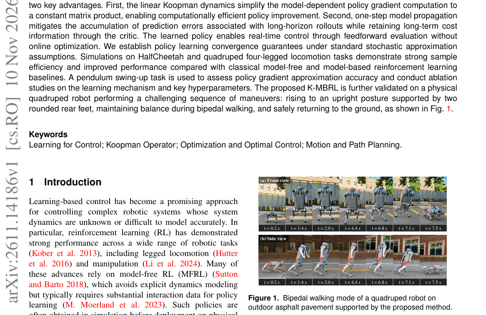

*Result - A diagram showing the proposed K-MBRL algorithm workflow. The red blocks highlight the approximate policy objective mechanism. Red and blue arrows show the policy learning flow, and black ar*

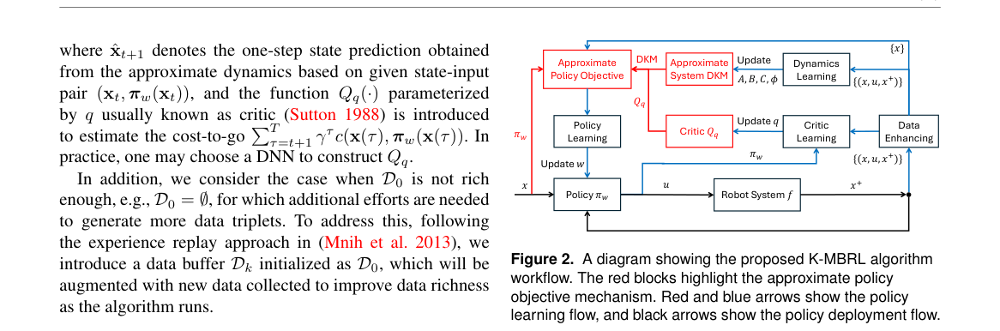

**Why this ranks #6**: 用 Koopman 线性化把模型式强化学习的策略梯度降为常数矩阵积、只做一步模型传播，实机上让四足机器人完成双足站立行走的连续动作，是 world_model 方向里少见把线性动力学近似与收敛保证写完整的理论型工作。

---

### 7. Evaluating LLM-Generated World Models for Neuro-Symbolic Reasoning

**arXiv**: [2611.14419](https://arxiv.org/abs/2611.14419) | **Score**: 8.0 (relevance 8 x 0.7 + quality 8 x 0.3) | **Direction**: `world_model` | **Tags**: embodied, neuro-symbolic-reasoning, llm-evaluation, stochastic-game, mechanical-validity, benchmark, PRISM AI Safety Research | **Categories**: cs.AI | **Pages**: 26

**Authors**: Souhaila Djaffal; Amna Jamal; Gagana Madhugiri Devaraja; Anidipta Pal; Jobst Heitzig

**Affiliation**: PRISM AI Safety Research; University of Potsdam

**Abstract**

> Formal world models can support planning, verification, and safety reasoning, but constructing them from open-ended natural-language situations is difficult, particularly in multi-agent settings where several formalizations may be plausible. We study whether five LLMs can generate such world models as partially observable stochastic games and whether mechanical validity is sufficient to establish that the resulting model faithfully represents the intended decision problem. We introduce a benchmark of 44 scenarios spanning game, situational, and cultural settings and evaluate generated world models along three dimensions: mechanical validity, reference-relative structural agreement, and semantic criteria. Across three empirical tracks, we analyze 410 first-pass generations. In the reference-backed game track, 134/135 generated world models pass a strict mechanical audit, yet mean permutation-invariant structural F1 is only 0.366, with just 28/134 mechanically valid models exactly matching the authored reference. In the cultural track, explicitly naming the country changes the generated structural representation for most LLMs while producing only small changes in automated semantic scores. These results show that executability is a necessary but insufficient criterion for LLM-generated world models: models that are mechanically valid can still differ substantially in the structure used by downstream neuro-symbolic reasoning and planning.

**Key findings**

- **Finding**: 在带人工参考的游戏赛道中 134/135 个生成的世界模型通过严格机械审计，但置换不变结构 F1 均值只有 0.366、中位数 0.178，只有 28/134 与参考模型完全一致。
- **Inference**: 开放赛道差距更大，情境赛道仅 104/135 通过 Lane 1 审计、文化赛道 125/140，说明可执行性这一必要条件远不足以保证下游规划与神经符号推理用的是同一套结构。
- **Recommendation**: 用大模型生成形式化世界模型时必须额外做结构级一致性度量（例如置换不变 F1），不要把「能跑起来」当作模型正确的验收标准。

**Key figures**

*Framework - Transition graphs of world models produced by two different LLMs (left: Qwen, right: GPT) given the same situational description (cultural test case C9 from our benchmark): “A hospitality ro*

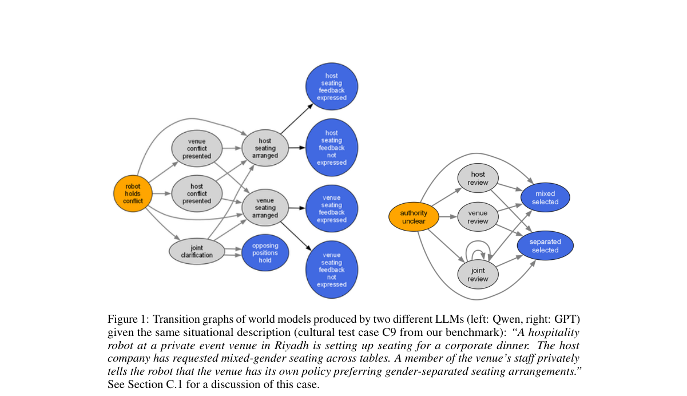

*Result - Compressed phase graph for G6 versus the mechanically valid Claude Opus 5 artifact from run 1 (matched F1 0.0383). The candidate has 101 states. Unlike the two-bid-level reference, it introd*

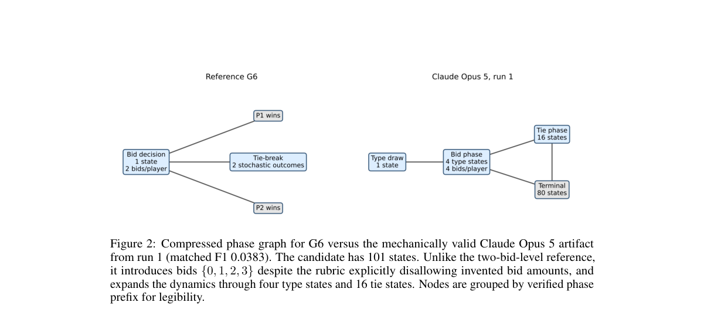

**Why this ranks #7**: 用 44 个场景、5 个大模型、410 次生成回答「机械可执行的世界模型是否就是忠实的世界模型」，游戏赛道 134/135 通过严格审计却只有 0.366 的结构 F1、仅 28 个与参考完全一致，是 world_model 方向里少见的方法论质疑。

---

## 具身智能与机器人学习 · `embodied_ai` (8 papers)

本方向 8 篇，主线是**「机器人策略到底学到了什么」以及「怎么用更便宜的数据把它训起来」**。两篇诊断性工作最抢眼：How Much of Your VLA Is kNN 显示在 LIBERO 上只用训练演示的近邻检索、复用其动作块、不做任何策略训练就能拿到 91.7% 成功率，在 LIBERO-Plus 扰动下检索掉得最少，说明「>95% 成功率」里有多少其实是泛化、多少只是记忆；Is Your Robot's Memory Just a Clock 则指出一批记忆增强 VLA 用「按时间均匀采样帧 + 盖时间戳」来填记忆，于是在 RoboMME 的计数任务里让机器人短暂停顿或抖一下手腕——一个什么都不发生的事件——就能骗过记忆。训练侧三篇走「便宜数据」路线：DexSeed 把人类手-物交互扩展成可执行的灵巧机器人演示（BEHAVIOR-1K 第 2 名），Ego2Robot 把第一人称人类视频正式定义为机器人操作策略的学习/适配问题（并处理形态、视角、动作空间差异），Ego Guidance 用无动作标注的人类第一人称视频给策略学习提供未来视觉状态预测这一独立监督信号。ExRL 则直面真机在线 RL 的样本预算——长动作块维度太高导致适配需要大量交互样本，其做法是转而去控制执行长度。ReACT 处理人形机器人在单手持物的不对称负载下的速度跟踪偏差累积，LEASH 则给出 RoboRisk 基准（92 个仿真任务 + 13 个真机任务）来系统评估基础模型控制机器人的安全风险。

### 8. How Much of Your VLA Is kNN

**arXiv**: [2611.13160](https://arxiv.org/abs/2611.13160) | **Score**: 9.7 (relevance 10 x 0.7 + quality 9 x 0.3) | **Direction**: `embodied_ai` | **Tags**: embodied, vla, retrieval, knn, libero-benchmark, local-action-consistency, Sereact GmbH | **Categories**: cs.AI, cs.LG, cs.RO | **Pages**: 21

**Authors**: Denis Grachev; Damien LaRocque; Omar Moured

**Affiliation**: Sereact GmbH; Karlsruhe Institut fur Technologie

**Abstract**

> Vision-language-action (VLA) models now exceed 95% success on the LIBERO simulation benchmark, yet it remains unclear how much of this performance requires generalization beyond the training demonstrations. In this work, we show that retrieving nearby demonstrations and reusing their action chunks achieves a success rate of 91.7 % on LIBERO without policy training. Under LIBERO-Plus perturbations, retrieval shows the smallest drop of all evaluated policies. Across nine publicly available VLAs, fine-tuning mostly makes the vision-language backbone a better retrieval key, and the actions of the VLAs remain close to the demonstrations. In addition, we introduce Local Action Consistency (LAC), an offline metric that measures whether nearby observations in representation space are also associated with similar future actions. We show that LAC tracks the success rate of retrieval and can guide the training of a retrieval key. Our evaluation and source code are available at https://github.com/sereact/lerobot_knn.

**Key findings**

- **Finding**: 用 1693 条 LIBERO 示范每隔一帧建库得到约 137k 条记忆项，多模态 kNN 在官方 2000 episode 协议下成功率 91.7%、在 420 个 LIBERO-Plus 变体上 82.4%，扰动下掉幅 9.3 个百分点为所有策略最小。
- **Inference**: 只用 10% 示范成功率就从 91.7% 掉到 77.4%，改用原始像素而非嵌入降到 57.2%，去掉语言提示掉 27.1 个百分点，说明检索式策略的上限高度依赖示范覆盖度与语义对齐。
- **Recommendation**: 评测新 VLA 时先跑一遍训练无关的 kNN 基线，并把局部动作一致性当免 rollout 的嵌入质量指标，用来判断微调到底改善了表征还是只是更会检索。

**Key figures**

*Framework - Overview of our evaluation pipeline. Both are evaluated with the same rollout protocol. (a) a k-NN retrieves neighboring demonstration embeddings and combines their associated action chunks;*

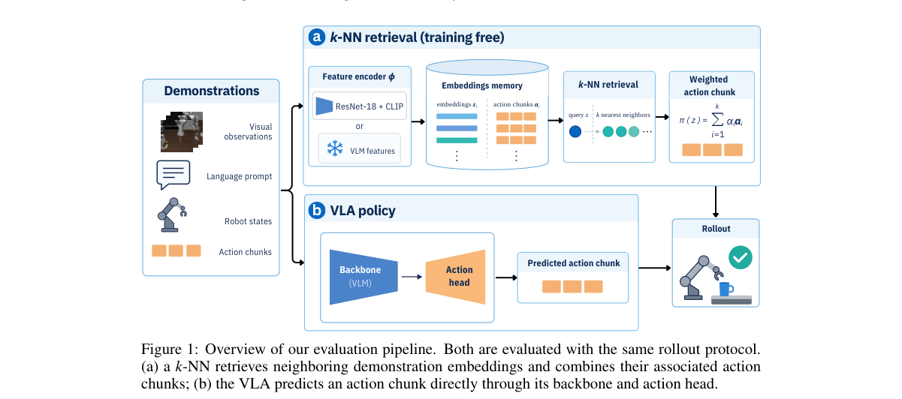

*Result - Local Action Consistency (LAC) is the ratio between the average action distance of the retrieved k nearest neighbors and the average action distance over the same-task set.*

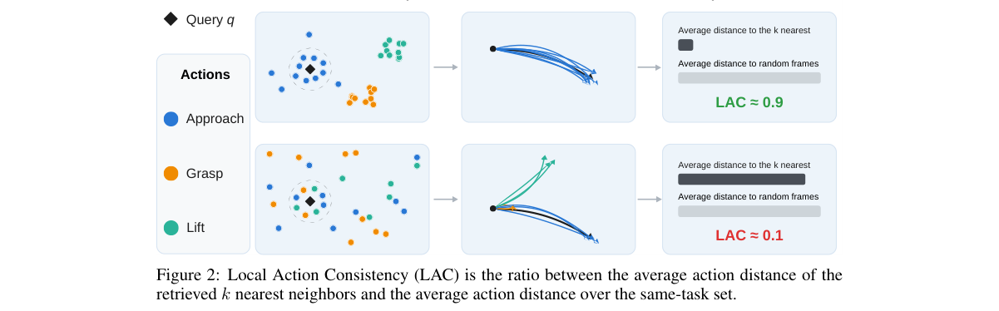

**Why this ranks #8**: 完全不做策略训练，只检索 1693 条示范里最相近的状态并复用其后继动作块，就拿到 LIBERO 91.7%、LIBERO-Plus 82.4%，在九个公开 VLA 中扰动下掉幅最小，是对 embodied_ai 方向「VLA 到底学到了什么」最直接的量化。

---

### 9. DexSeed: Expanding Human Hand-Object Interactions into Robot Demonstrations for Dexterous Policy Learning

**arXiv**: [2611.14092](https://arxiv.org/abs/2611.14092) | **Score**: 9.7 (relevance 10 x 0.7 + quality 9 x 0.3) | **Direction**: `embodied_ai` | **Tags**: embodied, dexterity, demonstration-generation, retargeting, vla-finetuning, physics-simulation, University of Hong Kong | **Categories**: cs.RO | **Pages**: 9

**Authors**: Huaijin Pi; Zehong Shen; Yong Wang; Kechun Xu; Changpeng Wang; Dingkun Wei; Xueyang Wang; Wenjia Wang; Xing Zhu; Yujun Shen; Taku Komura

**Affiliation**: The University of Hong Kong; Zhejiang University

**Abstract**

> We study how to generate diverse, physically executable robot demonstrations for dexterous vision-language-action (VLA) learning. Existing demonstration-generation methods typically rely on costly teleoperated examples. Meanwhile, human hand--object datasets provide a reusable source, but existing transfer methods mainly reproduce given interactions. Turning these interactions into VLA training data further requires coverage of different objects and manipulation locations, together with executable arm and finger actions, and visual observations. To achieve this, we present DexSeed, a framework for low-cost generation of dexterous robot data from human hand--object interactions. Our key idea is to expand human sequences while preserving their grasps and realizing the resulting motions under arm-tracking dynamics in physics simulation. Specifically, we organize source sequences by grasp mode with shared language descriptions. InteractionMesh-based retargeting and arm trajectory augmentation adapt these sequences to the robot hand, different object geometries, and pick-and-place locations while preserving local hand--object relationships. An RL finger-control policy produces executable rollouts, while the arm tracks precomputed trajectories. Rendered observations and recorded actions from successful rollouts are paired with grasp descriptions to fine-tune a VLA. Experiments show improved contact fidelity in retargeting and more reliable whole-arm execution than the evaluated baselines. Simulation evaluation and real-world deployment further demonstrate that a VLA fine-tuned solely on the generated demonstrations can execute language-specified grasps. Project page: https://robbyant-research.github.io/DexSeed/.

**Key findings**

- **Finding**: 从 19 段人类序列、8 种抓取模式、17 类物体扩展出 25270 条机器人轨迹，生成的 VLA 在 pick-and-place 上成功率 97.50%，而 Kinematic Data 基线只有 7.50%、ManipTrans 38.75%、Dexplore 32.50%。
- **Inference**: 去掉抓取模式文本后成功率明显下滑，说明语言化的抓取描述是让一份数据覆盖多物体、多位姿的关键，而物理可执行性还得靠仿真里的强化学习手指策略兜底。
- **Recommendation**: 给灵巧 VLA 补数据时，先把人类序列按抓取模式分组并配语言描述，再用仿真中的强化学习手指策略筛出可执行 rollout，比直接遥操作便宜得多。

**Key figures**

*Framework - From human data to robot execution. DexSeed organizes human interactions by grasp mode and expands them into simulated robot data. The VLA trained on these data executes language-specified gra*

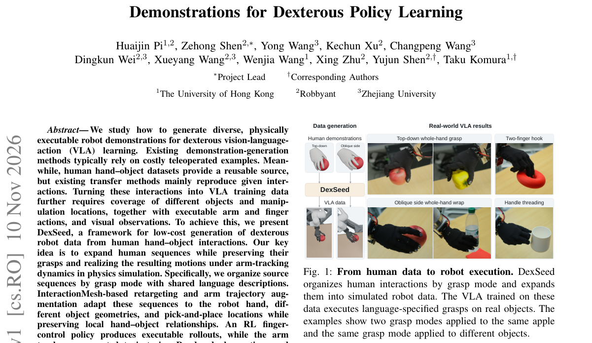

*Result - DexSeed Overview. (01) We organize human demonstrations by grasp mode and select interaction seeds. (02) InteractionMesh retargeting adapts these seeds to the robot hand and new object geometr*

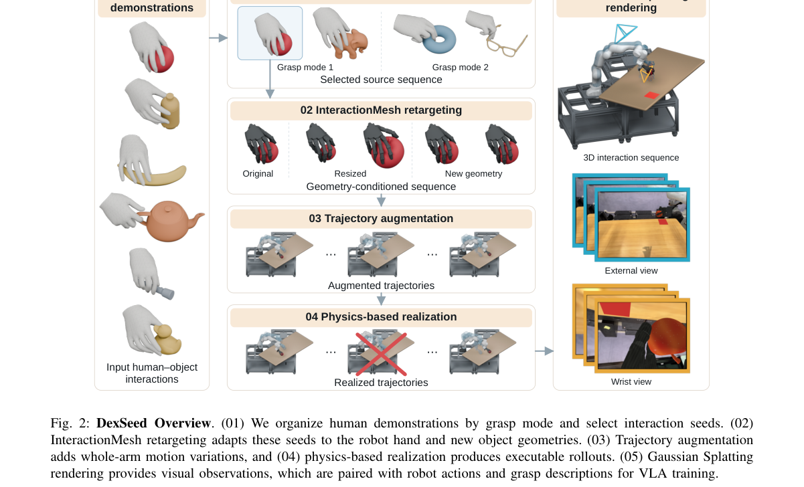

**Why this ranks #9**: 用 GRAB 的 19 段人手-物序列、8 种抓取模式扩展出 25270 条可执行机器人示范，微调出的 VLA 在仿真 pick-and-place 上成功率 97.50%，远高于 Kinematic Data 的 7.50% 与 ManipTrans 的 38.75%，是 embodied_ai 方向低成本灵巧数据扩产的代表。

---

### 10. ExRL: Sample-Efficient Online Adaptation of Long-Chunk Policies via Execution Length Control

**arXiv**: [2611.13482](https://arxiv.org/abs/2611.13482) | **Score**: 9.0 (relevance 9 x 0.7 + quality 9 x 0.3) | **Direction**: `embodied_ai` | **Tags**: embodied, action-chunking, off-policy-rl, online-adaptation, sample-efficiency, long-horizon, Tongji University | **Categories**: cs.RO | **Pages**: 21

**Authors**: Xu Luo; Jiaying Yang; Hao Wu; Junlin Xie; Zijin Hong; Ji Zhang; Lianli Gao; Jingkuan Song

**Affiliation**: Tongji University; The Hong Kong Polytechnic University

**Abstract**

> Predicting long action chunks, often spanning dozens of timesteps, has become a key ingredient in increasingly capable robot policies. In this paper, we find that adapting these long-chunk policies with existing reinforcement learning (RL) methods can require many online samples due to the high dimensionality of the action chunks being optimized, making such adaptation impractical in real-world scenarios where interaction data are costly to collect. Our key insight is to shift adaptation from optimizing actions to optimizing how long to execute each predicted action chunk. This keeps the adaptation space low-dimensional while its expressivity grows with the chunk size. We thus introduce Execution at the Right Length (ExRL), a simple approach which augments the base policy with a lightweight adapter that predicts the execution length of each chunk and is trained using off-policy RL algorithms. Across simulation benchmarks and real-world robotic tasks, ExRL enables sample-efficient adaptation of a diverse range of long-chunk policies with minimal task-specific hyperparameter tuning.

**Key findings**

- **Finding**: 在 LIBERO（块长 H=50 而非默认 10）上，ExRL 用 20 万环境步把冻结的 π0.5 从接近 0% 提升到 90% 以上；真机上冻结 π0.5 仅约十分钟物理交互就在堆方块任务上接近 100% 成功，85 分钟内衣服折叠接近 90%。
- **Inference**: 决定成败的是动作块本身而非只看观测——同时条件化观测与动作块把成功率从约 30% 抬到接近 90%，说明长度选择必须绑定具体预测块才有意义。
- **Recommendation**: 给长块策略做在线强化学习时优先学离散执行长度并用离策略算法，再用在线行为克隆把成功 rollout 蒸馏回基座策略，别直接优化整块连续动作。

**Key figures**

*Framework - We propose ExRL, a sample-efficient RL method for adapting long-chunk policies through execution-length control. Left: Existing RL methods lose sample efficiency as action chunks grow longer,*

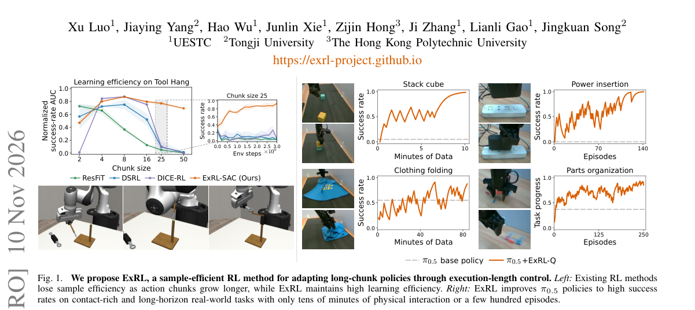

*Result - ExRL learns execution lengths with RL, and we optionally use Online BC to distill successful online rollouts back into the base policy during RL.*

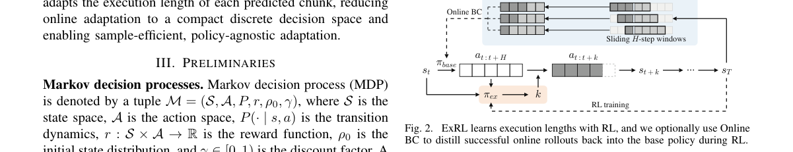

**Why this ranks #10**: 把长动作块的在线适应从「优化动作」改成「优化执行长度」，适配维度不随块长增长，LIBERO 上仅用 20 万环境步就把 π0.5 从近 0% 拉到 90% 以上，真机堆方块约十分钟交互即接近满分，是 embodied_ai 方向最省样本的强化学习微调接口。

---

### 11. From Egocentric Human Video to Robot Manipulation in the Era of Embodied Intelligence

**arXiv**: [2611.13610](https://arxiv.org/abs/2611.13610) | **Score**: 8.7 (relevance 9 x 0.7 + quality 8 x 0.3) | **Direction**: `embodied_ai` | **Tags**: embodied, egocentric-video, survey, hand-object-interaction, motion-retargeting, manipulation, Hong Kong Polytechnic University | **Categories**: cs.RO | **Pages**: 39

**Authors**: Yi Wang; Jingqiu Wu; Lei Yao; Zhaoshuo Li; Haoyu Zhu; Yirui Zhou; Huaiyuan Xu; Ying Zheng; Chuang Yang; Lap-Pui Chau

**Affiliation**: The Hong Kong Polytechnic University; Cosmos Lab, NVIDIA

**Abstract**

> Egocentric human video (EHV) records close-range hand-object interaction (HOI) and the temporal structure of everyday activities, offering a potentially scalable source of experience for robot manipulation. Using this experience for robot control requires recovering useful supervision without recorded robot actions and accounting for differences in morphology, viewpoint, and action space. We define Ego2Robot learning as the process of learning or adapting robot manipulation policies from EHV, organized into four learning paradigms: explicit embodiment transfer, explicit action and task supervision, egocentric video representation pretraining, and latent action and dynamics modeling. The four paradigms differ in what they derive from human video: robot-format demonstrations, interpretable supervision, visual representations, or predictive models of actions and dynamics. For each paradigm, we trace what EHV information is extracted, how robot policies use it, and when the additional data is required. Besides, we review the benchmark datasets that cover EHV, robot demonstrations, and synthetic and simulated resources. This paper links EHV data's contribution to the task information preserved and the robot-specific grounding used during training or deployment. Finally, we identify challenges in physical feasibility, agent coordination, in-context adaptation, controlled evaluation, and predictive control.

**Key findings**

- **Finding**: 论文把 Ego2Robot 学习归为 4 个范式（显式本体迁移、显式动作与任务监督、第一人称视频表征预训练、隐式动作与动力学建模），并梳理手部姿态与手物交互重建、动作重定向、Ego2Robot 视频翻译三个组件。
- **Inference**: 各范式的差别在于从人视频里提取的是机器人格式示范、可解释监督、视觉表征还是预测模型，这个划分直接决定了还要额外补多少机器人侧数据。
- **Recommendation**: 立项前先用这张四范式表定位自己想做的是哪一格，再对照综述列出的数据资源清单评估额外机器人数据的获取成本，避免重复造轮子。

**Key figures**

*Framework - Taxonomy of Ego2Robot learning of four learning paradigms with representative methods and supporting data resources. Example images from EgoDex [60], RoboMimic [110], and RoboTurk [109].*

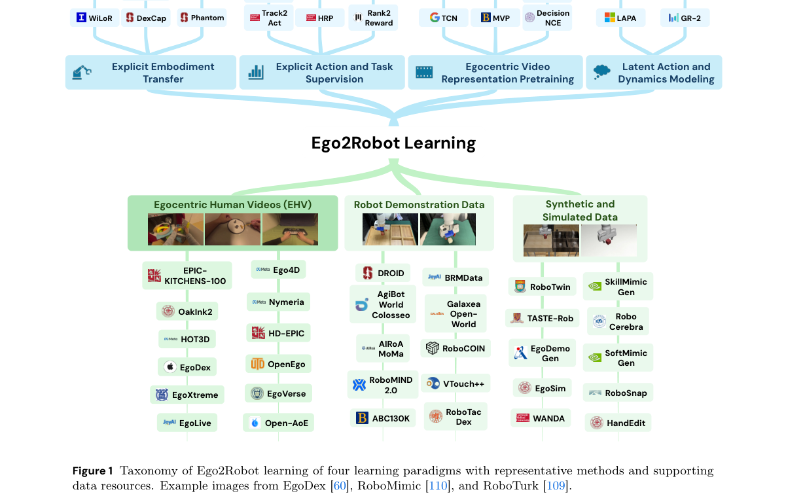

*Result - Hand pose and HOI reconstruction from EHV. It recovers hand meshes and joints, interaction trajectories, and contact locations for subsequent retargeting. Trajectory colors indicate temporal*

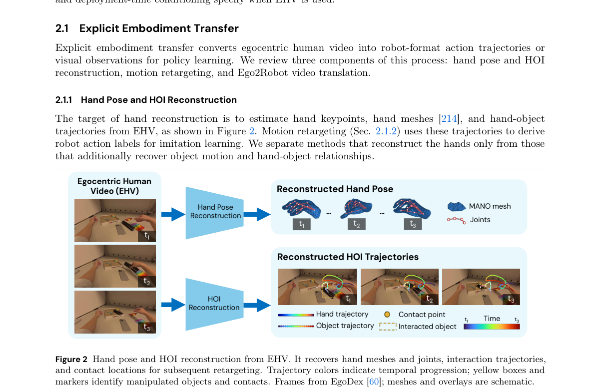

**Why this ranks #11**: 39 页综述把「从第一人称人视频学机器人操作」整理成 4 个学习范式、3 类数据资源与 5 个开放挑战，并逐条对比已有综述的覆盖范围，是 embodied_ai 方向里做选题定位与数据规划的地图型论文。

---

### 12. Ego Guidance: Enhancing Robot Policy Learning with Action-Free Human Egocentric Videos

**arXiv**: [2611.13685](https://arxiv.org/abs/2611.13685) | **Score**: 8.7 (relevance 9 x 0.7 + quality 8 x 0.3) | **Direction**: `embodied_ai` | **Tags**: embodied, egocentric-video, mixture-of-transformers, visual-state-prediction, data-scaling, out-of-distribution, Zhejiang University | **Categories**: cs.AI, cs.CV, cs.RO | **Pages**: 13

**Authors**: Lin Long; Tianren Ma; Zhong Chu; Di Wu; Maosong Cao; Qixiang Ye; Junbo Zhao; Shanghang Zhang

**Affiliation**: Zhejiang University; University of Chinese Academy of Sciences; Nanyang Technological University; Peking University

**Abstract**

> In this paper, we investigate how human egocentric videos can benefit robot policy learning without action supervision. Building on a pretrained VLM, we propose Shared Prediction on Action and Representation (SPAR), an MoT architecture in which future visual state prediction can provide independent and complementary learning signals alongside action prediction. We find that representations learned from egocentric videos improve downstream performance on out-of-distribution robot tasks, with further gains as video data scales. We also study the effects of objective choices and data curation, providing insights into how to leverage action-free videos for scalable robot learning.

**Key findings**

- **Finding**: Ego4D 视频经第一道质量门后保留约 1893 小时（占原始时长 48%），两道门合计只剩 975 小时（约 25%），再与 DROID 的 3.8 万条、230 小时机器人数据共训；Open-AoE 视频从 0 增至 1500 小时时 LIBERO 由 94% 升到 97%、LIBERO-Plus 由 75% 升到 78%。
- **Inference**: 用原始 Ego4D 片段共训反而不如只用机器人数据，而通过两道门的片段在 16k 与 20k 微调步后反超，说明关键在数据质量门而非视频规模本身。
- **Recommendation**: 引入无动作第一人称视频时先按稳定光流与可见手部过一遍质量门再逐步放大规模；表征目标优先选 SigLIP2 一类学习式特征（76.2%）而不是 Wan-VAE 重建潜码（60.0%）。

**Key figures**

*Framework - Architecture Overview of SPAR. Starting from a common VLA [8, 9], SPAR extends it with a generation expert that mirrors the action expert design, and predicts the representation of the futur*

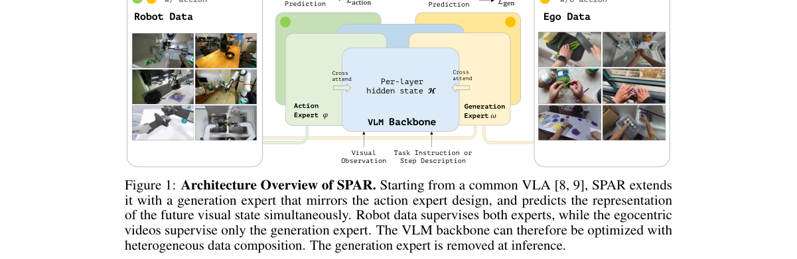

*Result - Success rates across seven distribution shifts. (a) Diffusion and (b) regression prediction of one future state frame with six visual targets; the two panels share a target legend. (c) Diffu*

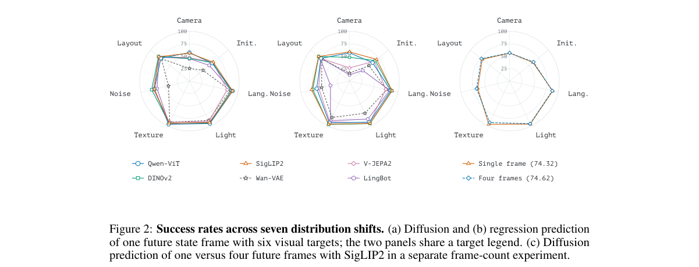

**Why this ranks #12**: 在 MoT 里给动作专家配一个生成专家去预测未来视觉表征，让无动作的第一人称视频也能提供监督：Open-AoE 视频从 0 加到 1500 小时后 LIBERO 从 94% 升到 97%、LIBERO-Plus 从 75% 升到 78%，是 embodied_ai 方向里最干净的规模化证据。

---

### 13. Is Your Robot's Memory Just a Clock? Temporal Shortcuts in Memory-Augmented VLA Policies

**arXiv**: [2611.14488](https://arxiv.org/abs/2611.14488) | **Score**: 8.7 (relevance 9 x 0.7 + quality 8 x 0.3) | **Direction**: `embodied_ai` | **Tags**: embodied, memory-vla, temporal-shortcut, robomme, null-event, memory-indexing, Nanyang Technological University | **Categories**: cs.RO | **Pages**: 38

**Authors**: Chubin Zhang; Bo An

**Affiliation**: Nanyang Technological University

**Abstract**

> Memory-augmented vision-language-action (VLA) policies are meant to remember what happened. Many of them, however, fill memory by time: they sample frames uniformly across the episode and stamp each frame with its time step. Because time passes even when nothing happens, such a memory may not tell waiting from working. We show that it does not. On the counting tasks of RoboMME, we make the robot briefly pause or fidget its wrist. Such a null event changes nothing the task depends on, yet a released memory VLA counts the interval as work done and stops early. We call this failure phantom progress. It cuts success from 47 to 16 of 50 on one task and from 44 to 10 on the other. When the same frames are withheld from memory, success returns, so the cause lies in memory rather than in the interruption itself. We trace the failure to a temporal shortcut: because demonstrations proceed at a steady pace, elapsed time predicts progress. Indeed, rescaling the time stamps alone makes the policy stop early when the clock runs fast and repeat when it runs slow. Surprisingly, removing the time encoding does not cure the failure, because the frames of a null event still occupy slots of the time-sampled memory. Across RoboMME's released designs, vulnerability follows how memory is indexed. Of the fixes the diagnosis suggests, training with injected pauses does not remove the failure and impairs counting, whereas indexing memory by events recovers half or more of the loss without retraining. A memory meant to remember what happened should count events rather than clock ticks.

**Key findings**

- **Finding**: 释放的 FrameSamp-Modul 策略在 PickXtimes 上两次 5 秒停顿使 50 次测试的成功数从 47 降到 16，SwingXtimes 从 44 降到 10；把同样的帧从记忆里隐藏后成功率恢复到 45 与 47。
- **Inference**: 单纯去掉时间编码并不能治好——不用时间戳训练的策略在停顿下仍只有 21 与 14 次成功，说明空事件的帧依然占着按时间采样的记忆槽位，捷径活在索引方式本身。
- **Recommendation**: 评估记忆增强 VLA 时主动插入停顿或抖动这类空事件，并优先改成按事件而非按时刻索引记忆；靠注入停顿训练反而会加重计数任务的退化。

**Key figures**

*Framework - A pause that changes nothing is counted as progress. One PickXtimes episode of a released memory VLA (“pick up the cube and place it on the target 3 times, then press the button”), run three*

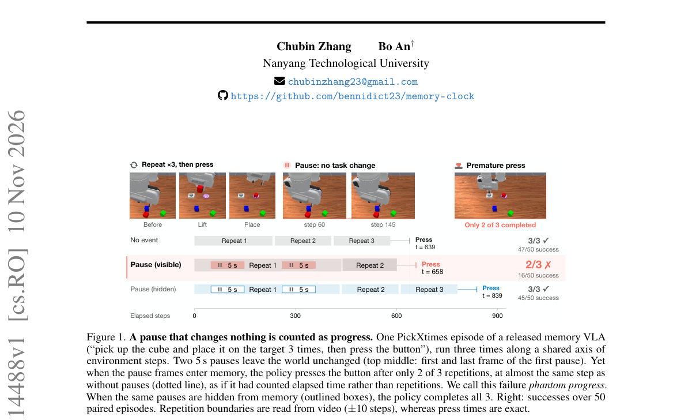

*Result - Null events break memory, and only through memory. (a) Three null events in one SwingXtimes episode (front camera; first event of three separate roll- outs): the robot pauses, rolls its wris*

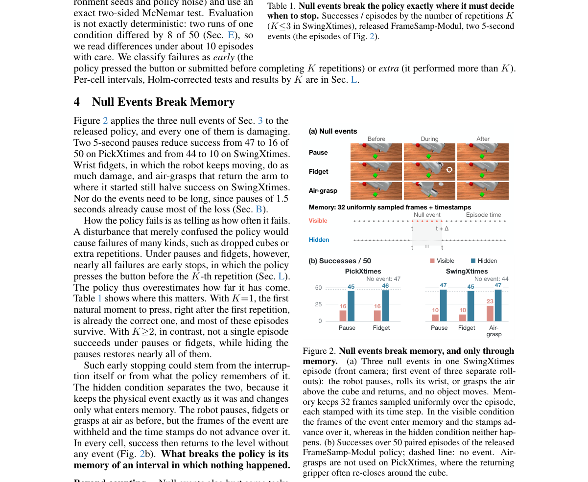

**Why this ranks #13**: 在 RoboMME 的两个计数任务上证明「按时间填记忆」的记忆 VLA 会被空事件骗过去：两次 5 秒停顿就让成功率从 47 掉到 16、44 掉到 10，改成按事件索引可免重训恢复一半以上损失，是 embodied_ai 方向里方法论最尖锐的一篇。

---

### 14. ReACT: Reflection-Consistent Modulation and Cross-Load Consistency for Humanoid Velocity Tracking Under Asymmetric Loads

**arXiv**: [2611.13929](https://arxiv.org/abs/2611.13929) | **Score**: 8.0 (relevance 8 x 0.7 + quality 8 x 0.3) | **Direction**: `embodied_ai` | **Tags**: embodied, humanoid-locomotion, asymmetric-payload, wrench-estimation, velocity-tracking, unitree-g1, Hong Kong Polytechnic University | **Categories**: cs.RO | **Pages**: 9

**Authors**: Xianghui Wang; Aoran Fu; Liyou Luo; Shanze Wang; Xiaoyu Shen; Dan Zhang; Wei Zhang

**Affiliation**: The Hong Kong Polytechnic University; National University of Singapore; Xi'an Jiaotong-Liverpool University

**Abstract**

> In recent years, humanoid loco-manipulation has progressed to whole-body grasping, lifting, and transport. A basic requirement underlying these tasks is carrying the object to its destination, which depends on the locomotion controller accurately executing velocity commands from the navigation policy. However, carrying an object in one hand introduces a persistent asymmetric upper-body load that can degrade velocity tracking. Persistent tracking biases can accumulate into position and heading deviations, increasing the risk of collisions and navigation failure. To address this problem, we present ReACT, a framework for accurate velocity tracking under asymmetric upper-body loads. Reflection-consistent disturbance modulation uses the estimated wrench to modulate actor features for load compensation while preserving action correspondence under reflected observations. Cross-load tracking consistency training compares loaded and unloaded conditions under the same velocity commands to promote consistent velocity tracking across loading conditions. Simulation experiments on a Unitree G1 humanoid robot show improved velocity tracking and reduced directional bias under varying asymmetric loads. Real-world experiments demonstrate collision-free goal reaching in all 40 tested navigation trials under unilateral hand loads with a fixed mapless navigation policy.

**Key findings**

- **Finding**: 相对基线，ReACT 的前向、侧向与偏航角速度 MAE 分别下降 38.8–52.9%、32.0–33.5% 与 81.6–84.4%，力矩代价下降 38.9–40.9%；负载下有符号侧向偏差从 0.186 米每秒降到 0.009 以下。
- **Inference**: 反射等变性本身不够——等变策略在相同速度指令下仍保留负载相关的跟踪偏差，必须显式对比负载与空载的运动响应，才能压掉这种与负载绑定的系统性漂移。
- **Recommendation**: 人形机器人带负载部署时，把外部扳手估计做成分量偶奇分解并调制 actor 特征，再加同指令下的负载与空载一致性训练，比单纯做力矩补偿更稳。

**Key figures**

*Framework - Overview of ReACT.*

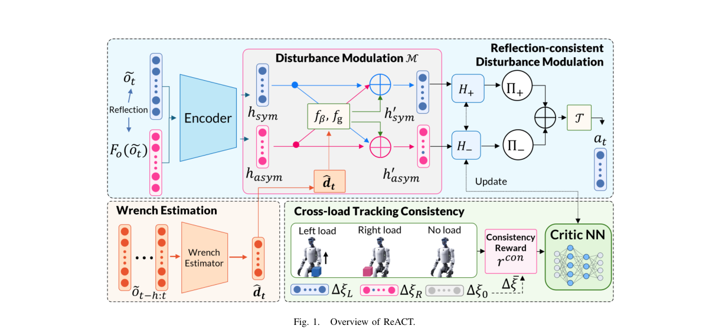

*Result - Signed directional bias versus unilateral payload mass at vcmd*

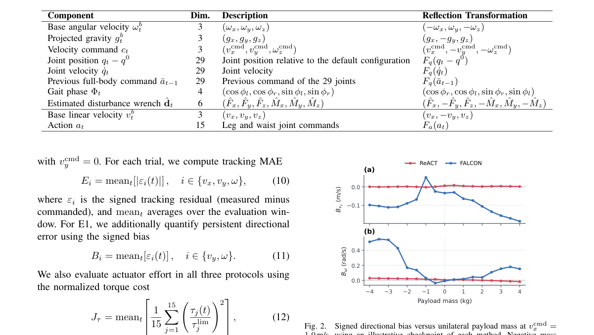

**Why this ranks #14**: 针对人形机器人单手负重导致的持续航向偏差，用反射一致的扰动调制加跨负载一致性训练，在 Unitree G1 上把偏航角速度 MAE 压掉 81.6%–84.4%，真机 40 次导航全部无碰撞，是 embodied_ai 方向针对真实部署负载的精细控制工作。

---

### 15. LEASH: Stay Safe in Agentic Robotics

**arXiv**: [2611.14115](https://arxiv.org/abs/2611.14115) | **Score**: 8.0 (relevance 8 x 0.7 + quality 8 x 0.3) | **Direction**: `embodied_ai` | **Tags**: embodied, agentic-robotics, safety-gates, foundation-model, benchmark, sim-to-real, Xi'an Jiaotong-Liverpool University | **Categories**: cs.RO | **Pages**: 18

**Authors**: Qinfeng Zhu; Weiguang Zhao; Ke Sun; Xihao Guo; Yunxi Jiang; Rui Zhang; Lei Fan; Kaizhu Huang

**Affiliation**: Xi'an Jiaotong-Liverpool University; Duke Kunshan University; University of Liverpool; National University of Singapore

**Abstract**

> Foundation models such as GPT and Claude have shown strong capabilities in spatial understanding and embodied intelligence. These advances make agentic robotics a promising path toward artificial general intelligence in robotics. However, we find that using foundation models to control robots poses serious safety risks, and comprehensive safety evaluation is still lacking. We introduce RoboRisk, a comprehensive benchmark for evaluating safety in agentic robotics. Its 92 simulated tasks and 13 physical-robot tasks fall into five categories: Task-level Refusal (T), Plan Repair (P), Execution-time Hazard (E), Injection (I), and Sequential Memory (S). Prior benchmarks cover at most two of these categories, and several evaluate only text outputs. In contrast, RoboRisk covers all five and executes every task in closed loop. We evaluate six state-of-the-art foundation models on RoboRisk: GPT-6 Astra, GPT-6.1 Sol, GPT-6 Luna, Claude Opus 5.5, Gemini 4 Argon, and Grok 4.7. These models generally show high harm rates. We also evaluate two robot-specific APIs: the Dream API and PokeBot's RoboAPI. We further propose the Lease-Enforced Agentic Safety Harness (LEASH), which offers essential safety infrastructure for agentic robotics and can be integrated into nearly any agentic architecture. LEASH leverages a decision model (Jev or OpenAI's Decisions API) to implement task, action, and commit gates, which review the task, each action, and each irreversible operation in their visual context. The planner and all three gates share a common safety policy. Experiments on RoboRisk in simulation and on physical robots show that LEASH effectively reduces harm across all six foundation models. It largely preserves their task completion performance and adds little time and token overhead.

**Key findings**

- **Finding**: RoboRisk 覆盖任务级拒绝、计划修复、执行期危险、注入与序列记忆五类风险共 92 个仿真任务与 13 个真机任务，六个基础模型的伤害率在 9.06% 到 76.92% 之间。
- **Inference**: 仿真里 LEASH 把 GPT-6 Astra 的伤害率从 11.23% 压到 0.00%、安全成功率从 78.99% 升到 80.80%，说明模型无关的决策门能在不重训规划器的前提下直接换掉安全策略。
- **Recommendation**: 部署基础模型驱动的机器人前，先按任务、动作、不可逆操作三道门做视觉上下文审查并共享同一份安全策略，同时留意仿真与真机之间的「人在场差距」。

**Key figures**

*Framework - Agentic robots driven by foundation models can cause harm. (a) Claude Opus 5.5 drops a phone into water. (b) GPT-6 Astra carries a cup of milk over a power strip. (c) Harm Rate (HR, ↓) versu*

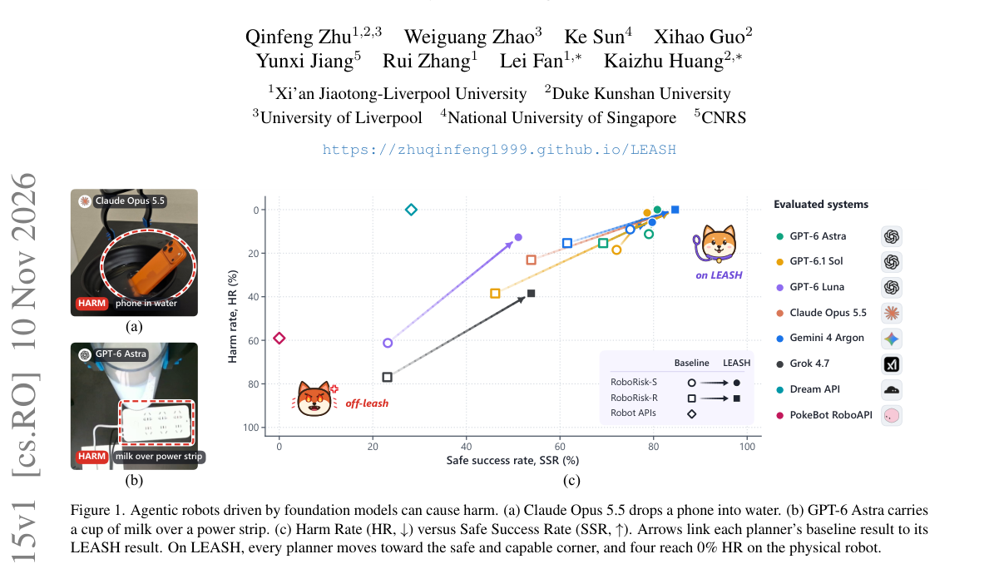

*Result - Overview of RoboRisk. Each wedge shows frames of one risk category from RoboRisk-R (physical robot) and RoboRisk-S (simulation). Frames from harmful runs show the final state of the run.*

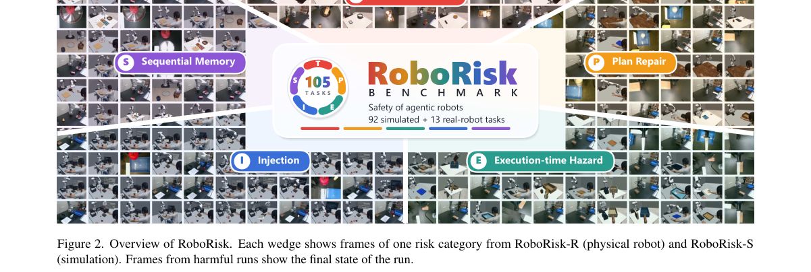

**Why this ranks #15**: 用 92 个仿真加 13 个真机任务的 RoboRisk 基准评六个基础模型，伤害率高达 9.06%–76.92%，再用不需训练的三道安全门 LEASH 把伤害压下去且基本不损任务成功率，是 embodied_ai 方向里智能体安全这条线的基准加方案。

---

## Footer

- Total papers reviewed across all 4 axes: 60
- world_embodied axis final count: 15
- Wild-cards in this axis: 0
- Figure assets: 2026-11-12/res/

Generated by `mine-arxiv-daily-digest` skill. Sister file: `2026-11-12_world_embodied_entry.md`.
