# Mine Arxiv Daily Digest - 2026-11-13 (AIGC 视觉生成与编辑 Axis, 12 papers)

**Generated**: 2026-11-13 10:46 CST

**Source**: arXiv cs.CV, cs.SD, eess.AS, cs.CL, cs.AI, cs.RO, cs.LG, cs.IR submissions, listing day 2026-11-11 (announced 2026-11-13 01:00 UTC)

**Batch window**: 2026-11-10T19:00:00Z .. 2026-11-11T19:00:00Z（arXiv 公告批次横跨两个 UTC 日：从前一日的美东 14:00 截止时刻起算（EDT 为 18:00Z，EST 为 19:00Z），到当日的同一时刻为止）

**Axis**: aigc_visual (12 papers, base 15, cap 20)

**Directions**: aigc_generation (5), aigc_editing (5), aigc_rl (2)

**Selection**: 12 papers ranked by relevance x quality, with 0 wild-card slots

**Day total**: 60 papers across 4 axes (target 60)

**Scope**: 图像 / 视频 / 3D / 4D 内容的生成与编辑，以及面向视觉生成的 RL / 偏好优化与奖励模型

**Wild-card**: 0 —— 本 axis 12 篇全部是补跑新增的够格论文，未启用任何 wild-card 名额。

**本 axis 从 0 篇补到 12 篇。** 当初那一轮只索引到批次的前 6.5 小时（`[2026-11-10T22:38:53Z, 2026-11-11T05:10:32Z]`，共 77 篇），正则扫描命中 0 篇 AIGC 论文；按完整批次（listing day 2026-11-11 窗口共 560 篇）重跑后，AIGC 侧共有 16 篇新候选过筛，其中 relevance ≥ 5 的 12 篇全部入选。

**但仍低于基准 15 篇，让出的名额交给了候选更充裕的 `llm_vlm`。** 完整批次里 AIGC 相关候选本身稀少：`aigc_generation` 5 篇、`aigc_editing` 5 篇、`aigc_rl` 只有 2 篇（relevance 7 与 6），没有任何一篇面向视觉生成的 RL 工作达到 rel ≥ 9。按「薄方向让出名额而不是被填充」的口径，三个方向都没有凑数。

---

## AIGC 生成（图像 / 视频 / 3D / 4D） · `aigc_generation` (5 papers)

本方向 5 篇全部是补跑新增，主线是**把生成模型放到更苛刻的物理与工程条件下**。ThermalSplat 证明在两视图热成像这种位姿估计彻底失效的输入上，前馈式 3D 重建（24.964 dB / 单次 80 ms）能反过来碾压逐场景优化（Thermal3DGS 11.889 dB，且需 15 到 25 分钟）；MatrixSplat 把 3DGS 渲染核从 ALU 密集改成 warp 级矩阵乘，Mip-NeRF 360 上从 156.0 FPS 提到 599.9 FPS；CoCode-World 证明多人视角一致性用「共享 3D proxy + 单分支宽度拼接」就够，不必为每个玩家单开分支再补交叉注意力（DOVER 0.524 对 Seedance 2.5 的 0.469，跨视角身份分 3.847 对 3.552）；Escaping the Curse of Dimensionality 给出单步 flow 模型的首个有原则收敛界 Õ(n^{-2β/(5β+2d)})，指数只取决于内在维度而非环境维度；Where to Generate Touch 则提醒离散 tokenizer 会在材质语义上掉 6.5 到 9.7 分，而 SD-VAE 只掉 0.3 分——重建 PSNR 看不出潜空间是否保住了语义。

### 1. ThermalSplat: Generalizable Pose-Free Gaussian Splatting for Sparse-View Thermal 3D Reconstruction

**arXiv**: [2611.15435](https://arxiv.org/abs/2611.15435) | **Score**: 7.7 (relevance 8 x 0.7 + quality 7 x 0.3) | **Direction**: `aigc_generation` | **Tags**: AIGC-visual, thermal-3d, gaussian-splatting, sparse-view, pose-free, feed-forward, Indian Institute of Technology Madras | **Categories**: cs.CV | **Pages**: 15

**Authors**: Prasanna S; Gopi Raju Matta; Divya Madhuri Vemunuri; Kaushik Mitra

**Affiliation**: Indian Institute of Technology Madras

**Abstract**

> Thermal infrared imaging is vital for applications like search-and-rescue and autonomous navigation, yet trans- lating it into 3D scene representations remains a critical bottleneck. The low-texture nature and view-dependent emissivity of thermal images cause standard pose estima- tors to fail catastrophically, collapsing standard 3D Gaus- sian Splatting pipelines under sparse-view constraints. Fur- thermore, existing thermal reconstruction methods rely heavily on dense capture and computationally expensive per-scene optimization. Critically, many of these ap- proaches depend on aligned RGB-thermal datasets to ob- tain reliable camera poses and initial point clouds, ren- dering them unusable in purely thermal, unposed envi- ronments. To break this bottleneck, we present Thermal- Splat, the first generalizable, feed-forward Gaussian splat- ting framework that reconstructs 3D scenes directly from sparse thermal images without requiring known camera poses, RGB guidance, or per-scene training. We over- come thermal-specific challenges using a soft census loss for brightness-invariant structural matching and a bound- ary structure loss to explicitly supervise temperature discon- tinuities. Trained on an aggregated multi-source dataset, ThermalSplat synthesizes sharp reconstructions of unseen scenes in a single feed-forward pass. Extensive experi- ments demonstrate that ThermalSplat holds a strict advan- tage over scene-specific thermal splatting methods in the sparse regime. Furthermore, even compared against these baselines operating under their ideal dense capture set- tings, ThermalSplat achieves superior perceptual fidelity. By eliminating the need for computationally expensive per scene optimization, ThermalSplat offers an efficient and generalizable approach to thermal 3D reconstruction.

**Key findings**

- **Finding**: 两视图稀疏设定下 ThermalSplat 平均 24.964 dB PSNR、0.8194 SSIM、0.2092 LPIPS，而 Thermal3DGS 降到 11.889 dB、ThermalGaussian 15.161 dB、PhysIR 19.025 dB。
- **Inference**: 逐场景优化路线依赖稠密多视图与已知位姿，在极稀疏输入下结构性失效，而预训练几何先验加前馈推理可以绕开这一失效点。
- **Recommendation**: 面向无位姿、无 RGB 引导的热成像 3D 任务，优先采用 ThermalSplat 这类前馈方案（80 ms，而逐场景优化需约 15 到 25 分钟）。

**Key figures**

*Result - Qualitative comparison under the sparse two-view setting against scene-specific optimization-based thermal reconstruction methods. When restricted to highly sparse inputs, existing thermal b*

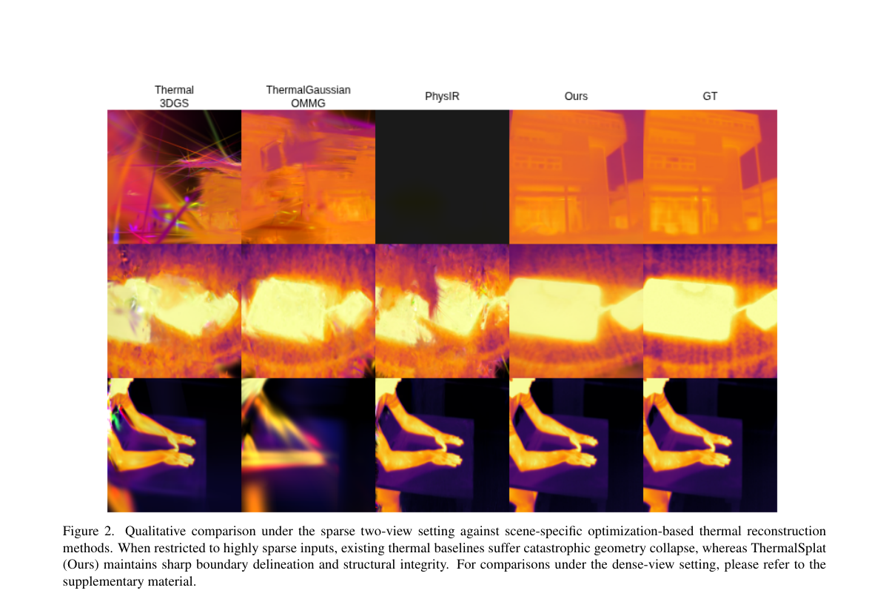

**Why this ranks #1**: 热成像低纹理使位姿估计在两视图稀疏下彻底失效：COLMAP、VGGT、VGGSfM 注册图像数全为 0。ThermalSplat 单次前向 80 ms 即得 24.964 dB PSNR 与 0.8194 SSIM，而同输入下逐场景优化的 Thermal3DGS 仅 11.889 dB、PhysIR 仅 19.025 dB。

---

### 2. CoCode-World: Shared 3D Proxy Representation for Multi-Player World Models

**arXiv**: [2611.15602](https://arxiv.org/abs/2611.15602) | **Score**: 7.4 (relevance 8 x 0.7 + quality 6 x 0.3) | **Direction**: `aigc_generation` | **Tags**: AIGC-visual, multiplayer-world-model, cross-view-attention, lora-adapter, proxy-video, game-engine, Shanghai Jiao Tong University | **Categories**: cs.CV | **Pages**: 13

**Authors**: Qirui Li; Xin Zhang; Yabo Chen; Jinkun Hao; Paul L Rosin; Yu-Kun Lai; Haibin Huang; Yin Chen; Ran Yi; Chi Zhang

**Affiliation**: Shanghai Jiao Tong University; Institute of Artificial Intelligence, China Telecom (TeleAI); Cardiff University

**Abstract**

> Multiplayer generative world models must produce observations that agree on shared entities despite different camera motions and occlusions. Explicit world representations provide spatial control, but precise modeling of individual game maps limits scene diversity, while shared geometry alone cannot ensure consistent appearance across views. We present CoCode-World, a shared 3D proxy framework that separates structural control from visual synthesis for two-player video generation. Programmable proxies specify scene layout, motion, and occlusion, while RGB references guide character and scene appearance. To coordinate visual details across players, we concatenate paired proxy videos, appearance references, and target views in a consistent spatial layout and generate both views jointly with a pretrained video model. This formulation uses the model's native attention for cross-view communication within a single generation branch, with LoRA adaptation learning proxy adherence and appearance correspondence from paired observations. We construct a two-player GTA~V dataset that pairs synchronized RGB observations with proxy videos derived from shared map geometry and game-engine state. Experiments demonstrate appearance transfer to characters and scene styles unseen during training, with improvements in video quality and cross-view player identity over the evaluated baseline. Ablations further examine how proxy construction and cross-view communication affect generation. Project page: https://iapple233.github.io/CCW/.

**Key findings**

- **Finding**: 150 个双人用例基准上本方法 DOVER 0.524、LAION 5.655、Edge F1 0.124、跨视角身份分 3.847，全面高于 Seedance 2.5 的 0.469、5.568、0.120 与 3.552。
- **Inference**: 两个玩家被拼进同一条生成分支后，预训练视频模型的原生注意力即可承担跨视角外观通信，双分支加交叉注意力的方案反而落后。
- **Recommendation**: 做多人视角一致性生成时优先用共享 proxy 加单分支宽度拼接，而不是为每个玩家单开分支再补交叉注意力模块。

**Key figures**

*Framework - Two-player views of a shared game world. Paired views illustrate environment interaction, combat, exploration, and vehicle riding. Each pair shows the scene from the two players’ perspectives*

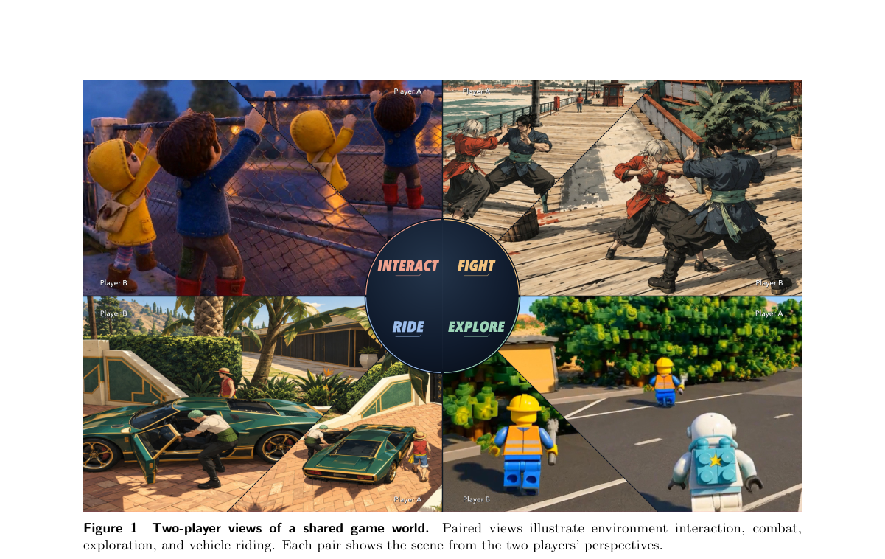

*Result - Joint two-player rendering. Map geometry and entity observations produce a proxy for each camera. The two proxy views share a fixed left–right layout with the RGB appearance reference and tar*

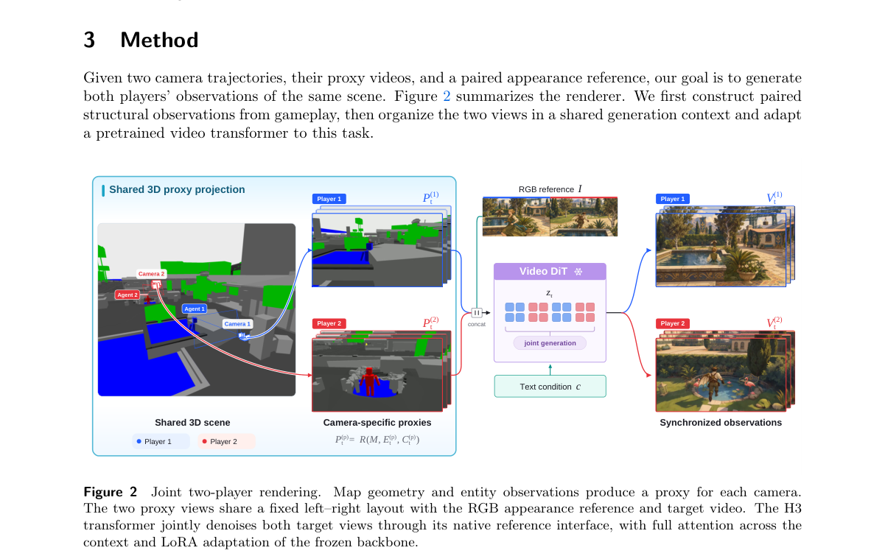

**Why this ranks #2**: 冻结 MiniMax-H3 33B Ref2VA 骨干并只训 LoRA，把共享 3D proxy 视频沿宽度拼接后联合生成两个玩家视角。在 150 个双人用例基准上 DOVER 0.524、跨视角玩家身份分 3.847，均高于 Seedance 2.5 的 0.469 与 3.552。

---

### 3. MatrixSplat: Matrix-Parallel and Feature-Scalable 3D Gaussian Splatting Rendering on GPUs

**arXiv**: [2611.15153](https://arxiv.org/abs/2611.15153) | **Score**: 7.0 (relevance 7 x 0.7 + quality 7 x 0.3) | **Direction**: `aigc_generation` | **Tags**: AIGC-visual, gaussian-splatting, tensor-core, matrix-parallel, semantic-features, rendering-acceleration, University of Texas at Arlington | **Categories**: cs.CV | **Pages**: 18

**Authors**: Yangming Zhang; Siyi Wu; Jian Wang; Bingzhe Li; Wei Niu; Sheng Di; Ming Li; Miao Yin

**Affiliation**: The University of Texas at Arlington; Snap Inc.; The University of Texas at Dallas; Argonne National Laboratory

**Abstract**

> 3D Gaussian Splatting (3DGS) has emerged as a mainstream representation for real-time novel view synthesis and 3D reconstruction. However, existing 3DGS rendering pipelines are poorly aligned with modern GPU architectures: depth-sorted alpha compositing introduces strong per-pixel sequential dependencies, limiting parallelism and resulting in scalar FMA-dominated execution that underutilizes high-throughput matrix units such as Tensor Cores. This mismatch becomes more severe for multimodal and semantically enriched 3DGS, where high-dimensional features must be accumulated from millions of Gaussians, leading to rapidly increasing computation and memory costs. We propose MatrixSplat, a matrix-parallel rendering framework for feature-scalable 3DGS on modern GPUs. We first identify the sequential dependency of alpha compositing as a key obstacle to efficient high-dimensional feature rendering, and adopt an order-independent weighted accumulation formulation that transforms feature rendering into matrix-oriented computation. Our framework features three key designs: (i) a tile-based splatting pipeline that maps feature accumulation to warp-level matrix-multiply-accumulate execution on Tensor Cores; (ii) a warp-granularity Gaussian packing strategy that mitigates visibility irregularity and improves feature reuse; and (iii) a lazy channel-batched feature-fetching pipeline that reduces shared-memory pressure, maintains high warp occupancy, and overlaps memory access with matrix execution for high-dimensional features. On Mip-NeRF 360, LERF, and 3D-OVS, MatrixSplat achieves up to 3.8$\times$ speedup over 3DGS and 2$\times$ over TC-GS while maintaining rendering quality and semantic accuracy, and further reduces render-kernel time by up to 36.7$\times$ for high-dimensional features. Integrated into existing fast renderers, it provides an additional 1.69-2.84$\times$ speedup.

**Key findings**

- **Finding**: Mip-NeRF 360 上 3DGS 为 156.0 FPS、3DGS 加 TC-GS 为 295.1 FPS，MatrixSplat 达 599.9 FPS，同时 mIoU 从 0.536 升到 0.541、定位准确率从 0.698 升到 0.730。
- **Inference**: 只有移除 alpha 合成的顺序依赖，特征累积才能整体表达为矩阵乘，这才真正吃到 Tensor Core 的高吞吐而非只搬动 alpha 计算。
- **Recommendation**: 要在多模态语义特征下做实时渲染，优先改造渲染核的执行方式，即 warp 级 MMA 配合 8 通道分批的懒加载取特征，而不是继续压缩特征维度。

**Key figures**

*Framework - SM utilization of 3DGS render- ing. Rendering is dominated by ALU and FMA (FP32), leaving Tensor Core never utilized.*

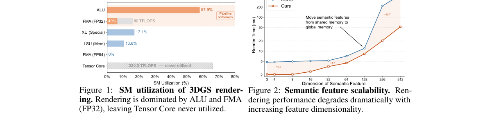

*Result - Semantic feature scalability. Ren- dering performance degrades dramatically with increasing feature dimensionality.*

**Why this ranks #3**: 剖析显示 3DGS 渲染时 ALU 占用 57.9%、Tensor Core 使用率为 0，其 330.3 TFLOPS 峰值完全闲置。改用顺序无关的加权累加把特征累积映射到 warp 级 MMA 后，Mip-NeRF 360 上由 156.0 FPS 提升到 599.9 FPS，高维特征下渲染核时间最多缩短 36.7 倍。

---

### 4. Escaping the Curse of Dimensionality in One-Step Flow-Based Generative Models

**arXiv**: [2611.15447](https://arxiv.org/abs/2611.15447) | **Score**: 7.0 (relevance 7 x 0.7 + quality 7 x 0.3) | **Direction**: `aigc_generation` | **Tags**: AIGC-visual, consistency-model, flow-map, curse-of-dimensionality, low-rank-manifold, self-distillation, HSE University | **Categories**: cs.LG, math.ST | **Pages**: 52

**Authors**: Konstantin Yakovlev

**Affiliation**: HSE University

**Abstract**

> Flow and diffusion-based generative models achieve state-of-the-art quality, but require multiple forward passes at inference time, making them computationally costly. Consistency models overcome this by learning a flow map directly, enabling few-step generation and dramatically reducing the computation needed at test time. However, formal statistical guarantees for such one-step generators are scarce. Existing results either suffer from the curse of dimensionality or rely on impractical loss functions. We investigate whether one-step flow-based models can escape the curse of dimensionality under the assumption that the data distribution is generated by a low-dimensional surface perturbed with Gaussian noise. In this setup, we derive approximation and generalization error bounds for the flow map estimate that circumvent the curse of dimensionality. Our findings provide the first principled explanation for practical success of one-step flow-based generative models.

**Key findings**

- **Finding**: 论文证明自蒸馏得到的 flow map 估计器收敛上界为 Õ(n^{-2β/(5β+2d)})，其指数由内在维度 d 决定而不含环境维度 D。
- **Inference**: 只要真实数据近似低维流形被高斯噪声扰动，单步生成就能绕开维度灾难，这为少步生成模型在实践中的成功提供了首个有原则的解释。
- **Recommendation**: 评估少步生成模型时不要再用含环境维度 D 的速率界，而应显式建模内在维度 d，并优先考虑自蒸馏而非需要训练 O(D^{5/2}/ε) 个模型的迭代方案。

**Why this ranks #4**: 在数据分布为低维流形加高斯噪声的假设下，给出自蒸馏 flow map 估计器 Õ(n^{-2β/(5β+2d)}) 的收敛上界，指数只取决于内在维度 d。对照之下，Li 等人的迭代一致性模型需要从零训练 O(D^{5/2}/ε) 个模型，实际不可行。

---

### 5. Where to Generate Touch: Do Image Latents Preserve Material Recognition?

**arXiv**: [2611.15834](https://arxiv.org/abs/2611.15834) | **Score**: 6.0 (relevance 6 x 0.7 + quality 6 x 0.3) | **Direction**: `aigc_generation` | **Tags**: AIGC-visual, tactile-generation, latent-space-selection, material-recognition, sd-vae, gelsight, University of Maryland | **Categories**: cs.CV, cs.RO | **Pages**: 13

**Authors**: Wanghao Ye; Aarosh Das; Sihan Chen; Yiting Wang; Bowei Tian; Guoheng Sun; Shwai He; Zheyu Shen; Ziyao Wang; Yexiao He; Zhaoyi Liu; Meng Liu

**Affiliation**: University of Maryland, College Park; Carnegie Mellon University; Stanford University; Texas A&M University

**Abstract**

> Generated touch could extend robot learning beyond recorded contacts. A tactile generator needs a latent space, and we choose one by testing whether a material classifier trained on real GelSight presses still works on encode-decode reconstructions from pretrained image models. On ObjectFolder Real, the classifier loses 6.5 to 9.7 points on reconstructions from three 16x discrete tokenizers and 0.3 points on those from the Stable Diffusion VAE (SD-VAE). The 16x tokenizers again lose far more on Touch and Go and on DIGIT object recognition (YCB-Slide). Retraining the classifier on reconstructions, with no new labels, narrows the discrete gap. SD-VAE reconstructions also keep object identity, with 76.7% object-matching accuracy against 78.9% for real touch and 67.0% for MAGVIT-v2. We therefore select SD-VAE latents and show a photo-to-touch generator trained in them. Code will be released upon acceptance.

**Key findings**

- **Finding**: 三个 16 倍离散 tokenizer 使材料分类准确率分别下降 6.5、9.7、8.1 分，SD-VAE 仅下降 0.3 分，且接触图相关系数离散为 0.87 到 0.91、SD-VAE 为 0.98。
- **Inference**: 匹配对照显示 16 倍下离散版本比连续版本多掉 7.6 分，损失主要来自量化而非下采样，因此重建 PSNR 无法判断潜空间是否保住了材质语义。
- **Recommendation**: 为新模态挑选生成潜空间时，先做一次编解码加下游分类器迁移测试再决定用连续 VAE 还是离散 tokenizer，不要只看重建 PSNR。

**Key figures**

*Framework - Choosing a representation and generating touch. A1 ObjectFolder Real recordings. A2 Continuous and discrete reconstructions with PSNR. A3 Real-trained material accuracy on 71 objects, family*

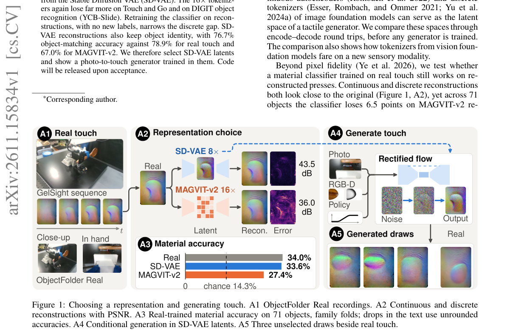

*Result - Representation quality and probe recovery. B1–B3 Mean PSNR, median contact correlation and material drop on 2,093 OF-Real presses; B3 filled/open markers: real→reconstruction/reverse transfe*

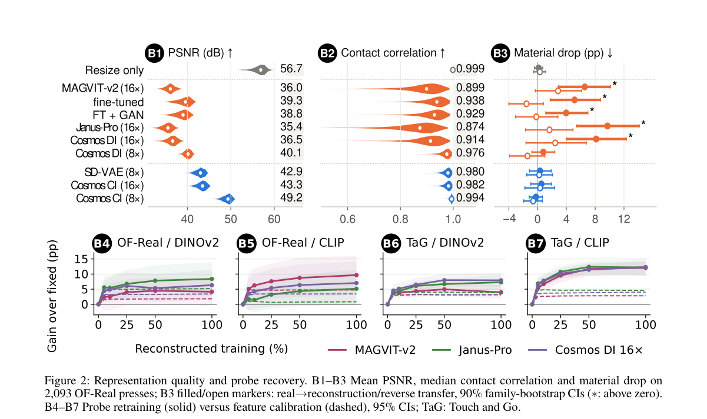

**Why this ranks #5**: 在同一批真实 GelSight 按压上做编解码迁移测试：ObjectFolder Real 的 71 个物体、2,093 次按压中，三个 16 倍离散 tokenizer 让材料分类器掉 6.5、9.7、8.1 分，而 SD-VAE 只掉 0.3 分；YCB-Slide 上离散 tokenizer 掉 21.1 到 28.0 分，SD-VAE 仅 1.2 分。

---

## AIGC 编辑（指令编辑 / 修补 / 个性化） · `aigc_editing` (5 papers)

本方向 5 篇全部新增，覆盖 SDR→HDR、动态压缩感知、文字超分、图像分解与水下增强五类编辑／复原任务。Reframing Video Inverse Tone Mapping 把逆色调映射重写成未知色调算子下的盲后验推断，用可观测性门控的非对称 expectile 损失在六个算子上把平均亮度误差压到 0.141（公开方法 0.179 到 0.341）；Learning Motion-Appearance Coupling Priors 指出光度与扭曲类约束等价于假设运动残差是高斯的，改为显式学其分布后 4 倍欠采样动态压缩感知从 28.3 dB 提到 44.50 dB；Reading the Unreadable 用 ReasonText 基准证明 12 个超分模型在 Level 2（必须靠推理才能读出）上的最高 GTTCA 只有 24.54%，低于任何模型 Level 1 的最低 45.72%，瓶颈是推理信息缺失而不是渲染能力；Image Deblending with Diffusion Models 用二阶多项式把 alpha 的参数空间从逐像素降到 6 个系数以避免边缘窃取，未见域 Vehicles 上已知标量混合达 20.23 dB（监督式 BIDeN 只有 15.44 dB）；WaveFlow-UIE 把水下增强搬进小波域做流匹配，LPIPS 0.1390 全场最佳且单张推理只要 79.31 ms（DiffWater 用 2000 步需 38437.57 ms）。

### 6. Reframing Video Inverse Tone Mapping as Blind Posterior Inference via Latent Luminance Supervision

**arXiv**: [2611.15146](https://arxiv.org/abs/2611.15146) | **Score**: 7.7 (relevance 8 x 0.7 + quality 7 x 0.3) | **Direction**: `aigc_editing` | **Tags**: AIGC-visual, inverse-tone-mapping, hdr-video, video-diffusion, luminance-error, expectile-loss, Seoul National University | **Categories**: cs.AI, cs.CV | **Pages**: 23

**Authors**: Hanwool Sul; Chang-Hoon Jeong; Kisung Shin; Bomseok Park; Donghoon Cha; Hansl von Kwon; DoHyung Ku; Byoung-Tak Zhang

**Affiliation**: Seoul National University

**Abstract**

> High-dynamic-range (HDR) displays are now common, but most video content, such as archival footage, broadcast material, and the output of generative video models, exists only in standard dynamic range (SDR). The need is sharpest for generated video, which has no HDR master at all and is graded alongside live-action and visual-effects material finished in HDR. Converting SDR to HDR means undoing a tone-mapping operation that was never recorded, and clipping destroys the radiance wherever it acts, so HDR recovery is a blind inverse problem. Methods built on generative video priors fill clipped regions with plausible structure, but their reconstructions are systematically biased: in every public method we test, saturated content leans too bright or too dark, and the direction of the lean moves with the tone operator behind the input. We call this failure the luminance error, measure both its magnitude and its sign, and make it the focus of this work. Reframing ITM as posterior inference under an unknown operator locates the failure in two places and yields two corrections. A fixed affine functional of the video-diffusion latent reads log-luminance without decoding; on that coordinate an asymmetric loss selects an expectile of the posterior, applied only where clipping leaves luminance unconstrained. We also synthesize training SDR through an explicit family of tone operators, so the model marginalizes over what the observation cannot show. Trained this way, our luminance error stays flatter across operators and smaller on average than any public method, and the full system achieves the best perceptual quality on all three benchmarks.

**Key findings**

- **Finding**: 公开方法的亮度偏差随输入算子改变，从硬裁剪下的 +0.09 漂移到 ACES 渲染下的 −0.26；本方法在六个算子上平均亮度误差 0.141，公开方法为 0.179 到 0.341。
- **Inference**: 偏差方向跟随算子说明模型学到的是条件均值而非后验，只有用可观测性门控的非对称 expectile 损失，才能在裁剪区挑到不偏亮也不偏暗的后验分位。
- **Recommendation**: 评估逆色调映射时不要重拟合响应曲线，并改用仅做曝光对齐的协议，否则标准 PSNR 与 SSIM 会把方向性亮度偏差完全掩盖。

**Key figures**

*Result - The same crop re-exposed. Each tile is linear 2EV with 2.2 gamma, so highlights that kept detail separate from highlights filled with a constant. Solid rows are the produced scale, dashed ro*

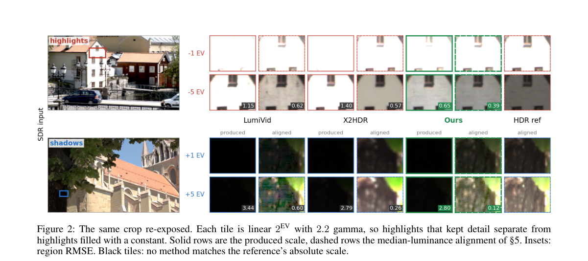

**Why this ranks #6**: 把 SDR 转 HDR 重构为未知色调算子下的盲后验推断：在未参与拟合的片段上，用视频扩散潜变量的固定仿射泛函直读对数亮度可得 R² 为 0.96，而最佳单个主成分只有 0.27；经五个算子族边缘化训练后平均亮度误差 0.141，优于公开方法的 0.179 到 0.341。

---

### 7. Learning Motion-Appearance Coupling Priors for Solving Video Inverse Problems

**arXiv**: [2611.15420](https://arxiv.org/abs/2611.15420) | **Score**: 7.7 (relevance 8 x 0.7 + quality 7 x 0.3) | **Direction**: `aigc_editing` | **Tags**: AIGC-visual, video-inverse-problems, motion-prior, diffusion-regularizer, cardiac-mri, temporal-consistency, School of Computation | **Categories**: cs.CV, cs.LG, eess.IV | **Pages**: 28

**Authors**: Anselm Krainovic; Reinhard Heckel

**Affiliation**: School of Computation, Information and Technology, Technical University of Munich

**Abstract**

> Reconstructing video from degraded measurements requires priors that capture both frame appearance and temporal dynamics. Many recent approaches combine pretrained image diffusion priors with motion guidance, sidestepping the costs of training large video models. Temporal consistency is often enforced via photometric losses or warping-based constraints, which implicitly assume that motion explains frame-to-frame or latent-to-latent changes up to small deviations, an assumption that fails under occlusions, lighting changes, and non-rigid deformation. In this paper, we propose to learn the coupling between motion and frame appearance as a generative prior. We learn the distribution of motion-induced appearance residuals with a conditional diffusion model and use it to regularize reconstruction in video inverse problems. Our motion-appearance prior acts as a plug-in regularizer for diffusion-based video reconstruction, preserving the benefits of image diffusion models while remaining compatible with existing appearance regularization techniques. Experiments on dynamic video inverse problems show that reconstruction with a learnt motion-appearance coupling prior outperforms photometric-consistency and noise-warping baselines, and that the approach also transfers to cardiac MRI reconstruction.

**Key findings**

- **Finding**: 4 倍欠采样动态压缩感知任务上本方法重建 44.50 dB，而随机噪声为 28.1 dB、积分噪声扭曲为 28.3 dB、置信度加权光度一致性为 40.21 dB。
- **Inference**: 光度与扭曲类约束等价于运动残差的简单高斯或拉普拉斯假设，而真实遮挡、光照变化与非刚性形变产生的是结构化非高斯残差，必须显式建模其分布。
- **Recommendation**: 做运动引导的视频逆问题时不要只依赖光流扭曲或光度损失，应把扭曲残差当作分布来学，并优先用变分后验拟合而非逐步后验采样来求解。

**Key figures**

*Framework - Reconstruction with a motion-appearance coupling prior outperforms noise warping and photometric consistency baselines. We consider the problem of reconstructing a video from a 4× undersampl*

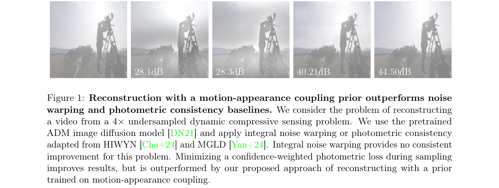

*Result - Noise warping and photometric consistency baselines exhibit appearance or motion artifacts on dynamic compressive sensing. We consider the task of dynamic compressive sensing, and present th*

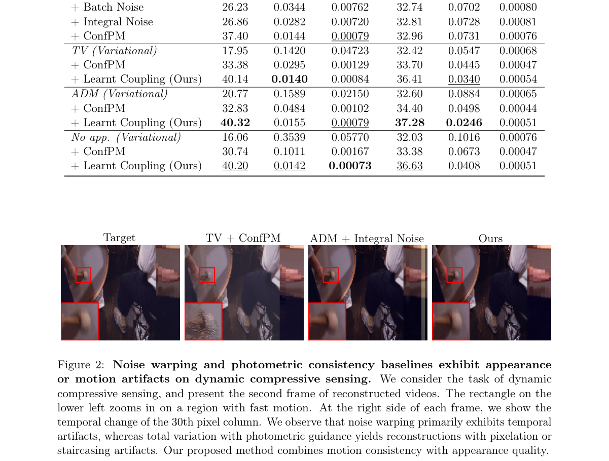

**Why this ranks #7**: 在 4 倍欠采样的动态压缩感知上，用预训练 ADM 图像扩散先验加学到的运动外观耦合先验重建达 44.50 dB，而积分噪声扭曲只有 28.3 dB、置信度加权光度一致性基线为 40.21 dB；该先验是即插即用的，并可迁移到心脏 MRI 重建。

---

### 8. Reading the Unreadable: Text-Aware Image Super-Resolution Needs Reasoning

**arXiv**: [2611.15449](https://arxiv.org/abs/2611.15449) | **Score**: 7.7 (relevance 8 x 0.7 + quality 7 x 0.3) | **Direction**: `aigc_editing` | **Tags**: AIGC-visual, text-aware-super-resolution, reasoning, gttca-metric, mllm-caption, benchmark, CIPLAB | **Categories**: cs.AI, cs.CV | **Pages**: 23

**Authors**: Jaeseong Lee; Jinwoo Kim; Jinho Jeong; Seon Joo Kim

**Affiliation**: CIPLAB, Yonsei University

**Abstract**

> Text-aware image super-resolution (TAISR) aims to recover high-resolution images from low-resolution inputs while preserving textual content. Existing methods treat this as a visual restoration problem, yet severely degraded text often cannot be read from local visual evidence alone. Humans instead read it by reasoning over image context, logical patterns, and prior knowledge. This raises a fundamental question: Does TAISR need reasoning? To answer this, we introduce two diagnostic tools. The first, ReasonText, is a human-curated benchmark that separates reasoning-required text from locally recoverable text. The second, Ground-Truth Text-Crop Accuracy (GTTCA), is a recognition-based metric that measures text restoration quality without text detection errors. Evaluating twelve recent super-resolution (SR) models, we find a consistent and substantial performance drop on reasoning-required text, revealing a systematic blind spot. Two observations point to a remedy. One is that text-conditioned SR models restore text substantially better when given ground-truth text. The other is that multimodal large language models (MLLMs) can read degraded text in low-resolution images through reasoning. We therefore propose Reasoning Transfer via Captioning (RTC), a training-free plug-in that uses an external MLLM to infer the degraded text and feeds the resulting caption to a text-conditioned SR model. RTC consistently improves all six text-conditioned SR models we evaluate, especially on reasoning-required text. Surprisingly, a real-world SR model with RTC can even outperform the TAISR model with RTC, suggesting that reasoning should be a core design axis for future TAISR.

**Key findings**

- **Finding**: 12 个模型在 ReasonText 上 GTTCA 全部断崖式下跌，最低 Level 1 得分 45.72% 仍高于最高 Level 2 得分 24.54%，高清真值在 Level 2 上为 90.69%。
- **Inference**: 把真值文本作为 caption 注入后，DiT4SR 的 Level 2 得分从 24.54% 升到 46.71%，SUPIR 从 22.57% 升到 40.37%，UniT 从 24.12% 升到 40.42%，说明瓶颈是推理信息缺失而非渲染能力。
- **Recommendation**: 评估文字超分应用免检测误差的 GTTCA 类指标，且不要用 PSNR 或 SSIM 代理文本还原质量，论文测得 PSNR 与 GTTCA 的 Pearson 相关仅 −0.1566。

**Key figures**

*Result - ReasonText addresses gaps in existing TAISR benchmarks. (a) SA-Text-test assigns difficulty at the image level via three degradation strengths, which does not indicate whether each instance*

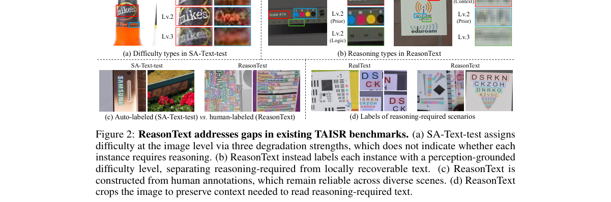

**Why this ranks #8**: 新构建的 ReasonText 基准含 513 对低清高清图、2,463 个文本实例，其中 709 个属于必须靠推理才能读出的 Level 2。12 个超分模型在 Level 2 上的最高 GTTCA 仅 24.54%，仍低于任何模型最低的 Level 1 得分 45.72%，而高清真值可达 90.69%。

---

### 9. Image Deblending with Diffusion Models

**arXiv**: [2611.15760](https://arxiv.org/abs/2611.15760) | **Score**: 7.7 (relevance 8 x 0.7 + quality 7 x 0.3) | **Direction**: `aigc_editing` | **Tags**: AIGC-visual, alpha-deblending, diffusion-posterior-sampling, training-free, cross-negative-prompting, blind-inverse, Reichman University | **Categories**: cs.CV | **Pages**: 22

**Authors**: Dan Botchan; Ohad Fried; Yacov Hel-Or

**Affiliation**: Reichman University, Herzliya, Israel

**Abstract**

> Image deblending is the task of decomposing a composite image back into its source images, which is an ill-posed problem, as a single blended image can be decomposed into multiple plausible source layers. While diffusion models are often used to solve inverse problems, they typically address single-output reconstruction problems. In this work, we formulate deblending as a joint inverse problem, employing diffusion posterior sampling to simultaneously reconstruct two source images, demonstrating that a single diffusion prior is expressive enough to disentangle two full images at once rather than just one. Drawing inspiration from human perception, where semantic understanding helps disentangle visual inconsistencies, we propose a training-free framework that leverages text prompts to constrain this solution space. We address the blind deblending task through a two-stage architecture: text-guided latent diffusion performs semantic separation using prompts as high-level cues, followed by a pixel-space refinement to recover fine details. Stochastic sampling produces multiple plausible decompositions that can be ranked without ground truth. Extensive experiments show that our training-free method achieves state-of-the-art results on unseen domains and extends to spatially-varying alpha maps, while remaining competitive with supervised baselines on standard scalar blending benchmarks.

**Key findings**

- **Finding**: 未见域 Vehicles 上本方法在已知标量、未知标量、空间变化 alpha 三种设定分别取得 20.23、18.90、17.81 dB，而监督式 BIDeN 仅为 15.44、14.52、14.68 dB。
- **Inference**: 逐像素自由 alpha 会发生边缘窃取，把高频细节塞进混合权重而源图发糊，因此必须用二阶多项式把 alpha 的参数空间从逐像素降到 6 个系数以保证平滑结构。
- **Recommendation**: 用扩散做盲分解时先约束 alpha 的表达能力再优化，跨负向提示在空间变化混合上比标准 CFG 高 2.45 dB、比对无提示采样高 3.58 dB。

**Key figures**

*Framework - A single blended image is separated into two sources and a spatially varying α-map, without training. Top: (a,b) ground-truth sources, (c) ground-truth α-map, (d) blended input y. Bottom: ou*

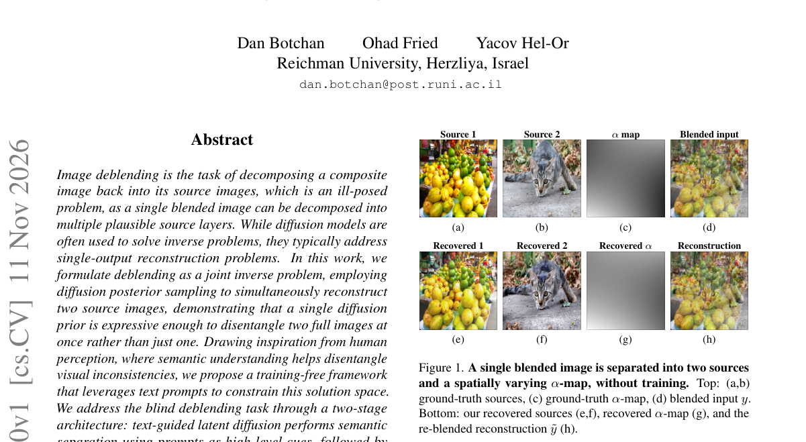

*Result - Overview of our two-stage training-free blind deblending framework. Top: Stage 1 separates the blended image y in latent space, starting from E(y) noised to ts and guided by prompts c1*

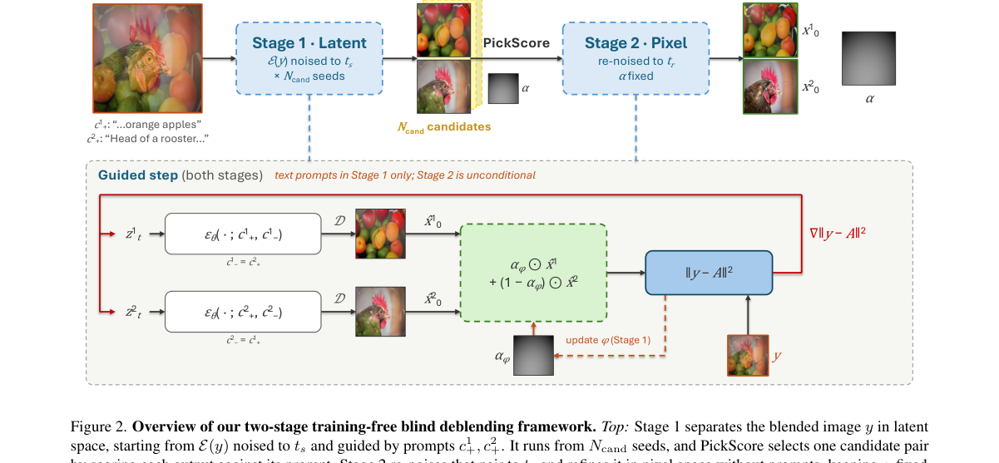

**Why this ranks #9**: 把 alpha 混合分解写成联合逆问题，用同一个冻结扩散先验同时去噪两张源图并联合优化 alpha。在两个未见域上三种混合设定全部取得最佳 PSNR、SSIM 与 LPIPS，已知标量场景达 20.23 dB，而监督式 BIDeN 只有 15.44 dB、LCD 只有 17.21 dB。

---

### 10. WaveFlow-UIE: A Single-Pipeline Wavelet-Domain Flow Model for Efficient Underwater Image Restoration

**arXiv**: [2611.15457](https://arxiv.org/abs/2611.15457) | **Score**: 7.4 (relevance 8 x 0.7 + quality 6 x 0.3) | **Direction**: `aigc_editing` | **Tags**: AIGC-visual, underwater-restoration, wavelet-domain, flow-matching, single-step, physics-prior, King Fahd University of Petroleum & | **Categories**: cs.AI, cs.CV | **Pages**: 11

**Authors**: Abdulaziz Alfaraj; Mohammed Al Naser; Hassan Al Nasser; Muzammil Behzad

**Affiliation**: King Fahd University of Petroleum & Minerals, Dhahran, Saudi Arabia

**Abstract**

> Underwater image restoration remains challenging because color distortion, scattering, and detail loss affect low- and high-frequency image components differently. Recent diffusion-based methods have shown strong restoration quality, but often rely on multi-stage pipelines and costly iterative refinement. We present WaveFlow-UIE, a single-pipeline wavelet-domain flow model that directly learns to transform degraded underwater wavelet representations into clean ones. Our method applies a discrete wavelet transform, estimates lightweight physics-inspired degradation cues including transmission and ambient light, and conditions a velocity network trained with flow matching in wavelet space. The training objective combines flow-matching, frequency-weighted reconstruction, perceptual, color-consistency, and physics-consistency losses. Across UIEB, LSUI, UFO-120, and EUVP, WaveFlow-UIE achieves a strong quality-efficiency tradeoff, with especially competitive results on perceptual metrics. Relative to a strong wavelet-based diffusion baseline, the proposed model substantially reduces inference cost while maintaining or improving restoration quality on several paired benchmarks. We show that reducing the inference process from five flow steps to a single step preserves nearly all of the restoration quality while providing an additional speedup of about $4\times$ on UIEB at $256\times256$ resolution. This single-step result suggests that a single-pass wavelet-domain model is an effective alternative to heavier diffusion-style refinement.

**Key findings**

- **Finding**: UIEB 256 乘 256 上 WaveFlow-UIE 的 LPIPS 0.1390、SSIM 0.9316、PSNR 24.9818 dB，LPIPS 优于全部基线（含 WF-Diff 的 0.1692），单张推理 79.31 ms 而 DiffWater 需 38437.57 ms。
- **Inference**: 在小波域做流匹配并把透射率、环境光等物理量作为条件，可以让模型用 5 步甚至 1 步就保住绝大部分质量，不必依赖重型迭代细化。
- **Recommendation**: 追求实时性的水下增强可优先考虑小波域流匹配加单步推理，但要注意本文未留独立验证集而按周期评测选 checkpoint，报告数值可能偏乐观。

**Key figures**

*Framework - WaveFlow-UIE architecture. A degraded underwater image is decomposed with a Haar discrete wavelet transform (DWT), conditioned by a lightweight physics-prior branch that predicts transmissio*

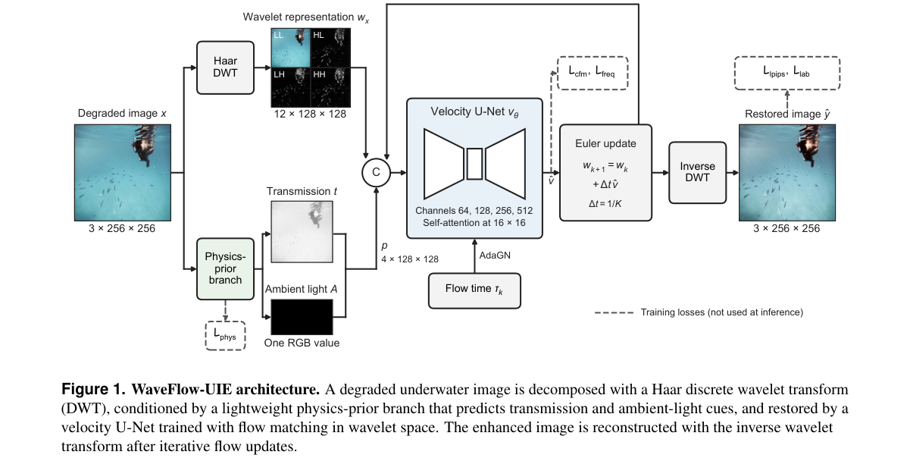

*Result - provides a qualitative view of the same comparison. Across these examples, WaveFlow-UIE tends to recover more balanced color and clearer local detail than the weaker feed-forward baselines, w*

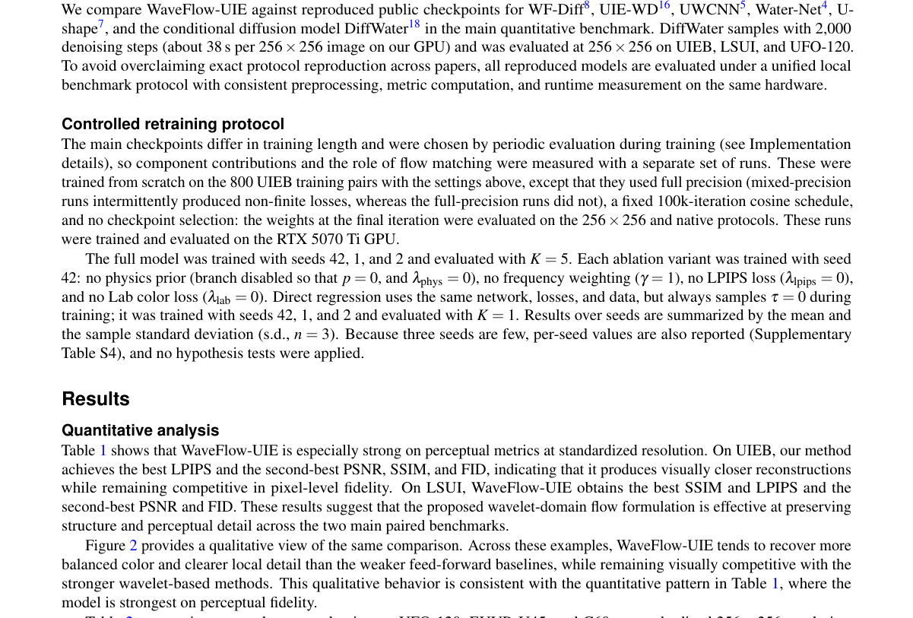

**Why this ranks #10**: 单管线小波域流匹配模型在 UIEB 的 256 乘 256 设定下 LPIPS 0.1390 为全场最佳，PSNR 24.98 dB 仅次于 DiffWater 的 25.80 dB，而单张推理只要 79.31 ms，DiffWater 用 2,000 步需 38437.57 ms。

---

## 面向视觉生成的 RL 与奖励模型 · `aigc_rl` (2 papers)

本方向 2 篇全部新增，且都不训练生成模型本身，而是动**评测与度量**。Verifier Choice is a Benchmark Design Variable 在 7 类计数目标、3 个提示模板、2 个生成器共 6240 张生成图上审计开放 MLLM verifier：任一 verifier 与协议组合都会把两个生成器的人类评分差压缩 7.5 到 25.0 个百分点，GPT-5.5 的三叶草有效计数保真度只有 59.92%，Claude Opus 4.7 的同片一致性更低（κ 为 0.432）；Estimating Image Creativity 则把感知创造力拆成新颖性、惊讶、唤醒三个维度（与总分 Pearson 相关 0.82 / 0.76 / 0.60），并证明 VLM 估计的相对准确率 90% / 76% / 72% 明显高于 CNN 方案的 25% 到 65%（随机基线 14%）。

### 11. Verifier Choice is a Benchmark Design Variable: Auditing Structural Counting Evaluation in Text-to-Image Models

**arXiv**: [2611.15433](https://arxiv.org/abs/2611.15433) | **Score**: 7.0 (relevance 7 x 0.7 + quality 7 x 0.3) | **Direction**: `aigc_rl` | **Tags**: AIGC-visual, t2i-evaluation, verifier-audit, structural-counting, mllm-verifier, benchmark-reliability, REASONS Lab | **Categories**: cs.CV, cs.LG | **Pages**: 24

**Authors**: Shurun Li; Michael Hua Wang; Haibo Zeng; Long Wang

**Affiliation**: REASONS Lab, Institute for Network Sciences and Cyberspace, Tsinghua University

**Abstract**

> Automatic evaluation is now central to text-to-image benchmarking, but the verifier that converts generated images into scores is often treated as an implementation detail. We argue that this is unsafe: an automatic benchmark score is a property of the image generator, prompt distribution, verifier, verifier-use protocol, and scoring rule, not of the generator alone. We study this issue in structural counting, a controlled setting where human-visible counts can be audited. We construct a verifier-centric audit suite over seven counting objects: cell phones, chairs, and traffic lights for object counting, and clover leaflets, dresser drawer fronts, power-strip sockets, and turbine blades for substructure counting. Across 6,240 generated images from Qwen-Image-2512 and FLUX.2-dev, we compare open MLLM verifiers under count-only, reject-aware, zero-shot and few-shot protocols, plus TIFA-like target queries, a detector baseline, and frontier closed-model checks on two hard objects. On a balanced 2,280-image evaluation split, aggregate score matching can coexist with image-level disagreement, and verifier-use protocols and generator distributions change the measured reliability. Every verifier-protocol configuration also shrinks the human score difference between the two generators, by 7.5-25.0 pp, and with a third generator, Z-Image, all four tested protocols reverse the human ordering of Z-Image and FLUX.2-dev on our fixed prompt suite. GPT-5.5 and Claude Opus 4.7 checks do not remove the failure modes: GPT-5.5 still has only 59.92% clover valid-count fidelity, while Claude Opus 4.7 has lower same-slice agreement ($κ=0.432$). We propose reporting automatic benchmark scores with a factorized verifier reliability profile: aggregate score gap, image-level agreement, generator-comparison distortion, valid-image count fidelity, rejection behavior, output compliance, and directional bias.

**Key findings**

- **Finding**: 平衡的 2,280 张评测划分上聚合分数对齐与图像级分歧可以并存，GPT-5.5 的三叶草有效计数保真度仅 59.92%，Claude Opus 4.7 的同片一致性更低（κ 为 0.432）。
- **Inference**: 自动分数是生成器、提示分布、verifier、verifier 使用协议与打分规则共同作用的产物，把 verifier 当作实现细节会系统性误导生成器优劣判断。
- **Recommendation**: 报告文本生成图像的自动分数时附上分解的 verifier 可靠性画像，含分数差、图像级一致性、生成器比较失真、有效计数保真度、拒答行为、输出合规性与方向偏差。

**Key figures**

*Framework - Verifier choice and verifier-use protocol change benchmark outcomes. Panel A shows a human-audited generated image. Panel B shows that the same image can receive different outputs under diff*

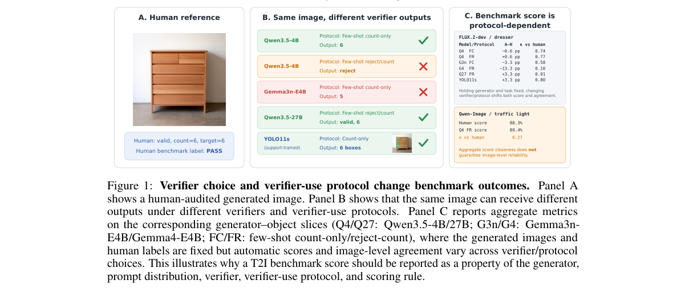

*Result - Aggregate score gap and image-level agreement for the current verifier–protocol pairs. The shaded band marks ±2 pp around score parity as a visual reference. Error bars are marginal 95% imag*

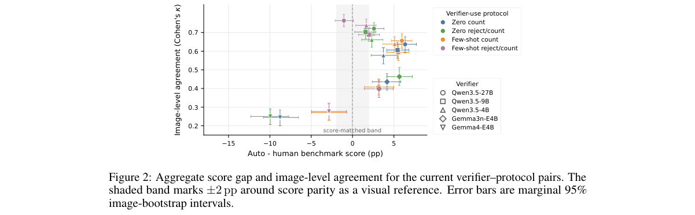

**Why this ranks #11**: 在 7 类计数目标、3 个提示模板、2 个生成器共 6,240 张生成图上审计开放 MLLM verifier：任一 verifier 与协议组合都会把两个生成器的人类评分差压缩 7.5 到 25.0 个百分点；加入第三个生成器 Z-Image 后，四种受测协议全部把 Z-Image 与 FLUX.2-dev 的人类排序颠倒。

---

### 12. Estimating Image Creativity

**arXiv**: [2611.15044](https://arxiv.org/abs/2611.15044) | **Score**: 6.0 (relevance 6 x 0.7 + quality 6 x 0.3) | **Direction**: `aigc_rl` | **Tags**: AIGC-visual, creativity-scoring, vlm-regression, human-ratings, novelty-surprise-arousal, mturk, NC State University | **Categories**: cs.AI, cs.CV, cs.HC, cs.LG | **Pages**: 9

**Authors**: Nisan Chhetri; Christopher G. Healey; Sina Baghbanijam

**Affiliation**: NC State University

**Abstract**

> What makes an image creative? Although this may seem like a highly subjective decision, research in psychology suggests that creativity may be based on a set of fundamental creativity dimensions such as novelty, surprise, and arousal. A deeper understanding of image creativity can benefit both research and practical applications. Exploring how human viewers use creativity dimensions to evaluate image creativity may allow us to predict a target image's human-rated creativity automatically. We present a novel framework to estimate the perceived creativity of an image by: (1) predicting the strengths of an image's novelty, surprise, and arousal creativity dimensions, and (2) combining the creativity dimension strengths to estimate an image creativity score. Controlled human-subject experiments were conducted on Amazon Mechanical Turk to collect data to train supervised machine learning models to estimate an image's strengths on the three creativity dimensions. A final machine learning model takes the predicted dimension strengths as input to produce an estimated image creativity score. Results showed that our estimated creativity scores are statistically equivalent to human ratings of creativity for the images we tested. The novel contributions of our research are: (1) identification and validation of three psychological creativity dimensions used to estimate image creativity; (2) supervised machine learning models to automatically estimate novelty, surprise, and arousal strengths for an input image; (3) a supervised machine learning model to predict a creativity score from novelty, surprise, and arousal strengths for an input image, and (4) experimental methods to confirm the accuracy, advantages, and limitations of our approach.

**Key findings**

- **Finding**: 三个创造力维度强度与创造力分数的 Pearson 相关分别为 0.82、0.76、0.60 且均 p 小于 0.0001；CNN 方案准确率只有 25% 到 65%（随机基线 14%），明显不如 VLM 方案。
- **Inference**: 新颖性、惊讶、唤醒是感知创造力的可分解基础维度，先估计维度强度再合成总分，比直接回归总分更可控也更容易逐维验证。
- **Recommendation**: 需要自动预测人类感知质量时先做维度分解再训练回归模型，消融显示新颖性是主要驱动因素（新颖性 F 为 8.11，惊讶 F 为 8.3），而唤醒维度上各配对差异均不显著。

**Key figures**

*Framework - Proposed image to creativity score pipeline: ML models estimate an image’s creativity dimension strengths, which are then combined in a final ML model to return an image creativity score*

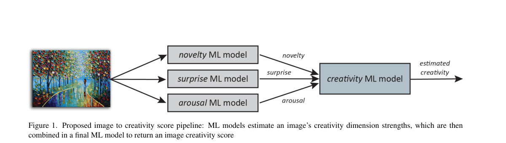

**Why this ranks #12**: 用 60 名 Mechanical Turk 被试在 3 个创造力维度各 45 张图上收集 900 组评分，维度强度与创造力分数的 Pearson 相关分别为 0.82、0.76、0.60，均 p 小于 0.0001；VLM 估计新颖性、惊讶、唤醒的相对准确率为 90%、76%、72%。

---

## Footer

- Total papers reviewed across all 4 axes: 60
- aigc_visual axis final count: 12
- Wild-cards in this axis: 0
- Figure assets: 2026-11-13/res/

Generated by `mine-arxiv-daily-digest` skill. Sister file: `2026-11-13_aigc_visual_entry.md`.
