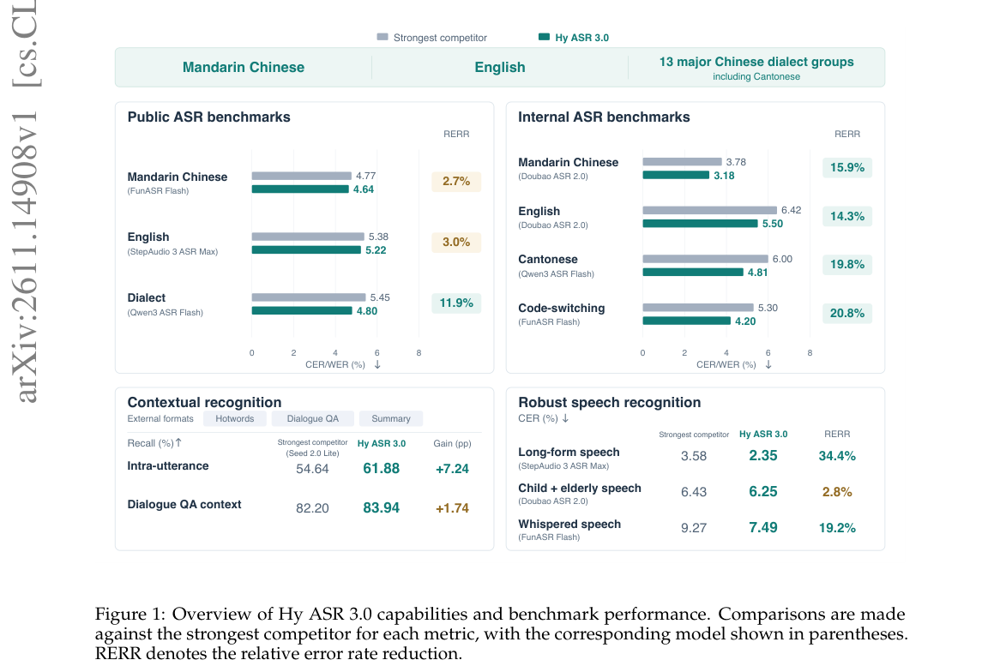
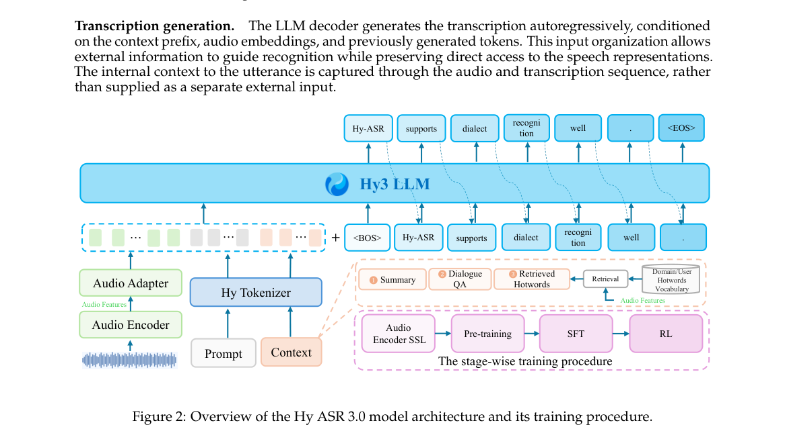
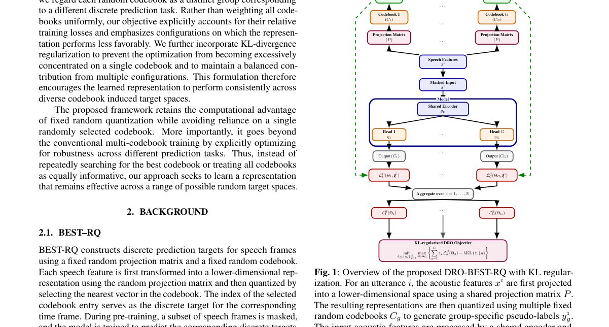
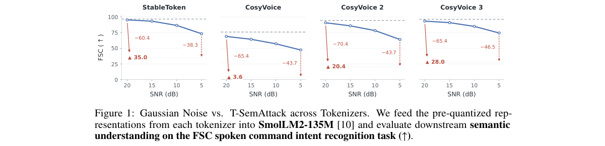
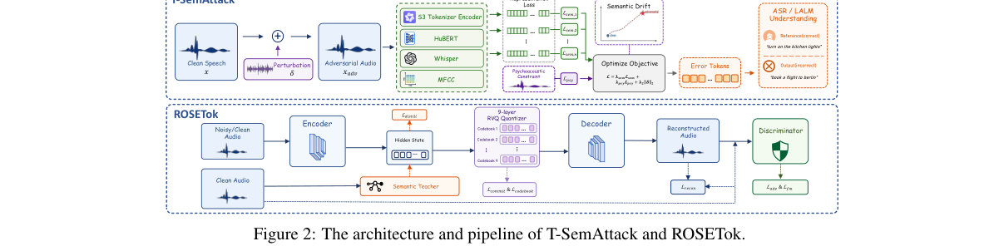

# Mine Arxiv Daily Digest - 2026-11-13 (全双工语音与语音 LM Axis, 3 papers)

**Generated**: 2026-11-13 10:46 CST

**Source**: arXiv cs.CV, cs.SD, eess.AS, cs.CL, cs.AI, cs.RO, cs.LG, cs.IR submissions, listing day 2026-11-11 (announced 2026-11-13 01:00 UTC)

**Batch window**: 2026-11-10T19:00:00Z .. 2026-11-11T19:00:00Z（arXiv 公告批次横跨两个 UTC 日：从前一日的美东 14:00 截止时刻起算（EDT 为 18:00Z，EST 为 19:00Z），到当日的同一时刻为止）

**Axis**: duplex_speech (3 papers, base 12, cap 20)

**Directions**: duplex_speech_core (3), speech_rl (0)

**Selection**: 3 papers ranked by relevance x quality, with 0 wild-card slots

**Day total**: 34 papers across 4 axes (target 60)

**Scope**: 全双工 / 实时 / 流式语音语言模型、speech-to-speech 语音助手、TTS / 语音克隆 / 语音转换，以及语音大模型的 RL 与奖励模型

**Wild-card**: 0 —— 本 axis 未启用任何 wild-card 名额，`speech_rl` 让出的名额没有同方向的候选可吸收，按规则**发不满而不是被填充**。

**语音 RL 方向（`speech_rl`）本批次断供**：全批 77 篇里没有任何一篇同时出现 RL / 奖励优化类词与语音 / 音频 / TTS 类词（140 字符窗口内共现数为 0）。`duplex_speech_core` 也只有 3 篇够格（Hy ASR 3.0 的 LLM-ASR 技术报告、语音 tokenizer 的可迁移语义攻击、BEST-RQ 的分布鲁棒扩展），远低于基准 8 篇。两条方向都没有同方向的富余候选可吸收，按 skill「薄方向让出名额而不是被填充」的口径，本 axis 发 3 篇、不凑数、不启用 wild-card 名额。

---

## 全双工语音与语音 LM · `duplex_speech_core` (3 papers)

本方向 3 篇，覆盖语音系统的**前端、识别与表征**。Hy ASR 3.0 是一个基于大语言模型的 ASR 系统，支持普通话、英语与 13 个汉语方言群（含粤语），除了纯音频转写还接受热词表、问答对话与摘要等多种外部上下文条件注入，在公开的普通话 / 英语 / 粤语基准上取得了被评测系统中的最低综合错误率。Speech Tokenizers are Vulnerable 指出语音 tokenizer 在**语义层面**很脆弱：小扰动就能破坏其语义编码过程，进而让下游 ASR 与音频大模型性能严重退化；作者提出基于语义编码器集成的可迁移语义攻击 T-SemAttack，通过联合漂移多个语义编码器的表示空间来破坏语音语义同时保住感知质量，并进一步分析了逐层表示漂移与跨模型梯度对齐。Distributionally Robust BEST-RQ 则针对自监督语音表征里 BEST-RQ 对量化目标选择的敏感性，给出分布鲁棒的扩展，在多个量化配置下追求稳健表征。

### 1. Hy ASR 3.0 Technical Report

**arXiv**: [2611.14908](https://arxiv.org/abs/2611.14908) | **Score**: 9.0 (relevance 9 x 0.7 + quality 9 x 0.3) | **Direction**: `duplex_speech_core` | **Tags**: duplex-speech, asr, dialect-recognition, context-biasing, hotword-retrieval, llm-asr, Hy ASR team (Tencent Hunyuan) | **Categories**: cs.CL, eess.AS | **Pages**: 12

**Authors**: Aoxiong Yin; Auden Li; Chao Huang; Chuanyang Hu; Eitan Wang; Ethan Zou; Fangming Feng; Guangyu Chen; Guinan Li; He Wang; Jiahong Li; Meng Yu

**Affiliation**: Hy ASR team (Tencent Hunyuan)

**Abstract**

> We present Hy ASR 3.0, a large language model (LLM)-based automatic speech recognition (ASR) system that delivers strong recognition accuracy, supports flexible contextual conditioning, and maintains robust recognition performance across diverse speech conditions. Hy ASR 3.0 supports Mandarin Chinese, English and 13 Chinese dialect groups, including Cantonese. Among the evaluated systems, it achieves the lowest aggregate error rates on public Mandarin Chinese, English, and Cantonese benchmarks and the lowest error rates on the corresponding internal test sets, alongside first-tier dialect recognition performance. Beyond audio-only transcription, Hy ASR 3.0 supports multiple forms of external context, including hotword lists, question--answer dialogues, and summaries, enabling the use of task-relevant information during recognition. The model also leverages intra-utterance context to disambiguate homophonic and phonetically similar keywords using information from other parts of the same utterance, without requiring a separate contextual input. Evaluations demonstrate strong contextual recognition in both external-context and intra-utterance settings, as well as robust recognition of long-form speech, children's and older adults' speech, low-volume speech, and speech in noisy environments. This report describes the model architecture and training methodology and presents evaluations across recognition accuracy, context utilization, and robustness.

**Key findings**

- **Finding**: 公开基准聚合 CER/WER 为中文 4.64%（FunASR Flash 4.77%）、英文 5.22%（StepAudio 3 ASR Max 5.38%）、方言 4.80%（Qwen3 ASR Flash 5.45%），KeSpeech 上误差率 3.77% 优于 FunASR Flash 的 4.33%；句内消歧目标词召回率 61.88% 对最强非 Hy 竞品 Seed 2.0 Lite 的 54.64% 高 7.24 个百分点，对话问答上下文召回 83.94% 高 1.74 个百分点。
- **Inference**: 句内消歧与外部上下文两组测试集同时领先，说明增益主要来自上下文利用而非单纯的声学建模精度；但论文自述这些是跨系统对比而非受控消融，因此 7.24 个百分点不能全部归因于上下文模块。
- **Recommendation**: 需要上下文偏置的中文方言落地时可直接对标该架构（音频编码器 + 适配器 + LLM 解码器 + 音频条件化热词检索前缀），但要先自建句内同音词测试集，因为带口音英语与吴语方言是报告明确点出的短板（VoxPopuli-en 口音集从 14.75% 退化到 15.27%）。

**Key figures**

*Framework - Overview of Hy ASR 3.0 capabilities and benchmark performance. Comparisons are made against the strongest competitor for each metric, with the corresponding model shown in parentheses. RERR*

*Result - Overview of the Hy ASR 3.0 model architecture and its training procedure.*

**Why this ranks #1**: 本批次语音识别方向唯一达到 rel 9 的系统：公开基准聚合 CER/WER 为中文 4.64%、英文 5.22%、方言 4.80%，对最强外部竞品分别取得 2.7%、3.0%、11.9% 的相对错误率下降；句内同音消歧的目标词召回率 61.88%，比最强非 Hy 竞品 Seed 2.0 Lite 高 7.24 个百分点，长音频场景 CER 2.35% 领先 34.4%，同时支持热词列表、问答对话与摘要三类外部上下文注入。

---

### 2. Distributionally Robust BEST-RQ For Speech Representation Learning

**arXiv**: [2611.14801](https://arxiv.org/abs/2611.14801) | **Score**: 8.0 (relevance 8 x 0.7 + quality 8 x 0.3) | **Direction**: `duplex_speech_core` | **Tags**: duplex-speech, best-rq, self-supervised-learning, group-dro, speech-representation, multilingual-asr, Rensselaer Polytechnic Institute | **Categories**: cs.CL, eess.AS, math.OC | **Pages**: 5

**Authors**: Muhammad Khan; Xiaodong Cui; Brian Kingsbury; George Saon

**Affiliation**: Rensselaer Polytechnic Institute; IBM Research

**Abstract**

> BEST-RQ, based on random projection and quantization, has been a well-established self-supervised learning approach to learn speech representations from large-scale unlabeled audio due to its high performance and efficiency. However, in BEST-RQ representations learned by random quantization can be sensitive to the choice of quantization targets. To address this issue, we propose a distributionally robust extension of BEST-RQ that seeks representations robust across multiple quantization configurations. Specifically, we define groups by codebooks and formulate the training as a group Distributionally Robust Optimization (DRO) problem. Rather than optimizing solely for the average loss across groups, our approach adaptively reweights groups to emphasize those performing poorly. Additionally, we regularize DRO with a Kullback-Leibler divergence to prevent excessive distribution deviation. We evaluate our approach on the Multilingual LibriSpeech dataset and show that the distributionally robust BEST-RQ achieves superior performance over the conventional uniform average across multiple codebooks.

**Key findings**

- **Finding**: 四个随机码本做 group DRO 后，λ=1.0 时 MLS 五语种平均 WER 为 8.4%，优于均匀加权多码本的 8.9%、单码本的 9.3% 与有监督基线的 10.4%；葡萄牙语由 18.9% 降到 17.7%、德语由 6.3% 降到 5.9%，是提升最大的两个语种。
- **Inference**: 去掉 KL 正则（λ=0）后 DRO 权重会全部塌缩到损失最高的那个码本（权重 1.0，其余三个为 0），等价于只用最难码本训练，平均 WER 反而回升到 9.1%，说明 KL 项是防止优化退化的关键约束而非可省略的正则。
- **Recommendation**: 要在自己语音 SSL 预训练中复现，先固定同一随机投影矩阵、只替换码本做基线，再按 λ∈{0.5, 1.0, 1.5} 扫描；数据量最小的语种最能显出 DRO 收益（葡萄牙语仅 160.96 小时标注数据），应优先在那里验证。

**Key figures**

*Framework - Overview of the proposed DRO-BEST-RQ with KL regular- ization. For an utterance i, the acoustic features xi are first projected into a lower-dimensional space using a shared projection matrix*

**Why this ranks #2**: 把随机量化目标按码本分组做 group DRO、再用 KL 正则约束组权重，在 Multilingual LibriSpeech 五语种上把平均 WER 从均匀加权多码本的 8.9% 降到 λ=1.0 时的 8.4%，其中只有 160.96 小时标注数据的葡萄牙语从 18.9% 降到 17.7%；它把 BEST-RQ 的码本选择从一次性随机抽样变成可显式优化的鲁棒性目标，主体是语音表征学习，故入 duplex_speech_core。

---

### 3. Speech Tokenizers are Vulnerable: Transferable Semantic Attack and Robust Tokenizer

**arXiv**: [2611.14929](https://arxiv.org/abs/2611.14929) | **Score**: 8.0 (relevance 8 x 0.7 + quality 8 x 0.3) | **Direction**: `duplex_speech_core` | **Tags**: duplex-speech, speech-tokenizer, adversarial-attack, speech-codec, robust-representation, transferable-attack, Shenzhen International Graduate School | **Categories**: cs.AI, cs.CR, cs.SD, eess.AS | **Pages**: 25

**Authors**: Zhisheng Zhang; Yifan Mi; Yixuan Zhou; Haiyun Li; Shengbo Cai; Dongfu Song; Ziang Xu; Jie Hao; Zhiyong Wu

**Affiliation**: Shenzhen International Graduate School, Tsinghua University; Beijing University of Posts and Telecommunications

**Abstract**

> Speech tokenizers serve as speech front ends, encoding input speech signals into representations for downstream models, such as automatic speech recognition (ASR) systems and large audio-language models (LALMs). In this paper, we find that speech tokenizers are fragile at the semantic level: small perturbations can disrupt their semantic encoding process and consequently cause severe degradation in downstream ASR and LALM performance. To study this vulnerability, we propose T-SemAttack, a transferable semantic attack based on a semantic encoder ensemble. By jointly drifting the representation spaces of multiple semantic encoders, T-SemAttack effectively disrupts the semantic content of speech while preserving perceptual quality, thereby inducing error features. We further analyze layer-wise representation drift and cross-model gradient alignment. Our findings show that perturbations can induce substantial shifts in deep semantic representations and that the input gradients of different surrogate encoders exhibit directional alignment. These observations suggest that shared adversarially sensitive directions in the input space may be a key factor underlying cross-model attack transferability. Building on these, we introduce ROSETok, a robust speech tokenizer that combines noisy training with robust semantic distillation to improve reconstruction fidelity and downstream SpeechLLM robustness. Extensive experiments on multiple datasets, 9 open-source and black-box ASR systems, and 4 LALMs demonstrate that T-SemAttack achieves strong transferable attack performance, while the proposed Robust Speech Tokenizer exhibits robustness under high-fidelity reconstruction and downstream tasks. Our code and demo are available at https://wxzyd123.github.io/t-semattack.

**Key findings**

- **Finding**: T-SemAttack 在 LibriTTS 上把 7 个目标 ASR 的平均 WER 从干净语音的 2.503% 推到 61.348%，其中 iFlytek 达 49.607%、GPT-4o-mini-transcribe 达 46.089%；Seed-TTS 英文平均 81.872%、中文平均 50.814%，RTF 21.800 低于 E2E-VGuard 的 26.797，SNR 保持 16.319。
- **Inference**: 经 Denoiser 与 DeepFilterNet3 去噪后攻击 WER 仍有 96.763% 与 42.901%，而 AudioPure 等对抗防御只能压到 21.571%，说明破坏发生在量化前的连续表征上，后置语音增强无法恢复已被改写的语义。
- **Recommendation**: 部署语音 tokenizer 前应先在自家前端上复现 token 级攻击面，并把受扰动后的下游 FSC 分数纳入选型指标；防御侧优先走带噪训练加语义蒸馏路线，ROSETok-AAF 的受攻击 FSC 分数 77.9，明显高于同为量化前表征的 StableToken 的 35.0。

**Key figures**

*Framework - Gaussian Noise vs. T-SemAttack across Tokenizers. We feed the pre-quantized rep- resentations from each tokenizer into SmolLM2-135M [10] and evaluate downstream semantic understanding on the*

*Result - The architecture and pipeline of T-SemAttack and ROSETok.*

**Why this ranks #3**: 揭示语音 tokenizer 在语义层的脆弱性：T-SemAttack 用 S3Tokenizer、HuBERT、Whisper、MFCC 四个代理编码器联合做语义漂移，在 9 个开源与黑盒 ASR 上把干净语音约 1%~4% 的错误率抬到 20.004%~63.555%，LibriTTS 平均 WER 61.348%、Seed-TTS 中文 50.814%；对应的 ROSETok 用带噪训练加鲁棒语义蒸馏，把受攻击后的下游 FSC 分数从基线最高的 35.0 提到 77.9，是当日语音 token 化方向唯一同时给出攻击与防御的工作。

---

## Footer

- Total papers reviewed across all 4 axes: 34
- duplex_speech axis final count: 3
- Wild-cards in this axis: 0
- Figure assets: 2026-11-13/res/

Generated by `mine-arxiv-daily-digest` skill. Sister file: `2026-11-13_duplex_speech_entry.md`.
