# Mine Arxiv Daily Digest - 2026-11-13 (全双工语音与语音 LM Axis, 8 papers)

**Generated**: 2026-11-13 10:46 CST

**Source**: arXiv cs.CV, cs.SD, eess.AS, cs.CL, cs.AI, cs.RO, cs.LG, cs.IR submissions, listing day 2026-11-11 (announced 2026-11-13 01:00 UTC)

**Batch window**: 2026-11-10T19:00:00Z .. 2026-11-11T19:00:00Z（arXiv 公告批次横跨两个 UTC 日：从前一日的美东 14:00 截止时刻起算（EDT 为 18:00Z，EST 为 19:00Z），到当日的同一时刻为止）

**Axis**: duplex_speech (8 papers, base 12, cap 20)

**Directions**: duplex_speech_core (8), speech_rl (0)

**Selection**: 8 papers ranked by relevance x quality, with 0 wild-card slots

**Day total**: 60 papers across 4 axes (target 60)

**Scope**: 全双工 / 实时 / 流式语音语言模型、speech-to-speech 语音助手、TTS / 语音克隆 / 语音转换，以及语音大模型的 RL 与奖励模型

**Wild-card**: 0 —— 本 axis 未启用任何 wild-card 名额。

**本 axis 从 3 篇补到 8 篇，仍低于基准 12 篇。** 完整批次里语音相关候选本来就少：`duplex_speech_core` 只有 5 篇新候选过筛（relevance 9、8、6、4、4），`speech_rl` 一篇都没有。

**`speech_rl` 依旧断供。** 全批 560 篇里没有任何一篇同时出现 RL / 奖励优化类词与语音 / 音频 / TTS 类词，按口径发 0 篇、不凑数；`duplex_speech_core` 也只有 8 篇够格，远低于基准 8 篇的上限缺口。

---

## 全双工语音与语音 LM · `duplex_speech_core` (8 papers)

本方向 8 篇里 5 篇新增，是本批补充幅度最大的语音方向。Hy ASR 3.0 仍是本 direction 首位：公开基准聚合 CER/WER 为中文 4.64%、英文 5.22%、方言 4.80%，句内消歧的目标词召回率 61.88% 比最强非 Hy 竞品高 7.24 个百分点。新增里 Dynamic Block-Online Streaming ASR 用 VAD 对齐的动态块在线推理化解黏着语的长程形态依赖（Eroot 0.29 对 3 秒因果流式的 0.35、Emorph 0.35 对 0.42）；Harmony 用 LLM 规划器协同 Qwen3-Omni 把音频编辑落到具体声源与时间窗，420 条 MMAE 样例上精确匹配率 22.62% 对 WavCraft 原版的 13.57%；Can Music Generation Models Tap Along? 只训 10.4M 参数适配器就让两个冻结的 MusicGen 生成同步打击乐轨并取得 F-measure 0.851（同一跟踪器直接读原曲只有 0.373）；Right Answers, Inconsistent Evidence 指出 8 个音频语言模型在 3456 个受控混合上有 6.3% 是「答案对但排序错」的失败，仅做 target-only 分数检查会漏掉其中 42.5%；Evaluating AI Musical Creativity 则把音乐创造力拆成价值、新颖、惊奇三维，并引用了 12 个模型、6000 段 AI 音乐、15000 余次成对比较的最大规模主观评测。

### 1. Hy ASR 3.0 Technical Report

**arXiv**: [2611.14908](https://arxiv.org/abs/2611.14908) | **Score**: 9.0 (relevance 9 x 0.7 + quality 9 x 0.3) | **Direction**: `duplex_speech_core` | **Tags**: duplex-speech, asr, dialect-recognition, context-biasing, hotword-retrieval, llm-asr, Hy ASR team (Tencent Hunyuan) | **Categories**: cs.CL, eess.AS | **Pages**: 12

**Authors**: Aoxiong Yin; Auden Li; Chao Huang; Chuanyang Hu; Eitan Wang; Ethan Zou; Fangming Feng; Guangyu Chen; Guinan Li; He Wang; Jiahong Li; Meng Yu

**Affiliation**: Hy ASR team (Tencent Hunyuan)

**Abstract**

> We present Hy ASR 3.0, a large language model (LLM)-based automatic speech recognition (ASR) system that delivers strong recognition accuracy, supports flexible contextual conditioning, and maintains robust recognition performance across diverse speech conditions. Hy ASR 3.0 supports Mandarin Chinese, English and 13 Chinese dialect groups, including Cantonese. Among the evaluated systems, it achieves the lowest aggregate error rates on public Mandarin Chinese, English, and Cantonese benchmarks and the lowest error rates on the corresponding internal test sets, alongside first-tier dialect recognition performance. Beyond audio-only transcription, Hy ASR 3.0 supports multiple forms of external context, including hotword lists, question--answer dialogues, and summaries, enabling the use of task-relevant information during recognition. The model also leverages intra-utterance context to disambiguate homophonic and phonetically similar keywords using information from other parts of the same utterance, without requiring a separate contextual input. Evaluations demonstrate strong contextual recognition in both external-context and intra-utterance settings, as well as robust recognition of long-form speech, children's and older adults' speech, low-volume speech, and speech in noisy environments. This report describes the model architecture and training methodology and presents evaluations across recognition accuracy, context utilization, and robustness.

**Key findings**

- **Finding**: 公开基准聚合 CER/WER 为中文 4.64%（FunASR Flash 4.77%）、英文 5.22%（StepAudio 3 ASR Max 5.38%）、方言 4.80%（Qwen3 ASR Flash 5.45%），KeSpeech 上误差率 3.77% 优于 FunASR Flash 的 4.33%；句内消歧目标词召回率 61.88% 对最强非 Hy 竞品 Seed 2.0 Lite 的 54.64% 高 7.24 个百分点，对话问答上下文召回 83.94% 高 1.74 个百分点。
- **Inference**: 句内消歧与外部上下文两组测试集同时领先，说明增益主要来自上下文利用而非单纯的声学建模精度；但论文自述这些是跨系统对比而非受控消融，因此 7.24 个百分点不能全部归因于上下文模块。
- **Recommendation**: 需要上下文偏置的中文方言落地时可直接对标该架构（音频编码器 + 适配器 + LLM 解码器 + 音频条件化热词检索前缀），但要先自建句内同音词测试集，因为带口音英语与吴语方言是报告明确点出的短板（VoxPopuli-en 口音集从 14.75% 退化到 15.27%）。

**Key figures**

*Framework - Overview of Hy ASR 3.0 capabilities and benchmark performance. Comparisons are made against the strongest competitor for each metric, with the corresponding model shown in parentheses. RERR*

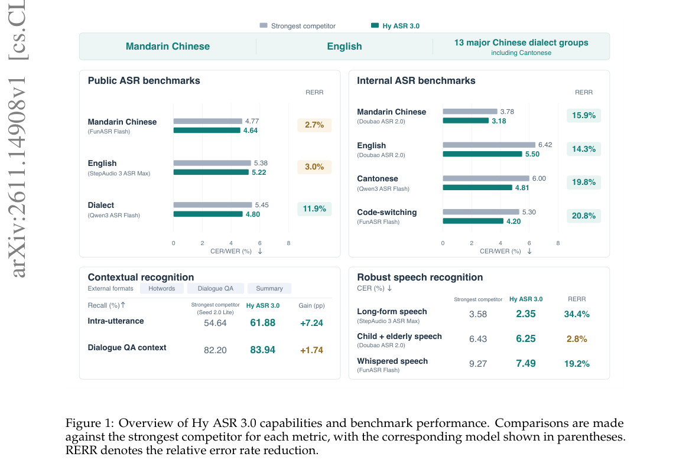

*Result - Overview of the Hy ASR 3.0 model architecture and its training procedure.*

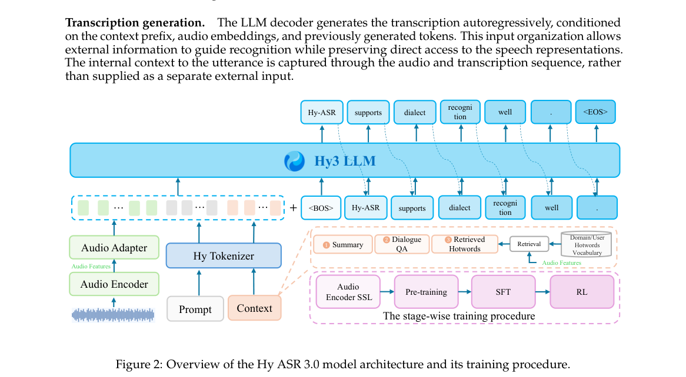

**Why this ranks #1**: 本批次语音识别方向唯一达到 rel 9 的系统：公开基准聚合 CER/WER 为中文 4.64%、英文 5.22%、方言 4.80%，对最强外部竞品分别取得 2.7%、3.0%、11.9% 的相对错误率下降；句内同音消歧的目标词召回率 61.88%，比最强非 Hy 竞品 Seed 2.0 Lite 高 7.24 个百分点，长音频场景 CER 2.35% 领先 34.4%，同时支持热词列表、问答对话与摘要三类外部上下文注入。

---

### 2. Dynamic Block-Online Streaming ASR for Low-Resource Agglutinative Code-Switching Speech with Morphology-Aware Evaluation

**arXiv**: [2611.15691](https://arxiv.org/abs/2611.15691) | **Score**: 8.4 (relevance 9 x 0.7 + quality 7 x 0.3) | **Direction**: `duplex_speech_core` | **Tags**: duplex-speech, streaming-asr, code-switching, bangla-english, vad-aligned-inference, agglutinative-morphology, Apurba NSU R&D Lab | **Categories**: cs.CL, cs.SD | **Pages**: 5

**Authors**: Kazi Rafat; Afifa Imran; Md. Ismail Hossain; Md. Romzan Ali; Fuad Rahman; Sifat Momen; Shafin Rahman; Nabeel Mohammed

**Affiliation**: Apurba NSU R&D Lab, North South University

**Abstract**

> Low-resource, agglutinative languages challenge low-latency ASR, as fixed lookahead windows fail when grapheme order diverges, suffixes cross code-switch boundaries, or code-switching data is imbalanced. We present the first comprehensive study of streaming ASR for intra-sentential Bangla-English code-switching, identifying a mismatch between strict causal streaming and long-range morphological dependencies. We introduce a Dynamic Block-Online framework with VAD-aligned inference that balances semantics, latency, and context, enabling global bidirectional attention to preserve morphological integrity. To mitigate data scarcity, we propose Script-Anchored Loanword Injection, augmenting training text with English loanwords to model phonotactic transitions. We introduce CS-WER to diagnose switch, root, and suffix errors, and show that flexible latency budgets enhance recognition of agglutinative and mixed-language speech, with successful transfer to menstrual-medical domains.

**Key findings**

- **Finding**: 在 750 小时孟加拉语数据上，3 秒因果流式的 Eroot/Emorph 为 0.35/0.42，而 VAD 对齐的动态块在线模型为 0.29/0.35，分别低 6 和 7 个百分点，接近离线模型的形态精度。
- **Inference**: 形态错误差异说明大窗口流式只能补足声学信息、无法绑定词根与后缀，瓶颈在因果掩码本身；动态块把错误从结构性的删除转向插入，保住了下游可用的语义。
- **Recommendation**: 黏着语与句内语码切换场景应优先用 VAD 触发的块在线推理加脚本锚定借词注入（750 条借词词典），而不是继续加大因果滑窗的窗口长度。

**Key figures**

*Framework - Comparison of (a) Fixed-Latency Causal Stream- ing, where memory-cached attention leads to CS morphologi- cal truncation (mistranscribing ে◌র[র]and board [bord]), and (b) our proposed Dynami*

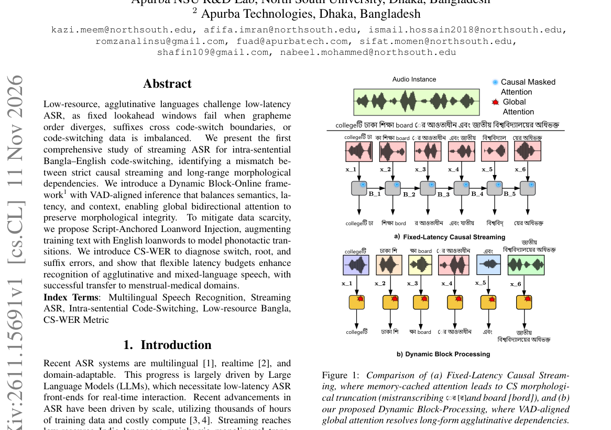

*Result - Proposed Methodology of: Script-Anchored Loan- word Injection - converting Bengali to CS transcript through a loanword database M. A Dynamic Block Online model that strips audio at communica*

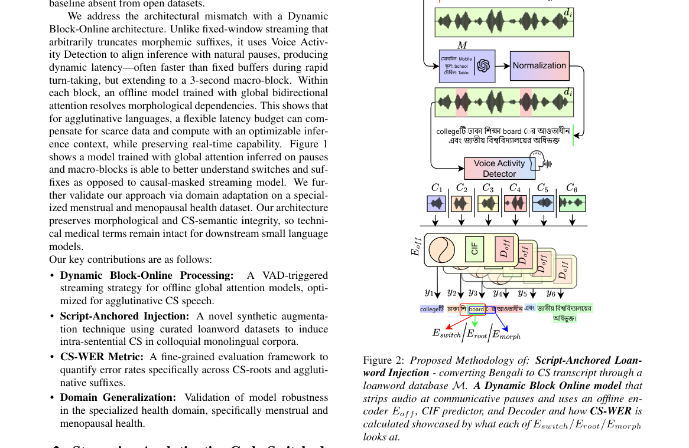

**Why this ranks #2**: VAD 对齐的动态块在线推理用全局双向注意力化解黏着语的长程形态依赖：动态块模型的 Eroot 0.29、Emorph 0.35，比 3 秒因果流式的 0.35 与 0.42 分别低 6 和 7 个点；750 条借词注入把离线借词召回从 87% 降到 25% 错误、在线从 99% 降到 61%。

---

### 3. Distributionally Robust BEST-RQ For Speech Representation Learning

**arXiv**: [2611.14801](https://arxiv.org/abs/2611.14801) | **Score**: 8.0 (relevance 8 x 0.7 + quality 8 x 0.3) | **Direction**: `duplex_speech_core` | **Tags**: duplex-speech, best-rq, self-supervised-learning, group-dro, speech-representation, multilingual-asr, Rensselaer Polytechnic Institute | **Categories**: cs.CL, eess.AS, math.OC | **Pages**: 5

**Authors**: Muhammad Khan; Xiaodong Cui; Brian Kingsbury; George Saon

**Affiliation**: Rensselaer Polytechnic Institute; IBM Research

**Abstract**

> BEST-RQ, based on random projection and quantization, has been a well-established self-supervised learning approach to learn speech representations from large-scale unlabeled audio due to its high performance and efficiency. However, in BEST-RQ representations learned by random quantization can be sensitive to the choice of quantization targets. To address this issue, we propose a distributionally robust extension of BEST-RQ that seeks representations robust across multiple quantization configurations. Specifically, we define groups by codebooks and formulate the training as a group Distributionally Robust Optimization (DRO) problem. Rather than optimizing solely for the average loss across groups, our approach adaptively reweights groups to emphasize those performing poorly. Additionally, we regularize DRO with a Kullback-Leibler divergence to prevent excessive distribution deviation. We evaluate our approach on the Multilingual LibriSpeech dataset and show that the distributionally robust BEST-RQ achieves superior performance over the conventional uniform average across multiple codebooks.

**Key findings**

- **Finding**: 四个随机码本做 group DRO 后，λ=1.0 时 MLS 五语种平均 WER 为 8.4%，优于均匀加权多码本的 8.9%、单码本的 9.3% 与有监督基线的 10.4%；葡萄牙语由 18.9% 降到 17.7%、德语由 6.3% 降到 5.9%，是提升最大的两个语种。
- **Inference**: 去掉 KL 正则（λ=0）后 DRO 权重会全部塌缩到损失最高的那个码本（权重 1.0，其余三个为 0），等价于只用最难码本训练，平均 WER 反而回升到 9.1%，说明 KL 项是防止优化退化的关键约束而非可省略的正则。
- **Recommendation**: 要在自己语音 SSL 预训练中复现，先固定同一随机投影矩阵、只替换码本做基线，再按 λ∈{0.5, 1.0, 1.5} 扫描；数据量最小的语种最能显出 DRO 收益（葡萄牙语仅 160.96 小时标注数据），应优先在那里验证。

**Key figures**

*Framework - Overview of the proposed DRO-BEST-RQ with KL regular- ization. For an utterance i, the acoustic features xi are first projected into a lower-dimensional space using a shared projection matrix*

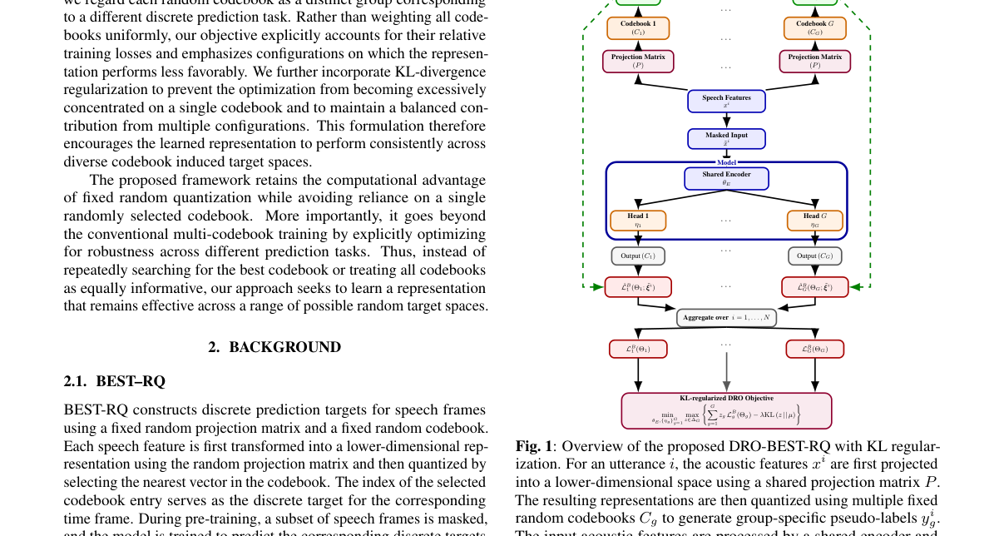

**Why this ranks #3**: 把随机量化目标按码本分组做 group DRO、再用 KL 正则约束组权重，在 Multilingual LibriSpeech 五语种上把平均 WER 从均匀加权多码本的 8.9% 降到 λ=1.0 时的 8.4%，其中只有 160.96 小时标注数据的葡萄牙语从 18.9% 降到 17.7%；它把 BEST-RQ 的码本选择从一次性随机抽样变成可显式优化的鲁棒性目标，主体是语音表征学习，故入 duplex_speech_core。

---

### 4. Speech Tokenizers are Vulnerable: Transferable Semantic Attack and Robust Tokenizer

**arXiv**: [2611.14929](https://arxiv.org/abs/2611.14929) | **Score**: 8.0 (relevance 8 x 0.7 + quality 8 x 0.3) | **Direction**: `duplex_speech_core` | **Tags**: duplex-speech, speech-tokenizer, adversarial-attack, speech-codec, robust-representation, transferable-attack, Shenzhen International Graduate School | **Categories**: cs.AI, cs.CR, cs.SD, eess.AS | **Pages**: 25

**Authors**: Zhisheng Zhang; Yifan Mi; Yixuan Zhou; Haiyun Li; Shengbo Cai; Dongfu Song; Ziang Xu; Jie Hao; Zhiyong Wu

**Affiliation**: Shenzhen International Graduate School, Tsinghua University; Beijing University of Posts and Telecommunications

**Abstract**

> Speech tokenizers serve as speech front ends, encoding input speech signals into representations for downstream models, such as automatic speech recognition (ASR) systems and large audio-language models (LALMs). In this paper, we find that speech tokenizers are fragile at the semantic level: small perturbations can disrupt their semantic encoding process and consequently cause severe degradation in downstream ASR and LALM performance. To study this vulnerability, we propose T-SemAttack, a transferable semantic attack based on a semantic encoder ensemble. By jointly drifting the representation spaces of multiple semantic encoders, T-SemAttack effectively disrupts the semantic content of speech while preserving perceptual quality, thereby inducing error features. We further analyze layer-wise representation drift and cross-model gradient alignment. Our findings show that perturbations can induce substantial shifts in deep semantic representations and that the input gradients of different surrogate encoders exhibit directional alignment. These observations suggest that shared adversarially sensitive directions in the input space may be a key factor underlying cross-model attack transferability. Building on these, we introduce ROSETok, a robust speech tokenizer that combines noisy training with robust semantic distillation to improve reconstruction fidelity and downstream SpeechLLM robustness. Extensive experiments on multiple datasets, 9 open-source and black-box ASR systems, and 4 LALMs demonstrate that T-SemAttack achieves strong transferable attack performance, while the proposed Robust Speech Tokenizer exhibits robustness under high-fidelity reconstruction and downstream tasks. Our code and demo are available at https://wxzyd123.github.io/t-semattack.

**Key findings**

- **Finding**: T-SemAttack 在 LibriTTS 上把 7 个目标 ASR 的平均 WER 从干净语音的 2.503% 推到 61.348%，其中 iFlytek 达 49.607%、GPT-4o-mini-transcribe 达 46.089%；Seed-TTS 英文平均 81.872%、中文平均 50.814%，RTF 21.800 低于 E2E-VGuard 的 26.797，SNR 保持 16.319。
- **Inference**: 经 Denoiser 与 DeepFilterNet3 去噪后攻击 WER 仍有 96.763% 与 42.901%，而 AudioPure 等对抗防御只能压到 21.571%，说明破坏发生在量化前的连续表征上，后置语音增强无法恢复已被改写的语义。
- **Recommendation**: 部署语音 tokenizer 前应先在自家前端上复现 token 级攻击面，并把受扰动后的下游 FSC 分数纳入选型指标；防御侧优先走带噪训练加语义蒸馏路线，ROSETok-AAF 的受攻击 FSC 分数 77.9，明显高于同为量化前表征的 StableToken 的 35.0。

**Key figures**

*Framework - Gaussian Noise vs. T-SemAttack across Tokenizers. We feed the pre-quantized rep- resentations from each tokenizer into SmolLM2-135M [10] and evaluate downstream semantic understanding on the*

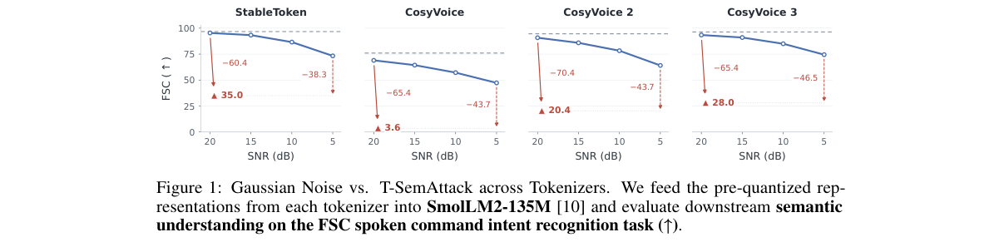

*Result - The architecture and pipeline of T-SemAttack and ROSETok.*

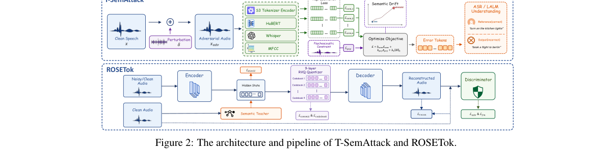

**Why this ranks #4**: 揭示语音 tokenizer 在语义层的脆弱性：T-SemAttack 用 S3Tokenizer、HuBERT、Whisper、MFCC 四个代理编码器联合做语义漂移，在 9 个开源与黑盒 ASR 上把干净语音约 1%~4% 的错误率抬到 20.004%~63.555%，LibriTTS 平均 WER 61.348%、Seed-TTS 中文 50.814%；对应的 ROSETok 用带噪训练加鲁棒语义蒸馏，把受攻击后的下游 FSC 分数从基线最高的 35.0 提到 77.9，是当日语音 token 化方向唯一同时给出攻击与防御的工作。

---

### 5. Harmony: Bridging Audio Understanding and Editing through Agentic Collaboration

**arXiv**: [2611.14724](https://arxiv.org/abs/2611.14724) | **Score**: 7.7 (relevance 8 x 0.7 + quality 7 x 0.3) | **Direction**: `duplex_speech_core` | **Tags**: duplex-speech, audio-editing, agentic-workflow, llm-planner, evidence-guided-execution, audio-understanding, Worcester Polytechnic Institute | **Categories**: cs.SD | **Pages**: 14

**Authors**: Zhongyi Tong; Yapeng Tian

**Affiliation**: Worcester Polytechnic Institute; The University of Texas at Dallas

**Abstract**

> Natural-language audio editing requires connecting a user's intent to specific sounds and time regions while preserving surrounding content. Complex requests make this connection demanding: an edit may select one occurrence, depend on a temporal relation, or modify a source that overlaps with other sounds. We introduce Harmony, an agentic framework that bridges audio understanding and editing through collaboration among an LLM planner, an audio-language model, and external tools. Harmony combines two mechanisms. Edit-driven collaborative planning uses targeted questions and tool measurements to determine the target, timing, and operation parameters. Evidence-guided execution uses observations of the first separated or generated audio to trigger bounded corrections before final mixing. Together, these mechanisms connect semantic decisions to waveform operations throughout the editing process. Harmony supports addition, removal, replacement, and volume adjustment. On 420 MMAE examples spanning these operations, Harmony achieves an exact match rate of 22.62%, compared with 13.57% for the strongest baseline, and improves aggregate instruction following and context preservation.

**Key findings**

- **Finding**: 在覆盖增加、删除、替换与音量调整的 420 条 MMAE 样例上，Harmony 的精确匹配率 22.62%（95 条全部通过），最强基线 WavCraft 原版为 13.57%（57 条）；整体 IFR 62.18%、CR 87.71%。
- **Inference**: 提升来自先规划后执行的两段机制——受外部证据约束的规划负责定位声源与窗口，执行阶段依据分离或生成的中间结果做有界修正，且每个素材的修正次数有硬上限。
- **Recommendation**: 做自然语言音频编辑时应把定位声源与时间窗、按中间证据修正拆成两阶段，并给执行阶段设固定修正次数上限，避免无界自修正带来的耗时与不可控。

**Key figures**

*Framework - Harmony’s two mechanisms. Collaborative planning resolves the target, timing, and preservation requirements through exchanges with Qwen and analysis tools. Execution conditions bounded corre*

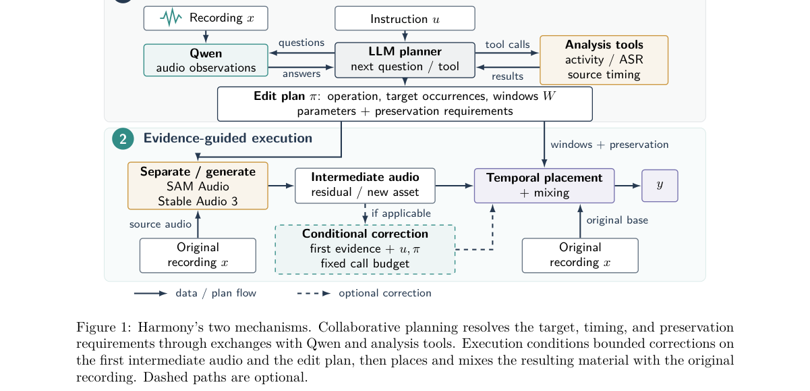

*Result - Schematic of local replacement. Removal and insertion share the selected window W; the residual and new material are combined within W, while audio outside W is retained. Green bands indicat*

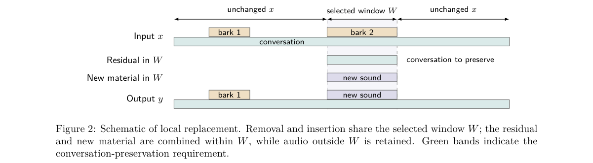

**Why this ranks #5**: LLM 规划器协同 Qwen3-Omni 与外部分析工具，把编辑指令落到具体声源与时间窗，执行阶段再按中间音频做有界修正；420 条 MMAE 样例上精确匹配率 22.62%（95 条全过），最强基线 WavCraft 原版为 13.57%（57 条）。

---

### 6. Can Music Generation Models Tap Along? Evaluating Generative Approaches to Beat Tracking

**arXiv**: [2611.14971](https://arxiv.org/abs/2611.14971) | **Score**: 7.7 (relevance 8 x 0.7 + quality 7 x 0.3) | **Direction**: `duplex_speech_core` | **Tags**: duplex-speech, beat-tracking, music-generation, musicgen-adapter, robustness-analysis, gtzan, Schulich School of Music | **Categories**: cs.SD | **Pages**: 13

**Authors**: Kun Fang; Ziyu Wang; Ichiro Fujinaga

**Affiliation**: Schulich School of Music, McGill University; Courant Institute, New York University; Mohamed bin Zayed University of Artificial Intelligence (MBZUAI)

**Abstract**

> Existing studies have shown that music generative models can generate synchronized tracks that play alongside an input song. Can we extend this capability to develop a generative approach to beat tracking? To answer this question, we equip a pretrained MusicGen model with an audio-conditioning adapter to generate percussion tracks synchronized with the input music, from which we extract the beat positions. We train separate models with percussion targets of varying rhythmic complexity and compare them with two other generative models and conventional beat trackers. On GTZAN, our model achieves performance close to state-of-the-art beat trackers. Our model also demonstrates greater robustness: it shows the smallest drop in F-measure when drums are removed from the input at inference time. In certain genres, such as metal and disco, our model is also less likely to be misled by strong onsets or to miss beats with weak onsets. These results suggest that percussion generation has the potential to become a viable approach to beat tracking, and that its output is not merely a sequence of beat positions but an audible percussion track.

**Key findings**

- **Finding**: 只训练 10.4M 参数适配器而两个 MusicGen 全部冻结，生成的打击乐轨在 GTZAN 上取得 F-measure 0.851（±70ms）与 AMLt 0.907，接近 Beat This! 的 0.888 与 0.895，且去鼓轨后 F-measure 跌幅最小。
- **Inference**: 拍点信息确实来自生成轨而非后端解析——同一个 TCN 跟踪器直接读原曲时 F-measure 只有 0.373，改用起音峰值拾取也有 0.747，说明模型在跟拍而不是在抄鼓点。
- **Recommendation**: 评估生成式节拍跟踪必须同时做去鼓轨和起音强度分组两项对照，只看 F-measure 数值无法区分模型是在跟随歌曲节奏还是在跟随显著起音。

**Key figures**

*Framework - Overall pipeline. The music generative model generates a percussion track from the song;*

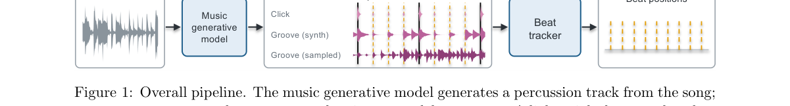

*Result - Our percussion generation model. N and N′ are the numbers of layers of the two Music-*

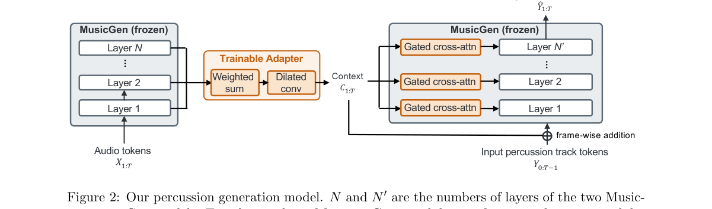

**Why this ranks #6**: 给两个冻结的 MusicGen 接一个 10.4M 参数的音频条件适配器生成同步打击乐轨再抽拍点，GTZAN 上 F-measure 达 0.851，接近 Beat This! 的 0.888；同一 TCN 跟踪器直接读原曲只有 0.373，说明拍点来自生成轨而非后端。

---

### 7. Right Answers, Inconsistent Evidence: Source-Level Counterfactual Auditing of Large Audio-Language Models

**arXiv**: [2611.15463](https://arxiv.org/abs/2611.15463) | **Score**: 6.3 (relevance 6 x 0.7 + quality 7 x 0.3) | **Direction**: `duplex_speech_core` | **Tags**: duplex-speech, audio-language-model, counterfactual-evaluation, source-attribution, ranking-failure, audio-mixture, School of Computer Science and Technology | **Categories**: cs.AI, cs.SD | **Pages**: 5

**Authors**: Yi Zhang; Yi Li; Hongwei Du

**Affiliation**: School of Computer Science and Technology, Harbin Institute of Technology, Shenzhen

**Abstract**

> A large audio-language model (LALM) can answer "is a cat present?" about a mixture correctly, and its confidence can drop when the cat is removed, yet this does not show that it can tell the cat's presence from its absence. We introduce TRACE. It deletes the queried source and each rival in turn and asks whether every view still containing that sound outscores the view with it removed. Across 8 LALMs and 3,456 controlled mixtures, 6.3% of correct answers fail this ordering: the target-absent view scores at or above some target-present view, a conflict no shared threshold repairs. A target-only score check misses 42.5% of them. The share rises from 4.9% to 8.4% as target SNR falls from +5 to -5 dB, even on units correct at every level, and survives loudness and re-pairing controls. Accuracy certifies the answer; TRACE audits whether it orders presence above absence. Code and data: https://github.com/yikise/TRACE.

**Key findings**

- **Finding**: 8 个 LALM 在 3456 个受控 ESC-50 混合上共 18911 个正确答案中，6.3% 是排序失败（2.7% 竞争者混淆、3.6% 无依据），而 target-only 分数检查会漏掉其中 42.5%。
- **Inference**: 失败随声学竞争加剧——目标信噪比从 +5 dB 降到 −5 dB 时占比从 4.9% 升到 8.4%，且在每个档位都答对的样本上依然成立，说明它不是准确率的副产品。
- **Recommendation**: 评估音频语言模型时除准确率外应补上逐声源删除的序数检验，只看目标删除后的分数变化会把近一半排序冲突误判成模型根本没有该能力。

**Key figures**

*Framework - Overview of TRACE. (a) A mixture (door wood creaks + footsteps; Qwen3-Omni-30B, 0 dB, partial overlap). The target-only check passes, yet removing the rival lowers the score further, so no sha*

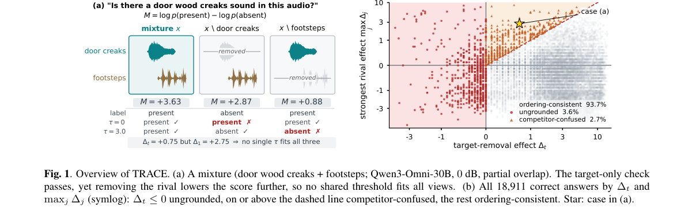

**Why this ranks #7**: TRACE 逐一删除被查询声源与每个竞争声源，比较各视图的对数概率边际；8 个音频语言模型、3456 个受控混合上，18911 个正确答案里有 6.3% 排序失败，仅做 target-only 分数检查会漏掉其中 42.5%。

---

### 8. Evaluating AI Musical Creativity: Towards a Quantitative Multi-Dimensional Framework Based on Value, Novelty, and Surprise

**arXiv**: [2611.14634](https://arxiv.org/abs/2611.14634) | **Score**: 5.7 (relevance 6 x 0.7 + quality 5 x 0.3) | **Direction**: `duplex_speech_core` | **Tags**: duplex-speech, creativity-metrics, music-generation-evaluation, value-novelty-surprise, objective-metrics, mird, Arts and Sciences | **Categories**: cs.AI, cs.CY, cs.SD | **Pages**: 46

**Authors**: Hindy Rossignol; Giorgio Franceschelli; Mirco Musolesi

**Affiliation**: Department of Arts and Sciences, University College London; Department of Computer Science and Engineering, University College London

**Abstract**

> Despite the increasing sophistication of generative Artificial Intelligence (AI), research on the evaluation of AI-generated musical creativity remains limited. To address this gap, this paper proposes a quantitative framework for the formalization and evaluation of AI musical creativity. Building on Margaret Boden's theory, which conceptualizes creativity in terms of value, novelty, and surprise, the framework adapts and operationalizes these three dimensions for the musical domain. On the hypothesis that certain aspects of musical creativity can be assessed with a degree of objectivity, a domain-specific set of quantitative metrics for evaluating the creativity of AI-generated music is introduced. Rather than reducing musical creativity to a single unifying measure, this article proposes an ensemble of complementary metrics that capture its different dimensions, recognizing the complexity of musical artifacts and the difficulty of defining meaningful multi-objective compositional criteria. The framework has two implications. First, it gives researchers and developers a principled methodology and quantitative tools for empirically evaluating creative outputs, enabling more informed model development and reducing unnecessary computational costs. Second, it lays the groundwork for future generative models to optimize directly for creativity by adopting these metrics as learning objectives.

**Key findings**

- **Finding**: 论文按价值、新颖、惊奇三个维度给出音乐领域的一组互补量化指标，明确拒绝压成单一综合分数，并声明该框架是概念性的、尚未与人类判断做实证校验。
- **Inference**: 作者引用 Salamanca 等对 43 位不同训练水平听众的实验——他们发现价值与新颖已足以预测创作价值，而新颖与惊奇的评分在统计上无法区分，印证单一标量度量音乐创造力并不可靠。
- **Recommendation**: 评估 AI 音乐创造力应按价值、新颖、惊奇分维度打分并保留分解结果而不是压成总分，在落地为训练目标前先补上与人类判断的相关性验证。

**Key figures**

*Framework - 3D embedding vector representation of three commercially released music pieces [61–63] from CLAP [64], after dimensionality reduction.*

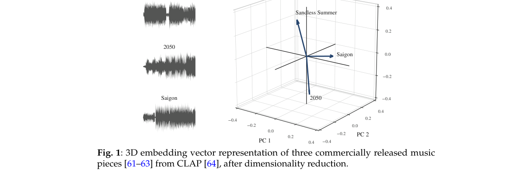

**Why this ranks #8**: 把 Boden 的价值、新颖、惊奇三要素操作化到音乐领域，给出一组互补的量化指标而非单一总分；文中引用的最大规模主观评测是 Grötschla 等在 12 个模型、6000 段 AI 音乐上做的 15000 余次成对比较。

---

## Footer

- Total papers reviewed across all 4 axes: 60
- duplex_speech axis final count: 8
- Wild-cards in this axis: 0
- Figure assets: 2026-11-13/res/

Generated by `mine-arxiv-daily-digest` skill. Sister file: `2026-11-13_duplex_speech_entry.md`.
