# Mine Arxiv Daily Digest - 2026-11-13 (具身智能与世界模型 Axis, 20 papers)

**Generated**: 2026-11-13 10:46 CST

**Source**: arXiv cs.CV, cs.SD, eess.AS, cs.CL, cs.AI, cs.RO, cs.LG, cs.IR submissions, listing day 2026-11-11 (announced 2026-11-13 01:00 UTC)

**Batch window**: 2026-11-10T19:00:00Z .. 2026-11-11T19:00:00Z（arXiv 公告批次横跨两个 UTC 日：从前一日的美东 14:00 截止时刻起算（EDT 为 18:00Z，EST 为 19:00Z），到当日的同一时刻为止）

**Axis**: world_embodied (20 papers, base 15, cap 20)

**Directions**: world_model (7), embodied_ai (13)

**Selection**: 20 papers ranked by relevance x quality, with 0 wild-card slots

**Day total**: 60 papers across 4 axes (target 60)

**Scope**: 世界模型、学习型模拟器与具身智能，含移动操作、人形控制、触觉反射、VLA 策略与面向具身任务的强化学习

**Wild-card**: 0 —— 本 axis 20 篇全部是够格论文，未启用任何 wild-card 名额。

**本 axis 从 13 篇补到 20 篇，打满 `AXIS_CAP = 20`。** `world_model` 刚好打满基准 7 篇（新增 4 篇），`embodied_ai` 吸收其余名额到 13 篇、超基准 5 个。

**5 个超基准名额只能由 `embodied_ai` 承担。** 按 `pipeline.py select` 的判据 `dir_over ≤ max(dir_under, axis_surplus)`，axis 超过基准时同轴内每个 direction 都必须不低于自己的基准；本批 `world_model` 过筛的新候选只有 5 篇（relevance 7、7、5、5、5），最多补到 7 篇，因此 `embodied_ai` 必须承担全部 5 个超基准名额，其中 3 篇是 rel ≥ 9 的必进论文。

---

## 世界模型与学习型模拟器 · `world_model` (7 papers)

本方向 7 篇里 4 篇新增。Fast Inference-Time Policy Refinement via Action-Affine World Models 以 9.0 居首：只学「小幅动作修正如何改变结果」这一局部响应，再解一个凸 QP，四个仿真操作任务平均成功率从冻结扩散策略的 27.18% 提到 59.51%，每控制步额外开销仅 3.80 ms。The Posterior-Prior Epistemic Gap 则把世界模型的失效量化：同一障碍物探针在后验状态上 AUC 0.85，在 15 步想象状态上单调衰减到 0.71、logit 间隔下降 57%，而规划器自带的 5 头集成分歧做障碍分类只有 AUC 0.52——失败不会被自己察觉。新增里 FloCOS 把周围车辆未来占据集的非凸并集直接写进轨迹优化的碰撞约束（Waymo 1000 个测试场景上全时域覆盖率 99.3%、交互完成率 85.6% 对 DOS-Ellipse 的 59.1%）；TyphoonWorld 用 47.2M 参数的残差 token 世界模型做台风预报，220 K 以下深对流区的 CRPS 相对所有其他集合降低 14% 到 39%、离散度与误差相关 0.78（外部风暴残差只有 0.21）；From Forecasting to World Modeling 提醒预测精度与干预响应精度是两个问题（Double ML 反事实 WMAPE 0.046，而 TabPFN 喂原始工具变量时从 0.094 恶化到 0.193）；Multi-View 3D Reconstruction Using V-JEPA Features 则老实报告了 JEPA 特征迁移到重建后收益与原始几何恶化的并存（原始 Chamfer 从 3.5535 涨到 4.4374）。

### 1. Fast Inference-Time Policy Refinement via Action-Affine World Models

**arXiv**: [2611.15011](https://arxiv.org/abs/2611.15011) | **Score**: 9.0 (relevance 9 x 0.7 + quality 9 x 0.3) | **Direction**: `world_model` | **Tags**: embodied, world-model, action-affine, inference-time-refinement, convex-qp, diffusion-policy, Tsinghua University | **Categories**: cs.RO | **Pages**: 9

**Authors**: Run Wang; Yilin Mo; Liang Wu

**Affiliation**: Tsinghua University

**Abstract**

> Imitation policies can perform complex manipulation, yet small execution errors can accumulate and cause failure. Refinement can correct these errors, but existing approaches often require additional on-policy learning or costly online planning. Our key insight is that a pretrained policy already supplies a useful nominal behavior: refinement can focus on predicting how small action corrections change its outcome. We therefore learn this local response in a form that is cheap to optimize. Our \textit{action-affine world model} (A\textsuperscript{2}WM) learns local action sensitivities offline from action-perturbed policy rollouts. Given interaction history and a policy proposal, it predicts task-relevant geometry as a nominal trajectory plus a linear response to corrections. It predicts the full planning horizon directly, avoiding the propagation of intermediate errors through recursive model evaluations. Quadratic penalties on predicted task errors and linear correction constraints then yield a cheap convex quadratic program (QP). Online refinement requires one model evaluation and one QP solve, while both policy and model weights remain frozen. Across four simulated manipulation tasks, our framework achieves the highest success rate among evaluated baselines, adding only 3.8 ms of mean refinement overhead per control step, excluding base-policy sampling.

**Key findings**

- **Finding**: A²WM 在 OneLeg、RoundTable、Lamp、PushT 四个仿真操作任务上把平均成功率从冻结扩散策略 DP 的 27.18% 提到 59.51%，其中 OneLeg 75.26%、RoundTable 42.97%、Lamp 41.02%、PushT 78.78%（与 GPC-OPT 持平）；每个控制步的精修开销为 3.40–4.00 ms、均值 3.80 ms，PushT 上只需 3.40 ms 而 GPC-OPT 需要 346.47 ms。
- **Inference**: 规划期的误差校正并不必然要求在线再训练或昂贵在线搜索；只要世界模型把动作修正的局部响应拟合成线性形式、用一次性视界预测替掉递归模型评估，凸 QP 就能承担几乎全部的规划负担，开销从百毫秒级降到个位数毫秒级。
- **Recommendation**: 要给冻结的扩散策略做推理期增强，优先复现「名义轨迹 + 线性响应」这一结构：离线只需 256 条（OneLeg/RoundTable/PushT）到 512 条（Lamp）扰动 rollout，线上策略与模型权重全部冻结，先用 3–4 ms 量级的单步开销验证收益，再考虑是否升级为在线树搜索。

**Key figures**

*Result - Overview of fast inference-time policy refinement. A frozen base policy generates action proposals every K control steps. At each control step, the action-affine world model uses interaction h*

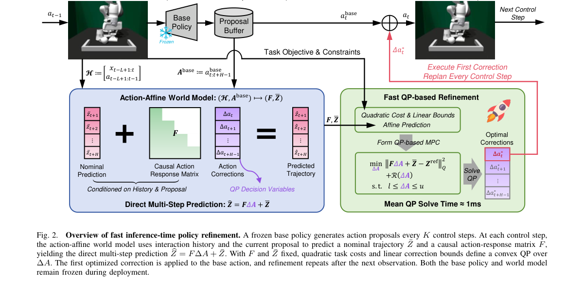

**Why this ranks #1**: 本 direction 分数最高（9.0）的一篇：只学「小幅动作修正如何改变结果」这一局部响应，把名义轨迹与线性修正项一起预测，再解一个凸 QP，线上只需一次模型评估加一次 QP 求解。在 OneLeg、RoundTable、Lamp、PushT 四个仿真操作任务上，平均成功率从冻结扩散策略 DP 的 27.18% 提到 59.51%（OneLeg 75.26%、RoundTable 42.97%、Lamp 41.02%、PushT 78.78%），每控制步额外开销仅 3.80 ms，方法主体是世界模型驱动的在线规划，故入 world_model。

---

### 2. The Posterior-Prior Epistemic Gap: When World Model Imagination Fails to Carry Task-Relevant Signals

**arXiv**: [2611.14955](https://arxiv.org/abs/2611.14955) | **Score**: 8.7 (relevance 9 x 0.7 + quality 8 x 0.3) | **Direction**: `world_model` | **Tags**: embodied, world-model, rssm, active-inference, epistemic-uncertainty, planning, University of Michigan-Dearborn | **Categories**: cs.AI, cs.RO | **Pages**: 7

**Authors**: Jaerock Kwon; Elahe Delavari; Donghyun Kim; Haewoon Nam

**Affiliation**: University of Michigan-Dearborn; Hanyang University

**Abstract**

> Model-based planners that roll out imagined futures assume the transition model faithfully propagates task-relevant signals---a property rarely measured directly. In a single-seed case study of a Recurrent State Space Model world model with active-inference planning in the CARLA driving simulator, we identify a \textbf{posterior-prior gap}---posterior (observation-filtered) states retain obstacle information that imagined rollout states progressively lose: a supervised obstacle probe achieves AUC 0.85 on posterior states, but the same probe applied to imagined prior states shows monotonic decay (AUC 0.85$\rightarrow$0.71 over 15 steps; logit separation drops 57\%). Because the probe is identical, the decay isolates the transition model---not the representation---as the information bottleneck. Obstacle avoidance drops to 0\% without privileged runtime coordinates, and the planner's own ensemble-based epistemic term does not flag the loss---ensemble disagreement yields AUC 0.52 as an obstacle classifier (chance level), making the failure an unflagged imagination failure---an unknown unknown at planning time. As a secondary contribution, we show that \textbf{task-conditioned weighting of Effective Free Energy components} over the same world model yields lane keeping ($81.2 \pm 1.8$\% route completion) and obstacle avoidance (28/28 avoided, \emph{using privileged coordinates}) in the CARLA simulator, with runtime weight modulation enabling post-evasion centering.

**Key findings**

- **Finding**: 同一障碍物探针在 RSSM 后验状态上 AUC 0.85，在 15 步想象先验状态上单调衰减到 0.71，logit 间隔下降 57%；无特权坐标时避障率为 0%，经任务条件化自由能加权后车道保持路线完成率 81.2±1.8%、11 个回合避开 28/28 个障碍；规划器 5 个转移头之间的集成分歧做障碍分类 AUC 仅 0.52。
- **Inference**: 探针完全不变而判别力随想象深度单调塌缩，说明信息瓶颈在转移模型而不在表征；同时集成分歧停在随机水平，意味着这类信息损失在规划时属于「未知的未知」，常规不确定性估计无法提前预警。
- **Recommendation**: 评估自己的世界模型规划器时，把同一个辅助探针分别挂在后验状态与第 k 步想象状态上画 AUC 曲线，并检查集成分歧是否具备判别力；若曲线单调下滑且分歧无判别力，就应在想象域内补感知监督，而不是继续加大集成规模或调采样温度。

**Key figures**

*Framework - Posterior-prior epistemic gap across imagination depth. AUC (left axis) and logit separation (right axis) both decay mono- tonically as the RSSM rolls out imagined states without observa- ti*

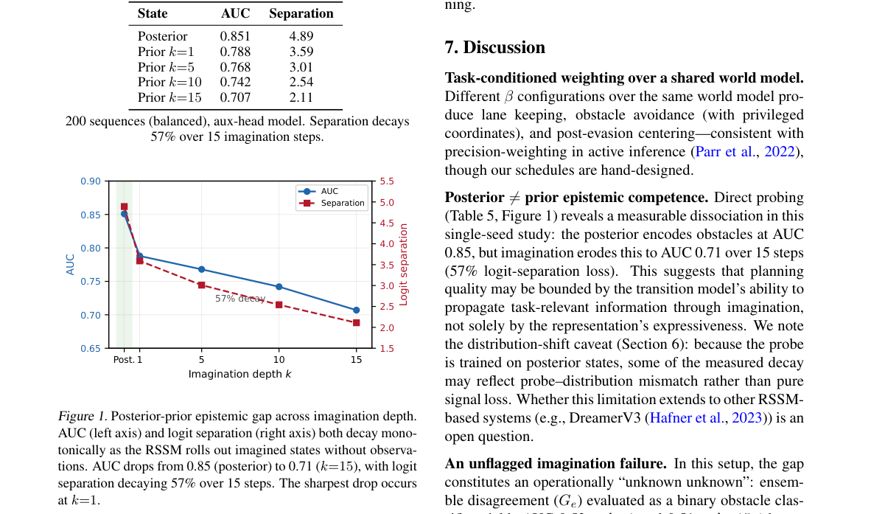

**Why this ranks #2**: 以 RSSM 世界模型 + CARLA 主动推断规划为对象，直接量化「后验状态知道、想象状态不知道」的落差：同一个监督障碍物探针在后验状态上 AUC 0.85，在 15 步想象先验状态上单调衰减到 0.71、logit 间隔下降 57%；没有特权运行时坐标时避障率跌到 0%，而规划器自带的 5 头集成分歧做障碍分类只有 AUC 0.52（随机水平），即失败不会被自己察觉。分数 8.7 排本 direction 第二。

---

### 3. FOE-Dreamer: Deployment-Efficient Learning of Cyber Defense Policies in Operational Networks

**arXiv**: [2611.14880](https://arxiv.org/abs/2611.14880) | **Score**: 7.0 (relevance 7 x 0.7 + quality 7 x 0.3) | **Direction**: `world_model` | **Tags**: embodied, model-based-rl, cyber-defense, dreamer, factored-latent, online-training, University of Texas at El Paso | **Categories**: cs.CR, cs.LG | **Pages**: 14

**Authors**: Yinuo Du; Christopher Kiekintveld

**Affiliation**: University of Texas at El Paso

**Abstract**

> Autonomous cyber defense is widely studied with deep reinforcement learning, but most work trains policies inside simulators because learning requires many trial-and-error interactions. Simulator-based training carries a fidelity gap: trained policies face authentication delays, partial action failures, service dependencies, and user traffic patterns that the simulator did not represent, and degrade on transfer. Training directly in the network being defended removes the gap but makes every interaction slow and costly, so sample efficiency becomes the binding constraint. Model-based reinforcement learning has reduced sample requirements on games and physical robots by orders of magnitude by planning inside a learned world model, but it has not been applied to defenders trained in operational networks. We present FOE-Dreamer (Factored Opponent-Enhanced Dreamer), a model-based reinforcement learning framework that trains a defender online and directly in a network on cloud infrastructure, without a simulator stage. FOE-Dreamer separates three sources of variation in the latent state: a controllable component driven by defender actions, an exogenous component driven by benign user activity, and an opponent embedding inferred from defender-observable signals alone. Separating the components reduces the variance in policy gradients during planning in imagination. Against two scripted attacker profiles with user activity emulated by the GHOSTS framework on an 8-host OpenStack testbed, FOE-Dreamer trains within a 3-day budget on a single GPU and achieves about 2$\times$ better episode loss than Rainbow and IQN baselines under matched compute. Both the factoring and the opponent model contribute to the gain, and the learned latents are consistent with the intended separation.

**Key findings**

- **Finding**: 在 8 主机 OpenStack 实网上配两个脚本化攻击者（Avoidant、Enticed）与 GHOSTS 用户模拟，FOE-Dreamer 单 GPU 训练三天，相对 Rainbow 与 IQN 把回合损失各降低约 2×；消融显示因子化与对手模型各自贡献一部分增益，学到的潜变量与预期的三分分离一致。
- **Inference**: 把「我方可控 / 外生噪声 / 对手意图」在潜空间里拆开，本质是降低想象式规划中策略梯度的方差，因此收益来自潜变量结构假设而不是更大的网络；这在每次交互都很昂贵的真实系统里比在仿真里更有价值。
- **Recommendation**: 要在真机或真实网络上做模型式 RL，先按同样的三分法（可控分量 / 外生分量 / 对手嵌入）重新设计潜变量，再谈算力投入；评估务必以「同算力下的回合损失 / 收敛速度」而非最终成功率为主指标，并准备一个无模型基线做同算力对照。

**Key figures**

*Framework - Agent-environment interface. The C2 server provides bidirectional translation: abstract defensive tactics become concrete network operations (downward), and distributed sensor data becomes s*

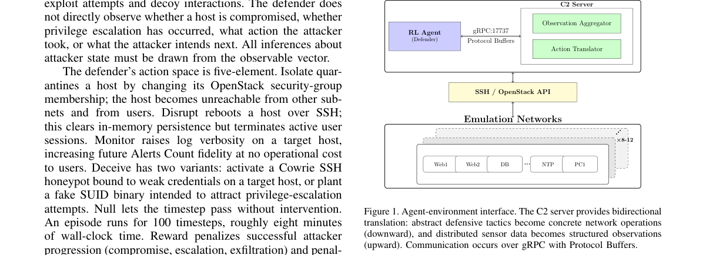

*Result - FOE-Dreamer architecture overview.*

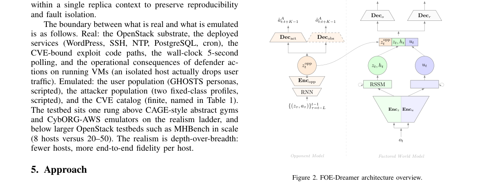

**Why this ranks #3**: 方法上是标准 Dreamer 式模型式 RL 的因子化变体：把潜状态拆成防御者动作驱动、外生用户活动驱动与对手嵌入三部分，在 8 主机 OpenStack 实网上用 GHOSTS 框架模拟用户流量，单 GPU 3 天训练预算内把回合损失做到 Rainbow 与 IQN 两个无模型基线的约一半（好 2×）。应用域是网络防御而非机器人，故分数只有 7.0，排本 direction 末位。

---

### 4. FloCOS: Predicting Compact Forward Occupancy Sets of Surrounding Vehicles via Conditional Flow Matching

**arXiv**: [2611.15488](https://arxiv.org/abs/2611.15488) | **Score**: 7.0 (relevance 7 x 0.7 + quality 7 x 0.3) | **Direction**: `world_model` | **Tags**: embodied, flow-matching, occupancy-prediction, motion-prediction, trajectory-planning, waymo-open-motion, School of Future Science and Engineering | **Categories**: cs.RO | **Pages**: 8

**Authors**: Chuansheng Dong; Yinxiao Zhan; Zongdian Li; Peng Hou; Jin Wang; Jiayu Fan

**Affiliation**: School of Future Science and Engineering, Soochow University; College of Control Science and Engineering, Zhejiang University; State Key Laboratory of Blockchain and Data Security, Zhejiang University

**Abstract**

> Existing methods for predicting surrounding vehicles' forward occupancy may under-approximate the ground-truth occupancy, exposing the ego vehicle to collision risk, or produce overly conservative regions that unnecessarily restrict feasible space and cause planning failures. To address these issues, we propose FloCOS, a conditional flow-matching framework that predicts compact forward occupancy sets with high occupancy coverage. FloCOS represents the forward occupancy set as a time-varying union of half-space convex polygons parameterized by temporal basis coefficients. Conditional flow matching captures the conditional distribution of these coefficients to govern the temporal evolution of the convex components, trained under coverage and union-area losses that penalize missed occupancy and excess area. For downstream trajectory optimization, the predicted nonconvex union is directly incorporated into hyperplane-based collision-avoidance constraints. Evaluations on the Waymo Open Motion Dataset show that FloCOS generates compact forward occupancy sets with high coverage and achieves a higher interaction completion rate than evaluated baselines. Real-world vehicle experiments further confirm its ability to support collision-free planning in interactive scenarios.

**Key findings**

- **Finding**: 在 Waymo Open Motion Dataset 的 1000 个测试场景上，FloCOS 全时域同时占据覆盖率 99.3%（DOS-Ellipse 98.8%），面积比从 3.98 降到 3.10，交互完成率从 59.1% 提到 85.6%；FORCE-OPT 完成率 85.2% 但覆盖率只有 69.7%，Traffic-Rule Set Prediction 面积比 8.59 而完成率仅 3.1%。
- **Inference**: 规划可行性同时取决于「覆盖得住」与「不占地」两个条件，只看完成率会被 FORCE-OPT 这类覆盖不足的方法误导；把预测目标从轨迹改成规划器可直接使用的凸包并集，才可能同时优化这两个量。
- **Recommendation**: 把运动预测接入规划时，先在同批场景上同时报覆盖率与面积比，再把非凸并集直接写进碰撞约束，不要退化成单个凸包或事后轨迹缓冲；消融可参考本文 Traj-CFM 变体，其 2 秒覆盖率掉到 66.1%、完成率仅 9.6%。

**Key figures**

*Framework - Effects of occupancy prediction on planning. All three panels use the same observation history and ego state. Left: undercoverage leaves part of the surrounding vehicle’s ground-truth occupanc*

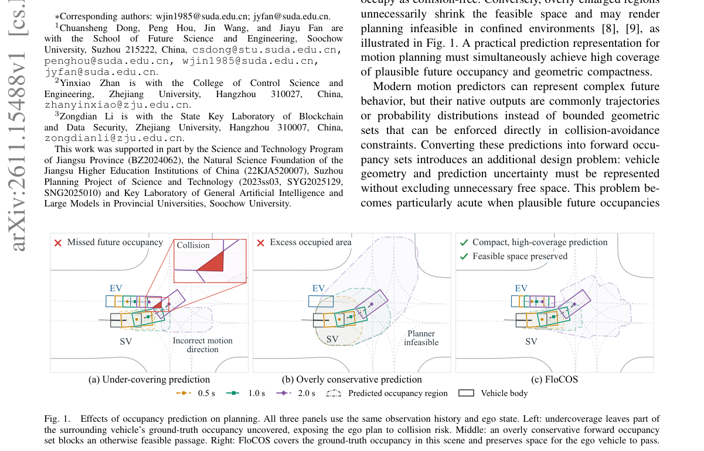

*Result - FloCOS generates temporal geometry coefficients from vehicle histories and map features and decodes them into sequences of convex components. The rightmost column shows the union of all eight*

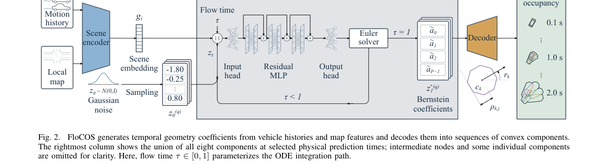

**Why this ranks #4**: 作为本 direction 并列第 3 位（分数 7.0）的一篇：它学的是周围车辆未来占据分布的生成模型，并把这个非凸占据并集直接写进轨迹优化的碰撞约束。Waymo 1000 个测试场景上全时域覆盖率 99.3%、面积比 3.10、交互完成率 85.6%（同族基线 DOS-Ellipse 为 98.8%、3.98、59.1%），属于「学到的未来模型直接服务于规划」的典型形态。

---

### 5. TyphoonWorld: A Residual Token World Model for Probabilistic Forecasting of Typhoon Imagery

**arXiv**: [2611.18740](https://arxiv.org/abs/2611.18740) | **Score**: 6.7 (relevance 7 x 0.7 + quality 6 x 0.3) | **Direction**: `world_model` | **Tags**: embodied, world-model, residual-modeling, discrete-token, ensemble-forecasting, satellite-imagery, Nanyang Technological University | **Categories**: cs.CV, cs.LG | **Pages**: 15

**Authors**: Xiaoyu Chen; Tianyi Li; Xuanyi Zhang

**Affiliation**: Nanyang Technological University; National Academy of Governance; PBC School of Finance

**Abstract**

> A satellite forecast of a typhoon should give a low-error picture of the next two days, together with an ensemble whose members are coherent fields and whose spread responds to the storm at hand. A small direct regression network already gives the lowest squared error on held-out storms, so a generative model has to earn its cost through the part of the future that the regression smooths away. We present TyphoonWorld, a discrete-token world model that generates only that part. Conditioned on tokens of the regression forecast, the latest frames and the best-track state at forecast time, it samples residual fields lead by lead, and members add these residuals to the regression center. We compare it under one protocol with per-pixel Gaussian networks, a diffusion model of the same residuals, residuals from other storms and an unconditional token world model, on 276 forecast windows from 46 held-out storms of Digital Typhoon. TyphoonWorld matches the squared error of the regression, lowers the CRPS of the area colder than 220 K, a direct measure of deep convection, by 14 to 39% against every other ensemble, and ties its spread to forecast error as closely as the Gaussian network, with a correlation of 0.78 across windows. It uses 56% of the parameters of the unconditional world model.

**Key findings**

- **Finding**: 直接 U-Net 回归中心只有 2.21M 参数、48 小时 MSE 0.0242（比 ConvLSTM 低 34%，比 token 采样均值低 17%）；TyphoonWorld 残差动力学 47.2M 参数，匹配该 MSE，并把 220 K 以下区域 CRPS 相对每一种其他集合降低 14%–39%、240 K 以下降低 21%–43%，离散度-误差相关 0.78（其他风暴残差 0.21）。
- **Inference**: 当一个小的确定性回归器已经拿到最低平方误差时，生成模型的正当性不在于复现整体未来，而在于专门采样被回归平滑掉的那部分误差；把生成能力对准残差，才能让扩散度与真实误差对应起来。
- **Recommendation**: 评估生成式预报器时，除平方误差外必须同时报深对流区的 CRPS 与「离散度-误差」相关系数，并检查参数量是否与无条件基线同量级；若集合只会输出一张平滑图，就没有提供额外信息。

**Key figures**

*Framework - Overview of TyphoonWorld. A direct U-Net estimates the mean at every lead (a). A residual world model reads tokens of the center, two recent frames and the initial state, and samples residua*

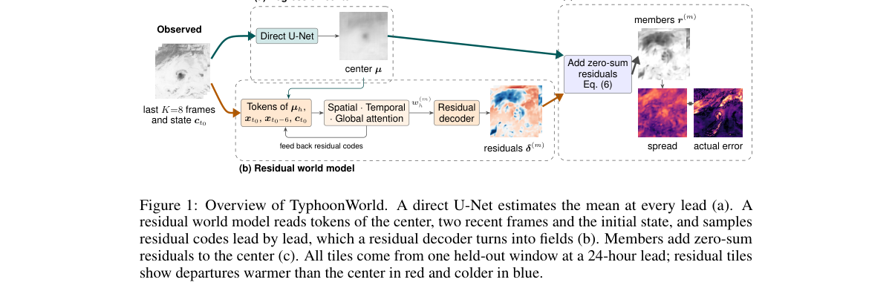

*Result - Skill by lead time on all test windows. TyphoonWorld holds the error of the regression center in (a), stays level with the best energy scores in (b), has the lowest CRPS of the area colder t*

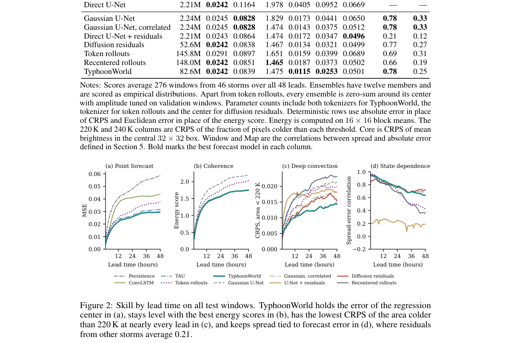

**Why this ranks #5**: 分数 6.7，排本 direction 第 5 位。它是名副其实的离散 token 世界模型：47.2M 参数的残差动力学在 46 个留出风暴、276 个预报窗口上，把 220 K 以下深对流区的 CRPS 相对所有其他集合降低 14%–39%，离散度与误差的相关系数 0.78（外部风暴残差只有 0.21），参数量却只有无条件 token 世界模型 129.2M 的 56%。

---

### 6. From Forecasting to World Modeling: Can Temporal Foundation Models Recover Causal Response?

**arXiv**: [2611.15009](https://arxiv.org/abs/2611.15009) | **Score**: 5.3 (relevance 5 x 0.7 + quality 6 x 0.3) | **Direction**: `world_model` | **Tags**: embodied, causal-inference, foundation-model, forecasting, instrumental-variables, benchmark, Seoul National University | **Categories**: cs.LG | **Pages**: 15

**Authors**: Juwon Hong; Minha Hwang; Venkatesh Shankar

**Affiliation**: Seoul National University; Microsoft

**Abstract**

> A model that forecasts sales accurately can still mislead a retailer about how sales respond to a price change. We evaluate released tabular and time-series foundation models, as well as a foundation model pretrained specifically to estimate causal effects. We report three findings. First, forecast accuracy does not indicate the accuracy of the predicted effect of price, both on simulated data in which the true effect is known and on real retail sales records. Second, for the tabular foundation models, additional context improves forecasts but not the predicted effect of price. Third, instrumental variables, the standard remedy in econometrics, reduce this error only when supplied in a specific form and increase it for every model under confounding when supplied as raw instruments.

**Key findings**

- **Finding**: 混杂面板下 LightGBM 反事实 WMAPE 为无工具变量 0.092、控制函数残差 0.064、原始工具变量 0.153，TabPFN 对应 0.094/0.052/0.193、TabICLv2 0.077/0.052/0.179；真实零售记录上 Double ML 预测误差更高（零食饼干 WMAPE 0.463 对 Chronos-2 的 0.368）却在每一行都正确判断降价方向。
- **Inference**: 拟合出的斜率是真实效应 β 减去 βδ·Var(ξ)/Var(log p)，更多同分布数据只会锐化这个被污染的估计；因此预测精度与干预响应精度是两个不同的问题，不能互相替代，也不能靠按预测误差选模型来自动选对工具变量形式。
- **Recommendation**: 把时序基础模型当世界模型评测时，除了预测误差必须额外测「干预响应误差」；工具变量要以控制函数残差形式喂入，并在混杂强度不为零的数据上检查反事实 WMAPE 是否低于「预测不变」基线，否则应直接采用双机器学习。

**Key figures**

*Framework - More data improve forecasts, but counterfactuals only without confounding. Panel A uses the confounded data (δ = 0.30) and Panel B the unconfounded data (δ = 0). The horizontal axis is the a*

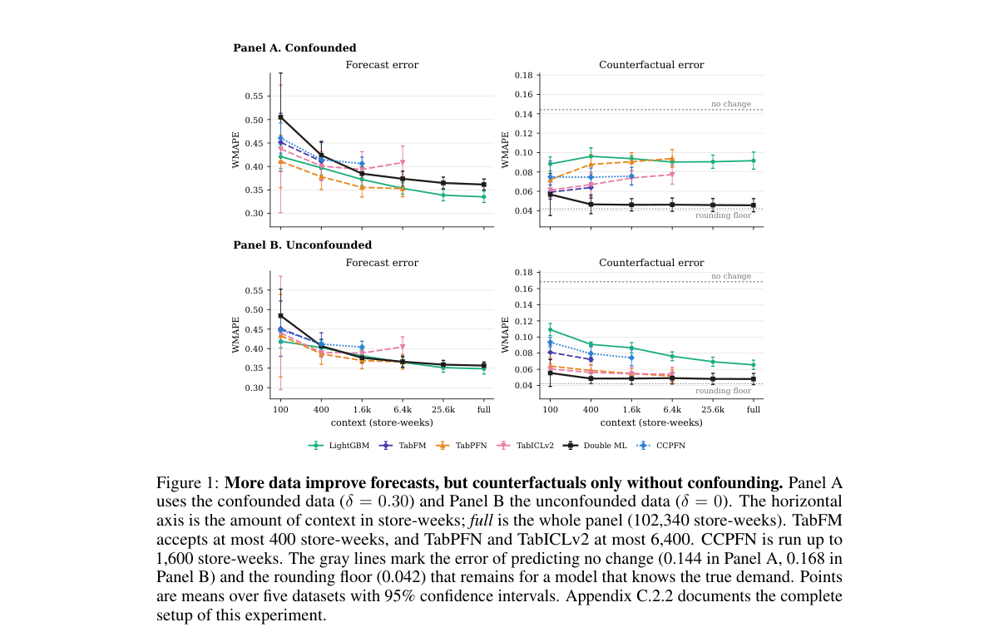

*Result - Overview of how the CausalDemand datasets are generated.*

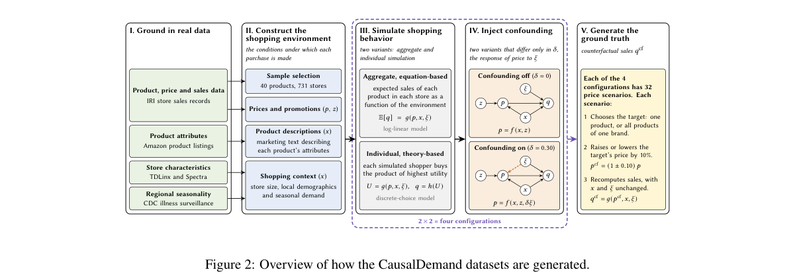

**Why this ranks #6**: 分数 5.3，并列本 direction 末位。它不提出新模型，而是用 CausalDemand 模拟零售数据（混杂强度 δ=0.30、32 个 ±10% 价格干预）系统检验时序基础模型能否当世界模型用：Double ML 反事实 WMAPE 0.046，而 TabPFN 在喂原始工具变量时从 0.094 恶化到 0.193，比「预测价格不变」的 0.144 基线还差。

---

### 7. Multi-View 3D Reconstruction Using V-JEPA Features

**arXiv**: [2611.15143](https://arxiv.org/abs/2611.15143) | **Score**: 5.3 (relevance 5 x 0.7 + quality 6 x 0.3) | **Direction**: `world_model` | **Tags**: embodied, jepa, multi-view-reconstruction, camera-estimation, depth-error, pointmap, [unverified] | **Categories**: cs.AI, cs.CV | **Pages**: 29

**Authors**: Anwar Shamim; Jeffrin Sam

**Affiliation**: [unverified]

**Abstract**

> Predictive video encoders provide dense visual representations, but adapting them to 3D reconstruction requires accurate depth, camera poses, and cross-view geometry. We study supervised RGB-only multi-view reconstruction using an architecture that combines video-pretrained features, camera estimation, scene aggregation, epipolar transport, and residual pointmaps. Experiments compare global and spatial camera regression with joint relative objectives on CO3D, alongside an independently trained TUM RGB-D model. On 168 CO3D five-view windows, the spatial-camera configuration achieves 29.3% lower absolute trajectory error than the global-camera configuration, but performs worse than identity poses in trajectory error and worse than the global configuration in depth error. The joint relative-objective configuration improves normalized intrinsics error and similarity-aligned Chamfer distance from 0.6447 to 0.5573, but increases raw Chamfer distance from 3.5535 to 4.4374. On 163 indoor windows, camera error is 0.3063 m versus 0.3694 m for identity poses, while depth error is 0.4279 versus 0.2516 for constant median depth. Refinement worsens indoor camera error, and additional experiments show competing depth and pose effects. Overall, the results distinguish representation adaptation, aligned shape, and raw reconstruction, highlighting the need for isolated component and encoder comparisons before attributing reconstruction gains to predictive video pretraining.

**Key findings**

- **Finding**: 168 个 CO3D 五视图窗口上，空间相机配置把相机绝对轨迹误差比全局配置降低 29.3%（旋转相对位姿误差从 30.43° 降到 22.67°），但仍比单位位姿基线高 10.03%；联合相对目标把对齐 Chamfer 从 0.6447 降到 0.5573、对齐 F@0.20 从 0.3943 升到 0.4476，同时原始 Chamfer 从 3.5535 涨到 4.4374、原始 F@0.20 从 0.0333 掉到 0.0265。
- **Inference**: 拟合一个参考导出的相似变换后误差下降，可以与首视图坐标系下的原始几何变差并存，因此「对齐后更准」并不等于「重建更准」；论文自己也强调架构、监督与选型准则同时变化，无法把增益归因到预测式视频预训练本身。
- **Recommendation**: 评估预测式视频特征带来的重建收益时，必须同时报原始与对齐后的 Chamfer，并保留单位位姿、常数深度、常数标定这三条朴素基线做对照；不要用单一的相似对齐误差下结论，也不要把置信度或潜向量余弦相似度当作几何正确的证据。

**Key figures**

*Framework - Our reconstruction architecture. Video-pretrained features are extracted separately from each image. Explicit camera estimation and epipolar transport provide multi-view geometry. Dashed arr*

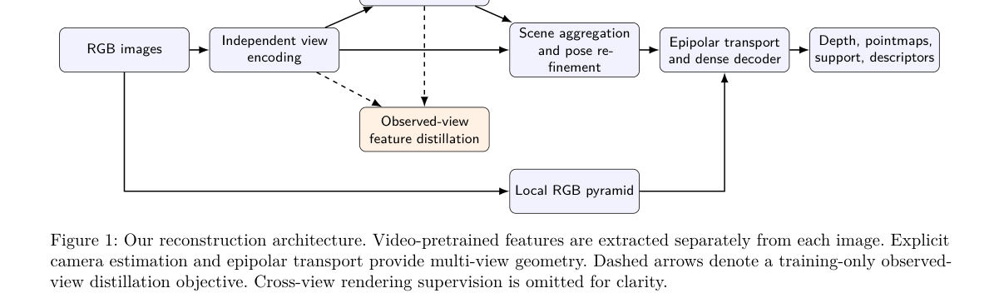

*Result - CO3D geometric trade-offs. The spatial-camera configuration has lower camera ATE than the global-camera configuration. The relative-objective configuration has lower intrinsics and aligned-s*

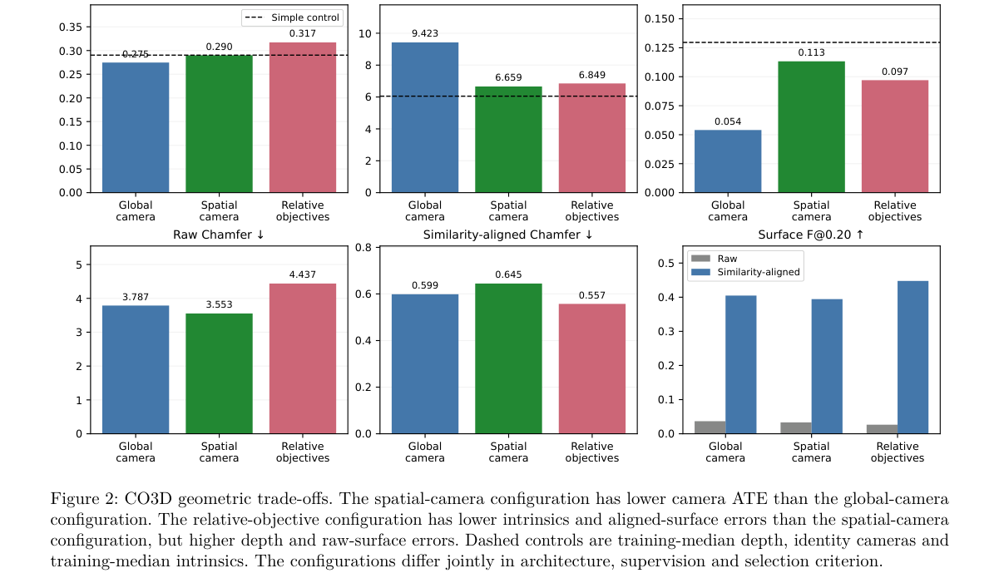

**Why this ranks #7**: 分数 5.3，与上一篇并列本 direction 末位。骨干用的是 V-JEPA 2.1 稠密视频特征，属 JEPA 系；论文用 168 个 CO3D 五视图窗口与 163 个 TUM 室内窗口逐组件拆解收益：空间相机配置轨迹误差比全局配置低 29.3%，但联合相对目标在原始 Chamfer 上从 3.5535 恶化到 4.4374，室内深度 AbsRel 0.4279 反而差于常数深度基线的 0.2516。

---

## 具身智能与机器人学习 · `embodied_ai` (13 papers)

本方向 13 篇是当天最大的方向，新增 6 篇且多为真机工作：Autonomous Trail Racing 用车载语义高程图把「找路」写进训练地形，苏黎世 1 公里非结构化山道全程自主通过、平均 3.26 m/s 峰值超 5 m/s，比遥控策略快 2.3 倍；EMS-Nav 以「区域」为组织单元统一感知、空间理解与导航，18628 条覆盖物体／房间／区域／实例四类目标的指令上首次成功率比最强基线高 9.39 个百分点，并在 RTX 4060 Ti 上跑到 5.19 FPS；DroneDiffusion 把感知可靠性图当作扩散规划器的一等条件量（真实机碰撞率 14.71% 降到 7.77%，不安全路点 20.52% 降到 12.89%）；APG-Planner 用解析策略梯度训练视觉轨迹规划器，稀疏林地成功率 94%、均速 8.16 m/s，去掉跨重规划步的时序梯度后成功率不变但均速塌到 2.46 m/s（PPO 只有 60%）；CARE-Drive 把 VLA 轨迹精修拆成位置与航向两个物理专家交替优化（NAVSIM PDMS 86.462 提到 88.837）；CrowdMAPS 则证明真机采集预算受限时把动作宽度从 K=1 提到 K=10 比追加遥操作轨迹更有效（五个任务平均成功率 38.7% 升到 74.2%，等密度高斯噪声基线只有 43.3%）。已发布部分里 Learning Low-Latency Action Verification 用终局成败训小验证器（三个真机任务 44.7% 提到 67.3%，中位时延只涨 5.4%）、Scaling VLA Serving 的 ERC 达 vLLM-Omni 的 1.26 到 3.75 倍，仍是本方向最高分两篇。

### 8. Learning Low-Latency Action Verification for Frozen Vision-Language-Action Models

**arXiv**: [2611.14834](https://arxiv.org/abs/2611.14834) | **Score**: 9.0 (relevance 9 x 0.7 + quality 9 x 0.3) | **Direction**: `embodied_ai` | **Tags**: embodied, vla, action-verifier, hindsight-learning, success-prediction, real-robot, University of California | **Categories**: cs.AI, cs.CV, cs.RO | **Pages**: 10

**Authors**: Wen-Han Hsieh; Ken Jiankun Zheng; Chia-Chien Chen; David M. Chan; Trevor Darrell

**Affiliation**: University of California, Berkeley; National Tsing Hua University

**Abstract**

> Vision-language-action (VLA) models have made significant progress in general-purpose robotic manipulation. However, sampled action sequences can be ineffective, while evaluating alternatives with computationally expensive verifiers adds latency at each policy query. In this work, we propose HDH, a lightweight framework that uses hindsight from a frozen VLA's own deployments to improve action verification. The framework has three stages. First, we deploy the policy and collect its autonomous rollouts. We then train a compact action verifier to assign each action chunk a predicted task-success score. Finally, the frozen VLA generates action candidates, and the verifier selects the candidate with the highest score for execution. Across four LIBERO-10 tasks, HDH achieves an average success rate of 82.3\% and on three real-world manipulation tasks, HDH improves average success over the baseline policy by 22.6\%.

**Key findings**

- **Finding**: HDH 在 4 个 LIBERO-10 任务上把仿真平均成功率从 78.8% 提到 82.3%；对照中去掉历史条件的 HDM 变体为 80.3%，加入执行历史后的最大增益落在 Soup + Sauce（+6.7%）与 Mug + Pudding（+5.3%）两个多物体任务上。3 个真机任务每任务 50 次试验，平均成功率从 44.7% 提到 67.3%，其中毛绒玩具摆放 64%→94%。每次查询端到端时延 p50 为 718 ms、p95 796 ms，相对基线 681/760 ms 仅 +5.4%，而 GPT-5 为 27,674/46,911 ms（+3963.7%）、GPT-6 为 7,403/10,270 ms。
- **Inference**: 终局成败本身已经足以训练出有判别力的候选排序器，说明「预测未来」这类昂贵监督并不是动作筛选的必要条件；代价是验证器只能学到策略历史分布上的相对排序，对候选分布外的动作外推能力有限。
- **Recommendation**: 想在不重训策略的前提下提升成功率，可直接照搬「收集自主 rollout → 用终局成败训小验证器 → 打分选优」三步，并把执行历史作为条件输入以区分任务进度；同时要自测候选数从 2 扩到更多时的延迟与判别力衰减，论文只验证了 2 个候选这一种配置。

**Key figures**

*Framework - We propose HDH, a lightweight framework for improving action selection in frozen vision-language-action models. We first collect autonomous policy rollouts and use their terminal success and f*

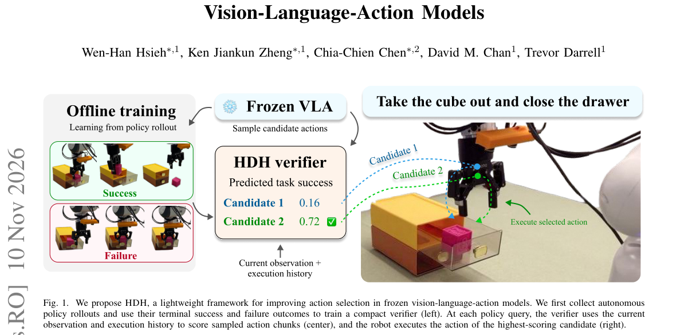

*Result - Overview of HDH (a) Given the task instruction, current image observations, and proprioception, (b) we sample candidate action chunks from a frozen VLA. (c) We assign each candidate a predicte*

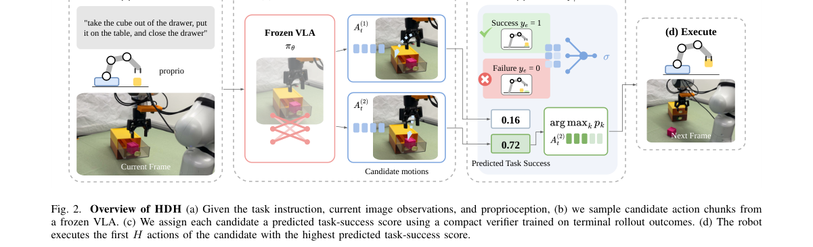

**Why this ranks #8**: 用冻结 VLA 自己的自主 rollout 终局成败做监督，训一个轻量动作验证器给候选动作块打分选优：LIBERO-10 四个任务平均成功率 78.8%→82.3%，三个真机任务（每任务 50 次试验）从 44.7% 提到 67.3%、毛绒玩具摆放 64%→94%；每次策略查询的中位时延只从基线 681 ms 涨到 718 ms（+5.4%），而 GPT-5 验证器要到 27,674 ms。分数 9.0，与 XInfer 并列本 direction 第一。

---

### 9. Scaling VLA Serving Under Robotic Execution Constraints

**arXiv**: [2611.14969](https://arxiv.org/abs/2611.14969) | **Score**: 9.0 (relevance 9 x 0.7 + quality 9 x 0.3) | **Direction**: `embodied_ai` | **Tags**: embodied, vla-serving, inference-systems, scheduling, robot-fleet, gpu-utilization, X Square Robot | **Categories**: cs.DC, cs.RO | **Pages**: 20

**Authors**: Yue Zhang; Zicong Ye; Lufang Chen; Dance Yang; Mingyang Li; Zhenwei Duan; Michael Zhao; Ziye Deng; Starrick Liu; Ruizhi Chengze; YongHua Chen; SongAo Han

**Affiliation**: X Square Robot

**Abstract**

> Vision-language-action (VLA) models have emerged as a promising paradigm for general-purpose robotic manipulation. In our production setting, hundreds of VLA-powered robots are already operating in real-world environments, creating an immediate need for efficient fleet serving. We present XInfer, a production-deployed VLA serving system designed to reduce the inference infrastructure cost of large-scale robotic deployments. XInfer jointly coordinates heterogeneous VLA computation with the evolving response requirements of robotic execution. By exploiting computational parallelism while managing interference, XInfer improves GPU efficiency while protecting time-critical robotic feedback. We evaluate XInfer across three VLA models using production-derived workloads, achieving 1.26-3.75 times the effective robot capacity (ERC) of state-of-the-art systems under physical-execution constraints. Our implementation is publicly available at https://github.com/X-Square-Robot/xinfer.

**Key findings**

- **Finding**: 在无错误响应条件下 XInfer 单卡可服务 18 台 VLA-2B 与 24 台 π0.5 机器人，vLLM-Omni 分别为 10 与 15 台、Robion 为 19 台 π0.5；异构响应预算的 VLA-2B 实验中 XInfer 的 ERC 为 18 台，Slack-Gate 15 台、FIFO 14 台、EDF 12 台；ERC 判据是响应 P50<150 ms 且零请求错误，评估负载取自生产衍生闭环工作流。
- **Inference**: 容量能提升到 1.26–3.75 倍主要来自两点——把 CPU 准备与 GPU 执行重叠、并让不同请求的 ViT/Prefill/Action 阶段交叉推进，于是瓶颈从单请求时延转为调度干扰；这说明时延敏感的机器人负载更适合异步流水线，而不是简单加大批处理。
- **Recommendation**: 做机器人推理服务时，先用 ERC（同时满足 P50 时延与零错误约束的最大并发机器人数）而不是 QPS 作为容量指标；调度上优先把 CPU 前处理与 GPU 执行解耦、把「请求优先级」与「阶段准入」分开处理，并按自己机器人的响应预算重测这三个系统的对比。

**Key figures**

*Framework - Production parcel handling. A carton (top) and a soft parcel (bottom) are reoriented and pushed onto the conveyor. Each row*

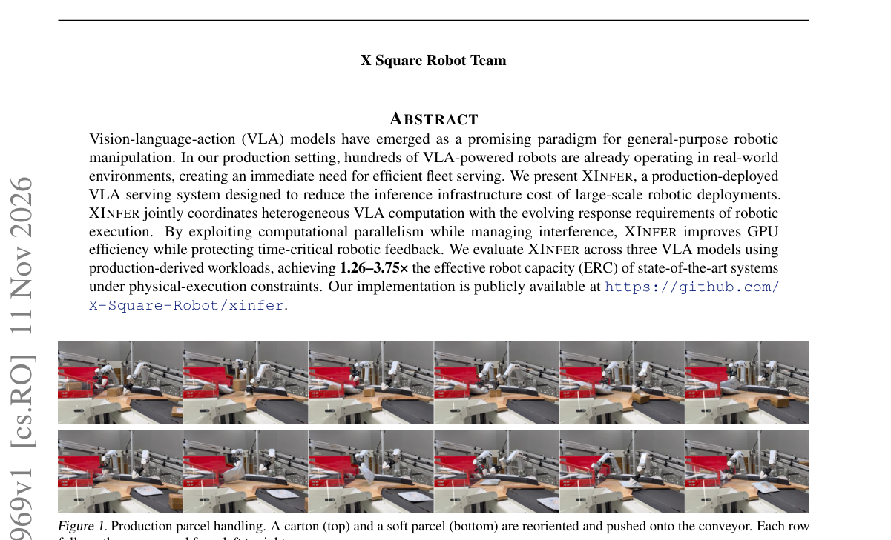

*Result - Projected parcel throughput on one GPU (VLA-2B),*

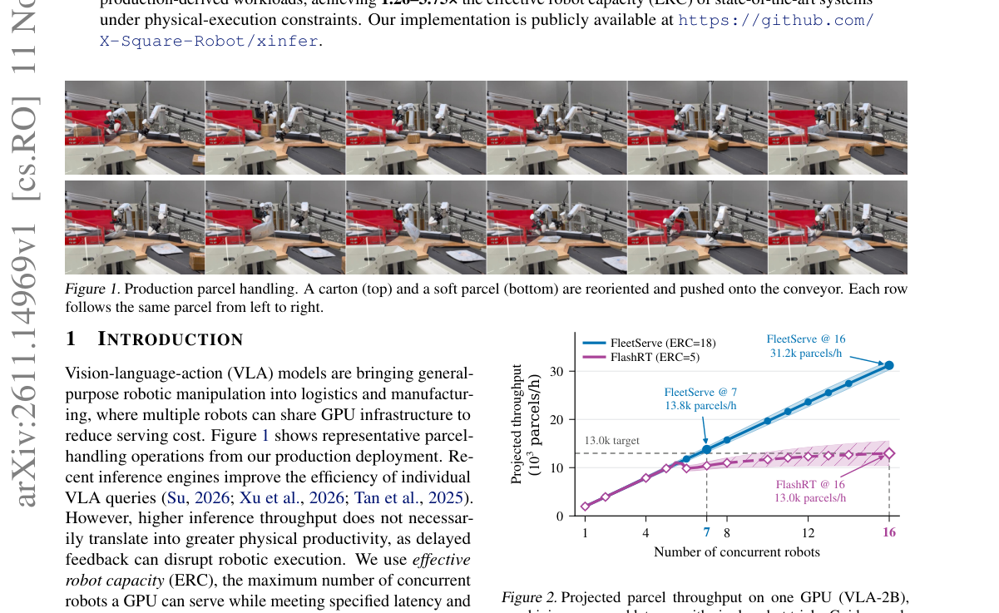

**Why this ranks #9**: 生产环境已有数百台 VLA 机器人，XInfer 用异步执行引擎加执行感知的跨阶段调度，把异构 VLA 算力与机器人响应需求耦合调度：在 VLA-2B、π0.5、Wall-OSS-0.5 三个模型与生产衍生负载上，单卡有效机器人容量（ERC）达 vLLM-Omni 的 1.26–3.75 倍（XInfer 为 18 台 VLA-2B 与 24 台 π0.5，vLLM-Omni 仅 10 与 15 台，Robion 为 19 台 π0.5）；异构响应预算下 XInfer ERC 18 台，对 Slack-Gate 15、FIFO 14、EDF 12，ERC 判据为响应 P50<150 ms 且零请求错误。

---

### 10. ILA: A Transferable Interface-Level Adapter for Compliant Humanoid Motion Tracking

**arXiv**: [2611.14985](https://arxiv.org/abs/2611.14985) | **Score**: 8.7 (relevance 9 x 0.7 + quality 8 x 0.3) | **Direction**: `embodied_ai` | **Tags**: embodied, humanoid, motion-tracking, compliance, reference-adaptation, sim-to-real, Harbin Institute of Technology | **Categories**: cs.RO | **Pages**: 8

**Authors**: ZhuoChang Cai; Zihao Yan; Jinxuan Zhu; Yanjie Li; Hao Xiong

**Affiliation**: Harbin Institute of Technology, Shenzhen; National University of Singapore

**Abstract**

> Humanoid motion tracking is fundamental to reproducing human motions on humanoid robots and serves as an important tool for teleoperation and motion data collection. However, directly tracking reference motions can be unsafe in constrained environments or during physical human--robot interaction, motivating the need for compliant motion tracking. We present ILA, an Interface-Level Adapter for compliant humanoid motion tracking without dedicated interaction sensors. ILA adapts motion references from the robot's observation history, allowing the robot to respond to physical guidance while preserving the capabilities of a pretrained motion tracker. As an interface-level module, ILA can be directly plugged into different pretrained motion trackers without retraining either the adapter or the tracking policies. ILA is trained entirely in simulation to predict reference corrections induced by physical interaction. We evaluate ILA with three humanoid motion trackers and achieve a 63.6--75.4% reduction in guidance-target error compared with their original policies. Matched simulation studies and hardware experiments further show that ILA improves responsiveness to human guidance while preserving nominal motion-tracking performance. These results demonstrate compliant guidance as a reusable, sensor-free extension to pretrained humanoid motion trackers.

**Key findings**

- **Finding**: 同一套冻结的 ILA 适配器跨三个独立训练的运动跟踪器复用，指导目标误差在 MimicLite 上降 63.6%、在 Sonic 上降 75.4%；硬件实验显示无外力时跟踪误差仅增加 0.5%、释放后恢复动作改善；适配器从特权教师蒸馏到因果历史学生，用四类交互阶段（无交互/让位/保持/恢复）与两路强度 sigmoid 头输出修正，评估含 243 个目标簇的 95% 自助置信区间（10,000 次重采样）。
- **Inference**: 把顺从性放在「参考适配」层而不是动作或力矩残差层，是同一适配器能跨跟踪器复用的原因（跟踪器只看被改写的参考），代价是它无法在跟踪器之外主动改变全身执行策略，顺从范围受跟踪器自身能力上限约束。
- **Recommendation**: 已有预训练人形跟踪器但缺接触传感器时，优先在参考接口层加一个由观测历史预测修正量的适配器，而不是改策略本体；训练照搬「特权教师 + 因果历史学生」蒸馏，并分别验收无外力时的跟踪退化与有引导时的响应两项指标（论文的 0.5% 与 63.6–75.4% 正是这两个量的分离度量）。

**Key figures**

*Framework - ILA adds physical guidance through reference adaptation while preserving pretrained whole-body policies. (a) Human-guided reference adaptation. (b–d) The same ILA trained with standard MotionT*

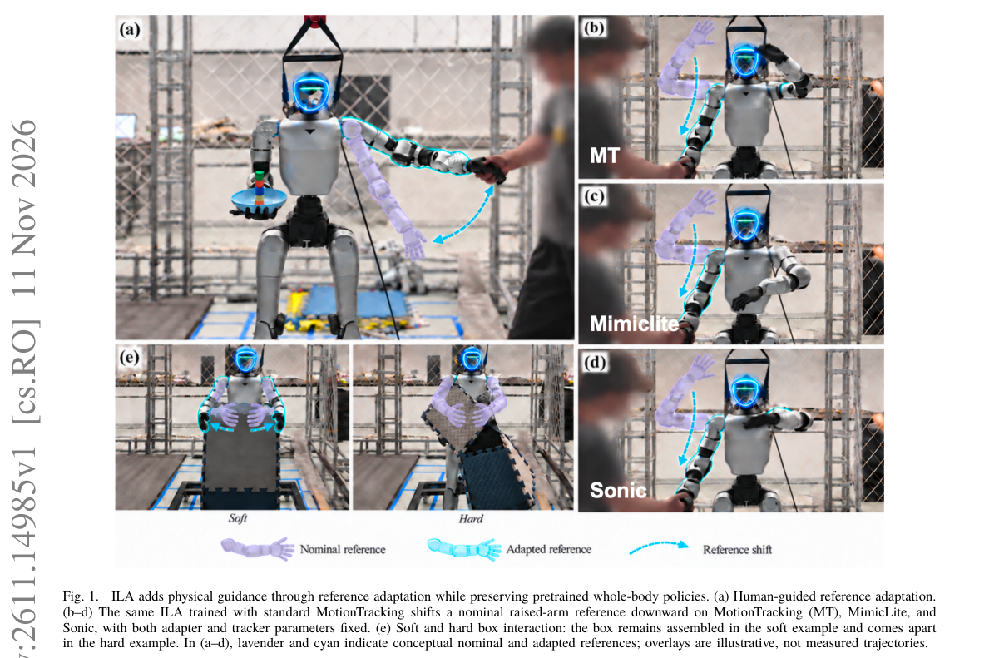

*Result - ILA adapts the reference while preserving the controller. (a) Nominal–modified reference pairs supervise the residual ∆r∗= m ⊙(rmod −rnom). (b) O denotes the observation history and nominal re*

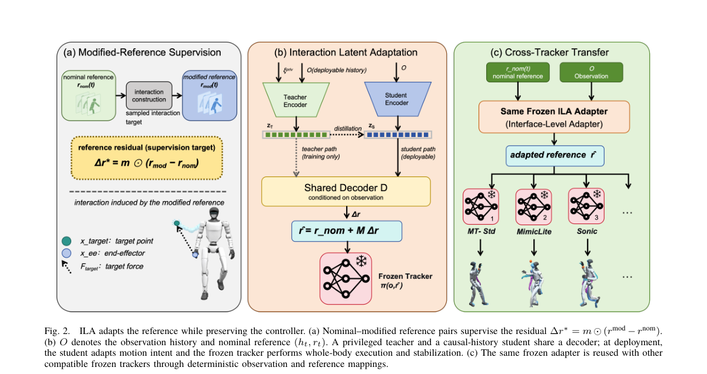

**Why this ranks #10**: 把「顺从引导」做成可插拔的接口层模块：ILA 只根据机器人观测历史预测参考动作的修正量，接在三个预训练人形运动跟踪器前，适配器与跟踪器权重全部冻结、也不加专用力传感器，指导目标误差在 MimicLite 上降 63.6%、Sonic 降 75.4%，而硬件实验中无外力时的跟踪误差只上升 0.5%。适配器完全在仿真里训练，分数 8.7 排 embodied_ai 第三。

---

### 11. Genie Sim Benchmark: Real-to-Sim Fidelity and Evaluation

**arXiv**: [2611.15020](https://arxiv.org/abs/2611.15020) | **Score**: 8.7 (relevance 9 x 0.7 + quality 8 x 0.3) | **Direction**: `embodied_ai` | **Tags**: embodied, sim-to-real, benchmark, system-identification, manipulation, policy-evaluation, [unverified] | **Categories**: cs.RO | **Pages**: 27

**Authors**: Di Yang; Da Huang; Yang Lv; Fan Yang; Yi Lu; Zheyuan Xing; Linting Guo; Jiaen Shen; Wenjun Sun; Maoqing Yao; Qian Wang

**Affiliation**: [unverified]

**Abstract**

> We evaluate Genie Sim Benchmark through paired real-simulation tasks and complementary system-identification studies. Across 22 robot-task pairs spanning 16 task names, task-specific pi0.5 policies fine-tuned on real-robot data achieve a descriptive Score correlation of 0.9686, MAE 0.0405, RMSE 0.0520, with simulation-real differences from -0.110 to +0.080. G2 crsB experiments assess long-horizon closed-loop position and joint-side torque agreement, while five representative object cases examine identification and cross-engine contact transfer. A separate 32.6503 s teleoperation trajectory, excluded from mechanical identification and servo-gain search, evaluates external position targets through simulated motion-controller command shaping and a calibrated position servo. Across both arms, per-joint position RMSE spans 0.00614-0.03522 rad and current-derived torque RMSE spans 0.73545-4.00099 N m. Native PhysX adaptations recover three recorded interaction tasks, with case-dependent alignment gains. These results support task-specific simulation evaluation through joint assessment of task outcomes and physical-response consistency.

**Key findings**

- **Finding**: 22 个机器人-任务对（G1 Omnipicker 8、G2 Swiftpicker 6、G2 Wuji 1、Arx X5 7）跨 16 个任务名，真机微调 π0.5 的仿真—真机 Score 相关系数 r=0.9686、MAE 0.0405、RMSE 0.0520、平均带符号差 −0.0068，逐对差值落在 −0.110~+0.080；独立的 32.6503 s 遥操作轨迹标定出逐关节位置 RMSE 0.00614–0.03522 rad、由电流推得的力矩 RMSE 0.73545–4.00099 N·m，Score 取自剔除前 1 s 预热后的 3,165 个采样。
- **Inference**: 任务级 Score 相关性高并不等于物理保真度高——逐关节位置误差已达 0.03522 rad 量级、力矩误差在低力臂上达 4.00099 N·m，因此「策略级排名可迁移」与「接触物理可迁移」必须分开验证，不能用前者推断后者。
- **Recommendation**: 要评估自家仿真能否替代真机做策略选型，建议直接照搬这套双轨协议：先做任务级配对回归（Score 对 Score）看排序一致性，再单独做关节位置与力矩的系统辨识看物理一致性；只有两轨都过关，才把仿真结论用于部署决策。

**Key figures**

*Framework - Robot- and task-level real–sim evidence. Left: 60 s J1–J4 closed-loop replay and seven-joint RMSE across three excitation families; errors are uncentred and torque limits are URDF references,*

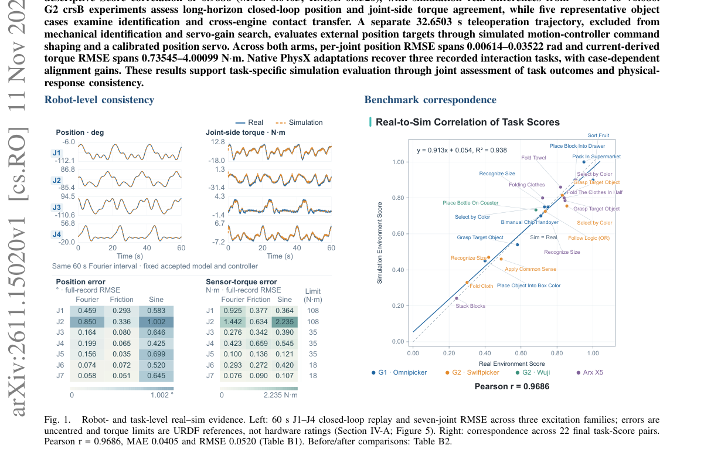

*Result - Representative scenes from the Real2Sim experiments summarized in Table 1: sixteen scene pairs across G1 Omnipicker, G2 Swiftpicker, G2 Wuji and Arx X5 configurations. Rows 1 and 3 are real sc*

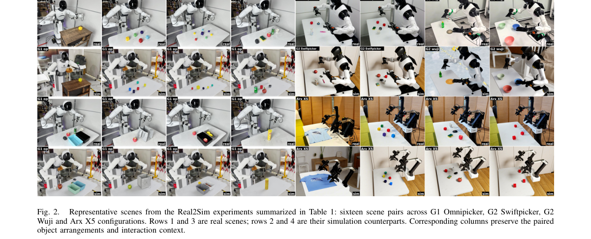

**Why this ranks #11**: 一份以「真机—仿真配对」为核心的双轨评测基准：22 个机器人-任务对、16 个任务名（G1 Omnipicker 8、G2 Swiftpicker 6、G2 Wuji 1、Arx X5 7），用真机数据微调的 π0.5 策略在仿真与真机上的 Score 相关系数 0.9686、MAE 0.0405、RMSE 0.0520，逐对差值 −0.110~+0.080；另用一段独立的 32.6503 s 遥操作轨迹做标定，两臂逐关节位置 RMSE 0.00614–0.03522 rad、力矩 RMSE 0.73545–4.00099 N·m。

---

### 12. Autonomous Trail Racing with a Bicycle Robot

**arXiv**: [2611.15280](https://arxiv.org/abs/2611.15280) | **Score**: 8.7 (relevance 9 x 0.7 + quality 8 x 0.3) | **Direction**: `embodied_ai` | **Tags**: embodied, robot-learning, off-road-navigation, semantic-mapping, sim-to-real, locomotion, Robotics and AI Institute (RAI) | **Categories**: cs.RO | **Pages**: 35

**Authors**: Fabian Jenelten; Deepana Ishtaweera; Pablo Garcia; Liana Margolese; Igor Bogoslavskyi; Luca Buonocore; Jan Migliazza; Aleksandrs Ecins; Annika Wollschlaeger; Dario Bellicoso; Gabriel Nelson; Abel Gawel

**Affiliation**: Robotics and AI Institute (RAI), Zurich; Robotic Systems Lab, ETH Zurich; Robotics and AI Institute (RAI), Cambridge, MA

**Abstract**

> Navigating off-road trails on a mountain bike requires diverse locomotion skills, including aerial maneuvers, cornering, and slip recovery, paired with sophisticated perception for scene understanding. Translating these capabilities to autonomous, two-wheeled robots remains a formidable challenge. We show that autonomous, high-speed trail navigation can be achieved through a single idea: encoding the trail as a semantic layer of the terrain. In simulation, this layer embeds the navigation task into the training environment; during deployment, it is reconstructed onboard from camera and LiDAR data. First, we introduce a unified learning framework that treats local navigation and locomotion as a joint optimization problem, bypassing the twist or pose command interface of classical control hierarchies. With fixed reward weights, the same framework produces both trail racing and agile parkour, shaped only through terrain semantics and episode length. Second, our perception pipeline combines a frozen vision foundation model with a lightweight dual-head decoder that predicts per-pixel terrain semantics and confidence scores, which are fused with LiDAR range measurements into an egocentric semantic elevation map at 30 Hz onboard an NVIDIA AGX Orin. We validate our framework on the Ultra Mobility Vehicle (UMV), a bicycle robot that autonomously raced across all sections of a kilometer-long, unstructured mountain bike trail at speeds exceeding 5 m/s and averaging 3.26 m/s. In simulation, our policy fails up to an order of magnitude less often than hierarchical baselines while driving faster.

**Key findings**

- **Finding**: 语义管线刷新率从 50 Hz 提到约 90 Hz，RGB 逐帧处理后与 LiDAR 测距在 NVIDIA AGX Orin 上以 30 Hz 融合成 15×15 m、格距 0.1 m 的自车语义高程图；训练环境用 1000 块随机地形拼出超过 46 km 可通行赛道、约 450 万顶点，新环境只需 20 张标注图即可在机器人本机上数分钟内适配。
- **Inference**: 把可通行路径编码成地形网格的一个语义层，等于把「找路」问题从策略的在线推理负担转移到离线可程序化生成的环境里；部署端只需重建同一个语义层，就能让同一套奖励权重在越野竞速与跑酷之间切换。
- **Recommendation**: 做户外高速机器人时，优先把任务语义写进训练用的地形表示并保留一个可重建的在线版本；评估要以真实平均速度与失败率对标分层基线（本文 3.26 m/s 对 2.3 倍差距），同时准备 20 张左右标注图的快速适配流程。

**Key figures**

*Framework - The Ultra Mobility Vehicle (UMV) autonomously navigates a mountain-bike trail in Zurich. Left: The robot corners a curve. Right: The robot traverses pump-track waves.*

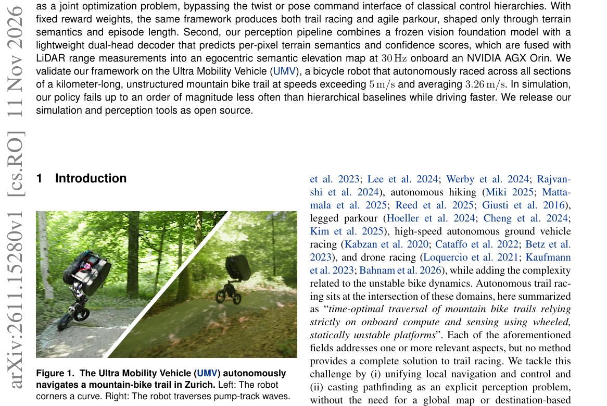

*Result - Autonomous trail racing and dynamic parkour. (A) The UMV autonomously navigates a mountain bike trail in Zurich at speeds exceeding 5 m/s, relying exclusively on onboard perception and compu*

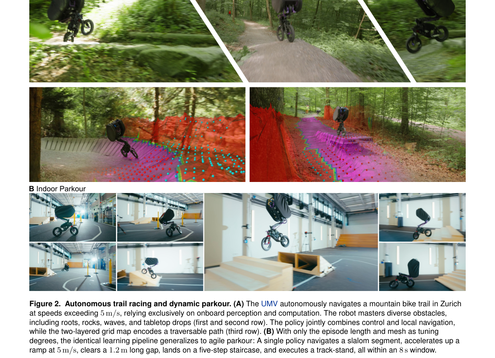

**Why this ranks #12**: 分数 8.7，并列本 direction 第 3 位。它把「局部导航 + 运动控制」合并成一个强化学习优化问题，绕过经典控制层里 twist/pose 的命令接口，并用车载语义高程图在线重建那条语义层：苏黎世 1 公里非结构化山道全程自主通过，平均 3.26 m/s、峰值超 5 m/s，比遥控策略快 2.3 倍，仿真失败率比分层基线低最多一个数量级。

---

### 13. EMS-Nav: Embodied Multi-Scale Navigation

**arXiv**: [2611.15589](https://arxiv.org/abs/2611.15589) | **Score**: 8.7 (relevance 9 x 0.7 + quality 8 x 0.3) | **Direction**: `embodied_ai` | **Tags**: embodied, scene-graph, language-goal-navigation, on-device, region-parsing, embodied-ai, Tsinghua University | **Categories**: cs.AI, cs.CV, cs.RO | **Pages**: 30

**Authors**: Zenghui Yang; Xinan Wang; Danyang Li; Zhe Xu; Zheng Yang; Jingao Xu; Qiang Ma

**Affiliation**: Tsinghua University

**Abstract**

> Industrial inspection robots must reach work areas and specific equipment. These destinations span spatial scales from regions to objects, so robots must relate each target to its surroundings to interpret the task and determine where to go. Existing methods support multi-scale navigation through rich environment representations, but at substantial computational and storage cost. These costs limit deployment where wireless coverage is incomplete and robots must rely on onboard computation to keep navigating. We introduce EMS-Nav, a biologically inspired multi-scale navigation framework for online, on-device operation. Its core innovation is to organize perception, spatial understanding, and navigation around regions, making local spaces the basic units of both environmental understanding and computation. EMS-Nav groups objects and their relationships into functionally meaningful spaces and builds a hierarchy from local areas to the broader environment. This organization supports efficient map construction alongside the interpretation and execution of language goals at different scales. In multi-scale navigation experiments, EMS-Nav achieves the highest success rates across all four target categories: objects, rooms, regions, and specific instances. It outperforms state-of-the-art open-vocabulary mapping and navigation methods, improving overall first-attempt success by 9.39 percentage points over the strongest baseline while reducing mapping overhead and language-model input size. Local deployment in real indoor environments further demonstrates its applicability to on-device embodied navigation. By establishing regions as the organizing basis for perception, spatial understanding, and language-guided action, EMS-Nav provides a system that combines multi-scale understanding with computational efficiency to support diverse language goals on resource-constrained robots.

**Key findings**

- **Finding**: 评测覆盖 18628 条指令、目标分物体/房间/区域/具体实例四类，EMS-Nav 首次成功率比最强基线高 9.39 个百分点且四类全部领先；实时部署在 RTX 4060 Ti 上峰值 5.19 FPS，同时压缩了建图开销与送入语言模型的输入规模；候选关联只在超点包围盒 1 m 内的区域内进行。
- **Inference**: 「先重建对象、再推断空间关系」的对象优先范式会随地图增长反复重算无关区域，而区域优先把在线更新与周期解析都限制在局部空间内，因此既能降低算力，又能把「目标在哪个功能空间里」这一多尺度语义问题显式化。
- **Recommendation**: 资源受限的机器人若要支持多尺度语言目标，应先把地图组织单元从对象换成区域：在线用局部关系证据做分区、周期性解析只重算变化区域及其父节点，并在选模型时以「同硬件上的处理帧率 + 语言模型输入长度」为联合指标，而不是只看成功率。

**Key figures**

*Result - EMS-Nav uses regions to connect online mapping with multi-scale spatial parsing. Left: posed RGB-D*

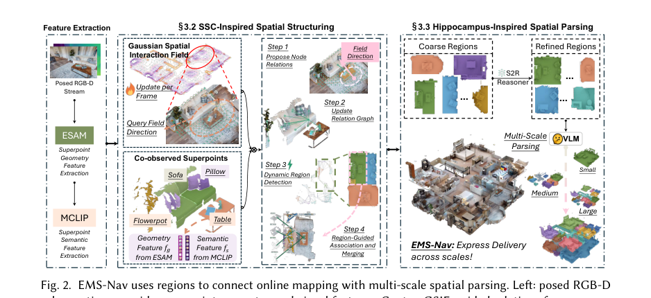

**Why this ranks #13**: 分数 8.7，与上一篇并列本 direction 第 3 位。EMS-Nav 用「区域」这一仿生学组织把感知、空间理解与导航统一起来：在线用高斯空间交互场引导关系提议与动态 Louvain 分区，周期性多尺度解析把区域组成语义层级，在 18628 条覆盖物体/房间/区域/实例四类目标的指令上首次成功率比最强基线高 9.39 个百分点，并在 RTX 4060 Ti 上跑到 5.19 FPS。

---

### 14. DroneDiffusion: Uncertainty-Guided Diffusion Path Planner for UAV Navigation

**arXiv**: [2611.15277](https://arxiv.org/abs/2611.15277) | **Score**: 8.4 (relevance 9 x 0.7 + quality 7 x 0.3) | **Direction**: `embodied_ai` | **Tags**: embodied, diffusion-policy, uav-navigation, perceptual-safety, sim-to-real, chomp-guidance, Intelligent Space Robotics Laboratory | **Categories**: cs.RO | **Pages**: 6

**Authors**: Ivan Valuev; Iana Zhura; Valerii Serpiva; Miguel Altamirano Cabrera; Dzmitry Tsetserukou

**Affiliation**: Intelligent Space Robotics Laboratory, Skolkovo Institute of Science and Technology

**Abstract**

> We present DroneDiffusion, a perception-aware diffusion planner for local 3-D UAV trajectory generation that explicitly models and avoids failure zones caused by lens flare, overexposure, and reflective surfaces. A vision-language perceptual safety estimator produces a pixel-aligned reliability map that highlights regions of degraded sensing. A denoising diffusion probabilistic model (DDPM) is conditioned on this map together with the onboard RGB image, goal point, and initial velocity to generate egocentric 3-D trajectories. To enforce obstacle avoidance at inference time without retraining, we apply training-free CHOMP guidance over a 3-D Euclidean signed distance field. The model is trained entirely in simulation and deployed zero-shot on a real drone. Reliability conditioning raises the mean perceptual reliability along generated trajectories to 0.71, compared with 0.63 for a geometric baseline, while guidance halves the collision rate of the learned prior from 14.7% to 7.8%. Perceptual safety conditioning and geometric guidance are therefore complementary: treating sensor reliability as a first-class signal reduces incursions into unreliable regions while maintaining competitive navigation performance.

**Key findings**

- **Finding**: 真实无人机观测上，完整方法的碰撞率 7.770±1.150%、最小间隙 0.618 m、平均可靠性 0.714±0.016、目标误差 0.723 m；去掉几何引导碰撞率升到 14.710±2.270%，去掉引导与可靠性后为 13.320±1.320%、平均可靠性 0.689，而 APF 基线碰撞率 6.650% 但平均可靠性仅 0.626、不安全路点 20.52%。
- **Inference**: 感知可靠性与几何间隙是两套独立的失效来源：APF 能靠几何约束把碰撞压到最低，却在过曝/眩光/镜面区域里留下 20.52% 的不安全路点，而可靠性条件化把这一项压到 12.89%，说明两者互补而非可替代。
- **Recommendation**: 室内无人机规划应把传感器可靠性当作一等条件量接进扩散去噪器，并在推理期用免训练的 ESDF 成本引导兜底；但要同时优化延迟——本文端到端 181.36 ms 中 AnyTraverse 占 122.14 ms（67.35%），需要蒸馏或替换该估计器才能进实时闭环。

**Key figures**

*Framework - Perception failures in indoor UAV flight. Left: RGB observation with severe lens flare. Middle: corresponding depth map with missing and phantom geometry in the corrupted region. Right: our sa*

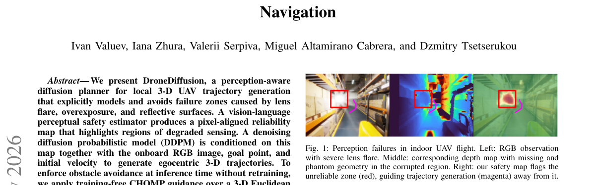

*Result - DroneDiffusion pipeline. Left: the corrupted trajectory xt is denoised over n reverse-diffusion steps by a conditional 1-D U-Net, conditioned on the RGB observation, the AnyTraverse reliabilit*

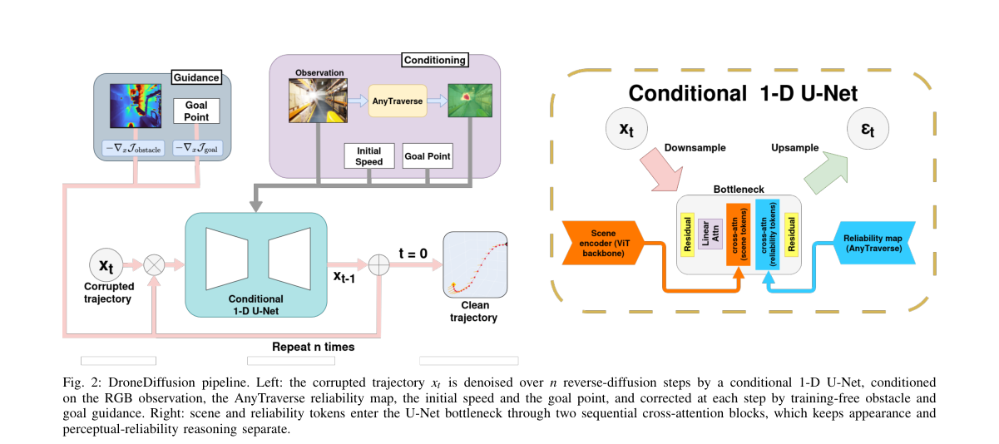

**Why this ranks #14**: 分数 8.4，排本 direction 第 7 位。它是标准的扩散规划器（1D U-Net 去噪 24 个 10 Hz 的 4-DoF 路点），但把「感知可靠性图」当成与 RGB、目标点、初速度并列的一等条件量：真实机评测里轨迹上的平均感知可靠性 0.714 对几何基线 0.626，不安全路点比例 12.89% 对 20.52%，训练无关的 CHOMP 引导把碰撞率从 14.71% 降到 7.77%。

---

### 15. SPIRE: Task-agnostic embodied continual learning through autonomous situation inference and causal motor-primitive reuse

**arXiv**: [2611.14840](https://arxiv.org/abs/2611.14840) | **Score**: 8.0 (relevance 8 x 0.7 + quality 8 x 0.3) | **Direction**: `embodied_ai` | **Tags**: embodied, continual-learning, spiking-network, motor-primitives, context-inference, transfer, University College London | **Categories**: cs.LG, cs.RO | **Pages**: 14

**Authors**: Yiyang Jia; Mingyang Lyu; Gongce Cao; Feifei Zhao; Yinqian Sun; Yi Zeng

**Affiliation**: University College London; Institute of Automation, Chinese Academy of Sciences (CASIA); University of Chinese Academy of Sciences (UCAS); Gaoling School of Artificial Intelligence, Renmin University of China

**Abstract**

> Embodied continual learning requires controllers to infer changing situations, retain prior behavior and reuse motor skills without task labels or known boundaries. The challenge is deciding when to recover earlier behavior and which skills can support new learning. We introduce Situation-guided Primitive Integration for Recurrent Embodiment (SPIRE), a recurrent-spiking system that infers latent contexts from action-outcome evidence and learns context-specific motor actors online. Mature actors become protected sources that combine with a target-context residual to drive recurrent-spiking motor populations. Across coordinate, three-joint and hidden-force control, SPIRE maintained control, autonomously inferred situations, retained prior behavior and accelerated acquisition of an unseen source composition, reducing mean interactions to criterion by approximately 40% relative to matched fresh controllers. Rewinding compatible source actors impaired early acquisition in every matched intervention, demonstrating causal reuse. Against seven recurrent continual-learning and modular-control comparators, SPIRE achieved 2.4 times the mean prior-learning advantage of the strongest eligible task-free alternative selected for each paired stream. These results demonstrate autonomous recovery and causal reuse of motor skills for new learning in continuous embodied control.

**Key findings**

- **Finding**: 跨坐标、三关节与隐藏力三种控制形式，SPIRE 达到标准所需的平均交互次数从匹配全新控制器的 109.25 次降到 66.00 次（约 40%），其中关节控制提前 30.9 次、力控制提前 54.1 次；对 7 个递归持续学习与模块化控制对比方法，SPIRE 的先修学习优势均值为最强合格无任务替代方法的 2.4 倍；把兼容的源 actor 回卷（rewind）在每一次配对干预中都损害早期习得。
- **Inference**: 回卷实验把「省下的交互」归因于因果性的技能复用，而不是额外算力或更大的网络；这为无标签持续学习提供了一个可证伪的验证范式——只要回卷就掉性能，就说明复用机制真的在被使用。
- **Recommendation**: 做无任务标签的持续学习时，可直接采用「情境推断 + 受保护 motor actor + 情境残差」三段式，并在报告里补上回卷消融与匹配的全新控制器基线；同时注意结论建立在连续控制的三种形式上，迁移到操作类任务时需要重新定义达标判据与交互成本的度量方式。

**Key figures**

*Framework - SPIRE learning architecture. From left to right: situation inference, primitive composition and recurrent-spiking action output. Colored dashed arrows indicate selection of source and residu*

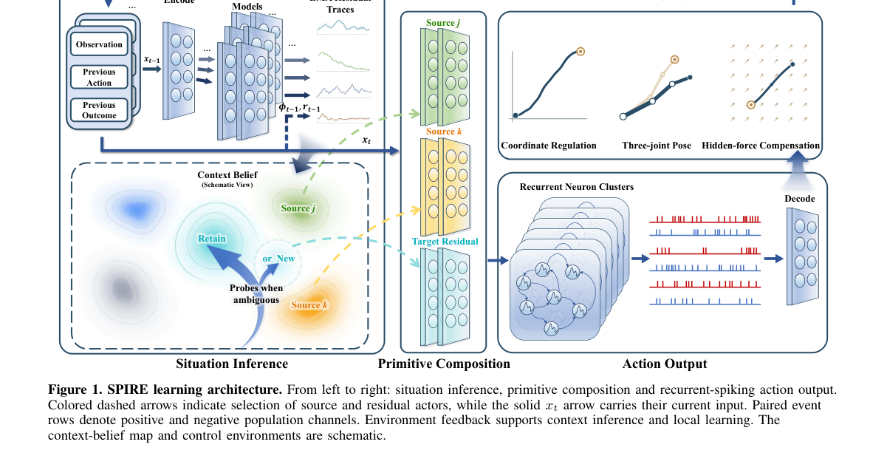

**Why this ranks #15**: 任务无标签的具身持续学习：SPIRE 用递归脉冲网络从动作—结果证据推断潜在情境，成熟的 motor actor 被保护起来与目标情境残差组合驱动脉冲运动种群。在坐标、三关节与隐藏力三类控制上，达到标准所需的平均交互次数从匹配全新控制器的 109.25 次降到 66.00 次（约 40%），先修学习优势是最强合格无任务替代方法的 2.4 倍。分数 8.0。

---

### 16. Can I join you? Extended Social Force Based Model with Predictive Control and Barrier Functions for Humanoid Group Repositioning Amidst Obstacles

**arXiv**: [2611.14853](https://arxiv.org/abs/2611.14853) | **Score**: 8.0 (relevance 8 x 0.7 + quality 8 x 0.3) | **Direction**: `embodied_ai` | **Tags**: embodied, social-force, model-predictive-control, control-barrier-function, humanoid, social-navigation, Simon Fraser University | **Categories**: cs.HC, cs.RO | **Pages**: 8

**Authors**: Chuxuan Zhang; Niloofar Jahanshahi; Yasaman Etesam; Mo Chen; Angelica Lim

**Affiliation**: Simon Fraser University

**Abstract**

> As social and service robots increasingly share interaction spaces in public, they may form groups while coordinating tasks or interacting with humans. Initial group formation alone is insufficient in dynamic settings, because it can be disrupted when a person or another agent joins, leaves, or passes through the group. Although group dynamics and repositioning have been widely studied in swarm robotics and virtual-agent settings, little attention has been given to socially appropriate repositioning behaviors in groups of humanoid robots. Existing social-force-based approaches provide a useful foundation for group behavior, but they have limited obstacle handling, and can produce unsafe behavior as environmental complexity increases. We propose a novel framework that modulates traditional Social Force, guided by Model Predictive Control (MPC) to plan ahead, bounded by Control Barrier Functions (CBF) to increase safety for robot groups repositioning behaviors. This approach aims to produce safer and socially aware group repositioning behaviors under various group formation disturbance. We evaluate the method in simulation through an ablation study and an online user study. The results show that our proposed method can produce smoother and safer repositioning behaviors in complex environments while preserving social appropriateness.

**Key findings**

- **Finding**: 消融覆盖 8 个条件（空旷、拥挤房间、电梯、走廊四类布局）：两种含 CBF 的控制器在 7/8 条件无检测碰撞，ESFFM+MPC 为 5/8、纯 ESFFM 为 4/8、SFFM 为 1/8；含 CBF 方案把自主机器人平均平面 RMS jerk 降低 1.22%–39.63%；在线用户研究招募 40 人（22 男 18 女，平均 34.4 岁），每对视频答 8 道 7 级李克特题，3 机器人条件下偏好显著（|t(39)|=2.39–4.57，Holm 校正 p=.0004–.043）。
- **Inference**: 碰撞下降与个人空间保护并不一致——几何避碰的改进并未稳定转化为更好的个人空间指标，说明社会力场与社会规范是两个可分离的目标，需要分别验收而不是用一个综合分互相掩盖。
- **Recommendation**: 把社会机器人部署到人群环境时，建议按「名义社会力 → MPC 前瞻 → CBF 过滤」三段实现并逐段消融，因为安全收益几乎全部来自 CBF 那一段；上报指标时把碰撞率、平均 jerk 与个人空间违规率分成三个独立项，并注意该框架只提供安全干预而非全局无碰撞保证。

**Key figures**

*Framework - Snapshots of four Gazebo Fortress layouts: empty space, crowded room, elevator, and hallway. The white robot groups reposition themselves as the yellow robot approaches along the dashed trajec*

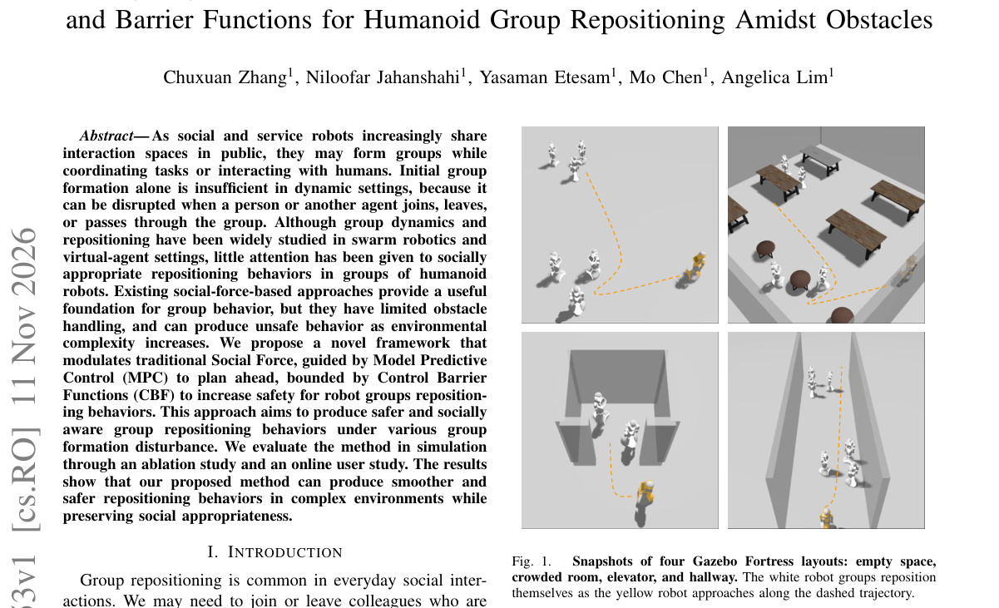

*Result - Overview of our proposed robot-group repositioning framework. ESFFM generates nominal accelerations from observed robot and environment states, which are refined by MPC and filtered by CBF. Sa*

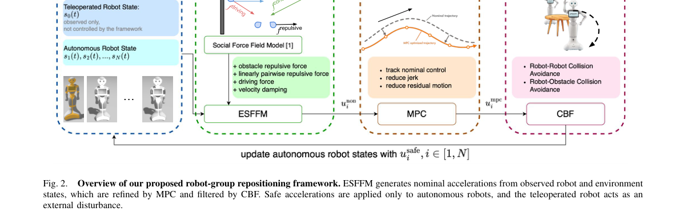

**Why this ranks #16**: 把社会力场、MPC 与控制障碍函数串成一条安全链：ESFFM 生成名义加速度，MPC 做前瞻规划，CBF 做安全过滤。在空旷、拥挤房间、电梯、走廊四类 Gazebo 布局共 8 个条件的消融中，含 CBF 的两种控制器有 7 个零碰撞，对比 ESFFM+MPC 的 5 个、纯 ESFFM 的 4 个、SFFM 的 1 个，平均 jerk 相对下降 1.22%–39.63%，另有 40 人在线用户研究支持其社交恰当性。分数 8.0。

---

### 17. APG-Planner: Learning Vision-Based High-Speed Trajectory Planning via Analytic Policy Gradient

**arXiv**: [2611.15296](https://arxiv.org/abs/2611.15296) | **Score**: 8.0 (relevance 8 x 0.7 + quality 8 x 0.3) | **Direction**: `embodied_ai` | **Tags**: embodied, analytic-policy-gradient, trajectory-planning, differential-flatness, vision-based-flight, reinforcement-learning, [unverified] | **Categories**: cs.RO | **Pages**: 8

**Authors**: Jinwoo Lee; Geunsik Bae; Changseung Kim; Jiwoo Kim; Woojae Shin; Hyondong Oh

**Affiliation**: [unverified]

**Abstract**

> Vision-based high-speed navigation requires a trajectory planner that can reactively generate smooth, collision-free trajectories from onboard visual observations. Deep reinforcement learning offers a promising approach to vision-based trajectory planning, as it enables the optimization of sequential decision-making policies in complex environments. However, model-free policy gradient methods rely on sample-based policy gradient estimation, which yields noisy gradient estimates and inefficient training. To this end, we propose a framework for learning trajectory planning policies using the analytic policy gradient (APG) method and use it to train APG-Planner, a vision-based high-speed trajectory planner. The proposed framework leverages differential flatness to analytically reconstruct vehicle states from planned trajectories, thereby enabling differentiable trajectory-level state transitions without requiring an explicit low-level dynamics model. By iteratively performing trajectory planning and differentiable state transitions, we construct a differentiable episode rollout and analytically compute policy gradients from episode-level losses, improving both training efficiency and policy performance. After approximately 30 minutes of training on a single GPU, APG-Planner demonstrates comparable or superior performance to existing baseline methods in simulation and achieves speeds of up to 11\,m/s in real-world flight experiments. We further validate the proposed framework on a skid-steer ground robot, demonstrating its applicability to differentially flat robotic systems beyond quadrotors.

**Key findings**

- **Finding**: 同一训练配置下对比三种优化方式，稀疏林地 APG 成功率 94%、均速 8.16 m/s，去掉时序梯度后成功率 94% 但均速只有 2.46 m/s，PPO 成功率 60%、均速 5.14 m/s；密集林地对应为 92%/7.47 m/s、88%/2.05 m/s、64%/5.11 m/s。训练在单张 RTX 4080 SUPER 上约 30 分钟、10000 次迭代、64 个并行环境。
- **Inference**: 不做时序梯度传播时，模型会优先满足逐步平滑而牺牲持续朝目标推进，这在高速飞行里直接体现为均速塌到 2 m/s 量级；解析梯度把跨重规划步的长期代价一次性算清，比采样估计既稳又便宜。
- **Recommendation**: 训练视觉轨迹规划策略时优先用解析策略梯度加微分平坦性重建状态，把跨重规划步的时序梯度打开；对照实验务必同时报成功率和实际均速，只看成功率会掩盖「慢但稳」的退化，并可用同一套框架迁移到滑移转向等微分平坦平台。

**Key figures**

*Framework - Policy inference (bottom) and the resulting trajectory (top). The network outputs terminal conditions, from which the trajectory is constructed.*

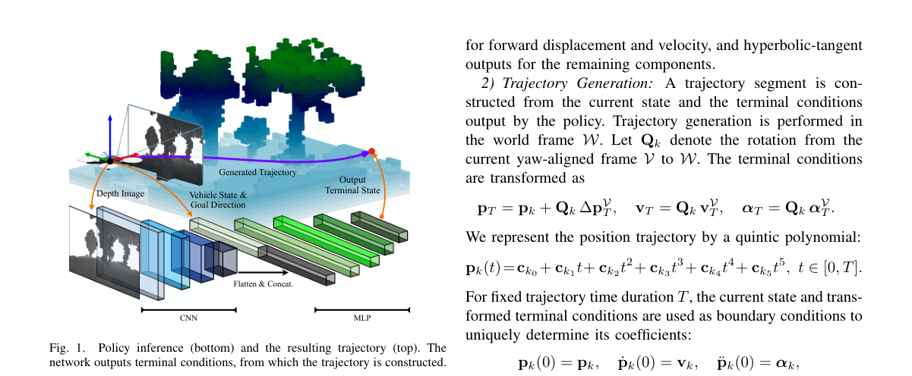

*Result - Comparison of state-transition models. Top: simulation advances the state through hardware-specific physics and actuator dynamics. Bottom: the transition in Eq. (3) evaluates the trajectory at*

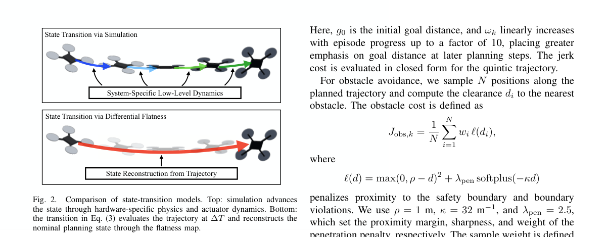

**Why this ranks #17**: 分数 8.0，并列本 direction 第 8 位。它用解析策略梯度训练视觉轨迹规划策略，靠微分平坦性在轨迹层面重建状态，因此不需要可微动力学模型：稀疏林地成功率 94%、均速 8.16 m/s，去掉跨重规划步的时序梯度后成功率虽仍 94% 但均速掉到 2.46 m/s，PPO 只有 60%；单卡约 30 分钟训练，真实飞行峰值 11 m/s。

---

### 18. CARE-Drive: Coupled Alternating Refinement for Ego-trajectories

**arXiv**: [2611.15360](https://arxiv.org/abs/2611.15360) | **Score**: 8.0 (relevance 8 x 0.7 + quality 8 x 0.3) | **Direction**: `embodied_ai` | **Tags**: embodied, vla, autonomous-driving, trajectory-refinement, grpo, world-model, NEXTAI Research Institute | **Categories**: cs.AI, cs.CV | **Pages**: 18

**Authors**: Xiao Ma; Yijun Chen; Zhiquan Hu; Jicheng Zhao; Ran Ji; Yuming Li; Chuang Dai

**Affiliation**: NEXTAI Research Institute, Chery Group

**Abstract**

> Vision-language-action (VLA) models bring multimodal understanding and world knowledge to end-to-end autonomous driving. To further improve the quality of predicted trajectories, existing studies introduce candidate refinement, residual denoising, and token correction. However, these methods typically focus on unified refinement of the entire trajectory, paying limited attention to the distinct physical quantities and their interactions. We further investigate physical specialization and coordination in trajectory refinement, centering on position and heading for simpler and more intuitive correction modeling. To this end, we propose CARE-Drive (Coupled Alternating Refinement for Ego-trajectories), which decomposes trajectory refinement into waypoint residual correction and position-conditioned heading generation. Through imitation learning and a future-token auxiliary task, the backbone provides predictive representations and a base trajectory. The position expert predicts bounded metric waypoint residuals, while the heading expert reconstructs vehicle orientation from adjacent angular increments conditioned on the corrected path. With the backbone frozen, the two experts are optimized alternately through supervised initialization and reinforcement fine-tuning. This design simplifies refinement through clear physical specialization while preserving conditional coupling during prediction and optimization. On NAVSIM v1, CARE-Drive achieves 88.8 PDMS, improving by 2.4 points over the unrefined base trajectories generated by the same backbone. Ablation studies further support the effectiveness of specialized experts and staged training.

**Key findings**

- **Finding**: 完整精修管线把 PDMS 从 86.462 提到 88.837（+2.375），其中先上航向专家到 87.562（+1.100）、位置专家在冻结初步航向下到 88.672（+1.110）、最后航向适配再加 0.165；训练用 92614 个场景共 28965 次优化器更新、16 张 Ascend 910 约 19 小时；专家每个约 78.42M 参数。
- **Inference**: 把「整条轨迹统一修正」拆成有明确物理量的位置残差与航向增量后，各自的监督信号可以被单独监督初始化再交替做强化微调，因此精修收益主要来自建模上的物理分工而非更大的骨干。
- **Recommendation**: 要给已有 VLA 骨干加轨迹精修，优先按物理量拆专家并冻结骨干交替优化（先航向、后位置、再回适配航向），按此顺序与论文一致；同时注意视觉塔在本文配置下解冻会掉 5.101 分，位置与航向的量化边界（±5 m / ±3 m、0.1° 步长）应按数据残差分布再核对。

**Key figures**

*Framework - CARE-Drive overview. (a) The predictive backbone produces shared action features and an initial trajectory; a frozen video teacher provides future-feature supervision during training. (b) Th*

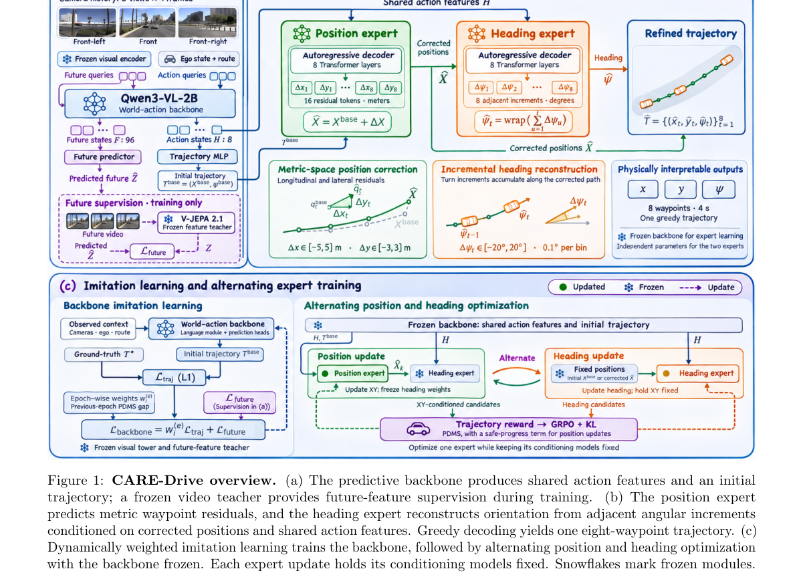

*Result - Qualitative comparison of backbone and complete-system predictions. Columns show straight driving, a left turn, a right turn, and a lane change. Green denotes the reference trajectory, dashe*

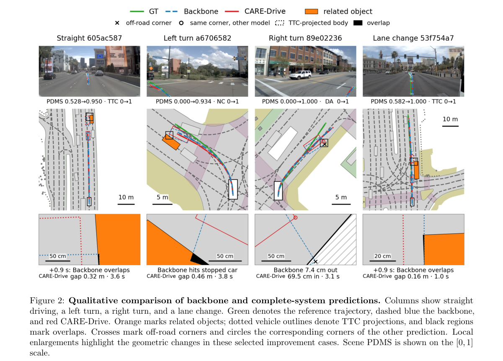

**Why this ranks #18**: 分数 8.0，并列本 direction 第 8 位。它是 VLA 侧的轨迹精修：Qwen3-VL-2B 骨干加位置与航向两个专家，在 NAVSIM v1 的 12146 个 navtest 场景上把 PDMS 从 86.462 提到 88.837（AutoVLA 88.026、CoWorld-VLA 报告 90.0），其中未来 token 辅助任务单独贡献 2.490 分，而解冻视觉塔反而掉 5.101 分。

---

### 19. From a Single RGB Image to Robot Execution: Metric Scene Alignment and Contact-Guided Retargeting

**arXiv**: [2611.14981](https://arxiv.org/abs/2611.14981) | **Score**: 7.7 (relevance 8 x 0.7 + quality 7 x 0.3) | **Direction**: `embodied_ai` | **Tags**: embodied, single-image-reconstruction, motion-retargeting, humanoid, metric-alignment, sim-to-real, Beijing University of Chemical Technology | **Categories**: cs.RO | **Pages**: 8

**Authors**: Zhenxuan Ding; Yu Huang; Xinmiao Wang; Chenghao Sun; Ziyang Dong; Wenhao Cui

**Affiliation**: Beijing University of Chemical Technology; National University of Defense Technology; Noetix Robotics

**Abstract**

> Extending humanoid interaction generation to new environments remains limited by the need for prebuilt 3D scene assets. Reconstructing scenes directly from single RGB images offers a way to overcome this limitation, but introduces a key challenge in maintaining geometric consistency throughout motion generation and transfer. Visually plausible human motions may be misaligned with the reconstructed scene, while retargeting can introduce additional support errors due to differences between human and robot embodiments. We present a unified pipeline that transforms a single RGB image into a humanoid motion reference. It reconstructs scene geometry from the input image, generates a human interaction conditioned on the reconstructed scene, and retargets the motion to a humanoid robot. To maintain geometric consistency throughout this process, we incorporate two complementary refinement stages before and after embodiment transfer. Before retargeting, Joint Metric Interaction Refinement (JMIR) refines human motion alignment with the registered metric scene while preserving the generated interaction structure. Following retargeting, Contact Guided Residual Retargeting (CGRR) corrects robot specific support errors to restore the intended support relationships. Together, these stages produce motion references that are consistent with the reconstructed scene and can be followed by multiple pretrained humanoid trackers without scene specific policy fine tuning. Compared with GRAIL, our method reduces refinement time from 480 s to 87 s, yielding a speedup of 5.5 times. The complete pipeline achieves a success rate of 89% in simulation and 70% across 50 physical trials on the Unitree G1, demonstrating its effectiveness in generating executable humanoid motion references from single RGB images.

**Key findings**

- **Finding**: 在 RTX 4090 上精修时间从 GRAIL 的 480 s 降到 87 s（5.5× 提速，含 JMIR 与 CGRR 两段，JMIR 取 niter=600）；完整 JMIR–GMR–CGRR 管线取得支撑误差 0.21 cm、局部逐关节位置误差 38.2 mm、仿真成功率 89%；Unitree G1 上共 50 次物理试验成功率 70%（细分评估每项 10 次），生成的动作参考无需场景特定策略微调即可被多个预训练人形跟踪器执行。
- **Inference**: 把几何一致性拆成「重定向前对齐人—场景」与「重定向后修复机器人支撑」两段、分别交给 JMIR 和 CGRR，说明单图管线的误差主要来自两次表示变换之间的语义漂移，而不是重建精度本身——所以提速与提质都该在两段修正上做文章。
- **Recommendation**: 想从单图生成可执行人形参考时，优先保证两阶段几何修正而不是堆重建保真度：按论文口径 JMIR 在前、CGRR 在后分别用度量场景与接触关系做约束，并用支撑误差与 MPJPE-L 而非视觉观感验收；同时把 87 s（RTX 4090）的精修开销计入在线流程预算。

**Key figures**

*Framework - Overview of the single-image-to-humanoid workflow. From a single RGB image, the pipeline reconstructs a registered metric scene and generates a scene-conditioned human interaction. JMIR first*

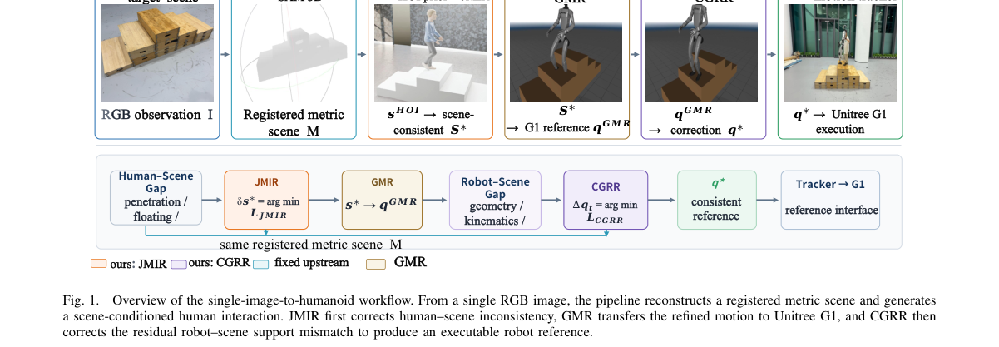

*Result - Two-stage geometric refinement across embodiment transfer. JMIR corrects the human–scene geometric mismatch while preserving the generated interaction structure. After GMR, CGRR performs a bou*

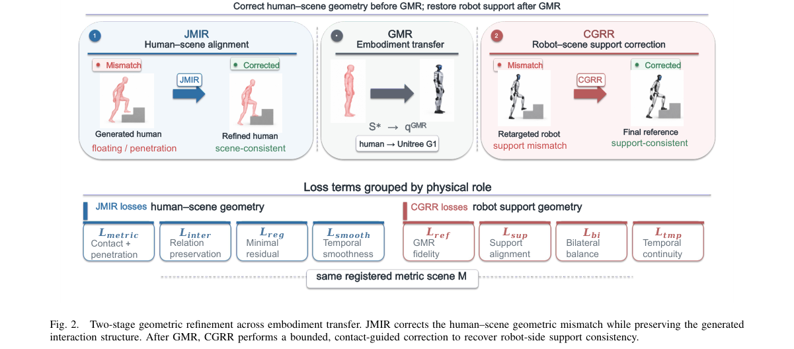

**Why this ranks #19**: 单张 RGB 图到可执行人形动作参考的完整管线：SAM 3D Objects 重建并注册米制场景，JMIR 在重定向前校正人—场景几何错配，GMR 之后用 CGRR 修正机器人特异的支撑误差。相比 GRAIL 精修时间从 480 s 降到 87 s（5.5×），完整管线仿真成功率 89%、Unitree G1 上 50 次物理试验成功率 70%，支撑误差 0.21 cm、局部逐关节位置误差 38.2 mm。分数 7.7。

---

### 20. CrowdMAPS: Crowdsourcing Multiple Actions per State for Real-World Imitation Learning

**arXiv**: [2611.15078](https://arxiv.org/abs/2611.15078) | **Score**: 7.7 (relevance 8 x 0.7 + quality 7 x 0.3) | **Direction**: `embodied_ai` | **Tags**: embodied, imitation-learning, crowdsourcing, real-robot-data, action-densification, diffusion-policy, University of Minnesota | **Categories**: cs.RO | **Pages**: 28

**Authors**: Yilong Song; Harshvardhan Chandirasekar; Karthik Desingh; Chen Zhu-Tian

**Affiliation**: University of Minnesota, Twin Cities

**Abstract**

> Real-world robot imitation learning is often limited by the cost of collecting physical demonstrations, which typically yield only one action label per visited state. We present CrowdMAPS, a web-based crowdsourcing paradigm for augmenting real-robot datasets with Multiple Actions per State (MAPS). After or during standard robot data collection, CrowdMAPS distributes visited robot states to remote annotators through a web-based 3D interface, where they specify alternative valid actions without requiring access to physical robot hardware. This expands robot datasets along a complementary "width" dimension--by increasing the number of actions per visited state--rather than only by collecting more trajectories. We evaluate CrowdMAPS using keyframe-centric goal-pose annotations supplied by non-expert annotators and train imitation policies on the resulting MAPS data. Across five real-world manipulation tasks, increasing MAPS width from one to ten actions per state improves sample efficiency and increases average success rates by 35.6 percentage points for keypose policies and 33.0 percentage points for trajectory policies. These results show that software-mediated human annotations can augment physical robot data to afford denser supervision, establishing CrowdMAPS as a scalable digital layer for real-robot data collection.

**Key findings**

- **Finding**: 47 名参与者中 78.7% 没有机械臂经验，提交中位耗时 7–12 秒，各任务接收率 51%–98%；关键位姿策略把动作宽度从 K=1 加到 K=10，平均成功率从 38.7% 升到 74.2%（+35.6 个百分点），而等密度的加性高斯噪声基线只有 43.3%；轨迹策略在 K=10 时五任务全部最优（抽屉 76、插装 40、倒液 92、分类 88、开关 70），优于追加专家轨迹的 56/24/80/52/54。
- **Inference**: 增益来自在已访问状态上把有效动作分布采样得更密，而不是单纯增加标签噪声或轨迹条数；因为未执行动作没有对应的后继观测，标注必须被限制在研究者选定的策略内并按动作类型加权，否则会引入 MAPS 分布偏移。
- **Recommendation**: 预算受限于真机采集时，优先做「动作致密化」而不是加采轨迹：每条轨迹挑关键帧让远程标注者补 5–10 个目标位姿，并给执行动作设最高权重；对照实验一定要包含等密度的高斯噪声基线，否则无法区分收益来自标注多样性还是来自标签平滑。

**Key figures**

*Framework - CrowdMAPS overview. After standard real-robot data collection (a), CrowdMAPS (b) distributes visited states to remote annotators, who provide unexecuted alternative actions through a web int*

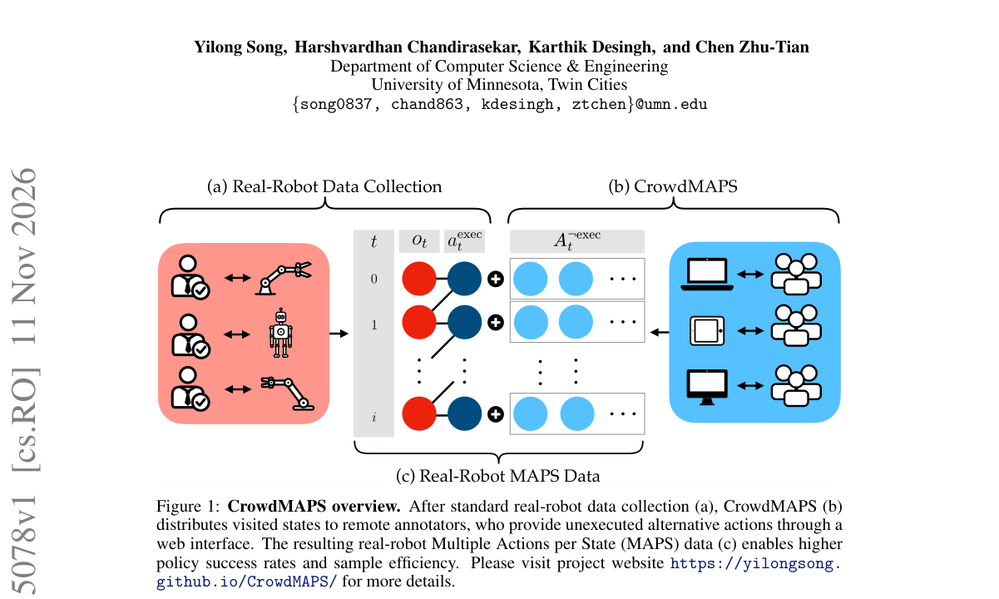

*Result - Standard trajectory data vs. keyframe-centric MAPS data. A standard real-robot trajectory records one executed action at for each visited observation ot. CrowdMAPS preserves the executed tra*

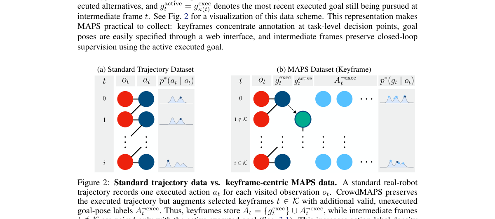

**Why this ranks #20**: 分数 7.7，并列本 direction 末位。它不动策略结构，而是改数据：把已访问状态分发给远程标注者补标多个可执行的目标位姿（动作宽度 K 从 1 到 10），五个真机操作任务上关键位姿策略平均成功率从 38.7% 升到 74.2%，轨迹策略提升 33.0 个百分点，且优于追加等量专家遥操作数据。

---

## Footer

- Total papers reviewed across all 4 axes: 60
- world_embodied axis final count: 20
- Wild-cards in this axis: 0
- Figure assets: 2026-11-13/res/

Generated by `mine-arxiv-daily-digest` skill. Sister file: `2026-11-13_world_embodied_entry.md`.
