# Mine Arxiv Daily Digest - 2026-11-13 (具身智能与世界模型 Axis, 13 papers)

**Generated**: 2026-11-13 10:46 CST

**Source**: arXiv cs.CV, cs.SD, eess.AS, cs.CL, cs.AI, cs.RO, cs.LG, cs.IR submissions, listing day 2026-11-11 (announced 2026-11-13 01:00 UTC)

**Batch window**: 2026-11-10T19:00:00Z .. 2026-11-11T19:00:00Z（arXiv 公告批次横跨两个 UTC 日：从前一日的美东 14:00 截止时刻起算（EDT 为 18:00Z，EST 为 19:00Z），到当日的同一时刻为止）

**Axis**: world_embodied (13 papers, base 15, cap 20)

**Directions**: world_model (3), embodied_ai (10)

**Selection**: 13 papers ranked by relevance x quality, with 0 wild-card slots

**Day total**: 34 papers across 4 axes (target 60)

**Scope**: 世界模型、学习型模拟器与具身智能，含移动操作、人形控制、触觉反射、VLA 策略与面向具身任务的强化学习

**Wild-card**: 0 —— 本 axis 未启用任何 wild-card 名额，`world_model` 让出的名额由 `embodied_ai` 内**同方向**的够格论文吸收。

**本 axis 13 篇（低于 axis 基准 15 篇）**：`world_model` 只有 3 篇够格（后验-先验认知鸿沟、动作仿射世界模型的推理时精炼、Dreamer 式网络防御），`embodied_ai` 有 10 篇（基准 8 篇，超出 2 个）吸收了让出的名额。轴内没有出现需要邻接选题补位的空位，因此未启用 wild-card 名额。

---

## 世界模型与学习型模拟器 · `world_model` (3 papers)

本方向 3 篇，主线是**「世界模型到底把任务信息带到了没有」**。The Posterior-Prior Epistemic Gap 是一个单种子案例研究：在 CARLA 驾驶模拟器上用循环状态空间模型（RSSM）世界模型配合主动推断规划，作者发现后验（经观测滤波）状态保留的障碍物信息会在想象 rollout 的状态里逐步丢失——监督式障碍物探针在后验上达到 AUC 0.85，而在先验 rollout 上则显著下降，这一落差被命名为**后验-先验认知鸿沟**。Fast Inference-Time Policy Refinement via Action-Affine World Models 换了个切入点：既然模仿策略的执行误差会累积，而精炼往往需要额外的在线学习或昂贵的在线规划，那就不去学全局动力学，而是只学「小动作修正如何改变结果」这一局部响应，把它写成易于优化的动作仿射形式。FOE-Dreamer 则是把 Dreamer 式的部署高效学习搬到网络防御域——直接在真实网络里学策略可以消除仿真器保真度鸿沟，但每次交互都很慢，于是要在部署效率与样本效率之间取平衡。

### 1. Fast Inference-Time Policy Refinement via Action-Affine World Models

**arXiv**: [2611.15011](https://arxiv.org/abs/2611.15011) | **Score**: 9.0 (relevance 9 x 0.7 + quality 9 x 0.3) | **Direction**: `world_model` | **Tags**: embodied, world-model, action-affine, inference-time-refinement, convex-qp, diffusion-policy, Tsinghua University | **Categories**: cs.RO | **Pages**: 9

**Authors**: Run Wang; Yilin Mo; Liang Wu

**Affiliation**: Tsinghua University

**Abstract**

> Imitation policies can perform complex manipulation, yet small execution errors can accumulate and cause failure. Refinement can correct these errors, but existing approaches often require additional on-policy learning or costly online planning. Our key insight is that a pretrained policy already supplies a useful nominal behavior: refinement can focus on predicting how small action corrections change its outcome. We therefore learn this local response in a form that is cheap to optimize. Our \textit{action-affine world model} (A\textsuperscript{2}WM) learns local action sensitivities offline from action-perturbed policy rollouts. Given interaction history and a policy proposal, it predicts task-relevant geometry as a nominal trajectory plus a linear response to corrections. It predicts the full planning horizon directly, avoiding the propagation of intermediate errors through recursive model evaluations. Quadratic penalties on predicted task errors and linear correction constraints then yield a cheap convex quadratic program (QP). Online refinement requires one model evaluation and one QP solve, while both policy and model weights remain frozen. Across four simulated manipulation tasks, our framework achieves the highest success rate among evaluated baselines, adding only 3.8 ms of mean refinement overhead per control step, excluding base-policy sampling.

**Key findings**

- **Finding**: A²WM 在 OneLeg、RoundTable、Lamp、PushT 四个仿真操作任务上把平均成功率从冻结扩散策略 DP 的 27.18% 提到 59.51%，其中 OneLeg 75.26%、RoundTable 42.97%、Lamp 41.02%、PushT 78.78%（与 GPC-OPT 持平）；每个控制步的精修开销为 3.40–4.00 ms、均值 3.80 ms，PushT 上只需 3.40 ms 而 GPC-OPT 需要 346.47 ms。
- **Inference**: 规划期的误差校正并不必然要求在线再训练或昂贵在线搜索；只要世界模型把动作修正的局部响应拟合成线性形式、用一次性视界预测替掉递归模型评估，凸 QP 就能承担几乎全部的规划负担，开销从百毫秒级降到个位数毫秒级。
- **Recommendation**: 要给冻结的扩散策略做推理期增强，优先复现「名义轨迹 + 线性响应」这一结构：离线只需 256 条（OneLeg/RoundTable/PushT）到 512 条（Lamp）扰动 rollout，线上策略与模型权重全部冻结，先用 3–4 ms 量级的单步开销验证收益，再考虑是否升级为在线树搜索。

**Key figures**

*Result - Overview of fast inference-time policy refinement. A frozen base policy generates action proposals every K control steps. At each control step, the action-affine world model uses interaction h*

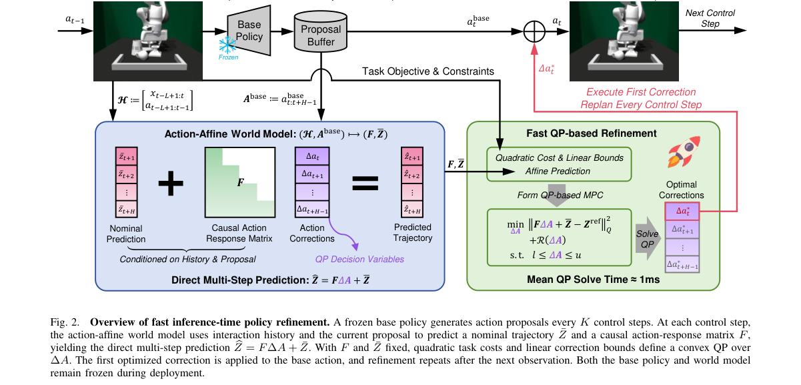

**Why this ranks #1**: 本 direction 分数最高（9.0）的一篇：只学「小幅动作修正如何改变结果」这一局部响应，把名义轨迹与线性修正项一起预测，再解一个凸 QP，线上只需一次模型评估加一次 QP 求解。在 OneLeg、RoundTable、Lamp、PushT 四个仿真操作任务上，平均成功率从冻结扩散策略 DP 的 27.18% 提到 59.51%（OneLeg 75.26%、RoundTable 42.97%、Lamp 41.02%、PushT 78.78%），每控制步额外开销仅 3.80 ms，方法主体是世界模型驱动的在线规划，故入 world_model。

---

### 2. The Posterior-Prior Epistemic Gap: When World Model Imagination Fails to Carry Task-Relevant Signals

**arXiv**: [2611.14955](https://arxiv.org/abs/2611.14955) | **Score**: 8.7 (relevance 9 x 0.7 + quality 8 x 0.3) | **Direction**: `world_model` | **Tags**: embodied, world-model, rssm, active-inference, epistemic-uncertainty, planning, University of Michigan-Dearborn | **Categories**: cs.AI, cs.RO | **Pages**: 7

**Authors**: Jaerock Kwon; Elahe Delavari; Donghyun Kim; Haewoon Nam

**Affiliation**: University of Michigan-Dearborn; Hanyang University

**Abstract**

> Model-based planners that roll out imagined futures assume the transition model faithfully propagates task-relevant signals---a property rarely measured directly. In a single-seed case study of a Recurrent State Space Model world model with active-inference planning in the CARLA driving simulator, we identify a \textbf{posterior-prior gap}---posterior (observation-filtered) states retain obstacle information that imagined rollout states progressively lose: a supervised obstacle probe achieves AUC 0.85 on posterior states, but the same probe applied to imagined prior states shows monotonic decay (AUC 0.85$\rightarrow$0.71 over 15 steps; logit separation drops 57\%). Because the probe is identical, the decay isolates the transition model---not the representation---as the information bottleneck. Obstacle avoidance drops to 0\% without privileged runtime coordinates, and the planner's own ensemble-based epistemic term does not flag the loss---ensemble disagreement yields AUC 0.52 as an obstacle classifier (chance level), making the failure an unflagged imagination failure---an unknown unknown at planning time. As a secondary contribution, we show that \textbf{task-conditioned weighting of Effective Free Energy components} over the same world model yields lane keeping ($81.2 \pm 1.8$\% route completion) and obstacle avoidance (28/28 avoided, \emph{using privileged coordinates}) in the CARLA simulator, with runtime weight modulation enabling post-evasion centering.

**Key findings**

- **Finding**: 同一障碍物探针在 RSSM 后验状态上 AUC 0.85，在 15 步想象先验状态上单调衰减到 0.71，logit 间隔下降 57%；无特权坐标时避障率为 0%，经任务条件化自由能加权后车道保持路线完成率 81.2±1.8%、11 个回合避开 28/28 个障碍；规划器 5 个转移头之间的集成分歧做障碍分类 AUC 仅 0.52。
- **Inference**: 探针完全不变而判别力随想象深度单调塌缩，说明信息瓶颈在转移模型而不在表征；同时集成分歧停在随机水平，意味着这类信息损失在规划时属于「未知的未知」，常规不确定性估计无法提前预警。
- **Recommendation**: 评估自己的世界模型规划器时，把同一个辅助探针分别挂在后验状态与第 k 步想象状态上画 AUC 曲线，并检查集成分歧是否具备判别力；若曲线单调下滑且分歧无判别力，就应在想象域内补感知监督，而不是继续加大集成规模或调采样温度。

**Key figures**

*Framework - Posterior-prior epistemic gap across imagination depth. AUC (left axis) and logit separation (right axis) both decay mono- tonically as the RSSM rolls out imagined states without observa- ti*

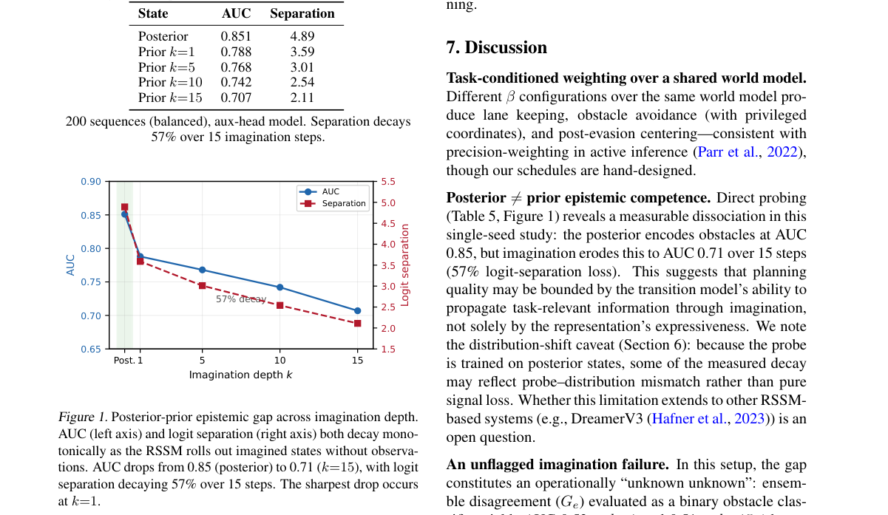

**Why this ranks #2**: 以 RSSM 世界模型 + CARLA 主动推断规划为对象，直接量化「后验状态知道、想象状态不知道」的落差：同一个监督障碍物探针在后验状态上 AUC 0.85，在 15 步想象先验状态上单调衰减到 0.71、logit 间隔下降 57%；没有特权运行时坐标时避障率跌到 0%，而规划器自带的 5 头集成分歧做障碍分类只有 AUC 0.52（随机水平），即失败不会被自己察觉。分数 8.7 排本 direction 第二。

---

### 3. FOE-Dreamer: Deployment-Efficient Learning of Cyber Defense Policies in Operational Networks

**arXiv**: [2611.14880](https://arxiv.org/abs/2611.14880) | **Score**: 7.0 (relevance 7 x 0.7 + quality 7 x 0.3) | **Direction**: `world_model` | **Tags**: embodied, model-based-rl, cyber-defense, dreamer, factored-latent, online-training, University of Texas at El Paso | **Categories**: cs.CR, cs.LG | **Pages**: 14

**Authors**: Yinuo Du; Christopher Kiekintveld

**Affiliation**: University of Texas at El Paso

**Abstract**

> Autonomous cyber defense is widely studied with deep reinforcement learning, but most work trains policies inside simulators because learning requires many trial-and-error interactions. Simulator-based training carries a fidelity gap: trained policies face authentication delays, partial action failures, service dependencies, and user traffic patterns that the simulator did not represent, and degrade on transfer. Training directly in the network being defended removes the gap but makes every interaction slow and costly, so sample efficiency becomes the binding constraint. Model-based reinforcement learning has reduced sample requirements on games and physical robots by orders of magnitude by planning inside a learned world model, but it has not been applied to defenders trained in operational networks. We present FOE-Dreamer (Factored Opponent-Enhanced Dreamer), a model-based reinforcement learning framework that trains a defender online and directly in a network on cloud infrastructure, without a simulator stage. FOE-Dreamer separates three sources of variation in the latent state: a controllable component driven by defender actions, an exogenous component driven by benign user activity, and an opponent embedding inferred from defender-observable signals alone. Separating the components reduces the variance in policy gradients during planning in imagination. Against two scripted attacker profiles with user activity emulated by the GHOSTS framework on an 8-host OpenStack testbed, FOE-Dreamer trains within a 3-day budget on a single GPU and achieves about 2$\times$ better episode loss than Rainbow and IQN baselines under matched compute. Both the factoring and the opponent model contribute to the gain, and the learned latents are consistent with the intended separation.

**Key findings**

- **Finding**: 在 8 主机 OpenStack 实网上配两个脚本化攻击者（Avoidant、Enticed）与 GHOSTS 用户模拟，FOE-Dreamer 单 GPU 训练三天，相对 Rainbow 与 IQN 把回合损失各降低约 2×；消融显示因子化与对手模型各自贡献一部分增益，学到的潜变量与预期的三分分离一致。
- **Inference**: 把「我方可控 / 外生噪声 / 对手意图」在潜空间里拆开，本质是降低想象式规划中策略梯度的方差，因此收益来自潜变量结构假设而不是更大的网络；这在每次交互都很昂贵的真实系统里比在仿真里更有价值。
- **Recommendation**: 要在真机或真实网络上做模型式 RL，先按同样的三分法（可控分量 / 外生分量 / 对手嵌入）重新设计潜变量，再谈算力投入；评估务必以「同算力下的回合损失 / 收敛速度」而非最终成功率为主指标，并准备一个无模型基线做同算力对照。

**Key figures**

*Framework - Agent-environment interface. The C2 server provides bidirectional translation: abstract defensive tactics become concrete network operations (downward), and distributed sensor data becomes s*

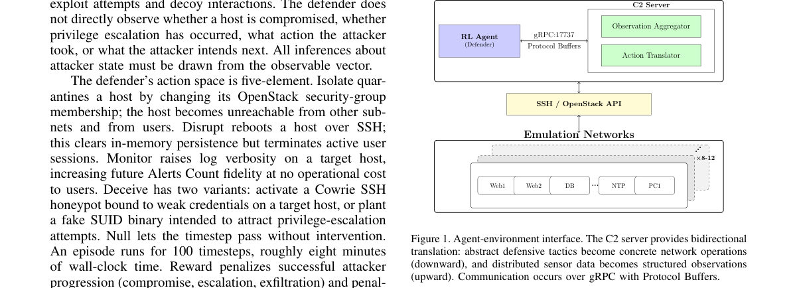

*Result - FOE-Dreamer architecture overview.*

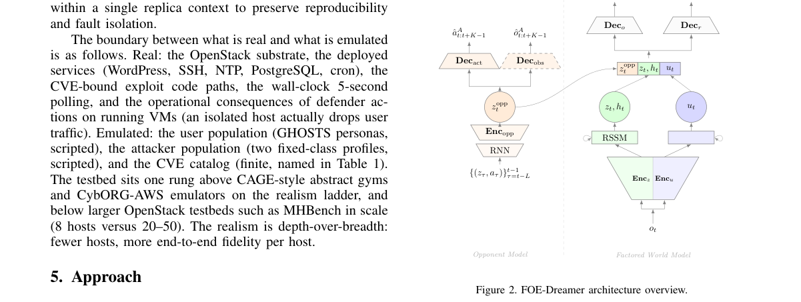

**Why this ranks #3**: 方法上是标准 Dreamer 式模型式 RL 的因子化变体：把潜状态拆成防御者动作驱动、外生用户活动驱动与对手嵌入三部分，在 8 主机 OpenStack 实网上用 GHOSTS 框架模拟用户流量，单 GPU 3 天训练预算内把回合损失做到 Rainbow 与 IQN 两个无模型基线的约一半（好 2×）。应用域是网络防御而非机器人，故分数只有 7.0，排本 direction 末位。

---

## 具身智能与机器人学习 · `embodied_ai` (10 papers)

本方向 10 篇，主线是**「把机器人策略放到真实执行约束下」**。XInfer 来自**生产环境**——数百台 VLA 机器人已经在真实世界运行，需要一套服务系统来摊薄大规模部署的推理基础设施成本，它把异构 VLA 计算与不断变化的响应需求协同调度。Learning Low-Latency Action Verification for Frozen VLA Models 直指一个部署痛点：采样出的动作序列可能无效，而用昂贵的验证器评估备选方案会在每次策略查询上叠加延迟，于是提出 HDH——用冻结 VLA 自己部署时留下的**事后信息（hindsight）**来训练轻量动作验证器。Genie Sim Benchmark 用配对的真实-仿真任务与系统辨识研究量化 real-to-sim 保真度：跨 22 个机器人-任务对、16 个任务名，用真实机器人数据微调的 π0.5 策略与仿真评分之间的相关性达到 0.9686（MAE 0.0405、RMSE 0.0520），仿真-真实差值落在 -0.110 到 +0.080。ILA 处理人形机器人在受限环境或人机交互中的**柔顺**动作跟踪，在没有专用交互传感器的前提下用机器人自身观测适配动作参考；Can I join you? 则用扩展社会力模型加预测控制与障碍函数，解决人群中有人加入或穿过时群体重排的社会合理性；SPIRE 用递归脉冲神经元从动作-结果证据推断潜在情境并在线学习情境专属运动基元，实现无任务标签、无边界假设的具身持续学习；其余几篇分别落在单张 RGB 图到机器人执行的度量场景对齐与接触引导重定向、单目深度估计在新场景中的视差精化与机器人自运动适配、头戴设备上体坐标系朝向分解的神经惯性里程计，以及非完整约束机器人的微分同胚向量场对齐运动规划。

### 4. Learning Low-Latency Action Verification for Frozen Vision-Language-Action Models

**arXiv**: [2611.14834](https://arxiv.org/abs/2611.14834) | **Score**: 9.0 (relevance 9 x 0.7 + quality 9 x 0.3) | **Direction**: `embodied_ai` | **Tags**: embodied, vla, action-verifier, hindsight-learning, success-prediction, real-robot, University of California | **Categories**: cs.AI, cs.CV, cs.RO | **Pages**: 10

**Authors**: Wen-Han Hsieh; Ken Jiankun Zheng; Chia-Chien Chen; David M. Chan; Trevor Darrell

**Affiliation**: University of California, Berkeley; National Tsing Hua University

**Abstract**

> Vision-language-action (VLA) models have made significant progress in general-purpose robotic manipulation. However, sampled action sequences can be ineffective, while evaluating alternatives with computationally expensive verifiers adds latency at each policy query. In this work, we propose HDH, a lightweight framework that uses hindsight from a frozen VLA's own deployments to improve action verification. The framework has three stages. First, we deploy the policy and collect its autonomous rollouts. We then train a compact action verifier to assign each action chunk a predicted task-success score. Finally, the frozen VLA generates action candidates, and the verifier selects the candidate with the highest score for execution. Across four LIBERO-10 tasks, HDH achieves an average success rate of 82.3\% and on three real-world manipulation tasks, HDH improves average success over the baseline policy by 22.6\%.

**Key findings**

- **Finding**: HDH 在 4 个 LIBERO-10 任务上把仿真平均成功率从 78.8% 提到 82.3%；对照中去掉历史条件的 HDM 变体为 80.3%，加入执行历史后的最大增益落在 Soup + Sauce（+6.7%）与 Mug + Pudding（+5.3%）两个多物体任务上。3 个真机任务每任务 50 次试验，平均成功率从 44.7% 提到 67.3%，其中毛绒玩具摆放 64%→94%。每次查询端到端时延 p50 为 718 ms、p95 796 ms，相对基线 681/760 ms 仅 +5.4%，而 GPT-5 为 27,674/46,911 ms（+3963.7%）、GPT-6 为 7,403/10,270 ms。
- **Inference**: 终局成败本身已经足以训练出有判别力的候选排序器，说明「预测未来」这类昂贵监督并不是动作筛选的必要条件；代价是验证器只能学到策略历史分布上的相对排序，对候选分布外的动作外推能力有限。
- **Recommendation**: 想在不重训策略的前提下提升成功率，可直接照搬「收集自主 rollout → 用终局成败训小验证器 → 打分选优」三步，并把执行历史作为条件输入以区分任务进度；同时要自测候选数从 2 扩到更多时的延迟与判别力衰减，论文只验证了 2 个候选这一种配置。

**Key figures**

*Framework - We propose HDH, a lightweight framework for improving action selection in frozen vision-language-action models. We first collect autonomous policy rollouts and use their terminal success and f*

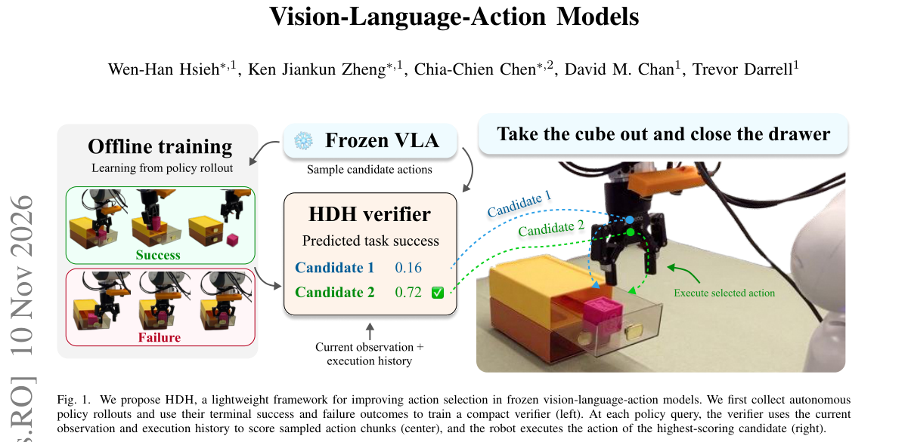

*Result - Overview of HDH (a) Given the task instruction, current image observations, and proprioception, (b) we sample candidate action chunks from a frozen VLA. (c) We assign each candidate a predicte*

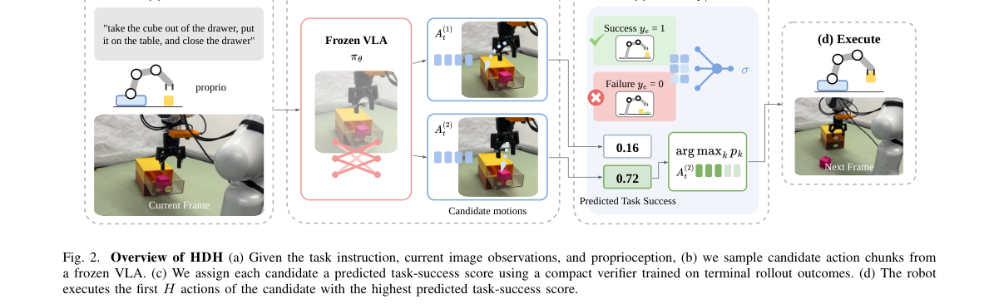

**Why this ranks #4**: 用冻结 VLA 自己的自主 rollout 终局成败做监督，训一个轻量动作验证器给候选动作块打分选优：LIBERO-10 四个任务平均成功率 78.8%→82.3%，三个真机任务（每任务 50 次试验）从 44.7% 提到 67.3%、毛绒玩具摆放 64%→94%；每次策略查询的中位时延只从基线 681 ms 涨到 718 ms（+5.4%），而 GPT-5 验证器要到 27,674 ms。分数 9.0，与 XInfer 并列本 direction 第一。

---

### 5. Scaling VLA Serving Under Robotic Execution Constraints

**arXiv**: [2611.14969](https://arxiv.org/abs/2611.14969) | **Score**: 9.0 (relevance 9 x 0.7 + quality 9 x 0.3) | **Direction**: `embodied_ai` | **Tags**: embodied, vla-serving, inference-systems, scheduling, robot-fleet, gpu-utilization, X Square Robot | **Categories**: cs.DC, cs.RO | **Pages**: 20

**Authors**: Yue Zhang; Zicong Ye; Lufang Chen; Dance Yang; Mingyang Li; Zhenwei Duan; Michael Zhao; Ziye Deng; Starrick Liu; Ruizhi Chengze; YongHua Chen; SongAo Han

**Affiliation**: X Square Robot

**Abstract**

> Vision-language-action (VLA) models have emerged as a promising paradigm for general-purpose robotic manipulation. In our production setting, hundreds of VLA-powered robots are already operating in real-world environments, creating an immediate need for efficient fleet serving. We present XInfer, a production-deployed VLA serving system designed to reduce the inference infrastructure cost of large-scale robotic deployments. XInfer jointly coordinates heterogeneous VLA computation with the evolving response requirements of robotic execution. By exploiting computational parallelism while managing interference, XInfer improves GPU efficiency while protecting time-critical robotic feedback. We evaluate XInfer across three VLA models using production-derived workloads, achieving 1.26-3.75 times the effective robot capacity (ERC) of state-of-the-art systems under physical-execution constraints. Our implementation is publicly available at https://github.com/X-Square-Robot/xinfer.

**Key findings**

- **Finding**: 在无错误响应条件下 XInfer 单卡可服务 18 台 VLA-2B 与 24 台 π0.5 机器人，vLLM-Omni 分别为 10 与 15 台、Robion 为 19 台 π0.5；异构响应预算的 VLA-2B 实验中 XInfer 的 ERC 为 18 台，Slack-Gate 15 台、FIFO 14 台、EDF 12 台；ERC 判据是响应 P50<150 ms 且零请求错误，评估负载取自生产衍生闭环工作流。
- **Inference**: 容量能提升到 1.26–3.75 倍主要来自两点——把 CPU 准备与 GPU 执行重叠、并让不同请求的 ViT/Prefill/Action 阶段交叉推进，于是瓶颈从单请求时延转为调度干扰；这说明时延敏感的机器人负载更适合异步流水线，而不是简单加大批处理。
- **Recommendation**: 做机器人推理服务时，先用 ERC（同时满足 P50 时延与零错误约束的最大并发机器人数）而不是 QPS 作为容量指标；调度上优先把 CPU 前处理与 GPU 执行解耦、把「请求优先级」与「阶段准入」分开处理，并按自己机器人的响应预算重测这三个系统的对比。

**Key figures**

*Framework - Production parcel handling. A carton (top) and a soft parcel (bottom) are reoriented and pushed onto the conveyor. Each row*

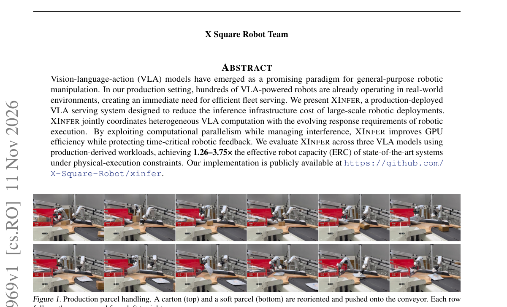

*Result - Projected parcel throughput on one GPU (VLA-2B),*

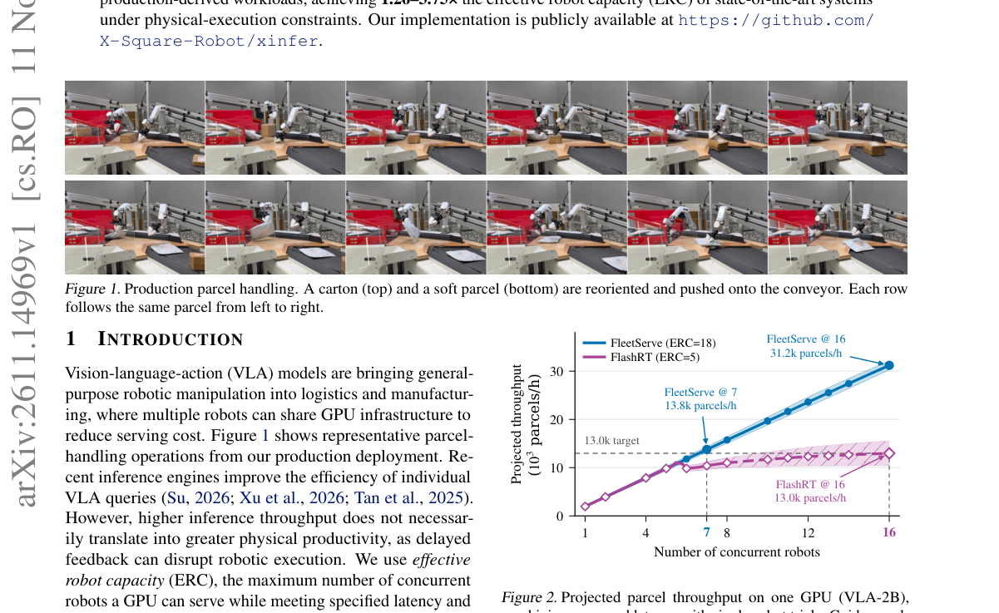

**Why this ranks #5**: 生产环境已有数百台 VLA 机器人，XInfer 用异步执行引擎加执行感知的跨阶段调度，把异构 VLA 算力与机器人响应需求耦合调度：在 VLA-2B、π0.5、Wall-OSS-0.5 三个模型与生产衍生负载上，单卡有效机器人容量（ERC）达 vLLM-Omni 的 1.26–3.75 倍（XInfer 为 18 台 VLA-2B 与 24 台 π0.5，vLLM-Omni 仅 10 与 15 台，Robion 为 19 台 π0.5）；异构响应预算下 XInfer ERC 18 台，对 Slack-Gate 15、FIFO 14、EDF 12，ERC 判据为响应 P50<150 ms 且零请求错误。

---

### 6. ILA: A Transferable Interface-Level Adapter for Compliant Humanoid Motion Tracking

**arXiv**: [2611.14985](https://arxiv.org/abs/2611.14985) | **Score**: 8.7 (relevance 9 x 0.7 + quality 8 x 0.3) | **Direction**: `embodied_ai` | **Tags**: embodied, humanoid, motion-tracking, compliance, reference-adaptation, sim-to-real, Harbin Institute of Technology | **Categories**: cs.RO | **Pages**: 8

**Authors**: ZhuoChang Cai; Zihao Yan; Jinxuan Zhu; Yanjie Li; Hao Xiong

**Affiliation**: Harbin Institute of Technology, Shenzhen; National University of Singapore

**Abstract**

> Humanoid motion tracking is fundamental to reproducing human motions on humanoid robots and serves as an important tool for teleoperation and motion data collection. However, directly tracking reference motions can be unsafe in constrained environments or during physical human--robot interaction, motivating the need for compliant motion tracking. We present ILA, an Interface-Level Adapter for compliant humanoid motion tracking without dedicated interaction sensors. ILA adapts motion references from the robot's observation history, allowing the robot to respond to physical guidance while preserving the capabilities of a pretrained motion tracker. As an interface-level module, ILA can be directly plugged into different pretrained motion trackers without retraining either the adapter or the tracking policies. ILA is trained entirely in simulation to predict reference corrections induced by physical interaction. We evaluate ILA with three humanoid motion trackers and achieve a 63.6--75.4% reduction in guidance-target error compared with their original policies. Matched simulation studies and hardware experiments further show that ILA improves responsiveness to human guidance while preserving nominal motion-tracking performance. These results demonstrate compliant guidance as a reusable, sensor-free extension to pretrained humanoid motion trackers.

**Key findings**

- **Finding**: 同一套冻结的 ILA 适配器跨三个独立训练的运动跟踪器复用，指导目标误差在 MimicLite 上降 63.6%、在 Sonic 上降 75.4%；硬件实验显示无外力时跟踪误差仅增加 0.5%、释放后恢复动作改善；适配器从特权教师蒸馏到因果历史学生，用四类交互阶段（无交互/让位/保持/恢复）与两路强度 sigmoid 头输出修正，评估含 243 个目标簇的 95% 自助置信区间（10,000 次重采样）。
- **Inference**: 把顺从性放在「参考适配」层而不是动作或力矩残差层，是同一适配器能跨跟踪器复用的原因（跟踪器只看被改写的参考），代价是它无法在跟踪器之外主动改变全身执行策略，顺从范围受跟踪器自身能力上限约束。
- **Recommendation**: 已有预训练人形跟踪器但缺接触传感器时，优先在参考接口层加一个由观测历史预测修正量的适配器，而不是改策略本体；训练照搬「特权教师 + 因果历史学生」蒸馏，并分别验收无外力时的跟踪退化与有引导时的响应两项指标（论文的 0.5% 与 63.6–75.4% 正是这两个量的分离度量）。

**Key figures**

*Framework - ILA adds physical guidance through reference adaptation while preserving pretrained whole-body policies. (a) Human-guided reference adaptation. (b–d) The same ILA trained with standard MotionT*

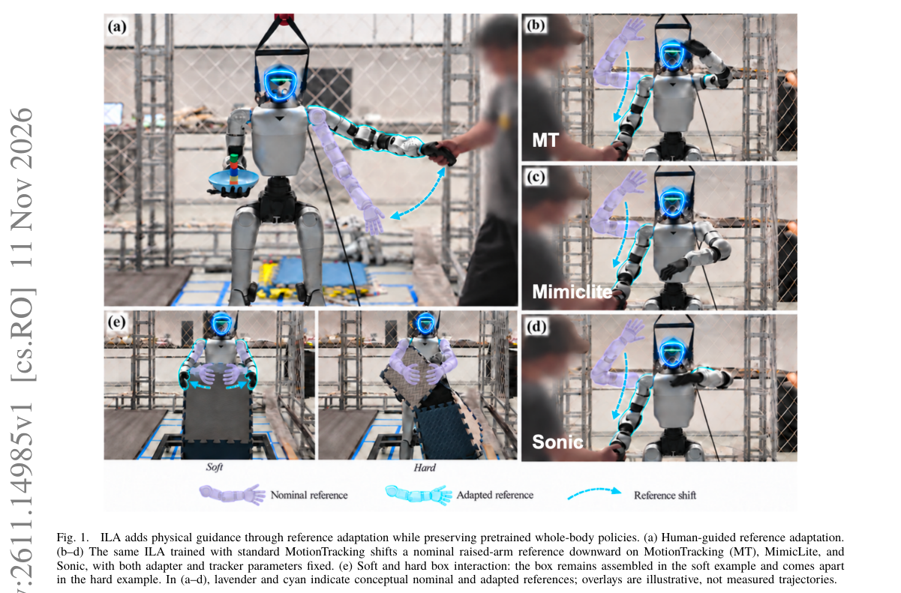

*Result - ILA adapts the reference while preserving the controller. (a) Nominal–modified reference pairs supervise the residual ∆r∗= m ⊙(rmod −rnom). (b) O denotes the observation history and nominal re*

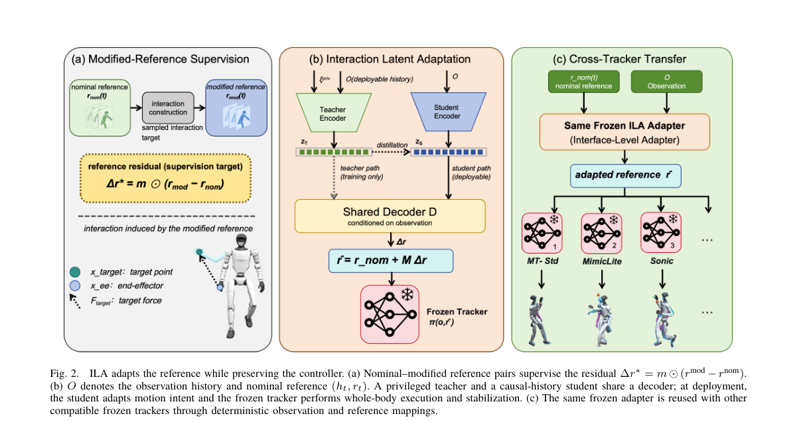

**Why this ranks #6**: 把「顺从引导」做成可插拔的接口层模块：ILA 只根据机器人观测历史预测参考动作的修正量，接在三个预训练人形运动跟踪器前，适配器与跟踪器权重全部冻结、也不加专用力传感器，指导目标误差在 MimicLite 上降 63.6%、Sonic 降 75.4%，而硬件实验中无外力时的跟踪误差只上升 0.5%。适配器完全在仿真里训练，分数 8.7 排 embodied_ai 第三。

---

### 7. Genie Sim Benchmark: Real-to-Sim Fidelity and Evaluation

**arXiv**: [2611.15020](https://arxiv.org/abs/2611.15020) | **Score**: 8.7 (relevance 9 x 0.7 + quality 8 x 0.3) | **Direction**: `embodied_ai` | **Tags**: embodied, sim-to-real, benchmark, system-identification, manipulation, policy-evaluation, [unverified] | **Categories**: cs.RO | **Pages**: 27

**Authors**: Di Yang; Da Huang; Yang Lv; Fan Yang; Yi Lu; Zheyuan Xing; Linting Guo; Jiaen Shen; Wenjun Sun; Maoqing Yao; Qian Wang

**Affiliation**: [unverified]

**Abstract**

> We evaluate Genie Sim Benchmark through paired real-simulation tasks and complementary system-identification studies. Across 22 robot-task pairs spanning 16 task names, task-specific pi0.5 policies fine-tuned on real-robot data achieve a descriptive Score correlation of 0.9686, MAE 0.0405, RMSE 0.0520, with simulation-real differences from -0.110 to +0.080. G2 crsB experiments assess long-horizon closed-loop position and joint-side torque agreement, while five representative object cases examine identification and cross-engine contact transfer. A separate 32.6503 s teleoperation trajectory, excluded from mechanical identification and servo-gain search, evaluates external position targets through simulated motion-controller command shaping and a calibrated position servo. Across both arms, per-joint position RMSE spans 0.00614-0.03522 rad and current-derived torque RMSE spans 0.73545-4.00099 N m. Native PhysX adaptations recover three recorded interaction tasks, with case-dependent alignment gains. These results support task-specific simulation evaluation through joint assessment of task outcomes and physical-response consistency.

**Key findings**

- **Finding**: 22 个机器人-任务对（G1 Omnipicker 8、G2 Swiftpicker 6、G2 Wuji 1、Arx X5 7）跨 16 个任务名，真机微调 π0.5 的仿真—真机 Score 相关系数 r=0.9686、MAE 0.0405、RMSE 0.0520、平均带符号差 −0.0068，逐对差值落在 −0.110~+0.080；独立的 32.6503 s 遥操作轨迹标定出逐关节位置 RMSE 0.00614–0.03522 rad、由电流推得的力矩 RMSE 0.73545–4.00099 N·m，Score 取自剔除前 1 s 预热后的 3,165 个采样。
- **Inference**: 任务级 Score 相关性高并不等于物理保真度高——逐关节位置误差已达 0.03522 rad 量级、力矩误差在低力臂上达 4.00099 N·m，因此「策略级排名可迁移」与「接触物理可迁移」必须分开验证，不能用前者推断后者。
- **Recommendation**: 要评估自家仿真能否替代真机做策略选型，建议直接照搬这套双轨协议：先做任务级配对回归（Score 对 Score）看排序一致性，再单独做关节位置与力矩的系统辨识看物理一致性；只有两轨都过关，才把仿真结论用于部署决策。

**Key figures**

*Framework - Robot- and task-level real–sim evidence. Left: 60 s J1–J4 closed-loop replay and seven-joint RMSE across three excitation families; errors are uncentred and torque limits are URDF references,*

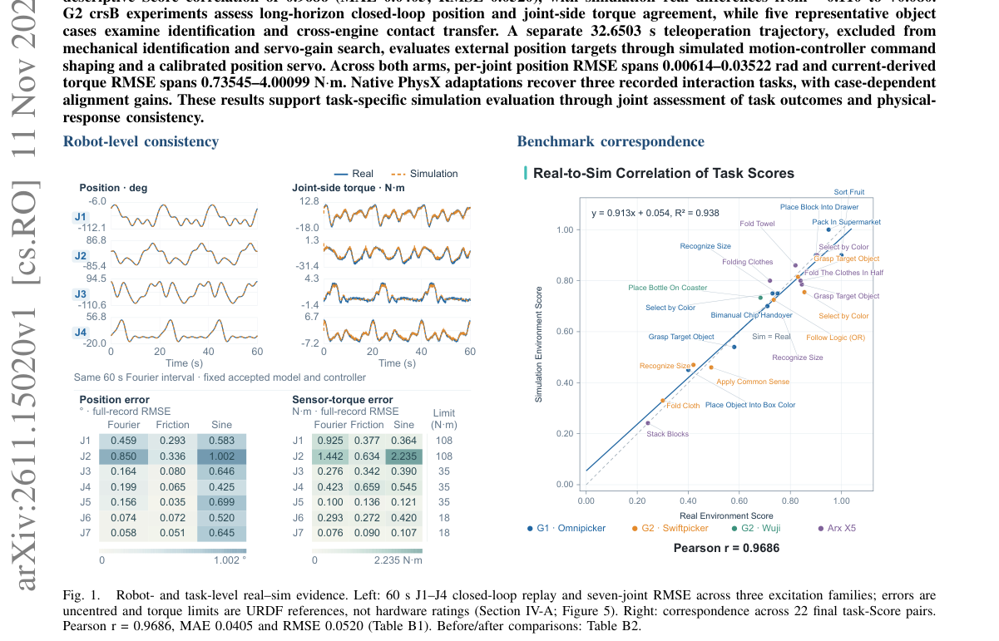

*Result - Representative scenes from the Real2Sim experiments summarized in Table 1: sixteen scene pairs across G1 Omnipicker, G2 Swiftpicker, G2 Wuji and Arx X5 configurations. Rows 1 and 3 are real sc*

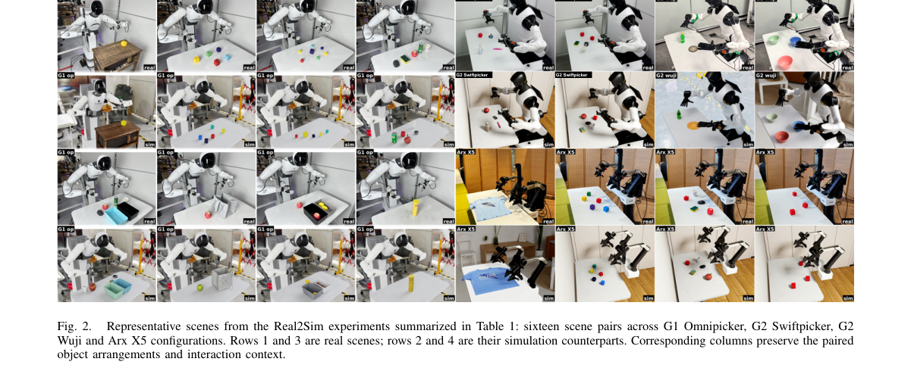

**Why this ranks #7**: 一份以「真机—仿真配对」为核心的双轨评测基准：22 个机器人-任务对、16 个任务名（G1 Omnipicker 8、G2 Swiftpicker 6、G2 Wuji 1、Arx X5 7），用真机数据微调的 π0.5 策略在仿真与真机上的 Score 相关系数 0.9686、MAE 0.0405、RMSE 0.0520，逐对差值 −0.110~+0.080；另用一段独立的 32.6503 s 遥操作轨迹做标定，两臂逐关节位置 RMSE 0.00614–0.03522 rad、力矩 RMSE 0.73545–4.00099 N·m。

---

### 8. SPIRE: Task-agnostic embodied continual learning through autonomous situation inference and causal motor-primitive reuse

**arXiv**: [2611.14840](https://arxiv.org/abs/2611.14840) | **Score**: 8.0 (relevance 8 x 0.7 + quality 8 x 0.3) | **Direction**: `embodied_ai` | **Tags**: embodied, continual-learning, spiking-network, motor-primitives, context-inference, transfer, University College London | **Categories**: cs.LG, cs.RO | **Pages**: 14

**Authors**: Yiyang Jia; Mingyang Lyu; Gongce Cao; Feifei Zhao; Yinqian Sun; Yi Zeng

**Affiliation**: University College London; Institute of Automation, Chinese Academy of Sciences (CASIA); University of Chinese Academy of Sciences (UCAS); Gaoling School of Artificial Intelligence, Renmin University of China

**Abstract**

> Embodied continual learning requires controllers to infer changing situations, retain prior behavior and reuse motor skills without task labels or known boundaries. The challenge is deciding when to recover earlier behavior and which skills can support new learning. We introduce Situation-guided Primitive Integration for Recurrent Embodiment (SPIRE), a recurrent-spiking system that infers latent contexts from action-outcome evidence and learns context-specific motor actors online. Mature actors become protected sources that combine with a target-context residual to drive recurrent-spiking motor populations. Across coordinate, three-joint and hidden-force control, SPIRE maintained control, autonomously inferred situations, retained prior behavior and accelerated acquisition of an unseen source composition, reducing mean interactions to criterion by approximately 40% relative to matched fresh controllers. Rewinding compatible source actors impaired early acquisition in every matched intervention, demonstrating causal reuse. Against seven recurrent continual-learning and modular-control comparators, SPIRE achieved 2.4 times the mean prior-learning advantage of the strongest eligible task-free alternative selected for each paired stream. These results demonstrate autonomous recovery and causal reuse of motor skills for new learning in continuous embodied control.

**Key findings**

- **Finding**: 跨坐标、三关节与隐藏力三种控制形式，SPIRE 达到标准所需的平均交互次数从匹配全新控制器的 109.25 次降到 66.00 次（约 40%），其中关节控制提前 30.9 次、力控制提前 54.1 次；对 7 个递归持续学习与模块化控制对比方法，SPIRE 的先修学习优势均值为最强合格无任务替代方法的 2.4 倍；把兼容的源 actor 回卷（rewind）在每一次配对干预中都损害早期习得。
- **Inference**: 回卷实验把「省下的交互」归因于因果性的技能复用，而不是额外算力或更大的网络；这为无标签持续学习提供了一个可证伪的验证范式——只要回卷就掉性能，就说明复用机制真的在被使用。
- **Recommendation**: 做无任务标签的持续学习时，可直接采用「情境推断 + 受保护 motor actor + 情境残差」三段式，并在报告里补上回卷消融与匹配的全新控制器基线；同时注意结论建立在连续控制的三种形式上，迁移到操作类任务时需要重新定义达标判据与交互成本的度量方式。

**Key figures**

*Framework - SPIRE learning architecture. From left to right: situation inference, primitive composition and recurrent-spiking action output. Colored dashed arrows indicate selection of source and residu*

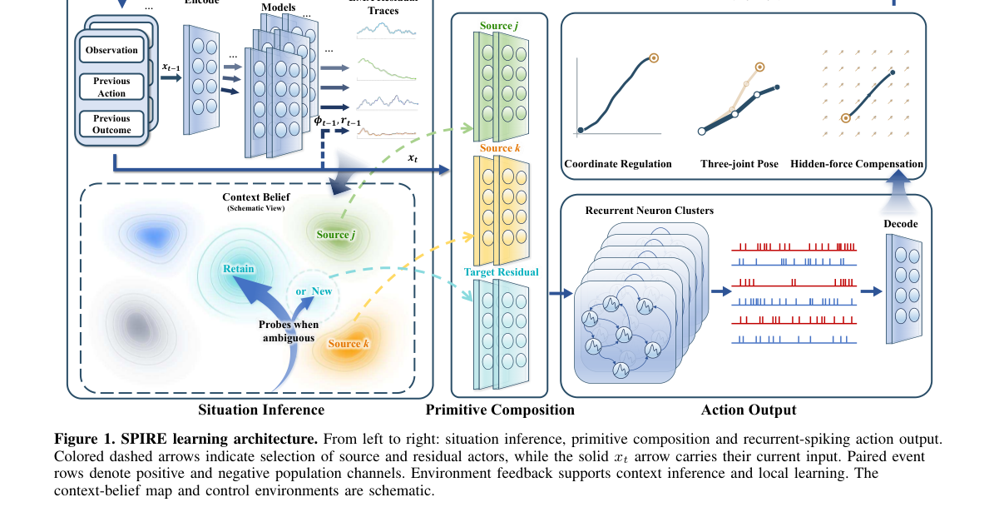

**Why this ranks #8**: 任务无标签的具身持续学习：SPIRE 用递归脉冲网络从动作—结果证据推断潜在情境，成熟的 motor actor 被保护起来与目标情境残差组合驱动脉冲运动种群。在坐标、三关节与隐藏力三类控制上，达到标准所需的平均交互次数从匹配全新控制器的 109.25 次降到 66.00 次（约 40%），先修学习优势是最强合格无任务替代方法的 2.4 倍。分数 8.0。

---

### 9. Can I join you? Extended Social Force Based Model with Predictive Control and Barrier Functions for Humanoid Group Repositioning Amidst Obstacles

**arXiv**: [2611.14853](https://arxiv.org/abs/2611.14853) | **Score**: 8.0 (relevance 8 x 0.7 + quality 8 x 0.3) | **Direction**: `embodied_ai` | **Tags**: embodied, social-force, model-predictive-control, control-barrier-function, humanoid, social-navigation, Simon Fraser University | **Categories**: cs.HC, cs.RO | **Pages**: 8

**Authors**: Chuxuan Zhang; Niloofar Jahanshahi; Yasaman Etesam; Mo Chen; Angelica Lim

**Affiliation**: Simon Fraser University

**Abstract**

> As social and service robots increasingly share interaction spaces in public, they may form groups while coordinating tasks or interacting with humans. Initial group formation alone is insufficient in dynamic settings, because it can be disrupted when a person or another agent joins, leaves, or passes through the group. Although group dynamics and repositioning have been widely studied in swarm robotics and virtual-agent settings, little attention has been given to socially appropriate repositioning behaviors in groups of humanoid robots. Existing social-force-based approaches provide a useful foundation for group behavior, but they have limited obstacle handling, and can produce unsafe behavior as environmental complexity increases. We propose a novel framework that modulates traditional Social Force, guided by Model Predictive Control (MPC) to plan ahead, bounded by Control Barrier Functions (CBF) to increase safety for robot groups repositioning behaviors. This approach aims to produce safer and socially aware group repositioning behaviors under various group formation disturbance. We evaluate the method in simulation through an ablation study and an online user study. The results show that our proposed method can produce smoother and safer repositioning behaviors in complex environments while preserving social appropriateness.

**Key findings**

- **Finding**: 消融覆盖 8 个条件（空旷、拥挤房间、电梯、走廊四类布局）：两种含 CBF 的控制器在 7/8 条件无检测碰撞，ESFFM+MPC 为 5/8、纯 ESFFM 为 4/8、SFFM 为 1/8；含 CBF 方案把自主机器人平均平面 RMS jerk 降低 1.22%–39.63%；在线用户研究招募 40 人（22 男 18 女，平均 34.4 岁），每对视频答 8 道 7 级李克特题，3 机器人条件下偏好显著（|t(39)|=2.39–4.57，Holm 校正 p=.0004–.043）。
- **Inference**: 碰撞下降与个人空间保护并不一致——几何避碰的改进并未稳定转化为更好的个人空间指标，说明社会力场与社会规范是两个可分离的目标，需要分别验收而不是用一个综合分互相掩盖。
- **Recommendation**: 把社会机器人部署到人群环境时，建议按「名义社会力 → MPC 前瞻 → CBF 过滤」三段实现并逐段消融，因为安全收益几乎全部来自 CBF 那一段；上报指标时把碰撞率、平均 jerk 与个人空间违规率分成三个独立项，并注意该框架只提供安全干预而非全局无碰撞保证。

**Key figures**

*Framework - Snapshots of four Gazebo Fortress layouts: empty space, crowded room, elevator, and hallway. The white robot groups reposition themselves as the yellow robot approaches along the dashed trajec*

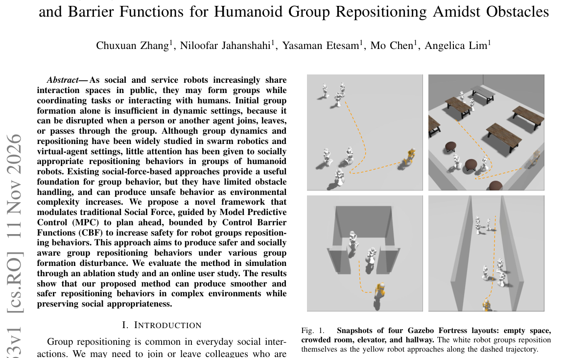

*Result - Overview of our proposed robot-group repositioning framework. ESFFM generates nominal accelerations from observed robot and environment states, which are refined by MPC and filtered by CBF. Sa*

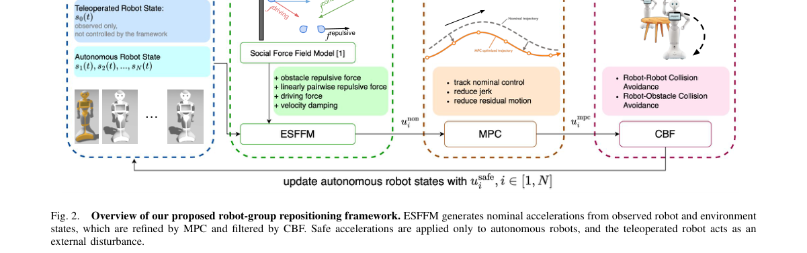

**Why this ranks #9**: 把社会力场、MPC 与控制障碍函数串成一条安全链：ESFFM 生成名义加速度，MPC 做前瞻规划，CBF 做安全过滤。在空旷、拥挤房间、电梯、走廊四类 Gazebo 布局共 8 个条件的消融中，含 CBF 的两种控制器有 7 个零碰撞，对比 ESFFM+MPC 的 5 个、纯 ESFFM 的 4 个、SFFM 的 1 个，平均 jerk 相对下降 1.22%–39.63%，另有 40 人在线用户研究支持其社交恰当性。分数 8.0。

---

### 10. From a Single RGB Image to Robot Execution: Metric Scene Alignment and Contact-Guided Retargeting

**arXiv**: [2611.14981](https://arxiv.org/abs/2611.14981) | **Score**: 7.7 (relevance 8 x 0.7 + quality 7 x 0.3) | **Direction**: `embodied_ai` | **Tags**: embodied, single-image-reconstruction, motion-retargeting, humanoid, metric-alignment, sim-to-real, Beijing University of Chemical Technology | **Categories**: cs.RO | **Pages**: 8

**Authors**: Zhenxuan Ding; Yu Huang; Xinmiao Wang; Chenghao Sun; Ziyang Dong; Wenhao Cui

**Affiliation**: Beijing University of Chemical Technology; National University of Defense Technology; Noetix Robotics

**Abstract**

> Extending humanoid interaction generation to new environments remains limited by the need for prebuilt 3D scene assets. Reconstructing scenes directly from single RGB images offers a way to overcome this limitation, but introduces a key challenge in maintaining geometric consistency throughout motion generation and transfer. Visually plausible human motions may be misaligned with the reconstructed scene, while retargeting can introduce additional support errors due to differences between human and robot embodiments. We present a unified pipeline that transforms a single RGB image into a humanoid motion reference. It reconstructs scene geometry from the input image, generates a human interaction conditioned on the reconstructed scene, and retargets the motion to a humanoid robot. To maintain geometric consistency throughout this process, we incorporate two complementary refinement stages before and after embodiment transfer. Before retargeting, Joint Metric Interaction Refinement (JMIR) refines human motion alignment with the registered metric scene while preserving the generated interaction structure. Following retargeting, Contact Guided Residual Retargeting (CGRR) corrects robot specific support errors to restore the intended support relationships. Together, these stages produce motion references that are consistent with the reconstructed scene and can be followed by multiple pretrained humanoid trackers without scene specific policy fine tuning. Compared with GRAIL, our method reduces refinement time from 480 s to 87 s, yielding a speedup of 5.5 times. The complete pipeline achieves a success rate of 89% in simulation and 70% across 50 physical trials on the Unitree G1, demonstrating its effectiveness in generating executable humanoid motion references from single RGB images.

**Key findings**

- **Finding**: 在 RTX 4090 上精修时间从 GRAIL 的 480 s 降到 87 s（5.5× 提速，含 JMIR 与 CGRR 两段，JMIR 取 niter=600）；完整 JMIR–GMR–CGRR 管线取得支撑误差 0.21 cm、局部逐关节位置误差 38.2 mm、仿真成功率 89%；Unitree G1 上共 50 次物理试验成功率 70%（细分评估每项 10 次），生成的动作参考无需场景特定策略微调即可被多个预训练人形跟踪器执行。
- **Inference**: 把几何一致性拆成「重定向前对齐人—场景」与「重定向后修复机器人支撑」两段、分别交给 JMIR 和 CGRR，说明单图管线的误差主要来自两次表示变换之间的语义漂移，而不是重建精度本身——所以提速与提质都该在两段修正上做文章。
- **Recommendation**: 想从单图生成可执行人形参考时，优先保证两阶段几何修正而不是堆重建保真度：按论文口径 JMIR 在前、CGRR 在后分别用度量场景与接触关系做约束，并用支撑误差与 MPJPE-L 而非视觉观感验收；同时把 87 s（RTX 4090）的精修开销计入在线流程预算。

**Key figures**

*Framework - Overview of the single-image-to-humanoid workflow. From a single RGB image, the pipeline reconstructs a registered metric scene and generates a scene-conditioned human interaction. JMIR first*

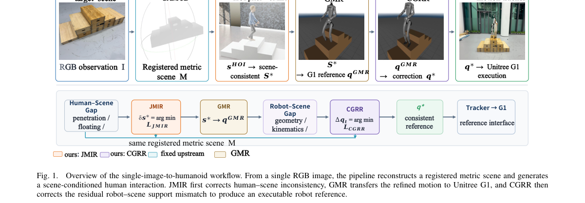

*Result - Two-stage geometric refinement across embodiment transfer. JMIR corrects the human–scene geometric mismatch while preserving the generated interaction structure. After GMR, CGRR performs a bou*

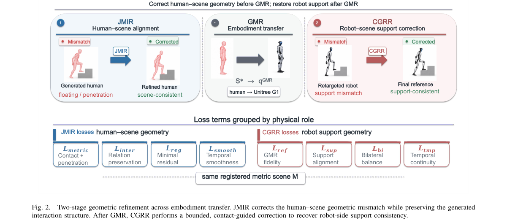

**Why this ranks #10**: 单张 RGB 图到可执行人形动作参考的完整管线：SAM 3D Objects 重建并注册米制场景，JMIR 在重定向前校正人—场景几何错配，GMR 之后用 CGRR 修正机器人特异的支撑误差。相比 GRAIL 精修时间从 480 s 降到 87 s（5.5×），完整管线仿真成功率 89%、Unitree G1 上 50 次物理试验成功率 70%，支撑误差 0.21 cm、局部逐关节位置误差 38.2 mm。分数 7.7。

---

### 11. HeadIO: Body-Frame Heading Decomposition for Neural Inertial Odometry on Head-Mounted Devices

**arXiv**: [2611.14895](https://arxiv.org/abs/2611.14895) | **Score**: 7.3 (relevance 7 x 0.7 + quality 8 x 0.3) | **Direction**: `embodied_ai` | **Tags**: embodied, inertial-odometry, head-mounted, mamba, equivariance, wearable-sensing, Northwestern University | **Categories**: cs.CV, cs.RO | **Pages**: 8

**Authors**: Taeyoung Yeon; Yiquan Li; Chenfeng Gao; Vasco Xu; Karan Ahuja

**Affiliation**: Northwestern University; University of Chicago

**Abstract**

> Inertial odometry (IO) using only Inertial Measurement Units (IMUs) enables camera-free head tracking in head-mounted devices such as VR headsets, AR glasses, and earbuds. Prior IO methods operate in a gravity-aligned world frame, which is not yaw-equivariant. Yaw augmentation improves robustness but does not guarantee equivariance; learned equivariant layers achieve it, but EqNIO's full pipeline costs nearly 3$\times$ the FLOPs of ours. While raw body-frame IMU inputs are inherently yaw-invariant, head tilt redistributes both gravity and motion signals across device axes, making the representation tilt-variant. We propose HeadIO, which combines a body-frame heading decomposition with a bidirectional Mamba backbone for head-mounted inertial odometry. Our decomposition achieves tilt invariance by separating gravity-aligned and horizontal components using only the tilt component of device orientation. We evaluate on four head-mounted datasets and find that HeadIO improves RTE-5s by 8.1% (0.260 m $\to$ 0.239 m) over world-frame methods with learned equivariant layers on Nymeria, the largest benchmark dataset, at nearly 3$\times$ lower FLOPs and 8$\times$ fewer parameters. HeadIO achieves state-of-the-art performance on our primary metric, RTE-5s, on all Aria-glasses datasets, which natively provide body-frame semantics for our decomposition method. We further evaluate the IMU-only deployment scenario on Nymeria, where HeadIO remains state-of-the-art. We show that our method relies mainly on tilt accuracy, which can be obtained from the gravity signal; for yaw, a single-coefficient gyroscope correction removes 11.6% of the yaw error and improves RTE-5s by 2.5%, and sparse external yaw corrections (for example, one every 30 s) can improve RTE-5s by 12.0%. Our decomposition is lightweight, composes with any backbone, and is suitable for real-time deployment on head-mounted devices.

**Key findings**

- **Finding**: 四个头戴数据集上，HeadIO 在 Nymeria 的 RTE-5s 从 EqNIO 的 0.260 m 降到 0.239 m（改善 8.1%，ATE 由 0.093 降到 0.086 m）；模型 0.97M 参数、3 s 窗口 444 MFLOPs，而 EqNIO 为 7.59M 参数与 1227 MFLOPs，即少 7–8× 参数、算力低 2.8×；单系数陀螺修正可消除 11.6% 偏航误差并使 RTE-5s 再提升 2.5%，每 30 s 一次的稀疏外部偏航修正可提升 12.0%。
- **Inference**: 该方法把等变性从网络结构挪到输入表示上，因此可与任意骨干组合；误差主要来自倾斜估计而非偏航，这也解释了为什么低频的稀疏偏航锚点收益远大于持续做陀螺修正。
- **Recommendation**: 做头戴或随身惯导时，先把 IMU 输入转到机体系并按重力对齐与水平分量拆开、再选骨干（本文用双向 Mamba），可省下等变层的算力；若偏航是主要误差源，优先加每 30 s 一次的外部偏航锚点，收益比持续做陀螺修正更明显。

**Key figures**

*Framework - Invariance properties of the body-frame heading decomposition. (a) Body-frame IMU inputs are heading-invariant: the same walking motion produces identical IMU readings regardless of which dire*

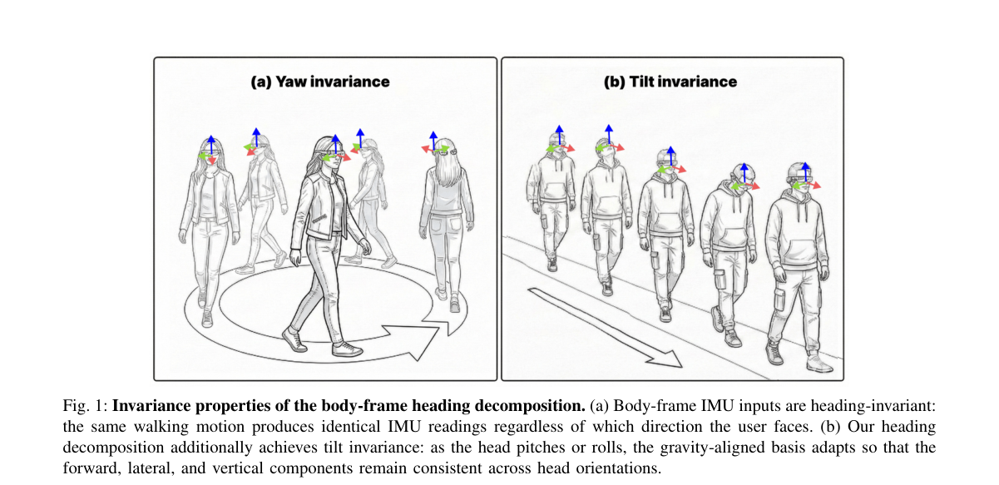

*Result - Body-frame heading decomposition. (A) When the head is upright, the body-frame up axis (+y) aligns with gravity direction eg, and the forward axis fb coincides with eh1. (B) When the head tilt*

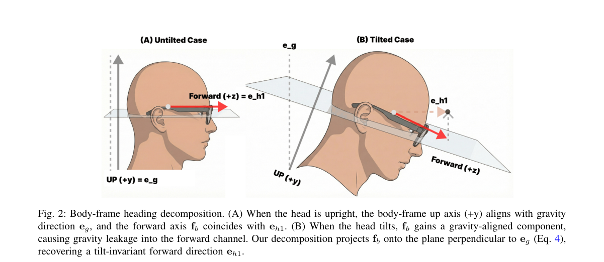

**Why this ranks #11**: 头戴设备的无摄像头惯性里程计：HeadIO 用机体系 heading 分解消掉头部倾斜时重力与运动信号在设备轴向的混叠，再接双向 Mamba 骨干。在 Nymeria 上把 RTE-5s 从等变方法 EqNIO 的 0.260 m 降到 0.239 m（改善 8.1%），参数量 0.97M 对 EqNIO 的 7.59M（约 1/8），算力 444 MFLOPs 对 1227 MFLOPs（2.8× 更省）。属可穿戴具身设备的自运动感知，故入 embodied_ai，分数 7.3。

---

### 12. Adapting Monocular Depth Estimation in Novel Scenes through Disparity Refinement and Robot Ego-Motion

**arXiv**: [2611.14958](https://arxiv.org/abs/2611.14958) | **Score**: 7.3 (relevance 7 x 0.7 + quality 8 x 0.3) | **Direction**: `embodied_ai` | **Tags**: embodied, monocular-depth, online-adaptation, disparity-refinement, ego-motion, metric-scale, University of California | **Categories**: cs.CV, cs.RO | **Pages**: 17

**Authors**: Dimitrios Chatziparaschis; Georgios Georgakis; Adnan I. Ansar; Shehryar Khattak; Konstantinos Karydis

**Affiliation**: University of California, Riverside; Jet Propulsion Laboratory, California Institute of Technology

**Abstract**

> The geometric understanding of a scene is a crucial component for safe and efficient robotic operations in novel and unstructured environments. The recent emergence of foundation models for Monocular Depth Estimation (MDE) has provided an opportunity to enrich robotic perception capabilities with dense long-range depth predictions, replacing expensive onboard hardware (e.g., LiDARs and stereo cameras). However, these offline models are primarily trained on affine-invariant depth representations, and their generalization to novel scenes remains unclear. In this work we present EM-ViT, a monocular depth estimation model that learns to adapt online relative depth inputs from a foundation model prior to the metric scale with observations collected during robotic operations. Motivated by the stereo camera parameterization, our method decomposes depth prediction via dense disparity refinement to recover the scene's relative structure and an effective baseline scalar prediction to determine the missing metric scale. The learning process leverages sparse LiDAR points and, optionally, the robot's Ego-Motion (EM) to rapidly train a lightweight Vision Transformer (ViT), while an internal gradient matching loss preserves the fine-grained semantic structure of the input disparity in real-time. We demonstrate the efficacy of our method on publicly available sequences, such as KITTI, and show that our online learning pipeline can adapt to novel scenes faster and with higher accuracy than existing MDE foundation models. The code and supplementary materials will be publicly available at https://emvit-mde.github.io.

**Key findings**

- **Finding**: KITTI 场景上 EM-ViT 的 δ1 为 0.822、AbsRel 0.14、RMSE 3.46、总训练时间 57.48 s，而在线 DAV2 ViT-S 为 0.666/0.24/4.20/67.75 s、FusionDepth 为 0.618/0.24/5.4/68.81 s；车库场景 δ1 0.910（对照 0.859）、总训练时间 82.37 s（对照 100.38 s）；柑橘园场景总训练时间 35.91 s（对照 40.42 s）；全部指标在 NVIDIA AGX Orin 64GB 上测得，图像采样率 0.75 Hz、时序窗口 10 s。
- **Inference**: 把「相对结构」与「绝对尺度」拆成两个预测头，等于把仿射不变基座模型给不出的尺度信息单独交给一个标量补齐，因此在线适配只需少量稀疏 LiDAR 观测就能收敛，而不必重训整个深度网络。
- **Recommendation**: 机器人只能拿到稀疏 LiDAR 观测时，可按「稠密视差精化 + 有效基线标量」两头来搭轻量 ViT，并把梯度匹配损失加进在线循环以防细结构被尺度分支冲掉；评测务必在自家算力平台上测在线适配耗时（本文 57 s 级别是在 Jetson AGX Orin 上得到的）。

**Key figures**

*Framework - Real-time and onboard MDE metric adaptation. Sparse image frames and corresponding point cloud views collected during exploration are used to refine an affine- invariant relative depth map int*

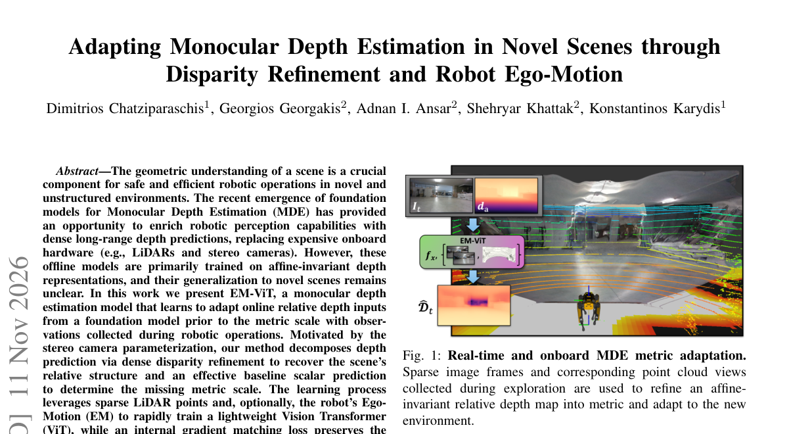

*Result - Self-supervised virtual stereo system for online metric adaptation in MDE. Based on an affine-invariant inverse depth input da and camera’s focal length f, our Ego Motion (EM)-ViT framework de*

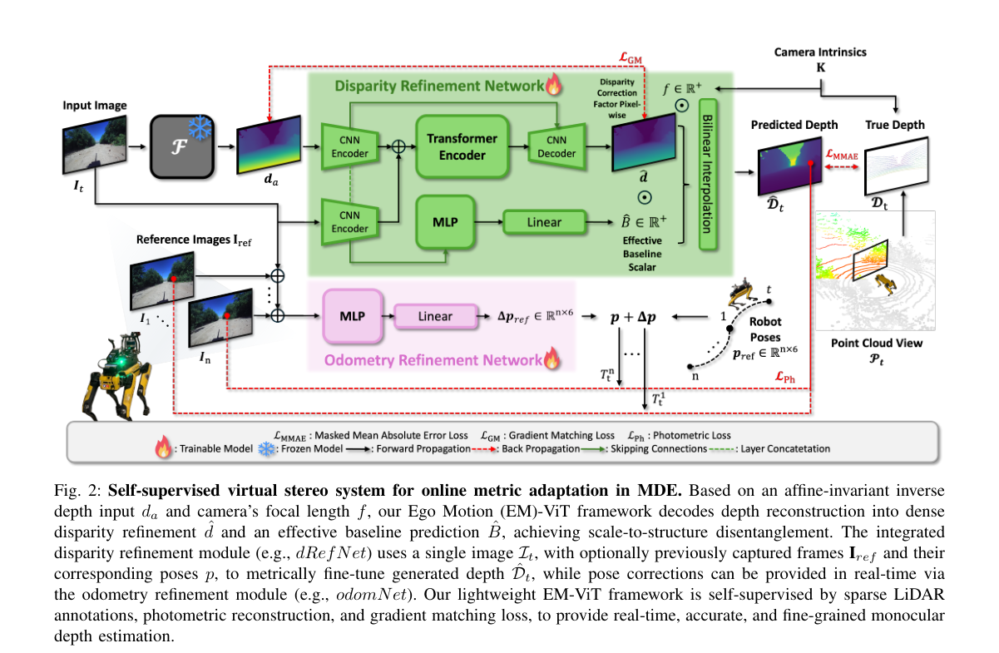

**Why this ranks #12**: 把仿射不变的单目相对深度在线适配成米制深度：EM-ViT 按立体相机参数化拆成稠密视差精化与一个有效基线标量两个头，用稀疏 LiDAR 点与可选的机器人自运动训练轻量 ViT，并用内部梯度匹配损失保住输入视差的细粒度结构。KITTI 场景上 δ1 0.822（在线 DAV2 为 0.666）、AbsRel 0.14（0.24）、RMSE 3.46（4.20），在线适配总耗时 57.48 s（对照 67.75 s），全部指标在 NVIDIA AGX Orin 64GB 上测得。分数 7.3。

---

### 13. DIVAL: Diffeomorphic Vector-Field Alignment for Nonholonomic Motion Planning

**arXiv**: [2611.14918](https://arxiv.org/abs/2611.14918) | **Score**: 7.0 (relevance 7 x 0.7 + quality 7 x 0.3) | **Direction**: `embodied_ai` | **Tags**: embodied, nonholonomic-planning, vector-field, diffeomorphism, obstacle-avoidance, motion-planning, [unverified] | **Categories**: cs.RO, eess.SY | **Pages**: 19

**Authors**: Yike Qiao; Xiaodong He; An Zhuo; Zhiyong Sun; Weimin Bao; Zhongkui Li

**Affiliation**: [unverified]

**Abstract**

> Conventional vector-field-based motion planners for nonholonomic robots consist of two steps: first designing a nominal vector field and then controlling the robot to follow it to approach the target. However, a nonholonomic robot cannot follow the vector field instantaneously and may collide with obstacles, due to the inevitable mismatch between the robot's initial heading and the vector field's direction. This paper proposes a diffeomorphic vector-field alignment (DIVAL) method, which aligns the vector field's direction with the robot's initial heading so the robot can follow the vector field from the start. Specifically, the nominal vector field is locally reshaped by applying a diffeomorphic deformation to the workspace, such that the reshaped vector field has the same direction as the robot's heading at the initial position and coincides with the nominal vector field outside the deformed region. Since DIVAL eliminates the initial heading mismatch, the nonholonomic robot can maintain heading alignment with the reshaped vector field throughout the motion. This heading alignment further ensures that the robot preserves the nominal vector field's properties, including obstacle avoidance, convergence to the target, and smooth control signals. Numerical simulations provide vector-field-tracking baselines where the nominal vector fields are reshaped with DIVAL. Compared to the original baselines, the proposed method achieves collision-free convergence in all trials and avoids control discontinuities. Hardware experiments on a ground vehicle further demonstrate collision-free convergence across different targets and initial conditions under real-world disturbances.

**Key findings**

- **Finding**: 论文报告数值仿真中相对原始基线所有试验均实现无碰撞收敛并避免控制不连续，实机地面车在真实扰动下对不同目标与初始条件同样无碰撞收敛；实现上 active 区域半径取为初始位置到自由空间边界的距离，转移函数用 12 个系数的五次 B 样条表示，并以 RMS 曲率加峰值曲率的组合为目标做优化以压低角速度需求。
- **Inference**: 把朝向失配在几何层面一次性消掉（而不是靠跟踪控制器慢慢转过来），等价于为非完整机器人造出一条可执行的积分曲线，于是障碍规避、目标收敛与控制平滑等名义向量场的性质可整段继承，代价是多求解一次微分同胚形变与 B 样条系数。
- **Recommendation**: 设计非完整机器人的向量场规划器时，可直接用「工作空间微分同胚形变对齐初始朝向 + 形变区外保持原场」的思路，并用 RMS 与峰值曲率联合优化过渡函数来降低角速度需求；评估务必与原向量场跟踪基线对比碰撞率与控制连续性，而不是只看是否收敛。

**Key figures**

*Framework - Comparison between the vector-field-tracking method and DIVAL (proposed). (a): The vector-field- tracking planner gradually rotates the nonholonomic robot towards the vector field’s direction.*

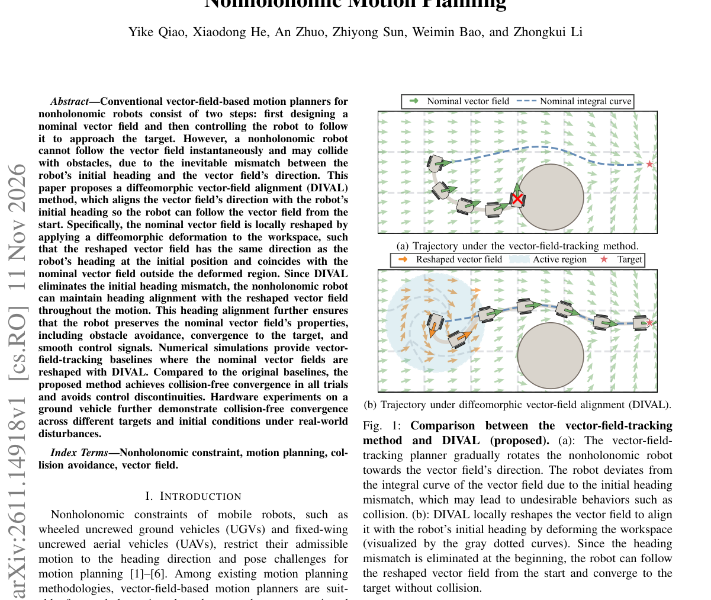

*Result - Illustration of 2D DIVAL, with the nominal vector field ξ “ r1, 0s⊺. The deformation map Φ maps the uniformly sampled nominal positions q to the deformed positions p, inducing the aligned vect*

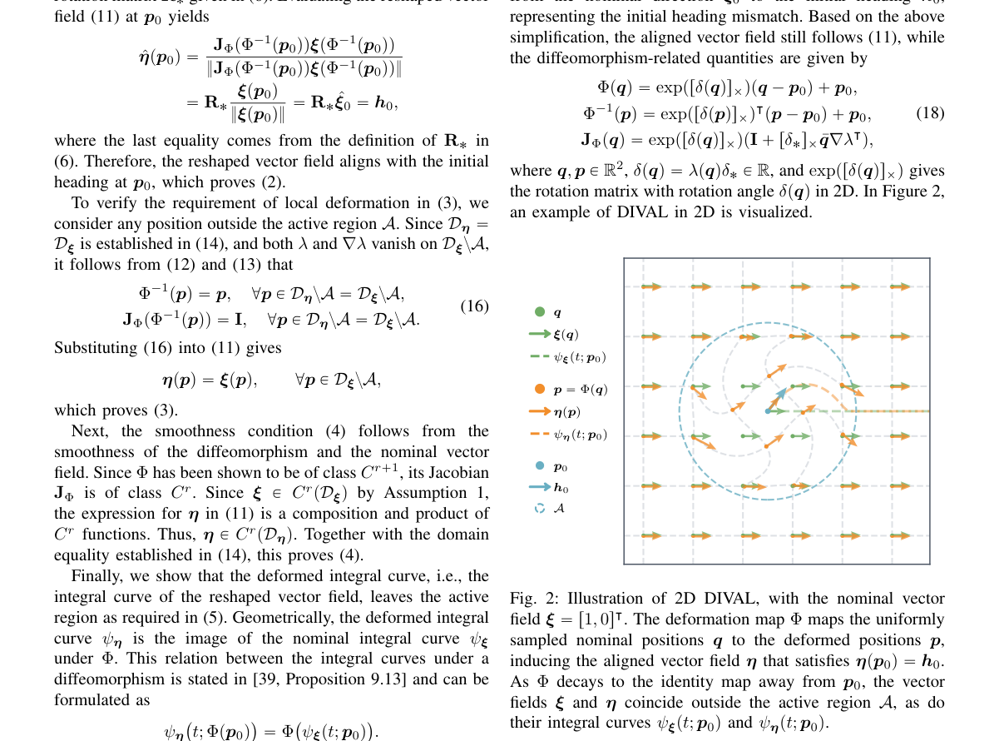

**Why this ranks #13**: 非完整约束机器人沿向量场运动时，初始朝向与向量场方向必然失配，带来偏航、碰撞与控制不连续。DIVAL 对工作空间做微分同胚形变，把向量场方向在起点处扭到机器人当前朝向上、在形变区外保持原向量场：数值仿真中相对原始基线所有试验均无碰撞收敛且无控制不连续，实机地面车在不同目标与初始条件下同样无碰撞收敛。active 区域半径取到自由空间边界距离、转移函数用 12 系数五次 B 样条优化。分数 7.0，为本 direction 末位。

---

## Footer

- Total papers reviewed across all 4 axes: 34
- world_embodied axis final count: 13
- Wild-cards in this axis: 0
- Figure assets: 2026-11-13/res/

Generated by `mine-arxiv-daily-digest` skill. Sister file: `2026-11-13_world_embodied_entry.md`.
