# Mine Arxiv Daily Digest - 2026-11-14 (AIGC 视觉生成与编辑 Axis, 15 papers)

**Generated**: 2026-11-14 11:25 CST

**Source**: arXiv cs.CV, cs.SD, eess.AS, cs.CL, cs.AI, cs.RO, cs.LG, cs.IR submissions, listing day 2026-11-11 + 2026-11-12 (announced 2026-11-13 01:00 UTC)

**Batch window**: 2026-11-10T19:00:00Z .. 2026-11-12T19:00:00Z（arXiv 公告批次横跨两个 UTC 日：从前一日的美东 14:00 截止时刻起算（EDT 为 18:00Z，EST 为 19:00Z），到当日的同一时刻为止）

**Axis**: aigc_visual (15 papers, base 15, cap 20)

**Directions**: aigc_generation (12), aigc_editing (3), aigc_rl (0)

**Selection**: 15 papers ranked by relevance x quality, with 0 wild-card slots

**Day total**: 60 papers across 4 axes (target 60)

**Scope**: 图像 / 视频 / 3D / 4D 内容的生成与编辑，以及面向视觉生成的 RL / 偏好优化与奖励模型

**Wild-card**: 0 —— 本 axis 未启用任何补位名额。`aigc_editing` 只有 3 篇够格、`aigc_rl` 断供，让出的名额全部由同方向候选更充裕的 `aigc_generation` 吸收（12 篇，超基准 4 个，正好等于 edit+rl 的缺口）。

**本 axis 15 篇（base 15，cap 20）**：`aigc_generation` 12 篇、`aigc_editing` 3 篇、`aigc_rl` **0 篇**。两个方向的让出名额（edit 1 + rl 3 = 4）全部由 `aigc_generation` 同方向吸收，其候选池里确实有 12 篇够格论文，因此不是凑数而是供给分配的结果。

**`aigc_editing` 供给确实偏薄**：严格编辑类正则（inpaint / outpaint / harmonization / retouch / 背景替换 / 身份保持 / 风格迁移 / 个性化等）在本批 814 篇里命中 13 篇，逐篇过筛后真正做图像或视频编辑的只有 3~5 篇，最终收 3 篇（WaveletLoRA / AIFR / ReliaGuard）。

**`aigc_rl` 本批次断供**：严格扫描（RL 类词 GRPO / DPO / PPO / RLHF / RLVR / RLAIF / reward model / preference optimization / best-of-N / rejection sampling / reward hacking / HPSv2 / GenEval / DrawBench 与视觉生成类词 image|video|visual|diffusion|T2I|T2V|clip score 在 140 字符窗口内共现）只命中 **1 篇**且为伪阳性；放宽到 160 字符、双向共现后命中 **21 篇**，逐篇读过**没有一篇属于面向视觉生成的 RL**。唯一带 GRPO 的视觉相关论文是 2611.16628《Safety as a Budget》，但它训练的是 VLM 的安全拒答行为、按方法学归属改落在 `llm_vlm_rl` 的 `Multimodal_GRPO`。

---

## AIGC 生成（图像 / 视频 / 3D / 4D） · `aigc_generation` (12 papers)

本方向 12 篇，主线是**「把生成从潜空间搬回像素」「把物理推理从扩散过程里拆出来」「把质量判据从人眼换成可验证的机制」**。Back to Pixels（PixVid）把视频扩散从 VAE 潜空间拉回像素空间——潜空间压缩虽然让训练可行，却让分辨率翻倍等价于 token 数翻四倍、条件只能作用于帧组而非单帧、每一帧响应都得等完整个多帧块；UniSpark-9B 用 Mixture-of-Transformer-Experts 骨干把全注意力与 GatedDeltaNet 线性注意力混合，让自回归文本预测与视觉 flow matching 共存于一个统一模型；TokenStream 用 token-wise LoRA 加引导注意力把各自独立训练的主体身份组合成多主体视频，既不需要参考视频数据集，也不需要为每种新组合重训；K2V 把「物理推理」从扩散过程内部拆出来，交给生成式关键帧单独承担；PhysLoop 解决视频生成缺物理监督的死结——LLM 有物理知识却不能稳定地指导生成模型，它用 LLM 的物理感知换来自改进；Track4D 把在数百万视频上预训练的视频扩散模型改造成稠密 3D 点跟踪器，先系统评估两种「把 3D 轨迹表示成类视频信号」的方式；eDMD 用端点分布匹配做少步扩散蒸馏，指出多步蒸馏里 fake model 被训在中间步上会造成分布错配。可控性一侧有四个不同答案：VibePrevisBench 让 coding agent 在 Blender 里搭出可执行的 4D 场景并同时评代理视频与长多镜头场景；MemCrafter 用脑科学机制（记忆形成过程）指导文本生成视频，把「记得住」变成可优化的生成目标；CFGComposer 用 copula score 校正在推理时组合两个独立训练的扩散模型，同时对齐语音节奏与文本语义地生成全身手势；WorldDraft 则提出「代码建世界、视频模型只做渲染」的分工，并给出世界保持与视觉一致两条判据。

### 1. Back to Pixels: Lifting Latent Video Diffusion into Pixel Space

**arXiv**: [2611.17336](https://arxiv.org/abs/2611.17336) | **Score**: 9.0 (relevance 9 x 0.7 + quality 9 x 0.3) | **Direction**: `aigc_generation` | **Tags**: AIGC-visual, pixel-space, video-generation, diffusion, high-resolution, Roblox | **Categories**: cs.CV | **Pages**: 23

**Authors**: Yanke Song; Shuo Chen; Chris Rockwell; Guande He; Nan Liu; Desai Xie; Tianpei Gu; Yong-Hyun Park; Aryan V S; Dennis Yuren Menn; Ming-Hsuan Yang; Xun Huang

**Affiliation**: Roblox; University of California, Merced; University of Pennsylvania; University of Texas at Austin

**Abstract**

> Frontier video generation models work in a VAE latent space that compresses video in both space and time. This compression made training tractable, but now limits high-resolution, controllable, and interactive generation -- doubling resolution quadruples token count, conditions apply to groups of frames rather than individual ones, and each response must wait for the rest of its multi-frame block. We present PixVid, a simple yet effective method that lifts a pretrained latent video model to directly generate every frame in pixel space. PixVid keeps the diffusion transformer and replaces the VAE decoder with a convolutional head that renders its outputs into pixels. We find that predicting clean video rather than velocity, together with a larger noise shift, is key to quality. Finetuned from Wan2.1-14B, PixVid is competitive with the latent baseline within $\sim 1.3$M training clips. Working framewise in pixels, it generates at $2\times$ higher resolution with the same per-frame token count, keeps depth-conditioned video editing aligned under fast motion, and responds to each action at the next frame. Project page: https://chenshuo20.github.io/PixVid/

**Key findings**

- **Finding**: PixVid 从 Wan2.1-14B 微调，用约 1.3M 训练片段（采样自 64K 视频）把视频扩散从 VAE 潜空间搬到像素空间，VBench 总分达 84.78，21 帧片段含 32,760 个 token、单卡耗时 192 秒。
- **Inference**: 潜空间压缩已经从「让训练可行」变成「限制高分辨率与逐帧可控」的瓶颈，而回到像素空间并不必然牺牲质量，代价主要落在推理侧的 token 数与时长上。
- **Recommendation**: 做高分辨率或逐帧可控的视频生成时，先按每帧 token 数与推理秒数核算预算，再决定是否沿用像素空间路线。

**Key figures**

*Framework - PixVid lifts a pretrained latent video model into pixel space, enabling: (a) scaling to 960 × 1664 video at minimal extra cost per frame over 480 × 832, at or above the pretrained latent mod*

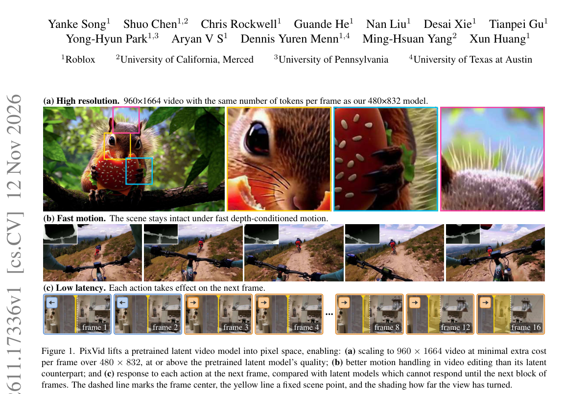

*Result - Lifting a pretrained latent video DiT to pixel space. Top: the pretrained latent model. A linear pixel-latent alignment, fitted offline, is fused with the pretrained patch embedding to obtai*

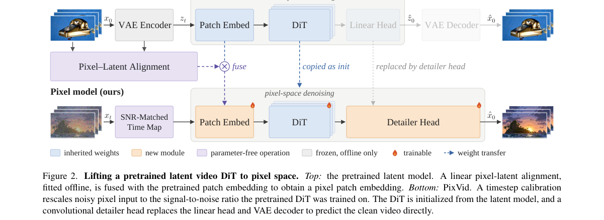

**Why this ranks #1**: 从 Wan2.1-14B 微调，用约 1.3M 训练片段（采样自 64K 视频）把视频扩散从 VAE 潜空间搬回像素空间，VBench 总分 84.78；每 token 只覆盖单帧的 1×p×p 像素块，960×1664 分辨率的每帧 token 数与 480×832 相同。

---

### 2. UniSpark: Exploring Hybrid Attention for Multimodal Understanding and Generation

**arXiv**: [2611.16517](https://arxiv.org/abs/2611.16517) | **Score**: 8.7 (relevance 9 x 0.7 + quality 8 x 0.3) | **Direction**: `aigc_generation` | **Tags**: AIGC-visual, hybrid-attention, flow-matching, unified-multimodal, linear-attention, Lucaria Academy | **Categories**: cs.CV | **Pages**: 31

**Authors**: Jiancheng Pan; Yuzheng Liu; Hengyuan Cao; Qiyuan Zhang; Yangyan Li; Biao Gong; Zheng Zhang; Ka Long Cheng; Xinyang Wang; Yujun Shen

**Affiliation**: Lucaria Academy

**Abstract**

> We present UniSpark-9B, a unified multimodal model that investigates hybrid attention for visual understanding and generation. Built on a Mixture-of-Transformer-Experts backbone with approximately 9B parameters in each branch, UniSpark combines full attention for explicit token interactions with GatedDeltaNet linear attention for compact context propagation. Autoregressive text prediction and visual flow matching jointly support visual question answering, text-to-image generation, instruction-guided editing, and interleaved text-image prediction. In interleaved generation, noisy visual targets are isolated from subsequent predictions, while clean visual representations provide context for later outputs. A blockwise protocol enforces this distinction through attention masks in full-attention layers and recurrent-state retention rules in linear-attention layers. The selected training sources contain 159.7M generation samples, 213.4M understanding samples, and 624.8K interleaved sequences. A four-stage curriculum jointly trains multimodal understanding and visual generation, refining answer accuracy and instruction following while extending image synthesis to 2K. UniSpark scores 2470.3 on MME-S and 0.83 on GenEval. Qualitative examples further illustrate its capabilities in interleaved image generation, video synthesis, and video editing. Together, these results demonstrate that hybrid attention provides an effective backbone for unified multimodal understanding and generation.

**Key findings**

- **Finding**: UniSpark-9B 每个分支约 9B 参数，用全注意力叠加 GatedDeltaNet 线性注意力，训练数据含 159.7M 生成样本、213.4M 理解样本与 624.8K 交织序列，MME-S 2470.3、GenEval 0.83，图像合成扩展到 2K。
- **Inference**: 自回归文本预测与视觉 flow matching 能在同一骨干内共存，说明统一多模态模型的难点正从「统一架构」转向注意力形态与训练数据配比。
- **Recommendation**: 复现统一理解+生成模型时优先对齐四阶段课程的数据配比与注意力掩码规则，再考虑更换骨干结构。

**Key figures**

*Framework - Multimodal understanding, generation, and editing performance.*

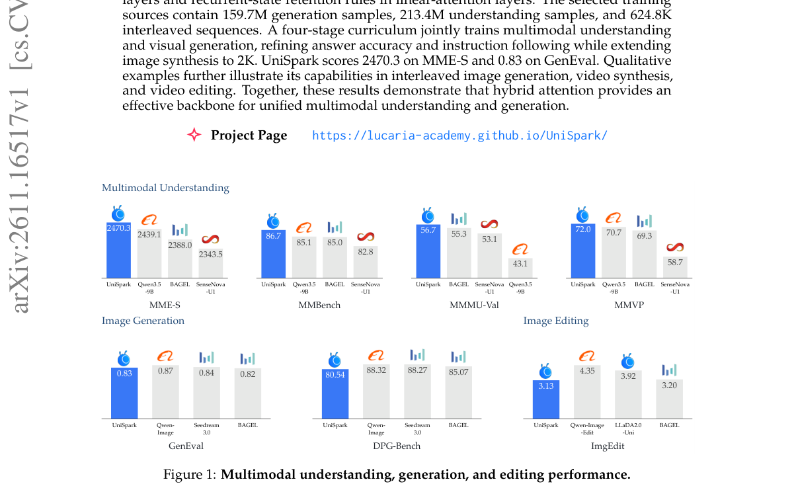

*Result - Text-to-image generation.*

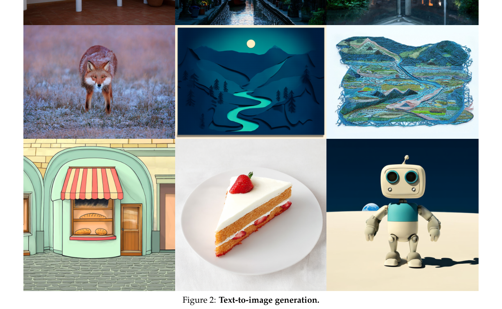

**Why this ranks #2**: UniSpark-9B 在 Mixture-of-Transformer-Experts 骨干中混合全注意力与 GatedDeltaNet 线性注意力，每个分支约 9B 参数；视觉分支用 flow matching 训练，数据含 159.7M 生成样本、213.4M 理解样本与 624.8K 交织序列，MME-S 2470.3、GenEval 0.83。

---

### 3. TokenStream: Multi-Subject Personalized Video Generation with Token-wise LoRA and Guided Attention

**arXiv**: [2611.16897](https://arxiv.org/abs/2611.16897) | **Score**: 8.7 (relevance 9 x 0.7 + quality 8 x 0.3) | **Direction**: `aigc_generation` | **Tags**: AIGC-visual, multi-subject, personalization, lora, video-generation, National University of Singapore | **Categories**: cs.CV | **Pages**: 16

**Authors**: Hung Nguyen; Quang Qui-Vinh Nguyen; Khoi Nguyen

**Affiliation**: National University of Singapore; Qualcomm AI Research

**Abstract**

> We introduce TokenStream, an optimization-based framework that composes independently learned subject identities in text-to-video generation without a reference-video training dataset or joint optimization of each new subject combination. Learning from a single reference image makes subject appearance difficult to separate from static-image bias, while merging independently trained adapters can mix identities. Token-wise LoRA (ToRA) restricts low-rank updates to the cross-attention value projections of subject-associated text tokens, providing a separate adaptation path for each subject. A T2V-guided stream copies queries and keys from the frozen base model during early denoising to reuse its layout and motion priors while retaining personalized values. We also introduce Multi-DB, a 30-subject, 122-prompt benchmark with appearance-free prompts and varied interactions. On Multi-DB at 1.3B, TokenStream improves identity preservation from 0.422 for DreamBooth to 0.467 and textual alignment from 0.652 to 0.688.

**Key findings**

- **Finding**: TokenStream 用 token-wise LoRA 把低秩更新限制在主体关联文本 token 的交叉注意力 value 投影上，在 Multi-DB（30 主体、122 条 prompt、其中 76 条双主体）上把身份保持从 DreamBooth 的 0.422 提到 0.467、文本对齐从 0.652 提到 0.688。
- **Inference**: 合并独立训练的主体适配器之所以会串味，根因是适配作用域重叠，缩小作用域比增加参考视频训练数据更有效。
- **Recommendation**: 做多主体视频定制时先让每个主体的适配只作用于其文本 span 的 value 投影，再考虑引入参考视频训练。

**Key figures**

*Framework - Multi-subject video personalization with TokenStream. TokenStream uses a single reference image per subject and composes independently trained subject adapters at inference time. Compared wi*

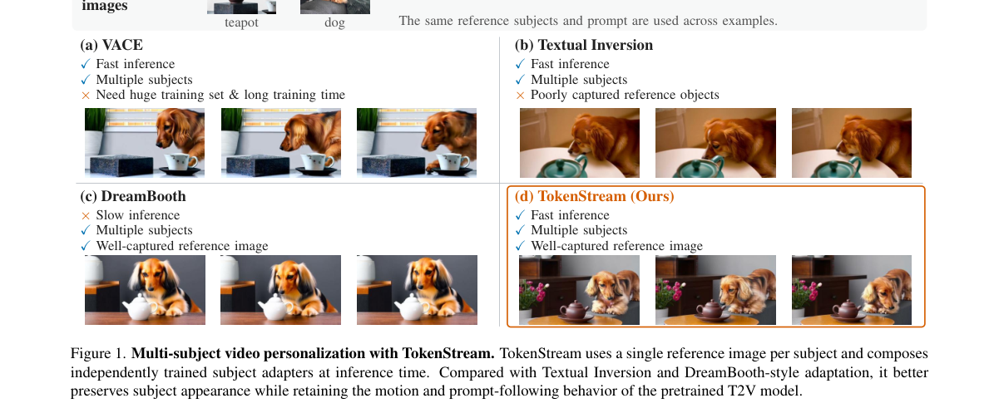

*Result - Overall framework of TokenStream. Subject adapters are learned independently and applied only to their text-token spans in the value projection. The frozen T2V-guided stream transfers Q, K a*

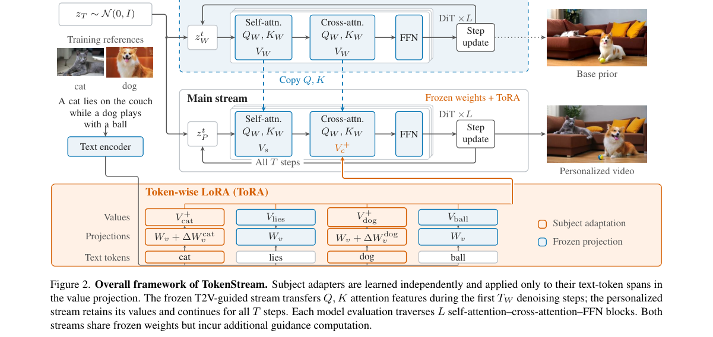

**Why this ranks #3**: 在 Wan2.1 上用 token-wise LoRA 把低秩更新限制在主体对应文本 token 的交叉注意力 value 投影上；Multi-DB 含 30 个主体、122 条 prompt（其中 76 条为双主体），1.3B 骨干上身份保持从 DreamBooth 的 0.422 提到 0.467、文本对齐从 0.652 提到 0.688。

---

### 4. K2V: Generative Keyframing For Physically Plausible Video Generation

**arXiv**: [2611.17324](https://arxiv.org/abs/2611.17324) | **Score**: 8.7 (relevance 9 x 0.7 + quality 8 x 0.3) | **Direction**: `aigc_generation` | **Tags**: AIGC-visual, keyframe, video-generation, physics-plausibility, llm-planning, University of Cambridge | **Categories**: cs.CV | **Pages**: 16

**Authors**: Felix O'Mahony; Daniel Olmeda Reino; Roberto Cipolla; Ayush Tewari

**Affiliation**: University of Cambridge; Toyota Motor Europe

**Abstract**

> Video diffusion models are able to generate samples with high-quality appearance and textural qualities. However, content produced by these methods is known to exhibit significant physical errors. This is because, in a classical video generation setting, all physical reasoning must take place simultaneously and exclusively within the diffusion process.We propose to resolve these issues by redistributing the task of physical reasoning onto a language model-backed keyframe generation module, which allows for explicit reasoning in language, and fine-grained control over the appearance of the video at important moments in the video. We then condition a video generation model with these keyframes, reducing the role of the diffusion model to the simpler task of interpolating between physically-correct intermediate states, rather than inferring an entire sequence with diffusion. Results demonstrate that our approach significantly outperforms existing approaches, achieving state-of-the-art performance on the Physics-IQ Verified benchmark and PhyGenBench.

**Key findings**

- **Finding**: K2V 由 Gemini 3.8 Flash 规划、图像编辑模型渲染关键帧，再微调 Wan2.2-14B 做关键帧插值，在 Physics-IQ Verified 图生视频轨道把分数从 32.2±0.6 提到 55.0±0.8，每条视频花费 0.47 美元，参数约为完整模型的 1/3。
- **Inference**: 把物理推理从扩散采样搬到可读的关键帧上比单纯放大采样模型更划算，因为出错的关键帧可以被直接检查和修正。
- **Recommendation**: 需要物理正确性的场景应先生成可核查的关键帧再交给视频模型插值，并把关键帧人工校正纳入流程。

**Key figures**

*Framework - Our approach generates keyframes to serve as stronger conditioning for a video model, leading to an approach which outperforms existing methods both qualitatively and quantitatively.*

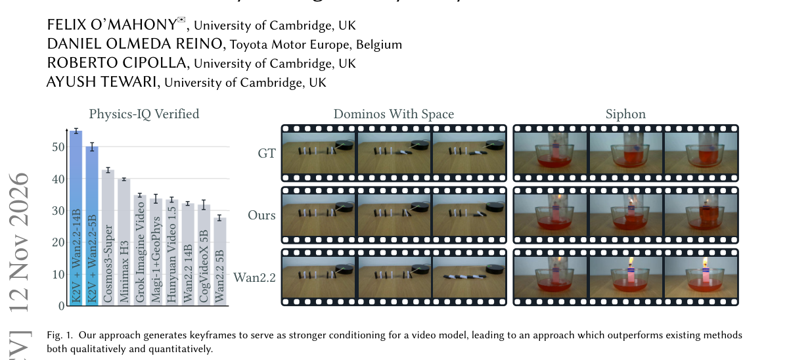

*Result - Overview of the proposed method. We design a keyframe module which reasons about the physical evolution of a given scene and produces keyframes with timestamps and an expanded caption. These a*

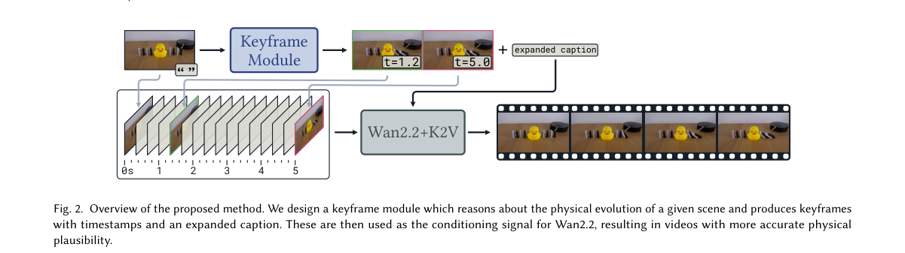

**Why this ranks #4**: 把物理推理卸载给 LLM 驱动的关键帧生成模块，视频模型只做插值；Wan2.2-14B 在 Physics-IQ Verified 图生视频轨道从 32.2±0.6 提到 55.0±0.8，每条视频成本 0.47 美元，参数约为完整 14B 骨干的三分之一。

---

### 5. CFGComposer: Compositional Audio-Text-to-Motion Generation via Copula Score Correction

**arXiv**: [2611.15101](https://arxiv.org/abs/2611.15101) | **Score**: 8.0 (relevance 8 x 0.7 + quality 8 x 0.3) | **Direction**: `aigc_generation` | **Tags**: AIGC-visual, motion-generation, audio-text-motion, copula-score, diffusion, Tsinghua University | **Categories**: cs.AI, cs.SD | **Pages**: 9

**Authors**: Pengyang Shi; Jinlu Zhang; Chunze Lin; Yizhou Wang; Li Yi

**Affiliation**: Tsinghua University; Galbot; Peking University; Shanghai Qi Zhi Institute; State Key Laboratory of General Artificial Intelligence

**Abstract**

> Generating whole-body gestures that are simultaneously rhythmically synchronized with speech audio and semantically aligned with text descriptions is a fundamental challenge in embodied AI and social robotics. We tackle this Audio-Text-to-Motion (AT2M) problem by composing two independently-trained diffusion models at inference time and refine bias in joint inference by modeling the copula score $s_I$. A rigorous theoretical analysis reveals that naive epsilon blending corresponds to a Product-of-Experts formulation that omits the copula score $s_I$: the cross-modal interaction between audio and text that neither marginal model can capture. We propose CFGComposer: a jointly-trained AT2M diffusion model that estimates $s_I$ via a CFG analogy and injects it as an $ε$-space correction. Experiments on BEAT demonstrate best-in-class semantic fidelity (SRGR $0.9916$, FID $27.18$) with GT-level beat alignment (BA $0.1826$ vs. GT $0.1743$), and 76-83% win rate in blind pairwise human evaluation against all prior methods. Physical deployment on a Unitree G1 humanoid confirms direct sim-to-real transfer.

**Key findings**

- **Finding**: CFGComposer 在 BEAT 上取得 SRGR 0.9916 与 FID 27.18，节拍对齐 BA 0.1826 接近真值 0.1743，对全部既有方法的盲测两两胜率为 76-83%，并在 Unitree G1 人形上直接 sim-to-real。
- **Inference**: 朴素混合两个独立训练的扩散模型等于 Product-of-Experts，会丢掉任一边缘模型都无法表达的跨模态交互项，补上该项才能真正组合。
- **Recommendation**: 做多条件生成时先用理论分析确认朴素融合漏掉了哪一项交互，再用联合训练模型显式补上该项。

**Key figures**

*Framework - Compositional AT2M via CFG-Guided Interaction Correction. Given speech audio a, text caption c and frame window m, the goal is to generate whole-body motion that is rhythmically locked to the*

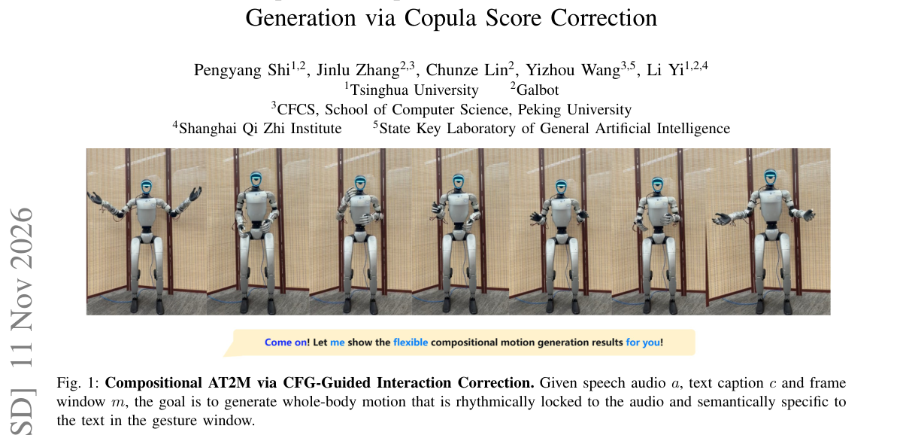

*Result - CFGComposer method overview. Pre-trained A2M and T2M experts compose at inference time via the exact PoE score decomposition (Eq. 9). CFGComposer trains a jointly-conditioned AT2M model and ap*

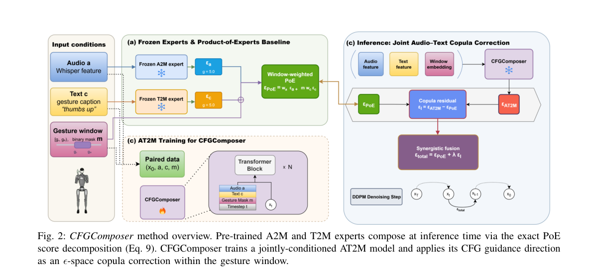

**Why this ranks #5**: 理论分析证明朴素 ε 混合等于 Product-of-Experts，会丢掉音频与文本间的 copula 交互项；CFGComposer 联合训练该交互并注入 ε 空间，BEAT 上 SRGR 0.9916、FID 27.18，节拍对齐 BA 0.1826 接近真值 0.1743，盲测两两胜率 76-83%，并在 Unitree G1 上验证 sim-to-real。

---

### 6. From Seeing to Remembering: Brain-Informed Agentic Text-to-Video Generation for Enhancing Memorability

**arXiv**: [2611.15107](https://arxiv.org/abs/2611.15107) | **Score**: 8.0 (relevance 8 x 0.7 + quality 8 x 0.3) | **Direction**: `aigc_generation` | **Tags**: AIGC-visual, memorability, agentic-prompt, brain-inspired, text-to-video, Tongji University | **Categories**: cs.CV | **Pages**: 10

**Authors**: Shengqi Dang; Yi He; Jiaying Lei; Feilin Han; Nan Cao

**Affiliation**: Tongji University; Shanghai Innovation Institute

**Abstract**

> Generating videos that faithfully convey intended semantics while remaining memorable to viewers is valuable for applications such as advertising, education, and storytelling. However, memorability-oriented text-to-video generation remains underexplored, as human memory involves complex neural processes that are difficult to model and translate into generation guidance. In this paper, we propose MemCrafter, brain-informed approach that enhances video memorability through iteratively agentic prompt refinement. The agentic framework contains two key components. First, we construct a cortical region-based neuro-memorability signal that predicts video memorability from estimated neural responses, providing both an optimization objective and interpretable region-level information. Second, we develop a sensitivity-aware feedback module, motivated by a conceptual sensitivity analysis of the optimization objective, to derive actionable guidance for prompt refinement while preserving semantic fidelity. Extensive experiments demonstrate that MemCrafter consistently improves predicted video memorability while maintaining semantic alignment and perceptual quality.

**Key findings**

- **Finding**: MemCrafter 的皮层分区神经记忆信号与人工标注记忆分的 Spearman 相关为 0.637；在 Seedance-2.5 上把记忆分从 0.848±0.003 提升到 0.908±0.003，语义对齐 SA 从 0.252±0.004 提升到 0.261±0.006。
- **Inference**: 记忆性可以被建模成可优化的标量信号，因此无需重训生成器的提示词改写路径就足以撬动生成结果的质量维度。
- **Recommendation**: 做广告、教育类素材时，把记忆性预测器当提示词打分器接入迭代改写循环，并用语义对齐指标防止改写跑偏。

**Key figures**

*Framework - Overview of MemCrafter. We employ an agentic approach to iteratively refine prompts for video generation.*

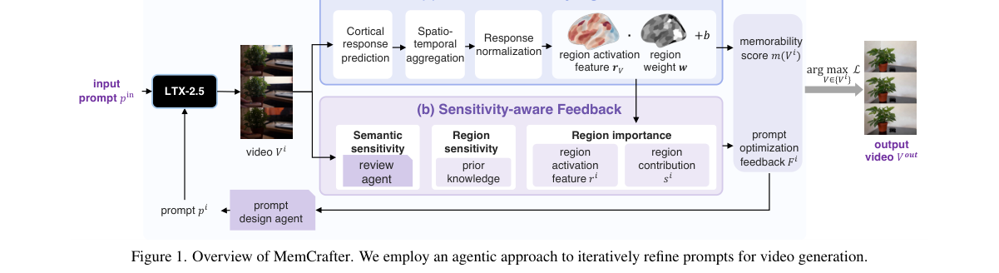

*Result - Evaluation of the proposed neuro-memorability signal.*

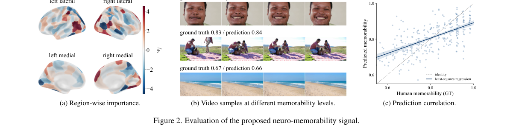

**Why this ranks #6**: 用皮层分区构造神经记忆信号预测视频记忆性，信号与人工标注记忆分的 Spearman 相关为 0.637；在 Seedance-2.5 上把记忆分从 0.848±0.003 提到 0.908±0.003，语义对齐 SA 从 0.252±0.004 提到 0.261±0.006，生成器为 LTX-2.5。

---

### 7. From Concepts to Interactions: Dynamic Graph Semantic Recomposition for Safe Visual Generation

**arXiv**: [2611.15149](https://arxiv.org/abs/2611.15149) | **Score**: 8.0 (relevance 8 x 0.7 + quality 8 x 0.3) | **Direction**: `aigc_generation` | **Tags**: AIGC-visual, safe-generation, concept-erasure, semantic-graph, flow-matching, Southwest Jiaotong University | **Categories**: cs.CV | **Pages**: 23

**Authors**: Qinghui Gong; Jinshan Lai; Xunlei Chen; Hua Meng; Zhengchun Zhou

**Affiliation**: Southwest Jiaotong University; University of Electronic Science and Technology of China

**Abstract**

> Recent advances in flow-matching Transformers have greatly improved Text-to-Image (T2I) and Text-to-Video (T2V) generation, but unconstrained generation risks producing illegal or unethical content. Safety alignment must therefore suppress unsafe content while preserving legitimate generation. A concept's safety depends on context: a knife used for cooking is safe, whereas its use in violence is harmful. Yet most concept erasure methods indiscriminately suppress static, isolated representations, overlooking evolving semantic interactions. Consequently, safe scenes containing potentially sensitive terms may be unintentionally suppressed, compromising generation quality. To address this, we propose Dynamic Graph Semantic Recomposition (DGSR), which dynamically constructs and updates a semantic interaction graph from evolving text visual states during sampling. Context aware graph reasoning captures semantic dependencies, while paired safe/unsafe supervision distinguishes harmful from legitimate interactions, enabling precise identification of and selective intervention on high risk semantic relationships while preserving benign semantics. DGSR freezes the pretrained backbone and supports both image and video generation. Experiments show that DGSR achieves the lowest Attack Success Rate (ASR) in 10 of 12 T2I evaluations and reduces the average T2V unsafe frame rate by 41.2\% relative to the strongest baseline, while maintaining high generation fidelity and temporal consistency.

**Key findings**

- **Finding**: DGSR 在 FLUX.1-dev 上把裸露概念的 I2P 攻击成功率从裸模的 15.7% 压到 3.2%（最强基线 8.1%），10 项 T2I 评测 ASR 最低，12 项评测中 Violence 的 ASR 相对最强基线再降 11.4%，T2V 平均不安全帧率相对最强基线降 41.2%。
- **Inference**: 安全控制的粒度应落在「语义关系」而非「概念本身」，同一把刀在切菜与行凶中的风险完全不同，静态概念擦除必然误伤正常场景。
- **Recommendation**: 做内容安全对齐时按上下文关系分级拦截，并同时监控 N-FID（DGSR 21.6 对裸模 30.9）以确认良性概念未被过度压制。

**Key figures**

*Framework - Motivation for relation-level safe generation. Whether a concept is harmful depends on its contextual semantic relations. Prior erasure methods suppress “knife” unconditionally, leading to u*

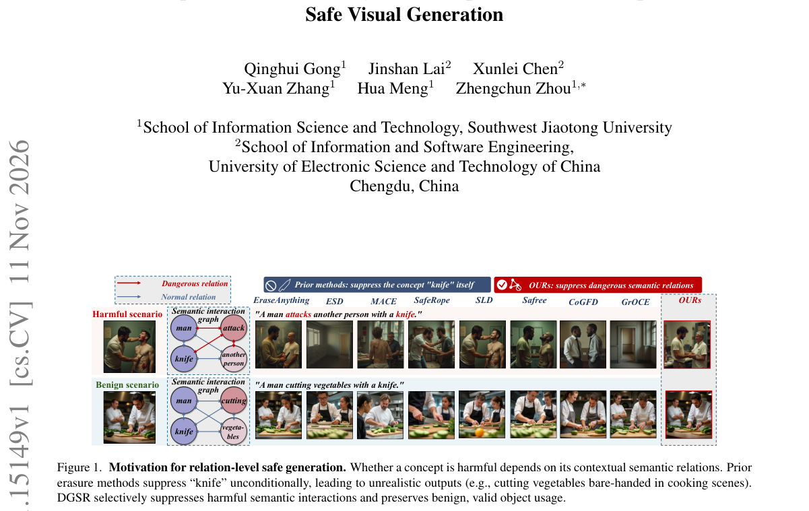

*Result - Overview of DGSR. DGSR constructs semantic supernodes from text–visual features and establishes a dynamic semantic interaction graph (DSIG) using Wasserstein-based grounding similarities. A*

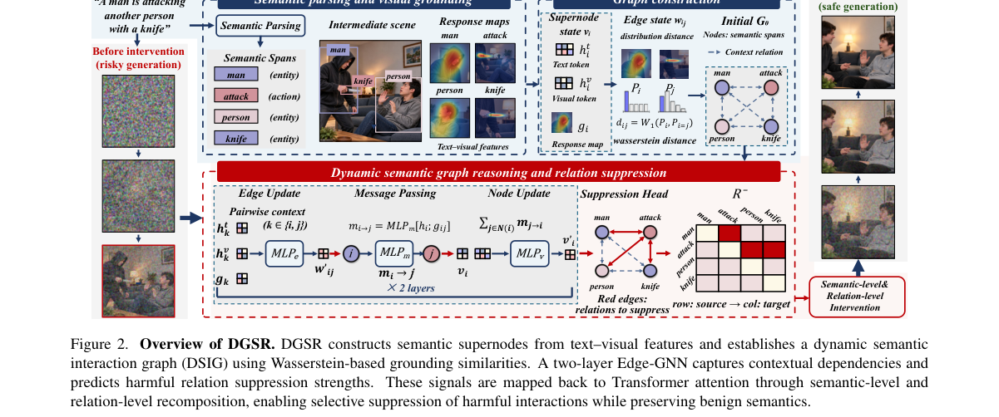

**Why this ranks #7**: 在采样过程中动态构建语义交互图，把安全控制从静态概念擦除转向关系级干预；FLUX.1-dev 裸模的裸露 I2P 攻击成功率为 15.7%，DGSR 压到 3.2%（最强基线 8.1%），10/12 项 T2I 评测 ASR 最低，T2V 平均不安全帧率相对最强基线下降 41.2%。

---

### 8. Track4D: Representing Dense 3D Tracking for Video Diffusion Models

**arXiv**: [2611.15287](https://arxiv.org/abs/2611.15287) | **Score**: 8.0 (relevance 8 x 0.7 + quality 8 x 0.3) | **Direction**: `aigc_generation` | **Tags**: AIGC-visual, 4d-reconstruction, dense-tracking, video-diffusion, lora, Visual Geometry Group | **Categories**: cs.CV | **Pages**: 38

**Authors**: Yushi Lan; Zeren Jiang; Kelvin Li; Xingang Pan; Chuanxia Zheng; Andrea Vedaldi

**Affiliation**: Visual Geometry Group, University of Oxford; Nanyang Technological University

**Abstract**

> We study how to repurpose video diffusion models (VDMs), pretrained on millions of videos, for dense 3D point tracking, where training data is scarce. Doing so is non-trivial, as it requires representing 3D tracks as video-like signals that may lie outside the natural-video distribution on which the VDM was trained. We thus systematically assess the effectiveness of two such video representations. The first, Residual 3D Tracking Video (RTV), encodes per-pixel 3D offsets relative to a query frame and allows recovery of 3D trajectories directly from the generated video. The second, Normalized Coordinate Map Video (NCMV), labels each pixel with a canonical coordinate invariant through time. This is closer to a natural video and easier for the VDM to learn, but requires additional post-processing with an off-the-shelf 2D tracker to recover 3D tracks. RTV tracks more accurately, while NCMV shows that a VDM can generate dense correspondence as a video. We instantiate both representations with LoRA adaptation of a frozen Wan backbone, conditioned on point maps from an off-the-shelf 3D reconstructor as a geometric scaffold. Trained with a single dynamic 3D tracking dataset, Track4D achieves competitive zero-shot tracking on four real and synthetic benchmarks. A regression readout that bypasses the video VAE and uses additional training data brings further improvement, demonstrating the potential of this direction for dense 3D tracking. We hope our analysis will inspire future work that leverages VDM priors for dense 3D tracking and 4D reconstruction. Project page: https://nirvanalan.github.io/projects/track4d

**Key findings**

- **Finding**: Track4D 用 rank-64 LoRA 适配冻结的 Wan2.2-5B 骨干，RTV 表示取得 0.336 APD / 1.079 EPE，优于 St4RTrack（0.047 / 5.333）与 TraceAnything（0.288 / 1.550）；RTV 与 NCMV 在 PO Dyn 上分别为 0.690 与 0.480。
- **Inference**: 视频扩散先验确实能被改造成稠密三维对应，但表示方式决定上限——显式 3D 偏移比时不变规范坐标图更准，代价是更难学。
- **Recommendation**: 需要稠密三维跟踪时优先选显式偏移表示并配合回归读出，同时留意外接 2D 跟踪器带来的额外后处理误差。

**Key figures**

*Result - TRACK4D overview. (a) Generative readout. A frozen reconstructor supplies point maps P; the video VAE encodes them with video V into condition C. The LoRA-adapted video DiT denoises the RTV*

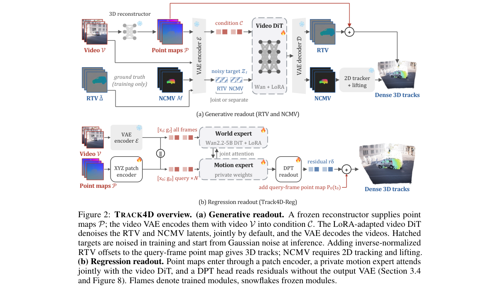

**Why this ranks #8**: 用 rank-64 LoRA 适配冻结的 Wan2.2-5B 扩散骨干，把稠密三维轨迹表示成视频；RTV 取得 0.336 APD / 1.079 EPE，优于 St4RTrack（0.047 / 5.333）与 TraceAnything（0.288 / 1.550），在四个真实与合成基准上达到有竞争力的零样本跟踪。

---

### 9. VibePrevisBench: Evaluating Agentic Coding for 4D Scene Generation in Blender

**arXiv**: [2611.15789](https://arxiv.org/abs/2611.15789) | **Score**: 8.0 (relevance 8 x 0.7 + quality 8 x 0.3) | **Direction**: `aigc_generation` | **Tags**: AIGC-visual, 4d-scene, benchmark, coding-agent, blender, Tianjin University | **Categories**: cs.AI, cs.CV | **Pages**: 28

**Authors**: Yuzhe Chen; Muxi Diao; Lele Yang; Wenbin Xu; Xuyang Liu; Qile Su; Changyi Liu; Jiankang Chen; Kaiyu Jiang; Haoyu Zhang; Hongyi Fu; Jianxiong Wang

**Affiliation**: Tianjin University; Beijing University of Posts and Telecommunications; Zhongguancun Academy; The Hong Kong Polytechnic University

**Abstract**

> Controllable real-world video generation models can condition on a rendered graybox proxy video, which fixes layout, motion and camera. Coding agents can build such videos by reconstructing a 4D scene in Blender, yet no benchmark checks both these videos and the long, multi-shot scenes behind them. We introduce VibePrevisBench, a benchmark for 4D scene reconstruction: an agent turns a brief into an executable 4D scene and renders its proxy video. Its 242 tasks span four input kinds, including scripts, photos, continuations, and reference videos. Each delivery is scored along two evaluation dimensions. Rule-based Scene Check re-runs the code and compares the exported 4D scene with hidden ground truth facts in nine dimensions. VLM-based Screen Check asks a VLM judge whether the facts that pass can be recognized in the proxy video. We analyze the evaluation results and trajectories of 11 frontier coding agents and identify three key observations. First, multimodal understanding separates the agents, especially in understanding space and camera motion. Second, all agents seem to already master basic camera work and staging, and fail at challenging requests. Third, agents inspect their own renders but fail to correct their errors. Agents thus need better visual understanding of space and camera, explicit checks for challenging requests, and item-by-item verification of renders against the brief.

**Key findings**

- **Finding**: VibePrevisBench 含 242 个任务与四类输入，用 9 个维度的规则场景核查加 VLM 屏幕核查双维度打分，并分析了 11 个前沿编码智能体；其中 31% 的标注动作能通过规则检查却难以在屏幕上被识别。
- **Inference**: 智能体现在普遍已经掌握相机调度与场景摆放，缺的并不是动手能力而是「把渲染结果与需求逐条对照」的自查机制。
- **Recommendation**: 用代理视频驱动可控视频生成时，把 4D 场景的逐项事实核查与屏幕可辨性检查做成独立验收环节。

**Key figures**

*Framework - Proxy-conditioned real-world video generation and what VibePrevisBench evaluates. (a) From a continuation brief (first frame), a coding agent reconstructs a 4D scene and renders its graybox*

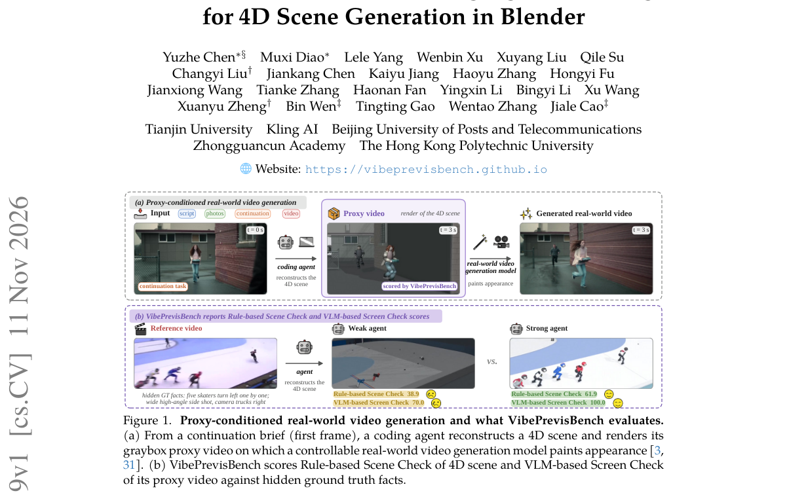

*Result - Two complementary evaluation dimensions. Each panel compares a reference video with strong and weak agents’ proxy videos and the corresponding real-world videos generated by Seedance 2.5. (a*

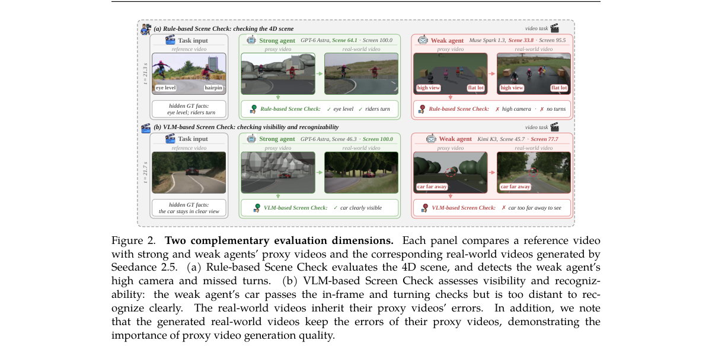

**Why this ranks #9**: 242 个任务覆盖脚本、照片、续写、参考视频四类输入，用「9 个维度的规则场景核查 + VLM 屏幕核查」双维度打分，并分析 11 个前沿编码智能体的轨迹；31% 的标注动作能通过规则检查却难以在屏幕上被识别。

---

### 10. PhysLoop: Harnessing LLMs' Physics Awareness for Self-Improving Video Generation Models

**arXiv**: [2611.16748](https://arxiv.org/abs/2611.16748) | **Score**: 8.0 (relevance 8 x 0.7 + quality 8 x 0.3) | **Direction**: `aigc_generation` | **Tags**: AIGC-visual, physics-awareness, video-generation, self-improvement, llm-agent, Peking University | **Categories**: cs.AI, cs.CV | **Pages**: 21

**Authors**: Yuxuan Chen; Xiaojie Li; Hao Chen; Juncheng Ma; Kewei Zhang; Zhongjing Du; Guoqiang Wei; Fangfang Wang; Zhen Dong; Zhiyang Dou; Liming Zhao; Yan Zeng

**Affiliation**: Peking University; ByteDance Seed; University of California, Santa Barbara; Massachusetts Institute of Technology; Universität Hamburg; Hangzhou Normal University

**Abstract**

> Video generation models produce visually realistic videos but still struggle with physical dynamics and causal consistency. Learning from generated videos requires fine-grained physical supervision, yet reliable quality judgments, correction pairs, and controlled variations are difficult to obtain. Large language models (LLMs) possess physical knowledge, but struggle to reliably guide video generation models in producing their training videos. We present PhysLoop, a unified harness designed to support physically grounded self-improvement in video generation models. The harness guides and constrains LLMs throughout video generation, selection, and correction, distilling their physical knowledge into physically consistent videos. The framework supports controllable training-data construction and inference-time video repair. By identifying and correcting failures, PhysLoop marks a key milestone toward recursive self-improvement (RSI) in video generation models with limited human intervention. We release 100K videos spanning diverse, realistic indoor and outdoor scenes, along with generation tools and two evaluation datasets: PhysLoop-Gen and PhysLoop-Repair. We evaluate controllable generation and localized repair on these datasets, respectively, and assess physical behavior on the external Physics-IQ Verified benchmark.

**Key findings**

- **Finding**: PhysLoop 发布 10 万条视频与 PhysLoop-Gen、PhysLoop-Repair 两个评测集，在 PhysLoop-Repair 上修复成功率达 86.00%（最强基线 19.33%），接入 Seedance 2.5 精修后生成成功率 85.00%、修复成功率由 60.67% 提升到 86.00%。
- **Inference**: 让 LLM 在可执行物理环境的约束下产出正确的视频，比让 LLM 事后评价生成视频更可靠，这是把物理知识蒸馏进视频模型的可规模化路径。
- **Recommendation**: 把该数据集与工具链当作视频模型自改进的「物理诊断—修正」数据引擎，优先复用其评测协议。

**Key figures**

*Framework - Overview of PhysLoop and its two applications: training-data construction and video repair. The harness guides LLMs to identify physical errors and generate physically consistent videos throu*

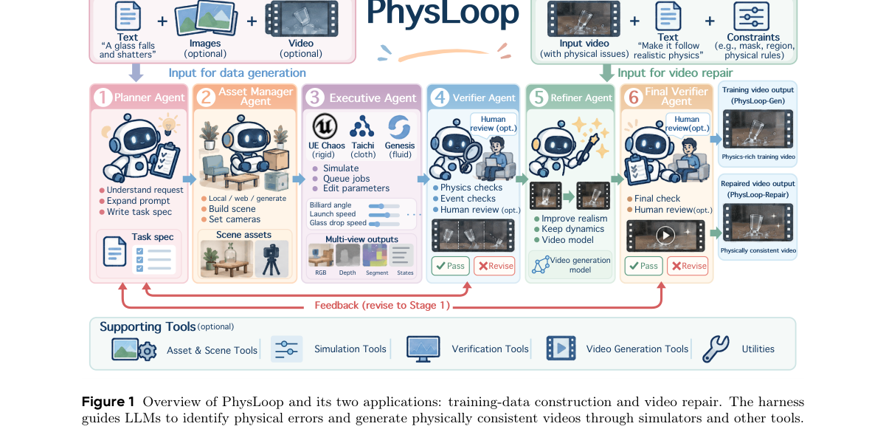

*Result - Dataset overview: (a) multi-views, depth, segmentation, and states; (b) controlled variations; (c) representative diverse cases.*

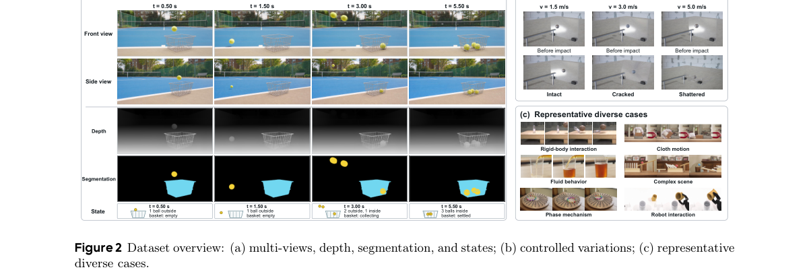

**Why this ranks #10**: 发布 10 万条视频与 PhysLoop-Gen、PhysLoop-Repair 两个评测集；在 PhysLoop-Repair 上修复成功率 86.00%，最强基线仅 19.33%；接入 Seedance 2.5 精修后生成成功率达 85.00%，修复成功率从 60.67% 升到 86.00%。

---

### 11. eDMD: Endpoint Distribution Matching for Few-Step Diffusion Distillation

**arXiv**: [2611.17194](https://arxiv.org/abs/2611.17194) | **Score**: 8.0 (relevance 8 x 0.7 + quality 8 x 0.3) | **Direction**: `aigc_generation` | **Tags**: AIGC-visual, diffusion-distillation, few-step, distribution-matching, flow-matching, Zhejiang University | **Categories**: cs.CV | **Pages**: 32

**Authors**: Tong Zhao; Xianfang Zeng; Yucheng Han; Ruoyu Wang; Mingkun Lei; Gang Yu; Chi Zhang

**Affiliation**: Zhejiang University; AGI Lab, Westlake University; StepFun

**Abstract**

> Distribution matching distillation (DMD) has emerged as a leading paradigm for distilling diffusion models into few-step students, where an auxiliary fake score model tracks the student's distribution and the discrepancy between the teacher and fake predictions drives the student toward the teacher. In multi-step distillation, although only the student's final output is delivered, existing methods train the fake model on intermediate states or across all denoising steps. Consequently, the student's update signal becomes entangled with intermediate distributions, which can distort the matching direction and remain nonzero even after the student's final outputs already match the teacher distribution. To resolve this mismatch, we propose Endpoint Distribution Matching Distillation (eDMD), which trains a single shared fake model exclusively on the student's final outputs and uses it to correct every denoising step. Our theoretical analysis proves that this endpoint reference guarantees that the distribution matching term vanishes if and only if the student's final output distribution matches the teacher's, regardless of intermediate distributions. Beyond the fake reference, we further strengthen teacher supervision through a precise teacher (PT) that replaces single-step guided predictions with short multi-step trajectories on the final noise interval, paired with a calibrated query density for intermediate steps. Experiments on SD3-Medium, FLUX.2-klein (4B and 9B), and Qwen-Image-2.1 demonstrate that eDMD consistently outperforms existing distribution matching methods for 4-step generation.

**Key findings**

- **Finding**: eDMD 只用学生最终输出训练一个共享 fake 模型，SD3-Medium 上 4 步学生的 HPSv3++ 达 11.171，高于 D-DMD 的 10.841、CDM 的 10.396 与 DMD2 的 10.270，DPG 85.33 接近 28 步教师的 85.93。
- **Inference**: 多步蒸馏中中间分布会污染更新方向，而最终交付物只有学生的末帧输出，因此把匹配信号锚在终点既更干净也更易做理论分析。
- **Recommendation**: 做少步蒸馏时优先把 fake 模型的训练分布重构到学生最终输出，并补上精度教师与校准过的中间步查询密度。

**Key figures**

*Framework - 4-step samples from eDMD, distilled from Qwen-Image-2.1. Using a tenth of the teacher’s 40 steps, eDMD renders photorealistic scenes, legible text and diverse artistic styles.*

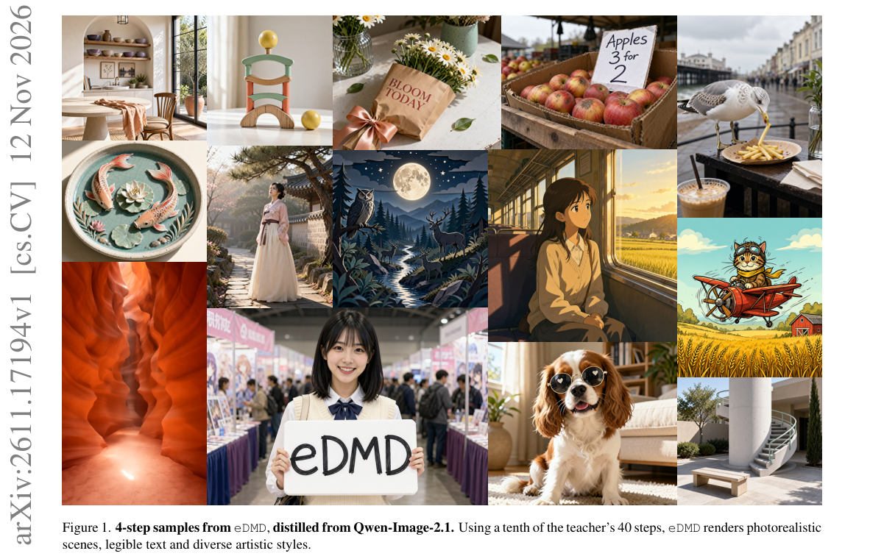

*Result - Overview of eDMD on a 2D tree-structured toy distribution (gray). Left: a 4-step student denoises from noise (σ = 1) to its final output (σ = 0, “delivered”); each update noises one step’s p*

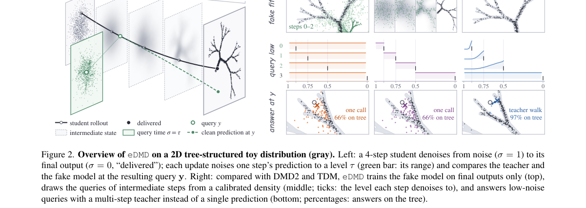

**Why this ranks #11**: 只用一个共享 fake 模型且只在学生最终输出上训练，再用它纠正每一步去噪；SD3-Medium 上 4 步学生的 HPSv3++ 达 11.171，高于 D-DMD 的 10.841、CDM 的 10.396 与 DMD2 的 10.270，覆盖 SD3-Medium、FLUX.2-klein（4B/9B）与 Qwen-Image-2.1。

---

### 12. WorldDraft: If Code Builds the World, Can Video Models Just Render It?

**arXiv**: [2611.16217](https://arxiv.org/abs/2611.16217) | **Score**: 7.7 (relevance 8 x 0.7 + quality 7 x 0.3) | **Direction**: `aigc_generation` | **Tags**: AIGC-visual, 4d-world, video-generation, benchmark, world-preservation, Southern University of Science and | **Categories**: cs.CV | **Pages**: 27

**Authors**: Zhiyu Hou; Wen-Jie Shu; Harold Haodong Chen; Weilin Ruan; Chenfei Liao; Liuzhou Zhang; Disen Lan; Xiaogang Xu; Qi Chen; Ser-Nam Lim

**Affiliation**: Southern University of Science and Technology; ZODA; HKUST; CUHK; HKUST(GZ); Fudan University; Zhejiang University; University of Central Florida

**Abstract**

> Multimodal coding agents decouple 4D world construction from visual generation, repurposing video models from world generators toward generative renderers. This division of labor raises a fundamental question: if code builds the world, can video models just render it? A reliable generative renderer hinges on two complementary criteria: (i) world preservation, retaining prescribed 4D kinematics and camera paths; and (ii) visual realization, persistently binding text-specified target attributes over time. To evaluate this capability, we introduce WorldDraft, a benchmark of $432$ strictly paired test cases across $48$ executable 4D world families spanning six dynamic challenge categories. Under a $3 \times 3$ factorial design, WorldDraft orthogonally crosses draft granularity (abstract proxy to previs) and appearance alignment (neutral to conflicting) under identical dynamics. Extensive evaluations across $12$ representative models reveal that: (I) world preservation and visual realization remain in stark operational tension; (II) richer draft scaffolding anchors structure but paradoxically impairs appearance fidelity; and (III) conflicting source cues trigger severe source leakage (up to $64\%$), exposing fragile cross-modal disentanglement. To mitigate these bottlenecks, we propose WorldDraft-Primer, a plug-and-play visual prompting strategy that consistently improves both objectives across frozen video renderers. Together, WorldDraft and WorldDraft-Primer lay a foundation for bridging programmatic 4D simulation with video generation, advancing physically grounded generative rendering.

**Key findings**

- **Finding**: WorldDraft 用 48 个可执行 4D 世界族、六类动态挑战与 3×3 因子设计构造 432 个严格配对用例，评测 12 个视频模型；冲突线索下颜色泄漏达 64.17%（Wan2.1-VACE）与 52.24%（UniVideo），Seedance 2.5 总分 64.73 被 32B 的 LynnReal-Omni 以 64.89 反超。
- **Inference**: 视频模型把草稿像素当成不可覆盖的刚性约束而非可重写脚手架，「代码造世界、视频只渲染」的分工目前并不成立。
- **Recommendation**: 用代理草稿驱动生成时必须同时量化世界保持与外观实现两项指标，并考虑 WorldDraft-Primer 这类在首帧注入物体强调与属性线索的免训练策略。

**Key figures**

*Framework - Performance overview of 12 video models on WorldDraft across 3 dimensions.*

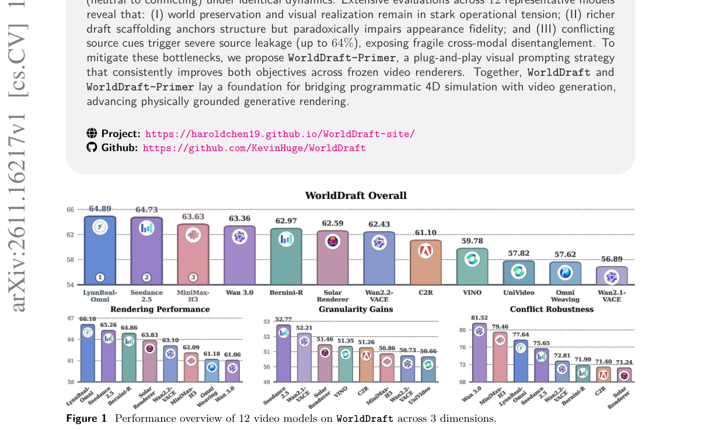

*Result - Overview of WorldDraft. (a) Six challenge categories across 48 executable 4D worlds (shown at P1, AA). (b) 3 × 3 factorial grid crossing draft granularity (P0 →P2) and appearance alignment (A*

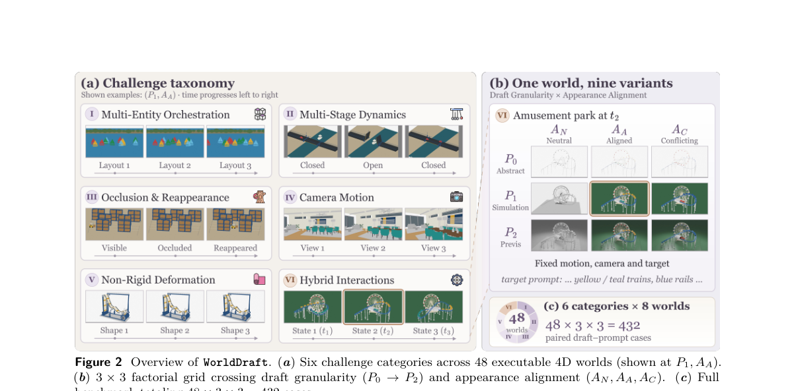

**Why this ranks #12**: 48 个可执行 4D 世界族 × 3 草稿粒度 × 3 外观对齐 = 432 个严格配对用例，覆盖六类动态挑战，系统评测 12 个视频模型；冲突源线索下颜色泄漏最高达 64.17%（Wan2.1-VACE）与 52.24%（UniVideo），并给出免训练的 WorldDraft-Primer。

---

## AIGC 编辑（指令编辑 / 修补 / 个性化） · `aigc_editing` (3 papers)

本方向只有 3 篇（基准 4，供给不足，让出 1 个名额）。三篇各自切中编辑链路的一个环节：WaveletLoRA 在频域做内容-风格分解——现有方法基本都在空间域操作，而「主体身份」与「视觉风格」天然对应不同的频率特征，显式利用这一点能提升单图个性化生成的可重组性；AIFR 面向扩散生成的妆容 / 动漫肖像做身份特征恢复，让被编辑过外观的图像仍能被人脸识别筛出来（既有做法要么改识别编码器、要么直接修图，前者要重做图库、后者会损失编辑结果）；ReliaGuard 处理生成式图像编辑带来的溯源难题——背景重建会削弱水印的空间证据，即使来源标识还能恢复，它提出重建感知的方案同时保住来源归属与盲编辑定位。

### 13. WaveletLoRA: Frequency-Aware Content-Style Decomposition for Personalized Image Generation

**arXiv**: [2611.15617](https://arxiv.org/abs/2611.15617) | **Score**: 8.0 (relevance 8 x 0.7 + quality 8 x 0.3) | **Direction**: `aigc_editing` | **Tags**: AIGC-visual, style-transfer, wavelet, lora, content-style, Institute of Automation | **Categories**: cs.CV | **Pages**: 23

**Authors**: Peiyao Wang; Jiahui Sun; Weining Wang; Jing Liu

**Affiliation**: Institute of Automation, Chinese Academy of Sciences; School of Artificial Intelligence, University of Chinese Academy of Sciences

**Abstract**

> Content-style decomposition from a single image is a fundamental challenge in personalized image generation, aiming to separate subject identity from visual style for flexible recomposition. Existing approaches primarily operate in the spatial domain, without explicitly exploiting the distinct frequency characteristics naturally associated with content and style. In this paper, we propose WaveletLoRA, a novel frequency-aware framework for explicit content-style decomposition through wavelet-domain supervision. Specifically, we first apply a multi-level discrete wavelet transform (DWT) to decompose the reference image into low-frequency and high-frequency subbands. We then assign a dedicated LoRA branch to each subband, where the low-frequency branch models global appearance for style acquisition, while the high-frequency branches capture structural details for content preservation. To further improve disentanglement quality, we introduce a dense Mixture-of-Experts aggregation module together with a frequency-domain regularization objective, which reduces style leakage and enhance content fidelity. In addition, we establish WaveBench and develop a VLM-based evaluation protocol that explicitly measures both attribute similarity and attribute separation for disentanglement assessment. Extensive experiments demonstrate that WaveletLoRA consistently outperforms existing methods and produces results that better align with human preference.

**Key findings**

- **Finding**: WaveletLoRA 用两级 DWT 把参考图分解为 1 个低频与 6 个高频子带并各配一条 LoRA 分支，同时建立含 1,000 张图的 WaveBench，以 VLM 协议同时度量属性相似度与属性分离度，每个风格随机采样 20 张图。
- **Inference**: 频域是内容与风格的天然先验，低频对应全局外观、高频对应结构细节，比纯空间域拆分更贴合信号本身的统计特性。
- **Recommendation**: 做单图内容-风格解耦时优先在小波子带级别分配 LoRA 分支，并用分离度而非仅 CLIP-I 这类整体相似度指标验收。

**Key figures**

*Framework - Given a single input image (middle), WaveletLoRA learns a disentangled content or subject LoRA (left) and style LoRA (right) that can be used to generate new images with the learned concepts*

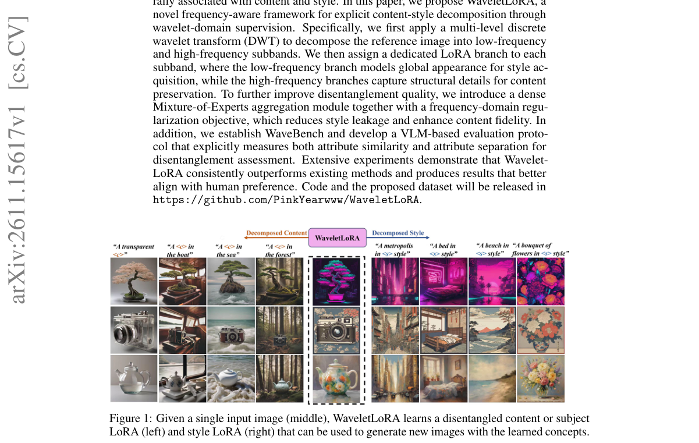

*Result - Overview of WaveletLoRA and WaveBench. (Top) Given a reference image, a two-level DWT decomposes the image into one low-frequency subband and multiple high-frequency subbands. The low-freque*

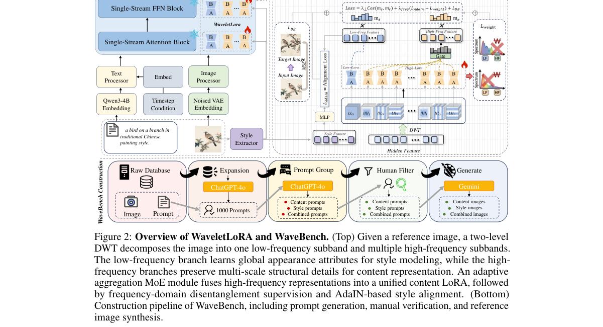

**Why this ranks #13**: 两级离散小波变换把参考图拆成 1 个低频与 6 个高频子带，各配一条 LoRA 分支——低频承载全局外观（风格）、高频承载结构细节（内容）；并建立含 1,000 张图的 WaveBench，用 VLM 协议同时度量属性相似度与属性分离度。

---

### 14. AIFR: Adaptive Identity Feature Recovery for Diffusion-Based Makeup and Anime Portraits

**arXiv**: [2611.15764](https://arxiv.org/abs/2611.15764) | **Score**: 8.0 (relevance 8 x 0.7 + quality 8 x 0.3) | **Direction**: `aigc_editing` | **Tags**: AIGC-visual, identity-preservation, face-recognition, makeup-portrait, embedding-recovery, Hong Kong Polytechnic University | **Categories**: cs.CV | **Pages**: 14

**Authors**: Linyan Dai; Xinwei Zhang; Yaxin Xiao; Mengyu Sun; Xinwei Liu; Renyang Liu; Qingqing Ye; Haibo Hu

**Affiliation**: The Hong Kong Polytechnic University; National University of Singapore

**Abstract**

> Diffusion-based makeup and anime portraits are increasingly popular in online content creation (e.g., virtual makeup editing and anime avatar generation), but their altered appearances can hinder face recognition (FR) in identity-based content screening. Existing methods mainly adapt FR encoders or restore input images. The former require costly gallery re-encoding, while the latter may be incomplete or distort identity-related facial details. To address these limitations, we aim to correct identity features within a frozen FR model to recover its output embeddings in its original space. Appearance changes vary in strength and affect facial regions differently. To this end, we propose Adaptive Identity Feature Recovery (AIFR), a framework that inserts a lightweight recovery module at a single intermediate layer to predict sample-level correction strength and spatially adaptive residual updates. Module training uses fused identity targets to guide embedding recovery in the original FR space and an identity-shift score to regulate correction strength and limit unnecessary changes. At inference, AIFR processes a single portrait in one forward pass without reference images, producing recovered embeddings that can be directly matched with existing gallery templates without re-encoding. With only 1.22M trainable parameters, AIFR improves the average TAR at FAR=$10^{-4}$ from 66.1\% to 90.2\% over the original ArcFace, and further experiments show improvements across unseen makeup styles, stylization strengths, and generators. Beyond recognition, the recovered embeddings can directly condition a pretrained Arc2Face model to generate faces with improved identity preservation, showing compatibility with embedding-conditioned downstream generation.

**Key findings**

- **Finding**: AIFR 只用 1.22M 可训练参数在冻结人脸识别网络的单个中间层插入恢复模块，把 FAR=1e-4 下的平均 TAR 从原 ArcFace 的 66.1% 提升到 90.2%，单张肖像单次前向即可得到可直接匹配既有模板的嵌入。
- **Inference**: 与其改造识别模型或修复输入图像，不如在原特征空间内做校正，既避开重编码 gallery 的成本，也不会破坏身份相关细节。
- **Recommendation**: 业务场景涉及妆容或动漫化肖像时，在内容审核前先做一次嵌入级身份恢复，可显著减少误判。

**Key figures**

*Framework - Comparison of three deployment settings for identity matching and downstream compatibility on appearance-altered portraits. (a) Pretrained FR may fail on makeup and anime por- traits; (b) Fi*

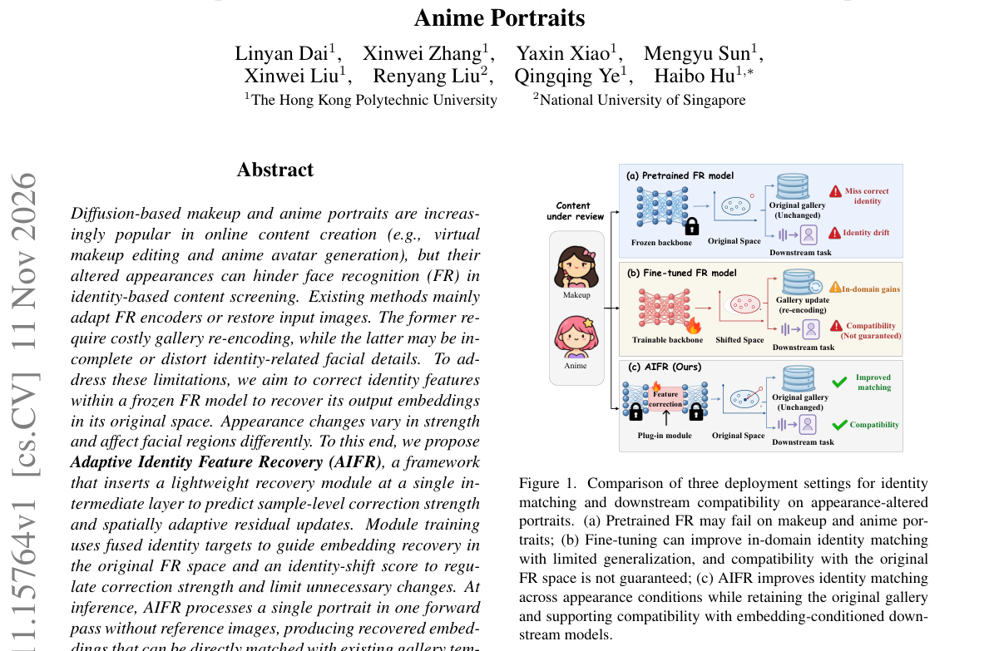

*Result - Overview of AIFR Framework. Given a makeup or anime portrait, the frozen FR front encoder first extracts an intermediate feature map. The trainable Adaptive Intermediate Feature Correction m*

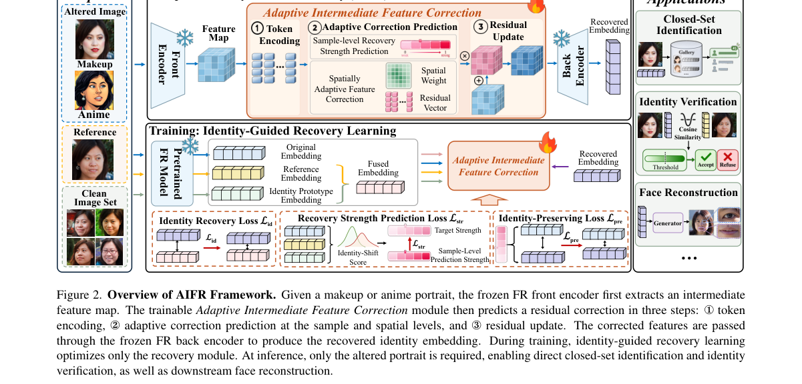

**Why this ranks #14**: 仅 1.22M 可训练参数插在冻结人脸识别网络的单个中间层，预测样本级校正强度与空间自适应残差；FAR=1e-4 下平均 TAR 从原 ArcFace 的 66.1% 提到 90.2%，推理时单张肖像一次前向，无需参考图也不必重编码 gallery。

---

### 15. ReliaGuard: Reconstruction-Aware Watermarking for Source Attribution and Blind Edit Localization

**arXiv**: [2611.16368](https://arxiv.org/abs/2611.16368) | **Score**: 8.0 (relevance 8 x 0.7 + quality 8 x 0.3) | **Direction**: `aigc_editing` | **Tags**: AIGC-visual, watermarking, edit-localization, source-attribution, blind-detection, College of Cyber Security | **Categories**: cs.AI, cs.CR, cs.CV | **Pages**: 14

**Authors**: Hailong Wang; Wuzheng Tan; Zixin Zhang; Xujun Fang; Fengjuan Gong

**Affiliation**: College of Cyber Security, Jinan University

**Abstract**

> Generative image editing facilitates content creation but complicates source attribution and edit verification. Existing watermarking methods combine copyright protection with tamper localization, yet background reconstruction can weaken spatial evidence even when source identifiers remain recoverable. We propose ReliaGuard, a reconstruction-aware watermarking framework for source attribution and blind edit localization. The writer optimizes keyed feature responses in both the protected image and its variational autoencoder reconstruction under image-distortion and source-preservation constraints. Using only the received image and a secret key, the reader combines watermark responses with local image context through residual evidence refinement and predicts an edit mask through native-resolution-guided multiscale reading. It is trained on complete editing outputs, locally spliced counterparts, and processed versions of both. On an independent test set of 300 source images and 900 editing cases from three image domains, our method achieves edit-region intersection-over-union scores of 85.61% for complete outputs and 94.90% for locally spliced outputs at a threshold calibrated to a nominal 1% background false-positive rate on complete outputs. The complete-output result exceeds the strongest baseline by 45.02 percentage points, while decoded identifier-bit accuracy reaches 100% in both conditions. Across seven families of image processing, the corresponding localization scores are 81.01% and 86.49%, with identifier-bit accuracies of 92.76% and 92.79%, respectively. These results support source recovery and blind edit localization under background reconstruction and subsequent image processing.

**Key findings**

- **Finding**: ReliaGuard 在 300 张源图、900 个编辑用例、3 个图像域的独立测试集上，完整输出与局部拼接输出的编辑区域 IoU 分别为 85.61% 与 94.90%（阈值标称 1% 背景误报率），比最强基线高 45.02 个百分点，标识比特准确率两种条件下均为 100%。
- **Inference**: 背景重建会削弱空间证据却不破坏可解码的源标识，因此水印写入必须同时对原图与其 VAE 重建做优化。
- **Recommendation**: 发布生成内容时采用重建感知的双写水印，并在下游编辑后同时做溯源解码与盲编辑区域定位两类取证。

**Key figures**

*Framework - Overall framework of ReliaGuard. (a) Source-message encoding and REW produce the protected image; source decoding and localization recover its identifier and estimate the target edit region. (*

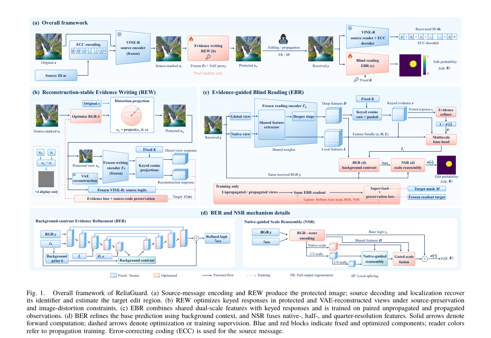

*Result - FR localization examples for active methods across three image domains and four target areas. Each row uses the same source and target mask across methods; each method receives its own protect*

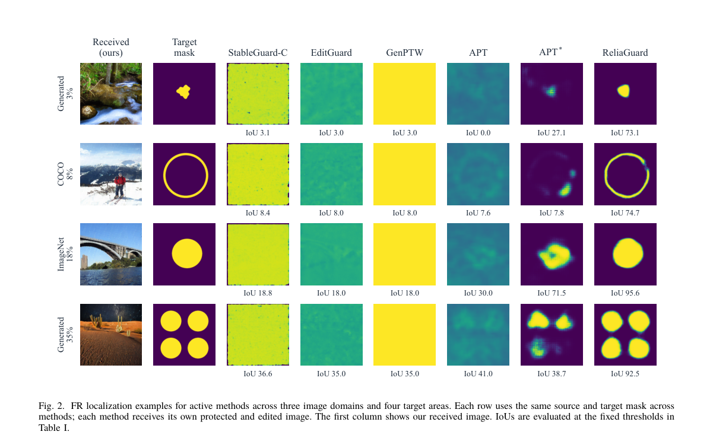

**Why this ranks #15**: 写入时同时优化受保护图像与其 VAE 重建的水印响应；在 300 张源图、900 个编辑用例、3 个图像域的独立测试集上，完整输出的编辑区域 IoU 85.61%、局部拼接 94.90%（标称 1% 背景误报率），比最强基线高 45.02 个百分点。

---

## Footer

- Total papers reviewed across all 4 axes: 60
- aigc_visual axis final count: 15
- Wild-cards in this axis: 0
- Figure assets: 2026-11-14/res/

Generated by `mine-arxiv-daily-digest` skill. Sister file: `2026-11-14_aigc_visual_entry.md`.
