# Mine Arxiv Daily Digest - 2026-11-14 (全双工语音与语音 LM Axis, 10 papers)

**Generated**: 2026-11-14 11:25 CST

**Source**: arXiv cs.CV, cs.SD, eess.AS, cs.CL, cs.AI, cs.RO, cs.LG, cs.IR submissions, listing day 2026-11-11 + 2026-11-12 (announced 2026-11-13 01:00 UTC)

**Batch window**: 2026-11-10T19:00:00Z .. 2026-11-12T19:00:00Z（arXiv 公告批次横跨两个 UTC 日：从前一日的美东 14:00 截止时刻起算（EDT 为 18:00Z，EST 为 19:00Z），到当日的同一时刻为止）

**Axis**: duplex_speech (10 papers, base 12, cap 20)

**Directions**: duplex_speech_core (7), speech_rl (3)

**Selection**: 10 papers ranked by relevance x quality, with 0 wild-card slots

**Day total**: 60 papers across 4 axes (target 60)

**Scope**: 全双工 / 实时 / 流式语音语言模型、speech-to-speech 语音助手、TTS / 语音克隆 / 语音转换，以及语音大模型的 RL 与奖励模型

**Wild-card**: 0 —— 本 axis 未启用任何补位名额。`duplex_speech_core` 7 篇（基准 8）与 `speech_rl` 3 篇（基准 4）都低于各自基准，但本轮全天名额已经被 `llm_vlm`（打满 20 上限）与 `world_embodied` 按富余量用满，按规则**发不满而不是被填充**。

**本 axis 10 篇（base 12）**：`duplex_speech_core` 7 篇、`speech_rl` 3 篇。两个方向各低于基准 1 篇，本轮让出的名额由 `llm_vlm`（候选池 398 篇，供给最充裕）与 `world_embodied`（候选池 144 篇）按富余量吸收——`llm_vlm` 打满 axis 上限 20，`world_embodied` 回到基准 15（world_model 7 + embodied_ai 8）。

**`speech_rl` 不是断供，是真的只有 3 篇**：全批 814 篇里用 RL 训练语音/音频模型的工作就是 DeALR（测试时 RL）、JEV-VAD（RLCD）与 ZONOS3-Mini（DPO + GRPO）这三篇。反向核对也做了：标题含语音/音频词但不含 RL 词的论文（Hy ASR 3.0 除外，它昨天已报）逐篇查过，没有第四篇。

⚠️ **这里纠正了本轮早些时候的误判**：先前按「RL 类词与语音类词 160 字符共现」扫出的 3 篇，只有 JEV-VAD 和 DeALR 命中，**ZONOS3-Mini 被漏掉了**——它的 DPO/GRPO 出现在偏好对齐小节里，与语音词的间距超过了 160 字符窗口。教训：关键词共现扫描必须**回读原文核实**，不能只看命中数。

---

## 全双工语音与语音 LM · `duplex_speech_core` (7 papers)

本方向 7 篇（基准 8，供给略薄，让出 1 个名额），覆盖全双工对话、语音前端与合成。An LLM Is All You Need 把全双工、词级的口语对话做到数据高效——主流做法要几十万到上百万小时语音、要改写提供知识的语言模型，而且轮次切换要么隐式要么很粗；它把**冻结的通用多模态 LLM** 适配成词级全双工系统：thinker–talker 级联跑在 80 ms 帧时钟上，thinker 保持 LLM 冻结，只训练轻量 adapter 与少量新 token embedding（97M 参数），每帧吐一个 agent 文本 token，停顿、让出话轮与话头都用专门符号表示。Kezek 解决全双工训练数据的结构性瓶颈：把两人对话的单声道混音还原成一路一人且长度时序不变，重叠段与「嗯」「对」这类短回应仍留在原轨。Structured Speaker Conditioning 把本地活动结构与 session 级声学身份组合成身份一致的目标说话人条件，在重叠语音条件下做目标说话人 ASR。Low Language Transfer Speech-to-Text 问一个跨语言迁移问题：多语种识别器在它从未训练过的语言上微调一点数据时，能带过去多少。Duo v1 引入互惠世界模型，把智能与物理现实同等视为「世界」的组成，实时感知视听输入并即时回应。RSE-TTS 让预训练 TTS 骨干兼任参考音频编码器做参考压缩，联合编码参考语音与其转写进一步提升说话人相似度。Beyond WER 给出流式听写 ASR 的失败分类法——106 段英语听写喂给 11 个 ASR 系统，因为用户真正要修的是那几类错，而不是一个平均 WER。

### 1. An LLM Is All You Need: Data-Efficient Adaptation to Full-Duplex, Word-Level Spoken Dialogue

**arXiv**: [2611.14774](https://arxiv.org/abs/2611.14774) | **Score**: 9.0 (relevance 9 x 0.7 + quality 9 x 0.3) | **Direction**: `duplex_speech_core` | **Tags**: duplex-speech, full-duplex, frozen-llm, turn-taking, data-efficient, AveraLabs | **Categories**: cs.CL, cs.SD, eess.AS | **Pages**: 20

**Authors**: Tairan Chen; Richard Yucheng He; Yihang Liu; Baodong Cao; Chen Xu

**Affiliation**: AveraLabs

**Abstract**

> Full-duplex spoken dialogue, in which a system listens while it speaks and can backchannel, yield the floor, and be interrupted, is usually obtained by training on hundreds of thousands to millions of hours of speech. This is costly, rewrites the language model that supplies the system's knowledge, and still leaves turn-taking either implicit or decided coarsely rather than word by word. We show that a frozen, general-purpose multimodal LLM can instead be adapted into a word-level full-duplex system with little data. Our system is a thinker-talker cascade on an 80 ms frame clock. The thinker keeps the LLM frozen and trains only lightweight adapters and a few new token embeddings (97M parameters); at every frame it emits one token of agent text, with pauses, yields, and onsets represented as tokens of the same vocabulary and kept legal by a finite-state machine. A four-stage curriculum, each stage anchored to the model's own behavior under the previous format, performs the conversion in about 30 GPU-hours. The talker reads only the thinker's discrete tokens, so the two halves are trained independently. On Full-Duplex-Bench and InteractionBench, the system is competitive with open-source full-duplex systems built through large-scale speech training: among them, it is the least likely to take the floor when the user merely pauses, backchannels most often, and leads in spoken-task accuracy, groundedness, and coherence over long conversations.

**Key findings**

- **Finding**: 骨干是冻结的 Qwen3-Omni-30B-A3B，97.4M 可训练参数被拆成 rank-16 注意力 LoRA（13.4M）、音频适配器 Fφ（75.5M）、通道融合层（8.4M）与 17 个时序 token 的输入 embedding 加输出行，四阶段课程合计约 30 GPU 小时。
- **Inference**: 全双工并不一定要靠大规模语音数据硬训——把暂停、让出、起音做成与词表同源的 token，再用有限状态机在采样前屏蔽非法转移，就能以极小成本补齐轮次切换能力。
- **Recommendation**: 想做全双工语音助手，优先复现“thinker–talker 级联 + 80 ms 帧时钟 + FSM 掩码 + 逐阶段 KL 锚定”这条路线，把算力花在时序 token 与解码头设计上，而不是堆语音数据。

**Key figures**

*Framework - Illustration of the two behaviors on a shared timeline (user above, agent below; schematic: timings and text are illustrative). (a) A free-running conversation: the agent backchannels (“mm-*

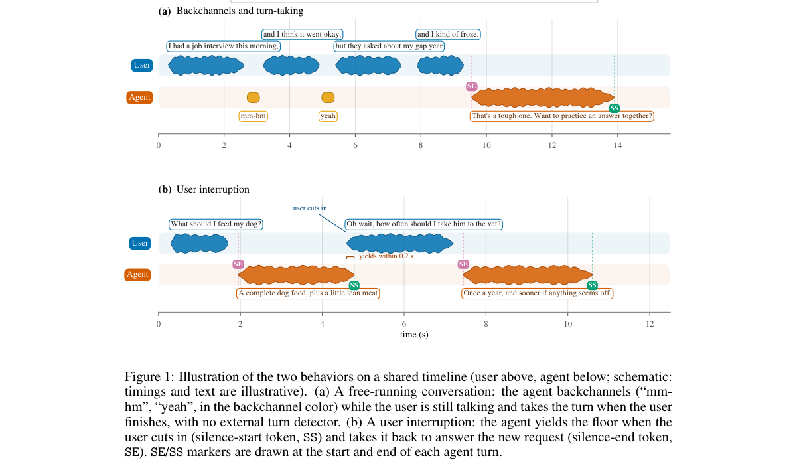

*Result - Overview. A frozen, general-purpose multimodal LLM (Qwen3-Omni), which only talks in turns, becomes the thinker of a full-duplex system through four training stages. Each stage card shows wh*

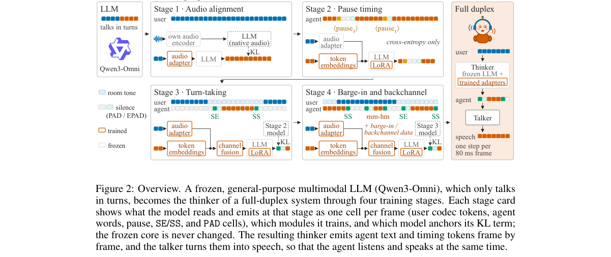

**Why this ranks #1**: 冻结 Qwen3-Omni-30B-A3B 骨干，只训练 97.4M 参数（注意力 rank-16 LoRA 13.4M + 音频适配器 75.5M + 通道融合层 8.4M + 17 个时间 token embedding），在 12.5 Hz（80 ms）帧时钟上用约 30 GPU 小时跑完四阶段课程，就把只会轮次对话的模型改成逐词级全双工系统，代价远低于主流动辄几十万到上百万小时语音训练，因此排在全双工方向首位。

---

### 2. Structured Speaker Conditioning for Diarization-Guided Target-Speaker ASR

**arXiv**: [2611.16371](https://arxiv.org/abs/2611.16371) | **Score**: 8.7 (relevance 9 x 0.7 + quality 8 x 0.3) | **Direction**: `duplex_speech_core` | **Tags**: duplex-speech, target-speaker-asr, speaker-conditioning, diarization, low-rank-modulation, University of Science and Technology of | **Categories**: eess.AS | **Pages**: 13

**Authors**: Ruoyu Wang; Shutong Niu; Jun Du; Weixin Zhu; Yannan Wang

**Affiliation**: University of Science and Technology of China; Ethereal Audio Lab

**Abstract**

> We propose structured speaker conditioning (SSC) for diarization-guided target-speaker recognition. SSC combines local activity structure with session-level acoustic identity to construct identity-consistent target conditions that control the acoustic encoder. Target-centric relational encoding (TCRE) retains per-speaker activity histories and factorized second- and third-order relations, capturing overlap and turn changes with aggregation cost linear in the number of tracks. Reference-based speaker conditioning (RSC) supplies session-derived identities that disambiguate local activity patterns within TCRE. Conditional low-rank modulation (CLRM) converts the joint condition into channel-wise affine modulation and a low-rank cross-channel residual with a condition-dependent core. On Qwen3-ASR-0.6B with oracle diarization, SSC uses 1.46M conditioning parameters and achieves a 6.23% mean relative reduction in concatenated minimum-permutation error rate (cpER) over four-state diagonal conditioning across four meeting test sets. SSC also transfers across audio foundation models. With predicted diarization and target-error group sequence policy optimization, the FireRedAudio text system achieves mean relative error reductions of 17.9% and 17.3% over DiCoW and MOSS-TD on the same four sets, and also outperforms both on three unseen domains. Scenario analyses identify gains under challenging overlap conditions, while fixed-checkpoint interventions support the contributions of session identity and the condition-dependent core. A timestamp variant jointly produces sentence boundaries and text. With predicted diarization, macro-average cpER across the four sets is 15.60% for text and 15.96% with timestamps.

**Key findings**

- **Finding**: 完整 SSC 只引入 1,464,312 个可训练条件参数（含目标中心关系编码 TCRE、参考身份池化 RSC 与条件低秩调制 CLRM），在 Qwen3-ASR-0.6B 用 oracle 分离时取得 16.47/12.86/17.19/19.67% 的 cpER，相对四状态对角条件 STNO-FDDT 平均相对下降 6.23%。
- **Inference**: 增益集中在真正混叠的窗口——峰值并发 2 人的窗口只降 3.44%，峰值 3 人以上才降 7.76%；目标说话人全程被他人重叠时，从纯活动条件换成加入会话身份收益最大，说明条件设计的价值在难例而不在平均分。
- **Recommendation**: 做 diarization 引导的目标说话人 ASR 时，先把分离轨迹压成带身份的四状态活动条件，再用低秩调制去调声学编码器，并叠一层以目标转写误差为奖励的 GSPO 微调，而不是直接放大骨干容量。

**Key figures**

*Framework - STNO activity compression. Different interferer counts (a) or hand- over histories (b) can yield the same four-state target condition despite distinct non-target track configurations.*

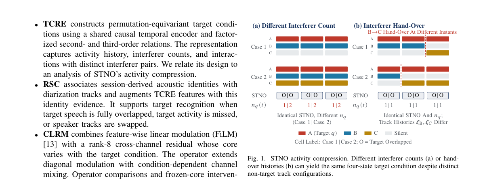

*Result - SSC architecture. (a) RSC derives speaker identities from session audio and diarization. (b) TCRE combines these identities with local track histories into cq(t). (c) CLRM aligns the condition*

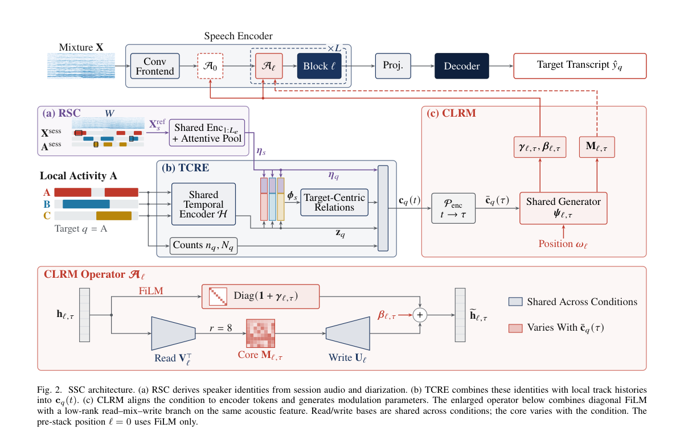

**Why this ranks #2**: 把「谁在说」和「谁在什么时候说」编成条件去调制声学编码器，而不是去堆更大的骨干：SSC 在 Qwen3-ASR-0.6B 上只引入 1,464,312 个条件参数，就在 AliMeeting/AISHELL-4/AMI-SDM/NOTSOFAR-1 四个会议集上相对四状态对角条件取得 6.23% 的平均 cpER 相对下降。

---

### 3. Kezek: Splitting Mono Two-Person Conversations into Per-Speaker Tracks for Full-Duplex Dialogue Data

**arXiv**: [2611.16933](https://arxiv.org/abs/2611.16933) | **Score**: 8.7 (relevance 9 x 0.7 + quality 8 x 0.3) | **Direction**: `duplex_speech_core` | **Tags**: duplex-speech, speaker-separation, full-duplex-data, short-reply-retention, two-stage, Manifestro | **Categories**: cs.AI, eess.AS | **Pages**: 18

**Authors**: Bagzhan Karl; Alizhan Karl

**Affiliation**: Manifestro

**Abstract**

> Full-duplex spoken dialogue models learn turn-taking, overlaps and backchannels from conversations recorded with one channel per speaker, but most available conversational audio is a single mono mix. We present Kezek, a model that turns a mono recording of exactly two people into one track per person with the original length and timing; overlaps and short replies ("yeah", "mm-hm") stay on the track of the person who said them. Kezek decides who speaks when and who is who once for the whole recording (stage 1: a two-voice activity model guided by a speaker fingerprint trained to be insensitive to phase), and a conditioned time-domain separator only carries out that decision (stage 2), with outputs that always sum to the input. Standard separation metrics miss the failures that matter for dialogue data, so we report short-reply retention, leakage onto the other person's solo, channel swaps and coverage. Against the open pipeline pyannote -> DialogueSidon on the same recordings, Kezek keeps more short replies (0.83 vs. 0.69 on Open Yap test; 0.80 vs. 0.71 over the other's speech on unseen telephone speech from CallHome English), mostly because it returns the whole recording while the external pipeline drops part of it (on the audio both return, reply retention is about the same: 0.859 vs. 0.865 on Open Yap); it also leaks less, swaps channels less often, and runs 4-5 times faster (about 230 hours of audio per GPU-hour). We also report negative results and an ideal-mask ceiling that locate the remaining gap: quiet replies under a louder voice. Code and weights are released under permissive licences.

**Key findings**

- **Finding**: Kezek 分两段：先用 10.1M 参数的相位不敏感说话人指纹加 11.8M 的双路活动模型整段定人，再由 19.6M 的条件时域分离器执行，输出恒等于输入之和；在 Open Yap 上每 GPU 小时处理 231 小时音频，基线为 51 小时。
- **Inference**: 常规分离指标测不出对话数据真正在意的问题——论文因此改用短回应保留率、串扰、换轨与覆盖率四项，Kezek 覆盖率 1.000（基线 0.735），换轨率在 Open Yap 为 7%、CallHome 为 14%。
- **Recommendation**: 构造全双工训练语料时可直接套用两段式流程（先整段定人再分离），验收时优先看短回应保留率而不是 SI-SDRi，并单独检查“更响的嗓音压住轻声回应”这一剩余缺口。

**Key figures**

*Framework - The Kezek pipeline. Stage 1 decides activity and identity once for the whole recording; stage 2 separates under that decision in 8 s chunks and its outputs always sum to the input.*

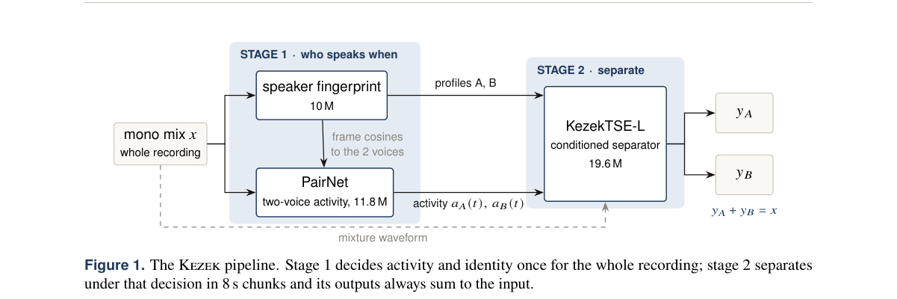

*Result - Main comparison at a glance. “Replies”: all short replies on Open Yap, replies over the other’s speech on CallHome. Kezek also runs 4–5× faster (231 vs. 51 hours of audio per GPU-hour on Ope*

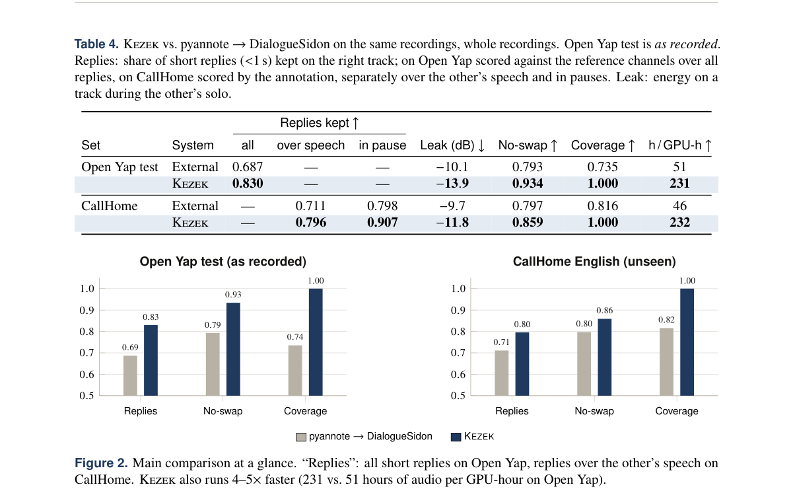

**Why this ranks #3**: 全双工训练需要一路一人的干净双轨，而现实语料多为单声道混音；Kezek 在 Open Yap 上把短回应保留率做到 0.83（对 pyannote→DialogueSidon 的 0.69）、CallHome 上 0.80 对 0.71，且每 GPU 小时处理 231 小时音频、比基线快 4–5 倍，是本批唯一直接解决双轨数据供给的工作。

---

### 4. Duo: A Reciprocal World Model for Full-Duplex Interaction

**arXiv**: [2611.15131](https://arxiv.org/abs/2611.15131) | **Score**: 8.0 (relevance 8 x 0.7 + quality 8 x 0.3) | **Direction**: `duplex_speech_core` | **Tags**: duplex-speech, full-duplex, world-model, audio-visual, streaming, Ant Group (inclusionAI) | **Categories**: cs.CV, cs.SD | **Pages**: 27

**Authors**: Hengyuan Cao; Biao Gong; Guoshan Lu; Qiyuan Zhang; Lin Liu; Yiding Tian; Yilei Jiang; Yuxin Ma; Chengzhang Wu; Kun Chen; Yiqian Xie; Ting Liu

**Affiliation**: Ant Group (inclusionAI)

**Abstract**

> In this report, we introduce the Reciprocal World Model (RWM) and present Duo v1, a full-duplex world model that continuously perceives audiovisual inputs while responding to users in real time. The RWM treats intelligence and physical reality as equally fundamental to what constitutes a world. Existing world models largely focus on simulating the latter, leaving reasoning and decision-making as external controls rather than intrinsic parts of the world itself. In RWM, we identify two equally fundamental capabilities: Intent, which provides the cognition underlying world interactions, and Realization, which generates coherent audio-visual behavior. To realize this formulation, Duo v1 introduces three key technical designs: (1) Leveraging autoregressive modeling for continuous interaction reasoning and participation decisions, rather than restricting it to instruction understanding for diffusion models. (2) Constructing chunk-specific conditions and synchronize tokens across Intent and Realization on a unified timeline. Module-specific attention masks enforce causal dependencies both within and across chunks, preventing access to future inputs. (3) Mitigating distribution shift in both modules through dual rollout distillation, training on autoregressively generated Intent tokens and synthesized audiovisual histories from Realization. Both modules continuously perceive real-time audio, video, and text, enabling full-duplex interaction with spontaneous conversations and interruptions. Beyond conversation, users can share real objects, reshape virtual scenes, guide assistants, or play audiovisual games without mouse or keyboard controls. The release of Duo v1 makes our first step, with the next version coming soon. We look forward to broader exploration of this emerging field.

**Key findings**

- **Finding**: Duo v1 的交互以 17 帧为一块，24 fps 下约 0.71 s（708.3 ms），60.9 s 视频对应 86 块；音频每个立体声通道每秒压成 40 个 32 维潜向量（每个对应 25 ms），视频 17 帧编码成 5 个 24 维潜帧。
- **Inference**: 意图表征负责“该不该说”的决策、联合因果扩散变换器负责“怎么说与长什么样”，模块专属注意力掩码保证块内与跨块都不泄漏未来帧，因此被打断时能立刻切走而不必等一个完整回答生成完。
- **Recommendation**: 做流式音视频交互可直接借鉴 Duo 的“块内因果 + 双 rollout 蒸馏”配方：训练时用模型自己生成的 Intent token 与合成视听历史做条件，把线上分布差提前压掉。

**Key figures**

*Framework - Illustrative scenarios for full-duplex interaction with Reciprocal World Model.*

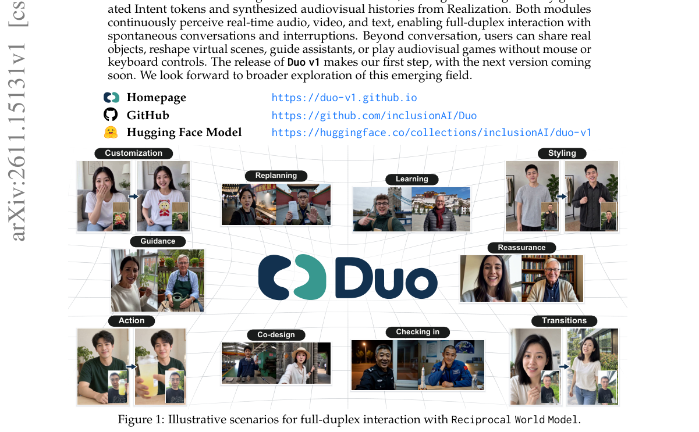

*Result - The framework of Duo v1. A joint causal diffusion transformer is conditioned on hidden states from the Intent Module, directly encoded user video and audio, a visual reference, and previousl*

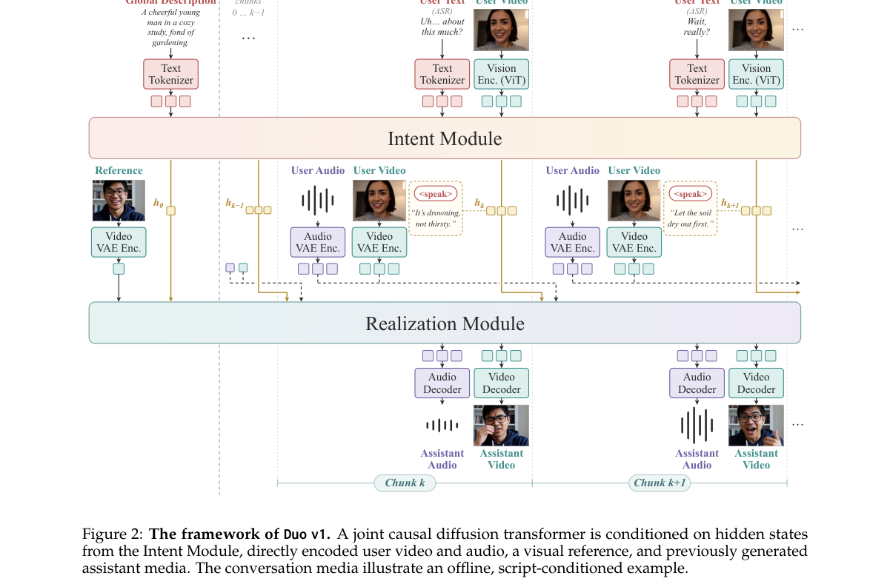

**Why this ranks #4**: 论文把“智能”与“物理现实”并列为世界的基本构成，由此拆出 Intent 与 Realization 两种同等根本的能力；交互按 17 帧一块推进（24 fps 下约 0.71 s 一块），音频每通道每秒压成 40 个 32 维潜向量，是本批中唯一把全双工放到音视频世界模型框架下、而非纯语音 pipeline 的工作。

---

### 5. RSE-TTS: Compact Text-to-Speech through Shared Text-Aware Reference Encoding and Generation

**arXiv**: [2611.15464](https://arxiv.org/abs/2611.15464) | **Score**: 8.0 (relevance 8 x 0.7 + quality 8 x 0.3) | **Direction**: `duplex_speech_core` | **Tags**: duplex-speech, tts, voice-cloning, reference-encoding, parameter-sharing, VoxNexus | **Categories**: cs.SD, eess.AS | **Pages**: 15

**Authors**: Ming Ma; Mingjie Chen; Yuanzhong Zheng; Hengyao Bao; Hailin Yu; Shijing Yu; Hao Qiu; Gongfan Cao; Xiao Li; Xuemin Zhao; Youhai Jiang

**Affiliation**: VoxNexus

**Abstract**

> Can a speech generator also serve as an effective voice encoder? We show that a pretrained autoregressive text-to-speech (TTS) backbone can be repurposed for reference compression, improving speaker similarity in subsequent synthesis. Jointly encoding reference speech and its transcript further strengthens this capability. Controlled ablations and activation interventions trace the text benefit through intermediate acoustic representations into the compressed vectors that condition generation. Building on these findings, we introduce RSE-TTS, whose Reconstructive Speaker Encoder (RSE) shares the generation backbone and compresses paired reference text and speech into eight continuous vectors. Sharing reduces encoder-generator parameters by 48% relative to independent pretrained encoding. Large-scale English training yields a 118M-parameter generator that improves both word error rate and speaker similarity over the corresponding official MOSS-TTS-Nano cloning modes on all three English benchmarks. Combined with acoustic continuation, RSE-TTS approaches the speaker similarity of substantially larger systems while achieving lower WER than the evaluated CosyVoice 3 and MOSS-TTS-Local models. Audio samples are available at https://voxnexusai.github.io/RSE-TTS/.

**Key findings**

- **Finding**: 同一 20k 小时数据上训练五个变体：用 TTS 骨干初始化独立编码器就把 Seed-TTS 的 SIM 从 0.400 提到 0.530、CV3-eval 从 0.342 提到 0.469、MiniMax 从 0.391 提到 0.592；共享骨干版本参数 118.2M 对独立版 228.5M。
- **Inference**: 生成式预训练能力确实能迁移到参考压缩——加入配对转写文本后 RSE 在 MiniMax 上达到 WER 0.64% 与 SIM 0.615，比 continuation-only 的 1.77% 与 0.684 在可懂度上更好，说明固定长度的参考条件能替代把参考语音当历史延续的做法。
- **Recommendation**: 做紧凑克隆 TTS 时先复用预训练骨干初始化参考编码器，再把参考文本一并喂进去，通常比单纯加长 prompt 更可控；评测时同时看 WER 与 SIM，避免只用其中一项。

**Key figures**

*Framework - RSE-TTS uses the same Global transformer to encode reference text and speech and to generate a new utterance. Eight learned queries produce Z, which is combined with a projected speaker embe*

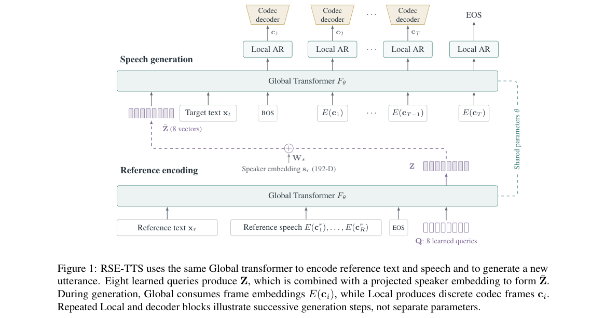

*Result - Longer reference speech improves similar- ity even though target generation always receives eight compressed vectors. Points show measured means. The auxiliary speaker vector is fixed across*

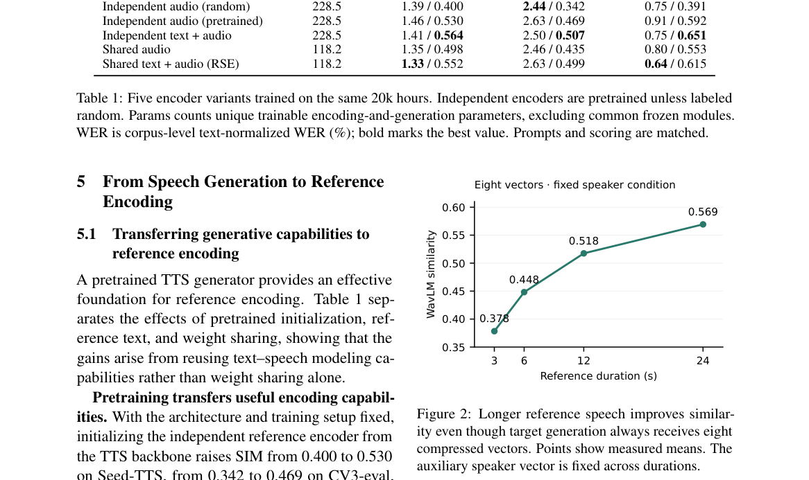

**Why this ranks #5**: 让预训练 TTS 骨干兼任参考音频编码器，把参考文本与语音压成 8 个连续向量喂给生成端，编码加生成的参数从 228.5M 降到 118.2M（省 48%）；在这批紧凑 TTS 里，它同时给出了可核对的 WER 与说话人相似度双指标改善。

---

### 6. Low Language Transfer Speech-to-Text

**arXiv**: [2611.16260](https://arxiv.org/abs/2611.16260) | **Score**: 8.0 (relevance 8 x 0.7 + quality 8 x 0.3) | **Direction**: `duplex_speech_core` | **Tags**: duplex-speech, low-resource-asr, cross-lingual-transfer, multilingual-speech, cer-evaluation, Scicom (MSC) Berhad | **Categories**: cs.CL | **Pages**: 56

**Authors**: Husein Zolkepli

**Affiliation**: Scicom (MSC) Berhad, Malaysia

**Abstract**

> A multilingual speech recogniser has heard much speech in its own languages. We ask how much of that it brings to a language it was never trained on, when it is fine-tuned on the little that language has. We score 28 open multilingual models untouched on Low-Language-TTS, 50 low-resource languages in 11 writing systems, and fine-tune 24 of them on at most 1,000 clips a language, 82 hours in all, with a dev set choosing every epoch. Fine-tuning lowers every model's macro character error rate (CER), by 16.6 to 53.1 points, to 9.5 at best, and a word language model takes three CTC models 1.2 to 1.4 points lower; WER is still 34.4 at best. On the 12 languages that no model lists, every model starts at 46 or worse and the best ends at 11.7. The same architectures from random weights stay 60 points or more behind, so the gain is transfer, and an encoder left untouched already gives a Whisper or Qwen decoder most of what it needs. It is the language, not the corpus: on FLEURS recordings that ours do not share, the median model keeps 79% of its gain. It costs the languages the models knew, 5.7 points of CER on English, Spanish, French and German in the median model. Low-rank adapters on 4% of the weights come within 1.1 points of tuning everything, and on 2 of 3 models forget less. Seq2seq and language-model decoders are done within three to five epochs, while a new CTC head is still improving at twenty or thirty. Data beats epochs: 25 clips a language take Qwen3-ASR 0.6B from 60.9 to 39.3, and at equal clips presented, ten times the data is worth 9.7 points. A model that first learned forty of the languages learns the other ten no faster. On a public Malay benchmark, untouched Whisper large-v3 scores 8.9 when it detects the language and 14.9 when told the clip is Malay, because it then translates the English that speakers mix in; trained on the Scicom telephony dataset it scores 6.0.

**Key findings**

- **Finding**: 测试集 Low-Language-TTS 含 50 种语言、11 种书写系统、1,250 段 2.56 小时音频；28 个多语种模型直接打分后，24 个用每语言最多 1,000 段、合计 42,816 段 82 小时微调，宏 CER 全部下降 16.6 到 53.1 个点、最佳到 9.5，但词错误率最好仍有 34.4。
- **Inference**: 同架构随机初始化始终落后 60 点以上，而只冻结编码器已足以把大部分能力交给 Whisper 或 Qwen 解码器，说明增益来自预训练跨语言迁移而非微调数据量；换到不共享录音的 FLEURS 上，中位模型仍保留 79% 的增益。
- **Recommendation**: 面向低资源语言上线的语音识别，应把预算放在「只解冻解码器 + 每语言 1,000 段」这类极小微调上，同时接受 CER 好看而 WER 仍高 34.4 的现实，并为模型原本不认识的 12 种语言单独准备兜底方案。

**Key figures**

*Framework - The test set’s languages by language family.*

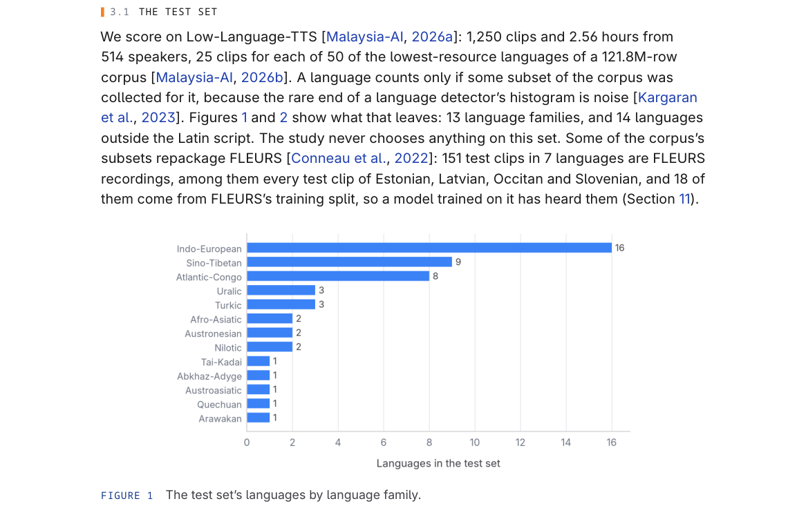

*Result - The test set’s languages by writing system.*

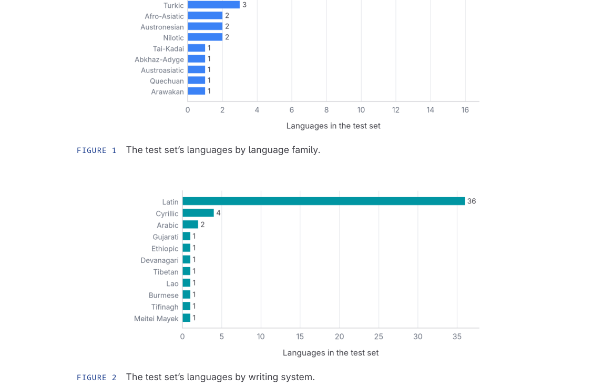

**Why this ranks #6**: 低资源语言的语音识别到底能不能靠别的语言「带过来」：论文在 Low-Language-TTS 上给 28 个多语种开源模型直接打分，再挑 24 个用每语言最多 1,000 段、合计 82 小时音频微调，宏字符错误率一律下降 16.6 到 53.1 个点、最佳到 9.5，而同架构随机初始化始终落后 60 点以上。

---

### 7. Beyond Word Error Rate: A Failure Taxonomy of Streaming Dictation ASR

**arXiv**: [2611.16919](https://arxiv.org/abs/2611.16919) | **Score**: 8.0 (relevance 8 x 0.7 + quality 8 x 0.3) | **Direction**: `duplex_speech_core` | **Tags**: duplex-speech, streaming-asr, failure-taxonomy, dictation, whisper-speech, HeyLemon (heylemon.ai) | **Categories**: cs.CL, cs.SD | **Pages**: 35

**Authors**: Harras Mansoor; Muhammad Wisal; Hassan Bhatti; Masood Shakir

**Affiliation**: HeyLemon (heylemon.ai)

**Abstract**

> Speech recognition (ASR) systems are usually compared by word error rate (WER) on recorded files, after punctuation, capital letters and number format are removed. In dictation, the audio is streamed live and the text goes into the user's message as written, so what matters is which mistakes the user has to fix. The test set, streamed to eleven ASR systems, comprises 106 scripted English dictations from one speaker (read in a quiet room, with a fan on, and whispered), 20 clips in each of eleven other language and dialect sets, and 400 recordings that join clips in two languages. Every error was sorted by a fixed rule into four levels: recognition, output formatting, language handling and, for the self-hosted models, audio dropped before the model. Systems with similar WER failed in different ways. Zoom Scribe and OpenAI's GPT-Live-Transcribe have almost the same WER on quiet English (7.4% and 7.3%), but 34.7% and 8.8% on whispered English. Zoom and both AssemblyAI models left out 26-28% of whispered words, and still 21-26% with their end-of-turn detection relaxed or off; seven other systems left out at most 3%. Qwen3-ASR's 32% came from the speech detection in our own deployment (6% when relaxed). Across 107 EARS speakers, the same four systems lost 7-31% of whispered words, while six others lost under 2%. With only English selected, Gemini, Deepgram and our self-hosted Whisper lost the non-English part of a two-language recording in 86-99% of recordings, against 33-46% with both languages selected, while GPT-Live-Transcribe, OpenAI's realtime Whisper and Meta lost it in at most 20%. Running Whisper behind a Silero voice activity detector that drops audio judged to be silence raised whispered WER from 10.1% to 51.4%. Most English results come from one read speaker. The code, the recordings, both references and every transcript are released.

**Key findings**

- **Finding**: 论文把 Whisper 挂在会丢弃被判为静音音频的 Silero VAD 之后，耳语 WER 从 10.1% 升到 51.4%；Zoom 与两个 AssemblyAI 模型丢掉 26–28% 的耳语词，即使放松或关闭端点检测仍有 21–26%，而另外七个系统丢词不超过 3%。
- **Inference**: 听写场景的失败大量发生在模型之前——在 107 名 EARS 说话人上，同样四个系统丢掉 7–31% 的耳语词而另外六个低于 2%，说明 VAD 门控与端点策略比换更大的解码器更能决定体验。
- **Recommendation**: 选听写或输入法场景的 ASR 时，按“识别、输出格式、语言处理、模型前丢弃”四层分别压测，并把 VAD 与端点检测关掉重测一遍，再拿 WER 做横向比较。

**Key figures**

*Framework - Whispered WER split into wrong, missing and extra words, as a share of all words; the number is the WER.*

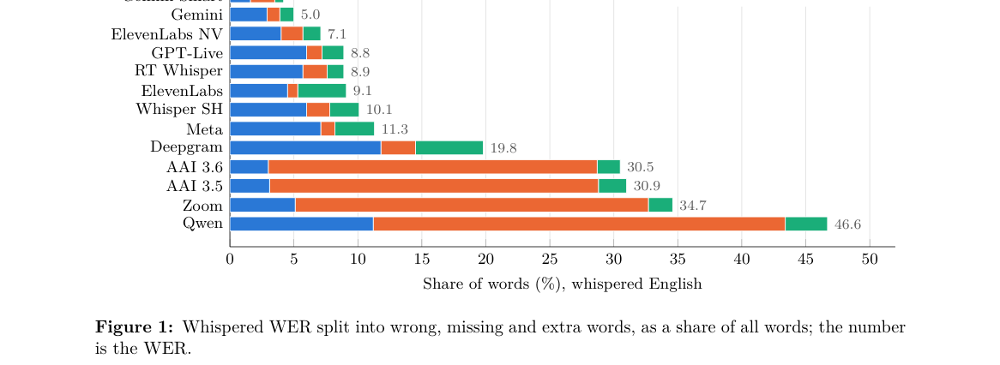

**Why this ranks #7**: 106 段英语听写流式送给 11 个 ASR 系统，错误按识别、输出格式、语言处理、模型前丢弃四层归类；Zoom Scribe 与 GPT-Live-Transcribe 安静英语 WER 几乎相同（7.4% 对 7.3%），耳语下却拉开到 34.7% 对 8.8%，说明只看 WER 会选错系统。

---

## 语音 LM 的 RL 与偏好优化 · `speech_rl` (3 papers)

本方向 3 篇（基准 4），**是本批次唯一有语音 RL 供给的方向**——这也纠正了「语音 RL 断供」的初步判断：全批 814 篇里真正用 RL 训练语音/音频模型的就是这三篇。DeALR 把大音频语言模型常见的「一次编码、之后在语言主导空间推理」换成**测试时强化学习**：提出 Decoupled Audio-Latent Optimization（DALO），在推理阶段联合精炼思维与声学隐变量，让冻结的 LALM 主动回到细粒度声学证据上。JEV-VAD 的端点检测用**RL for Calibrated Decisions（RLCD）**——先 SFT 再用强化学习把「话说完了」与「只是停顿」的判定校准好，同时保留任务优先条件化、标量端点读出与解码器前缀剪枝三条设计。ZONOS3-Mini 是零样本声音克隆 TTS，训练里用上了 **DPO**（在音频 token 的对数概率均值上，β=0.1）与 **GRPO**，主打的却是 886M 总参、每 token 只激活 100M 的潜空间 MoE 骨干加 44.1 kHz 的 ZAC-1 音频编解码器，能在笔记本或手机上实时跑。三篇的共同点：语音侧的 RL 正在从「训练大模型」转向「在测试时或在轻量模型上把行为校准好」。

### 8. JEV-VAD: Efficient Semantic Endpointing via Task-First Conditioning and Decoder-Prefix Pruning

**arXiv**: [2611.15362](https://arxiv.org/abs/2611.15362) | **Score**: 8.0 (relevance 8 x 0.7 + quality 8 x 0.3) | **Direction**: `speech_rl` | **Tags**: duplex-speech, turn-taking, endpointing, asr-free, rlcd-calibration, decoder-pruning, Tianjin University | **Categories**: eess.AS | **Pages**: 13

**Authors**: Jintao Liang; Nan Li; Longbiao Wang; Tubin Huang; Min Xu

**Affiliation**: Tianjin University; Tianjin Normal University; Shanghai Shenqijiyuan Intelligent Terminal Co., Ltd.

**Abstract**

> Semantic endpointing must distinguish a completed turn from a temporary pause, yet its binary output does not require the full generation pathway of an audio-language model. We propose JEV-VAD, an ASR-free framework that combines task-first conditioning, a scalar endpoint readout, and decoder-prefix pruning. The question and completion criteria are placed before audio tokens, allowing causal decoder attention to construct audio states conditioned on the endpointing objective. A dedicated scalar head maps the assistant-prefix state directly to a stop probability, removing transcript generation, answer decoding, and vocabulary-sized output projection. To reduce representation cost, decoder-prefix pruning physically retains only the initial decoder blocks. Matched head refitting then identifies which retained depths provide useful endpoint information under a common adaptation budget. The framework is built on Qwen3-ASR-0.6B and adapted through supervised fine-tuning followed by reinforcement learning for calibrated decisions. Together, these components address input conditioning, output complexity, and decoder depth within one endpointing framework. Experiments on EOT-bench show cross-language transfer from English endpoint supervision and useful discrimination in shallow prefixes, supporting a selectable quality-resource trade-off.

**Key findings**

- **Finding**: JEV-VAD 把问题与完成标准前置到音频 token 之前，用 1025 个可训练参数的标量头直接输出停止概率；训练分 SFT 与 RLCD 两阶段，RLCD 对 32 个采样二值动作做重要性加权策略更新，以标签一致性和二值概率构造组奖励，全程可训参数合计 4,588,545。
- **Inference**: 端点信息在浅层前缀即可分——14 语言宏平均 cut@300ms 为 19.09%，优于 DuplexJev-Para 的 32.75% 与 FD-VAD 的 27.63%，lat@5%cut 也更低的 775.9 ms；英文监督只来自 Smart Turn v3.1 的 58,594 条训练与 6,460 条验证片段却能跨语言迁移。
- **Recommendation**: 搭语音助手时端点模块可以单独做小：先用前置问题条件加标量头的 ASR-free 结构，再按算力预算裁剪解码器前缀并重新拟合头部，而不是沿用带转写的整条生成链路。

**Key figures**

*Framework - JEV-VAD architecture. The completion question and criteria precede audio tokens. The scalar head reads the assistant-prefix state after RMSNorm. Decoder LoRA is adapted during SFT/RLCD and f*

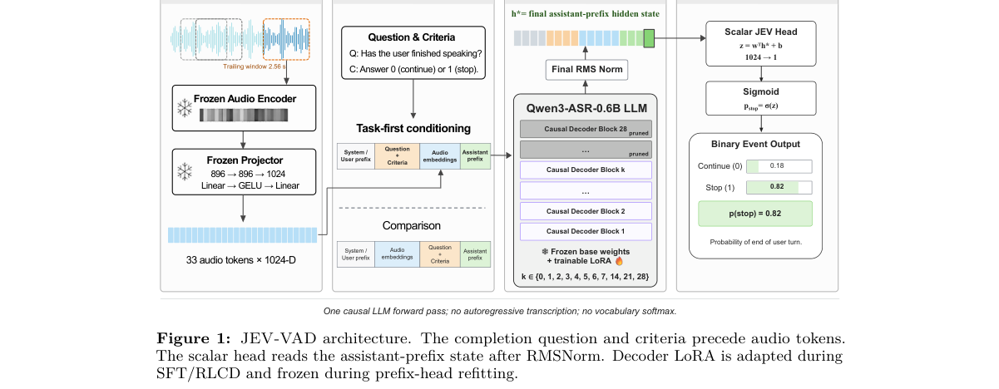

*Result - Training sequence. Stage I fits the endpoint labels with binary cross-entropy. Stage II initializes from SFT and applies the Bernoulli RLCD objective. All sampled actions share one forward d*

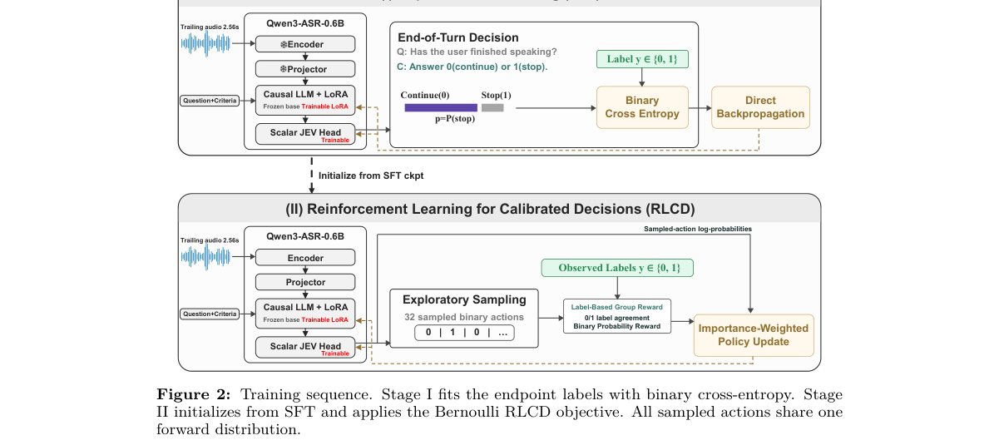

**Why this ranks #8**: 端点检测只需要一个标量的停与不停概率，不必背上完整生成链路；JEV-VAD 基于 Qwen3-ASR-0.6B，先 SFT 再用 RLCD 从 SFT 检查点出发对 32 个采样二值动作做重要性加权策略更新，全程只解冻解码器 LoRA 加 1025 个参数的标量头共 458 万参数，在 14 语言 EOT-bench 上中文 cut@300ms 19.57%，是所有对比系统中最低。

---

### 9. DeALR: Decoupled Audio-Latent Optimization with Acoustic Backtracking for Test-Time Reasoning

**arXiv**: [2611.15439](https://arxiv.org/abs/2611.15439) | **Score**: 8.0 (relevance 8 x 0.7 + quality 8 x 0.3) | **Direction**: `speech_rl` | **Tags**: duplex-speech, test-time-optimization, audio-latent, backtracking, policy-gradient, HKUST(GZ) | **Categories**: cs.SD | **Pages**: 9

**Authors**: Haoyu He; Yan Rong; Li Liu

**Affiliation**: HKUST(GZ)

**Abstract**

> Large audio-language models (LALMs) typically encode audio once and conduct subsequent multi-step reasoning in a language-dominated space, weakening access to fine-grained acoustic evidence. Although recent multimodal approaches have explored re-engaging perceptual inputs during reasoning, whether a frozen LALM can actively revisit crucial acoustic evidence in the latent space at test time remains underexplored. To bridge this gap, we introduce Decoupled Audio Latent Reasoning (DeALR), a novel test-time latent reasoning framework that shifts the paradigm from text-dominated deliberation to active audio-latent interaction. Inspired by the human cognitive process of "backtracking" to specific acoustic cues during complex listening tasks, DeALR establishes a dynamic interaction between learnable thought tokens and acoustic segments. Specifically, we introduce Span-Level Acoustic Backtracking, which traces initial attention distributions to dynamically isolate contiguous, key acoustic spans. Furthermore, we propose Decoupled Audio-Latent Optimization (DALO), a test-time reinforcement learning algorithm that jointly refines thought vectors and acoustic patches via confidence-guided policy gradients. Crucially, DALO explicitly decouples trajectory search from response generation by reinstating uncorrupted, high-fidelity audio embeddings prior to text synthesis, entirely eliminating optimization-induced distribution drift while retaining the navigation of the refined thoughts. Comprehensive experiments on benchmarks demonstrate that DeALR consistently outperforms prior test-time optimization approaches, delivering substantial improvements in both confidence calibration and reasoning accuracy.

**Key findings**

- **Finding**: DeALR 只优化 32 个可学习向量——8 个潜思维 token 与 24 个 patch 向量（N=8 块、窗宽 w=3），测试时跑 15 步策略梯度（学习率 0.005、噪声衰减 0.95），底层 Qwen2.5-Omni-7B 与 Qwen2-Audio-Instruct 权重全程冻结。
- **Inference**: 把音频嵌入直接插进自回归流的 ICoT 崩到 MMAR 56.0、MMAU 38.0、AudioMCQ 25.3，而“先在潜空间搜索、合成前再把未污染的原始音频嵌回复位”的解耦策略保住了精度，说明 reinstatement 是关键而非搜索本身。
- **Recommendation**: 评测语音问答时先量模型的声学注意力比与置信度分箱准确率（论文给出 Q1 至 Q5 对应 37.0% 至 68.0% 准确率），若二者都偏低再引入测试时声学回溯，而不是直接换更大的音频语言模型。

**Key figures**

*Framework - Comparison of reasoning paradigms. (a) Vanilla ALM with text-based CoT. (b) Latent reasoning with- out acoustic revisiting. (c) DeALR dynamically backtracks to salient acoustic spans and per*

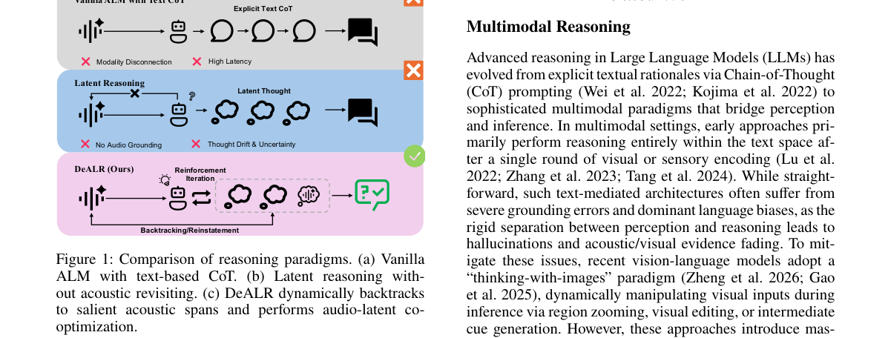

*Result - AAR comparison among Vanilla LALM, LTPO, CCoT, and Ours.*

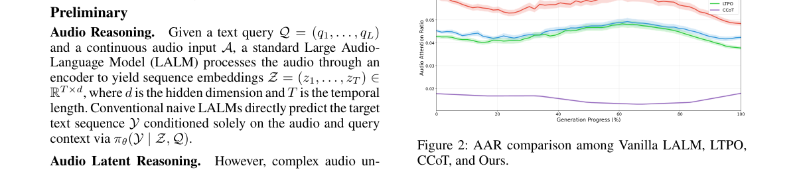

**Why this ranks #9**: 让冻结的音频语言模型在推理时用测试时强化学习主动回到声学证据做回溯优化，DALO 以置信度引导的策略梯度联合更新思维 token 与声学片段，MMAR 从 57.7 升到 60.3、MMAU 从 70.2 升到 73.1、AudioMCQ 从 83.4 升到 88.4，而全程只动 32 个可学习向量、底层权重不训练。

---

### 10. ZONOS3-Mini Technical Report

**arXiv**: [2611.16525](https://arxiv.org/abs/2611.16525) | **Score**: 8.0 (relevance 8 x 0.7 + quality 8 x 0.3) | **Direction**: `speech_rl` | **Tags**: duplex-speech, zero-shot-cloning, on-device-tts, grpo-post-training, dpo-filtering, latent-moe, Zyphra | **Categories**: cs.AI, cs.SD | **Pages**: 19

**Authors**: Gabriel Clark; Sofian Mejjoute; George Close; Beren Millidge

**Affiliation**: Zyphra

**Abstract**

> ZONOS3-Mini is an ultra-compact, ultra-fast, zero-shot voice-cloning TTS model. The model can run in real time on a laptop or smartphone. For its latency and size, it achieves state-of-the-art accuracy and cloning fidelity. To achieve this we propose a latent MoE backbone with only 886M parameters (100M active per token) and a new audio codec, Zyphra Audio Codec 1 (ZAC-1), which represents 44.1 kHz audio at a 15 Hz frame rate. On the new ZTTS2-Eval benchmark, ZONOS3-Mini reaches a 6.71% macro-average WER over 55 language sets (35 clean and 20 in the wild), which is competitive with larger and slower state-of-the-art models. We release the model weights, inference, and training code.

**Key findings**

- **Finding**: 后训练分两阶段——先用 DPO（β=0.1，每个提示采 11 个候选、8 个在 CFG 1、3 个在 CFG 1.5）把无语音、触顶 token 上限、时长异常或高 WER 的失败样本与最相似的完整候选配对做偏好学习（108 步），再用 GRPO（587 步）以 0.9·max(0, 1−WER²)+0.1·SIM 的奖励直接优化说话人相似度与字错率。
- **Inference**: ZAC-1 以 15 Hz、44.1 kHz 工作、每帧 1 个语义码加 9 个残差码、码率仅 1.80 kbit/s，骨干总参 886M 而每 token 只激活 100M，最终宏平均 WER 6.71%、相似度 81.2、野外集 WER 由 7.52 降到 4.81，说明把算力压在编解码压缩比与稀疏激活上、再用偏好与策略梯度修失败模式，比单纯堆参数更划算。
- **Recommendation**: 做端侧零样本克隆可优先走这类小模型路线，先在目标设备上实测首包延迟与并发吞吐，再决定是否需要更大的克隆模型。

**Key figures**

*Framework - Quality versus speed on one H100 80GB. Left: time to first audio (p50) at 8 concurrent requests; right: peak throughput at each model’s best-throughput concurrency. Quality is 1*

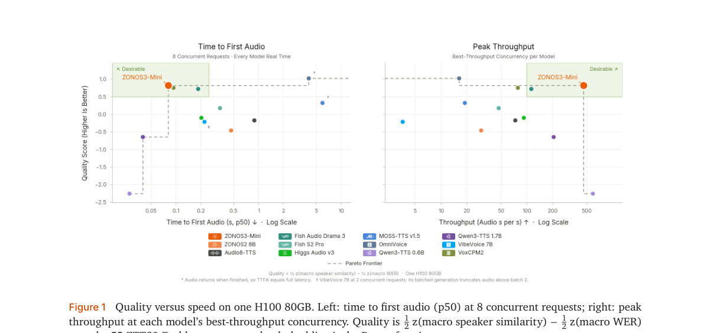

*Result - ZAC-1. One semantic and nine residual codes per 15 Hz frame are passed to the backbone. Discussed on p. 3*

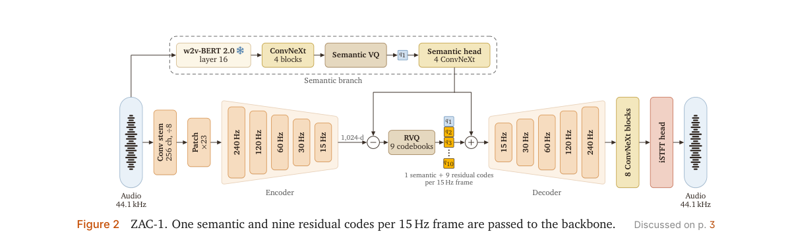

**Why this ranks #10**: 886M 总参、每 token 只激活 100M 的潜空间 MoE 骨干，配 44.1 kHz、15 Hz 帧率的 ZAC-1 编解码器（1.80 kbit/s，音频序列比上一代短 5.7 倍），在 55 个语言集上宏平均 WER 6.71%；后训练先用 DPO（β=0.1，每个提示采 11 个候选）筛掉早停与失控生成，再用 587 步 GRPO 直接优化说话人相似度与字错率。

---

## Footer

- Total papers reviewed across all 4 axes: 60
- duplex_speech axis final count: 10
- Wild-cards in this axis: 0
- Figure assets: 2026-11-14/res/

Generated by `mine-arxiv-daily-digest` skill. Sister file: `2026-11-14_duplex_speech_entry.md`.
