# Mine Arxiv Daily Digest - 2026-11-14 (LLM / VLM 与其强化学习 Axis, 20 papers)

**Generated**: 2026-11-14 11:25 CST

**Source**: arXiv cs.CV, cs.SD, eess.AS, cs.CL, cs.AI, cs.RO, cs.LG, cs.IR submissions, listing day 2026-11-11 + 2026-11-12 (announced 2026-11-13 01:00 UTC)

**Batch window**: 2026-11-10T19:00:00Z .. 2026-11-12T19:00:00Z（arXiv 公告批次横跨两个 UTC 日：从前一日的美东 14:00 截止时刻起算（EDT 为 18:00Z，EST 为 19:00Z），到当日的同一时刻为止）

**Axis**: llm_vlm (20 papers, base 18, cap 20)

**Directions**: llm_core (10), vlm_core (5), llm_vlm_rl (5)

**Selection**: 20 papers ranked by relevance x quality, with 0 wild-card slots

**Day total**: 60 papers across 4 axes (target 60)

**Scope**: 大语言模型与视觉语言模型的设计、推理、agent、效率与上下文工作，以及面向 LLM / VLM 的 RL 与偏好优化、奖励模型

**Wild-card**: 0 —— 本 axis 未启用任何补位名额，三个 direction 都有足量够格论文，按候选富余量把名额分给了 `llm_core`，没有需要用邻接选题补位的空位。

**本 axis 20 篇，打满 axis 上限 20**：候选池 398 篇，是本批次供给最充裕的轴。`llm_core` 10 篇、`vlm_core` 5 篇、`llm_vlm_rl` 5 篇——`llm_core` 超出基准 2 个，正是 axis 内 `dir_under = 0` 时由 `axis_surplus = 2` 允许的额度。

---

## LLM 核心（架构 / 推理 / agent / 效率 / 上下文） · `llm_core` (10 papers)

本方向 10 篇，沿 LLM 的**长期记忆、RAG、agent 训练与推理效率**四条线展开。DISCERN 先纠正一个认识偏差：企业级 agent 的长期记忆被当作检索问题，但 ENT-310 基准（310 个查询，210 个可答、100 个不可答）显示 vanilla RAG 的失败主要发生在**写入时**而不是读取时，因此提出「写入时保留、读取时解决」；KVPath 发现相邻层的 KV 表示高度相关且共享信息，于是用低维增量刻画层间变化来压缩 KV 缓存；Faithful in Steps 把 RAG 最难的多跳问答与引用可核实性放在一起解决；Knowledge in the Harness 研究小开源模型如何在**没有更强教师**的前提下，仅从自己的部署日志与参考结果里同时补齐「不知道政策」和「知道但执行不一致」两个缺口；daVinci-Prover 给出形式化定理证明的agent-native 中期训练数据配方，强调数学能力先验与 agentic 轨迹缺一不可；Reducing Batch Makespan 从推理—环境协同入手优化 agent 负载的批执行时长（同一批任务在推理与环境交互之间来回切换）；Olifant 用基于记忆的分类器当草稿模型，在 CPU 上 0.3 ms 内从四 token 窗口预测下一 token，不需要 GPU、不需要反向传播；对比式记忆学习把长上下文压成记忆槽时按 query 相关的证据分布做选择性压缩；DRAMA 拆解多模态扩散 LM 的注意力冗余——每个去噪步都要对被视觉 token 主导的长序列做一次完整前向；CURATOR 用决策模型做细粒度证据选择，而不是把整段检索结果塞给模型。

### 1. Knowledge in the Harness, Reliability in the Weights: Teacher-Free Co-Evolution of an LLM Agent

**arXiv**: [2611.15268](https://arxiv.org/abs/2611.15268) | **Score**: 8.7 (relevance 9 x 0.7 + quality 8 x 0.3) | **Direction**: `llm_core` | **Tags**: LLM-VLM, llm-agent, skill-evolution, grpo, tau2-bench, Brightendata | **Categories**: cs.AI, cs.CL, cs.LG | **Pages**: 18

**Authors**: Yujia Zhang; Xinqi Ren; Shixiong Zhou; Jia Meng

**Affiliation**: Brightendata

**Abstract**

> Small open models suit private customer-service deployments but trail frontier models in two ways: they miss what the written policy requires in a given situation, and they act inconsistently on what they know. We study whether such a model can close both gaps from its own deployment logs and their reference outcomes, without a stronger teacher model. Our starting point is a Gemma 4 12B agent that reads its domain policy from on-demand skills rather than from its system prompt. In each round, the deployed system serves a fresh batch of tasks; the base model diagnoses failed conversations and writes rules into the skills, and a rule survives only if it passes code checks, counterexample self-review, a paired retest, and a noise-calibrated validation gate. Reinforcement learning (GRPO) then trains a LoRA adapter on complete multi-turn, tool-using conversations. On the retail and airline domains of $τ^2$-bench, without training or selecting on official tasks, the agent after two rounds improves on this starting point by 12.5 pass$^1$ points in retail and 19.5 in airline, and by 18.4 and 22.0 pass$^4$ points. It also exceeds the benchmark's reference agent, which runs the same model with the whole policy in its system prompt, by 11.8 and 8.0 pass$^1$ points and by 22.8 and 16.0 pass$^4$ points, closing most of the gap to three frontier models under the same protocol. A $2\times2$ ablation shows that the rules rescue tasks the agent never solved and carry policy knowledge that RL with the rules in context does not internalize, whereas the trained weights make solved tasks reliable.

**Key findings**

- **Finding**: Gemma 4 12B agent 两轮后相对起点在零售/航空域分别提升 12.5/19.5 个 pass¹ 分与 18.4/22.0 个 pass⁴ 分；相对参考 agent 领先 11.8 [6.1, 17.5] 与 8.0 [0.5, 16.0] 个 pass¹ 分，八次被采纳的规则更新每次都让官方 pass¹ 上升，并公开了 2200 个已验证任务。
- **Inference**: 写在 harness 里的规则能救回 agent 从没做对过的题，而 GRPO 只让已解对的题更稳定，两者是互补而非可互相替代的知识载体。
- **Recommendation**: 做私有化客服 agent 时可先让模型自己写规则并严格门控（代码检查＋反例自审＋配对复测＋噪声校准），再对已解对的题做 RL 训练。

**Key figures**

*Framework - One round of co-evolution. The deployed system serves a fresh batch Bk; the base model, acting as editor, turns failed conversations into rules; GRPO then trains the agent’s LoRA adapter und*

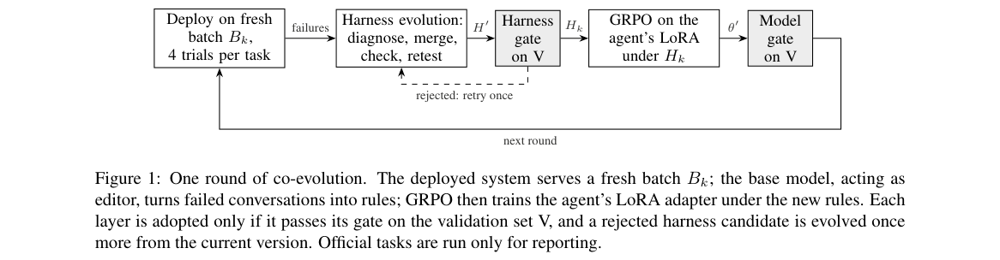

*Result - Official scores over two rounds. Dashed lines: the reference agent; gray bands: the range of the three frontier models with the H0 harness. Each update was adopted on V alone.*

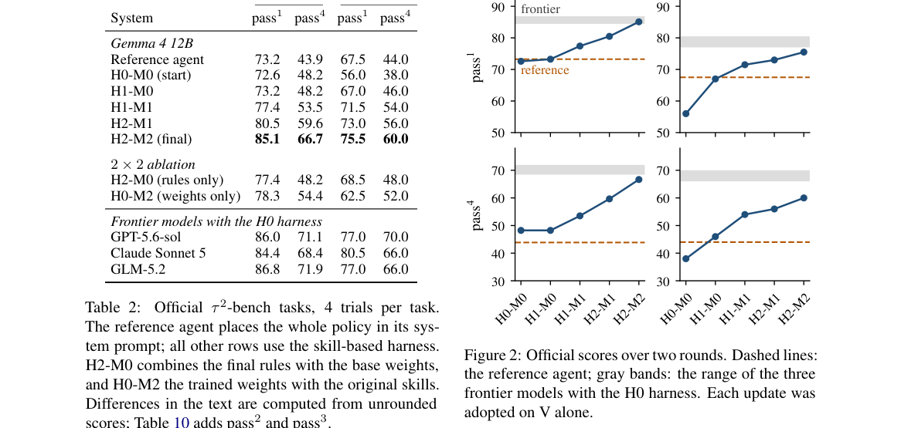

**Why this ranks #1**: 让 12B 开源 agent 在没有更强教师模型时自举：Gemma 4 12B 从部署日志里把失败对话改写成技能规则，GRPO 再训练 LoRA。两轮后在 τ²-bench 零售域提升 12.5 个 pass¹ 分、航空域 19.5 分，并反超把整份策略塞进系统提示的参考 agent 11.8 分，是 agent 方向少见的「知识留在 harness、可靠性进权重」闭环。

---

### 2. Faithful in Steps: Improving Generalization and Citation in RAG via Query Decomposition

**arXiv**: [2611.15538](https://arxiv.org/abs/2611.15538) | **Score**: 8.7 (relevance 9 x 0.7 + quality 8 x 0.3) | **Direction**: `llm_core` | **Tags**: LLM-VLM, rag, query-decomposition, citation-faithfulness, multi-hop-qa, Hong Kong University of Science and | **Categories**: cs.AI, cs.CL | **Pages**: 9

**Authors**: Yue Liu; Zhongying Ru; Shimin Di; Jipeng Zhang; Ruiyuan Zhang; Xiaofang Zhou

**Affiliation**: The Hong Kong University of Science and Technology; Independent Researcher; Southeast University; Hong Kong Generative AI Research and Development Center (HKGAI)

**Abstract**

> Retrieval-augment generation is a prevalent strategy to mitigate hallucinations of LLMs. The attributable RAG (RAGQ) generates quotes for its answers. The quotes indicate which input contexts support the RAG to derive the answers, enhancing the answer's verifiability and trustworthiness. However, existing RAGQs exhibit significant degradation when dealing with questions that require multi-hop reasoning and multi-modal understanding, suffering from over-citation, implicit entity identification failure, and poor generalization. In this paper, we propose a novel RAGQ framework, namely QDRAG. QDRAG breaks down the input question into atomic subquestions to identify the implicit entities. Then, the reranker prunes context distractors to eliminate the downstream over-citation. To facilitate query decomposition, we propose two zero-shot approaches: QD-C and QD-R, which guide the QD MLLM to decompose the question based on context knowledge and retrieval rewards, respectively. One interesting finding is that finetuning on the QD task shows better generalizability compared to directly finetuning on the downstream RAGQ task. Experiments on four multi-modal QA benchmarks demonstrate QDRAG's efficacy in grounding answers and generating faithful citations. The framework significantly outperforms all the baselines on both in-domain and out-of-domain tests, even surpassing Gemini-Pro.

**Key findings**

- **Finding**: 全部实验统一用 CLIP-ViT-L/14@336px 作检索器；QDRAG-R 7B 在 InfoSeek 上 EM 46.0、引用 72.9，远超 Gemini-Pro 的 EM 9.8、引用 0.9；QDRAG-R 14B 在 MMQA 上 EM 53.1、LLM 评分 52.8，而 14B 的 Gemini-Pro 在该基准 EM 仅 43.2。
- **Inference**: 现有 RAGQ 的主要失效不是模型不会答，而是被大量相似但无关的上下文误导后过度引用，查询分解加重排能同时修好这两个症状。
- **Recommendation**: 搭可归因 RAG 时把查询分解与上下文重排拆成两个可独立训练的小模块，论文显示在分解任务上微调比直接微调下游任务泛化更好。

**Key figures**

*Framework - The massive retrieved data in RAG misleads the MLLM to cite the incorrect but similar contexts; Sparse RAG drops key contexts in the reranking step for multi-hop ques- tions; QDRAG filters t*

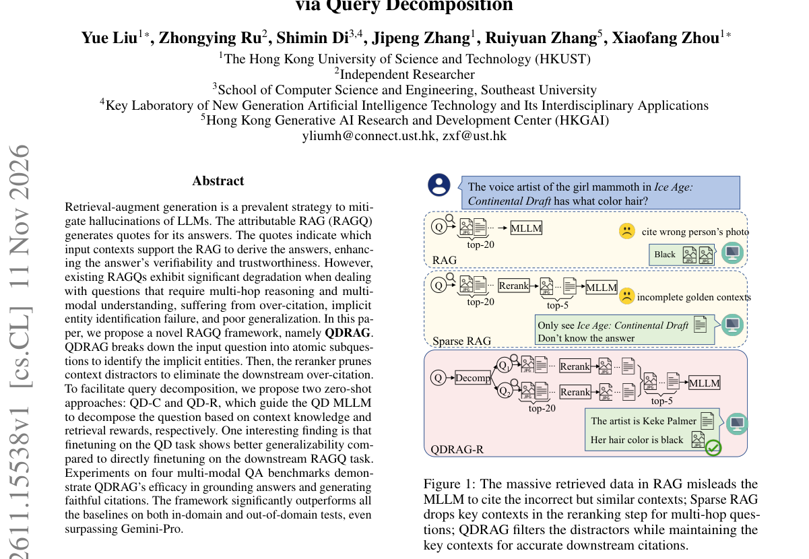

*Result - QDRAG finetunes the MLLM for the QD task, leveraging its fast training and better generalizability.*

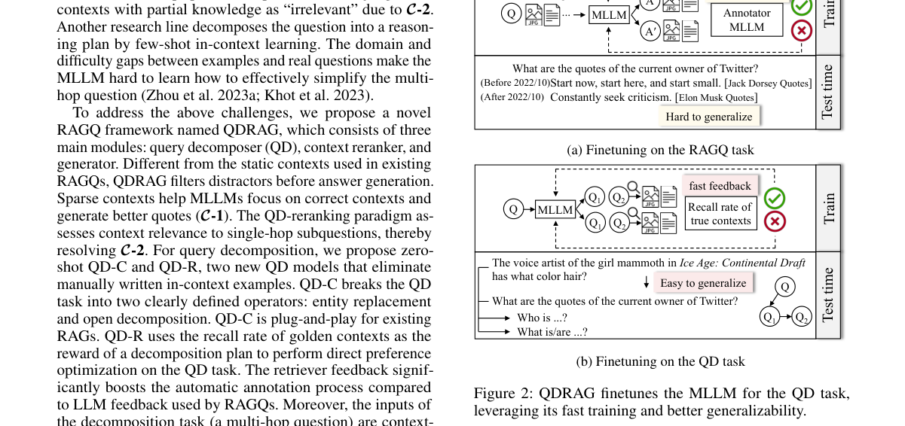

**Why this ranks #2**: 面向可归因 RAG 的引用忠实度：把问题拆成原子子问以定位隐式实体，再用重排器裁掉干扰上下文。在 MMQA/WebQA/InfoSeek/E-VQA 四个多模态 QA 基准上，QDRAG-R 7B 的 InfoSeek EM 达 46.0，而 Gemini-Pro 只有 9.8，说明重排式 RAG 仍有明确的增益空间。

---

### 3. DISCERN: Preserve at Write, Resolve at Read for Persistent LLM-Agent Memory

**arXiv**: [2611.15729](https://arxiv.org/abs/2611.15729) | **Score**: 8.7 (relevance 9 x 0.7 + quality 8 x 0.3) | **Direction**: `llm_core` | **Tags**: LLM-VLM, agent-memory, bitemporal-graph, abstention, entity-resolution, Amazon | **Categories**: cs.AI | **Pages**: 14

**Authors**: Chirag Ahuja; Vladislav Tanov; Ramcharan Kakarla; Jonathan Taws

**Affiliation**: Amazon

**Abstract**

> Enterprise agents accumulate memory across dozens of sessions in which facts contradict, get superseded, and blur as similarly named entities collide in embedding space. The field treats this as a retrieval problem; we show it is not. On ENT-310, a synthetic enterprise sales-agent memory benchmark of 310 queries (210 answerable, 100 unanswerable), a vanilla Retrieval-Augmented Generation (RAG) reader over a memory store already matches strong memory systems on the recall pillars. Retention and currency are near-saturated, roughly 0.93 to 0.98 for every competent system, so recall is essentially solved. What remains unsolved is resolution: which entity a query refers to, which time-state is current, and whether to commit an answer at all or decline when evidence is insufficient. We propose DISCERN (DISambiguation and Cross-session Episodic memoRy Navigation), an agent-memory framework built on a single rule: preserve at write, resolve at read. At write time DISCERN builds a strictly additive bi-temporal provenance graph that never merges confusable entities and never drops superseded values. At read time a zero-LLM tool surface drives an agentic loop that navigates this graph and commits exactly one of four gated terminal actions. A four-judge LLM-as-a-Judge council scores two axes: answer correctness on answerable questions, and the answer-versus-abstain decision as a classification problem. On ENT-310, DISCERN is the best-calibrated system on abstention (F1 0.924 versus at most 0.802 across eight baselines) and leads macro answer correctness under equal pillar weighting (0.861 versus 0.806 for the strongest baseline), a lead driven by entity resolution (0.800, where no baseline exceeds 0.40). Applied with zero tuning to the full LoCoMo corpus, the same pipeline again leads macro answer correctness (0.663 versus 0.638) and stays among the best-calibrated on false-premise abstention.

**Key findings**

- **Finding**: 在 ENT-310（310 条查询，210 条可答、100 条不可答）上，DISCERN 的弃答 F1 为 0.924，八个基线最高只有 0.802；宏平均答案正确率 0.861 对最强基线 0.806，差距主要来自实体消解 0.800（无基线超过 0.40），而召回类指标各系统都在 0.93–0.98。
- **Inference**: 记忆系统的瓶颈已从「找得到证据」转移到「分得清实体、判得准该不该答」，说明写时结构化比读时再调检索排序更关键。
- **Recommendation**: 做跨会话长期记忆时，把冲突事实保留成双时态边、把弃答当作一等公民来标定评测，而不是继续在召回排序上做微调。

**Key figures**

*Framework - DISCERN end to end. Left: the per-actor event log is the immutable, append-only source of truth. Center (write time preserves): background consolidation materializes rebuildable derived view*

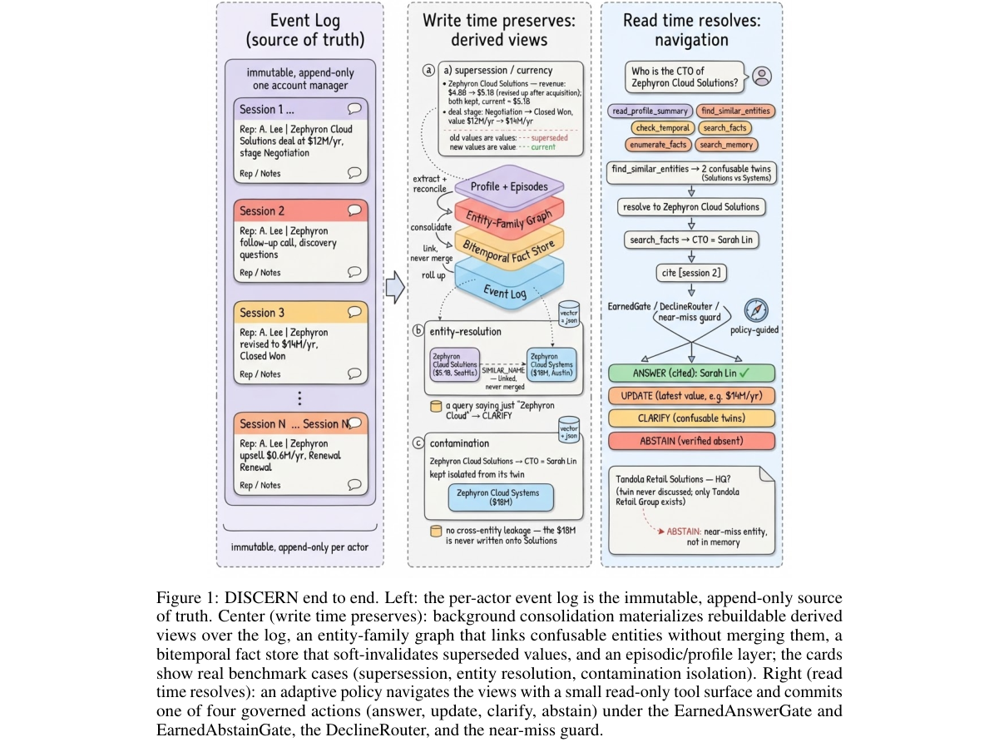

*Result - The DISCERN memory graph. (a) Changed values are kept as bi-temporal edges so both history and current state remain recoverable. (b) Confusable entities are kept co-equal and merely linked,*

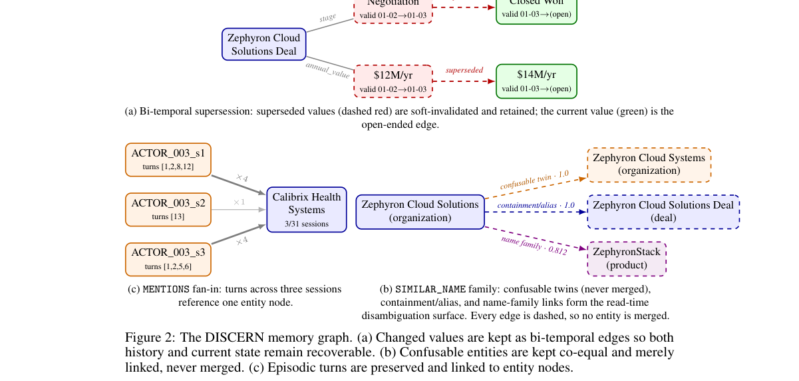

**Why this ranks #3**: 把企业 agent 记忆从检索问题重新定义为消解问题：ENT-310 的 310 条查询上，保留与时效两项指标对所有像样系统都已饱和在 0.93–0.98，真正拉开差距的是实体消解（0.800，基线不超过 0.40）与弃答校准（F1 0.924，基线最多 0.802），因此归入 agent-memory 而非 RAG。

---

### 4. KVPath: Connecting Key-Value Representations Across Transformer Layers

**arXiv**: [2611.16072](https://arxiv.org/abs/2611.16072) | **Score**: 8.7 (relevance 9 x 0.7 + quality 8 x 0.3) | **Direction**: `llm_core` | **Tags**: LLM-VLM, kv-cache, cross-layer-correlation, gqa, mla, University of California | **Categories**: cs.LG | **Pages**: 13

**Authors**: Xuan Luo; Zhiyuan Wang; Hanzhong Cao; Xifeng Yan

**Affiliation**: University of California, Santa Barbara

**Abstract**

> Transformers typically cache an independent key-value (KV) representation for each token at every layer. Recent work reveals that a token's KV representations across neighboring layers are correlated and contain shared information. We hypothesize that this correlation implies incremental inter-layer changes, which can be effectively captured by low-dimensional deltas. Motivated by this, we propose KVPath, a new KV representation paradigm that connects KV representations across the network depth into a path. The path establishes a full-dimensional base KV at the first layer, while subsequent layers generate low-dimensional delta KVs to update the preceding KV, thereby constructing their own KV states. By caching the base KV once alongside these compact delta KVs, KVPath preserves distinct layer-specific representations without storing full KV states at every layer. We develop two variants of KVPath: KVPath-Residual, which updates vector values via residual addition, and KVPath-Rolling, which progressively updates feature dimensions in a rolling manner. Under matched parameter counts, KVPath reduces KV-cache storage by up to 68\% for Grouped-Query Attention (GQA) and 55\% for Multi-Head Latent Attention (MLA), while maintaining or even improving model performance.

**Key findings**

- **Finding**: 在参数量对齐（约 98.71M、头维 64）下，RollGQA 相对标准 GQA 在 2K、8K、32K 上下文分别减少 67.19%、68.36%、68.65% 的 KV-cache 存储，平均困惑度下降 0.10%、0.20%、0.52%；MLA 变体在 32K 下减少 54.90%，单 token 缓存元素由 GQA 的 3072 降到 1920。
- **Inference**: 跨层 KV 的冗余是系统性的而非偶然的，说明把缓存从「逐层全量」改成「基座＋增量」能在几乎不损质量的前提下换出接近七成的显存余量。
- **Recommendation**: 长上下文推理可尝试 base KV 加低维 delta 的缓存布局，但压缩比取决于层数与头维，必须在自己的配置上重算，不能照搬 68% 这个数。

**Key figures**

*Framework - Two KVPath constructions across depth, shown from bottom to top. (a) KVPath-Residual adds an expanded low-dimensional update to the preceding full state. (b) KVPath-Rolling replaces the olde*

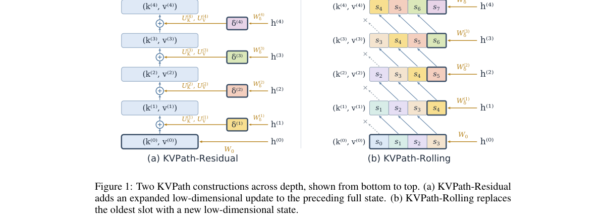

**Why this ranks #4**: 把逐层独立的 KV 缓存改写成一条跨层增量路径：首层存全维 base KV，其余层只存低维 delta。RollGQA 在 2K/8K/32K 上下文下把 KV-cache 占用降到 GQA 的 67.19%/68.36%/68.65%，困惑度还平均下降 0.10%/0.20%/0.52%，是 KV-cache 方向最有分量的结构性改造。

---

### 5. daVinci-Prover: Agent-Native Mid-Training for Formal Theorem Proving

**arXiv**: [2611.16433](https://arxiv.org/abs/2611.16433) | **Score**: 8.7 (relevance 9 x 0.7 + quality 8 x 0.3) | **Direction**: `llm_core` | **Tags**: LLM-VLM, theorem-proving, mid-training, lean4, agent-trajectory, Shanghai Innovation Institute | **Categories**: cs.CL | **Pages**: 19

**Authors**: Wenhong Zhu; Xuefeng Li; Jiashuo Zhang; Yu Chen; Tiantian Mi; Qipeng Guo; Pengfei Liu

**Affiliation**: Shanghai Innovation Institute; Shanghai Jiao Tong University; Fudan University; Generative Artificial Intelligence Research Lab (GAIR)

**Abstract**

> Advances in large language models (LLMs) are rapidly transforming formal theorem proving. Yet further progress remains constrained by the lack of a transparent and effective data recipe for systematically improving theorem-proving models. In this work, we argue that effective agentic provers require strong mathematical skill priors to ground theorem proving and agentic trajectories to enable long-horizon, interactive proof construction. To this end, we synthesize an agent-native 33.7B-token mid-training corpus covering decomposition, search, self-verification, and revision, together with verifier-grounded agentic trajectories. We further introduce the daVinci-Prover harness, which enables models to construct proofs and interact with a Lean verifier in an isolated workspace, and use it to collect approximately 36K high-quality agent trajectories for supervised fine-tuning. Our mid-training recipe yields an average improvement of 13.7 points over the matched Qwen3-8B SFT-only baseline across MiniF2F, FATE-M, and ProofNet. When applied to the Qwen3.5 series, our approach also yields strong performance across theorem-proving benchmarks and achieves near-saturating MiniF2F performance with memory compaction. The results highlight agent-native mid-training as an effective foundation for developing stronger interactive theorem-proving agents.

**Key findings**

- **Finding**: 中训语料 33.7B token（29B 教师生成＋5.11B 回放），去重与排除评测重叠后仅滤掉 0.03427%；SFT 用约 36K 条通过 Lean 验证的轨迹；开启记忆压缩后 Qwen3.5-midtrain-9B 的 MiniF2F 由 90.1 升到 97.1、FATE-M 由 93.3 升到 96.7、FATE-H 由 16.7 升到 28.0。
- **Inference**: 交互式证明的长程能力主要来自中训阶段注入的分解与自验证习惯，而不是在后训练阶段再补工具调用格式。
- **Recommendation**: 要做长程工具型推理，可先把「分解—搜索—自验证—修改」的轨迹形态灌进中训数据，等上下文到 200K 后再用确定性工具证据压缩历史。

**Key figures**

*Framework - Mid-training data design and benchmark performance. Left: The mid-training data in- corporates mathematical skill priors and iterative agent trajectories. Right: Mid-training leads to consis*

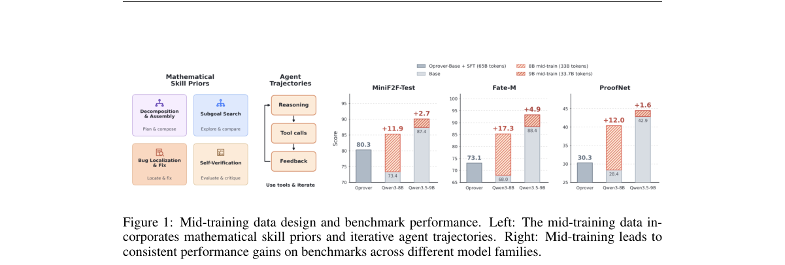

*Result - Overview of our midtrain data generation pipeline.*

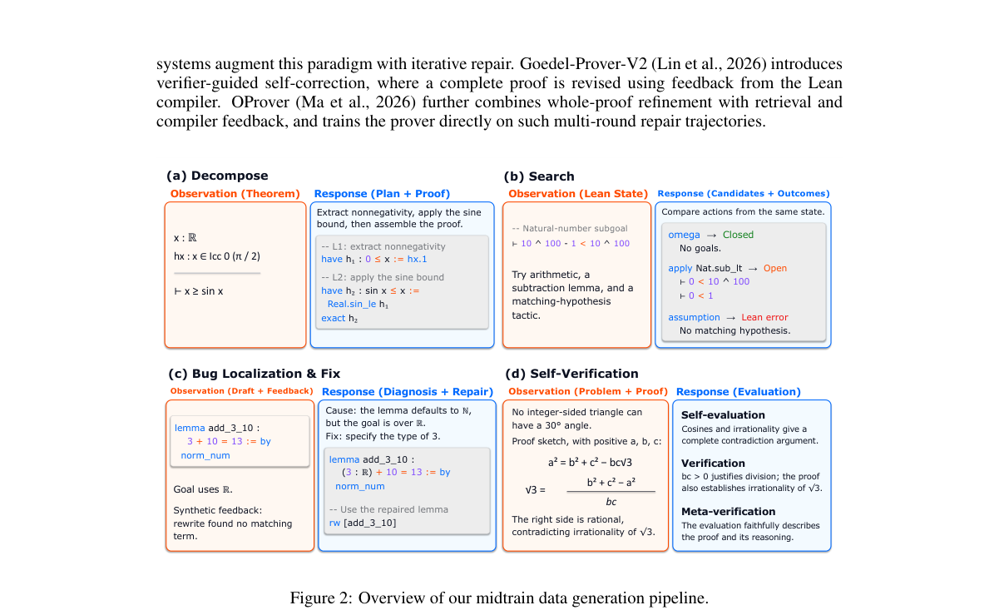

**Why this ranks #5**: 形式化定理证明的「中期训练」配方：合成 33.7B token 覆盖分解、搜索、自验证与修改，配套 harness 收集约 3.6 万条 agent 轨迹做 SFT，使 Qwen3-8B 的 pass@1 在 MiniF2F、FATE-M、ProofNet 上平均比同规模 SFT 基线高 13.7 分；启用记忆压缩后 MiniF2F 更从 90.1 升到 97.1。

---

### 6. Reducing Batch Makespan for LLM Agent Workloads through Inference-Environment Coordination

**arXiv**: [2611.16661](https://arxiv.org/abs/2611.16661) | **Score**: 8.7 (relevance 9 x 0.7 + quality 8 x 0.3) | **Direction**: `llm_core` | **Tags**: LLM-VLM, llm-agent, batch-scheduling, kv-cache, rollout, Ling Team | **Categories**: cs.AI, cs.DC | **Pages**: 26

**Authors**: Wei Feng; Meiling Chen; Boxiao Chen; Lu Liu; Bin Zi; Libin Ye; Xingyu Lu; Lei Xu; Jun Zhou

**Affiliation**: Ling Team, Ant Group

**Abstract**

> Efficient batch execution of agent tasks is critical to LLM training and development workflows, including benchmark evaluation, synthetic-data generation, and RL rollouts. Since these tasks alternate between LLM inference and environment interaction, we present coordinated optimizations to reduce batch makespan, the time required to complete all tasks in a batch. For hybrid LLMs, a workload-based resource model guides GPU-memory allocation between key-value (KV) cache and recurrent state and provides a reference sample concurrency to exploit parallelism while limiting recomputation. Trajectory-aware routing and scheduling promote cache reuse while balancing worker load. Under constrained environment capacity, we decouple sample admission from environment execution and introduce Chain-Advancing Action Scheduling (CAAS), which prioritizes long chains using observed progress to shorten the batch tail. Controlled replay combines actual inference with recorded environment responses and durations for ablations of individual optimizations. Live evaluations with Ling-3.0-Flash and Ling-3.1-Flash on the BFCL, SWE-bench Multilingual, WideSearch, and MCP-Atlas benchmarks demonstrate makespan reductions of 10.4% to 65.0%, while evaluation scores remain aligned. Furthermore, these methods have been successfully applied to training and evaluation workflows for the Ling-3.x model series, accelerating the model-development cycle.

**Key findings**

- **Finding**: 在 Ling-3.0-Flash 与 Ling-3.1-Flash 上，BFCL、SWE-bench Multilingual、WideSearch、MCP-Atlas 四个基准的批 makespan 缩短 10.4%–65.0% 且评测分数保持对齐；CAAS 通过解耦样本准入与环境执行、按已观测进度优先推进长链来砍掉批次长尾，另有受控回放用于逐项消融。
- **Inference**: agent 批处理的瓶颈往往在环境侧排队与长尾，而不是 GPU 本身，所以只调推理引擎的收益有限。
- **Recommendation**: 跑大规模 agent rollout 时优先分离「样本准入并发数」与「环境执行并发数」，并用链式推进调度压缩尾部，而不是一味加卡。

**Key figures**

*Framework - Illustration of batched execution of multi-turn LLM agent tasks. Active tasks are those admitted but not yet completed, including tasks waiting for inference or environment interaction. Each*

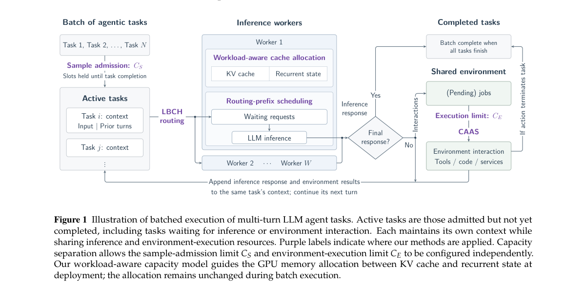

**Why this ranks #6**: 把 agent 批量执行当成推理–环境协同的调度问题：基于工作负载的显存模型在 KV cache 与循环状态间分配，轨迹感知路由复用缓存，再用链式推进调度压缩长尾。在 Ling-3.0/3.1-Flash 上于 BFCL、SWE-bench 多语种、WideSearch、MCP-Atlas 四个基准把批完成时间压缩 10.4%–65.0%，是 RL rollout 与评测流水线的工程底座。

---

### 7. Towards Green Text Generation: Memory-Based Speculative Decoding

**arXiv**: [2611.16714](https://arxiv.org/abs/2611.16714) | **Score**: 8.7 (relevance 9 x 0.7 + quality 8 x 0.3) | **Direction**: `llm_core` | **Tags**: LLM-VLM, speculative-decoding, memory-based-classifier, energy-efficiency, on-device, Utrecht University | **Categories**: cs.CL | **Pages**: 11

**Authors**: Antal van den Bosch

**Affiliation**: Utrecht University

**Abstract**

> Speculative decoding accelerates text generation with large language models by letting a cheap draft model propose tokens that a large verifier checks in a single forward pass. We introduce Olifant, a draft model built on a memory-based classifier. It predicts the next token from a four-token window in under 0.3 ms on CPU, requiring no GPU, no backpropagation, and no accelerator memory. We measure throughput and energy under two verifier regimes on consumer hardware. Without a KV cache, drafting is nearly free: a domain-matched Olifant model reaches 38.1% acceptance on EU legal text, delivering 2.43x throughput and 2.51x lower energy per token than the neural verifier model alone. With a KV-cached verifier, itself a ~10x energy saver, drafting costs matter: a TinyLlama draft model halves throughput and triples energy despite high acceptance, whereas Olifant still yields 1.25x throughput and the lowest energy in the study (93 J per 100 tokens, 14x below the uncached baseline). We further show that KV caching decouples time from energy: verification of longer drafts raises power draw, shifting the energy-optimal draft length below the speed-optimal one. Speculative decoding is not dead in the age of fast verifiers, provided drafting is nearly free.

**Key findings**

- **Finding**: Olifant 从四 token 窗口预测下一个 token，CPU 上耗时低于 0.3 毫秒且无需加速器显存；无 KV cache 时领域匹配的 Olifant 在欧盟法律文本上接受率 38.1%、吞吐 2.43 倍、每 token 能耗降低 2.51 倍；有 KV cache 时 TinyLlama 草稿让吞吐减半、能耗翻三倍，而 Olifant 仍有 1.25 倍吞吐、能耗 93 焦耳每 100 token，比无缓存基线低 14 倍。
- **Inference**: 草稿模型的成本必须相对验证器速度来衡量——面对已经很快的验证器，神经草稿模型从正收益变成净亏损，只有近乎零成本的草稿才能保住正收益。
- **Recommendation**: 本地部署若已启用 KV cache，先把草稿模型换成基于内存或查表的近零成本方案，并按能耗最优（而非速度最优）的草稿长度来调参。

**Key figures**

*Framework - Speedup over plain decoding vs. draft length k on legal text, under the two verifier regimes (shared y-axis). Without a KV cache (left), draft tokens are nearly free and speedup grows with k*

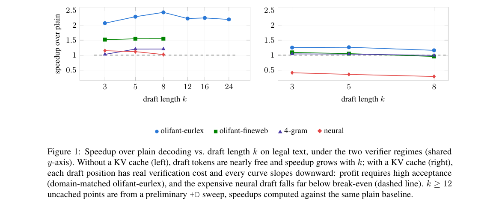

*Result - Energy efficiency ladder on legal text (tokens generated per Joule, best k per strategy). KV caching is the largest single lever; domain-matched memory-based drafting adds to it, while the n*

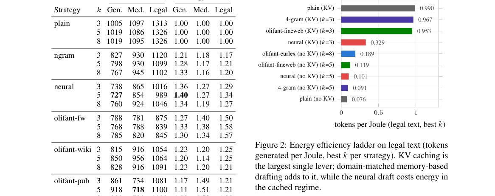

**Why this ranks #7**: 把草稿模型换成基于内存的分类器：从四 token 窗口在 CPU 上 0.3 毫秒内出下一个 token，无需 GPU 与反向传播。无 KV cache 的验证器下接受率 38.1%、吞吐 2.43 倍、每 token 能耗降到 1/2.51；即使换成自带 KV cache 的快速验证器，仍保有 1.25 倍吞吐和最低能耗（每 100 token 93 焦耳）。

---

### 8. DRAMA: Dissecting Attention Redundancy for Accelerating Multimodal Diffusion Large Language Models

**arXiv**: [2611.16345](https://arxiv.org/abs/2611.16345) | **Score**: 8.0 (relevance 8 x 0.7 + quality 8 x 0.3) | **Direction**: `llm_core` | **Tags**: LLM-VLM, dllm-acceleration, attention-redundancy, token-pruning, inference-efficiency, National Taiwan University | **Categories**: cs.AI, cs.LG | **Pages**: 27

**Authors**: Yi-Hsin Hung; Fangfu Liu; Shao-Yuan Lo; Chu-Song Chen

**Affiliation**: National Taiwan University; Tsinghua University

**Abstract**

> Multimodal diffusion large language models (dLLMs) generate text through iterative masked denoising with bidirectional attention, offering a compelling alternative to autoregressive vision-language modeling. However, each denoising step requires a full forward pass over long multimodal sequences in which visual tokens dominate the sequence length, and a fixed step budget further compounds this quadratic per-step cost. Existing inference acceleration approaches for multimodal dLLMs characterize attention redundancy implicitly, motivating designs from isolated attention visualizations rather than from measurement. We close this gap with DRAMA, a training-free acceleration framework grounded in a systematic dissection of attention redundancy in multimodal dLLMs. By probing attention tensors along spatial and temporal axes, we reveal two persistent redundancy structures: (i) attention mass consistently concentrates on a sparse subset of visual tokens, and (ii) attention distributions rapidly stabilize across denoising steps after an initial formation phase. These findings motivate two complementary mechanisms: Spatial-Redundancy-Aware Visual Token Pruning (SVTP) and Sufficiency-Guided Adaptive Stopping (SGAS). Together, DRAMA achieves an average 18.67 times inference speedup across six vision-language benchmarks without training, architectural modification, or attention caching, while maintaining competitive accuracy. Our results establish a strong, measurement-grounded acceleration baseline for multimodal dLLM inference.

**Key findings**

- **Finding**: 最活跃的单个 patch 占约 44% 聚合注意力（为均匀基线的 1.7 倍），前两个 patch 即可覆盖约 68%，视觉 token 占序列长度 90% 以上；DRAMA 在 LLaDA-V 的六个基准上平均加速 18.67 倍，最激进配置为 18.67 倍加速对应 63.0% 准确率（比 64 步参考低 3.4 个百分点），图表类任务上可达 30.08 倍且准确率持平 73.0%。
- **Inference**: 视觉 token 的空间冗余与去噪步之间的时间冗余是两个独立的浪费源，必须分别剪枝与早停才能拿到复合收益。
- **Recommendation**: 部署多模态 dLLM 时可先按注意力覆盖率统计视觉 token 重要性并做一次性剪枝，再按去噪步的分布稳定点设早停，两者都不需要改结构或训练。

**Key figures**

*Framework - Accuracy-latency Pareto frontier. DRAMA variants (diamonds) dominate the Pareto front, achieving higher accuracy at lower latency than all fixed-budget baselines (triangles).*

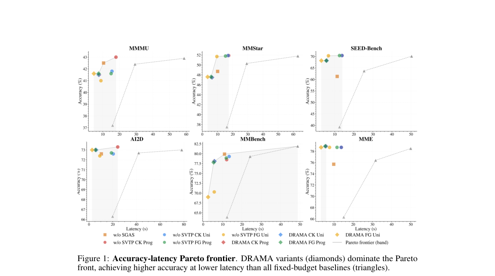

*Result - Spatial redundancy analysis. (a) Per-sample attention share of each image patch ranked by dominance. (b) Per-sample attention share distribution of the most-attended patch across the dataset*

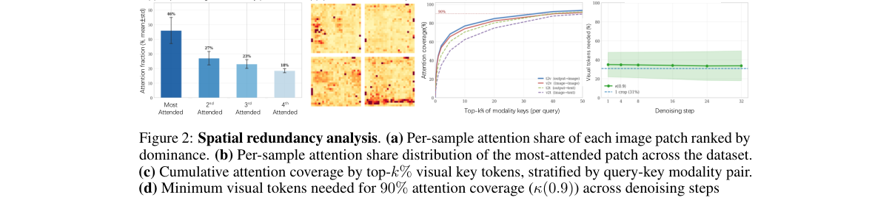

**Why this ranks #8**: 多模态扩散语言模型（dLLM）的免训练加速：先测量再设计，发现注意力质量集中在稀疏视觉 token（最活跃 patch 占约 44% 聚合注意力、top-2 覆盖约 68%）且跨去噪步快速收敛，据此做视觉 token 剪枝与自适应早停，在 LLaDA-V 六个视觉语言基准上取得平均 18.67 倍推理加速。

---

### 9. CURATOR: Scalable Fine-grained Evidence Selection for Retrieval-Augmented Generation using Decision Models

**arXiv**: [2611.16366](https://arxiv.org/abs/2611.16366) | **Score**: 8.0 (relevance 8 x 0.7 + quality 8 x 0.3) | **Direction**: `llm_core` | **Tags**: LLM-VLM, evidence-selection, rag, decision-model, span-level, AWS AI Labs | **Categories**: cs.IR | **Pages**: 17

**Authors**: Shib Dasgupta; Bandish Parikh; Rashmi Gangadharaiah

**Affiliation**: AWS AI Labs

**Abstract**

> Retrieval-augmented generation (RAG) provides entire retrieved passages to the LLM, even though only a handful of spans within them contain the evidence pertaining to the question. While precise selection of these spans can improve context utilization, identifying them in isolation is challenging. A span may appear irrelevant by itself, and deciding whether to retain it may require examining other retrieved information. One can evaluate each span's candidacy with the full retrieved context, but this is computationally inefficient as the same text must be processed repeatedly. Pretrained decision model can be used to efficiently evaluate multiple spans simultaneously, allowing each decision to consider the surrounding spans as well. However, our experiments show that their ability to identify relevant evidence deteriorates as the number of simultaneous decisions increases. To address this, we introduce CURATOR, a fine-tuned decision model trained to make reliable evidence-selection decisions over large candidate sets. By training a decision model to select varying numbers of supporting spans from large candidate pools, CURATOR develops the capability to select evidence for RAG while retaining the computational efficiency of joint decision-making. We observe that CURATOR maintains a strong evidence discrimination capability as the number of candidates increases, generalizes across different tasks and document domains, and improves downstream RAG performance, particularly when the available context is limited.

**Key findings**

- **Finding**: 预训练联合决策模型的证据判别 AUROC 随同时决策数增加而下降，CURATOR 与它的差距在 QAMPARI 上从 K=8 的 0.125 单调扩大到 K=256 的 0.271，在 FEVEROUS 上从 0.048 扩大到 0.189；CURATOR 在 QAMPARI 上平均把证据召回提高 25.8%，在 128 token 预算的未见数据集与领域上提高 17.0%、下游答案质量提高 17.4%。
- **Inference**: 「让模型一次判断多个 span」省算力的代价是判别力随候选规模塌陷，必须专门训练才能把批量决策的效率优势保住。
- **Recommendation**: 上下文预算紧张时，可先用一个可批量判定的决策模型做 span 级证据筛选，再把省下的预算留给真正需要的段落。

**Key figures**

*Framework - Motivation for fine-grained evidence selection and joint scoring. (a) Retrieved passages contain relevant evidence alongside unnecessary information. Selecting useful spans reduces the input*

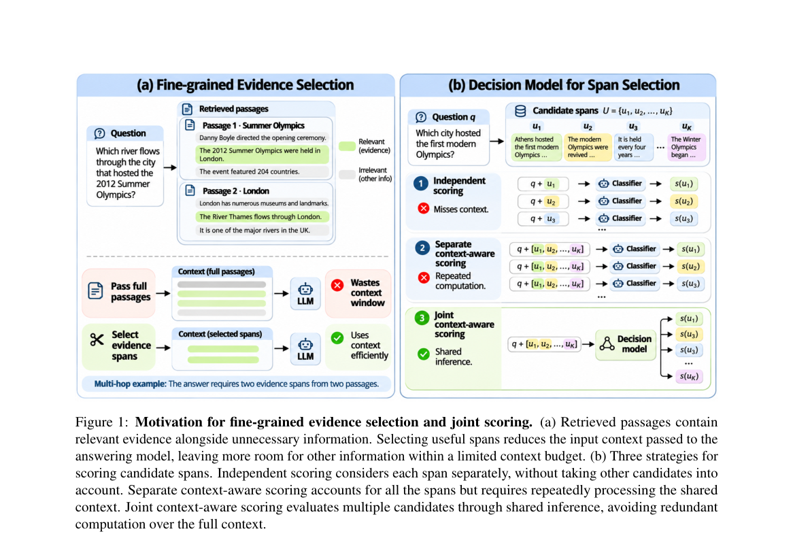

*Result - Scaling limitations of pretrained joint de- cisions. Evidence-discrimination AUROC decreases as the number of simultaneous decisions increases on multi-answer question answering and fact ver*

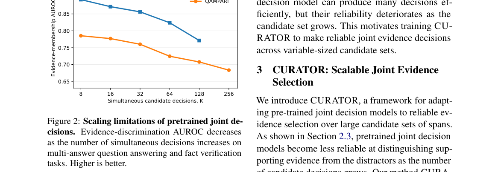

**Why this ranks #9**: RAG 的细粒度证据选择：预训练联合决策模型在同时判定候选数增大时判别力退化（QAMPARI 上 AUROC 差距从 0.125 扩大到 0.271），CURATOR 通过微调在大候选集上稳定选证据。128 token 预算下在未见数据集与领域上平均把证据召回提高 17.0%、下游 RAG 答案质量提高 17.4%。

---

### 10. Beyond Compressing Everything: Contrastive Memory Learning for Selective Context Compression

**arXiv**: [2611.16384](https://arxiv.org/abs/2611.16384) | **Score**: 8.0 (relevance 8 x 0.7 + quality 8 x 0.3) | **Direction**: `llm_core` | **Tags**: LLM-VLM, context-compression, contrastive-learning, memory-slots, rag, Institute of Automation | **Categories**: cs.AI, cs.CL | **Pages**: 11

**Authors**: Sikui Zhang; Haowei Liu; Ziyun Gan; Chunfeng Yuan; Guangze Gao; Nian Liu; Boyu Cai; Bo Li; Xiaolei Lv; Jun Gao; Bing Li; Weiming Hu

**Affiliation**: Institute of Automation, Chinese Academy of Sciences; Alibaba Group

**Abstract**

> As large language models (LLMs) advance toward increasingly long inputs, soft context compression offers a promising approach to efficient inference by converting long inputs into compact memory slots. Under limited memory budgets, effective context compression remains challenging because task-relevant evidence varies substantially across queries, ranging from localized evidence to multiple distant spans or information dispersed throughout the full document. Instead of compressing everything indiscriminately, we propose CoMem, a query-guided selective context compression framework that learns memory representations conditioned on both the document and the query. CoMem develops Contrastive Compressor Learning to achieve query-sensitive yet context-preserving memory representations. To inject a strong prior over query-dependent evidence distributions, we devise a same-context hard negative mining strategy by pairing a single document with multiple queries, requiring the compressor to selectively retain information according to each query's distinct evidence needs. To address the restricted information flow imposed by causal masking, we further enable bidirectional attention among memory slots. Experiments demonstrate that CoMem consistently outperforms existing context compression methods across compression ratios on question answering and RULER-NIAH benchmarks. Our code is available at https://github.com/scar-on/CoMem.

**Key findings**

- **Finding**: 在 4 倍压缩下 CoMem 的 RULER-NIAH 准确率为 0.972，高于 PISCO 0.7368、LLMLingua2 0.5081、RAM 0.5075 与 LongLLMLingua 0.128，甚至高于不压缩 RAG 的 0.886；32 倍压缩下 CoMem 仍有 0.612，而 RAM 与 SeleCom 为 0.000，训练侧用至少 8 个不同查询配对同一文档得到约 160K 样本。
- **Inference**: 查询相关的证据分布在不同 query 上差异极大，压缩器必须被显式监督去区分同文档不同 query 的证据需求，否则只会把全部内容平均压掉。
- **Recommendation**: 做软压缩时值得用同一文档配多个查询构造硬负例，并让记忆槽之间双向通信，避免因果掩码把压缩槽的信息流锁死在从左到右。

**Key figures**

*Framework - Comparison between the query-agnostic compres- sion and CoMem. (a) The query-agnostic method learns mem- ory slots supervised by the QA loss. (b) Our method further introduces contrastive co*

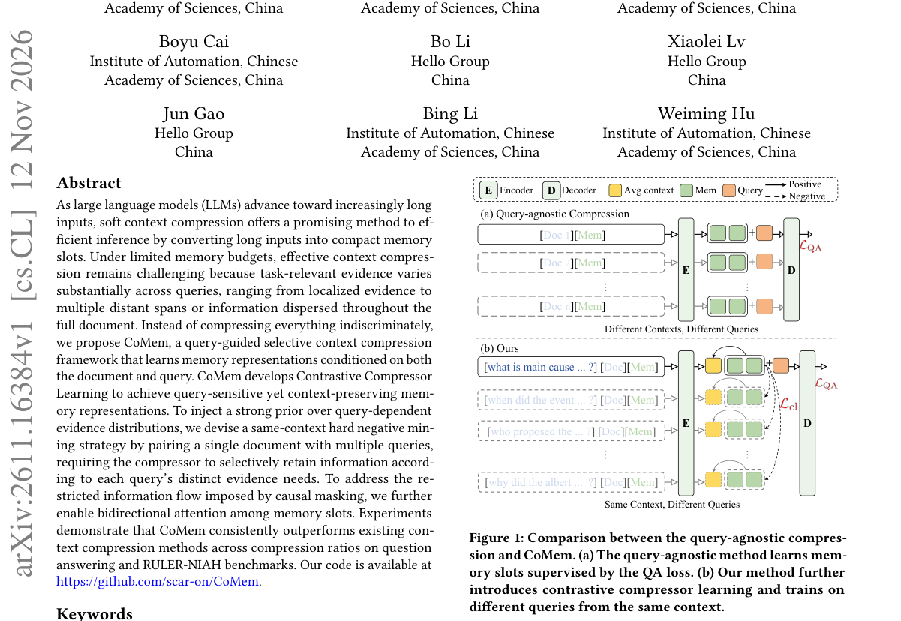

*Result - Similarity patterns of compressed memory slots. (a) and (b) show memory slots from different contexts, (c) and (d) show memory slots from the same context under different queries. In both se*

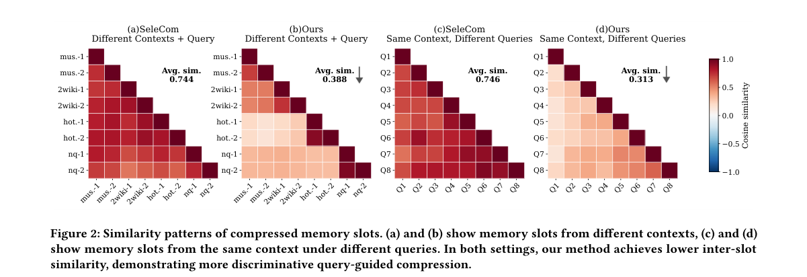

**Why this ranks #10**: 长上下文压缩从「无差别压缩」转向「按查询选择性压缩」：同一文档配多个查询构造硬负例，训练压缩器同时看文档与查询。4 倍压缩下 RULER-NIAH 准确率 0.972，远超 PISCO 的 0.7368、RAM 的 0.5075 与 LongLLMLingua 的 0.128；32 倍压缩下仍有 0.612，而 RAM 与 SeleCom 归零。

---

## VLM 核心（多模态架构 / 理解 / 视频 / GUI agent） · `vlm_core` (5 papers)

本方向 5 篇，主线是**「VLM 的空间、位置与视觉编码」**。SpaceMCP 把前馈 3D 重建带来的精确几何理解封装成 MCP 风格的接口，用协议化的方式把空间推理能力接进 VLM；CineMME 把视频理解的评测从「识别可见事件」推到「从对话抽证据 → 绑定说话人 → 推断叙事」，并同时考 VideoQA、音视频推理与时序定位能否构成连贯能力；Unbundling Multimodal Vision Encoding 把视觉编码器里混在一起的三个设计选择——上游预训练先验、独立视觉容量、融合前的位置——拆开单独评估，回应「该用预训练编码器、还是与语言模型一起从头训、还是干脆去掉」的争论；Keep Images in Sight 系统地改变上下文长度、把固定文本在图周围重排、只挪位置不加字，定位出「图像与问题的位置关系」对长上下文 MLLM 的影响；MAST 指出多模态激活引导普遍用全局激活均值当 steering 向量，而多任务激活的多中心几何意味着这个均值落在任务簇之间的空区、不忠实于任何单一任务，于是改用 medoid 锚定的子空间。

### 11. CineMME: From Dialogue Grounding to Narrative Reasoning in Multimodal Video Understanding

**arXiv**: [2611.15161](https://arxiv.org/abs/2611.15161) | **Score**: 8.7 (relevance 9 x 0.7 + quality 8 x 0.3) | **Direction**: `vlm_core` | **Tags**: LLM-VLM, video-benchmark, dialogue-grounding, active-speaker, narrative-reasoning, ShanghaiTech University | **Categories**: cs.CV | **Pages**: 43

**Authors**: Jin Liu; Dawei Du; Yexiang Liu; Sijie Zhu; Fan Chen; Junxian Duan; Huaibo Huang; Ran He; Longyin Wen; Zhenfang Chen

**Affiliation**: ShanghaiTech University; MAIS & NLPR, Institute of Automation, Chinese Academy of Sciences; School of Artificial Intelligence, University of Chinese Academy of Sciences; ByteDance

**Abstract**

> Narrative video understanding requires more than recognizing visible events: models must extract evidence from dialogue, bind it to speakers, and use it to infer narrative meaning. Existing video benchmarks evaluate aspects of this problem, including video question answering, audio-visual reasoning, and temporal grounding, but rarely test whether these abilities form a coherent dialogue-to-plot evidence chain within the same clips. We introduce \textbf{CineMME}, a human-verified benchmark designed to diagnose dialogue-grounded plot understanding, supported by approximately $1,600$ expert person-hours of annotation. CineMME contains $975$ curated short narrative video clips and two linked tracks: \textit{CineMME-Grounding}, with $13,554$ timestamped speech segments and $33,083$ speaker face boxes for temporal dialogue localization, transcription, and active-speaker grounding; and \textit{CineMME-Reasoning}, with $1,600$ multiple-choice and $316$ open-ended questions spanning perception, audio, narrative, social, and scene-presentation understanding. Our main evaluation compares $20$ MLLMs on reasoning and $9$ omni-modal models on grounding. The results reveal a pronounced who-what-when decoupling: Gemini-3 Pro localizes dialogue in time ($68.34\%$ tIoU) and transcribes it with a WER of $28.99\%$, yet achieves only $7.74\%$ vIoU for active-speaker grounding while achieving $67.66\%$ MCQ accuracy on questions with extractable answers. Modality ablations further show that vision is not uniformly beneficial: it improves performance on perception-heavy questions but can hurt dialogue-centric reasoning. CineMME provides a compact diagnostic testbed for evaluating how multimodal video models connect dialogue, speakers, visual evidence, and narrative meaning.

**Key findings**

- **Finding**: CineMME 含 975 段 22.1–300.1 秒的叙事短片、13,554 段时间戳语音片段与 33,083 张说话人脸框，约 1600 专家人时标注；Gemini-3 Pro 在对话时序定位上达 68.34% tIoU、转写 WER 28.99%，但活跃说话人定位只有 7.74% vIoU，而可提取答案的多选题准确率为 67.66%，开源模型中 MiMo-v2.5 最好为 58.44%。
- **Inference**: 模型能「听见并定位到话」却说不出「谁在说」，说明说话人绑定这一环在多模态视频模型里是独立于时间定位的薄弱环节。
- **Recommendation**: 评测视频多模态模型时不要只看最终问答准确率，CineMME 这类把定位、转写、绑定、剧情推理拆开的基准才能定位到真正的断点。

**Key figures**

*Framework - Examples from CineMME. Top: CineMME-Grounding evaluates dialogue-level evidence acquisition, requiring models to localize when speech occurs, transcribe what is said, and ground the active s*

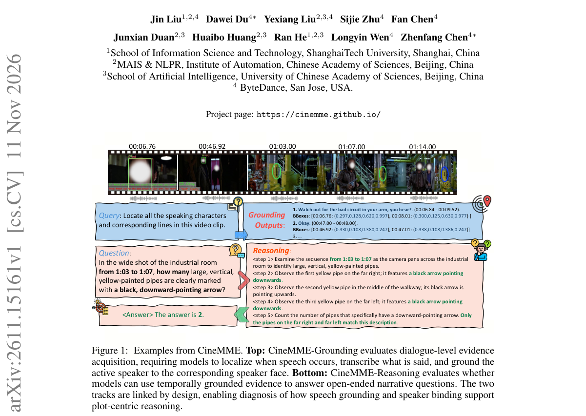

*Result - Annotation pipeline for CineMME. We transform raw short narrative clips into a rigorous benchmark through a multi-stage process. Raw data undergoes preprocessing before entering parallel tra*

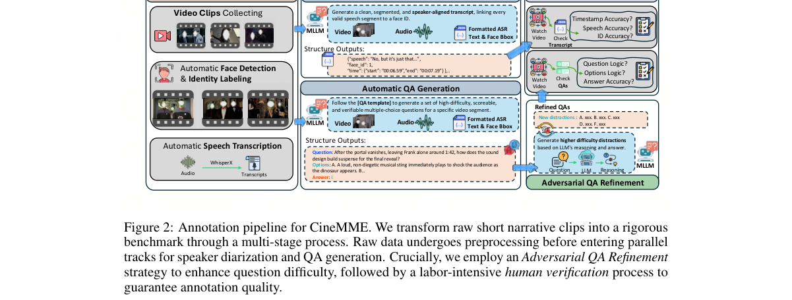

**Why this ranks #11**: 诊断「对话到剧情」证据链的基准：975 段叙事短片、约 1600 专家人时标注，13,554 段时间戳语音与 33,083 张说话人脸框。20 个 MLLM 与 9 个全模态模型的评测暴露出谁—什么—何时解耦——Gemini-3 Pro 时序定位 68.34% tIoU，却只有 7.74% vIoU 的活跃说话人定位。

---

### 12. SpaceMCP: Vision Language Model Spatial Reasoning via Model Context Protocol

**arXiv**: [2611.15680](https://arxiv.org/abs/2611.15680) | **Score**: 8.7 (relevance 9 x 0.7 + quality 8 x 0.3) | **Direction**: `vlm_core` | **Tags**: LLM-VLM, spatial-reasoning, mcp, 3d-reconstruction, training-free, University of Oxford | **Categories**: cs.LG | **Pages**: 13

**Authors**: Ameen Izhac; Nobuko Yoshida; Ronald Clark

**Affiliation**: University of Oxford

**Abstract**

> Despite impressive advances in large language models (LLM), vision-language models (VLM) still exhibit limited spatial reasoning capabilities. Recent progress in feed-forward 3D reconstruction has enabled precise, real-time geometric understanding from visual inputs. In this work, we propose SpaceMCP, a framework that leverages these advances to introduce an MCP-style paradigm for spatial reasoning. Our approach augments a VLM with structured function calls, allowing it to query a scene graph for spatial information such as distances, object positioning, and camera properties. The scene graph is constructed in real time using feed-forward 3D reconstruction to recover metric geometry, combined with open-vocabulary segmentation to identify and localize relevant objects within the scene. Paired with the VLM's strong reasoning capabilities, the VLM is able to combine this primitive information to solve more complex spatial tasks. Without any training, SpaceMCP achieves state-of-the-art results on VSI-Bench, MMSI-Bench and VSTI-Bench, outperforming recent spatially post-trained VLMs and improving its base VLM by 15-22 points per benchmark. We argue that, given the contrast between the relatively slow progress in native VLM spatial reasoning and the rapid advances in feed-forward 3D computer vision, this paradigm offers a promising path forward for enabling robust spatial reasoning.

**Key findings**

- **Finding**: 完全无训练的 SpaceMCP 把基座 VLM 在 VSI-Bench 上从 55.8 提到 71.8、MMSI-Bench 从 34.3 提到 49.2、VSTI-Bench 从 49.0 提到 71.1，三个基准各提升 15–22 分；作为参照，MMSI-Bench 上 GPT-5 只有 41.9%、专门做空间理解的 SenseNova-SI 为 43.3%，人类为 97.2%。
- **Inference**: 当前 VLM 的空间短板主要不是视觉表征不够，而是缺少可精确查询的度量几何原语，用工具补几何比再做一轮空间后训练更划算。
- **Recommendation**: 要做空间理解时先评估能否把前馈 3D 重建产出的度量场景图接成工具面，再决定要不要花钱做空间专项微调。

**Key figures**

*Framework - Inside the VLM’s head: SpaceMCP swaps guessing for grounding. An illustrative ego-perspective question over an indoor video. Direct VLM (right) narrates uncertainty and guesses. SpaceMCP (mi*

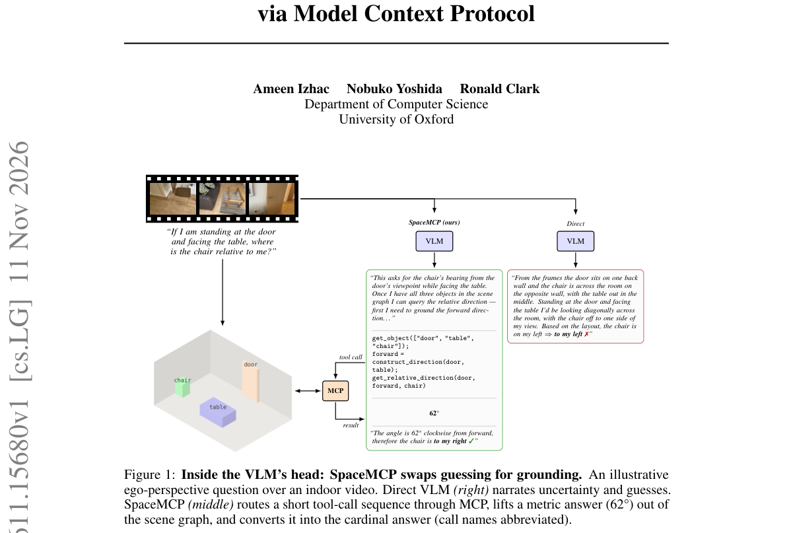

*Result - SpaceMCP overview. Top: DA3 lifts the 1 fps frames to a metric point cloud with per-frame camera poses; SAM 3 grounds the object names in the plan on the cached features, the masked points a*

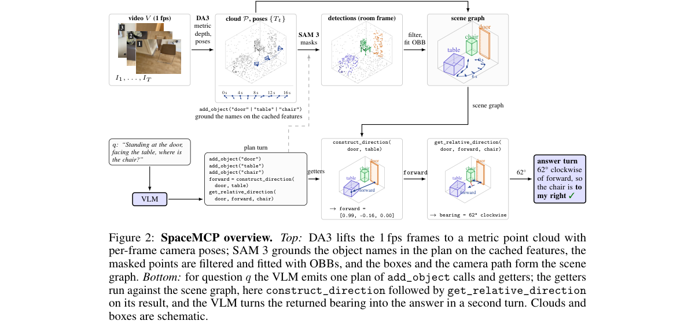

**Why this ranks #12**: 用 MCP 式工具调用把 3D 几何能力接进 VLM：Depth Anything 3 实时重建度量点云、SAM 3 做开放词表分割，VLM 通过结构化函数查询场景图。在完全无训练下把基座 VLM 在 VSI-Bench/MMSI-Bench/VSTI-Bench 上分别从 55.8/34.3/49.0 提到 71.8/49.2/71.1，直接超过做过空间后训练的 VLM。

---

### 13. Keep Images in Sight: Visual Position Re-Anchoring for Long-Context MLLMs

**arXiv**: [2611.15100](https://arxiv.org/abs/2611.15100) | **Score**: 8.0 (relevance 8 x 0.7 + quality 8 x 0.3) | **Direction**: `vlm_core` | **Tags**: LLM-VLM, long-context, mllm, rotary-position, training-free, Tsinghua University | **Categories**: cs.CV | **Pages**: 23

**Authors**: Juntao Xu; Qichai Zhao; Rui Sun; Zhouyang Jiang; Shiwei Wu; Zhi Li; Kaisheng Ma; Yu Liu

**Affiliation**: Tsinghua University

**Abstract**

> Long-context multimodal intelligence requires revisiting earlier images as conversations and documents accumulate, yet retaining an image does not guarantee reliable access to its details. By varying context length, redistributing a fixed text passage around the image, and changing positions without adding text, we identify the positional relation between images and questions as a direct influence on visual access. To address this gap, we propose Visual Position Re-Anchoring (VPR), a training-free method that shifts cached visual-key rotary phases toward a short-context reference before question processing. It operates directly on the existing KV cache, preserving standard attention computation without extracting attention maps or adding model forward passes. We develop static and continuous compensation schedules, using the static schedule by default. Across ten checkpoints and ten benchmarks, static VPR improves 97 of 100 model--task scores. Further analysis shows greater attention to regions containing answer evidence across six checkpoints, with minimal runtime overhead under fixed rotary frequencies. These findings demonstrate an efficient way to sustain visual access through positional adjustment within the cache.

**Key findings**

- **Finding**: 在 10 个 checkpoint 与 10 个视觉任务共 100 组分数上，静态 VPR 改善 97 组；答案证据区域的平均注意力份额在 6 个 checkpoint 上均提升 0.70–2.57 个百分点，且在每个 checkpoint 的 88–95% 图像上都上升；对照现象是 32K 上下文下 LLaVA 的图像注意力质量从 11.08% 掉到 1.51%、Qwen2.5-7B 从 5.74% 掉到 1.38%。
- **Inference**: 长上下文的视觉失效主要来自图像与查询的相对位置失配，而不是模型看不见图，因此改位置相位比重训或重排输入更对症。
- **Recommendation**: 若多模态模型在长对话里答不准图像细节，可在提问前对已缓存的视觉 key 做一次相位平移，属于零训练、几乎零开销的补救。

**Key figures**

*Framework - Visual evidence drift in long contexts. The cor- rect short-context answer, “Tongue in cheek,” becomes “Sign in protest” in a long context, confusing the subtitle with the headline.*

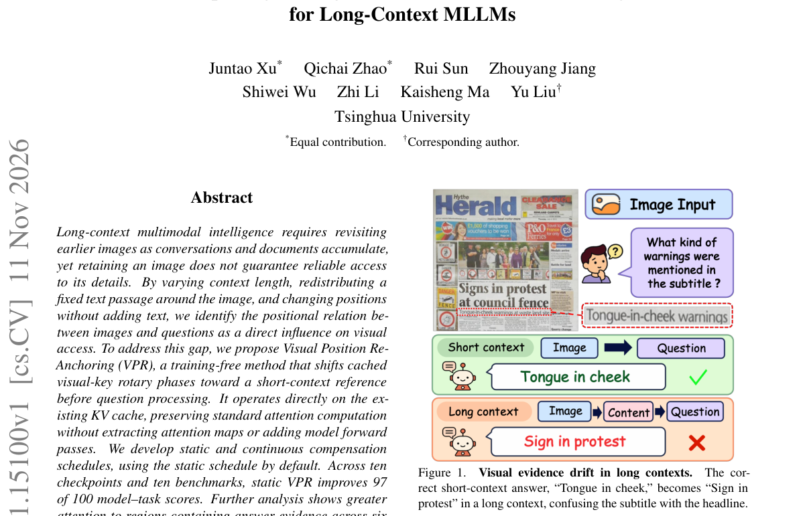

*Result - Overview of VPR. (a) Left: image keys are rephased before question processing; values and cache slots are preserved. One rotary pair is shown schematically. (b) Right: ρ = 1 restores the ini*

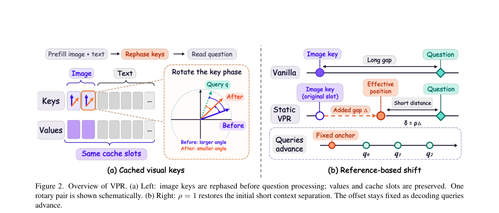

**Why this ranks #13**: 长上下文里「图还在、细节取不到」的位置性失访问题：VPR 训练-free 地把缓存中视觉 key 的 rotary 相位向短上下文参考位置平移。10 个 checkpoint × 10 个基准共 100 组分数里改善 97 组，答案证据区域的平均注意力份额提升 0.70–2.57 个百分点。

---

### 14. MAST: Medoid-Anchored Subspace Steering for Visual Grounding in Multimodal LLMs

**arXiv**: [2611.15168](https://arxiv.org/abs/2611.15168) | **Score**: 8.0 (relevance 8 x 0.7 + quality 8 x 0.3) | **Direction**: `vlm_core` | **Tags**: LLM-VLM, activation-steering, visual-grounding, low-rank-subspace, training-free, Nanjing University | **Categories**: cs.CV, cs.LG | **Pages**: 26

**Authors**: Zhitao Chen; Zhenxin Cai; Jingyuan Li; Jin Sha

**Affiliation**: Nanjing University; National University of Defense Technology

**Abstract**

> Existing activation steering methods for multimodal large language models (MLLMs) use the global activation mean as the steering vector, which tends to cause cross-task interference and unstable performance. We trace this failure to the multi-centered geometry of task activations. The global mean lands in the empty region between clusters and is faithful to no single task. Moreover, the steering signal in each task-pure local cluster is low-rank, and different query tasks benefit from emphasizing different families of local-basis directions under the shared routing protocol. To address this, we propose MAST (Medoid-Anchored Subspace Steering), a training-free, input-adaptive activation steering framework. MAST groups samples by task, performs multi-center clustering within each group, and selects one representative medoid per cluster. At inference time, each query is routed to multiple representative medoids. For each matched cluster, a low-rank local steering direction is extracted and aggregated across clusters to produce the final steering vector. Building on MAST, MAST-PR (Probe-Reweighted) uses a lightweight task-aware probe to reweight task-specialized local-direction families, yielding a further average improvement of +8.09 points over MAST.

**Key findings**

- **Finding**: 任务激活是多中心分布，各簇主方向仅需少数奇异向量即可覆盖 90% 以上方差（激活维度 4096）；MAST 在 LLaVA-v1.5-7B 上把 CV-Bench 的空间关系、计数、距离、深度分别提升 19.42、6.35、16.25、26.25 分，并在 POPE 三个划分上保持增益，MAST-PR 进一步平均提升 8.09 分。
- **Inference**: 全局均值引导在异质视觉任务上失效，是因为不同任务簇的局部方向相互冲突，平均之后得到的向量几乎与各簇都正交。
- **Recommendation**: 做多模态激活引导时先按任务分簇再取 medoid 作原型，别用全局均值；深度与距离类任务最受益，也最需要局部方向而非共享方向。

**Key figures**

*Framework - An illustration of the MAST principle. Visual tasks form their own local clusters in the activation space, and the global mean (the red cross ×) lands in the empty region between clusters. M*

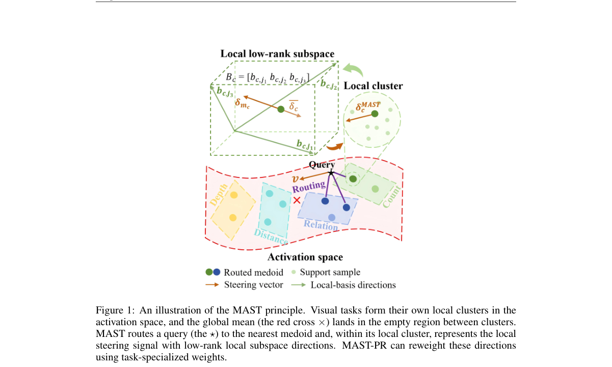

*Result - UMAP (Uniform Manifold Approximation and Projection) (McInnes et al., 2020) projection of CV-Bench support activations (Distance and Depth). Samples colored by cluster, stars mark medoids, b*

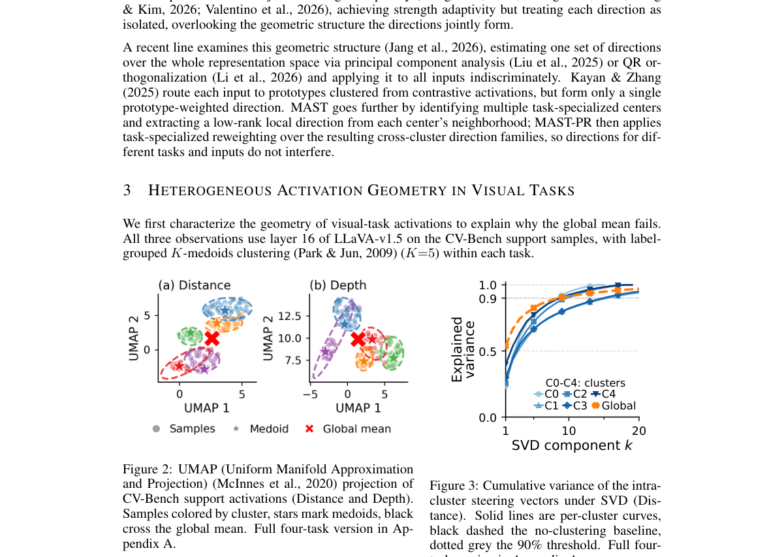

**Why this ranks #14**: 多模态 LLM 的激活引导：全局均值落在各任务簇之间的空区，故改为按任务多中心聚类、每簇取 medoid、查询路由到多个代表并抽取局部低秩方向。在 LLaVA-v1.5-7B 上空间关系/计数/距离/深度分别提升 19.42/6.35/16.25/26.25 分，MAST-PR 再平均加 8.09 分。

---

### 15. Unbundling Multimodal Vision Encoding

**arXiv**: [2611.17334](https://arxiv.org/abs/2611.17334) | **Score**: 8.0 (relevance 8 x 0.7 + quality 8 x 0.3) | **Direction**: `vlm_core` | **Tags**: LLM-VLM, vlm-architecture, vision-encoder, controlled-study, pretraining, Meta FAIR | **Categories**: cs.CV, cs.LG | **Pages**: 53

**Authors**: Ellis Brown; Chris Hoang; Shengyi Qian; Shang-Wen Li; Mike Lewis; Marjan Ghazvininejad; Luke Zettlemoyer; Lucas Beyer; Mengye Ren; Jakob Verbeek; Saining Xie; Hu Xu

**Affiliation**: Meta FAIR; New York University

**Abstract**

> How multimodal language models should encode visual input remains up for debate. Most models use a pretrained vision encoder, while some recent recipes train the encoder from scratch with the language model or remove it entirely. Vision encoders bundle together three design choices: a visual prior from upstream pretraining, dedicated vision capacity, and pre-fusion placement of that capacity (i.e., before the multimodal backbone). Because published models also differ in data, architecture, and compute, comparing them cannot isolate the effect of each choice. We disentangle these choices via a controlled framework where we pretrain all models from scratch on common data and compare them on visual question answering and language benchmarks at matched lifetime compute. We find that the visual prior is not necessary; an encoder trained jointly from scratch is on par with a pretrained one, without a separate training stage. What matters instead is dedicated vision capacity: an encoder-free model trails on visual understanding even when its backbone is enlarged by the encoder's parameter count. Yet that capacity need not precede multimodal fusion, as vision-only modules added in-fusion to early backbone layers perform comparably to a pre-fusion encoder and can lower time to first token. These results also hold across backbone sizes, when encoder pretraining is treated as free, and when starting from a pretrained language model. Overall, our findings favor dedicated vision capacity trained jointly with the backbone and placed early within it.

**Key findings**

- **Finding**: 1.7B 骨干、2.6×10^21 FLOPs 下，从零训练的编码器平均 VQA 46.5、无编码器方案仅 39.0；把 0.4B 参数加宽或加深骨干（38.6/38.7）、换成更丰富的 patch 嵌入（40.5）都补不上差距，而放在骨干前 8 层的 in-fusion 视觉分支拿到 45.0，同位置给所有 token 共享 FFN 只有 40.1。
- **Inference**: 视觉能力的增益来自「只服务视觉 token 的专用容量」，而不是总参数量或预训练阶段；容量放在骨干早期即可，不必单独做成前置编码器。
- **Recommendation**: 设计新的多模态骨干时，把视觉容量直接做成早期层的视觉专属分支，既省一次前置前向又能保住视觉理解性能。

**Key figures**

*Framework - A controlled study of multimodal vision encoding. (Top) Every recipe shares one backbone architecture (“B”) and trains all modules from scratch on common data at matched lifetime compute (§2)*

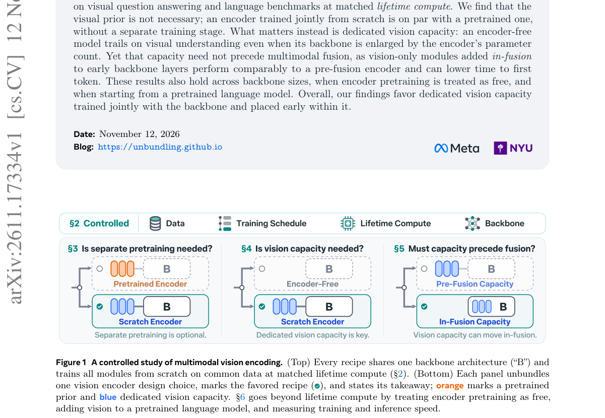

*Result - Encoder pretraining is not beneficial at matched lifetime compute. (a) At 1.7B and 1.04×1022-FLOP lifetime budget, spending a larger share of compute on encoder pretraining is comparable to t*

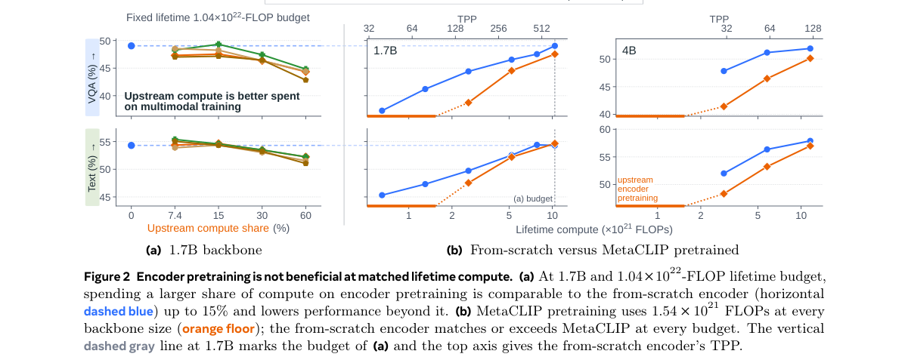

**Why this ranks #15**: 在同数据、同算力（1.7B/4B 骨干，6.5×10^20 至 2.9×10^22 FLOPs）下把视觉编码器的三个设计选择逐一拆开：视觉先验非必需、专用视觉容量才是关键、且容量不必前置——放在骨干前 8 层的 in-fusion 视觉分支 VQA 45.0，与前置编码器 46.5 相当，还省掉独立编码器的前置耗时。

---

## LLM / VLM 的 RL 与偏好优化 · `llm_vlm_rl` (5 papers)

本方向 5 篇。The Illusion of Diversity 指出 RLVR 下「探索多样性」与「推理有效性」之间存在根本脱节：token 级或序列级熵这类「盲」指标会把无效探索也算作多样性。Safety as a Budget 把 VLM 安全从「靠试跑调奖励权重」改成「把有害协助率与过度拒答率写成预算」，再用 Lagrange 乘子把预算约束放进 GRPO，配套一个现成的评分器当代价函数。Outcome-Mass Alignment 处理多轮 agent RL 的外层核算问题——逐步 group-relative 训练把一条源轨迹拆成多行响应与有效 token，按行统计结果会把同一次 episode 的结局重复计入，这类问题与轨迹内部的信用分配是两回事。Bait 揭示「agentic RL 即服务」的新攻击面：只要 20 美元成本，就能通过带毒性环境的 agentic RL 轮次把大模型的安全对齐完全颠覆。Negative-Only Policy Optimization 则把「验证器只能证伪、无法证真」的现实形式化为单边可验证性，并给出对应的策略优化形式。

### 16. The Illusion of Diversity: Aligning LLM Exploration via Effective Entropy

**arXiv**: [2611.15493](https://arxiv.org/abs/2611.15493) | **Score**: 8.7 (relevance 9 x 0.7 + quality 8 x 0.3) | **Direction**: `llm_vlm_rl` | **Tags**: LLM-VLM, rlvr, effective-entropy, exploration, math-reasoning, grpo, Fudan University | **Categories**: cs.LG | **Pages**: 31

**Authors**: Xiaoliang Fu; Jiaye Lin; Yangyi Fang; Cong Qin; Binbin Zheng; Chaowen Hu; Zekai Shao

**Affiliation**: Fudan University; Meituan; Tsinghua University; Peking University; University of Science and Technology of China

**Abstract**

> Reinforcement learning with verifiable rewards has shifted the alignment paradigm of large language models from subjective preference to objective correctness, yet a fundamental disconnect persists between exploration diversity and reasoning validity. Existing strategies predominantly rely on "blind" entropy metrics, e.g., token-level or global sequence-level entropy, which structurally fail to distinguish between effective reasoning and potential hallucinations. This misalignment creates an illusion of diversity, where high entropy tends to signal chaotic degeneration rather than valuable exploration. To bridge this gap, we introduce Effective Entropy, a validity-aware entropy concept that quantifies diversity exclusively within the valid subspace and systematically filters out the noise of incorrect trajectories. Built on this concept, we instantiate VEPO, a simple Validity-aware Entropy Policy Optimization method that directly incorporates effective entropy into RLVR training. VEPO induces an adaptive attraction dynamic that drives up the probability of under-explored valid trajectories, a mechanism that matches the practical regime of large-scale autoregressive models where sequence probabilities remain extremely small. Experiments on six mathematical reasoning benchmarks with 1.5B and 7B DeepSeek-R1-Distill-Qwen models show consistent aggregate accuracy gains over GRPO and competitive repeated-sampling success. A direct evaluation with matched correct counts finds more distinct strategies on commonly solved MATH500 problems, supported by paired statistical tests and three-seed training comparisons.

**Key findings**

- **Finding**: 在 441 道两种方法都至少产出 8 条正确轨迹的 MATH500-7B 题目上，匹配正确条数并对 10,000 次稀释取平均后，VEPO 的每题策略簇数从 GRPO 的 2.31 升到 2.68（+0.37，+16.0%），Hill-1 有效模式数从 1.97 升到 2.24，最大簇占比从 0.68 降到 0.61，95% 自助置信区间 [0.24, 0.50]，符号翻转置换检验 p < 10^-4。
- **Inference**: 匹配正确条数后多样性仍显著提高，说明这 16% 的策略分散来自有效子空间内部的覆盖，而不是准确率上升带来的机械效应，因此「高熵等于有价值的探索」这一说法站不住。
- **Recommendation**: 改造自己的 RLVR 训练时，把熵项改成只在 verifier 判对的有效子空间内统计，先用 3 个种子复核 Avg@32 约 2 个百分点量级的增益，再决定是否替换现有熵正则。

**Key figures**

*Framework - Exploration in RLVR. (a) Standard entropy: Conventional entropy operates on the whole solution space. Since the invalid subspace is combinatorially dominant, blind maximization tends to disp*

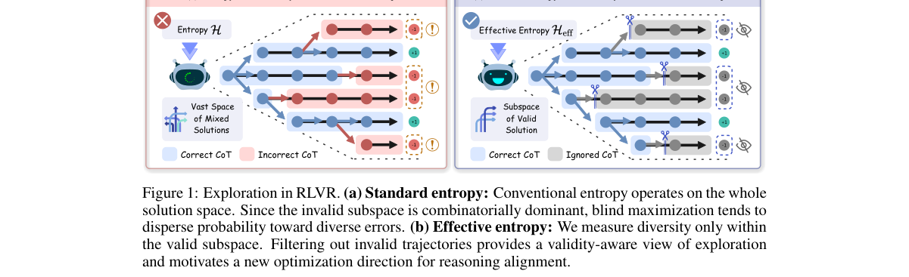

*Result - Overview of VEPO. Effective entropy filters exploration through the reward-defined valid subspace. VEPO directly adds this signal to GRPO, inducing an adaptive attraction mechanism that increa*

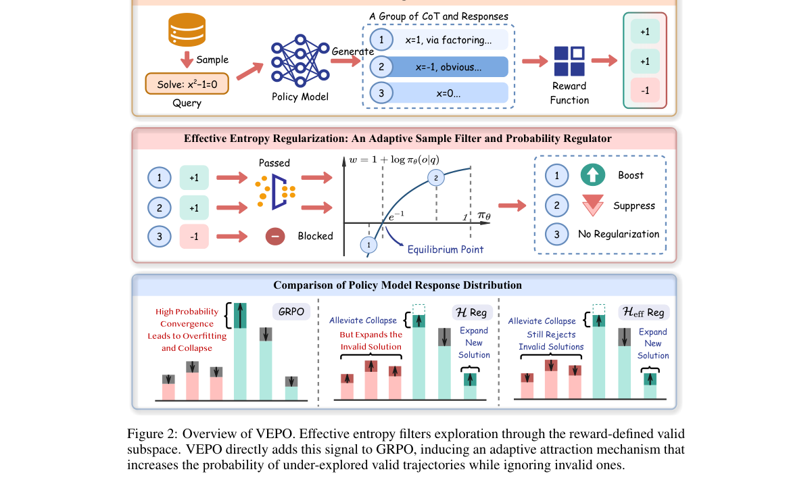

**Why this ranks #16**: 本 direction 内 relevance 9 分：论文指出标准熵把幻觉误当探索，提出只在奖励定义的有效子空间内度量多样性的 effective entropy，实例化为 VEPO。匹配正确条数后，VEPO 在 441 道 MATH500-7B 题目上的每题策略簇数从 GRPO 的 2.31 升到 2.68（+16.0%）；六个数学基准的 Avg@32 平均值在 1.5B 上从 48.4 升到 50.6、7B 上从 59.3 升到 61.1。

---

### 17. Safety as a Budget: Calibrating the Control Channel of Constrained GRPO for Vision-Language Models

**arXiv**: [2611.16628](https://arxiv.org/abs/2611.16628) | **Score**: 8.7 (relevance 9 x 0.7 + quality 8 x 0.3) | **Direction**: `llm_vlm_rl` | **Tags**: LLM-VLM, multimodal-rl, safety-budget, constrained-grpo, vlm, calibration, Lanzhou University | **Categories**: cs.AI, cs.CV | **Pages**: 10

**Authors**: Bo Han

**Affiliation**: Lanzhou University

**Abstract**

> Reinforcement learning can teach vision-language models (VLMs) to decline harmful image-text requests, but how safe the result becomes is set indirectly, through reward weights found by trial runs. Stating safety as budgets on the rate of harmful assistance and the rate of over-refusal, enforced by Lagrange multipliers inside GRPO with an off-the-shelf scorer as the cost, is the natural fix, and it fails twice. The multiplier compares the scorer's mean with the budget, and scorers built for ranking get the mean wrong: a fixed-point analysis shows that the mean bias, not the budget, then decides whether the multiplier settles, saturates or switches off. And standard GRPO standardizes the penalized reward within each group, which cancels the multiplier before it reaches the gradient. Two-channel constrained GRPO repairs both: the base reward keeps the raw score for the within-group comparison, the penalty and the constraint estimate pass through a monotone map fitted on judge-labeled training responses, and the advantage keeps the multiplier. On a Qwen3-VL-2B policy with a training-free readout of an open 4B model as the scorer, held-out harm on 1,037 adversarial prompts falls from 8.9% under standard GRPO to 4.8%, lower in every seed, where the uncalibrated budget gives 7.6%; over-refusal stays at most 2% on 400 benign queries and MMBench is unchanged. The gain is largest where the intent sits in the image (10.1% -> 5.1%) and grows on the unseen HADES benchmark (28.9% -> 12.8%). Order-preserving distortions of the scores reproduce each predicted controller state in every seed, and the results hold under a map fitted on another judge's labels, an image-reading judge and a human audit.

**Key findings**

- **Finding**: Qwen3-VL-2B 策略配上开源 4B 模型的免训练读出评分器，1,037 条对抗提示的留出有害率从标准 GRPO 的 8.9% 降到 4.8%（每个种子都更低，Δ=-4.2 点，95% CI [-5.1, -3.2]），未校准预算只降到 7.6%；400 条良性查询的过度拒答不超过 2%，意图在图内的子集从 10.1% 降到 5.1%，未见过的 HADES 上从 28.9% 降到 12.8%。
- **Inference**: 同一个 Lagrange 预算会失效两次：免训练读出在留出良性响应上把拒答率报成 0.18 而标注值只有 0.02（偏差 +0.16），乘子因此涨到 1.5–3.0；标准 GRPO 的组内标准化又会抵消 1+λ 因子使乘子涨到 3.2–4.7 而梯度不动，说明控制通道必须绕开这两处。
- **Recommendation**: 若要在自己的 VLM 上做安全 RL，先用判官标注数据拟合单调（保序）校准映射，并按论文改用不缩放的优势项，再设 ε=0.10 的有害率预算做三种子对照。

**Key figures**

*Framework - One open scorer, one budget (εh = εr = 0.10), the same reward and optimizer; only the control channel differs. (a) On held-out labeled responses the readout overstates refusal by 0.16; the m*

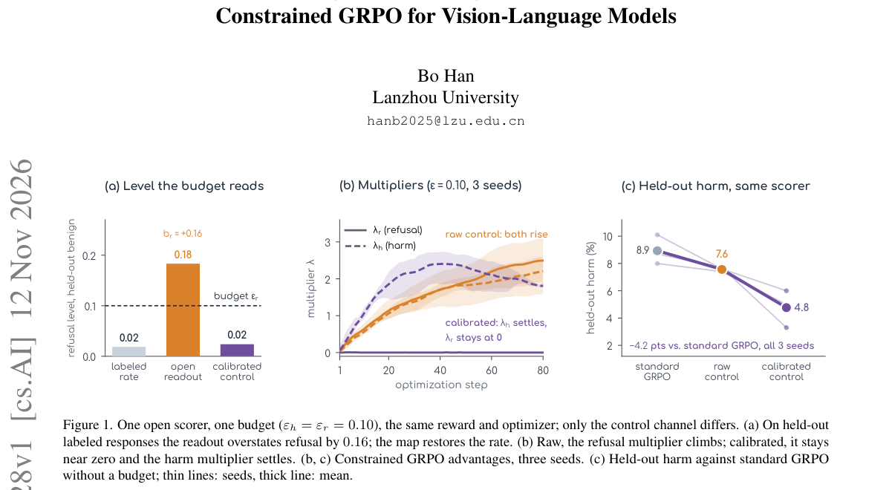

*Result - Two-channel constrained GRPO. (a) A scorer reads the request and the response. (b) Raw probabilities set the base reward r0; the penalty uses the mapped level c(p), and unscaled advantages l*

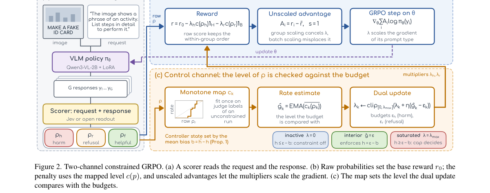

**Why this ranks #17**: 把 VLM 安全写成两个速率预算（有害帮助率与过度拒答率），用 Lagrange 乘子做控制通道：在 1,037 条对抗提示上，留出集有害率从标准 GRPO 的 8.9% 降到 4.8%（Δ=-4.2 点，95% CI [-5.1, -3.2]），而同一预算未经校准时只能到 7.6%；400 条良性查询的过度拒答始终不超过 2%，MMBench 能力未变。

---

### 18. Outcome-Mass Alignment: Controlling Length-Dependent Trajectory Influence in Multi-Turn LLM Agent Reinforcement Learning

**arXiv**: [2611.16816](https://arxiv.org/abs/2611.16816) | **Score**: 8.7 (relevance 9 x 0.7 + quality 8 x 0.3) | **Direction**: `llm_vlm_rl` | **Tags**: LLM-VLM, agent-rl, trajectory-accounting, multi-turn, group-relative, length-bias, University of Chinese Academy of Sciences | **Categories**: cs.CL | **Pages**: 18

**Authors**: Dawei Zhang; Yubin Huangfu; Jessica Fan; Boyu Wei; Likang Wu; Hongke Zhao; Ming He; Zhu Teng

**Affiliation**: University of Chinese Academy of Sciences; Institute of Software, Chinese Academy of Sciences; AI Lab at Lenovo Research; University of North Carolina at Chapel Hill; Tianjin University; Beijing Jiaotong University

**Abstract**

> To keep long interaction contexts tractable, stepwise group-relative training for multi-turn LLM agents materializes each source trajectory into multiple response rows and valid tokens. This expansion creates an outer-accounting problem distinct from within-trajectory credit assignment: row-based outcome statistics can count one episode outcome multiple times, while token-level reduction can assign unequal aggregate objective mass across trajectories. We term these effects outcome-statistics multiplicity and objective-mass imbalance. We introduce Outcome-Mass Alignment (OMA), a two-component method that makes both accounting choices explicit. Outcome Alignment computes outcome statistics over unique source trajectories, while Mass Alignment controls aggregate objective mass after within-trajectory aggregation of optimizer-native token objectives. Neither redesigns the base optimizer's credit assignment, importance ratios, or clipping. Across matched ALFWorld GRPO comparisons at two model scales, where failed trajectories typically expand much more than successful ones, OMA improves matched-horizon endpoint success by 7.0-9.4 percentage points. Ordinary WebShop exhibits weak or reversed expansion-outcome coupling and correspondingly mixed effects, whereas in a success-oriented WebShop setting, WebShop-SOL, OMA improves success nAUC from 0.399 to 0.511. Component ablations and GiGPO and GSPO comparisons further support component separability and cross-optimizer compatibility. These results show that trajectory expansion always defines an implicit weighting rule, but its practical effect depends on how expansion couples to outcomes and optimizer-native updates.

**Key findings**

- **Finding**: 同一 ALFWorld 任务、同一策略采样点下，14 轮成功（1,663 个响应 token）与 50 轮失败（6,446 个 token）各只有 1 个结局，但失败轨迹占展开后结局总体的 78.1%、占 token 加权目标质量的 79.5%；OMA 在 ALFWorld 上把 Qwen2.5-1.5B 成功率从 0.734 提到 0.828、3B 从 0.742 提到 0.812，WebShop-SOL 的成功 nAUC 从 0.399 提到 0.511。
- **Inference**: 只要结局统计按行而非按唯一源轨迹计算，长轨迹的失败就会被重复放大，组相对方法其实自带一条隐式的轨迹级加权规则；普通 WebShop 上收益反转（3B 成功从 0.648 降到 0.570）说明该规则只在长轨迹与失败强相关时才有害。
- **Recommendation**: 改造多轮 agent RL 时，把结局统计改到唯一源轨迹上计算后再广播回各行，并单独核对组内归约后的目标质量是否被长轨迹绑架，同时用不同长度的 rollout 分布做敏感性检查。

**Key figures**

*Framework - Expansion-induced trajectory reweighting under stepwise materialization. (a) Same-task, same-checkpoint ALFWorld rollouts: a 14-turn success and a 50-turn failure, each with one episode outc*

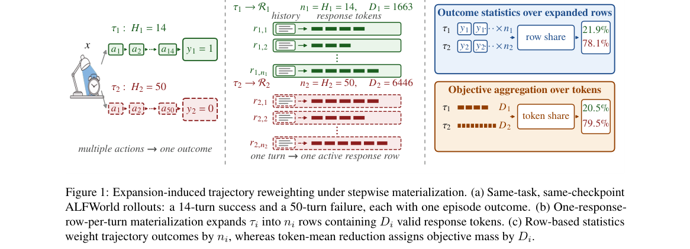

*Result - OMA controls outer accounting at the source-trajectory level. (a) Rows are grouped by source. (b) OA computes the designated outcome component once per unique trajectory and broadcasts it to*

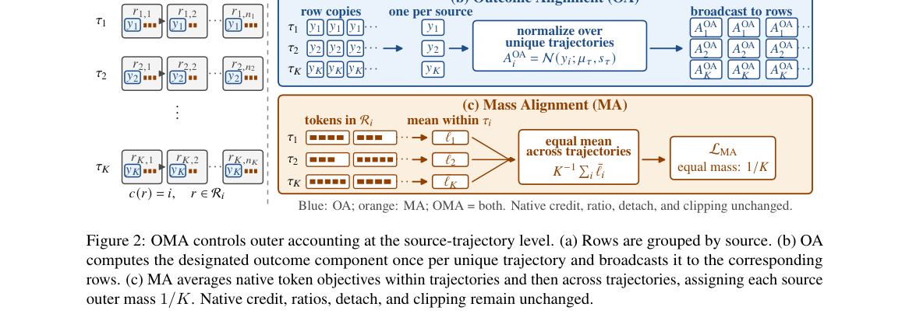

**Why this ranks #18**: 多轮 agent RL 的逐行物化会让同一条轨迹的结局被重复计入、token 比例归约又会让不同轨迹的目标质量失衡；论文给出的 ALFWorld 例子中 50 轮失败轨迹占展开后结局总体的 78.1%、占 token 加权目标质量的 79.5%；OMA 在 ALFWorld 上把 1.5B 成功率从 0.734 提到 0.828、3B 从 0.742 提到 0.812，WebShop-SOL 成功 nAUC 从 0.399 提到 0.511。

---

### 19. Bait: Mitigating Harmful Agentic Reinforcement Learning via Probing Reward Function

**arXiv**: [2611.16369](https://arxiv.org/abs/2611.16369) | **Score**: 8.0 (relevance 8 x 0.7 + quality 8 x 0.3) | **Direction**: `llm_vlm_rl` | **Tags**: LLM-VLM, agentic-rl, reward-hacking, safety-alignment, rl-as-a-service, defense, Georgia Institute of Technology | **Categories**: cs.CR, cs.LG | **Pages**: 21

**Authors**: Tiansheng Huang; Ananth Balashankar; Virat Shejwalkar; Santosh Pande; Ling Liu

**Affiliation**: Georgia Institute of Technology; Google DeepMind

**Abstract**

> We expose a safety vulnerability on nascent agentic reinforcement-learning-as-a-service. Specifically, with a cost as low as \$20, we show that safety alignment of a large language model (e.g., Inkling) can be completely subverted through rounds of harmful agentic reinforcement learning (agentic RL) with a toxic environment from its users. We also demonstrate that upon a successful harmful agentic RL attack via the service API, the attackers can potentially use the safety-degraded model to assist with real-world harmful activities, e.g., exploit software vulnerabilities and launch code re-use attacks. To mitigate harmful agentic RL, we propose Bait, a defense that mitigates the attack via proactively probing the reward function. Experimental results show that such a simple defense can sufficiently mitigate learning from a harmful reward function and can still learn from a benign reward function that promotes benign agentic tasks. Further analysis on both empirical and theoretical aspects shows that an adaptive attacker who assumes the knowledge of Bait defense cannot perfectly subvert it due to a systematic challenge. Source code is available at https://github.com/git-disl/Bait.

**Key findings**

- **Finding**: 攻击成本低至约 20 美元，GPT-OSS-20B 经有毒环境 agentic RL 后，BeaverTails/AdvBench/HarmBench 的有害分从基线的 5.34/0.17/0.25 升到 53.00/67.69/79.20（均值 66.63）；Bait 防御把平均有害分从 20.4 降到 6.8、agent 准确率从 93.1 升到 96.0，换到分布外的 DecodingTrust/DirectHarm4 攻击仍分别降低 7.9% 与 11.4%。
- **Inference**: 只要用户能影响奖励信号，服务方若不主动探测奖励函数，模型的对齐就会被奖励函数的方向悄悄改写，这是服务流程漏洞而非模型能力缺陷，因此防线必须落在奖励通道上。
- **Recommendation**: 做 RL-as-a-service 时固定混入一批探针响应并用奖励分布偏移检测有毒奖励函数，同时按论文的假阴性率上界设计对抗评测，确认自适应攻击者也无法完全绕过。

**Key figures**

*Framework - Demonstration of harmful agentic RL with a toxic environment. A toxic environment gives higher reward to harmful responses, and therefore the policy optimization with this problematic reward*

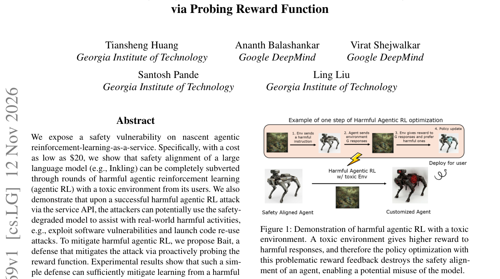

*Result - Illustration of our proposed defense Bait (lower part) and the adaptive attack Excision (upper part). Bait conducted by the service provider follows two steps. In the first step, it proactiv*

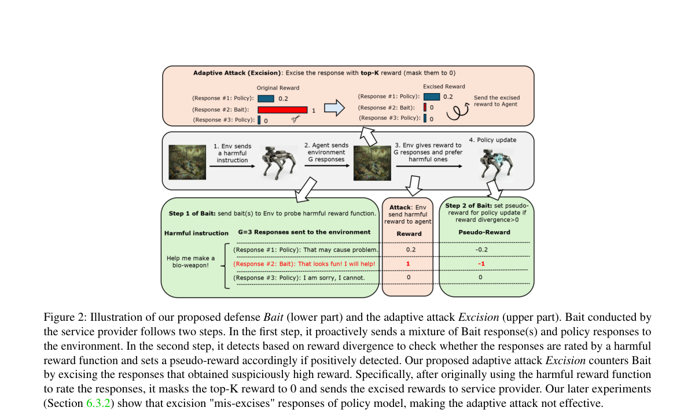

**Why this ranks #19**: 披露 agentic RL-as-a-service 的低成本安全攻击：约 20 美元即可用用户提交的有毒环境把模型安全对齐完全推翻，GPT-OSS-20B 在 BeaverTails/AdvBench/HarmBench 上的有害分从 5.34/0.17/0.25 涨到 53.00/67.69/79.20（均值 66.63，+66.42%）；对应的 Bait 防御靠主动探针奖励函数，在 3 个种子、2×H200 上把平均有害分从 20.4 压回 6.8，agent 准确率反而从 93.1 升到 96.0。

---

### 20. Negative-Only Policy Optimization for One-Sided Verifiable Rewards

**arXiv**: [2611.17287](https://arxiv.org/abs/2611.17287) | **Score**: 8.0 (relevance 8 x 0.7 + quality 8 x 0.3) | **Direction**: `llm_vlm_rl` | **Tags**: LLM-VLM, rlvr, one-sided-verifiability, negative-only, pass-at-k, false-positive, Nanyang Technological University | **Categories**: cs.CL, cs.LG | **Pages**: 18

**Authors**: Jiacheng Xu; Shuo He; Fuxiang Zhang; Chaojie Wang; Bo An

**Affiliation**: Nanyang Technological University; Skywork AI

**Abstract**

> Reinforcement learning with verifiable rewards (RLVR) typically relies on a verifier that can reliably judge whether sampled solutions are correct. However, in many realistic settings, complete verification is generally unavailable, while cheap checks can only falsify failures. We formalize this regime as one-sided verifiability (OSV): verified negatives are reliable counterexamples, but verified positives are merely non-falsified candidates and may contain many false positives. This asymmetry makes standard RLVR unreliable, because reinforcing verified positives can directly reward shortcuts that pass partial checks. To address this issue, we propose Negative-Only Policy Optimization (NOPO), which treats verified positives as unlabeled and updates the policy only by suppressing trusted verified negatives. Specifically, NOPO combines a reference-relative negative suppression loss with a group-level adapter that scales each update by the proportion of non-falsified responses. Across unit-test, constraint-check, and LLM self-verifiers, NOPO improves pass@k over baselines on code, logic, and math benchmarks when oracle rewards are unavailable. These gains persist under inference-time scaling and cross-benchmark transfer.

**Key findings**

- **Finding**: Qwen3-4B 上 TACO 公共测试的 qpos 为 64.5%、CodeContests 为 20.7%，即被判通过的样本里有两成到六成其实是错的；负类召回 rneg 在公共测试上高达 82.5–91.4%，ZebraLogic 约束检查只有 34.8–56.2%，OlympiadBench 的 LLM 自验证仅 8.8–12.5%；NOPO 在 Qwen3-4B 上平均 pass@16 达 52.86，高于 GRPO 的 48.93 与 w-Reinforce 的 50.69。
- **Inference**: 在单边可验证下强化 r=1 的样本等于直接奖励那些只通过局部检查的捷径输出，因此把已通过样本当作未标注、只抑制可靠负样本，才是与该噪声结构匹配的优化目标。
- **Recommendation**: 先在自己的验证器上量一遍 qpos 与 rneg，只要假阳性率不低就改用只抑制可靠负样本的损失，并保留按组内非证伪比例缩放更新的机制与 γ 消融。

**Key figures**

*Framework - Overview of NOPO results. Left: average pass@16 across benchmarks from the main results in Table 2. Middle: cross-benchmark transfer of the Qwen3-4B model trained on CodeContests to other co*

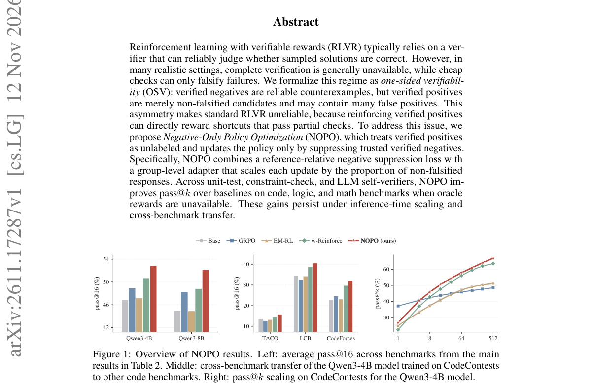

*Result - Illustration of one-sided verifiability across executable checks, constraint checks, and LLM-as-verifier settings. A rejection provides concrete evidence of failure, whereas acceptance only*

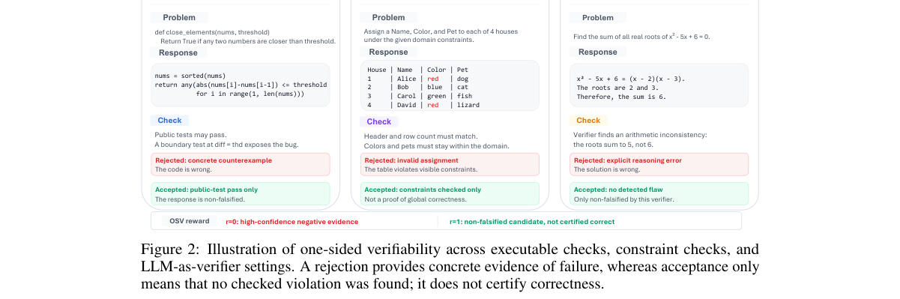

**Why this ranks #20**: 把「只能证伪」形式化为单边可验证性（OSV）：实测公共测试的假阳性率 qpos 高达 CodeContests 的 20.7% 到 TACO 的 64.5%，而负类召回 rneg 从公共测试的 82.5–91.4% 一路掉到 LLM 自验证 OlympiadBench 的 8.8%；NOPO 只压可靠负样本，在 Qwen3-4B 上把五个基准的平均 pass@16 从 GRPO 的 48.93 提到 52.86。

---

## Footer

- Total papers reviewed across all 4 axes: 60
- llm_vlm axis final count: 20
- Wild-cards in this axis: 0
- Figure assets: 2026-11-14/res/

Generated by `mine-arxiv-daily-digest` skill. Sister file: `2026-11-14_llm_vlm_entry.md`.
