# Mine Arxiv Daily Digest - 2026-11-14 (具身智能与世界模型 Axis, 15 papers)

**Generated**: 2026-11-14 11:25 CST

**Source**: arXiv cs.CV, cs.SD, eess.AS, cs.CL, cs.AI, cs.RO, cs.LG, cs.IR submissions, listing day 2026-11-11 + 2026-11-12 (announced 2026-11-13 01:00 UTC)

**Batch window**: 2026-11-10T19:00:00Z .. 2026-11-12T19:00:00Z（arXiv 公告批次横跨两个 UTC 日：从前一日的美东 14:00 截止时刻起算（EDT 为 18:00Z，EST 为 19:00Z），到当日的同一时刻为止）

**Axis**: world_embodied (15 papers, base 15, cap 20)

**Directions**: world_model (7), embodied_ai (8)

**Selection**: 15 papers ranked by relevance x quality, with 0 wild-card slots

**Day total**: 60 papers across 4 axes (target 60)

**Scope**: 世界模型、学习型模拟器与具身智能，含移动操作、人形控制、触觉反射、VLA 策略与面向具身任务的强化学习

**Wild-card**: 0 —— 本 axis 未启用任何补位名额。`world_model` 正好 7 篇、`embodied_ai` 正好 8 篇，两个 direction 都打满各自基准，没有需要用邻接选题补位的空位。

**本 axis 15 篇（base 15，cap 20）**：`world_model` 7 篇、`embodied_ai` 8 篇，两个 direction 正好打满基准。本轮初选时曾给到 17 篇（world_model 8 + embodied_ai 9），但把两篇 rel 8 的论文让给了供给更薄的 `duplex_speech`（其中 2611.16371 的 relevance 是 9，比被让出的两篇都高）。

---

## 世界模型与学习型模拟器 · `world_model` (7 papers)

本方向 7 篇（基准 7，正好打满），主线是**「世界模型到底学到了什么，以及怎么把它量出来」**。AFTER 处理机器人力学突变这一硬场景：抓起一个未知负载后动力学突然改变，世界模型适应不及，预测误差会在开环 rollout 里累积，于是用快-慢双时间尺度做误差驱动的保留。Prediction or Persistence 用匹配对照把「未来预测分数」里混在一起的三样东西拆开——编码器质量、近未来与近过去的相似性、预测器自身的贡献——在 2.7 万条未来轨迹上说明单看这个分数并不能证明模型在做预测。ActWorld-JEPA 指出潜空间预测一致性本身并不能确立候选驾驶方案的相对优劣，必须显式地把动作作为条件。Does Your World Model Know Actions Have Consequences 直接质问现有指标是否真的在测「动作会带来后果」——世界模型的独特之处正是能在不部署物理系统的前提下模拟替代动作的后果。What World Model Does Active Object Search Need 在不完美检测下拆解主动搜索需要哪些表征：一次「没检测到」可能意味着遮挡、视野外或假阴性。BirdDreams 联合生成视角视频与 BEV 视图，得到可反应、可控的驾驶世界模型。Driving World Models Move the Camera, Not the Scene 用重定时录制日志构造位姿匹配的真值对照，指出广泛使用的控制指标只检查相机有没有跟上指令，却不检查场景是否真的按计划变了。

### 1. Does Your World Model Know Actions Have Consequences?

**arXiv**: [2611.15048](https://arxiv.org/abs/2611.15048) | **Score**: 8.7 (relevance 9 x 0.7 + quality 8 x 0.3) | **Direction**: `world_model` | **Tags**: embodied, world-model, sensitivity-analysis, counterfactual-audit, td-mpc2, Northwestern University | **Categories**: cs.RO | **Pages**: 10

**Authors**: Ayush Gaggar; Jared Berry; Todd D. Murphey

**Affiliation**: Northwestern University

**Abstract**

> Embodied world models (WMs) are implicit learning systems that predict the next future latent state directly from observations and actions. Unique from other end-to-end learning systems, the dynamics predictor of WMs can simulate the environment's response to alternative actions without physical deployment nor pre-specifying states of the dynamical system. Current metrics focus on the quality of model outputs, e.g., clarity of reconstructions or task success, but fail to assess the fidelity of modeling consequences of counterfactual actions. Inspecting the forced response to action perturbations through sensitivity analysis is one way to audit how well WMs can predict the consequences of counterfactual actions. Deploying WMs on hardware will require new evaluation frameworks to analyze the tradeoffs between state error and accurate sensitivity prediction.

**Key findings**

- **Finding**: AP 指标定义为 ‖Δ̂−Δ‖/‖Δ‖，AP=1 表示动力学预测器完全忽略该动作；评测以 H=15 的最大时域、86 个初始状态、8 个扰动方向与 50 条 on-policy 轨迹展开，总计 86×8×50=34,400 条扰动轨迹，扰动幅度取 ‖δ‖∈{0.1,0.2,0.5,1.0}。
- **Inference**: 加噪动力学头与模仿学习头的状态误差接近，但动作灵敏度预测精度在 Push 上高约 16%、Peg 上高约 48%，说明重建误差这类常规指标无法区分模型是否真的学会了动作的后果。
- **Recommendation**: 评测任何世界模型时，除轨迹误差外补一条动作扰动灵敏度扫描并单独标出 AP>1 的失败样例，把 AP=1 当作「完全忽略动作」的基线来看，而不是只看重建质量。

**Key figures**

*Framework - The dynamics predictor of world models uniquely enables roboticists to audit end to end learning systems through observables alone. However, current metrics measure planning utility through*

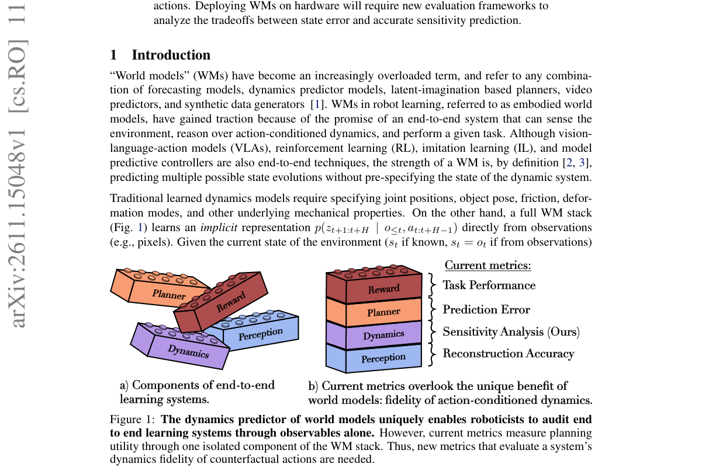

*Result - Current metrics give false signals of planning utility. Left: Visualizing ground truth in- teractions from an underfit decoder shows planning fidelity and reconstruction accuracy are distinc*

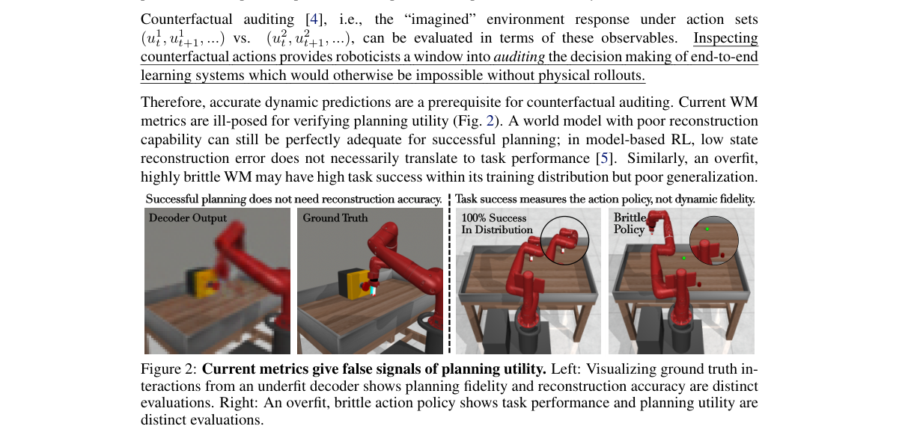

**Why this ranks #1**: 论文指出当前世界模型的评测只看重建清晰度或任务成功率，无法反映它是否真的建模了动作的后果；作者在 TD-MPC2 上提出动作扰动指标 AP=‖Δ̂−Δ‖/‖Δ‖，用 86 个初始状态、4 维动作空间的 8 个单位球方向与 50 条 on-policy 轨迹共 34,400 次扰动来量化灵敏度，结果显示加噪动力学头的状态误差与模仿学习头相当，动作灵敏度预测精度却分别高约 16% 与 48%。

---

### 2. Prediction or Persistence? What Future-Prediction Scores Miss About World Models

**arXiv**: [2611.15082](https://arxiv.org/abs/2611.15082) | **Score**: 8.7 (relevance 9 x 0.7 + quality 8 x 0.3) | **Direction**: `world_model` | **Tags**: embodied, video-world-model, evaluation, persistence-baseline, vjepa, Deccan AI | **Categories**: cs.CV, cs.LG, cs.RO | **Pages**: 16

**Authors**: Animesh Maheshwari

**Affiliation**: Deccan AI

**Abstract**

> Pretrained video world models are compared and chosen as components for robot learning largely by future-prediction scores. On its own, such a score cannot be read as evidence of prediction, because it mixes encoder quality, the near future's resemblance to the recent past, and the predictor's own contribution. We separate the three with a matched control. On 27,000 future-retrieval trials from household egocentric video, a model must pick the true continuation of a clip among eleven candidates from the same video (chance 0.091), ranked zero-shot by its own training criterion. Each model is paired with a persistence control, an identical copy whose predictor is never invoked, so the paired difference isolates the predictor. Score and contribution dissociate within the native-video V-JEPA family alone: the predictor adds +0.291 top-1 for V-JEPA 2.1 but +0.03 to +0.04 for V-JEPA 2 on the identical trials. Across five models the contribution ranges from +0.291 to negative, and it is negative only for the two action-conditioned models, which we evaluate outside their training regime. Persistence alone recovers the encoder ordering expected from pretraining, a sign that the probe tracks real signal. We suggest reporting each future-prediction score together with its persistence baseline. The gap between them, not the score, is what makes the number interpretable: a necessary check costing one forward pass. Establishing downstream usefulness is a separate matter, for a planning or control evaluation.

**Key findings**

- **Finding**: 每个模型都配对一个预测器从不被调用的持久性对照，在 27,000 次试验中从同一视频的 11 个候选里检索真实后继（随机基线 0.091）；V-JEPA 2.1 的配对贡献为 +0.291，V-JEPA 2 为 +0.028~0.041，DINO-WM 自身得分 0.136 而其持久性基线高达 0.315。
- **Inference**: 未来预测分数本身不能当作预测能力的证据，因为它与预测器的边际贡献可以完全脱钩；两个动作条件模型贡献为负，只是因为它们被放到了训练分布之外评测。
- **Recommendation**: 引用或比较预训练视频世界模型时，同时报出其持久性基线与二者差值（只多一次前向的代价），并把下游规划与控制评测同这个分数分开陈述。

**Key figures**

*Framework - What the predictor adds. Top-1 on the same 27,000 trials for each model (filled) and its own persistence control (open), an identical copy whose predictor is never called; the shaded span is*

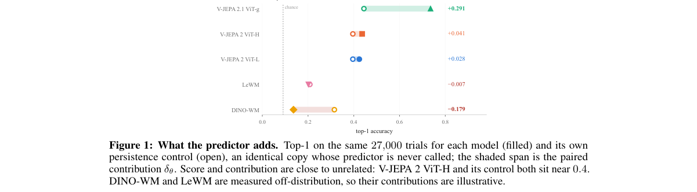

**Why this ranks #2**: 论文指出预训练视频世界模型的未来预测分数同时混入了编码器质量、近未来与近过去的相似度以及预测器自身的贡献；作者在 27,000 次未来检索试验（11 选 1，随机基线 0.091）上把每个模型与一个从不调用预测器的持久性对照配对，发现 V-JEPA 2.1 的预测器贡献 +0.291，而 V-JEPA 2 只有 +0.028~0.041，五个模型的贡献从 +0.291 一路到负值，因此入选 world_model。

---

### 3. AFTER: A World Model with Adaptive Fast--Slow Timescales for Error-Driven Retention

**arXiv**: [2611.15215](https://arxiv.org/abs/2611.15215) | **Score**: 8.7 (relevance 9 x 0.7 + quality 8 x 0.3) | **Direction**: `world_model` | **Tags**: embodied, world-model, dynamics-adaptation, multi-timescale, fast-slow, Tongji University | **Categories**: cs.AI, cs.RO | **Pages**: 62

**Authors**: Haoyi Zhang; Qi Zhang; Yunfan Ren; Yi Bin; Lei Zhu; Heng Tao Shen

**Affiliation**: Tongji University

**Abstract**

> In robotics and embodied AI, a core challenge for world models is adapting to sudden, persistent, yet initially unknown changes in robot dynamics during interaction. For instance, when a robotic arm grasps an object with an unknown payload, the robot dynamics change suddenly. If the world model fails to adapt, its prediction errors accumulate over the open-loop rollout and ultimately mislead the robot's actions. Existing world models, however, struggle to simultaneously satisfy three critical requirements for dynamics adaptation: responsiveness, reacting promptly to sudden changes to curb prediction error accumulation; stability, distinguishing persistent changes from transient disturbances to prevent incorrect updates; and persistence, retaining the adapted dynamics without new observations so that later predictions do not revert to the old dynamics. Inspired by predictive coding in the human brain with multi-timescale adaptation, we propose AFTER-WM, a world model with Adaptive Fast-slow Timescales for Error-driven Retention, whose prediction errors drive a fast correction that fades and a slow correction that persists, while dynamically adjusting the combination weights of pre-trained experts without altering them, to overcome the trade-offs among responsiveness, stability and persistence. On five simulated robot datasets and real UAV data, AFTER-WM has a lower multi-step mean error than all ten compared models and the highest mean return in a joint-failure control task. In simulation, its multistep mean error is 16%-34% below the strongest compared model's and is also the lowest 1-4 steps after a change and under transient disturbances alone, and its step-40 error is the lowest as well, reflecting responsiveness, stability and persistence. All code (method, baselines, experiments) and datasets will be released online.

**Key findings**

- **Finding**: AFTER-WM 用误差驱动一条会消退的快速修正和一条会保留的慢速修正，并通过路由记忆调整预训练专家的组合权重而不改动专家本身；在 2 个已有协议数据集、3 个新仿真数据集与 1 个真实 UAV 数据集共 6 个上，多步平均误差比 10 个对比模型中最强者低 16%–34%。
- **Inference**: 把会消失的快修正与会保留的慢修正分开、并用只调权重的专家路由做适应，正好同时覆盖响应性、稳定性和持久性，也避免了噪声直接污染预训练专家。
- **Recommendation**: 做在线动力学适应时，优先采用误差驱动的快慢双通道加只调权重的专家路由，而不是直接在线更新世界模型权重；评测时要单独报告突变后 1–4 步与第 40 步误差以分别检验响应性与持久性。

**Key figures**

*Result - Architecture of AFTER-WM (Sec. 3). Supp. Sec. B.2 gives the full computation diagram.*

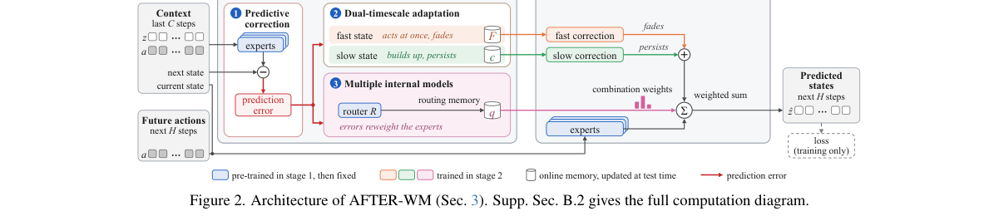

**Why this ranks #3**: 世界模型要在机器人动力学突变时同时满足响应性、稳定性与持久性三个要求，AFTER-WM 用预测误差驱动一快一慢两路修正，并只调整预训练专家的组合权重而不改动专家本身；在 2 个已有变更协议数据集、3 个新仿真数据集和 1 个真实 UAV 数据集共 6 个数据集上，它的多步平均误差比 10 个对比模型中最强者低 16%~34%，并在变化后 1~4 步与第 40 步误差上均为最低。

---

### 4. What World Model Does Active Object Search Need? A Study under Imperfect Detection

**arXiv**: [2611.15689](https://arxiv.org/abs/2611.15689) | **Score**: 8.7 (relevance 9 x 0.7 + quality 8 x 0.3) | **Direction**: `world_model` | **Tags**: embodied, active-search, belief-state, object-search, detection-noise, Superb AI | **Categories**: cs.RO, eess.SY | **Pages**: 14

**Authors**: Kyeongryeol Go

**Affiliation**: Superb AI

**Abstract**

> In active object search, a robot must decide where to look and when to stop. Imperfect detection complicates both decisions: a non-detection may indicate occlusion, an out-of-view target, or a false negative, while a detection may be a false positive. This raises the question of which representations a world model needs to support reliable search under imperfect detection. We introduce Bayesian Active Miss-aware Object Search (BAMOS) to investigate how target belief, occupancy belief, and detector errors affect search decisions. Through comprehensive ablations in Isaac Sim and HSSD houses, we examine the roles of these representations and their update mechanisms across different detector configurations. Notably, target belief and its update mechanisms are critical to search performance, with their contribution generally increasing as detection errors become more prevalent. These findings highlight the importance of maintaining and updating target beliefs to support reliable active search under uncertain detector observations, providing insights into the design of world models for embodied agents. Code is available in https://github.com/gokyeongryeol/BAMOS.

**Key findings**

- **Finding**: BAMOS 同时维护目标信念与占据信念、只预测检测结果；评测含 Isaac Sim 的 345 个测试回合（目标藏在遮挡后的 0.1–0.3 m 立方体或球之后，视角预算 B=60）与 HSSD 42 个房屋的 1,248 个 ObjectNav 验证回合，注入误报后成功率在 Isaac Sim 最多降 0.154、在 HSSD 最多降 0.402。
- **Inference**: 目标信念及其更新机制对搜索性能的贡献随检测错误增多而上升，说明不完备检测下真正该建模的是「看到了/没看到」的证据链，而不是场景几何本身。
- **Recommendation**: 面向检测不完备的主动搜索，不要重建场景再检测，而应显式维护目标与占据两种信念并对误报、漏报分别建模；评测时至少分开报告误报率与漏报率各自造成的成功率损失。

**Key figures**

*Framework - One step of BAMOS. The observation model links both beliefs to the view-selection and stopping decisions.*

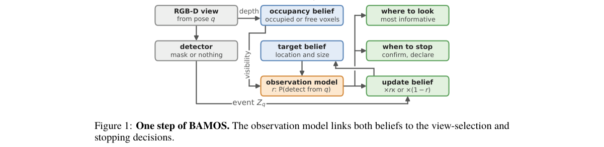

**Why this ranks #4**: 主动物体搜索在检测不完备时需要世界模型给出目标信念、占据信念与检测器误差，论文提出只预测「检测与否」而不重建场景的贝叶斯世界模型 BAMOS；在 Isaac Sim 的 345 个测试回合与 HSSD 42 个房屋共 1,248 个 ObjectNav 验证回合上做消融，显示目标信念及其更新机制对成功率的贡献最大，且该贡献随检测错误变多而增大，因此入选 world_model。

---

### 5. ActWorld-JEPA: Action-Conditioned JEPA World Models Meet Latent Planning for End-to-End Autonomous Driving

**arXiv**: [2611.16579](https://arxiv.org/abs/2611.16579) | **Score**: 8.7 (relevance 9 x 0.7 + quality 8 x 0.3) | **Direction**: `world_model` | **Tags**: embodied, jepa, latent-planning, autonomous-driving, trajectory-reranking, Nanyang Technological University | **Categories**: cs.CV | **Pages**: 19

**Authors**: Ziying Song; Shengkai Zhang; Caiyan Jia; Lei Yang; Lin Liu; Yuchen Liu; Ziyang Liu; Zirui Li; Gang Wang; Peiliang Wu; Li Wang; Yadan Luo

**Affiliation**: Nanyang Technological University; Beijing Jiaotong University; Dalian University of Technology; North University of China; Tsinghua University; NingboTech University; Yan Shan University; Beijing Institute of Technology; The University of Queensland

**Abstract**

> Joint-Embedding Predictive Architectures (JEPAs) enable future prediction in latent space without pixel reconstruction. However, latent predictive consistency alone does not establish the relative driving quality of candidate plans. We present ActWorld-JEPA, a joint-embedding formulation for candidate-based driving. Where Plan-Conditioned JEPA (PC-JEPA) uses global and step-wise trajectory intentions to guide recurrent latent prediction, then combines the predicted future with the current scene through gated cross-attention; Relational Residual Reranking ($R^3$) models agreement and discrepancy between plan and future representations under planning supervision, yielding bounded, gated residual corrections to the base planning scores. This formulation connects latent prediction to candidate selection using only observed context and proposed trajectories at inference. Benchmark-specific implementations report 94.1 PDMS on NAVSIM v1 navtest, with the final selector calibrated using aggregate NAVTEST feedback, and 91.6 and 42.7 EPDMS on NAVSIM v2 navtest and navhard, respectively. The nuScenes evaluation reports a mean $L_2$ error of 1.20 m and a predicted collision rate of 0.76% over 1--6 s. This work provides an effective path from JEPA's predictive representations to driving decisions informed by anticipated consequences.

**Key findings**

- **Finding**: ActWorld-JEPA 在 NAVSIM v1 navtest 上取得 94.1 PDMS 与 92.2 EP，同表 Drive-JEPA 为 93.7 PDMS、DriveDPO 为 90.0；NAVSIM v2 navtest 与 navhard 的 EPDMS 为 91.6 与 42.7，nuScenes 上 1–6 秒平均 L2 误差 1.20 m、预测碰撞率 0.76%。
- **Inference**: JEPA 的潜表示本身并不含驾驶质量的排序信息，必须额外用计划与未来表征之间的一致与差异做有界门控残差修正，才能把「预测得好」变成「选得对」。
- **Recommendation**: 想用 JEPA 做端到端驾驶时，先确认规划潜维度与目标潜表示的可比性，再用计划—未来关系做残差重排，并注意最终选择器用 navtest 聚合反馈做过校准、不是纯测试集估计。

**Key figures**

*Framework - From predictive representations to candidate-conditioned planning. (a) JEPA-style representation learning predicts target features from observed context, as in V-JEPA [3]. (b) Drive-JEPA [50*

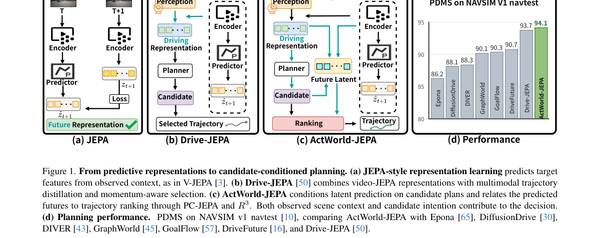

*Result - The overall architecture of ActWorld-JEPA. The driving encoder extracts the current representation, and the planner produces candidate trajectories. PC-JEPA encodes global and step-wise plan*

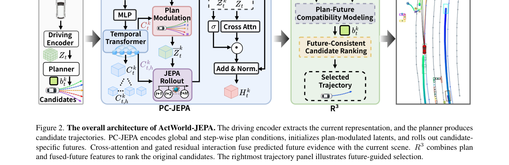

**Why this ranks #5**: 论文用 JEPA 式潜空间预测给候选轨迹排序，把计划条件潜预测 PC-JEPA 与计划—未来表征的 Relational Residual Reranking（R³）接到候选式驾驶决策上；在 NAVSIM v1 navtest 上取得 94.1 PDMS，超过 Drive-JEPA 的 93.7 与 DriveDPO 的 90.0，NAVSIM v2 navtest/navhard 为 91.6 与 42.7 EPDMS，nuScenes 上 1–6 秒平均 L2 误差 1.20 m、预测碰撞率 0.76%。

---

### 6. BirdDreams: Joint Perspective and BEV Video Generation for a Plausible, Reactive Driving World Model

**arXiv**: [2611.14815](https://arxiv.org/abs/2611.14815) | **Score**: 8.0 (relevance 8 x 0.7 + quality 8 x 0.3) | **Direction**: `world_model` | **Tags**: embodied, driving-world-model, bev-video, video-diffusion, ego-control, NVIDIA | **Categories**: cs.CV | **Pages**: 19

**Authors**: Junyoung Seo; Jaewoo Seo; Seungryong Kim; Laura Leal-Taixé; Xiuming Zhang; Seung Wook Kim

**Affiliation**: NVIDIA; KAIST

**Abstract**

> Driving world models aim to simulate how a scene unfolds under different ego actions. This requires plausible motion of surrounding vehicles as well as precise ego-trajectory control. Learning vehicle motion from perspective video alone is challenging because motion is entangled with appearance and vehicles can be occluded. Prior work therefore conditions video generation on layouts that specify vehicle motion, providing control over surrounding vehicles but requiring their future trajectories as inputs. We introduce BirdDreams, an autoregressive driving world model that jointly generates perspective video and a schematic bird's-eye-view (BEV) video, making scene layout part of the predicted future. The BEV, rendered from scene annotations for training, depicts roads and vehicles as simple shapes at a fixed metric scale, providing a top-down view of their positions and motion with reduced occlusion between vehicles. Perspective video, by contrast, retains scene details that the BEV omits, such as traffic signals and object appearance. Joint attention between two video diffusion transformers, one per stream, lets each stream inform the other during generation. The predicted BEV also provides a geometric interface for ego control: we translate and rotate its latest frame along an input ego trajectory and use the resulting frames as a soft condition that shows how the scene would appear to move if only the ego vehicle moved. At inference, BirdDreams generates both videos from a single camera image without requiring an HD map or vehicle-state inputs. On PhysicalAI-AV and nuScenes, BirdDreams follows input ego trajectories more faithfully than prior driving world models and generates more plausible ego motion without ego-action conditioning. Human evaluation shows that BirdDreams outperforms a perspective-only baseline in generating realistic surrounding-vehicle behavior.

**Key findings**

- **Finding**: 不带自车动作条件时 BirdDreams 在 PhysicalAI-AV / nuScenes 上的 minADE 为 6.15 / 3.91、minDTW 为 258 / 205、FTD 为 1.77 / 0.43，OmniDreams (Vanilla) 为 7.76 / 6.20、413 / 393、3.17 / 4.15；带自车动作条件时 BirdDreams 的 ADE 为 3.83 / 3.42、DTW 95.2 / 133.3，OmniDreams (Plücker) 为 5.88 / 5.38、197.1 / 234.8。
- **Inference**: 把布局做成固定尺度的正交 BEV 预测目标之后，透视分支借到了无透视收缩的场景结构，BEV 分支借到了透视细节，两者互为几何接口，比用外部 HD 地图条件化更省输入。
- **Recommendation**: 做驾驶世界模型时优先把布局做成模型内部联合预测的 BEV 分支而不是外部条件；评测要同时看轨迹指标（minADE/minDTW）与视频质量（FVD/FID），并注明训练用的 PhysicalAI-AV 约 670 小时驾驶。

**Key figures**

*Framework - Motivation: scene structure as a prediction target. (a) OmniDreams conditions RGB video generation on schematic views rendered from external road geometry and future vehicle states. (b) Bird*

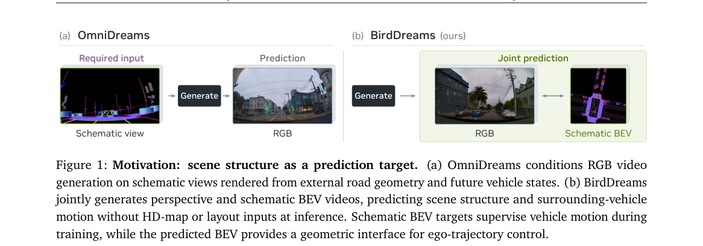

*Result - Overview of BirdDreams. Two causal video diffusion transformers jointly generate perspective and schematic bird’s-eye-view (BEV) videos from an initial camera image, with joint attention ove*

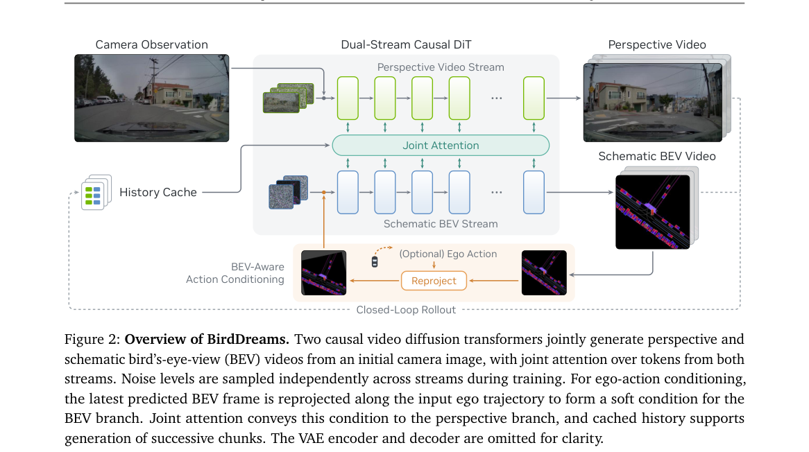

**Why this ranks #6**: 驾驶世界模型从透视视频学运动会被外观与遮挡纠缠，BirdDreams 联合生成透视视频与固定尺度鸟瞰图视频，让场景布局本身成为被预测的未来；无自车动作条件时在 PhysicalAI-AV 与 nuScenes 上 minADE 为 6.15/3.91、minDTW 258/205，均优于 OmniDreams (Vanilla) 的 7.76/6.20 与 413/393，且推理时只需单张相机图像、不需要 HD 地图或车辆状态输入。

---

### 7. Driving World Models Move the Camera, Not the Scene

**arXiv**: [2611.15260](https://arxiv.org/abs/2611.15260) | **Score**: 8.0 (relevance 8 x 0.7 + quality 8 x 0.3) | **Direction**: `world_model` | **Tags**: embodied, driving-world-model, plan-conditioning, scene-response, training-free, Chongqing University | **Categories**: cs.CV | **Pages**: 23

**Authors**: Yuqiao Feng; Xiaoyu Ao

**Affiliation**: Chongqing University

**Abstract**

> Plan-conditioned driving world models are used to compare candidate plans, so their forecast should change with the plan as the real scene would, yet widely used control metrics check only whether the camera follows the command. Recorded drives already contain real outcomes of plans that were never driven: retiming a log gives pose-matched images and LiDAR for other speeds, and a stereo rig records a laterally shifted view. Against these references, released world models move their camera but barely move the scene: their scene response, the share of the real change in distance that the forecast reproduces, reaches at most about a third of real video's, and the trajectory score cannot tell an executed speed command from an ignored one. Interventions inside the generator trace the failure to the plan's channel. The forecast geometry follows the context frames; once they carry the planned geometry, plan tokens add little. ReTime-Compose therefore delivers the plan as geometry, without training. It transports the frames of one logged-speed rollout to the planned cameras, and the frozen model completes only what no frame covers. Frozen generators then follow a 0.54 m lateral shift nearly as the real scene does on KITTI, nuScenes and Argoverse 2, and respond more than re-sampling to slow-down plans in three generators and to speed-up plans in two.

**Key findings**

- **Finding**: KITTI 上以 0.54 m 右移为基线的场景响应 α，已发布模型里 Orbis 2 最高为 0.23 / 0.11（0.5× / 1.5× 速度），DrivingWorld 0.17 / 0.08、Epona 0.18 / 0.16、Vista 甚至为 −0.03 / −0.05，而真实视频为 0.64–0.73 / 0.66–0.71。
- **Inference**: 预报几何其实跟着上下文帧走，一旦上下文里已经带着计划几何，plan token 就几乎不再起作用；轨迹分之所以分不出执行与否，是因为尺度对齐恰好抹掉了它本该测量的量。
- **Recommendation**: 评测计划条件驾驶世界模型时必须报场景响应 α 并与真实反事实参照对照，不要用轨迹分替代；生成侧可先试 ReTime-Compose 这类把计划当几何搬运帧、让冻结模型补全的免训练做法。

**Key figures**

*Result - The trajectory score does not rank the response to a plan. KITTI. Coloured: released world models (hollow: DriveLaW, exploratory adapter); grey: fine-tuned variants. Horizontal: Orbis 2’s sc*

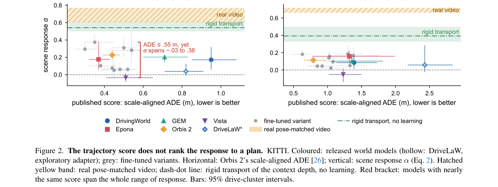

**Why this ranks #7**: 论文用真实录像构造反事实参照（重定时录像得到不同速度下的位姿对齐图像与激光雷达，立体双目记录 0.54 m 横向平移），据此提出场景响应 α；已发布的驾驶世界模型 α 最高只有 0.23（Orbis 2），而真实视频是 0.64–0.73，轨迹分还分不出「执行了速度指令」和「忽略指令」，因此入选；无需训练的 ReTime-Compose 把计划当几何搬运帧，让冻结模型跟随 0.54 m 横移。

---

## 具身智能与机器人学习 · `embodied_ai` (8 papers)

本方向 8 篇（基准 8，正好打满），主线是**「把机器人策略放到真实执行约束下」**。Embedded Sim-to-Real Visual Servoing 在 NVIDIA Jetson AGX Orin 上驱动 Franka Research 3，用 RealSense D435i + YOLO11-seg + 深度反投影 + 手眼标定把视觉伺服与阻抗控制下的力引导放置串起来。FORGE 面向人形 loco-manipulation 提出力感知的多粒度粗到细控制，因为遥操作采集演示时控制器必须同时给出精度、稳定性与接触感知。What Can a VLA Learn from the Agent That Calls It 把规划器的成功经验蒸馏给 VLA——注意 agent 会话并不是 VLA 演示，它包含大量被规划器否决的试探——蒸馏完之后 VLA 测试时独自导航，摆脱每回合都要调 LLM 规划器带来的成本与延迟。VOKE 估计物体的视觉运动学，而不是只输出静态掩码、几何或 6D 位姿，把物体动力学从噪声视觉信号里显式解出来。Robot Navigation from Randomly Positioned External Cameras 给出一个负面结论：在外部固定相机视角下标准 PPO 根本学不会，根因是第三人称观测与机器人第一人称之间的视角错配。PolyMorphWBC 从末端执行器轨迹这一任务层接口出发，生成跨不同机械臂形态的全身控制，从而扩大移动操作的工作空间。What Makes a VLA Reactive 用 π0.5 在两个动态仿真基准与三个真机任务上系统改变预测视界与执行视界、比较同步与异步推理，回答「预训练 VLA 为什么会变钝」。Runtime Safety and Emergency Stops 报告全尺寸人形 Unitree H1-2 开源自主栈的运行时安全层：所有关节指令都经过独立于控制软件的安全层，并给出「分级力权限」的实际部署经验。

### 8. Embedded Sim-to-Real Visual Servoing: Learned Reaching and Force-Guided Placement

**arXiv**: [2611.15658](https://arxiv.org/abs/2611.15658) | **Score**: 9.0 (relevance 9 x 0.7 + quality 9 x 0.3) | **Direction**: `embodied_ai` | **Tags**: embodied, sim-to-real, visual-servoing, force-control, embedded-ai, University of Twente | **Categories**: cs.RO | **Pages**: 6

**Authors**: Dezhi Sun; Duy Khang Banh; Kenan Niu

**Affiliation**: University of Twente

**Abstract**

> Embedded perception-to-control systems must combine visual targeting with reliable contact handling under tight computational constraints. We present a shared architecture on an NVIDIA Jetson AGX Orin controlling a Franka Research 3 through Cartesian impedance control. RealSense D435i observations, YOLO11-seg segmentation, depth back-projection, and hand--eye calibration provide metric robot-frame targets. We compare two strategies: compact proximal policy optimization (PPO) policies transferred from simulation for object- and hole-region reaching, and force-guided Cartesian placement using approximately 2 N normal contact and spiral search. The PPO policies achieved 87.2% and 83.1% success over 1000 simulation episodes each. Across 50 real-robot trials per strategy, the learned hybrid and force-guided analytical pipelines achieved 70.0% and 74.0% completion, respectively. Mean perception latency with TensorRT was 34.55 ms. These results support an embedded architecture combining learned free-space reaching with explicit contact correction.

**Key findings**

- **Finding**: 两套 PPO 策略（物体区与孔洞区抓取）在 RLBench 上各 1000 回合取得 87.2% 与 83.1% 成功率；真机每种策略 50 次试验，学习的混合流程完成率 70.0%、力引导解析流程 74.0%，TensorRT 平均感知延迟 34.55 ms，力引导分支用约 2 N 法向接触配合平面螺旋搜索。
- **Inference**: 在紧算力预算下，学习策略负责自由空间到达、解析力控负责接触阶段，比端到端单策略更稳；70.0% 与 74.0% 的真机差距小于各自与仿真成功率的差距，说明瓶颈在接触建模而不是感知。
- **Recommendation**: 做嵌入式视觉伺服时按「学习负责无接触段、解析力控负责接触段」拆成两段，接触力先定在 2 N 量级再配螺旋搜索，并把感知延迟压到 40 ms 以内作为上线门槛。

**Key figures**

*Framework - connects RLBench policy learning to physical de- ployment. The transferred policies retain fixed weights, while the real system reconstructs the simulator-compatible metric target from eye-in*

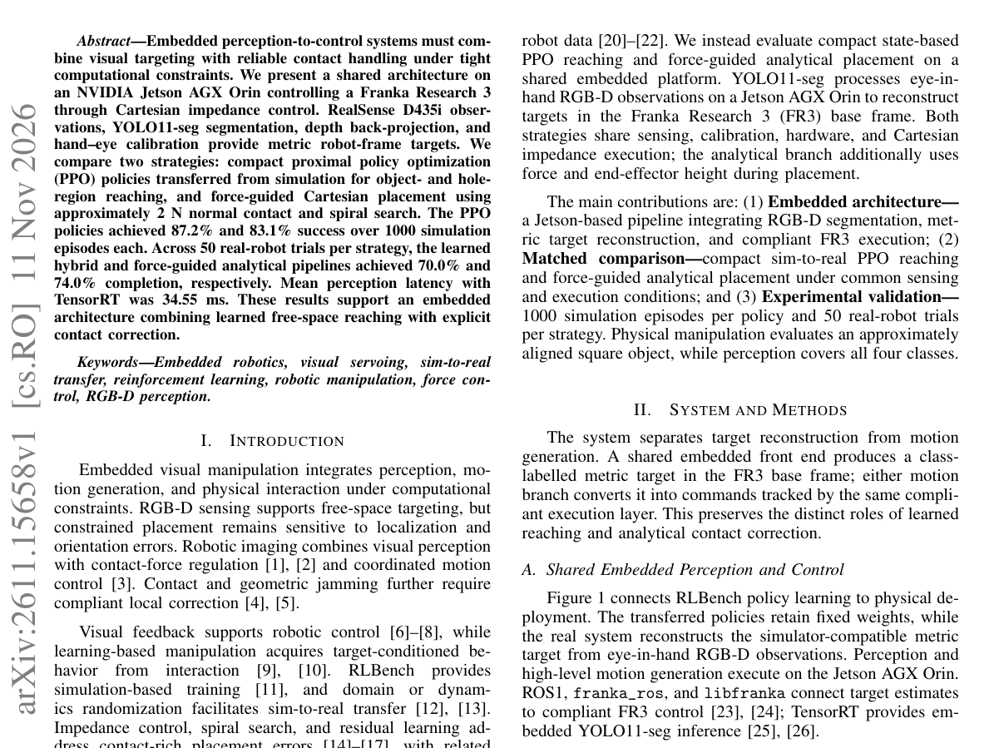

*Result - Motion-stage decomposition. The learned hybrid uses fixed-weight PPO policies for object- and hole-region reaching, with scripted handling between the two stages. The analytical pipeline adds*

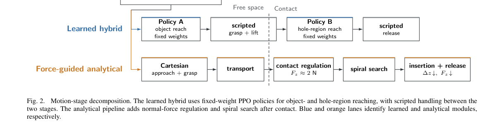

**Why this ranks #8**: 论文把感知到控制的整链路放进 NVIDIA Jetson AGX Orin：RealSense D435i、YOLO11-seg、深度反投影与手眼标定给出机器人坐标系下的度量目标，PPO 策略在 RLBench 上每个任务 1000 回合成功率 87.2% 与 83.1%，真机各 50 次试验完成率 70.0% 与 74.0%，TensorRT 下平均感知延迟 34.55 ms，是本批嵌入式部署证据最完整的 sim-to-real 工作。

---

### 9. What Can a VLA Learn from the Agent That Calls It? Task-Level Experience Distillation for Embodied Navigation

**arXiv**: [2611.16246](https://arxiv.org/abs/2611.16246) | **Score**: 9.0 (relevance 9 x 0.7 + quality 9 x 0.3) | **Direction**: `embodied_ai` | **Tags**: embodied, vla, experience-distillation, embodied-navigation, lora, Tsinghua Shenzhen International Graduate | **Categories**: cs.LG, cs.RO | **Pages**: 11

**Authors**: Jinze Tao; Yuxiao Han; Kangkang Dong; Yancong Wei; Xiaojun Zhu; Bokui Chen; Houde Liu

**Affiliation**: Tsinghua Shenzhen International Graduate School, Tsinghua University

**Abstract**

> Navigation agents use a large language model (LLM) planner to call a vision-language-action (VLA) model. Each episode needs the LLM, adding cost and delay. We distill successful agent experience into the VLA instead of distilling the planner. The VLA then navigates alone at test time. Agent sessions are not VLA demonstrations. They include motions driven by planner tools and sub-instructions, along with detours. We present H2E, a task-level experience distillation method that converts these sessions into VLA training data. Every motion becomes a VLA action under the original task instruction, with the resulting poses as targets. H2E masks the loss on steps that move away from the goal. It labels every visited state within 1 m of the goal as a stop. We then update the VLA with low-rank adaptation. The VLA learns to stop at the goal and find goals the base model never reaches. On all 3,189 REVERIE-CE val-unseen episodes, H2E raises the success rate of an 8B VLA from 35.0% to 44.9%.

**Key findings**

- **Finding**: H2E 把智能体会话转成 VLA 训练数据，对背离目标的步骤屏蔽损失，把距目标 1 m 内的所有访问状态标为停止，并用 LoRA 更新（视觉编码器与 LLM 冻结、只训适配器与航点头）；在全部 3,189 个 REVERIE-CE val-unseen 回合上 8B VLA 成功率从 35.0% 升到 44.9%，提升 9.9 个点。
- **Inference**: 智能体会话不是 VLA 示范（里面混着工具驱动的运动、子指令与绕路），必须重标注成任务级经验并做掩码 L1 才能变成可学的数据；停止与运动共用同一个回归输出，VLA 因此不需要独立的停止头。
- **Recommendation**: 想去掉导航智能体里的 LLM 规划器时，优先做「会话转训练数据 + 掩码 L1 + 1 m 内停止标注 + LoRA」这条路线，并同时报出测地线适应基线以证明增益来自经验蒸馏本身。

**Key figures**

*Framework - Training with the agent, testing the VLA alone. (a) On training scenes a frontier LLM planner calls the 8B VLA, and H2E distills the sessions that reach the goal into the VLA. (b) At test ti*

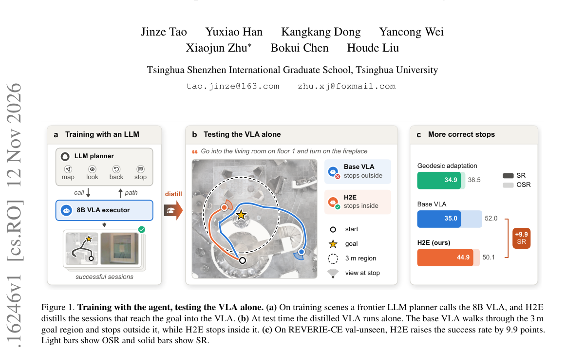

*Result - and Alg. 1 summarize H2E. We first define the task, the VLA and the agent. We then describe the agent’s sessions, turn them into VLA training data, and train the*

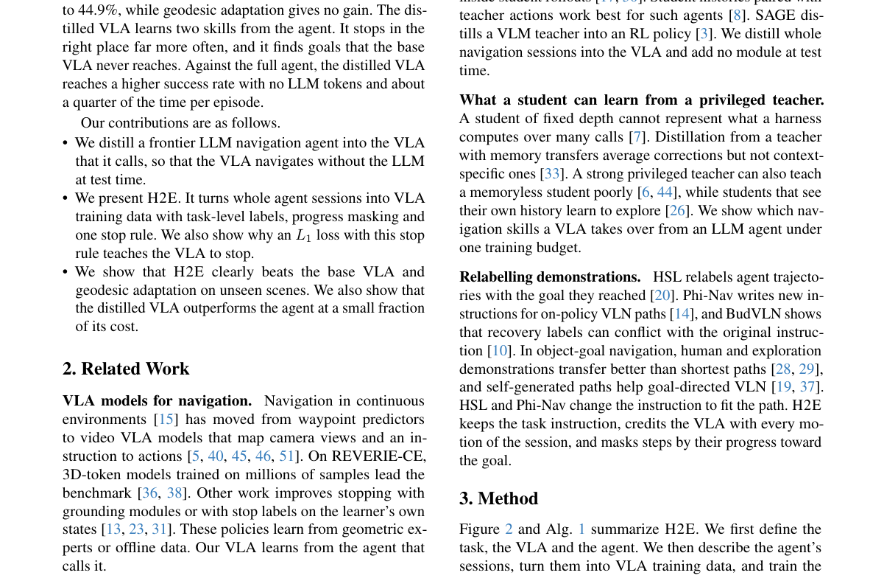

**Why this ranks #9**: 导航智能体每回合都要调 LLM 规划器，成本与延迟都高，论文提出 H2E：把调用 VLA 的智能体会话转成 VLA 训练数据，每个运动在原任务指令下变成一个 VLA 动作目标，背离目标的步骤屏蔽损失、离目标 1 m 内的访问状态一律标为停止，再用 LoRA 更新 VLA；在 REVERIE-CE 全部 3,189 个 val-unseen 回合上，8B VLA 成功率从 35.0% 提升到 44.9%，而测地线适应没有增益。

---

### 10. VOKE: Visual Object Kinematics Estimator for Dexterous In-Hand Manipulation

**arXiv**: [2611.16423](https://arxiv.org/abs/2611.16423) | **Score**: 9.0 (relevance 9 x 0.7 + quality 9 x 0.3) | **Direction**: `embodied_ai` | **Tags**: embodied, in-hand-manipulation, object-kinematics, pose-refinement, perception, Shanghai Jiao Tong University | **Categories**: cs.RO | **Pages**: 8

**Authors**: Shengjia Zhu; Wenqiang Xu; Lin Shao

**Affiliation**: Shanghai Jiao Tong University; National University of Singapore; Fudan University

**Abstract**

> Vision-based dexterous in-hand manipulation requires knowing not only where an object is, but also how it moves. However, most robotic manipulation systems rely on off-the-shelf visual perception models whose outputs are limited to static object masks, geometry, or 6D poses, leaving downstream controllers to infer object dynamics implicitly from noisy visual observations. We present VOKE, a kinematics-aware perception framework that augments existing object and hand-object pose estimators to recover a complete object kinematic state comprising pose, linear and angular velocity, and linear and angular acceleration. VOKE contains two core perception modules and a downstream application study. First, a Pluggable Kinematics Module (PKM) attaches to the output of a standard pose estimator and predicts the object's linear and angular velocity and acceleration from temporal visual features. Second, a Kinematics-guided Pose Refinement Module (KPRM) converts this motion vector into a second-order, motion-prior reference pose and refines the per-frame pose estimates. We evaluate VOKE on DexYCB and OakInk, where it consistently improves object pose estimation across three different backbones and substantially reduces velocity and acceleration estimation error compared with pose differencing. As a downstream application, we use Kinematics-Augmented Reinforcement Learning (KARL) to compare a kinematics-augmented policy with a pose-history baseline. After training the policies in simulation, we transfer the kinematics-augmented policy to the physical robot without policy fine-tuning, demonstrating the complete perception-to-control pathway in the target domain.

**Key findings**

- **Finding**: 以 gSDF 为骨干时 VOKE 在 DexYCB 上把平均中心误差从 1.95 cm 降到 1.80 cm、平均角点误差从 2.89 降到 2.75 cm，平移 RPE 从 2.50 降到 0.89 cm；在 OakInk 上平移 RPE 从 2.65 降到 1.06 cm，整体平移 RPE 下降 41.0%–64.4%、旋转 RPE 下降 7.9%–33.3%。
- **Inference**: 运动学引导的精化之所以有效，是因为它给逐帧位姿估计提供了一个跨帧的运动先验，替代了用位姿差分反推速度这种噪声放大严重的做法。
- **Recommendation**: 做手内操作时把「位姿 + 线角速度 + 线角加速度」当作完整运动学状态显式建模，并对现有位姿估计器做即插即用增强；评估时同时看位姿误差与平移/旋转 RPE，并检查增强后的策略能否零微调迁到真机。

**Key figures**

*Framework - Motivation and overview of VOKE. Top: VOKE augments frame-wise object pose estimation with explicit linear and angular velocity and acceleration. Bottom: During real-world deployment, VOKE con*

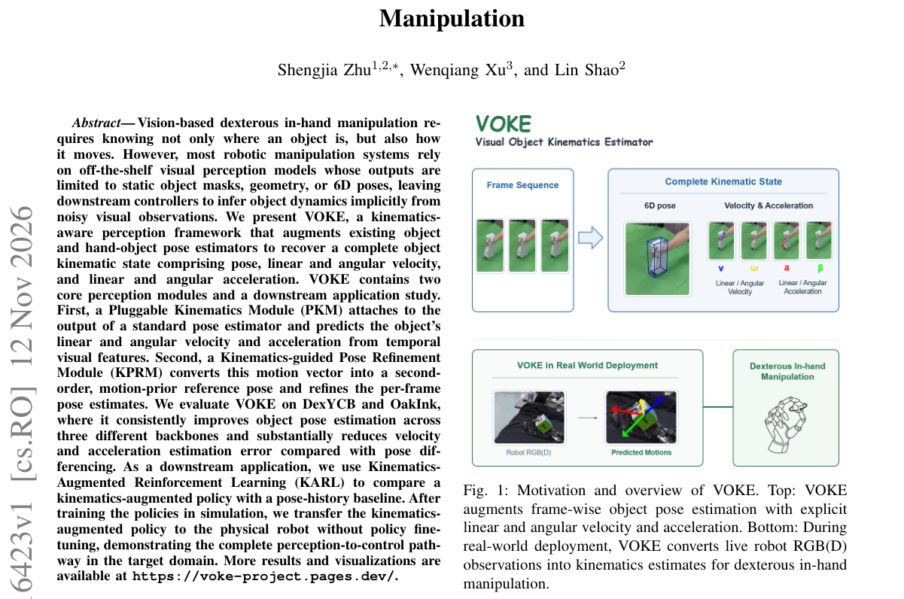

*Result - Overview of VOKE. Given a sequence of RGB(D) frames, a base pose estimator shares its image encoder with the Pluggable Kinematics Module (PKM) and produces per-frame pose estimates. PKM aggreg*

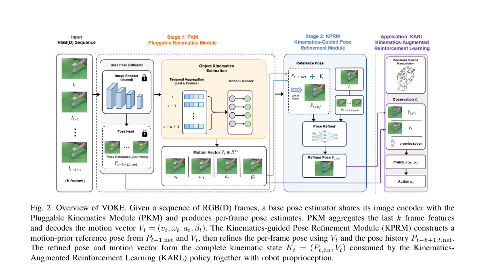

**Why this ranks #10**: 灵巧在手的操作需要的不只是物体位姿，还有速度与加速度，VOKE 用可插拔运动学模块从时序视觉特征预测物体线/角速度与线/角加速度，再用运动学引导的位姿精化模块把运动矢量转成二阶运动先验参考位姿去修正逐帧估计；在 DexYCB 与 OakInk 上跨 3 种骨干一致提升，平移 RPE 下降 41.0%–64.4%，下游运动学增强强化学习策略成功率 78.90% 对位姿历史基线的 68.20%。

---

### 11. FORGE: Force-Aware Multi-Granularity Control for Efficient Humanoid Loco-Manipulation

**arXiv**: [2611.17142](https://arxiv.org/abs/2611.17142) | **Score**: 9.0 (relevance 9 x 0.7 + quality 9 x 0.3) | **Direction**: `embodied_ai` | **Tags**: embodied, humanoid, loco-manipulation, force-estimation, whole-body-control, Shanghai AI Laboratory | **Categories**: cs.RO | **Pages**: 8

**Authors**: Liangjun Xing; Ke Fan; Kailin Li; Bin Wang; Xiaojie Niu; Qingwei Ben; Jiafei Cao; Wei Yao; Yebin Liu; Jingbo Wang; Weinan Zhang

**Affiliation**: Shanghai AI Laboratory; Tsinghua University; Zhejiang University; Shanghai Jiao Tong University; The Chinese University of Hong Kong

**Abstract**

> Humanoid loco-manipulation requires coordinated locomotion, balance regulation, and manipulation under frequent contacts, making teleoperated demonstration collection difficult: a practical controller must simultaneously provide precision, stability, and contact awareness. We propose FORGE, a force-aware multi-granularity control system with a coarse-to-fine command space spanning velocity navigation, planar foot placement, wrist-pose tracking, and optional force-conditioning inputs. Policy training requires no full-body human motion trajectories or joint-angle references; deployment consumes only sparse bilateral wrist poses relative to the pelvis, coarse motion commands, and optional desired wrist-load inputs. For sustained contact, FORGE combines a momentum observer with a learned correction trained using simulator contact-force supervision. At deployment, it estimates low-frequency, wrist-equivalent interaction forces from proprioception and reconstructed low-level arm PD torques, without wrist force/torque sensors. A quasi-static virtual-target loop uses this estimate and an optional desired applied-force input to adapt the wrist target. A frozen locomotion prior and asymmetric residual actions stabilize manipulation-induced whole-body corrections. Experiments evaluate unified-control stability, task-space tracking, quasi-static wrist-equivalent force estimation, squeezing forces during sustained contact with a rigid box, and downstream diffusion-policy execution of a squat-and-lift task across payload conditions. Website: https://bb0928.github.io/forge/.

**Key findings**

- **Finding**: FORGE 的混合力估计器在分级负载轨迹上 x/y/z 三轴 RMSE/MAE 为 0.81/0.50、1.97/1.57、0.87/0.67 N，优于纯动量观测器的 2.83/2.29、5.15/4.43、3.02/2.58 N；策略以 50 Hz 运行，在 35/40/50 N 未见负载下混合估计的 RMSE 为 8.28/9.66/12.35 N。
- **Inference**: 用本体感知加重建的低层手臂 PD 力矩就能在无腕部力矩传感器条件下估计低频交互力，从而让准静态虚拟目标环去自适应腕部目标，比上腕力传感器更容易落地到现有人形平台。
- **Recommendation**: 做人形 loco-manipulation 时优先按多粒度命令空间（导航/落足/腕姿/力条件）设计接口，部署侧用 50 Hz 策略加 50 N 力估计上限，并照它的跨载荷评测方式给每种载荷 20 次硬件试验。

**Key figures**

*Framework - FORGE enables efficient humanoid loco-manipulation via multi-granularity control: velocity navigation, foot placement, single-/dual-arm end- effector tracking, and force-conditioned contact ad*

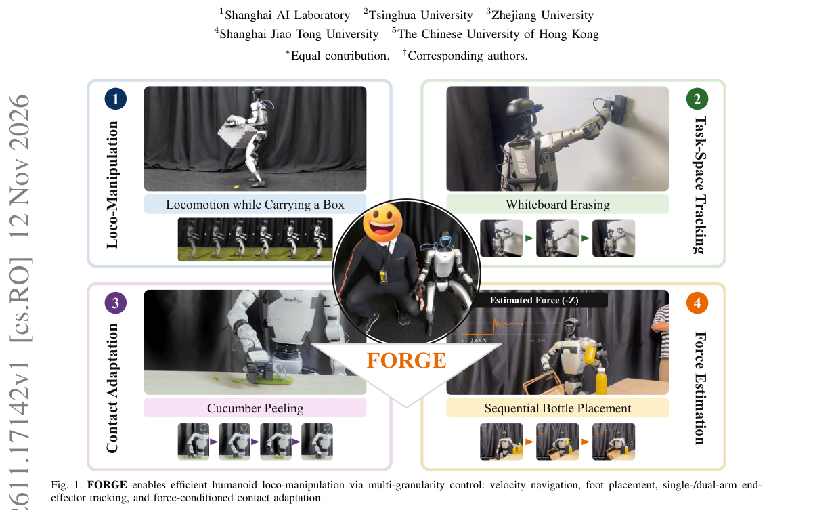

*Result - Overall pipeline of FORGE. The framework has three components: multi-granularity control over navigation, stance, pose, and optional force- conditioning inputs; a physics-informed hybrid force*

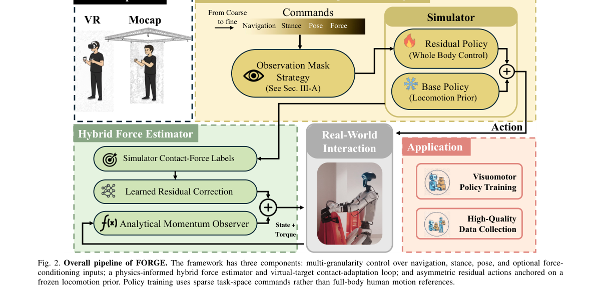

**Why this ranks #11**: FORGE 用粗到细的命令空间覆盖速度导航、平面足底落位、腕部位姿跟踪与可选力条件，训练不需要全身人体动作或关节角参考，部署只吃骨盆相对的双腕位姿与可选期望腕部载荷；混合力估计在 x/y/z 三轴的 RMSE 为 0.81/1.97/0.87 N，明显优于纯动量观测器的 2.83/5.15/3.02 N，0–2 kg 载荷的搬运任务每种 20 次试验分别成功 20/20、20/20、18/20、18/20。

---

### 12. PolyMorphWBC: Whole-Body Control from End-Effector Trajectories for Quadrupedal Mobile Manipulation across Arm Morphologies with Extended Reach

**arXiv**: [2611.15117](https://arxiv.org/abs/2611.15117) | **Score**: 8.7 (relevance 9 x 0.7 + quality 8 x 0.3) | **Direction**: `embodied_ai` | **Tags**: embodied, mobile-manipulation, whole-body-control, morphology-conditioning, extended-reach, [unverified] | **Categories**: cs.RO | **Pages**: 8

**Authors**: Heng Li; Yang Li; Yifan Duan; Ren Fang; Matao Duan; Wenhao Yu; Lu Zhang; Jianmin Ji; Yanyong Zhang

**Affiliation**: [unverified]

**Abstract**

> Quadrupedal mobile manipulators can extend their manipulation workspace by coordinating the mounted arm with the mobile base. At the task level, short-horizon end-effector (EE) trajectories provide an interface for specifying the desired manipulation motion without prescribing how it should be realized by the arm and base. However, executing such trajectories remains challenging because the controller must determine when and how the base should move, and this decision depends on the mounted-arm morphology. We therefore present PolyMorphWBC, a hierarchical controller that takes an EE trajectory as the sole task-level motion command and generates coordinated arm--base motions across four families of 6-DoF mounted arms, with extended-reach trajectories beyond the initial fixed-base reach. Within PolyMorphWBC, a trajectory-conditioned coordinator determines the base motion from previewed EE targets, while arm-specific Inverse Kinematics (IK) tracks the current target, and a frozen locomotion backend executes the resulting motion. Cross-arm reuse is enabled by a Unified Robot Description Format (URDF)-derived morphology conditioning, together with online residual-wrench feedback. We train PolyMorphWBC on procedurally generated arms and structured trajectories within and beyond fixed-base reach. In IsaacLab, it achieves 93.95% completion with 2.30cm position error and 4.81° orientation error on held-out trajectories and arm morphologies. In MuJoCo evaluation against UMI-on-Legs, PolyMorphWBC reduces EE position error by 69--72% and orientation error by 91--97% across four within- and extended-reach trajectories. On a physical Go2--ARX5 system, we demonstrate language-conditioned extended-reach pick-and-place using EE trajectories from pi_0 without vision-language-action (VLA)-generated base commands.

**Key findings**

- **Finding**: PolyMorphWBC 覆盖 4 类 6 自由度安装臂并支持超出固定基座初始可达范围的轨迹；IsaacLab 留出轨迹与留出臂形态上完成率 93.95%、位置误差 2.30 cm、姿态误差 4.81°；MuJoCo 上相对 UMI-on-Legs 的位置误差降低 69%–72%、姿态误差降低 91%–97%。
- **Inference**: 把「基座要不要动、怎么动」从上层策略手里拿出来交给轨迹条件协调器，并让不同臂共享同一套控制器靠形态条件化而非重训，就能跨臂型复用同一策略。
- **Recommendation**: 做四足移动操作时把末端轨迹当作唯一任务接口、把臂型差异编码进控制器而不是重训策略；评测要单列超出固定基座可达范围的轨迹，并给出相对 UMI-on-Legs 等基线的误差降幅。

**Key figures**

*Framework - Cross-arm reuse and extended reach with PolyMorphWBC. Top: a shared control hierarchy maps short-horizon EE trajectories to morphology-dependent arm–base motion across mounted-arm morpholo- gi*

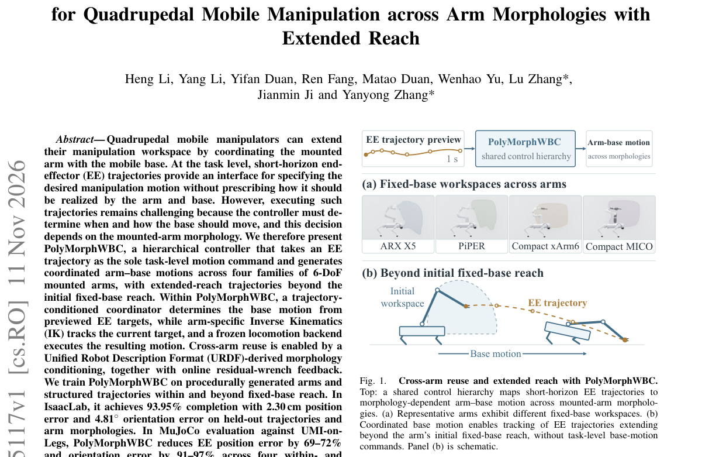

*Result - Pipeline of PolyMorphWBC. (a) The coordinator converts an EE trajectory preview into a base command, while arm-specific IK tracks the current target and the locomotion backend produces leg act*

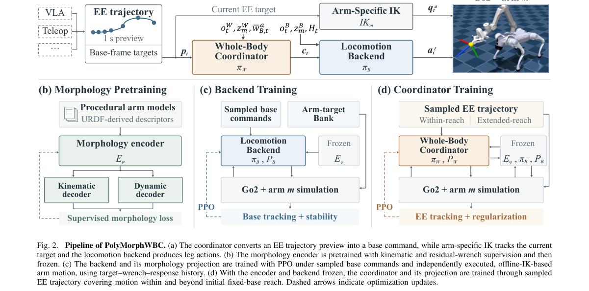

**Why this ranks #12**: PolyMorphWBC 把短时域末端执行器轨迹当作唯一任务级运动指令，用轨迹条件协调器决定基座何时与如何移动，由臂专属 IK 跟踪当前目标、冻结的 locomotion 后端执行；靠 URDF 派生的形态条件化与在线残差力反馈实现跨臂复用，在 IsaacLab 上留出轨迹与留出臂形态的完成率 93.95%、位置误差 2.30 cm、姿态误差 4.81°，MuJoCo 上对 UMI-on-Legs 的位置误差降低 69%–72%、姿态误差降低 91%–97%。

---

### 13. What Makes a VLA Reactive? A Study of Execution Strategies for Dynamic Manipulation

**arXiv**: [2611.15491](https://arxiv.org/abs/2611.15491) | **Score**: 8.7 (relevance 9 x 0.7 + quality 8 x 0.3) | **Direction**: `embodied_ai` | **Tags**: embodied, vla, action-chunking, async-inference, dynamic-manipulation, Karlsruhe Institute of Technology (KIT) | **Categories**: cs.CV, cs.LG, cs.RO | **Pages**: 13

**Authors**: Zhuoyue Li; Zhendong Han; Pankhuri Vanjani; Wenting Li; Rudolf Lioutikov

**Affiliation**: Karlsruhe Institute of Technology (KIT); Robotics Institute Germany (RIG)

**Abstract**

> Vision-language-action (VLA) models predict chunks of future actions, and when objects move, those chunks go stale before they are executed. We study what makes a pretrained VLA reactive, using \pihalf{} on two dynamic simulation benchmarks and three real-robot tasks. We vary the prediction and execution horizons, compare synchronous and asynchronous inference, test methods that deliver actions sooner or keep successive chunks continuous, and adapt the policy with motion cues and latent-space reinforcement learning. The best prediction horizon is about one second, and the best execution horizon depends on the checkpoint. Short horizons help more with asynchronous execution, and methods that keep the trajectory continuous outperform those that only reduce latency. Adapting the policy repairs targeted failures, but on the conveyor task changing the execution horizon gained as much. Reactivity depends on the execution pipeline as much as on the policy, so both should be evaluated together.

**Key findings**

- **Finding**: 最佳预测时域在 DOM 上是 25 步、DOMINO 上是 30 步，对应 25 Hz 与 30 Hz 控制率下各为 1 秒运动；最佳执行时域依赖检查点，1k 检查点在 s=5、5k 在 s=15；自适应时域 AAC 从未超过最佳固定时域，并在静态与高速传送带任务上失败。
- **Inference**: 推理调度与轨迹连续性带来的收益和策略本身一样大——异步执行下相关方法可达 60%–75%；而对目标条件做策略适配后 DOM 上成功率从 32% 升到 47%、最难传送带情形从 0 升到 60%，但在传送带任务上改执行时域收益相当。
- **Recommendation**: 评估 VLA 实时性时把预测时域与执行时域、推理同步方式、动作块连续性一起扫，并固定检查点再比较；不要用熵触发重规划，因为场景陌生时熵高但决策并不会因此改变。

**Key figures**

*Framework - Dynamic VLA manipulation depends on the interaction between prediction and execution horizons, inference scheduling, chunk continuity, and policy behavior, which together determine whether f*

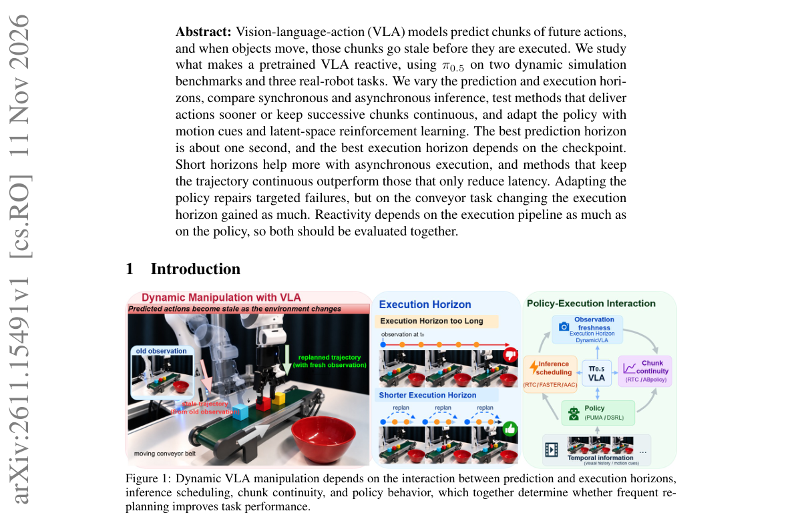

*Result - RQ1. (a) Success against the prediction horizon in seconds on DOM and DOMINO; rings mark the best horizon. (b) Conveyor-belt success of the 1k and 5k checkpoints across execution horizons. (*

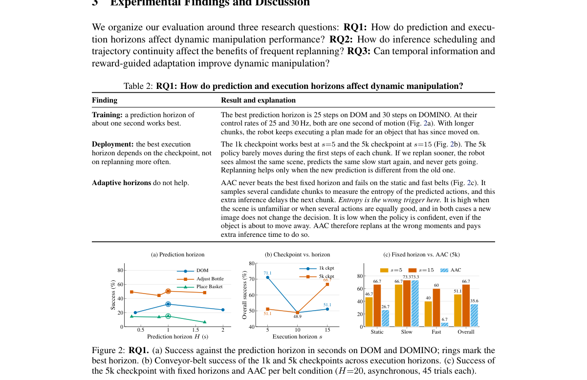

**Why this ranks #13**: VLA 预测的动作块在物体移动后会过期，论文在两个动态仿真基准与三个真机任务上系统改变预测与执行时域：最佳预测时域约为 1 秒（DOM 25 步 @25 Hz、DOMINO 30 步 @30 Hz），最佳执行时域取决于检查点（1k 在 s=5、5k 在 s=15），保持轨迹连续的方法优于单纯降延迟，熵自适应时域 AAC 从未超过最佳固定时域。

---

### 14. Runtime Safety and Emergency Stops on a Full-Size Humanoid: Deployment Lessons and a Case for Graduated Force Authority

**arXiv**: [2611.15928](https://arxiv.org/abs/2611.15928) | **Score**: 8.7 (relevance 9 x 0.7 + quality 8 x 0.3) | **Direction**: `embodied_ai` | **Tags**: embodied, humanoid-safety, emergency-stop, deployment, force-authority, University of Colorado Boulder | **Categories**: cs.RO | **Pages**: 5

**Authors**: Max Conway; Yutong Zhang; Allen Devaraj; William Xie; Alessandro Roncone; Nikolaus Correll

**Affiliation**: University of Colorado Boulder; University of Notre Dame

**Abstract**

> Full-size humanoid robots are being considered for hazardous industrial work such as disassembling electric-vehicle batteries. We describe the safety mechanisms of an open-source autonomy stack for the Unitree H1-2 humanoid and what deploying them taught us. All joint commands pass through a safety layer that runs separately from the control software. It enforces joint position, velocity, and torque limits, and it stops the robot when a state estimate becomes stale or when the hard-wired emergency stop (e-stop) is pressed or disconnected. We pushed the standing robot until it lost balance. With a model-predictive lower-body controller it never recovered, and the operator had to press the e-stop in every trial. Pressing it removes balance control, and the robot falls. The safety layer's own limits trigger the same stop, and limits chosen for manipulation were exceeded during normal walking. Near an operator or a battery pack, the fall can be more dangerous than the cause of the stop. Joint limits bound how much force a robot can apply, but not when applying it is appropriate. Drawing on research on responsibility and on child and adolescent development, we therefore make a case for granting robots force authority in stages, with a person or organization explicitly responsible for its use.

**Key findings**

- **Finding**: 安全层是独立于控制软件的进程，强制关节位置、速度与力矩上限，并在状态估计过期或硬接线急停按下/断开时停机；推挤试验中 MJPC 的质心裕度降到 −0.166 m、峰值俯仰 16.3±6.3°，操作员每次都按急停（4.68±2.86 s），ALMI 最小裕度 −0.044 m、峰值俯仰 6.8±1.4°，15 次试验中 14 次恢复正裕度。
- **Inference**: 全尺寸人形的安全停机不能用固定基座机械臂的「断电即安全」假设——H1-2 只靠 50–67 Hz 的平衡控制器维持站立，Category 0 停机会直接抽掉它，70 kg、质心 0.9 m 的身体倒下可释放约 600 J。
- **Recommendation**: 部署全尺寸人形时把急停设计成受控下降或最小损伤跌倒而不是直接切力矩；同时明确「安全层自身的上限也可能触发危险停机」，并用逐步授权的力权限代替一次性放开。

**Key figures**

*Framework - A Unitree H1-2 humanoid working alongside the gantry-based RAPID disassembly cell [2] on a Hyundai Ioniq 5 battery pack.*

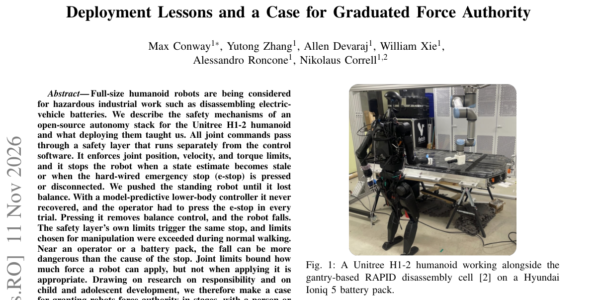

*Result - Skills command the lower- and upper-body con- trollers. Every joint command they produce passes through the safety layer, a separate process that is independent of the learned and model-based*

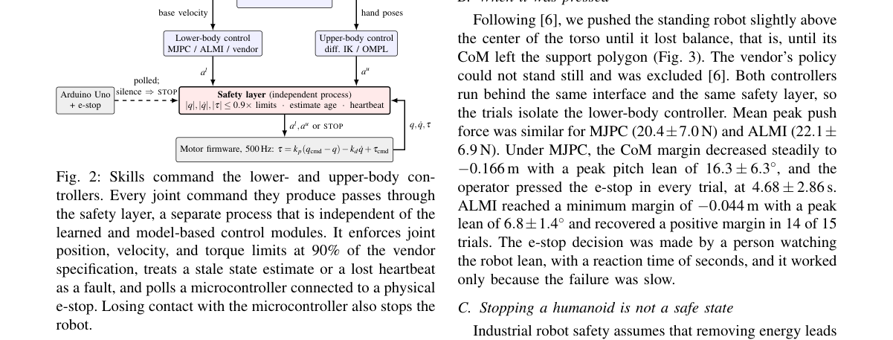

**Why this ranks #14**: 论文公开了 Unitree H1-2 全尺寸人形机器人的开源自主栈中与控制软件分离运行的安全层，它强制关节位置、速度与力矩上限，并在状态估计变陈旧或硬接线急停被按下或断开时停机；推挤试验里 MJPC 下操作员每次都必须按急停（4.68±2.86 s），而 ALMI 在 15 次试验中 14 次恢复；由于急停直接切掉力矩，机器人倒下可释放约 600 J 能量，因此入选 embodied_ai 方向。

---

### 15. Robot Navigation and Obstacle Avoidance from Randomly Positioned External Cameras

**arXiv**: [2611.16282](https://arxiv.org/abs/2611.16282) | **Score**: 8.7 (relevance 9 x 0.7 + quality 8 x 0.3) | **Direction**: `embodied_ai` | **Tags**: embodied, visual-navigation, exocentric-vision, obstacle-map, sim-to-real, University of Tsukuba | **Categories**: cs.RO | **Pages**: 8

**Authors**: Raul Steinmetz; Jair Augusto Bottega; Ayanori Yorozu; Akihisa Ohya

**Affiliation**: University of Tsukuba

**Abstract**

> We study robot navigation in indoor environments from fixed exocentric cameras (infrastructure-mounted, external to the robot). We show that standard Proximal Policy Optimization (PPO), which succeeds with onboard cameras, fails to learn this navigation end-to-end in our setup. This failure results from the perspective mismatch between exocentric observations and egocentric action and goal formulations, which is too complex to resolve from the reward signal alone. To address this, we propose Viewpoint-Invariant Navigation from Exocentric Cameras (VINE). VINE uses an obstacle map estimation network, trained with supervised learning, that takes exocentric images, camera pose, robot pose, and room dimensions as input and produces a viewpoint-invariant obstacle map. This map can be used either by a PPO policy or by a planner such as A*. VINE's map estimation performs better than perspective mapping approaches, handles cameras placed across a wide range of positions and orientations without view-specific tuning, requires only approximate camera pose estimates (noise with a standard deviation of 30cm per axis in x, y, and z and about 20° of rotation error on average), is robust to intrinsic variation, and extends to two-camera setups with partial coverage. Despite operating from cameras randomized in position during evaluation, VINE surpasses the navigation success rate of PPO with an onboard camera in simulated environments.

**Key findings**

- **Finding**: VINE 的障碍物地图估计验证 IoU 为单相机 0.909、双相机 0.913，可容忍 x/y/z 各 30 cm 的标准差与约 20° 的平均旋转误差；导航成功率上 No Camera PPO 为 25.8%、固定世界相机 PPO 仅 24.7%、机载 PPO 83.9%、VINE-PPO 单/双相机 92.3%/93.5%、VINE-A* 单/双相机 94.4%/95.1%，而 A* 用真值地图可达 99.9%。
- **Inference**: 外置视角与机载动作/目标表述之间的透视错配太复杂，靠奖励信号无法在训练预算内解决；把问题降维成可监督测量、能直接用 IoU 评估的障碍物地图，就能绕开这一错配。
- **Recommendation**: 用外部摄像头做导航时，先训练一个视角无关的障碍物地图估计器（有明确 IoU 指标）再接 PPO 或 A*，并用真值地图基线（如 A* 的 99.9%）给出可达上限来判断差距。

**Key figures**

*Framework - Overview of VINE. A supervised-learned obstacle map estimation network (blue) predicts a global obstacle map from an exocentric image, conditioned on the approximate camera pose matrix and roo*

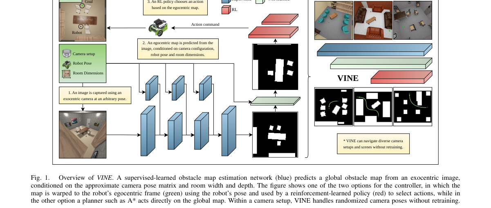

*Result - Obstacle map estimation IoU as a function of individual perturbation magnitude. Lines show the mean over three estimator seeds and bands the 95% confidence interval. Gray regions indicate the*

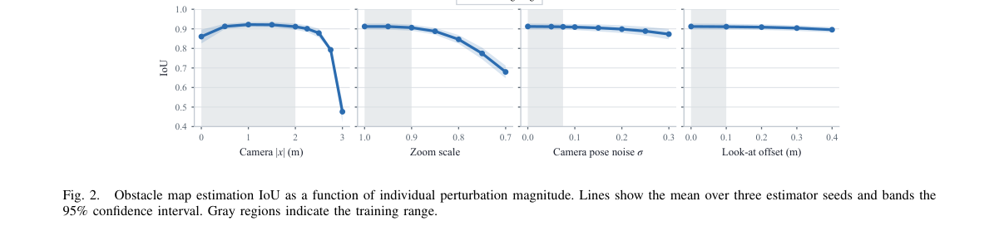

**Why this ranks #15**: 标准 PPO 用机载相机可以学会导航，但换到外置固定相机就训不出来，论文提出 VINE：用监督学习的外置相机障碍物地图估计网络（输入图像、相机位姿、机器人位姿与房间尺寸）产出视角无关地图，再交给 PPO 或 A*；在随机相机设置下 VINE-PPO 单相机成功率 92.3%、双相机 93.5%，高于机载 PPO 的 83.9%，而固定世界相机的 PPO 只有 24.7%。

---

## Footer

- Total papers reviewed across all 4 axes: 60
- world_embodied axis final count: 15
- Wild-cards in this axis: 0
- Figure assets: 2026-11-14/res/

Generated by `mine-arxiv-daily-digest` skill. Sister file: `2026-11-14_world_embodied_entry.md`.
