# Mine Arxiv Daily Digest - 2026-11-16 (AIGC 视觉生成与编辑 Axis, 15 papers)

**Generated**: 2026-11-16 11:54 CST

**Source**: arXiv cs.CV, cs.SD, eess.AS, cs.CL, cs.AI, cs.RO, cs.LG, cs.IR submissions, listing day 2026-11-13 (announced 2026-11-16 01:00 UTC)

**Batch window**: 2026-11-12T19:00:00Z .. 2026-11-13T19:00:00Z（arXiv 公告批次横跨两个 UTC 日：从前一日的美东 14:00 截止时刻起算（EDT 为 18:00Z，EST 为 19:00Z），到当日的同一时刻为止）

**Axis**: aigc_visual (15 papers, base 15, cap 20)

**Directions**: aigc_generation (10), aigc_editing (4), aigc_rl (1)

**Selection**: 15 papers ranked by relevance x quality, with 0 wild-card slots

**Day total**: 60 papers across 4 axes (target 60)

**Scope**: 图像 / 视频 / 3D / 4D 内容的生成与编辑，以及面向视觉生成的 RL / 偏好优化与奖励模型

**Wild-card**: 0 —— 本 axis 未启用任何 wild-card 名额。原报告的 2 条 wild-card（2611.17629 多视图 3D transformer 的免训练加速、2611.17752 稀疏视角 3D 高斯泼溅的 lineage-aware dropout）在完整批次重跑后 relevance 都只有 6，被更够格的新候选挤出，按「wild-card 必须比够格论文更该进」的口径一并取消。

**本 axis 从 10 篇补到 15 篇，正好打满基准 15 篇。** 原分配是 `aigc_generation` 6 / `aigc_editing` 3 / `aigc_rl` 1；本轮新增 7 篇——`aigc_generation` 6 篇（MacroGS、SceneAgent、Vessel2Brain、损失与预测参数化分析、JaRS、InfiHall-Bench）、`aigc_editing` 1 篇（RecurIR）、`aigc_rl` 0 篇，同时有 2 篇旧的 `aigc_generation` 被挤出（2611.17629、2611.17752），最终为 10 / 4 / 1。

**`aigc_generation` 超基准 2 个，由 `aigc_rl` 让出。** 按 `pipeline.py select` 的判据 `dir_over ≤ max(dir_under, axis_surplus)`，本 axis 的 direction 基准和是 15、实际也是 15，因此 `axis_surplus = 0`，超基准的 2 个名额只能由 `aigc_rl` 的缺口吸收——而 `aigc_rl` 全批仍然断供，只有 2611.17585 一篇够格，未凑数。

⚠️ **原报告的 2 条 wild-card 被取消**：2611.17629 与 2611.17752 在完整批次重跑后 relevance 均为 6，而 MacroGS 等新候选 relevance 为 8。wild-card 的前提是「比够格论文更该进」，候选供给变充裕后这一前提不再成立。

---

## AIGC 生成（图像 / 视频 / 3D / 4D） · `aigc_generation` (10 papers)

本方向 10 篇里 7 篇是补跑新增，主线是**把生成目标与轨迹本身当成可设计的量**。AnisoFlow 只改训练目标、不动架构与采样器，就把 JiT-H/16 的 FID 从 1.90 降到 1.55；Speed-Variation Distillation 进一步把反向过程蒸馏成从共享原型出发的多样化算子，让每一步解都落在可辨认图像上、因而可以提前终止；Analyzing Learning-Dynamics Across Loss and Prediction Choices 则从理论上把这件事讲透——改变损失空间等价于确定性的时间步重加权，CIFAR-10 上换用 ε-损失让 x-预测的 FID 从 11.79 降到 2.20，瓶颈比 0.67 时 ε-预测 MSE 为 5.85 而 x-预测仅 0.048；Finite speed OU-K 则连驱动过程一起换，用有限速率的 Kac 过程替代布朗运动，让 diffusion 里必需的时间截断超参整体消失（CIFAR-10 FID 3.56 对 flow matching 3.59）。新增的应用侧覆盖三块：MacroGS 把光场超分的生成单元从单视角像素换成跨视角共享的宏像素，基元数从 UVKhw 降到 Khw、10 个编码器-尺度设定里 8 个拿到最高 PSNR；Vessel2Brain 只用稀疏血管标注就生成 3D 脑 MRI（SSIM 65.36%、PSNR 26.84、NMI 1.145）；SceneAgent 把跨引擎复用的构造过程做成规范状态加可蒸馏技能，1860 次成对判定胜率 76.9%。审计侧 JaRS 用去噪器雅可比行和定位记忆区域而无需 null prompt（mIoU 0.969 / 0.975），InfiHall-Bench 则测出自回归 T2I 的幻觉集中在多要求组合上（FLUX.1-dev 整体 67.08 而动作关系只有 64.53）。

### 1. Learning Anisotropic Prediction Targets for Flow Models

**arXiv**: [2611.17767](https://arxiv.org/abs/2611.17767) | **Score**: 8.0 (relevance 8 x 0.7 + quality 8 x 0.3) | **Direction**: `aigc_generation` | **Tags**: AIGC-visual, flow-matching, learned-prediction-target, anisotropic-noise-weights, image-generation, low-precision-inference, Stanford University | **Categories**: cs.CV, cs.LG | **Pages**: 27

**Authors**: Rayhan Zirvi; Hansheng Chen; Gordon Wetzstein; Leonidas Guibas

**Affiliation**: Stanford University; California Institute of Technology

**Abstract**

> Flow-based generative models are trained on a hand-chosen prediction target, such as the velocity, the noise, or the clean data. This choice strongly affects training and sample quality. We introduce Anisotropic Flow Models (AnisoFlow), which replaces a fixed prediction target with a fully learnable one. AnisoFlow learns to scale the noise component of the target anisotropically, assigning a separate nonnegative weight to each direction in a jointly learned basis. A closed-form map recovers the velocity from the network's prediction, leaving the architecture, flow-matching loss, and sampler unchanged. Since recovery is exact, training optimizes the target purely to make it easier for the network to predict. We theoretically analyze the resulting prediction error and predict that the preferred noise weight in each direction scales near-linearly with data variance, in agreement with the weights learned empirically in pixel space. AnisoFlow improves FID from 1.90 to 1.55 over the JiT baseline on ImageNet 256$\times$256, by learning only the prediction target, without representation alignment or architectural changes. In pixel-space text-to-image generation, AnisoFlow improves image quality and, through better-conditioned velocity recovery, largely removes patch-seam artifacts under reduced-precision inference.

**Key findings**

- **Finding**: 在 JiT-H/16 上 AnisoFlow 把 FID 从 JiT 的 1.90 降到 1.55，160 epoch 时为 2.68→2.25，训练 0.819 秒/迭代、推理 0.180 秒/步几乎不变。
- **Inference**: 学到的噪声权重与数据方差近似线性（w_i≈cλ_i），说明收益来自目标本身的可学性，而不是网络容量或表示对齐。
- **Recommendation**: 复现 flow 基线时先扫预测目标的参数化形式再考虑加宽网络；低精度部署可优先试这种良态目标以换取无 patch 接缝的输出。

**Key figures**

*Result - AnisoFlow overview. (a) The network predicts the AnisoFlow target uW = W ϵ −x, where W is a learned positive semidefinite operator, and a closed-form map recovers the standard velocity. (b)*

**Why this ranks #1**: 把 flow 模型手选的预测目标换成可学习的各向异性正半定算子，只改训练目标、不动架构与采样器，就在 ImageNet 256×256 上把 JiT-H/16 的 FID 从 1.90 降到 1.55（AsymFlow 的冻结二值掩码为 1.76）；像素空间 T2I 侧 HPSv3 7.71→8.03、COCO-10k FID 22.0→20.1，且 INT8/FP8 推理不再出现 patch 接缝。

---

### 2. Speed-Variation Distillation for Generative Modeling

**arXiv**: [2611.17868](https://arxiv.org/abs/2611.17868) | **Score**: 8.0 (relevance 8 x 0.7 + quality 8 x 0.3) | **Direction**: `aigc_generation` | **Tags**: AIGC-visual, diffusion-distillation, variation-reduction, prototype-trajectory, early-termination, speed-variation-tradeoff, VISTEC | **Categories**: cs.CV | **Pages**: 16

**Authors**: Sukit Seripanitkarn; Phonphrm Thawatdamrongkit; Supasorn Suwajanakorn

**Affiliation**: VISTEC, Thailand

**Abstract**

> While diffusion models excel at image generation, their denoising trajectories pass through corrupted intermediate states far from the image manifold. We ask whether generation can instead proceed through recognizable images throughout the entire trajectory. We introduce a generative framework built around a variation-reducing degradation process that contracts diverse images toward a shared prototype while preserving recognizable intermediate states. Because such manifold traversal lacks a simple analytical form, we construct the trajectories using generative-prior-based image morphing. We then distill the reverse process into a diversification operator that transforms the prototype into increasingly varied samples. To resolve the one-to-many ambiguity of the reverse process, we associate each trajectory with its initial noise latent and apply perturbations to improve robustness against accumulated errors. At inference, every step yields a recognizable image, allowing early termination and enabling a controllable speed--variation trade-off.

**Key findings**

- **Finding**: 训练配置为 T=50 步轨迹、变化扰动上限 s_max=5、1,000 步扩散调度下噪声扰动 τ=300 与 200，batch 32、学习率 1×10⁻⁵ 微调 20,000 步，LSUN-Churches 为 50,000 步。
- **Inference**: 由于每一步解出的都落在数据流形上、是可识别图像，提前终止就能换取更少的变化，于是速度与多样性成了一个显式可控的旋钮。
- **Recommendation**: 若要做少步数生成或需要可中途打断的采样流水线，可以按这套「共享原型 + 多样化算子」的范式改造现有蒸馏目标。

**Key figures**

*Result - Overview. (a) Generate images with a pretrained LDM, select a prototype, and construct variation-reducing trajectories. (b) We train the diversification operator using noise and variation pert*

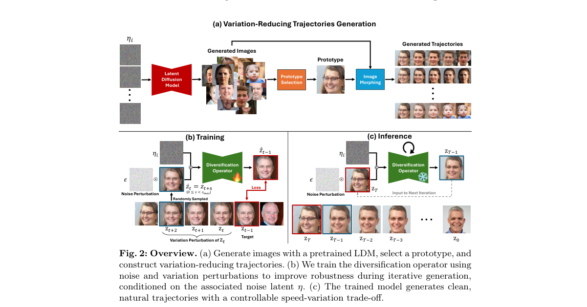

**Why this ranks #2**: 把反向过程蒸馏成一个从共享原型出发的多样化算子：训练用 DiffMorpher 造 50 步（T=50）morphing 轨迹、变化扰动上限 s_max=5、噪声扰动 τ=300（FFHQ/CelebA/LSUN-Bedrooms）与 200（LSUN-Churches），推理每一步都是可识别图像因而可提前终止；在 FFHQ 等 4 个数据集上各生成 10,000 张 256×256 图微调 2 万步（LSUN-Churches 5 万步）即可显式调节速度—多样性折中。

---

### 3. MacroGS: Macro-Pixel Shared Gaussian Primitives for Arbitrary-Scale Light Field Super-Resolutio

**arXiv**: [2611.17957](https://arxiv.org/abs/2611.17957) | **Score**: 7.7 (relevance 8 x 0.7 + quality 7 x 0.3) | **Direction**: `aigc_generation` | **Tags**: AIGC-visual, light-field-super-resolution, gaussian-splatting, arbitrary-scale, multi-view-geometry, Capital Normal University | **Categories**: cs.CV | **Pages**: 11

**Authors**: Zeqiang Wei; Angulia Yang; Min Xu

**Affiliation**: Capital Normal University; National University of Singapore

**Abstract**

> Arbitrary-scale light field spatial super-resolution reconstructs high-resolution views at any requested scale from low-resolution multi-view observations. Gaussian primitives enable continuous reconstruction, but generating separate primitive sets for each view redundantly encodes shared scene structure across views and causes the primitive count grow linearly with the number of views. To avoid such redundancy, we propose MacroGS, a feed-forward decoder that jointly predicts a single shared Gaussian set per macro pixel rather than generating separate sets for each view. Disparity-dependent replacement and angle-conditioned appearance allow each set to be reused across all output views, keeping the predicted primitive count independent of the number of views at each requested scale. The decoder iteratively predicts per-primitive disparities, retrieves the corresponding multi-view features, and updates the primitive states. Gaussian splatting and residual refinement then reconstruct the output light field. Despite being learned without geometric supervision, the predicted disparities strongly correlate with underlying scene geometry. Experiments across five benchmarks demonstrate that MacroGS integrates effectively with diverse light field encoders, improving reconstruction quality at fixed scales while achieving leading performance across most evaluated arbitrary-scale settings. The decoder also achieves speedups of approximately $2$-$10\times$ over state-of-the-art implicit light field decoders and $10$-$18\times$ over the view-wise Gaussian baseline.

**Key findings**

- **Finding**: MacroGS 为每个宏像素预测 K 个高斯基元并跨全部视角共享，使基元总数从逐视角设计的 UVKhw 降到 Khw，在五个基准的十个编码器-尺度设定中有八个取得最高平均 PSNR。
- **Inference**: 让基元集合与视角数解耦，说明光场超分的主要冗余来自逐视角重复参数化而非渲染本身，前馈共享表示因此比隐式坐标查询更划算。
- **Recommendation**: 若要复现任意尺度光场重建，应把生成单元从单 SAI 像素换成宏像素，并逐基元预测视差而不是给整块赋同一个视差。

**Key figures**

*Framework - Gaussian representations of a 2 × 2 light field at one requested scale; colours mark the K primitives. Only the primi- tives generated at the red pixel are drawn; every LR pixel generates it*

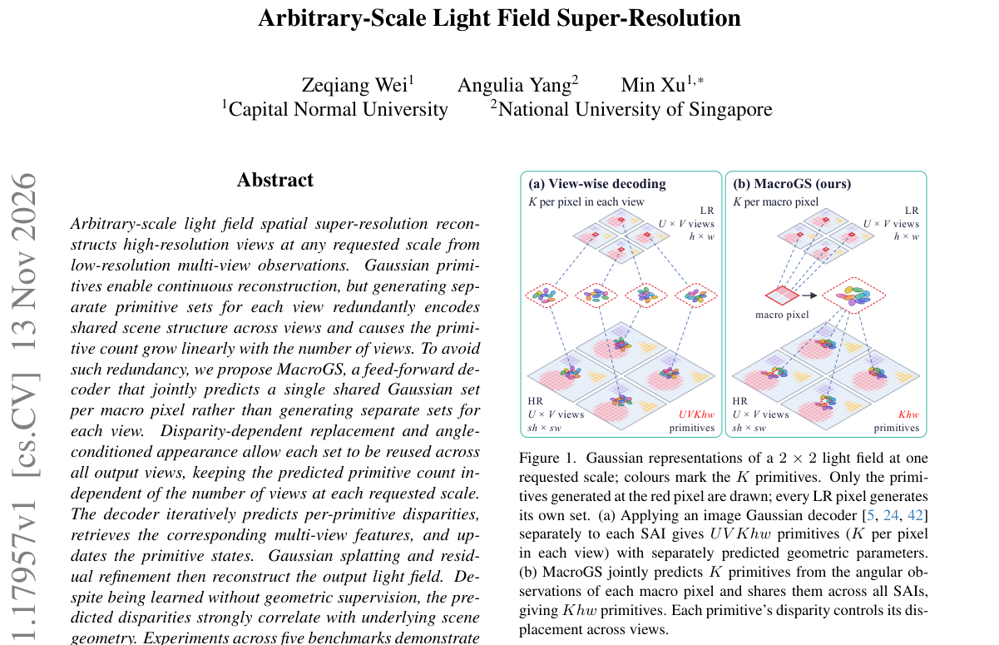

*Result - The framework of MacroGS for arbitrary-scale LFSSR. From the encoder features F, MacroGS infers one set G of K Gaussian primitives per macro pixel, shared by all views, through (a) initializ*

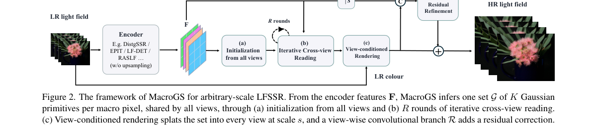

**Why this ranks #3**: 生成侧覆盖广：MacroGS 属于面向 3D/4D 表征的生成式重建工作，每个宏像素只生成 K 个跨视角共享的高斯基元，把基元数从 UVKhw 降到 Khw，在 10 个编码器-尺度设定中 8 个拿到最高平均 PSNR，×4 时相对原上采样器提升 0.34–0.70 dB。

---

### 4. Finite speed Ornstein-Uhlenbeck-Kac processes and their applications in generative modeling

**arXiv**: [2611.17625](https://arxiv.org/abs/2611.17625) | **Score**: 7.0 (relevance 7 x 0.7 + quality 7 x 0.3) | **Direction**: `aigc_generation` | **Tags**: AIGC-visual, ornstein-uhlenbeck-kac, finite-speed-diffusion, legendre-polynomial, flow-matching, cifar-10, Institute of Mathematics | **Categories**: cs.LG, math.AP, math.PR | **Pages**: 48

**Authors**: Richard Duong; Janis Auffenberg; Gabriele Steidl

**Affiliation**: Institute of Mathematics, Technische Universität Berlin

**Abstract**

> We study the Ornstein-Uhlenbeck-Kac (OU-K) process, where instead of a Brownian motion, a finite-speed Kac process defines the driving process. The OU-K process can be analyzed through a rescaled, time-inhomogeneous Kac process, characterized by a switching rate from the Kac part, and a convergence rate from the Ornstein-Uhlenbeck (OU) part. The law of this inhomogeneous Kac process describes the solution of a wave equation, the Euler-Poisson-Darboux (EPD) equation. For Kac switching rates being multiples of the OU convergence rate, we can explicitly derive this EPD solution via the sum of (the derivative of) two Legendre polynomials, restricted between two Dirac points representing the wave fronts. Using the framework of piecewise-deterministic Markov processes (PDMP), we describe the conditional velocity fields of the OU-K process via our polynomial-law-formula. This allows us to apply the OU-K process in a generative flow model. Since the OU-K velocity fields prove to be bounded by the finite Kac speed, the usual time truncations of diffusion models become unnecessary. We demonstrate advantages over diffusion and flow matching models in terms of generation sharpness on singular data sets, while achieving competitive results on CIFAR-10 image generation.

**Key findings**

- **Finding**: CIFAR-10 上 OU-K 模型 FID 为 3.56，flow matching 基线 3.59、OU 基线 3.50；在 d=32 多面体奇异数据集上，训练 15,000 与 30,000 步即比 OU diffusion 基线更尖锐。
- **Inference**: 速度场上界由有限 Kac 速率给出，损失在首尾时刻不会像 diffusion 那样出现奇异性，所以「时间截断」这一工程补丁可以整体去掉。
- **Recommendation**: 需要训练稳定性或想摆脱时间截断超参时，可把 OU-K 在 PDMP 框架下给出的条件速度场公式当作 flow matching 目标的一个现成备选。

**Key figures**

*Framework - Generated samples after 15.000 (left), 30.000 (middle) and 100.000 (right) training steps of a polytope in dimension d = 32 via the OU diffusion baseline (top) and our OU-K model (bottom), o*

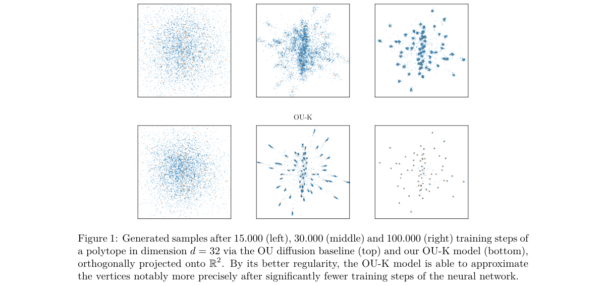

**Why this ranks #4**: 用有限速率的 Kac 过程替代布朗运动驱动 OU 过程，解析求出 Euler-Poisson-Darboux 方程的显式解（两个 Legendre 多项式 L_k、L_{k-1}），并证明条件速度场被有限 Kac 速率一致有界、从而不再需要 diffusion 的时间截断；在 d=32 多面体这类奇异数据集上更早变锐，CIFAR-10 FID 3.56 也接近 flow matching 的 3.59 与 OU 的 3.50。

---

### 5. Creative Product Design under Brand Image Constraints

**arXiv**: [2611.17762](https://arxiv.org/abs/2611.17762) | **Score**: 7.0 (relevance 7 x 0.7 + quality 7 x 0.3) | **Direction**: `aigc_generation` | **Tags**: AIGC-visual, brand-constraint, industrial-design, vlm-as-judge, self-enhancement-loop, creative-direction, TOYOTA CENTRAL R&D LABS. | **Categories**: cs.AI, cs.CV, cs.GR | **Pages**: 24

**Authors**: Takeshi Onishi; Hiroya Makino; Takahiro Yamaguchi; Hiroyuki Sakai

**Affiliation**: TOYOTA CENTRAL R&D LABS., INC.

**Abstract**

> Industrial design requires creative visual exploration while satisfying constraints that are often product-specific and implicit. Existing text-to-image (T2I) approaches can generate creative designs through concept blending or multi-agent self-enhancement, but they provide limited mechanisms for ensuring that generated designs remain consistent with such constraints. We focus on brand image as a representative design constraint and propose a framework for brand-aware redesign generation. Given a product name, the framework constructs a brand image survey report that summarizes product and market information, derives a creative direction from the report, and integrates this direction into a self-enhancement loop in which generated images are critiqued and prompts are revised. We evaluate the framework on 50 redesign tasks across five product categories, comparing it with Naive T2I, IP-Adapter/IT-Blender, and unconstrained self-enhancement under the same T2I backbone. By a VLM-as-Judge protocol to measure creativity and brand identifiability, the proposed framework achieves a more favorable trade-off between the two objectives, with particularly clear gains in highly constrained categories such as automotive and motorcycle, where the plausible design space is relatively limited compared with that of other product categories. These results suggest that dynamically eliciting and textualizing brand image can guide creative product design generation under brand image constraints.

**Key findings**

- **Finding**: 评测覆盖 5 类 50 个再设计任务，创新分取 Novelty 与 Usefulness 的调和平均（各 1–5 分），框架最终 Identity Score 0.8、Creativity Score 3.7，基线为 Naive T2I、IP-Adapter、IT-Blender 与无约束自增强。
- **Inference**: 把品牌信息显式写成文本报告相当于给身份一致性加了一个外生锚，因此能在自增强迭代中同时保住可识别性与创新性。
- **Recommendation**: 做受约束的生成设计时，先把品牌、法规、工程等约束写成结构化文本再进入生成循环，比直接塞进 prompt 更稳。

**Key figures**

*Framework - Overview of the proposed framework.*

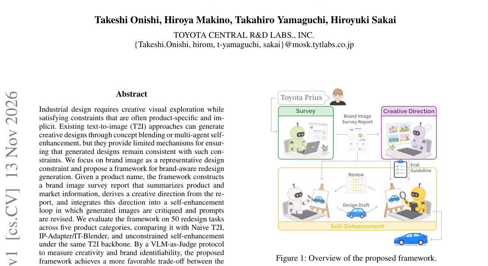

*Result - Creativity Score and Identity Score with ex- ample outputs from the proposed framework and Self- Enhancement.*

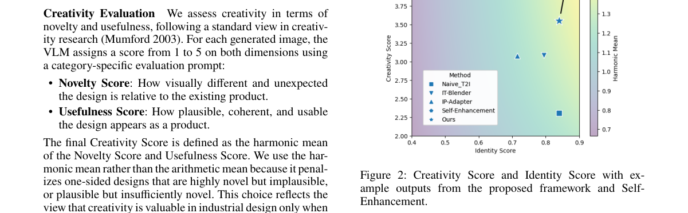

**Why this ranks #5**: 把「品牌印象」当作可动态文本化的设计约束：先用 Deep Research 生成品牌调查报告并抽出创作方向，再让 Reviewer 批判生成图、把评语改写成下一轮提示词；在 5 个品类 50 个产品上用 Gemini 2.5 Pro 做 VLM-as-Judge 评创新性与品牌可识别性，最终 Identity Score 0.8、Creativity Score 3.7，在汽车、摩托这类强约束品类上取得尤其明显的增益。

---

### 6. SceneAgent: A Multi-Agent Framework for Portable Game Scene Generation

**arXiv**: [2611.17821](https://arxiv.org/abs/2611.17821) | **Score**: 7.0 (relevance 7 x 0.7 + quality 7 x 0.3) | **Direction**: `aigc_generation` | **Tags**: AIGC-visual, multi-agent, game-scene-generation, skill-library, cross-backend-transfer, Tencent | **Categories**: cs.AI, cs.CV | **Pages**: 28

**Authors**: Xingyi Li; Jiahao Yang; Yiqin Zhu; Jingwen Ye; Yang Sun; Weidong Zhang

**Affiliation**: Tencent; Fudan University

**Abstract**

> Moving a scene generator to a new game engine requires more than exporting its final output: planning, construction tools, and stored experience may also depend on the original backend. We present SceneAgent, a multi-agent framework for reusing the construction process and its experience across backends. A canonical SceneContext maintains the evolving world, while backend adapters isolate coordinate conventions, asset bindings, and export. Structured handoffs let fresh Builder sessions query this persistent state without inheriting the full construction transcript. Across generations, human-approved traces are distilled into asset-ID-free Layout skills and semantic Content skills that can be retrieved and recombined. We introduce GameSceneBench, comprising 69 indoor and outdoor prompts. Under a common asset and evaluation protocol, SceneAgent obtains human tie-adjusted preference scores of 78.2-89.4% against five baselines. Ablations show that reusable skills and the multi-agent protocol primarily improve prompt alignment and scene completeness, with additional runtime. Deployment in a second engine preserves the shared construction protocol and skill library while replacing backend integration components. Together, these results support separating persistent scene state, task-local reasoning, and reusable experience for portable scene construction.

**Key findings**

- **Finding**: 在 GameSceneBench 的 69 条提示、1860 次成对判定中，SCENEAGENT 胜率 76.9%、平局 12.7%、负率 10.3%，平局校正偏好 83.3%，对五个基线的偏好分落在 78.2–89.4%。
- **Inference**: 把构造过程与经验沉淀解耦成可迁移的技能库，说明跨引擎复用的瓶颈不在单次生成质量，而在状态表示与资产绑定方式。
- **Recommendation**: 场景生成工具链应拆成规范化 SceneContext 加后端适配器，并把人工确认轨迹蒸馏成不含资产 ID 的 Layout 与 Content 技能以便换引擎复用。

**Key figures**

*Framework - SCENEAGENT separates within-run construction from cross-run experience reuse. Fresh Builders coordinate through canonical scene state. Backend adapters realize that state in the target engin*

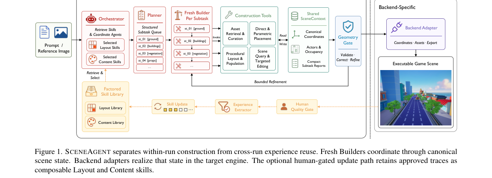

*Result - Qualitative comparison on representative GameSceneBench prompts. Rows share an input prompt, and columns show different methods under the common Engine A asset and rendering protocol.*

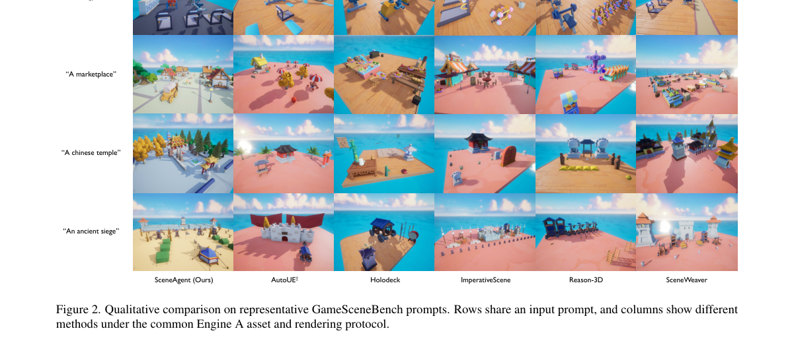

**Why this ranks #6**: 场景生成是本方向的重要落点：SceneAgent 把跨引擎复用的构造过程做成规范状态加可蒸馏技能，在 GameSceneBench 的 69 条提示、1860 次成对判定中胜率 76.9%、平局 12.7%，平局校正偏好 83.3%，对五个基线为 78.2–89.4%。

---

### 7. Vessel2Brain: Edge-Aware Multi-Scale Flow Matching for 3D Brain Image Generation from Vessel Masks

**arXiv**: [2611.17919](https://arxiv.org/abs/2611.17919) | **Score**: 7.0 (relevance 7 x 0.7 + quality 7 x 0.3) | **Direction**: `aigc_generation` | **Tags**: AIGC-visual, flow-matching, 3d-brain-mri, conditional-generation, edge-aware-loss, medical-imaging, School of Engineering | **Categories**: cs.CV | **Pages**: 10

**Authors**: Zhi Chen; Tianyang Zhang; Theodoros N. Arvanitis; Le Zhang

**Affiliation**: School of Engineering, College of Engineering and Physical Sciences, University of Birmingham; Institute of Biomedical Engineering, University of Oxford

**Abstract**

> Generating realistic 3D brain MRI volumes from sparse anatomical priors is a highly ill-posed yet clinically valuable problem, with important applications in data augmentation, simulation, and downstream neuroimaging analysis. In this work, we investigate the challenging task of synthesising full 3D brain MRI volumes conditioned solely on vascular label maps. While vascular structures provide strong anatomical and topological cues, they occupy only a small fraction of the brain volume and offer no direct information about surrounding tissue appearance. To address this challenge, we propose Vessel2Brain, an edge-aware multi-scale conditional flow matching framework that explicitly incorporates vascular structure information into the generative process. Our approach formulates vessel-guided brain image synthesis as a conditional continuous flow, enabling stable training and flexible generation while preserving structural correspondence. A multi-scale flow matching strategy is introduced to jointly model global anatomical coherence and fine-grained local details, with auxiliary velocity predictions providing additional supervision across spatial resolutions. Furthermore, we design an edge-aware objective that emphasises vascular boundaries during training, encouraging anatomically faithful tissue synthesis around vessel structures. We evaluate Vessel2Brain on two public 3D brain MRI datasets with paired vascular annotations. Extensive quantitative and qualitative experiments demonstrate that our method consistently outperforms state-of-the-art generative models in terms of reconstruction accuracy, structural consistency, and distributional realism.

**Key findings**

- **Finding**: 在 CereVessMRA 上 Vessel2Brain 的 SSIM 达 65.36%、PSNR 26.84、NMI 1.145、MAE 2.97%，四项全面超过 Med-DDPM（63.81%、26.79、1.142、2.99%）与 3D Pix2Pix（57.69%、23.74%）。
- **Inference**: 在只有稀疏血管先验的条件下，边缘加权损失加粗分辨率辅助速度监督比纯像素重建损失更能守住解剖对应关系。
- **Recommendation**: 做稀疏条件 3D 医学生成时可直接套用边缘加权 L1 流匹配损失加辅助速度头的组合，并按 128³ 体数据与被试级 8:1:1 划分对齐实验。

**Key figures**

*Framework - Overview of the proposed Vessel2Brain framework. Given a 3D vascular label map and a time step t, a UNet-style FlowNet conditioned on timestep and label embed- dings learns a velocity field fo*

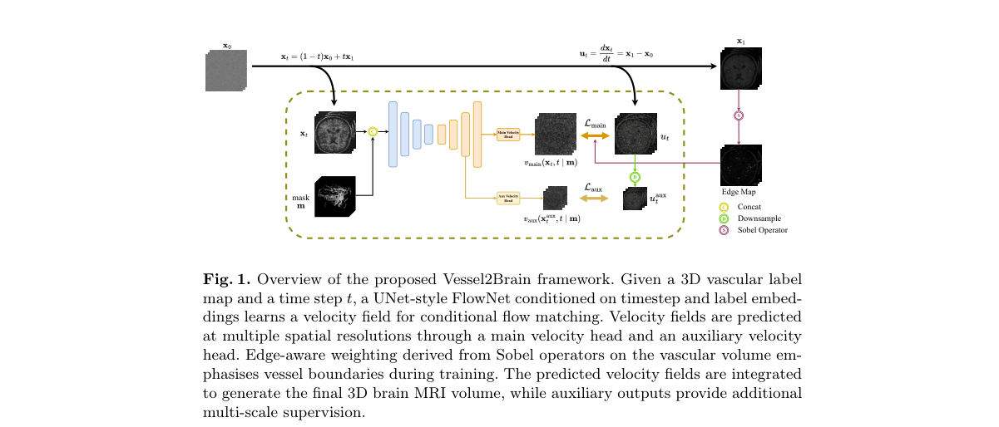

*Result - Qualitative comparison on the CereVessMRA dataset. From left to right: vascu- lar mask, ground-truth brain MRI, 3D Pix2Pix, LDM, 3D VAE, Med-DDPM, and the proposed Vessel2Brain. Results are vi*

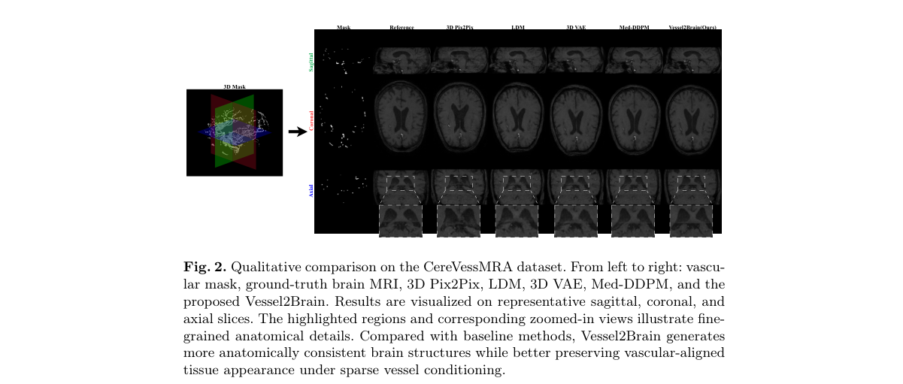

**Why this ranks #7**: 3D 体数据生成归入本方向：Vessel2Brain 仅以稀疏血管标注为条件生成 3D 脑 MRI，在 128³ 分辨率上以边缘加权流匹配训练，在 CereVessMRA 取得 SSIM 65.36%、PSNR 26.84、NMI 1.145、MAE 2.97%，四项指标均超过 Med-DDPM。

---

### 8. Analyzing Learning-Dynamics Across Loss and Prediction Choices for Diffusion Models

**arXiv**: [2611.17967](https://arxiv.org/abs/2611.17967) | **Score**: 7.0 (relevance 7 x 0.7 + quality 7 x 0.3) | **Direction**: `aigc_generation` | **Tags**: AIGC-visual, diffusion-theory, prediction-parameterization, timestep-reweighting, bottleneck-analysis, POSTECH | **Categories**: cs.LG | **Pages**: 23

**Authors**: Dongwoo Kim

**Affiliation**: POSTECH

**Abstract**

> Denoising generative models predict clean data ($x$), noise ($ε$), or velocity ($v$), while training losses can be measured in any of these spaces. Although the resulting nine combinations are algebraically related, they can yield substantially different denoising accuracy and sample quality. We disentangle the effects of prediction and loss spaces. For a fixed prediction target, we show that changing the loss space is exactly equivalent to timestep reweighting and provide a heuristic analysis of how this reweighting affects generation quality. We then show that a rank-$m$ linear bottleneck compressing a $D$-dimensional noisy input imposes an irreducible squared-error floor of $D-m$ on noise and velocity prediction, whereas clean-data prediction can exploit low-dimensional data structure. Combining this bound with prediction-dependent error conversion yields distinct necessary conditions on bottleneck capacity. Experiments with U-Net and JiT across CIFAR-10, Imagenette, and ImageNet-256 support these theoretical predictions. Under compression, prediction choice strongly affects both denoising accuracy and sample quality, with noise-prediction errors closely matching the theoretical lower bound. Our results provide a quantitative understanding of how architectural bottlenecks interact with prediction and loss choices in denoising generative models.

**Key findings**

- **Finding**: Proposition 1 证明固定预测目标时改变损失空间等价于确定性的时间步重加权；在 U-Net 与 JiT-B 上，CIFAR-10 把 x-损失换成 ε-损失让 x-预测的 FID 从 11.79 降到 2.20。
- **Inference**: 损失与预测参数化本质是同一族时间步加权，只有当嵌入瓶颈比 r 低于 1 时，下界 D−m 才把差异放大成数量级的 MSE 差距。
- **Recommendation**: 选型时先测出嵌入维度与瓶颈比 r，r 小于 1 时优先选 x-预测并同时比对 ε 与 v 预测的 x-space MSE，不要只看 FID 排序。

**Key figures**

*Framework - Synthetic validation of the bottleneck lower bound (Theorem 4) with D = 64 and d = 2. Left: Prediction MSE in each target’s native space as a function of bottleneck dimension m. The ϵ- and v*

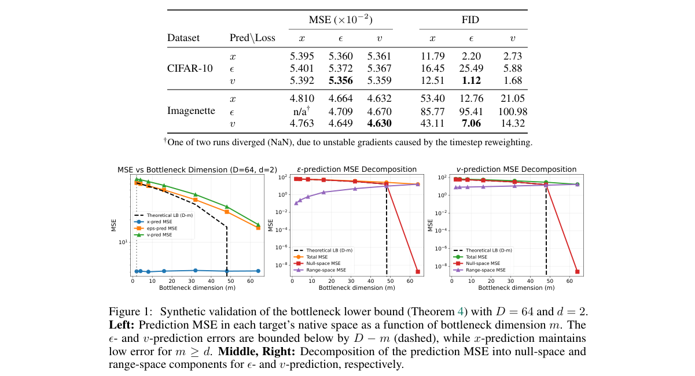

**Why this ranks #8**: 扩散模型的训练动力学直接决定生成质量：该文证明改变损失空间等价于确定性的时间步重加权，并在 U-Net（≈97M 参数）与 JiT-B（≈130M 参数）上验证，CIFAR-10 上换用 ε-损失让 x-预测的 FID 从 11.79 降到 2.20，瓶颈比 0.67 时 ε-预测 MSE 为 5.85 而 x-预测仅 0.048。

---

### 9. JaRS: Contrast-Free Localization of Memorized Regions in Diffusion Models via Jacobian Row Sums

**arXiv**: [2611.18024](https://arxiv.org/abs/2611.18024) | **Score**: 7.0 (relevance 7 x 0.7 + quality 7 x 0.3) | **Direction**: `aigc_generation` | **Tags**: AIGC-visual, memorization-detection, jacobian-analysis, diffusion-privacy, localization-map, Indian Institute of Science | **Categories**: cs.CV, cs.LG | **Pages**: 21

**Authors**: Saisuchith Mahajan; Aditey Nandan; Rohit Singh; Nishanth Shetty; Chandra Sekhar Seelamantula

**Affiliation**: Indian Institute of Science

**Abstract**

> Diffusion models sometimes memorize and reproduce regions of their training images, raising privacy and copyright concerns. We aim to localize these regions. Existing contrast-based methods use the diagonal of the denoiser Jacobian, which reflects the posterior variance of each pixel. However, a small diagonal entry is ambiguous: it signals either memorization or averaging over many neighboring pixels in smooth or predictable regions. To resolve this ambiguity, these methods subtract a reference map, which requires a second evaluation with a null prompt or an earlier checkpoint. Unconditional models have no null prompt, and earlier checkpoints are unavailable in general. We show that Jacobian row sums (JaRS), unlike the diagonal, separate memorization from local averaging without a reference map. Pairing JaRS with an image-level detection score that uses the same statistic at an early denoising step yields JaRS+. Across Stable Diffusion v1.4 and v2.1, Realistic Vision v5.1, and an unconditional diffusion Transformer (DiT), JaRS+ outperforms contrast-based localization methods.

**Key findings**

- **Finding**: JaRS+ 在 SD v1.4 的 TV、TV+N、All 设置分别取得 0.969、0.975、0.940 的 mIoU，比最强对比基线高 5.6 与 2.5 个点；SD v2.1 上 TV+N 达 0.989。
- **Inference**: 雅可比行和能区分记忆与局部平均而无需参考图，说明对比式定位必须依赖 null prompt 或历史 checkpoint，根源在于对角元本身的歧义。
- **Recommendation**: 审计扩散模型的训练数据泄漏时可直接用去噪器雅可比行和构造定位图，无需额外准备 null prompt 或历史 checkpoint。

**Key figures**

*Framework - Qualitative comparison of localization maps on Stable Diffusion v1.4 for randomly sampled test instances, two per row: four template verbatims from distinct templates (rows 1–2), one global*

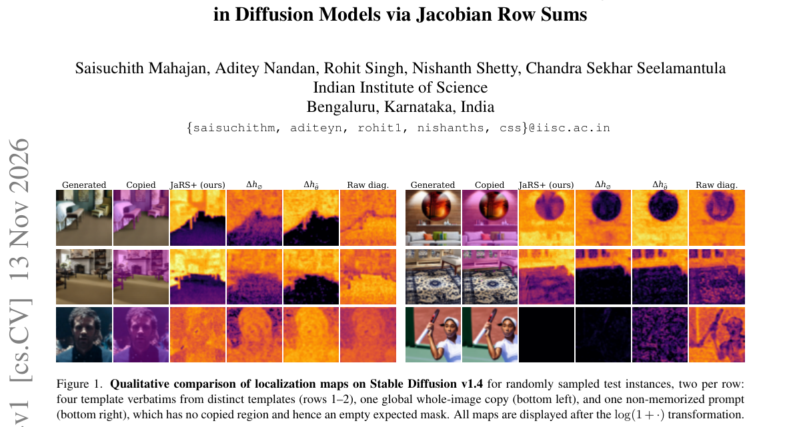

*Result - Full denoiser Jacobian rows of Stable Diffusion v1.4 (step 15) and DiT-B/2 (step 35). Left: For one development image from each category, we show the generated image (copied region outlined*

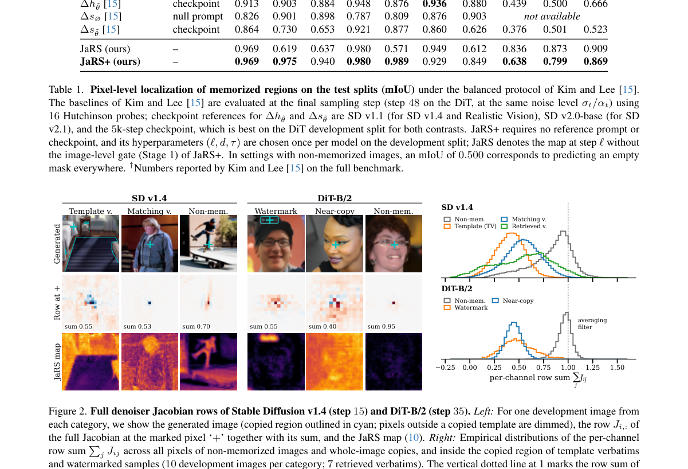

**Why this ranks #9**: 扩散模型的可记忆性审计属于生成侧议题：JaRS 不用 null prompt 或早期 checkpoint 就能定位记忆区域，在 SD v1.4 的 TV 与 TV+N 上分别取得 0.969 与 0.975 mIoU，比最强对比基线高 5.6 与 2.5 个点，在无条件 DiT-B/2 上把 All 设置从 0.666 提到 0.869。

---

### 10. InfiHall-Bench: A Benchmark for Hallucination Evaluation in Autoregressive Text-to-Image Generation

**arXiv**: [2611.18053](https://arxiv.org/abs/2611.18053) | **Score**: 7.0 (relevance 7 x 0.7 + quality 7 x 0.3) | **Direction**: `aigc_generation` | **Tags**: AIGC-visual, hallucination-benchmark, autoregressive-image-generation, confidence-masking, text-to-image, Harbin Institute of Technology | **Categories**: cs.CV | **Pages**: 18

**Authors**: Yuxia Qiao; Xinhao Zhong; Junhao Li; Yi Sun; Jiaxin Hong; Shuoyang Sun; Bin Chen

**Affiliation**: Harbin Institute of Technology, Shenzhen

**Abstract**

> Hallucination benchmarks for text-to-image generation are predominantly designed around diffusion models, limiting their diagnostic value for visual autoregressive (VAR) models and the development of mitigation methods. We identify two limitations in existing prompt construction paradigms: many prompts are no longer challenging for modern generators, while category-based construction relies on recurring object-attribute-relation templates and rarely tests interactions among multiple visual requirements within a single image. We introduce InfiHall-Bench, a controlled benchmark of 411 prompts constructed by systematically composing five foundational and visually verifiable skills: attribute binding, spatial relation, action relation, part consistency, and scene consistency. Each prompt covers 4.05 annotated skills on average, enabling the evaluation of hallucinations under diverse combinations of visual requirements. Using this benchmark, we find that hallucinations in VAR models exhibit a scale-wise persistence pattern: semantic errors can emerge at different autoregressive scales and are rarely corrected by subsequent fine-scale steps. Motivated by this observation, we propose Confidence-Masked Hallucination Mitigation (CMHM), which estimates the prediction confidence of target visual tokens at each autoregressive scale during teacher-forced fine-tuning. CMHM downweights reliably predicted tokens, allowing optimization to focus on uncertain predictions across scales. Experiments show that InfiHall-Bench distinguishes models that existing compositional benchmarks rate as comparable, while CMHM consistently outperforms uniform LoRA fine-tuning for VAR-based text-to-image generation.

**Key findings**

- **Finding**: InfiHall-Bench 含 411 条提示、平均每条标注 4.05 项技能；预训练模型中 FLUX.1-dev 的 Overall 最高为 67.08，Infinity-8B 为 65.77，却在 Action Relation 与 Spatial Relation 上只有 64.53 和 56.56，而 Scene Consistency 达 96.08。
- **Inference**: 自回归生成的整体场景容易拼对、动作与相对布局却难拼对，说明幻觉集中在多要求组合上，并呈尺度级持久、后续精细尺度难以纠正。
- **Recommendation**: 评估视觉自回归 T2I 应逐技能打分而非只看整体分，并可用 CMHM 这类按尺度重新分配损失权重的微调压低高不确定尺度上的错误。

**Key figures**

*Framework - Overview of InfiHall-Bench. Representative failures across the five skills covered by the benchmark. Each example shows the prompt, an Infinity output, and the skill-specific feedback return*

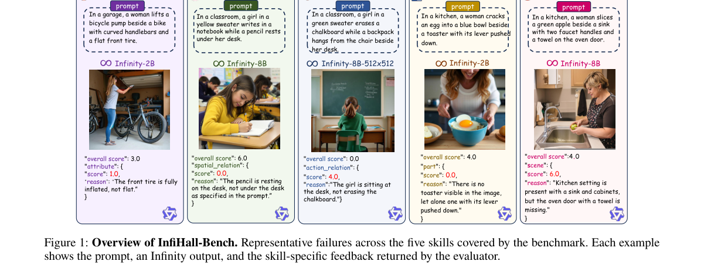

*Result - Benchmark construction and evaluation. The upper panel shows skill-guided prompt construction, followed by quality control. The lower panel illustrates the evaluation protocol to produce an*

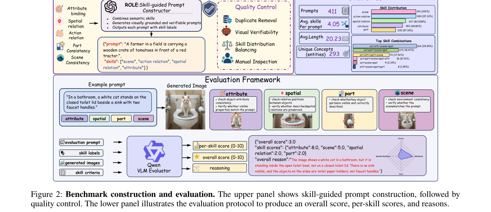

**Why this ranks #10**: 自回归文生图的生成质量需要专门评测：InfiHall-Bench 用五类可验证技能系统组合出 411 条提示、平均每条 4.05 项技能，测得 FLUX.1-dev 整体分 67.08、Infinity-8B 65.77 但动作关系只有 64.53，并用 CMHM 把 Infinity-8B 提到 67.49。

---

## AIGC 编辑（指令编辑 / 修补 / 个性化） · `aigc_editing` (4 papers)

本方向 4 篇里 1 篇新增，共同点是**编辑不再是单次前向，而是一个可迭代、可触发的回路**。HarmonyText 用 RePair 反向合成 25K 对高质量伪配对数据 STE25K，再以 RDO 把编辑区与保留区分开监督、CHFTG 在小波域补高频，155 张 HarmonyText-Bench 上 PSNR 28.443 dB、SSIM 0.803，比最强开源基线高 1.65 dB；Open-World Scene Deocclusion 先把场景分解成按深度排序的 RGBA 层再解开互遮挡环，把补全通过率从 12.49% 提到 35.59%（2.85×），并用边界连续、颜色保真、纹理连贯、全局合理四项子分数作为迭代停止条件。新增的 RecurIR 把「什么时候该改复原策略」本身建模成可证伪的假设，靠任务演化生成针对性退化变体，全合一设定下平均 PSNR 35.58 dB 比最强模型式基线 Defusion 高 2.00 dB，回滚率从 0.35 降到 0.12；Real-Time Diffusion Relighting 则把生成式增强做成控制回路里的神经传感器，只在检测置信度下降时异步启动，CARLA 五圈实验碰撞率从 32.75% 降到 21.44%，事件触发仅激活 0.4% 的帧、控制回路延迟保持 2.0 ms。

### 11. Open-World Scene Deocclusion

**arXiv**: [2611.17695](https://arxiv.org/abs/2611.17695) | **Score**: 8.0 (relevance 8 x 0.7 + quality 8 x 0.3) | **Direction**: `aigc_editing` | **Tags**: AIGC-visual, amodal-completion, deocclusion, training-free, rgba-layer-decomposition, iterative-refinement, Victoria University of Wellington | **Categories**: cs.CV | **Pages**: 10

**Authors**: K. M. S. J. Kumarasinghe; Neil A. Dodgson; Fang-Lue Zhang

**Affiliation**: Victoria University of Wellington; University of New South Wales

**Abstract**

> Recovering the complete appearance of occluded objects from a single image is a fundamental problem for scene understanding and image editing. Real-world scenes are challenging due to clutter, complex spatial occlusions, and diverse object categories. Existing methods often struggle when occlusion involves background surfaces or objects that are not explicitly detected, and fail to resolve the cyclic occlusion dependencies that frequently occur in natural scenes. We introduce a training-free, open-world scene deocclusion framework that recovers the full amodal appearance of detected or user-selected objects from a single RGB image, decomposing the scene into depth-ordered RGBA layers that are geometrically plausible, semantically faithful, and visually consistent with the visible scene. Extensive experiments show that our approach improves scene-level deocclusion, producing coherent and realistic reconstructions in real-world settings. Code will be available on the project page: https://sashjk.github.io/owsd/

**Key findings**

- **Finding**: 自建 COCO 伪遮挡集含 2,745 张图、约 70 个类别，遮挡比例从 20% 到 90%；补全通过率由 12.49% 提升到 35.59%，97.23% 的可恢复层在 6 次迭代内解决。
- **Inference**: 补全失败主要源于互遮挡环与背景遮挡物检测不准，先修几何一致性再采样能以更少的迭代收敛。
- **Recommendation**: 要做遮挡物恢复可先分解深度序 RGBA 层再逐层补全，并把边界连续、颜色保真、纹理连贯、全局合理四项子分数作为迭代停止条件。

**Key figures**

*Framework - Deocclusion across three scene types: (a) an object hidden behind another, (b) interlocked objects that mutually occlude (red arrows mark the cycle), and (c) an object cut by the image frame*

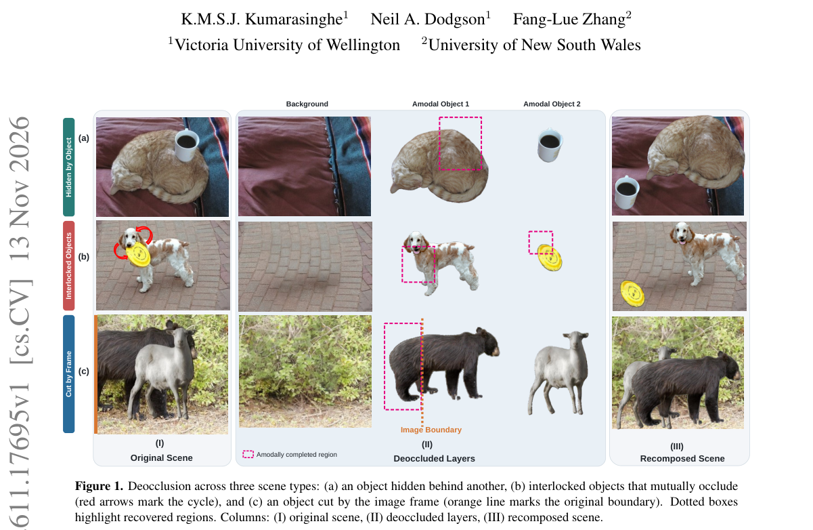

*Result - Overview of the layered amodal scene deocclusion framework. The system extracts object instances, performs geometric reasoning to construct an occlusion-aware scene representation, assigns d*

**Why this ranks #11**: 免训练地从单张 RGB 图像恢复被遮挡物体的完整外观：先把场景分解成按深度排序的 RGBA 层并解开互遮挡环，再用迭代精修把补全通过率从 12.49% 提到 35.59%（2.85×）；伪遮挡集上 CLIP 28.241、LPIPS 0.230、SSIM 0.895 均优于 OWAAC 的 27.105/0.384/0.726，27 人用户研究的强制选择胜率达 68.0%。

---

### 12. HarmonyText: Harmonious Scene Text Editing via Reverse-to-Refined Pair Synthesis and Region-Decoupled Frequency Learning

**arXiv**: [2611.17733](https://arxiv.org/abs/2611.17733) | **Score**: 8.0 (relevance 8 x 0.7 + quality 8 x 0.3) | **Direction**: `aigc_editing` | **Tags**: AIGC-visual, scene-text-editing, mask-free, wavelet-guidance, pseudo-pair-synthesis, gt-free-evaluation, South China University of Technology | **Categories**: cs.CV | **Pages**: 11

**Authors**: Ziqi Yi; Huiguo He; Guitao Xu; Peirong Zhang; Cheng Da; Xinyao Yu; Zhanpeng Wang; Changqian Yu; Huan Yang; Kun Gai; Lianwen Jin

**Affiliation**: South China University of Technology; Kolors Team, KlingAI Research

**Abstract**

> Natural language-guided, mask-free scene text editing aims to modify text in real-world images using only textual instructions, yet remains challenged by unreliable pseudo-GT supervision, over-smoothed text generation, and the absence of GT-free evaluation. Existing methods often rely on imperfect pseudo-targets with background discrepancies, while standard MSE-based velocity regression tends to suppress high-frequency details, leading to blurred text boundaries and weakened local textures. To address these issues, we propose HarmonyText, a mask-free scene text editing framework with region- and frequency-aware supervision. HarmonyText introduces Region-Decoupling Optimization (RDO), which aligns edited text regions with pseudo-targets while anchoring preserved regions to the source image, and Cascaded High-Frequency Texture Guidance (CHFTG), which applies cascaded wavelet-domain constraints to preserve sharp boundaries and fine-grained textures of textual content. We further propose Reverse-to-Refined Pair Synthesis (RePair) to construct STE25K, a high-quality 25K paired dataset, and introduce a GT-free evaluation protocol with Color Distribution Divergence and a Harmony Assessment Model. Extensive experiments show that HarmonyText outperforms existing methods in text editing accuracy, background fidelity, color consistency, and perceptual harmony.

**Key findings**

- **Finding**: HarmonyText-Bench 上 PSNR 28.443 dB、SSIM 0.803、ACC 0.916、NED 0.981、CDD 0.063、Harmony 2.761，Public-STR 上 PSNR 33.040；和谐度评估模型 HAM 与人工判断一致率 83.07%，高于 GPT-5.4 的 53.88% 与 Gemini-3.1-Pro 的 55.29%。
- **Inference**: 伪配对数据的背景偏差会被 MSE 速度回归放大成模糊边缘，先做区域解耦再在小波域约束高频能把两类问题分开处理。
- **Recommendation**: 做免掩码文字编辑时可照此思路把「编辑区对齐伪目标 + 非编辑区锚定原图」与「小波域高频约束」拆成两个独立损失项。

**Key figures**

*Framework - Harmonious scene text editing. Given only a natural-language instruction, HarmonyText edits the target text while preserving its natural integration with the surrounding scene, including local*

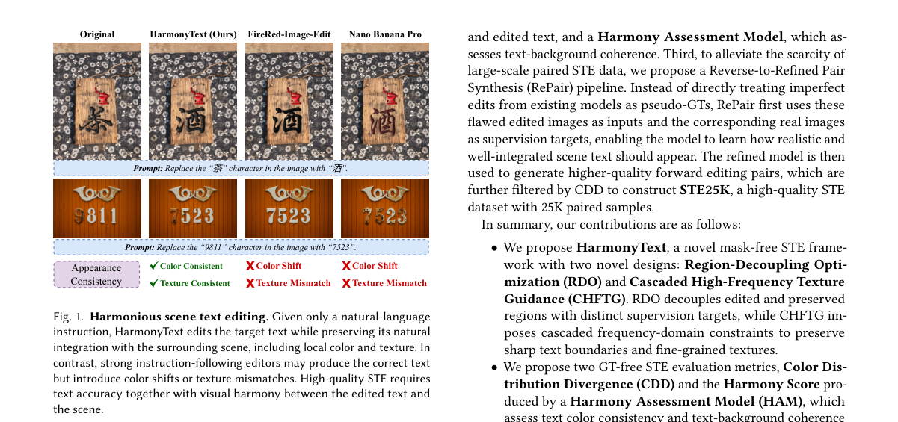

**Why this ranks #12**: 针对自然语言指令驱动的免掩码场景文字编辑：RePair 反向合成出 25K 对高质量伪配对数据（STE25K），RDO 把编辑区与保留区分开监督，CHFTG 在小波域补高频纹理；在 155 张 HarmonyText-Bench 上 PSNR 28.443 dB、SSIM 0.803，比最强开源基线 FireRed-Image-Edit-v1.1 高 1.65 dB，CDD 0.063 比次优低 19.2%，Harmony Score 2.761 最高。

---

### 13. RecurIR: Learning When and How to Revise Restoration Policies via Recursive Self-Improvement

**arXiv**: [2611.18006](https://arxiv.org/abs/2611.18006) | **Score**: 7.4 (relevance 8 x 0.7 + quality 6 x 0.3) | **Direction**: `aigc_editing` | **Tags**: AIGC-visual, agentic-restoration, self-improvement, policy-revision, image-restoration, Shanghai Jiao Tong University | **Categories**: cs.CV | **Pages**: 17

**Authors**: Hu Gao; Haoran Zhang; Yulong Chen; Lizhuang Ma

**Affiliation**: Shanghai Jiao Tong University; Harbin Institute of Technology

**Abstract**

> Agent-based image restoration has achieved promising performance by coordinating restoration tools to handle heterogeneous and coupled degradations. However, existing agents often improve their decisions through accumulated successful and failed executions, without explicitly identifying the conditions under which learned restoration strategies remain effective. Consequently, changes in degradation severity, spatial coverage, or interactions may invalidate previous decisions, while providing limited guidance on how these decisions should be revised. In this paper, we propose \textbf{RecurIR}, a recursive self-improvement framework that enables restoration agents to learn when and how to revise their decision rules. Specifically, we introduce a policy-hypothesis discovery mechanism to identify testable, condition-dependent rules through matched tool executions. We then design a rule-falsification-driven task evolution mechanism to generate targeted degradation variations, examine the validity of learned rules, and identify their applicability boundaries. Based on the resulting evidence, we develop a change-conditioned policy revision mechanism that learns how variations in degradation conditions should modify tool selection, execution order, operation strength, and processing regions. We further incorporate independent verification to retain effective revisions and use the resulting feedback to guide subsequent hypothesis discovery and task evolution. Through this recursive process, RecurIR progressively refines its restoration policies as degradation conditions change. Extensive experiments demonstrate the effectiveness of the proposed framework.

**Key findings**

- **Finding**: RecurIR 在全合一复原设定下的平均 PSNR 达 35.58 dB，比最强模型式基线 Defusion 的 33.58 dB 高 2.00 dB；最低分智能体 MAIR 为 34.96 dB，相对 Defusion 领先 1.38 dB。
- **Inference**: 让智能体显式发现条件化策略规则并按退化变化改写规则，比单纯累积成败经验更能适应退化类型与空间分布的改变。
- **Recommendation**: 构建复原智能体时应把何时修正策略建模成可证伪的假设，配合任务演化生成针对性退化变体，评估时同时看 PSNR 与回滚率。

**Key figures**

*Framework - Overview of the proposed RecurIR framework. Top: A general agentic image restoration pipeline. Bottom: The pro- posed recursive self-improvement framework, consisting of policy- hypothesis d*

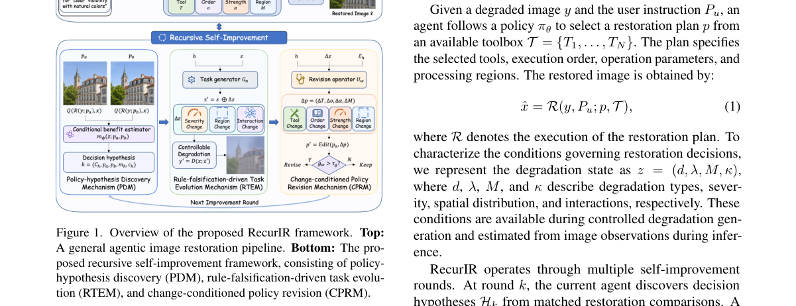

*Result - Visual comparisons of different restoration methods. The red and green boxes highlight representative regions, with magnified views illustrating differences in artifact removal and detail pr*

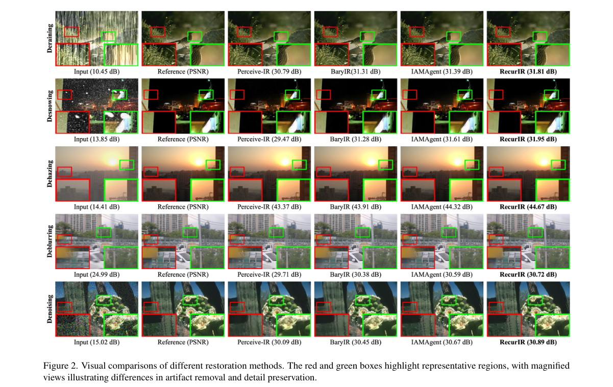

**Why this ranks #13**: 图像编辑轴关注对已有图像的可控修改，复原属同类操作：RecurIR 在全合一设定下平均 PSNR 35.58 dB，比最强模型式基线 Defusion 的 33.58 dB 高 2.00 dB，也高于最低分智能体 MAIR 的 34.96 dB，在真实雨雾基准 RealRain-1k-L 上达 27.83 dB，并把回滚率从 0.35 降到 0.12。

---

### 14. Real-Time Diffusion Relighting as a Neural Sensor: Closing the Low-Light Domain Gap for Robotic Perception

**arXiv**: [2611.17438](https://arxiv.org/abs/2611.17438) | **Score**: 7.0 (relevance 7 x 0.7 + quality 7 x 0.3) | **Direction**: `aigc_editing` | **Tags**: AIGC-visual, diffusion-relighting, low-light-enhancement, event-driven-trigger, robot-perception, real-time, University of Maryland | **Categories**: cs.CV | **Pages**: 8

**Authors**: Shengjie Xu; Alexander Gao; Anshul Rai; Dae Yeol Lee; Guan-Ming Su; Ming C. Lin

**Affiliation**: University of Maryland, College Park; Dolby Laboratories

**Abstract**

> Low-light conditions severely degrade robotic perception: object detectors trained on daylight imagery are prone to failure under dark and adverse weather conditions that fall outside of their training distribution. Furthermore, from an efficiency standpoint, existing Low-Light Image Enhancement (LLIE) methods are designed for offline processing and are therefore impractical to integrate into live control loops. To address these issues, we propose to embed a Generative Neural Sensor within the control loop that treats illumination as a generative prior rather than a signal processing problem, enabling task-relevant semantic recovery. We further propose an Real-Time Perceptual Architecture that decouples high-latency semantic recovery from low-latency robotic control. Rather than blocking the control loop, our system runs a large-scale image-to-image diffusion model in a background thread, and is activated only when a drop in detection confidence signals a perceptual uncertainty event, significantly reducing computational overhead. Our method sets a new state-of-the-art performance on the ExDark low-light benchmark with 87.1% mAP, and under adverse weather conditions, significantly boosts detection rates over competing methods. On a navigation task in a closed-loop autonomous driving simulator (CARLA), we achieve a 100% lap completion rate, establishing a simulation-based proof-of-concept for integrating high-latency generative models with standard robotic control autonomy stacks.

**Key findings**

- **Finding**: ExDark 上 mAP 达 87.1%；vKITTI2 雾天 F1 0.855、mAP 0.807，远超基线的 0.681/0.544 与 MambaSFLNet 的 0.579/0.452；CARLA 日落场景无修复碰撞率 32.75%、加 CLAHE 32.06%、本方法 21.44%，接近日间基线 22.47%。
- **Inference**: 生成先验擅长补回被光照抹掉的结构，而以像素重建为目标的 LLIE 会抹掉检测器依赖的低对比边缘，所以它在雾天反而不如基线。
- **Recommendation**: 把生成式增强接进实时系统时，用检测置信度做滞回触发（τ_low=0.3、τ_high=0.5）并只在中重度退化时启用，能兼顾安全与算力。

**Key figures**

*Framework - Low-light conditions cause detection failures in autonomous navigation (left). Our Generative Neural Sensor recovers daylight-quality semantics on-demand (right) via an asynchronous diffusion*

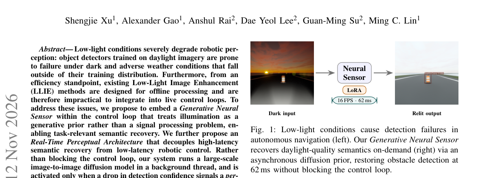

*Result - Overview of the Generative Neural Sensor Pipeline. (a) Synthetic Data Engine: Extracting geometry to render pixel- aligned training pairs (Iu, Ir). (b) Asynchronous Active Perception: triggere*

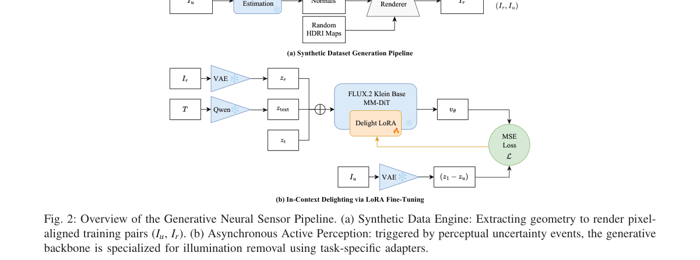

**Why this ranks #14**: 把 FLUX.2-klein-4B + LoRA 的图像重光照做成控制回路里的「生成式神经传感器」：只在检测置信度下降时由后台线程异步启动，ExDark 上取得 87.1% mAP；CARLA Thunderhill 5 圈实验中碰撞率从 32.75% 降到 21.44%，事件触发仅激活 0.4% 的帧，GPU 占用从 95.0% 降到 0.4%，控制回路延迟保持 2.0 ms。

---

## 面向视觉生成的 RL 与奖励模型 · `aigc_rl` (1 papers)

本方向仍只有 1 篇，但它同时是本 axis 最高分（9.0）与 rel ≥ 9 的必进论文。Rethinking Visual Reasoning in Text-to-Image Reward Modeling 的出发点不是换更大的骨干或更多偏好对，而是奖励模型自身的视觉理解：它发现广泛使用的 T2I 奖励模型在针对性的视觉推理评测上表现很差，而从强视觉语言骨干出发做偏好微调会**侵蚀**这种能力，持续学习基线也化解不了「视觉推理 ↔ 偏好精度」之间那个陡峭的权衡。解法是翻转配对轴——把现有视觉理解与推理评测集转换成「同一张图、不同 prompt」的偏好对（CrossPairs），与常规人类偏好数据混合训练，最终在 GenEval 上让推理期 best-of-n 选择与 RL 后训练分别提升 4.0% 与 5.5%，并超过用了 6 倍偏好对（1.3M）的 HPSv3。

### 15. Rethinking Visual Reasoning in Text-to-Image Reward Modeling

**arXiv**: [2611.17585](https://arxiv.org/abs/2611.17585) | **Score**: 9.0 (relevance 9 x 0.7 + quality 9 x 0.3) | **Direction**: `aigc_rl` | **Tags**: AIGC-visual, reward-model, preference-data, visual-reasoning, best-of-n, geneval, Stanford University | **Categories**: cs.AI, cs.CV | **Pages**: 28

**Authors**: Shiye Su; Xiaohan Wang; Ludwig Schmidt; Serena Yeung-Levy

**Affiliation**: Stanford University

**Abstract**

> Reward models are a core component of modern text-to-image systems, serving as the objective for inference-time selection and RL-based post-training. A key prerequisite is visual understanding: to judge prompt adherence and ground aesthetic preferences, a reward model must bind attributes, resolve relations, and count reliably. We find that widely-used reward models perform poorly on targeted visual reasoning evaluations. Even when starting from strong vision-language backbones, preference fine-tuning erodes these capabilities, and continual-learning baselines fail to mitigate a steep tradeoff between visual reasoning and preference accuracy. We propose a data-centric intervention that injects visual reasoning supervision into preference learning by flipping the pairing axis. To complement conventional human preference data (paired images under a shared prompt), we convert existing visual reasoning datasets into preference pairs that share the same image but differ in prompt, and train on the mixture. This yields a Pareto improvement in both visual understanding and preference prediction. Across inference-time best-of-n selection and RL post-training, the resulting reward model improves text-to-image generation on challenging compositional prompts (GenEval) by an average of 4.0% and 5.5% respectively, outperforming HPSv3 which was trained on 6x more preference pairs.

**Key findings**

- **Finding**: ImageRewardDB 准确率 66.3%；GenEval 上 SD-Turbo 在 n=50 时达 64.5%（次优 62.4%），FLUX.1-Schnell 在 n=50 时达 78.1%（次优 75.7%），RL 后训练 SD 达 61.5%；对照的 HPSv3 用了 1.3M 偏好对。
- **Inference**: 偏好微调会把模型推向美学捷径，视觉解析能力因而退化；共享图像、只翻转提示词的配对能在不追加人工偏好标注的前提下把这种退化补回来。
- **Recommendation**: 训 T2I 奖励模型时可直接从现成的视觉理解与推理评测集翻转成偏好对混入训练，而不是一味加更多人类偏好对。

**Key figures**

*Result - Visual understanding (y) vs preference accu- racy (x) for multiple checkpoints of the reward model during conservative fine-tuning on preference pairs. Conservative fine-tuning only weakly m*

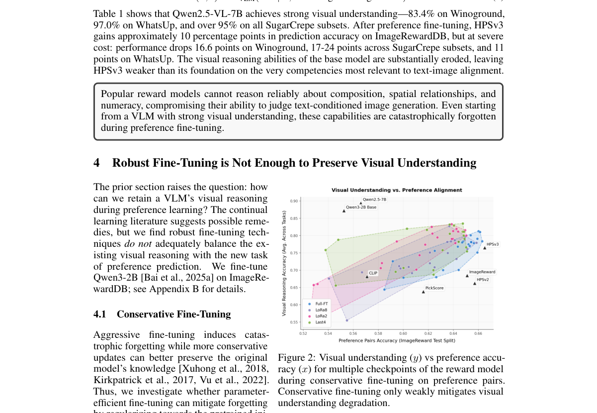

**Why this ranks #15**: 奖励模型是 T2I 推理期筛选与 RL 后训练的目标，但偏好微调会侵蚀视觉理解；本文翻转配对轴——让偏好对共享同一张图、只改提示词（CrossPairs），与常规人类偏好数据混合训练后两侧同时提升：在 GenEval 上 best-of-n 平均 +4.0%、RL 后训练平均 +5.5%，ImageRewardDB 准确率 66.3%，优于用了 6 倍偏好对（1.3M）的 HPSv3。

---

## Footer

- Total papers reviewed across all 4 axes: 60
- aigc_visual axis final count: 15
- Wild-cards in this axis: 0
- Figure assets: 2026-11-16/res/

Generated by `mine-arxiv-daily-digest` skill. Sister file: `2026-11-16_aigc_visual_entry.md`.
