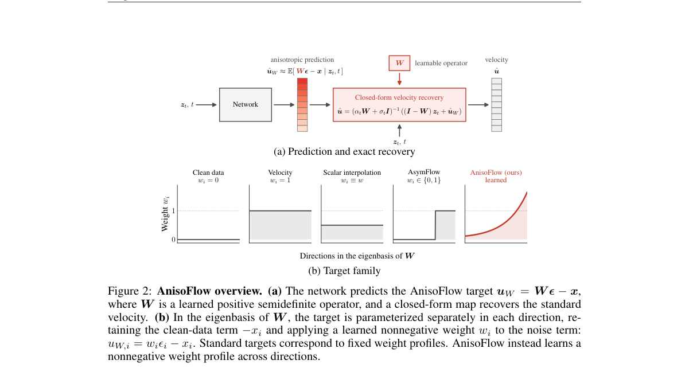
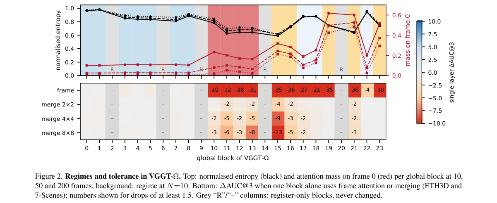
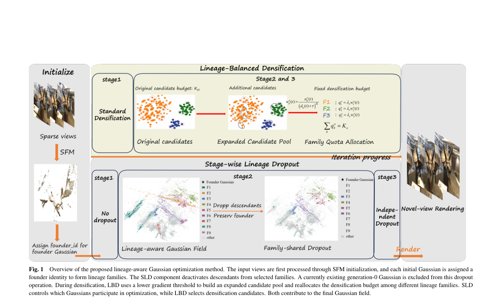
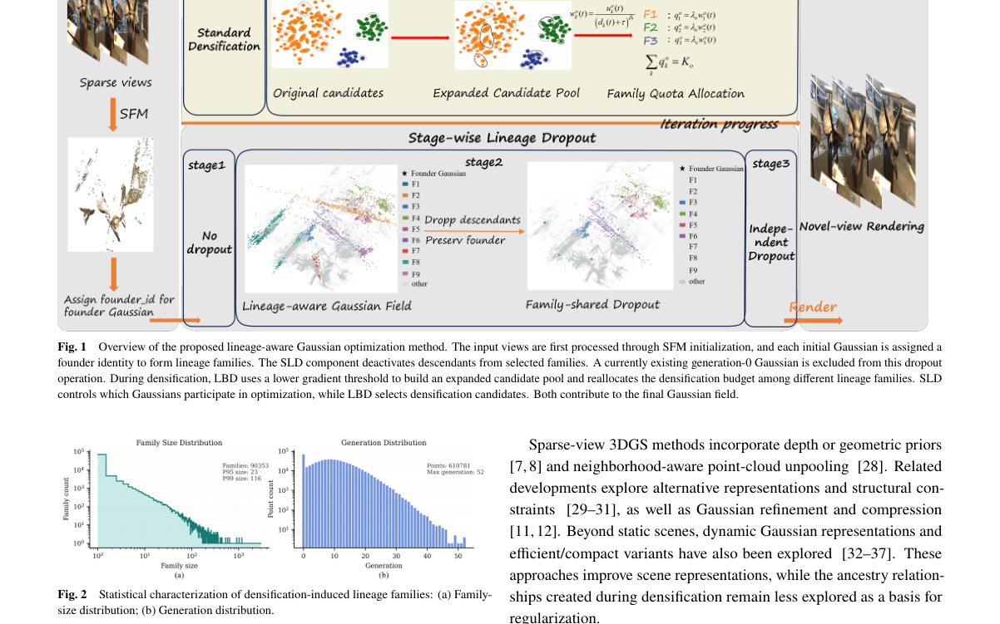
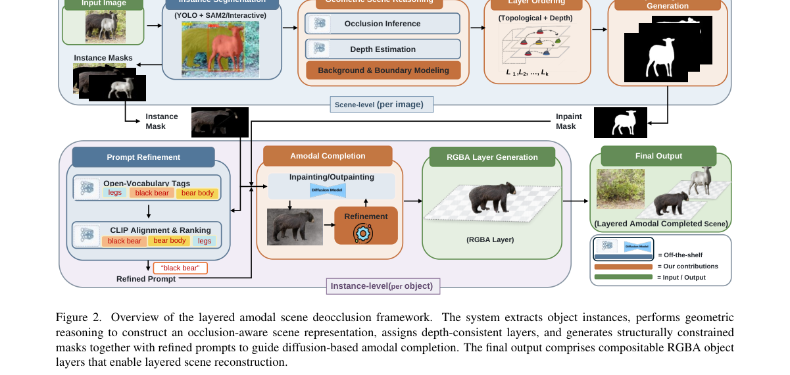

# Mine Arxiv Daily Digest - 2026-11-16 (AIGC 视觉生成与编辑 Axis, 10 papers)

**Generated**: 2026-11-16 11:54 CST

**Source**: arXiv cs.CV, cs.SD, eess.AS, cs.CL, cs.AI, cs.RO, cs.LG, cs.IR submissions, listing day 2026-11-13 (announced 2026-11-16 01:00 UTC)

**Batch window**: 2026-11-12T19:00:00Z .. 2026-11-13T19:00:00Z（arXiv 公告批次横跨两个 UTC 日：从前一日的美东 14:00 截止时刻起算（EDT 为 18:00Z，EST 为 19:00Z），到当日的同一时刻为止）

**Axis**: aigc_visual (10 papers, base 15, cap 20)

**Directions**: aigc_generation (6), aigc_editing (3), aigc_rl (1)

**Selection**: 10 papers ranked by relevance x quality, with 2 wild-card slots

**Day total**: 48 papers across 4 axes (target 60)

**Scope**: 图像 / 视频 / 3D / 4D 内容的生成与编辑，以及面向视觉生成的 RL / 偏好优化与奖励模型

⚠️ **Wild-card**: 2 —— 本 axis 未启用常规补位名额，`aigc_generation` 与 `aigc_editing` 都低于基准。两条 wild-card 全部用于补 **3D 侧**的供给缺口：本批真正与 3D 生成/重建相关的可读论文只有 2611.17629（多视图 3D transformer 的免训练注意力近似加速）与 2611.17752（稀疏视角 3D 高斯泼溅的 lineage-aware dropout），而 3D 生成与重建正是用户的长期关注方向，因此这两条比任何够格论文都更该进。

**本 axis 10 篇（base 15，cap 20）**：`aigc_generation` 6 篇、`aigc_editing` 3 篇、`aigc_rl` **1 篇**。三个方向都低于各自基准，缺口由 aigc_visual 让出给候选更充裕的 `llm_vlm`（打满 20 上限）。

**`aigc_rl` 全批只有 1 篇**。严格扫描（RL 类词与视觉生成类词 160 字符双向共现窗口）命中 19 篇，逐篇回读原文后确认**只有 2611.17585 属于面向视觉生成的 RL**：其余 18 篇要么 RL 词与视觉词来自不同段落（离线 MARL 轨迹增强、对抗 MDP 后悔界、论文评审 RL、LLM 去遗忘、注意力共享理论），要么视觉词其实是分子/晶体扩散或 3D 检测，与生成 RL 无关。

**`aigc_editing` 只有 3 篇**。编辑类正则（inpaint / outpaint / harmonization / retouch / 背景替换 / 身份保持 / 风格迁移 / 个性化 / 场景文字编辑 / 文档水印等）在本批 179 篇里只命中 4 篇，其中 2611.17793 的 inpainting 是误命中（讲的是多智能体轨迹增强）。

**2 条 wild-card** 用来补 3D 侧供给：2611.17629（RAWATTA，多视图 3D transformer 的免训练加速，12 GB GPU 上 200 张图可跑而原版 100 张即 OOM）与 2611.17752（稀疏视角 3D 高斯泼溅的 lineage-aware dropout）。理由是本批 3D 侧真正可用的工作只有这两篇，而 3D 生成与重建正是用户的长期关注方向；两条都在报告与条目里逐条标注为补位。

---

## AIGC 生成（图像 / 视频 / 3D / 4D） · `aigc_generation` (6 papers)

本方向 6 篇（含 2 条 wild-card），主线是**「生成轨迹本身可以被重新设计」**。Speed-Variation Distillation 问了一个被默认忽略的问题：扩散模型的去噪轨迹整段都走在远离数据流形的损坏中间态上，它换成一个「变异缩减」的退化过程，把不同图像朝一个共同原型收缩，让生成全程都停留在可辨认的图像上。AnisoFlow 则动的是 flow matching 里手写的那个预测目标——速度、噪声或干净数据——把它换成完全可学习的、各向异性缩放的版本，理由是这个选择对训练与样本质量影响极大。有限速 Ornstein-Uhlenbeck-Kac 过程把布朗运动换成有限速的 Kac 过程来驱动生成流，其速度场被有限 Kac 速度界住，扩散模型里常见的时间截断因此不再必要，在奇异数据集上比扩散与 flow matching 更锐利。Creative Product Design 把品牌调研报告变成自我增强循环里的创意约束源，用 VLM-as-Judge 协议同时量创造性与品牌可辨识度，在汽车、摩托这类可想象设计空间本就窄的品类上收益最明显。两条 wild-card 分别补 3D 侧的供给缺口：RAWATTA 免训练地压缩多视图 3D transformer 的全局注意力，在 12 GB GPU 上把可处理图数从 100 抬到 200；稀疏视角 3D 高斯泼溅的 lineage-aware dropout 则把「同族高斯的补偿效应」当成一等公民来设计正则与致密化预算分配。

### 1. Learning Anisotropic Prediction Targets for Flow Models

**arXiv**: [2611.17767](https://arxiv.org/abs/2611.17767) | **Score**: 8.0 (relevance 8 x 0.7 + quality 8 x 0.3) | **Direction**: `aigc_generation` | **Tags**: AIGC-visual, flow-matching, learned-prediction-target, anisotropic-noise-weights, image-generation, low-precision-inference, Stanford University | **Categories**: cs.CV, cs.LG | **Pages**: 27

**Authors**: Rayhan Zirvi; Hansheng Chen; Gordon Wetzstein; Leonidas Guibas

**Affiliation**: Stanford University; California Institute of Technology

**Abstract**

> Flow-based generative models are trained on a hand-chosen prediction target, such as the velocity, the noise, or the clean data. This choice strongly affects training and sample quality. We introduce Anisotropic Flow Models (AnisoFlow), which replaces a fixed prediction target with a fully learnable one. AnisoFlow learns to scale the noise component of the target anisotropically, assigning a separate nonnegative weight to each direction in a jointly learned basis. A closed-form map recovers the velocity from the network's prediction, leaving the architecture, flow-matching loss, and sampler unchanged. Since recovery is exact, training optimizes the target purely to make it easier for the network to predict. We theoretically analyze the resulting prediction error and predict that the preferred noise weight in each direction scales near-linearly with data variance, in agreement with the weights learned empirically in pixel space. AnisoFlow improves FID from 1.90 to 1.55 over the JiT baseline on ImageNet 256$\times$256, by learning only the prediction target, without representation alignment or architectural changes. In pixel-space text-to-image generation, AnisoFlow improves image quality and, through better-conditioned velocity recovery, largely removes patch-seam artifacts under reduced-precision inference.

**Key findings**

- **Finding**: 在 JiT-H/16 上 AnisoFlow 把 FID 从 JiT 的 1.90 降到 1.55，160 epoch 时为 2.68→2.25，训练 0.819 秒/迭代、推理 0.180 秒/步几乎不变。
- **Inference**: 学到的噪声权重与数据方差近似线性（w_i≈cλ_i），说明收益来自目标本身的可学性，而不是网络容量或表示对齐。
- **Recommendation**: 复现 flow 基线时先扫预测目标的参数化形式再考虑加宽网络；低精度部署可优先试这种良态目标以换取无 patch 接缝的输出。

**Key figures**

*Result - AnisoFlow overview. (a) The network predicts the AnisoFlow target uW = W ϵ −x, where W is a learned positive semidefinite operator, and a closed-form map recovers the standard velocity. (b)*

**Why this ranks #1**: 把 flow 模型手选的预测目标换成可学习的各向异性正半定算子，只改训练目标、不动架构与采样器，就在 ImageNet 256×256 上把 JiT-H/16 的 FID 从 1.90 降到 1.55（AsymFlow 的冻结二值掩码为 1.76）；像素空间 T2I 侧 HPSv3 7.71→8.03、COCO-10k FID 22.0→20.1，且 INT8/FP8 推理不再出现 patch 接缝。

---

### 2. Speed-Variation Distillation for Generative Modeling

**arXiv**: [2611.17868](https://arxiv.org/abs/2611.17868) | **Score**: 8.0 (relevance 8 x 0.7 + quality 8 x 0.3) | **Direction**: `aigc_generation` | **Tags**: AIGC-visual, diffusion-distillation, variation-reduction, prototype-trajectory, early-termination, speed-variation-tradeoff, VISTEC | **Categories**: cs.CV | **Pages**: 16

**Authors**: Sukit Seripanitkarn; Phonphrm Thawatdamrongkit; Supasorn Suwajanakorn

**Affiliation**: VISTEC, Thailand

**Abstract**

> While diffusion models excel at image generation, their denoising trajectories pass through corrupted intermediate states far from the image manifold. We ask whether generation can instead proceed through recognizable images throughout the entire trajectory. We introduce a generative framework built around a variation-reducing degradation process that contracts diverse images toward a shared prototype while preserving recognizable intermediate states. Because such manifold traversal lacks a simple analytical form, we construct the trajectories using generative-prior-based image morphing. We then distill the reverse process into a diversification operator that transforms the prototype into increasingly varied samples. To resolve the one-to-many ambiguity of the reverse process, we associate each trajectory with its initial noise latent and apply perturbations to improve robustness against accumulated errors. At inference, every step yields a recognizable image, allowing early termination and enabling a controllable speed--variation trade-off.

**Key findings**

- **Finding**: 训练配置为 T=50 步轨迹、变化扰动上限 s_max=5、1,000 步扩散调度下噪声扰动 τ=300 与 200，batch 32、学习率 1×10⁻⁵ 微调 20,000 步，LSUN-Churches 为 50,000 步。
- **Inference**: 由于每一步解出的都落在数据流形上、是可识别图像，提前终止就能换取更少的变化，于是速度与多样性成了一个显式可控的旋钮。
- **Recommendation**: 若要做少步数生成或需要可中途打断的采样流水线，可以按这套「共享原型 + 多样化算子」的范式改造现有蒸馏目标。

**Key figures**

*Result - Overview. (a) Generate images with a pretrained LDM, select a prototype, and construct variation-reducing trajectories. (b) We train the diversification operator using noise and variation pert*

**Why this ranks #2**: 把反向过程蒸馏成一个从共享原型出发的多样化算子：训练用 DiffMorpher 造 50 步（T=50）morphing 轨迹、变化扰动上限 s_max=5、噪声扰动 τ=300（FFHQ/CelebA/LSUN-Bedrooms）与 200（LSUN-Churches），推理每一步都是可识别图像因而可提前终止；在 FFHQ 等 4 个数据集上各生成 10,000 张 256×256 图微调 2 万步（LSUN-Churches 5 万步）即可显式调节速度—多样性折中。

---

### 3. Finite speed Ornstein-Uhlenbeck-Kac processes and their applications in generative modeling

**arXiv**: [2611.17625](https://arxiv.org/abs/2611.17625) | **Score**: 7.0 (relevance 7 x 0.7 + quality 7 x 0.3) | **Direction**: `aigc_generation` | **Tags**: AIGC-visual, ornstein-uhlenbeck-kac, finite-speed-diffusion, legendre-polynomial, flow-matching, cifar-10, Institute of Mathematics | **Categories**: cs.LG, math.AP, math.PR | **Pages**: 48

**Authors**: Richard Duong; Janis Auffenberg; Gabriele Steidl

**Affiliation**: Institute of Mathematics, Technische Universität Berlin

**Abstract**

> We study the Ornstein-Uhlenbeck-Kac (OU-K) process, where instead of a Brownian motion, a finite-speed Kac process defines the driving process. The OU-K process can be analyzed through a rescaled, time-inhomogeneous Kac process, characterized by a switching rate from the Kac part, and a convergence rate from the Ornstein-Uhlenbeck (OU) part. The law of this inhomogeneous Kac process describes the solution of a wave equation, the Euler-Poisson-Darboux (EPD) equation. For Kac switching rates being multiples of the OU convergence rate, we can explicitly derive this EPD solution via the sum of (the derivative of) two Legendre polynomials, restricted between two Dirac points representing the wave fronts. Using the framework of piecewise-deterministic Markov processes (PDMP), we describe the conditional velocity fields of the OU-K process via our polynomial-law-formula. This allows us to apply the OU-K process in a generative flow model. Since the OU-K velocity fields prove to be bounded by the finite Kac speed, the usual time truncations of diffusion models become unnecessary. We demonstrate advantages over diffusion and flow matching models in terms of generation sharpness on singular data sets, while achieving competitive results on CIFAR-10 image generation.

**Key findings**

- **Finding**: CIFAR-10 上 OU-K 模型 FID 为 3.56，flow matching 基线 3.59、OU 基线 3.50；在 d=32 多面体奇异数据集上，训练 15,000 与 30,000 步即比 OU diffusion 基线更尖锐。
- **Inference**: 速度场上界由有限 Kac 速率给出，损失在首尾时刻不会像 diffusion 那样出现奇异性，所以「时间截断」这一工程补丁可以整体去掉。
- **Recommendation**: 需要训练稳定性或想摆脱时间截断超参时，可把 OU-K 在 PDMP 框架下给出的条件速度场公式当作 flow matching 目标的一个现成备选。

**Key figures**

*Framework - Generated samples after 15.000 (left), 30.000 (middle) and 100.000 (right) training steps of a polytope in dimension d = 32 via the OU diffusion baseline (top) and our OU-K model (bottom), o*

**Why this ranks #3**: 用有限速率的 Kac 过程替代布朗运动驱动 OU 过程，解析求出 Euler-Poisson-Darboux 方程的显式解（两个 Legendre 多项式 L_k、L_{k-1}），并证明条件速度场被有限 Kac 速率一致有界、从而不再需要 diffusion 的时间截断；在 d=32 多面体这类奇异数据集上更早变锐，CIFAR-10 FID 3.56 也接近 flow matching 的 3.59 与 OU 的 3.50。

---

### 4. Creative Product Design under Brand Image Constraints

**arXiv**: [2611.17762](https://arxiv.org/abs/2611.17762) | **Score**: 7.0 (relevance 7 x 0.7 + quality 7 x 0.3) | **Direction**: `aigc_generation` | **Tags**: AIGC-visual, brand-constraint, industrial-design, vlm-as-judge, self-enhancement-loop, creative-direction, TOYOTA CENTRAL R&D LABS. | **Categories**: cs.AI, cs.CV, cs.GR | **Pages**: 24

**Authors**: Takeshi Onishi; Hiroya Makino; Takahiro Yamaguchi; Hiroyuki Sakai

**Affiliation**: TOYOTA CENTRAL R&D LABS., INC.

**Abstract**

> Industrial design requires creative visual exploration while satisfying constraints that are often product-specific and implicit. Existing text-to-image (T2I) approaches can generate creative designs through concept blending or multi-agent self-enhancement, but they provide limited mechanisms for ensuring that generated designs remain consistent with such constraints. We focus on brand image as a representative design constraint and propose a framework for brand-aware redesign generation. Given a product name, the framework constructs a brand image survey report that summarizes product and market information, derives a creative direction from the report, and integrates this direction into a self-enhancement loop in which generated images are critiqued and prompts are revised. We evaluate the framework on 50 redesign tasks across five product categories, comparing it with Naive T2I, IP-Adapter/IT-Blender, and unconstrained self-enhancement under the same T2I backbone. By a VLM-as-Judge protocol to measure creativity and brand identifiability, the proposed framework achieves a more favorable trade-off between the two objectives, with particularly clear gains in highly constrained categories such as automotive and motorcycle, where the plausible design space is relatively limited compared with that of other product categories. These results suggest that dynamically eliciting and textualizing brand image can guide creative product design generation under brand image constraints.

**Key findings**

- **Finding**: 评测覆盖 5 类 50 个再设计任务，创新分取 Novelty 与 Usefulness 的调和平均（各 1–5 分），框架最终 Identity Score 0.8、Creativity Score 3.7，基线为 Naive T2I、IP-Adapter、IT-Blender 与无约束自增强。
- **Inference**: 把品牌信息显式写成文本报告相当于给身份一致性加了一个外生锚，因此能在自增强迭代中同时保住可识别性与创新性。
- **Recommendation**: 做受约束的生成设计时，先把品牌、法规、工程等约束写成结构化文本再进入生成循环，比直接塞进 prompt 更稳。

**Key figures**

*Framework - Overview of the proposed framework.*

*Result - Creativity Score and Identity Score with ex- ample outputs from the proposed framework and Self- Enhancement.*

**Why this ranks #4**: 把「品牌印象」当作可动态文本化的设计约束：先用 Deep Research 生成品牌调查报告并抽出创作方向，再让 Reviewer 批判生成图、把评语改写成下一轮提示词；在 5 个品类 50 个产品上用 Gemini 2.5 Pro 做 VLM-as-Judge 评创新性与品牌可识别性，最终 Identity Score 0.8、Creativity Score 3.7，在汽车、摩托这类强约束品类上取得尤其明显的增益。

---

### 5. Training-Free Acceleration of Multi-View 3D Transformers via Regime-Aware Attention Approximation

**arXiv**: [2611.17629](https://arxiv.org/abs/2611.17629) | **Score**: 6.6 (relevance 6 x 0.7 + quality 8 x 0.3) | **Direction**: `aigc_generation` | **Tags**: AIGC-visual, attention-approximation, multi-view-transformer, training-free, low-precision-inference, pose-accuracy, Independent Researcher | **Categories**: cs.AI, cs.CV | **Pages**: 25

**Authors**: Muhammed Izzet Sezer; Sevval Belkis Dikkaya

**Affiliation**: Independent Researcher; Carnegie Mellon University

**Abstract**

> Multi-view 3D transformers such as VGGT reconstruct a scene from a set of unposed images in a single forward pass, predicting camera poses, depth and 3D points, but the cost of their global attention grows quadratically with the num- ber of images. Accelerators borrowed from large language models assume that each token attends to only a few oth- ers; on these models they lose accuracy or gain little speed. We study the global attention of three multi-view transform- ers on seven datasets and find that every layer plays one of three roles: it averages over the whole scene, matches points across many images, or anchors on the first image, whose coordinates the outputs use. Building on this anal- ysis, we propose Regime-AWare ATTention Approximation (RAWATTA), a training-free method that runs attention in 8- bit precision and keeps 16-bit precision only in the layers where a worst-case calibration check requires it. Its fast set- ting, RAWATTA-Fast, also approximates attention in a few averaging and anchoring layers, while matching layers and the first image keep all their keys. On a 12 GB GPU at 50 im- ages, RAWATTA runs VGGT faster than the released code, mostly through our CUDA engine, and loses at most about one point of pose accuracy (AUC@3) on any dataset; RAWATTA-Fast is slightly faster and less accurate. Both fit 200 images, where the released code runs out of memory at 100.

**Key findings**

- **Finding**: 12 GB RTX 4070 SUPER 上 50 帧整次前向，官方 VGGT-Ω 为 3605 ms 且 100 帧即 OOM，精确引擎 2237 ms，RAWATTA 1734 ms（2.08×），RAWATTA-Fast 1616 ms（2.23×），最差数据集 AUC@3 分别为 −1.03 与 −1.14。
- **Inference**: 精度损失集中在少数「匹配层」，所以按层而不是全局统一降精度，就能把加速收益几乎无损地留下来。
- **Recommendation**: 部署多视图几何模型时先按三种角色给全局注意力分层标定，再决定哪些层降精度，比直接套用稀疏注意力近似更安全。

**Key figures**

*Result - Regimes and tolerance in VGGT-Ω. Top: normalised entropy (black) and attention mass on frame 0 (red) per global block at 10, 50 and 200 frames; background: regime at N=10. Bottom: ∆AUC@3 whe*

**Why this ranks #5**: wild-card 补位（本轮 3D 生成侧合格候选供给不足）：免训练地在 7 个数据集、10–200 帧上把多视图 3D transformer 的全局注意力归为平均/匹配/锚定三种角色，再按角色选近似算子与数值格式；在 12 GB 的 RTX 4070 SUPER 上 50 帧时相对官方 VGGT-Ω 加速 2.08×（RAWATTA-Fast 2.23×），最差数据集位姿 AUC@3 只掉 1.03/1.14 点，并且 200 帧仍能跑（官方在 100 帧就 OOM）。  [wild-card=yes] 本批 3D 侧唯一一篇直接优化前沿多视图 3D 基础模型推理成本的论文：它先在 7 个数据集上拆出全局注意力的三种层角色，再给出免训练的 8-bit/16-bit 混合精度方案 RAWATTA 与进一步近似的 RAWATTA-Fast，在 12 GB GPU 上把可处理图数从原版 100 张抬到 200 张、位姿精度 AUC@3 只掉约 1 个点。3D 生成与重建管线正卡在推理吞吐上，这篇比任何够格的 2D 生成论文都更该占位。

---

### 6. Stage-wise Lineage-aware Dropout for Sparse-View 3D Gaussian Splatting

**arXiv**: [2611.17752](https://arxiv.org/abs/2611.17752) | **Score**: 6.3 (relevance 6 x 0.7 + quality 7 x 0.3) | **Direction**: `aigc_generation` | **Tags**: AIGC-visual, gaussian-splatting, sparse-view, dropout-regularization, densification, lineage-family, Hefei University of Technology | **Categories**: cs.CV | **Pages**: 11

**Authors**: Yan Xing; Zhi Chen; Fanglue Zhang; Junhong Zhao; Bing Xue; Mengjie Zhang

**Affiliation**: Hefei University of Technology; Victoria University of Wellington; University of New South Wales; Joint International Research Laboratory of Spatio-temporal Information and Intelligent Location Services

**Abstract**

> Sparse-view 3D Gaussian Splatting (3DGS) is prone to overfitting because only a limited number of images are available to constrain scene geometry. Dropout is one regularization strategy for alleviating this problem. We introduce the concept of a lineage family to describe a set of Gaussian primitives derived from the same founder through cloning or splitting operations. The founder Gaussians refer to all Gaussian primitives generated during initialization. Descendants within the same family often jointly contribute to the refinement of adjacent local regions. However, dropping individual Gaussians can be less effective due to the compensation effect from neighboring Gaussians for the dropped ones. To address this issue, we propose Stage-wise Lineage-aware Dropout(SLD), which applies lineage-family dropout during the structural regularization stage and switches to individual dropout during the later refinement stage. We further propose Lineage-Balanced Densification(LBD), which operates during densification by constructing an expanded candidate pool and reallocating the densification budget according to the mean gradient scores and existing descendant sizes of different families. Experiments on the LLFF, MipNeRF360, and Blender datasets show that the proposed framework achieves competitive performance in sparse-view reconstruction

**Key findings**

- **Finding**: LLFF 3 视角下本方法 PSNR 20.70 dB，比 DropGaussian 高 0.37 dB，SSIM 与 LPIPS 均居首或次席；超参为 t_w=3000、t_s=7000、p_max=0.3、p_3=0.2，LBD 的 γ=0.5 与 β_max=0.5。
- **Inference**: 邻居 Gaussian 的补偿效应让单个 dropout 效果打折，按同族整批停用才能真正压住对有限视角的过拟合。
- **Recommendation**: 做稀疏视角 3DGS 时可把训练切成分正则与精修两段、前段改用族级 dropout，再对照单点 dropout 做消融。

**Key figures**

*Framework - Overview of the proposed lineage-aware Gaussian optimization method. The input views are first processed through SFM initialization, and each initial Gaussian is assigned a founder identity to*

*Result - Statistical characterization of densification-induced lineage families: (a) Family- size distribution; (b) Generation distribution.*

**Why this ranks #6**: wild-card 补位（本轮 3D 生成侧合格候选供给不足）：把稀疏视角 3DGS 的过拟合按「血统家族」重新建模——结构正则阶段整族 dropout、精修阶段退回单个 Gaussian dropout（t_w=3000、t_s=7000、p_max=0.3、p_3=0.2），并用 LBD 按族重分配稠密化预算（γ=0.5、β_max=0.5）；在 LLFF 3 视角下 PSNR 达 20.70 dB，比 DropGaussian 高 0.37 dB，同时取得全场最优 LPIPS。  [wild-card=yes] 本批另一篇 3D 侧代表作：它把 3D 高斯泼溅里由同一「创始」高斯经克隆或分裂派生出的高斯视为一个 lineage family，指出逐个丢弃会被邻近高斯的补偿效应抵消，于是提出分阶段使用族级 dropout 与族级致密化预算再分配，在 LLFF、MipNeRF360 与 Blender 上验证稀疏视角重建。稀疏视角 3D 重建是 3D 生成的直接前置环节，其正则与致密化策略对做 3D 生成的人有直接参考价值。

---

## AIGC 编辑（指令编辑 / 修补 / 个性化） · `aigc_editing` (3 papers)

本方向 3 篇，各自打编辑链路上的一个环节。HarmonyText 处理自然语言引导、无需掩码的场景文字编辑的三个老问题：伪 GT 监督带背景差异、标准 MSE 速度回归把文字抹得过于平滑、以及缺少免 GT 的评测；它的做法是把「反向到精修」的成对合成与区域解耦的频率学习结合起来。Open-World Scene Deocclusion 指出真实场景里遮挡常常涉及没有被检测到的背景表面或物体，现有方法在「遮挡 ↔ 缺失」互相耦合处失效，它用循环推理来打破这个耦合。Real-Time Diffusion Relighting 把低光照增强从离线重建任务改造成一个实时神经传感器，理由是机器人感知里的低照度与恶劣天气是训练分布之外的条件，而面向离线的 LLIE 方法根本没法塞进在线回路。

### 7. Open-World Scene Deocclusion

**arXiv**: [2611.17695](https://arxiv.org/abs/2611.17695) | **Score**: 8.0 (relevance 8 x 0.7 + quality 8 x 0.3) | **Direction**: `aigc_editing` | **Tags**: AIGC-visual, amodal-completion, deocclusion, training-free, rgba-layer-decomposition, iterative-refinement, Victoria University of Wellington | **Categories**: cs.CV | **Pages**: 10

**Authors**: K. M. S. J. Kumarasinghe; Neil A. Dodgson; Fang-Lue Zhang

**Affiliation**: Victoria University of Wellington; University of New South Wales

**Abstract**

> Recovering the complete appearance of occluded objects from a single image is a fundamental problem for scene understanding and image editing. Real-world scenes are challenging due to clutter, complex spatial occlusions, and diverse object categories. Existing methods often struggle when occlusion involves background surfaces or objects that are not explicitly detected, and fail to resolve the cyclic occlusion dependencies that frequently occur in natural scenes. We introduce a training-free, open-world scene deocclusion framework that recovers the full amodal appearance of detected or user-selected objects from a single RGB image, decomposing the scene into depth-ordered RGBA layers that are geometrically plausible, semantically faithful, and visually consistent with the visible scene. Extensive experiments show that our approach improves scene-level deocclusion, producing coherent and realistic reconstructions in real-world settings. Code will be available on the project page: https://sashjk.github.io/owsd/

**Key findings**

- **Finding**: 自建 COCO 伪遮挡集含 2,745 张图、约 70 个类别，遮挡比例从 20% 到 90%；补全通过率由 12.49% 提升到 35.59%，97.23% 的可恢复层在 6 次迭代内解决。
- **Inference**: 补全失败主要源于互遮挡环与背景遮挡物检测不准，先修几何一致性再采样能以更少的迭代收敛。
- **Recommendation**: 要做遮挡物恢复可先分解深度序 RGBA 层再逐层补全，并把边界连续、颜色保真、纹理连贯、全局合理四项子分数作为迭代停止条件。

**Key figures**

*Framework - Deocclusion across three scene types: (a) an object hidden behind another, (b) interlocked objects that mutually occlude (red arrows mark the cycle), and (c) an object cut by the image frame*

*Result - Overview of the layered amodal scene deocclusion framework. The system extracts object instances, performs geometric reasoning to construct an occlusion-aware scene representation, assigns d*

**Why this ranks #7**: 免训练地从单张 RGB 图像恢复被遮挡物体的完整外观：先把场景分解成按深度排序的 RGBA 层并解开互遮挡环，再用迭代精修把补全通过率从 12.49% 提到 35.59%（2.85×）；伪遮挡集上 CLIP 28.241、LPIPS 0.230、SSIM 0.895 均优于 OWAAC 的 27.105/0.384/0.726，27 人用户研究的强制选择胜率达 68.0%。

---

### 8. HarmonyText: Harmonious Scene Text Editing via Reverse-to-Refined Pair Synthesis and Region-Decoupled Frequency Learning

**arXiv**: [2611.17733](https://arxiv.org/abs/2611.17733) | **Score**: 8.0 (relevance 8 x 0.7 + quality 8 x 0.3) | **Direction**: `aigc_editing` | **Tags**: AIGC-visual, scene-text-editing, mask-free, wavelet-guidance, pseudo-pair-synthesis, gt-free-evaluation, South China University of Technology | **Categories**: cs.CV | **Pages**: 11

**Authors**: Ziqi Yi; Huiguo He; Guitao Xu; Peirong Zhang; Cheng Da; Xinyao Yu; Zhanpeng Wang; Changqian Yu; Huan Yang; Kun Gai; Lianwen Jin

**Affiliation**: South China University of Technology; Kolors Team, KlingAI Research

**Abstract**

> Natural language-guided, mask-free scene text editing aims to modify text in real-world images using only textual instructions, yet remains challenged by unreliable pseudo-GT supervision, over-smoothed text generation, and the absence of GT-free evaluation. Existing methods often rely on imperfect pseudo-targets with background discrepancies, while standard MSE-based velocity regression tends to suppress high-frequency details, leading to blurred text boundaries and weakened local textures. To address these issues, we propose HarmonyText, a mask-free scene text editing framework with region- and frequency-aware supervision. HarmonyText introduces Region-Decoupling Optimization (RDO), which aligns edited text regions with pseudo-targets while anchoring preserved regions to the source image, and Cascaded High-Frequency Texture Guidance (CHFTG), which applies cascaded wavelet-domain constraints to preserve sharp boundaries and fine-grained textures of textual content. We further propose Reverse-to-Refined Pair Synthesis (RePair) to construct STE25K, a high-quality 25K paired dataset, and introduce a GT-free evaluation protocol with Color Distribution Divergence and a Harmony Assessment Model. Extensive experiments show that HarmonyText outperforms existing methods in text editing accuracy, background fidelity, color consistency, and perceptual harmony.

**Key findings**

- **Finding**: HarmonyText-Bench 上 PSNR 28.443 dB、SSIM 0.803、ACC 0.916、NED 0.981、CDD 0.063、Harmony 2.761，Public-STR 上 PSNR 33.040；和谐度评估模型 HAM 与人工判断一致率 83.07%，高于 GPT-5.4 的 53.88% 与 Gemini-3.1-Pro 的 55.29%。
- **Inference**: 伪配对数据的背景偏差会被 MSE 速度回归放大成模糊边缘，先做区域解耦再在小波域约束高频能把两类问题分开处理。
- **Recommendation**: 做免掩码文字编辑时可照此思路把「编辑区对齐伪目标 + 非编辑区锚定原图」与「小波域高频约束」拆成两个独立损失项。

**Key figures**

*Framework - Harmonious scene text editing. Given only a natural-language instruction, HarmonyText edits the target text while preserving its natural integration with the surrounding scene, including local*

**Why this ranks #8**: 针对自然语言指令驱动的免掩码场景文字编辑：RePair 反向合成出 25K 对高质量伪配对数据（STE25K），RDO 把编辑区与保留区分开监督，CHFTG 在小波域补高频纹理；在 155 张 HarmonyText-Bench 上 PSNR 28.443 dB、SSIM 0.803，比最强开源基线 FireRed-Image-Edit-v1.1 高 1.65 dB，CDD 0.063 比次优低 19.2%，Harmony Score 2.761 最高。

---

### 9. Real-Time Diffusion Relighting as a Neural Sensor: Closing the Low-Light Domain Gap for Robotic Perception

**arXiv**: [2611.17438](https://arxiv.org/abs/2611.17438) | **Score**: 7.0 (relevance 7 x 0.7 + quality 7 x 0.3) | **Direction**: `aigc_editing` | **Tags**: AIGC-visual, diffusion-relighting, low-light-enhancement, event-driven-trigger, robot-perception, real-time, University of Maryland | **Categories**: cs.CV | **Pages**: 8

**Authors**: Shengjie Xu; Alexander Gao; Anshul Rai; Dae Yeol Lee; Guan-Ming Su; Ming C. Lin

**Affiliation**: University of Maryland, College Park; Dolby Laboratories

**Abstract**

> Low-light conditions severely degrade robotic perception: object detectors trained on daylight imagery are prone to failure under dark and adverse weather conditions that fall outside of their training distribution. Furthermore, from an efficiency standpoint, existing Low-Light Image Enhancement (LLIE) methods are designed for offline processing and are therefore impractical to integrate into live control loops. To address these issues, we propose to embed a Generative Neural Sensor within the control loop that treats illumination as a generative prior rather than a signal processing problem, enabling task-relevant semantic recovery. We further propose an Real-Time Perceptual Architecture that decouples high-latency semantic recovery from low-latency robotic control. Rather than blocking the control loop, our system runs a large-scale image-to-image diffusion model in a background thread, and is activated only when a drop in detection confidence signals a perceptual uncertainty event, significantly reducing computational overhead. Our method sets a new state-of-the-art performance on the ExDark low-light benchmark with 87.1% mAP, and under adverse weather conditions, significantly boosts detection rates over competing methods. On a navigation task in a closed-loop autonomous driving simulator (CARLA), we achieve a 100% lap completion rate, establishing a simulation-based proof-of-concept for integrating high-latency generative models with standard robotic control autonomy stacks.

**Key findings**

- **Finding**: ExDark 上 mAP 达 87.1%；vKITTI2 雾天 F1 0.855、mAP 0.807，远超基线的 0.681/0.544 与 MambaSFLNet 的 0.579/0.452；CARLA 日落场景无修复碰撞率 32.75%、加 CLAHE 32.06%、本方法 21.44%，接近日间基线 22.47%。
- **Inference**: 生成先验擅长补回被光照抹掉的结构，而以像素重建为目标的 LLIE 会抹掉检测器依赖的低对比边缘，所以它在雾天反而不如基线。
- **Recommendation**: 把生成式增强接进实时系统时，用检测置信度做滞回触发（τ_low=0.3、τ_high=0.5）并只在中重度退化时启用，能兼顾安全与算力。

**Key figures**

*Framework - Low-light conditions cause detection failures in autonomous navigation (left). Our Generative Neural Sensor recovers daylight-quality semantics on-demand (right) via an asynchronous diffusion*

*Result - Overview of the Generative Neural Sensor Pipeline. (a) Synthetic Data Engine: Extracting geometry to render pixel- aligned training pairs (Iu, Ir). (b) Asynchronous Active Perception: triggere*

**Why this ranks #9**: 把 FLUX.2-klein-4B + LoRA 的图像重光照做成控制回路里的「生成式神经传感器」：只在检测置信度下降时由后台线程异步启动，ExDark 上取得 87.1% mAP；CARLA Thunderhill 5 圈实验中碰撞率从 32.75% 降到 21.44%，事件触发仅激活 0.4% 的帧，GPU 占用从 95.0% 降到 0.4%，控制回路延迟保持 2.0 ms。

---

## 面向视觉生成的 RL 与奖励模型 · `aigc_rl` (1 papers)

本方向只有 1 篇，但它是全批唯一一篇真正面向视觉生成 RL 的工作。《Rethinking Visual Reasoning in Text-to-Image Reward Modeling》的出发点不是换更大的骨干或更多偏好对，而是奖励模型自身的视觉理解：它发现广泛使用的 T2I 奖励模型在针对性的视觉推理评测上表现很差，而从强视觉语言骨干出发做偏好微调会**侵蚀**这种能力，持续学习基线也化解不了「视觉推理 ↔ 偏好精度」之间那个陡峭的权衡。它的解法是翻转配对轴：把现有视觉推理数据集转换成「同一张图、不同 prompt」的偏好对，与常规人类偏好数据混合训练，最终在 GenEval 上让推理时 best-of-n 选择与 RL 后训练分别提升 4.0% 与 5.5%，并超过用了 6 倍偏好对的 HPSv3。

### 10. Rethinking Visual Reasoning in Text-to-Image Reward Modeling

**arXiv**: [2611.17585](https://arxiv.org/abs/2611.17585) | **Score**: 9.0 (relevance 9 x 0.7 + quality 9 x 0.3) | **Direction**: `aigc_rl` | **Tags**: AIGC-visual, reward-model, preference-data, visual-reasoning, best-of-n, geneval, Stanford University | **Categories**: cs.AI, cs.CV | **Pages**: 28

**Authors**: Shiye Su; Xiaohan Wang; Ludwig Schmidt; Serena Yeung-Levy

**Affiliation**: Stanford University

**Abstract**

> Reward models are a core component of modern text-to-image systems, serving as the objective for inference-time selection and RL-based post-training. A key prerequisite is visual understanding: to judge prompt adherence and ground aesthetic preferences, a reward model must bind attributes, resolve relations, and count reliably. We find that widely-used reward models perform poorly on targeted visual reasoning evaluations. Even when starting from strong vision-language backbones, preference fine-tuning erodes these capabilities, and continual-learning baselines fail to mitigate a steep tradeoff between visual reasoning and preference accuracy. We propose a data-centric intervention that injects visual reasoning supervision into preference learning by flipping the pairing axis. To complement conventional human preference data (paired images under a shared prompt), we convert existing visual reasoning datasets into preference pairs that share the same image but differ in prompt, and train on the mixture. This yields a Pareto improvement in both visual understanding and preference prediction. Across inference-time best-of-n selection and RL post-training, the resulting reward model improves text-to-image generation on challenging compositional prompts (GenEval) by an average of 4.0% and 5.5% respectively, outperforming HPSv3 which was trained on 6x more preference pairs.

**Key findings**

- **Finding**: ImageRewardDB 准确率 66.3%；GenEval 上 SD-Turbo 在 n=50 时达 64.5%（次优 62.4%），FLUX.1-Schnell 在 n=50 时达 78.1%（次优 75.7%），RL 后训练 SD 达 61.5%；对照的 HPSv3 用了 1.3M 偏好对。
- **Inference**: 偏好微调会把模型推向美学捷径，视觉解析能力因而退化；共享图像、只翻转提示词的配对能在不追加人工偏好标注的前提下把这种退化补回来。
- **Recommendation**: 训 T2I 奖励模型时可直接从现成的视觉理解与推理评测集翻转成偏好对混入训练，而不是一味加更多人类偏好对。

**Key figures**

*Result - Visual understanding (y) vs preference accu- racy (x) for multiple checkpoints of the reward model during conservative fine-tuning on preference pairs. Conservative fine-tuning only weakly m*

**Why this ranks #10**: 奖励模型是 T2I 推理期筛选与 RL 后训练的目标，但偏好微调会侵蚀视觉理解；本文翻转配对轴——让偏好对共享同一张图、只改提示词（CrossPairs），与常规人类偏好数据混合训练后两侧同时提升：在 GenEval 上 best-of-n 平均 +4.0%、RL 后训练平均 +5.5%，ImageRewardDB 准确率 66.3%，优于用了 6 倍偏好对（1.3M）的 HPSv3。

---

## Footer

- Total papers reviewed across all 4 axes: 48
- aigc_visual axis final count: 10
- Wild-cards in this axis: 2
- Figure assets: 2026-11-16/res/

Generated by `mine-arxiv-daily-digest` skill. Sister file: `2026-11-16_aigc_visual_entry.md`.
