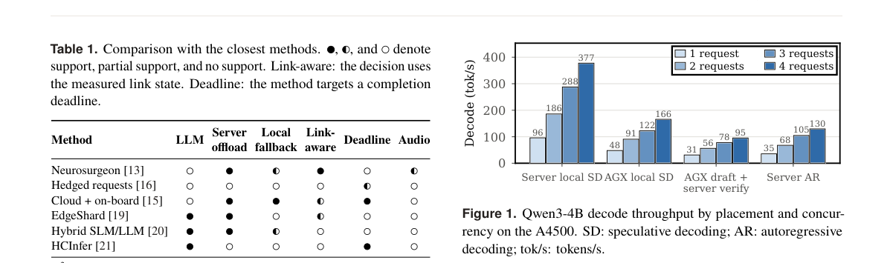
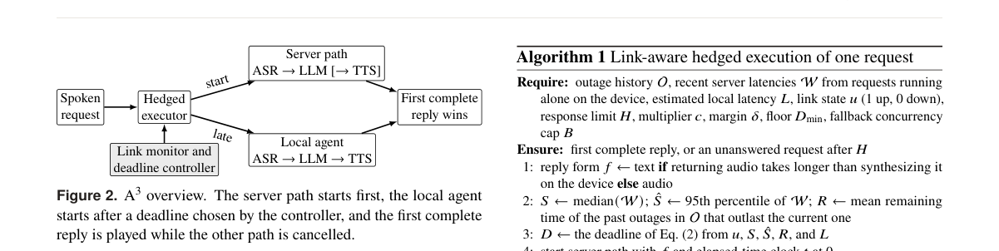
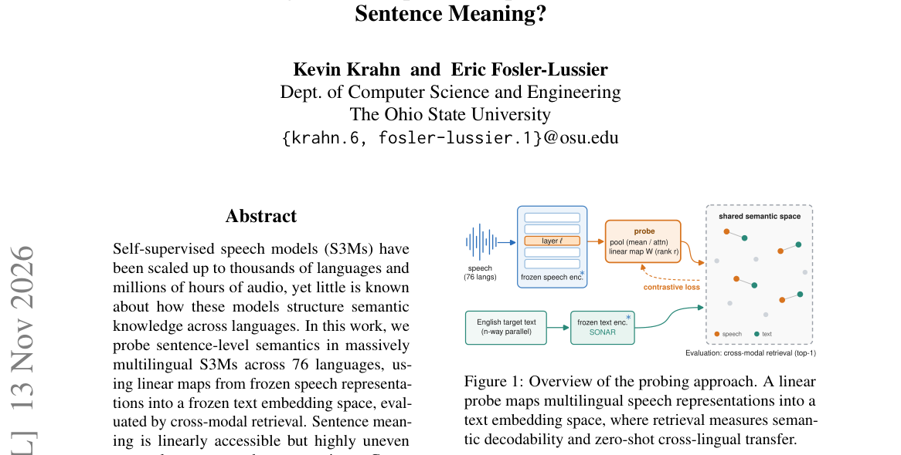
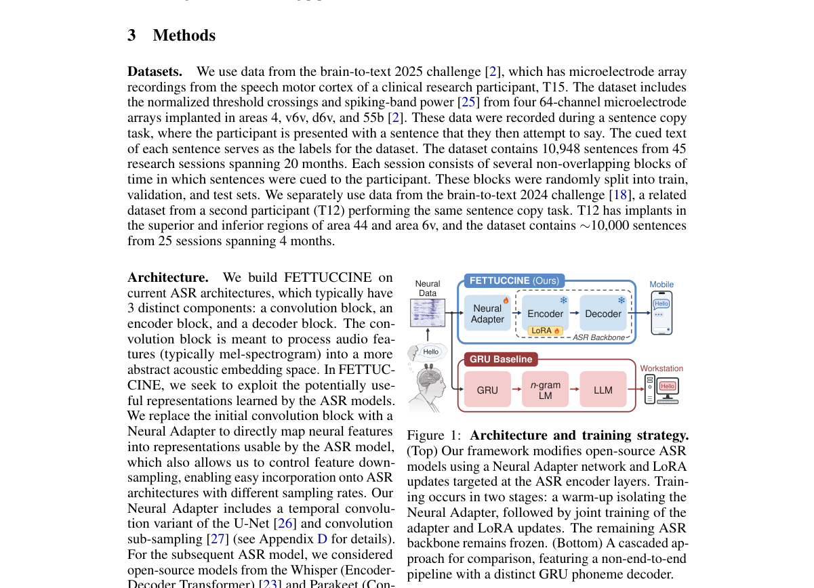
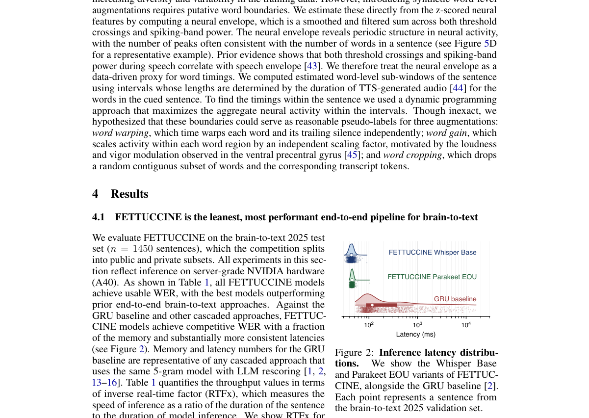
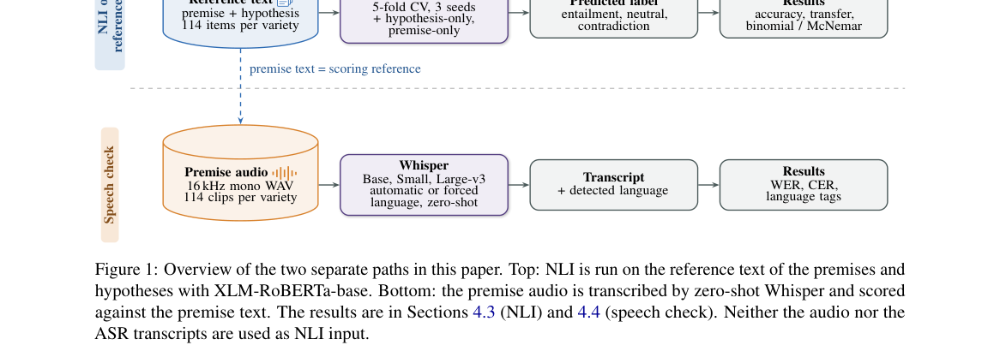
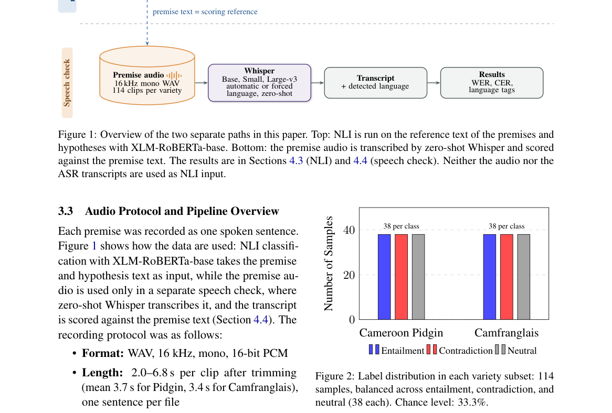
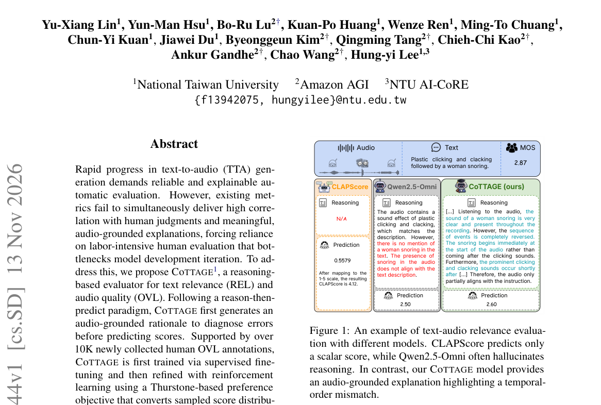
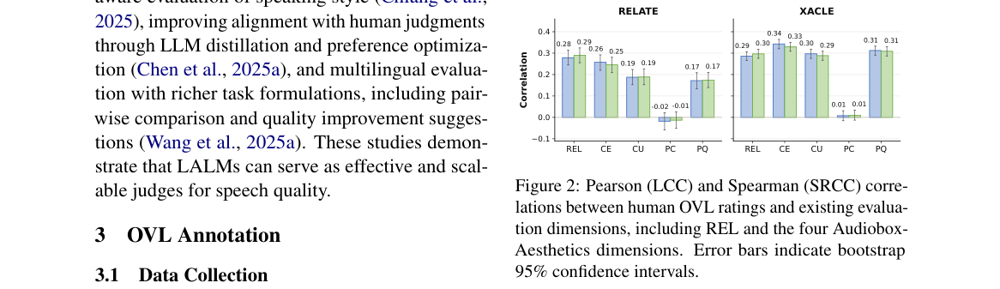

# Mine Arxiv Daily Digest - 2026-11-16 (全双工语音与语音 LM Axis, 5 papers)

**Generated**: 2026-11-16 11:54 CST

**Source**: arXiv cs.CV, cs.SD, eess.AS, cs.CL, cs.AI, cs.RO, cs.LG, cs.IR submissions, listing day 2026-11-13 (announced 2026-11-16 01:00 UTC)

**Batch window**: 2026-11-12T19:00:00Z .. 2026-11-13T19:00:00Z（arXiv 公告批次横跨两个 UTC 日：从前一日的美东 14:00 截止时刻起算（EDT 为 18:00Z，EST 为 19:00Z），到当日的同一时刻为止）

**Axis**: duplex_speech (5 papers, base 12, cap 20)

**Directions**: duplex_speech_core (4), speech_rl (1)

**Selection**: 5 papers ranked by relevance x quality, with 0 wild-card slots

**Day total**: 60 papers across 4 axes (target 60)

**Scope**: 全双工 / 实时 / 流式语音语言模型、speech-to-speech 语音助手、TTS / 语音克隆 / 语音转换，以及语音大模型的 RL 与奖励模型

**Wild-card**: 0 —— 本 axis 未启用任何 wild-card 名额。原报告唯一的 wild-card（2611.17895 工业声学异常检测）在完整批次重跑后被 3 篇更够格的语音侧论文挤出。

**本 axis 从 3 篇补到 5 篇，仍远低于基准 12 篇。** `duplex_speech_core` 2 → 4、`speech_rl` 维持 1 篇，本轮让出的名额由候选更充裕的 `llm_vlm` 与 `world_embodied` 按富余量吸收。

**`speech_rl` 依旧断供但有 1 篇入选。** 全批窗口里没有任何第二篇面向语音/音频的 RL 或偏好优化工作够格，CoTTAGE 是唯一入选；`duplex_speech_core` 新增的 A³、FETTUCCINE、CamSpokenNLI 三篇分别覆盖端侧部署、脑到文本解码与低资源变体评测，相关性依次为 8、6、6，按「薄方向让出名额而不是被填充」的口径未再凑数。

⚠️ **原报告的唯一 wild-card 被取消**：2611.17895（工业声学异常检测，relevance 5）在完整批次重跑后让位给 3 篇更够格的语音侧论文。

---

## 全双工语音与语音 LM · `duplex_speech_core` (4 papers)

本方向 4 篇里 3 篇新增，是本批补充幅度最大的语音方向，但整条 axis 仍只有 5 篇、远低于基准 12 篇。新增三篇分别钉住端侧部署的三个断面：A³ 实测 Kokoro TTS 在 Jetson Orin AGX 的 CPU 上单次回复超过 40 秒、GPU 上约 2 秒，三个 ASR/LLM/TTS 服务合计占 Orin Nano 7.6 GB 内存中的 7.1 GB（93%），并证明按 token 卸载反而更慢（单请求 31.1 tok/s 低于 AGX 单独解码的 47.9 tok/s），因此整段级卸载才是可行粒度；FETTUCCINE 把 Whisper 主干改造成端到端脑到文本解码器，brain-to-text 2025 测试集上公开子集 WER 低至 4.39%，而级联基线 GRU+5-gram+OPT-6.7B 要占 320,000 MB 内存、单句延迟 494.8±2457.7 ms，首次在 iPhone 15 Pro Max 上跑到 370 倍实时；CamSpokenNLI 则给低资源变体的口语 NLI 划了可信边界——零样本 Whisper 的 WER 高达 66.6% 与 45.5%，Whisper Large-v3 把 114 条 Pidgin 录音中的 93 条判成 Yoruba 或 Swahili，不重叠跨变体迁移只有 40.1% 与 45.6%，而有样本泄露时虚高到 60–64%。已发布的 What Do Multilingual Self-Supervised Speech Encoders Know About Sentence Meaning 以 76 种语言、9 个模型的句级线性探针给出本 direction 第一位：OmniASR-W2V-7B 的留一语言探针 top-1 达 33%，反超其单语探针 30%，580M 的 w2v-BERT-2.0 多语探针 47% 直接超过 7B 的 OmniASR。

### 1. A$^3$: Adaptive Audio Agent Framework for Collaborative Edge Computing

**arXiv**: [2611.18064](https://arxiv.org/abs/2611.18064) | **Score**: 7.4 (relevance 8 x 0.7 + quality 6 x 0.3) | **Direction**: `duplex_speech_core` | **Tags**: duplex-speech, edge-computing, hedged-execution, audio-agent, fallback-deadline, latency-budget, Nanyang Technological University | **Categories**: cs.AI | **Pages**: 8

**Authors**: Zexin Li; Xueyi Zhang; Tao Ren; Yiming Chen

**Affiliation**: Nanyang Technological University; National University of Singapore

**Abstract**

> Embedded audio agents need a nearby edge server for speed, but a server-dependent agent returns nothing when the link fails. We present A$^3$, an adaptive audio agent framework that places whole pipeline stages on the server, keeps a complete fallback agent on devices that can host one, and hedges both paths with a link-aware deadline that decides when to give up on the server. On Jetson devices and an RTX A4500 server, A$^3$ matches the server-only agent on a healthy link, answers every request in a full outage on the AGX, and beats a percentile hedge in simulated outages.

**Key findings**

- **Finding**: 端侧瓶颈在 TTS 与内存：Kokoro 在 AGX 的 CPU 上单次回复超过 40 秒、GPU 上约 2 秒，三个服务合计占 Orin Nano 7.6 GB 内存中的 7.1 GB（93%），叠加系统已用的 1.6 GB 后本地整条流水线放不下。
- **Inference**: 把 LLM 拆成「AGX 出草稿 + 服务器校验」反而更慢——单请求 31.1 tok/s 低于 AGX 单独解码的 47.9 tok/s，因为每个解码步都要付一次网络往返，所以整段级卸载才是可行粒度。
- **Recommendation**: 音频 agent 上端侧时，应按整段（ASR / LLM / TTS）而不是按 token 切分，并让本地回退只保证「能答完」，由链路感知的截止时间决定何时放弃服务器路径。

**Key figures**

*Framework - Qwen3-4B decode throughput by placement and concur- rency on the A4500. SD: speculative decoding; AR: autoregressive decoding; tok/s: tokens/s.*

*Result - A3 overview. The server path starts first, the local agent starts after a deadline chosen by the controller, and the first complete reply is played while the other path is cancelled.*

**Why this ranks #1**: 它把「语音助手必须在端侧也答得出话」这件工程事量化了：在 Jetson Orin AGX、Orin Nano 与 RTX A4500 服务器上测得 Kokoro TTS 在 AGX 的 CPU 上单次回复超过 40 秒、GPU 上约 2 秒，三个 ASR/LLM/TTS 服务合计占 Orin Nano 7.6 GB 内存中的 7.1 GB（93%），带宽受限下延迟可从 17.6 秒压到 9.7 秒，全断网时 AGX 仍能回答全部请求而纯服务器方案为零。

---

### 2. What Do Multilingual Self-Supervised Speech Encoders Know About Sentence Meaning?

**arXiv**: [2611.17686](https://arxiv.org/abs/2611.17686) | **Score**: 7.3 (relevance 7 x 0.7 + quality 8 x 0.3) | **Direction**: `duplex_speech_core` | **Tags**: duplex-speech, self-supervised-speech, multilingual-probing, cross-modal-retrieval, cross-lingual-transfer, linear-probe, Ohio State University | **Categories**: cs.CL | **Pages**: 18

**Authors**: Kevin Krahn; Eric Fosler-Lussier

**Affiliation**: The Ohio State University

**Abstract**

> Self-supervised speech models (S3Ms) have been scaled up to thousands of languages and millions of hours of audio, yet little is known about how these models structure semantic knowledge across languages. In this work, we probe sentence-level semantics in massively multilingual S3Ms across 76 languages, using linear maps from frozen speech representations into a frozen text embedding space, evaluated by cross-modal retrieval. Sentence meaning is linearly accessible but highly uneven across languages and resource tiers. Cross-lingual probes can match language-specific probes on languages never seen in probe training, but per-model monolingual decodability does not predict transfer. Within the OmniASR wav2vec family, scaling from 300M--7B disproportionately benefits high-resource languages, and ASR tuning sharply improves semantic decodability while making representations more language-specific. However, semantic content is entangled with acoustics, inflating apparent performance on single-speaker corpora.

**Key findings**

- **Finding**: FLEURS 的 40 种语言上，OmniASR-W2V-7B 的留一语言探针 top-1 检索 33% 高于其单语探针 30%，并在 24/39 种非英语语言上占优；w2v-BERT-2.0 的多语探针 47% vs 单语 36%，同样是多语胜出。
- **Inference**: 语义可解码性并不随参数规模线性提升——OmniASR-W2V 从 300M 扩到 7B，高资源语言从 14% 升到 68%，低资源仅从 6% 升到 12%，而 XEUS 单语 33% 却只有 15% 的留一语言成绩，说明跨语言迁移取决于训练目标而非规模。
- **Recommendation**: 选语音表征前端时别用单语可解码性当代理指标，要直接测留一语言外推；同时优先用注意力池化（MMS 26%→44%、w2v-BERT-2.0 36%→52%），均值池化会稀释帧级语义信号。

**Key figures**

*Framework - Overview of the probing approach. A linear probe maps multilingual speech representations into a text embedding space, where retrieval measures seman- tic decodability and zero-shot cross-li*

*Result - Monolingual, multilingual, and leave-one-language-out (LOO) top-1 accuracy of mean-pooled probes of self-supervised models on FLEURS (top) and Bible (bottom). English is excluded from mean c*

**Why this ranks #2**: 以 76 种语言、9 个自监督语音模型的句级线性探针结果拿到本 direction 第一位：OmniASR-W2V-7B 的留一语言探针 top-1 达 33%，反超其单语探针 30%，且在 24/39 种非英语语言上占优；580M 的 w2v-BERT-2.0 多语探针 47% 直接超过 7B 的 OmniASR。对全双工语音系统而言，这张来自 The Ohio State University 的表征画像，是选语音前端与定多语 fallback 策略时最直接可核对的依据。

---

### 3. FETTUCCINE: Fast and efficient brain-to-text decoding on mobile devices

**arXiv**: [2611.18561](https://arxiv.org/abs/2611.18561) | **Score**: 6.3 (relevance 6 x 0.7 + quality 7 x 0.3) | **Direction**: `duplex_speech_core` | **Tags**: duplex-speech, brain-to-text, neural-prosthesis, asr-adapter, lora-finetuning, edge-inference, Georgia Tech | **Categories**: cs.LG, q-bio.NC | **Pages**: 29

**Authors**: Jonathan D. McCart; Pranav I. Deevi; Mehdi Azabou; Nanda H. Krishna; Caleb A. McKinney; Nicholas S. Card; Sergey D. Stavisky; Chethan Pandarinath

**Affiliation**: Georgia Tech; Emory University; Mila; Université de Montréal; UC Davis

**Abstract**

> Recent advances in speech neuroprostheses have enabled new communication avenues for people who have lost the ability to speak due to neurological illness or injury. These systems can decode neural activity during attempted speech into text by relying on language priors to achieve high decoding accuracy. This performance currently comes at the cost of using a compute-intensive language modeling stack, presenting a major bottleneck for real-world use. Further, current language models incur highly variable and disruptive inference latencies, limiting communication throughput and preventing users from reliably participating in natural conversation. We introduce FETTUCCINE, an end-to-end brain-to-text framework that leverages the speed and portability of automatic speech recognition (ASR) models to address the aforementioned practical challenges, while achieving usable (<10%) word error rates (WER), efficient adaptation to neural non-stationarities, and reliable performance on mobile devices. When evaluated using publicly available data from an intracortical speech neuroprosthesis user, FETTUCCINE outperforms previous end-to-end methods, achieving as low as 4.39% WER. Most notably, our models successfully run on a commercially-available mobile device with throughput reaching up to 370x real-time, providing the first demonstration of brain-to-text decoding on a mobile device. We also show that our models can be successfully finetuned to extend usable performance to future days. Beyond performance, our approach enables localization of the neural features most relevant for decoding via gradient-based saliency maps, which we show align with well-established physiological priors across different ASR model families. Taken together, our results show that FETTUCCINE overcomes core infrastructural and computational barriers, yielding a new class of portable brain-to-text communication.

**Key findings**

- **Finding**: 在 brain-to-text 2025 测试集（n=1450）上，FETTUCCINE 的 Whisper Small 变体公开子集 WER 低至 4.39%、私有子集 5.05%，而 GRU+5-gram+OPT-6.7B 级联基线要占 320,000 MB 内存、单句延迟 494.8±2457.7 ms。
- **Inference**: 用 ASR 编码器加神经适配器与 LoRA 取代 n-gram 加 LLM 的语言模型栈，把决定准确率的语言先验从内存密集的后处理挪进轻量网络，才让手机级设备跑得动这套解码。
- **Recommendation**: 做神经假体或轻量流式解码时，优先复用 ASR 主干并只训练适配层与 LoRA，用「峰值显存 ≤3 GB 且 WER<10%」双阈值筛可部署版本，并按天微调以对抗神经信号的非平稳性。

**Key figures**

*Framework - Architecture and training strategy. (Top) Our framework modifies open-source ASR models using a Neural Adapter network and LoRA updates targeted at the ASR encoder layers. Train- ing occurs*

*Result - Inference latency distribu- tions. We show the Whisper Base and Parakeet EOU variants of FETTUC- CINE, alongside the GRU baseline [2]. Each point represents a sentence from the brain-to-text*

**Why this ranks #3**: 它把语音识别主干改造成端到端脑到文本解码器：在 brain-to-text 2025 测试集（n=1450）上 Whisper Small 变体公开子集 WER 低至 4.39%、私有子集 5.05%，而级联基线 GRU+5-gram+OPT-6.7B 需要 320,000 MB 内存、单句延迟 494.8±2457.7 ms，FETTUCCINE 的 Parakeet EOU 变体只有 43.2±6.7 ms，并首次在 iPhone 15 Pro Max 上跑到 370 倍实时。

---

### 4. CamSpokenNLI: A Pilot Resource for Cross-Variety Transfer Evaluation in Cameroon Pidgin English and Camfranglais

**arXiv**: [2611.17573](https://arxiv.org/abs/2611.17573) | **Score**: 5.7 (relevance 6 x 0.7 + quality 5 x 0.3) | **Direction**: `duplex_speech_core` | **Tags**: duplex-speech, low-resource-speech, spoken-nli, cameroon-pidgin, camfranglais, whisper-zeroshot, University of Buea | **Categories**: cs.CL, cs.SD | **Pages**: 26

**Authors**: Tiani Pekins Ebika

**Affiliation**: University of Buea

**Abstract**

> Cameroon Pidgin English (a West African Pidgin English variety) and Camfranglais are widely used in Cameroon, yet to our knowledge, neither has a dedicated spoken Natural Language Inference (NLI) resource. We introduce CamSpokenNLI, a pilot dataset of 114 scenario-matched spoken NLI items in each variety (228 in total), recorded by one native speaker from Buea. Each item pairs premise audio and text with a hypothesis, an NLI label, and English glosses. The author assigned labels, so the dataset is an exploratory resource rather than a mature benchmark. The NLI experiments use the reference text; the audio is evaluated separately. XLM-RoBERTa baselines with five-fold item-level cross-validation reach 44.7% on Pidgin and 46.2% on Camfranglais (chance 33.3%). Still, neither is statistically distinguishable from hypothesis-only input, so hypothesis wording may account for much of the accuracy. Under disjoint-item cross-variety transfer, where a test item's counterpart is never seen in training, accuracy is 40.1% (Pidgin to Camfranglais) and 45.6% (Camfranglais to Pidgin). A counterpart-leak audit raises this to 60-64%, illustrating how counterpart leakage can overstate transfer. Zero-shot Whisper transcription of the recordings performs poorly: the best word error rates are 66.6% for Pidgin and 45.5% for Camfranglais, and with automatic language identification, Whisper Large-v3 labels 93 of 114 Pidgin recordings as Yoruba or Swahili. Together, the results suggest that such resources need disjoint-item evaluation and hypothesis-only controls, and that speech recognition must be adapted to these varieties before spoken NLI can be tested end to end.

**Key findings**

- **Finding**: 零样本 Whisper 在这两个变体上基本不可用：Pidgin 最佳 WER 66.6%、Camfranglais 45.5%，Whisper Large-v3 还把 114 条 Pidgin 录音中的 93 条误判为 Yoruba 或 Swahili。
- **Inference**: 语音识别必须先针对低资源变体适配，否则所谓「口语 NLI 端到端」测的其实是 ASR 的语种误判，而不是模型对前提与假设的推理能力。
- **Recommendation**: 评估多语种语音 NLI 时应同时报告 hypothesis-only 对照与不重叠迁移划分，并把转写子系统的 WER 与语种误判率单列，否则准确率提升可能只是泄露或标注线索。

**Key figures**

*Framework - Overview of the two separate paths in this paper. Top: NLI is run on the reference text of the premises and hypotheses with XLM-RoBERTa-base. Bottom: the premise audio is transcribed by zero*

*Result - Label distribution in each variety subset: 114 samples, balanced across entailment, contradiction, and neutral (38 each). Chance level: 33.3%.*

**Why this ranks #4**: 它给低资源变体的口语 NLI 划了可信边界：两个变体各 114 条（合计 228 条）样本上 XLM-RoBERTa 五折准确率只有 44.7% 与 46.2%（随机基线 33.3%），不重叠跨变体迁移 40.1% 与 45.6%，而存在对应样本泄露时虚高到 60–64%；零样本 Whisper 的 WER 更高达 66.6% 与 45.5%，Whisper Large-v3 把 114 条 Pidgin 录音中的 93 条判成 Yoruba 或 Swahili。

---

## 语音 LM 的 RL 与偏好优化 · `speech_rl` (1 papers)

本方向仍只有 1 篇，但它把 RL 真正用到了语音/音频评估器上。CoTTAGE 走「先想后评」路线：先用音频锚定的理由诊断错误，再给出相关性（REL）与总体质量（OVL）分数；它用 1 万余条新采集的人工 OVL 标注先做 SFT，再用 GRPO 式分组采样得到 K=8 条推理轨迹的分数分布，经 Thurstone 模型转成成对偏好概率，与人工 MOS 导出的偏好对齐充当奖励。在 XACLE 的 REL 上 LCC 达 0.685（CLAPScore 0.472、ELSA 0.398、Gemini-3.1 Pro 0.551），去掉 RL 阶段后六个基准一致下降（0.601 / 0.529 / 0.481）。它的理由在人工盲测中相对 Qwen2.5-Omni-7B 的胜率达 REL 75.7%、OVL 63.4%，并补上音频质量奖励模型长期缺数据这一环。

### 5. CoTTAGE: An Explainable Judge for Text-to-Audio Generation

**arXiv**: [2611.17644](https://arxiv.org/abs/2611.17644) | **Score**: 8.0 (relevance 8 x 0.7 + quality 8 x 0.3) | **Direction**: `speech_rl` | **Tags**: duplex-speech, text-to-audio-evaluation, audio-judge, thurstone-preference, reinforcement-learning, explainable-evaluation, National Taiwan University | **Categories**: cs.AI, cs.SD | **Pages**: 18

**Authors**: Yu-Xiang Lin; Yun-Man Hsu; Bo-Ru Lu; Kuan-Po Huang; Wenze Ren; Ming-To Chuang; Chun-Yi Kuan; Jiawei Du; Byeonggeun Kim; Qingming Tang; Chieh-Chi Kao; Ankur Gandhe

**Affiliation**: National Taiwan University; Amazon AGI; NTU AI-CoRE

**Abstract**

> Rapid progress in text-to-audio (TTA) generation demands reliable and explainable automatic evaluation. However, existing metrics fail to simultaneously deliver high correlation with human judgments and meaningful, audio-grounded explanations, forcing reliance on labor-intensive human evaluation that bottlenecks model development iteration. To address this, we propose CoTTAGE, a reasoning-based evaluator for text relevance (REL) and audio quality (OVL). Following a reason-then-predict paradigm, CoTTAGE first generates an audio-grounded rationale to diagnose errors before predicting scores. Supported by over 10K newly collected human OVL annotations, CoTTAGE is first trained via supervised fine-tuning and then refined with reinforcement learning using a Thurstone-based preference objective that converts sampled score distributions into pairwise preference probabilities and rewards agreement with rankings derived from human judgments. Across six benchmarks spanning REL and OVL, CoTTAGE achieves state-of-the-art correlation with human judgments while producing human-preferred explanations to accelerate TTA development.

**Key findings**

- **Finding**: CoTTAGE 在 REL 上 XACLE 的 LCC/SRCC 为 0.685/0.652，OVL 上 PAM-Audio 为 0.611/0.614、Clotho 为 0.559/0.558；去掉 RL 阶段后分别降到 0.601、0.529、0.481，六个基准一致下降。
- **Inference**: 用 Thurstone 模型把含方差的分数分布转成成对偏好概率、再以 Bhattacharyya 系数与人工 MOS 偏好对齐，等于把「绝对打分」改写成「排序一致」这一更密也更易优化的目标，因此能稳定超过纯 SFT 的点式监督。
- **Recommendation**: 做语音或音频奖励模型时照它的两段式来：先用人工 MOS 构造「先理由后打分」的 SFT 轨迹，再用成对偏好做 RL，并保留 <think>/<score> 格式奖励；其理由在人工盲测中相对 Qwen2.5-Omni-7B 的胜率达 REL 75.7%、OVL 63.4%。

**Key figures**

*Framework - An example of text-audio relevance evalua- tion with different models. CLAPScore predicts only a scalar score, while Qwen2.5-Omni often hallucinates reasoning. In contrast, our CoTTAGE model*

*Result - Pearson (LCC) and Spearman (SRCC) corre- lations between human OVL ratings and existing evalua- tion dimensions, including REL and the four Audiobox- Aesthetics dimensions. Error bars indica*

**Why this ranks #5**: speech_rl 档唯一入选且相关性最高（8.0）：它把 RL 真正用到语音/音频评估器上——用 GRPO 式分组采样得到 K=8 条推理轨迹的分数分布，经 Thurstone 模型转成成对偏好概率，再与人工 MOS 导出的偏好对齐充当奖励；在 XACLE 的 REL 上 LCC 达 0.685（CLAPScore 0.472、ELSA 0.398、Gemini-3.1 Pro 0.551），并新增 1 万余条 OVL 人工标注，补上音频质量奖励模型长期缺数据这一环。

---

## Footer

- Total papers reviewed across all 4 axes: 60
- duplex_speech axis final count: 5
- Wild-cards in this axis: 0
- Figure assets: 2026-11-16/res/

Generated by `mine-arxiv-daily-digest` skill. Sister file: `2026-11-16_duplex_speech_entry.md`.
