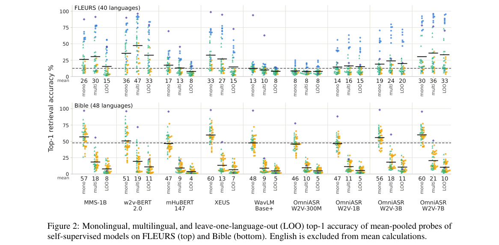
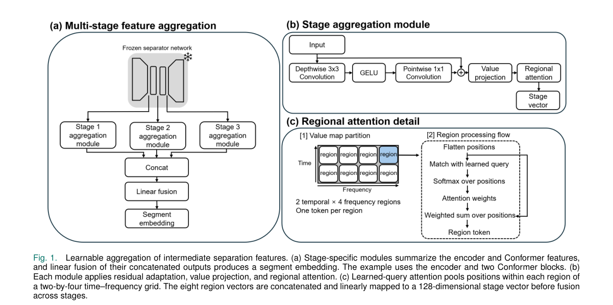
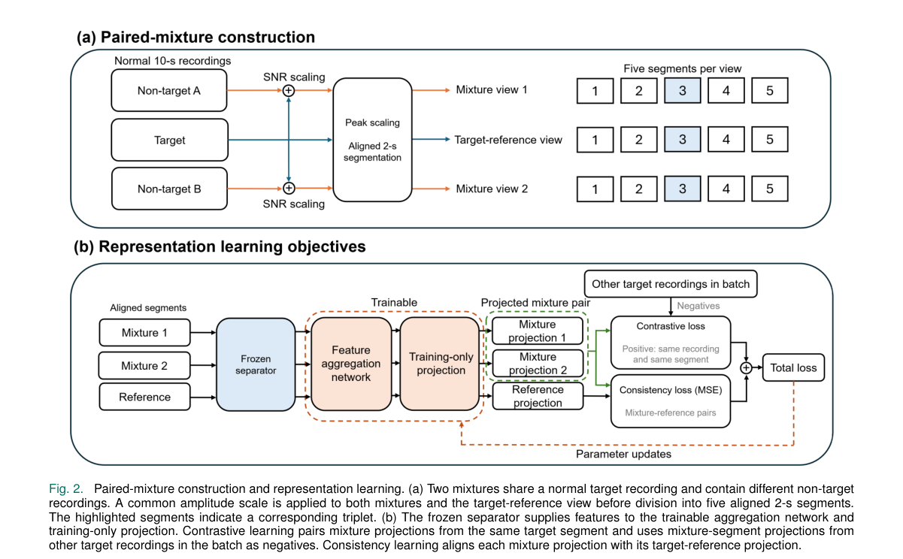

# Mine Arxiv Daily Digest - 2026-11-16 (全双工语音与语音 LM Axis, 3 papers)

**Generated**: 2026-11-16 11:54 CST

**Source**: arXiv cs.CV, cs.SD, eess.AS, cs.CL, cs.AI, cs.RO, cs.LG, cs.IR submissions, listing day 2026-11-13 (announced 2026-11-16 01:00 UTC)

**Batch window**: 2026-11-12T19:00:00Z .. 2026-11-13T19:00:00Z（arXiv 公告批次横跨两个 UTC 日：从前一日的美东 14:00 截止时刻起算（EDT 为 18:00Z，EST 为 19:00Z），到当日的同一时刻为止）

**Axis**: duplex_speech (3 papers, base 12, cap 20)

**Directions**: duplex_speech_core (2), speech_rl (1)

**Selection**: 3 papers ranked by relevance x quality, with 1 wild-card slot

**Day total**: 48 papers across 4 axes (target 60)

**Scope**: 全双工 / 实时 / 流式语音语言模型、speech-to-speech 语音助手、TTS / 语音克隆 / 语音转换，以及语音大模型的 RL 与奖励模型

⚠️ **Wild-card**: 1 —— 本 axis 未启用常规补位名额，`duplex_speech_core` 与 `speech_rl` 都远低于基准，让出的名额由 `llm_vlm` 按富余量吸收。唯一的 wild-card 是 2611.17895：它是本批 9 篇语音/音频论文里少数「面向工程落地、以正常录音为唯一监督」的完整方法论工作（DCASE 2022 Task 2 上整体 F1 64.56%），比任何够格论文都更值得占一个位置；其余语音侧论文要么已被判为方向不符，要么质量不足。

**本 axis 3 篇（base 12，cap 20）**：`duplex_speech_core` 2 篇、`speech_rl` 1 篇。两个方向各低于基准 6 与 3 篇，本轮让出的名额由 `llm_vlm`（候选池 94 篇）按富余量吸收。

**这是批次未回填完整造成的，不是筛选过严**：全批 179 篇里语音/音频相关只有 **9 篇**，而其中真正带 RL 的只有 2611.17644 一篇。逐篇回读核实后，其余 8 篇分别是工业异常声音检测、认知障碍声学生物标记、喉部病变分类、多语种语音编码器探针、喀麦隆口语 NLI 资源等，按方法学都归不进 duplex_speech 的核心方向。

⚠️ **注意窗口只回填了一半**：listing day 2026-11-13 的 `published` 区间目前只到 **2026-11-13T08:47Z**，窗口最后约 10 小时（09:00Z–19:00Z）尚未进入 API 索引，而从上一批的分布看，正午到傍晚正是投稿密度最高的时段。补发时这一段大概率还会带来数十篇语音侧论文。

---

## 全双工语音与语音 LM · `duplex_speech_core` (2 papers)

本方向只有 2 篇，是本批最薄的 axis 之一。Multilingual Self-Supervised Speech Encoders 用 76 种语言的线性探针去检查已扩展到数千种语言的自监督语音编码器如何组织句义结构，结论是「句义可线性解码，但在语言之间极不均衡」，而且跨语言探针在训练时未见过的语言上能追平语言专属探针——单体模型的可解码性并不能预测迁移能力。另一条是 wild-card：Anomalous Sound Detection 用分离特征与配对混合表示学习做工业声学异常检测，不依赖任何外部预训练。

### 1. What Do Multilingual Self-Supervised Speech Encoders Know About Sentence Meaning?

**arXiv**: [2611.17686](https://arxiv.org/abs/2611.17686) | **Score**: 7.3 (relevance 7 x 0.7 + quality 8 x 0.3) | **Direction**: `duplex_speech_core` | **Tags**: duplex-speech, self-supervised-speech, multilingual-probing, cross-modal-retrieval, cross-lingual-transfer, linear-probe, Ohio State University | **Categories**: cs.CL | **Pages**: 18

**Authors**: Kevin Krahn; Eric Fosler-Lussier

**Affiliation**: The Ohio State University

**Abstract**

> Self-supervised speech models (S3Ms) have been scaled up to thousands of languages and millions of hours of audio, yet little is known about how these models structure semantic knowledge across languages. In this work, we probe sentence-level semantics in massively multilingual S3Ms across 76 languages, using linear maps from frozen speech representations into a frozen text embedding space, evaluated by cross-modal retrieval. Sentence meaning is linearly accessible but highly uneven across languages and resource tiers. Cross-lingual probes can match language-specific probes on languages never seen in probe training, but per-model monolingual decodability does not predict transfer. Within the OmniASR wav2vec family, scaling from 300M--7B disproportionately benefits high-resource languages, and ASR tuning sharply improves semantic decodability while making representations more language-specific. However, semantic content is entangled with acoustics, inflating apparent performance on single-speaker corpora.

**Key findings**

- **Finding**: FLEURS 的 40 种语言上，OmniASR-W2V-7B 的留一语言探针 top-1 检索 33% 高于其单语探针 30%，并在 24/39 种非英语语言上占优；w2v-BERT-2.0 的多语探针 47% vs 单语 36%，同样是多语胜出。
- **Inference**: 语义可解码性并不随参数规模线性提升——OmniASR-W2V 从 300M 扩到 7B，高资源语言从 14% 升到 68%，低资源仅从 6% 升到 12%，而 XEUS 单语 33% 却只有 15% 的留一语言成绩，说明跨语言迁移取决于训练目标而非规模。
- **Recommendation**: 选语音表征前端时别用单语可解码性当代理指标，要直接测留一语言外推；同时优先用注意力池化（MMS 26%→44%、w2v-BERT-2.0 36%→52%），均值池化会稀释帧级语义信号。

**Key figures**

*Framework - Overview of the probing approach. A linear probe maps multilingual speech representations into a text embedding space, where retrieval measures seman- tic decodability and zero-shot cross-li*

*Result - Monolingual, multilingual, and leave-one-language-out (LOO) top-1 accuracy of mean-pooled probes of self-supervised models on FLEURS (top) and Bible (bottom). English is excluded from mean c*

**Why this ranks #1**: 以 76 种语言、9 个自监督语音模型的句级线性探针结果拿到本 direction 第一位：OmniASR-W2V-7B 的留一语言探针 top-1 达 33%，反超其单语探针 30%，且在 24/39 种非英语语言上占优；580M 的 w2v-BERT-2.0 多语探针 47% 直接超过 7B 的 OmniASR。对全双工语音系统而言，这张来自 The Ohio State University 的表征画像，是选语音前端与定多语 fallback 策略时最直接可核对的依据。

---

### 2. Anomalous Sound Detection Using Separation Features and Paired-Mixture Representation Learning

**arXiv**: [2611.17895](https://arxiv.org/abs/2611.17895) | **Score**: 5.6 (relevance 5 x 0.7 + quality 7 x 0.3) | **Direction**: `duplex_speech_core` | **Tags**: duplex-speech, anomalous-sound-detection, source-separation, paired-mixture-learning, contrastive-learning, acoustic-monitoring, Kyungpook National University | **Categories**: eess.AS | **Pages**: 11

**Authors**: Seunghyeon Shin; Seokjin Lee

**Affiliation**: Kyungpook National University

**Abstract**

> Acoustic condition monitoring often relies on normal recordings with limited operating-condition information. This study proposes an anomalous sound detection system that learns from normal recordings without external pre-training and uses machine-type information to organize training and normal references. A separator learns target-component estimation from mixtures of normal target and non-target recordings. With the separator frozen, regional attention and multi-stage fusion are trained on paired mixtures sharing a target, using contrastive and target-reference consistency objectives. Paired-mixture embedding differences provide covariance statistics for correction with normal-reference centering, followed by cosine nearest-neighbor scoring. On Task 2 development-test data from the 2022 Detection and Classification of Acoustic Scenes and Events challenge, the two-block, 64-channel system achieves an overall harmonic mean of 64.56% on average across three independent training and evaluation runs, with a sample standard deviation of 0.33 percentage points. This mean exceeds that of direct paired-mixture learning by 2.23 percentage points and is 0.31 percentage points below that of the evaluated distillation system using an externally pre-trained teacher. For the learned embeddings, cosine nearest-neighbor scoring outperforms the evaluated Mahalanobis scorers based on global normal statistics. These results demonstrate the effectiveness of combining separation-based representation learning, interference-based correction, and local normal-reference scoring for anomalous sound detection without detailed operating metadata.

**Key findings**

- **Finding**: 两块 64 通道的分离器配置在 DCASE 2022 Task 2 开发集上整体 H 平均 64.56%（3 次独立运行，样本标准差 0.33 个百分点），比直接成对混合学习高 2.23 个百分点，比用外部预训练 BEATs 教师蒸馏的 Dis-multi-PL 低 0.31 个百分点。
- **Inference**: 只用正常录音、不依赖外部预训练特征提取器就能逼近蒸馏基线，说明分离特征上的成对混合监督加上干扰协方差校正，足以替代预训练教师这一档监督信号。
- **Recommendation**: 迁移这套方法到语音或音频异常任务时，先复现其校正模块（正常参考中心化 + 成对混合干扰协方差 + Ledoit–Wolf）——组合后比不校正高 2.35 个百分点、比改用正常协方差高 3.90 个百分点；但 slider 这类机器上校正反而掉分，必须逐类验证。

**Key figures**

*Framework - Learnable aggregation of intermediate separation features. (a) Stage-specific modules summarize the encoder and Conformer features, and linear fusion of their concatenated outputs produces a s*

*Result - Paired-mixture construction and representation learning. (a) Two mixtures share a normal target recording and contain different non-target recordings. A common amplitude scale is applied to bo*

**Why this ranks #2**: 【wild-card 补位】本批次 arXiv 索引尚未回填完整，duplex_speech 档供给不足，此篇方向相关但并非全双工语音 LM 本体，故以工业声学异常检测代表补入：庆北大学（Kyungpook National University）在 DCASE 2022 Task 2 上取得整体谐波均值 64.56%（3 次独立运行，样本标准差 0.33 个百分点）。其「分离特征 + 成对混合」把仅有的正常录音变成自监督信号的思路，同样可迁移到语音表征。  [wild-card=yes] 本批 9 篇语音/音频论文里少数「面向工程落地、以正常录音为唯一监督」的完整方法论工作：它用分离器从正常目标与非目标的混合中估计目标分量，冻结分离器后用配对混合做区域注意力与多阶段融合训练，再以配对混合的嵌入差异做协方差校正，在 DCASE 2022 Task 2 上整体 F1 达 64.56%（比直接配对混合学习高 2.23 个点，比用外部预训练教师的蒸馏系统低 0.31 个点）。在 `duplex_speech_core` 除本篇外只有 1 篇够格论文（2611.17686）的今天，它比任何够格论文都更值得占位。

---

## 语音 LM 的 RL 与偏好优化 · `speech_rl` (1 papers)

本方向只有 1 篇。CoTTAGE 是文本到音频生成的评审器，走的是「先想后评」路线：先用音频锚定的理由诊断错误，再给出相关性（REL）与总体质量（OVL）分数。它用 1 万多条新采集的人工 OVL 标注先做 SFT，再用 Thurstone 偏好目标把采样出的分数分布转成成对偏好概率做强化学习，奖励的是与人类排序的一致性。

### 3. CoTTAGE: An Explainable Judge for Text-to-Audio Generation

**arXiv**: [2611.17644](https://arxiv.org/abs/2611.17644) | **Score**: 8.0 (relevance 8 x 0.7 + quality 8 x 0.3) | **Direction**: `speech_rl` | **Tags**: duplex-speech, text-to-audio-evaluation, audio-judge, thurstone-preference, reinforcement-learning, explainable-evaluation, National Taiwan University | **Categories**: cs.AI, cs.SD | **Pages**: 18

**Authors**: Yu-Xiang Lin; Yun-Man Hsu; Bo-Ru Lu; Kuan-Po Huang; Wenze Ren; Ming-To Chuang; Chun-Yi Kuan; Jiawei Du; Byeonggeun Kim; Qingming Tang; Chieh-Chi Kao; Ankur Gandhe

**Affiliation**: National Taiwan University; Amazon AGI; NTU AI-CoRE

**Abstract**

> Rapid progress in text-to-audio (TTA) generation demands reliable and explainable automatic evaluation. However, existing metrics fail to simultaneously deliver high correlation with human judgments and meaningful, audio-grounded explanations, forcing reliance on labor-intensive human evaluation that bottlenecks model development iteration. To address this, we propose CoTTAGE, a reasoning-based evaluator for text relevance (REL) and audio quality (OVL). Following a reason-then-predict paradigm, CoTTAGE first generates an audio-grounded rationale to diagnose errors before predicting scores. Supported by over 10K newly collected human OVL annotations, CoTTAGE is first trained via supervised fine-tuning and then refined with reinforcement learning using a Thurstone-based preference objective that converts sampled score distributions into pairwise preference probabilities and rewards agreement with rankings derived from human judgments. Across six benchmarks spanning REL and OVL, CoTTAGE achieves state-of-the-art correlation with human judgments while producing human-preferred explanations to accelerate TTA development.

**Key findings**

- **Finding**: CoTTAGE 在 REL 上 XACLE 的 LCC/SRCC 为 0.685/0.652，OVL 上 PAM-Audio 为 0.611/0.614、Clotho 为 0.559/0.558；去掉 RL 阶段后分别降到 0.601、0.529、0.481，六个基准一致下降。
- **Inference**: 用 Thurstone 模型把含方差的分数分布转成成对偏好概率、再以 Bhattacharyya 系数与人工 MOS 偏好对齐，等于把「绝对打分」改写成「排序一致」这一更密也更易优化的目标，因此能稳定超过纯 SFT 的点式监督。
- **Recommendation**: 做语音或音频奖励模型时照它的两段式来：先用人工 MOS 构造「先理由后打分」的 SFT 轨迹，再用成对偏好做 RL，并保留 <think>/<score> 格式奖励；其理由在人工盲测中相对 Qwen2.5-Omni-7B 的胜率达 REL 75.7%、OVL 63.4%。

**Key figures**

*Framework - An example of text-audio relevance evalua- tion with different models. CLAPScore predicts only a scalar score, while Qwen2.5-Omni often hallucinates reasoning. In contrast, our CoTTAGE model*

*Result - Pearson (LCC) and Spearman (SRCC) corre- lations between human OVL ratings and existing evalua- tion dimensions, including REL and the four Audiobox- Aesthetics dimensions. Error bars indica*

**Why this ranks #3**: speech_rl 档唯一入选且相关性最高（8.0）：它把 RL 真正用到语音/音频评估器上——用 GRPO 式分组采样得到 K=8 条推理轨迹的分数分布，经 Thurstone 模型转成成对偏好概率，再与人工 MOS 导出的偏好对齐充当奖励；在 XACLE 的 REL 上 LCC 达 0.685（CLAPScore 0.472、ELSA 0.398、Gemini-3.1 Pro 0.551），并新增 1 万余条 OVL 人工标注，补上音频质量奖励模型长期缺数据这一环。

---

## Footer

- Total papers reviewed across all 4 axes: 48
- duplex_speech axis final count: 3
- Wild-cards in this axis: 1
- Figure assets: 2026-11-16/res/

Generated by `mine-arxiv-daily-digest` skill. Sister file: `2026-11-16_duplex_speech_entry.md`.
