# Mine Arxiv Daily Digest - 2026-11-16 (LLM / VLM 与其强化学习 Axis, 20 papers)

**Generated**: 2026-11-16 11:54 CST

**Source**: arXiv cs.CV, cs.SD, eess.AS, cs.CL, cs.AI, cs.RO, cs.LG, cs.IR submissions, listing day 2026-11-13 (announced 2026-11-16 01:00 UTC)

**Batch window**: 2026-11-12T19:00:00Z .. 2026-11-13T19:00:00Z（arXiv 公告批次横跨两个 UTC 日：从前一日的美东 14:00 截止时刻起算（EDT 为 18:00Z，EST 为 19:00Z），到当日的同一时刻为止）

**Axis**: llm_vlm (20 papers, base 18, cap 20)

**Directions**: llm_core (8), vlm_core (6), llm_vlm_rl (6)

**Selection**: 20 papers ranked by relevance x quality, with 0 wild-card slots

**Day total**: 60 papers across 4 axes (target 60)

**Scope**: 大语言模型与视觉语言模型的设计、推理、agent、效率与上下文工作，以及面向 LLM / VLM 的 RL 与偏好优化、奖励模型

**Wild-card**: 0 —— 本 axis 未启用任何 wild-card 名额，三个 direction 都有足量够格论文，按候选富余量分配名额即可，无需用邻接选题补位。

**本 axis 维持 20 篇，继续打满 `AXIS_CAP = 20`，但方向构成变了。** 原分配 `llm_core` 10 / `vlm_core` 5 / `llm_vlm_rl` 5，本轮为 8 / 6 / 6：新增的 5 篇 `llm_core`（UUE、Soteria、LACCO、VelServe、Callo）与 1 篇 `vlm_core`（MMFlash）、1 篇 `llm_vlm_rl`（G-CAST）挤出了 7 篇旧的 `llm_core`。

**同轴让位：7 篇已发布的 `llm_core` 被挤掉，5 篇新论文是 rel ≥ 9 的必进项。** 本批 `llm_vlm` 侧共有 11 篇 relevance ≥ 9（`llm_core` 7、`vlm_core` 2、`llm_vlm_rl` 2），按 skill「rel ≥ 9 必进、同 axis 内让位」的口径，被挤出的 7 篇 `llm_core` 分别是 Interpreting Coding Agents、Unfinished-Bench、More Agents More Samples or More Thinking、LuthorSQL、Can Agents Keep Up with Time、Fuse-All MoE Inference Kernel 与 RAG-FGO，它们的 relevance 都是 8、低于必进线。

**超基准名额由 axis 富余吸收。** `vlm_core` 与 `llm_vlm_rl` 各超基准 1 个，而本 axis 的 `dir_under = 0`，因此这 2 个名额靠 `axis_surplus = 20 − 18 = 2` 放行。

---

## LLM 核心（架构 / 推理 / agent / 效率 / 上下文） · `llm_core` (8 papers)

本方向 8 篇里 5 篇新增，覆盖**模型编辑、安全、长程 agent 与训练推理基础设施**四条线。模型编辑侧 UUE 把参数更新投影到保留知识表征的左零空间并给出闭式解，TOFU forget01 上把 Phi-1.5B 的 ROUGE-L 遗忘分从 0.9530 压到 0.3178，而保留分仅从 0.9290 微降到 0.9228，闭式适配器更新只占总运行时间的 5.5%。安全侧 Soteria 先验地形式验证计划并在运行期强制执行，三个基准 207 个任务、四个模型上全部达成 100% 一致性与零规格违反（最强基线最高 93.0%），而 Alignment with Reflect-Reasoning 教的是「如何对原则做反思推理」而不是「遵守哪些原则」，留出原则上对 Base-ICL 胜率 82.5%–94.7%，无需人工标注即可迁移到金融与医疗。长程 agent 侧 CarryOn 回答「长程交互历史里该保留什么」，把紧凑执行状态与带来源链接的细粒度证据分开管理，三个 benchmark、三个 Actor 上宏平均成功率 75.7%，比最强基线高 6.7 个点；Co-Sight Harness 则把工作流定义、状态与领域知识外置成版本化控制资产，120 例评测里无人值守完成率从 50% 升到 100%、端到端延迟从 440 分钟降到 159 分钟。基础设施三篇都是新增：LACCO 用前瞻加主两阶段让全局通信与本地计算重叠，0.5B 模型在 0.5 Gbps 下端到端加速 1.89 倍、与 DDP 差距不超过 1.77%；VelServe 按自身迭代延迟的实测尾部校准每步预填充预算，SLO goodput 是最强基线的 2.4–2.9 倍；Callo 复用被作废的 KV 起草并在精确 KV 上校验，草稿下一 token 一致率 98.3%、32 token 窗口在 65% 的 miss 请求中整窗接受。

### 1. Co-Sight Harness: Externalized Control Assets and Deterministic Enforcement for Long-Horizon Business Agents

**arXiv**: [2611.17696](https://arxiv.org/abs/2611.17696) | **Score**: 8.7 (relevance 9 x 0.7 + quality 8 x 0.3) | **Direction**: `llm_core` | **Tags**: LLM-VLM, long-horizon-agent, harness-design, control-assets, acceptance-gates, enterprise-workflow, ZTE | **Categories**: cs.AI | **Pages**: 21

**Authors**: Luyao Wang; Xijun Zhu; Zhaohui Hao; Xiwen Zhang; Xingyu Wen; Weishan Li; Yuyang Liao; Yanqin Gao; Yongsheng Du; Lingjun Huang; Shaowei Zhao; Gang Li

**Affiliation**: ZTE Corporation

**Abstract**

> Long-horizon business workflows fail in two ways: errors accumulate as a chain of activities lengthens, and the knowledge an activity needs is written in a different vocabulary from the user's request. We study whether such workflows can be made reliable without changing the language model. Our method keeps the backbone fixed and moves the workflow definition, state and domain knowledge into versioned control assets outside the model. A state machine and machine-checkable acceptance gates enforce these assets during execution; an independent auditor grades the resulting trace. The assets are updated only after a regression check and human approval .We evaluate the method on three deployed workflows exceeding 200 steps. On Domain A, a 120-case end-to-end evaluation set shows unattended completion rising from 50% to 100%, retrieval recall from 56% to 91.67%, and end-to-end latency dropping from 440 to 159 minutes, with scenario-analysis recall rising from 45% to 93%. Two other domains were taken over by teams that did not write the assets, one in four days and one in seven days. A controlled ablation separates the two failure sources. The code is available at https://github.com/ZTE-AICloud/Co-Sight/tree/master/Co-Sight%20Harness.

**Key findings**

- **Finding**: 冻结骨干只改 harness，Domain A 的 120 例评测显示无人值守完成率 50%→100%、检索召回 56%→91.67%、端到端延迟 440→159 分钟、情景分析召回 45%→93%。
- **Inference**: 逐步可靠性 0.95 串十步只有 0.95^10≈60% 的成功率，长流程失败是乘积结构问题，靠换更大模型或加重试都改不动。
- **Recommendation**: 想提长流程可靠性，先把流程定义、状态与验收门外置成可版本化资产，再谈换模型；资产更新必须先过回归门并人工批准。

**Key figures**

*Framework - Overview of the proposed method and its implementation.*

**Why this ranks #1**: 中兴通讯（ZTE Corporation）把工作流定义、状态与领域知识外置成版本化控制资产，由状态机和机器可检验的验收门在执行期强制执行，骨干模型全程冻结。Domain A 的 120 例端到端评测里，无人值守完成率从 50% 升到 100%，检索召回从 56% 升到 91.67%，端到端延迟从 440 分钟降到 159 分钟；三个部署域的工作流都超过 200 步，且同一套资产被非原团队以 2 人×4 天、1 人×7 天接手。

---

### 2. CarryOn: Learning What to Keep in Context for Long-Horizon LLM Agents

**arXiv**: [2611.17808](https://arxiv.org/abs/2611.17808) | **Score**: 8.7 (relevance 9 x 0.7 + quality 8 x 0.3) | **Direction**: `llm_core` | **Tags**: LLM-VLM, context-management, long-horizon-agent, evidence-selection, token-efficiency, tool-agents, University of New South Wales | **Categories**: cs.AI, cs.CL | **Pages**: 31

**Authors**: Lihuan Li; Ruiyi Yang; Jiru Wang; Yifan Duan; Xiachong Lin; Hao Xue; Yang Song; Flora Salim

**Affiliation**: University of New South Wales; The Hong Kong University of Science and Technology (Guangzhou)

**Abstract**

> Long-horizon LLM agents can coordinate tools and applications to complete complex, multi-step tasks. As their interaction histories grow, effective context management becomes essential for reliable and efficient execution. Existing methods reduce context through summarization, pruning, or history selection. However, shorter contexts do not necessarily support better decisions: summaries can omit exact details needed for later actions, while retaining entire interactions can carry substantial irrelevant information. We propose CarryOn, a lightweight context manager that pairs compact execution state with fine-grained, source-linked evidence. A learned selector and adaptive retention policy keep relevant evidence available without additional LLM calls for context management. We introduce two complementary evaluation metrics: $S_α$ prioritizes task success while accounting for resource use, and normalized cost per success (NCS) measures the resources spent per successful task. Across AppWorld, OfficeBench, and Tau2 Telecom with three LLM Actors, CarryOn achieves 75.7% macro-averaged task success, exceeding the strongest baseline by 6.7 percentage points. It also achieves the best average scores on both metrics.

**Key findings**

- **Finding**: 三个 benchmark × 三个 Actor 上平均 Success 75.7%、S0.8 68.45、平均 NCS 0.792，Success 在 8 组对比中 7 次第一、1 次并列第一，NCS 在 6 组最低。
- **Inference**: 同一冻结选择器可跨不同 Actor 复用，说明收益来自证据选择机制本身，而不是靠某个基座模型的能力。
- **Recommendation**: 做长程 agent 时把状态与证据分开存，并按证据是否被后续调用复用来决定取舍，而不是按最近顺序裁剪。

**Key figures**

*Framework - CarryOn: carry what matters. Left: Context-management challenges and CarryOn’s separation of compact task state from fine-grained evidence. Right: Success–efficiency comparison (top) and tas*

*Result - CarryOn overview. (1) History: The archive supplies fine-grained observation units. (2) Evidence selection: The selector ranks units using the task and latest observation. (3) Acting: The Ac*

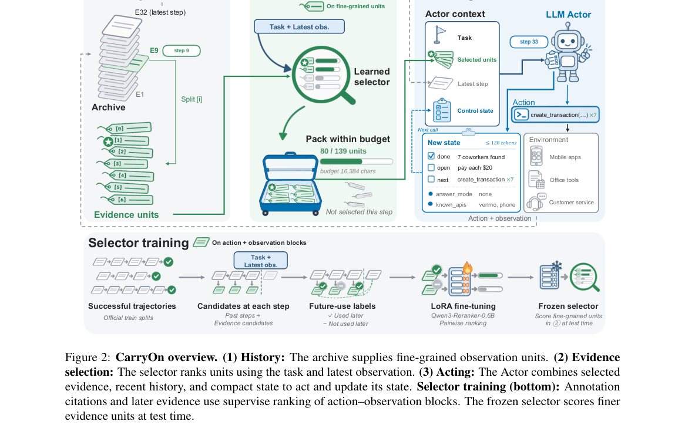

**Why this ranks #2**: 新南威尔士大学与香港科技大学（广州）把紧凑执行状态和细粒度、带来源链接的证据分开管理，学习式选择器加自适应保留策略无需额外 LLM 调用即可取舍历史。在 AppWorld、OfficeBench、Tau2 Telecom 三个 benchmark、三个 LLM Actor 上宏平均任务成功率 75.7%，比最强基线高 6.7 个百分点，平均 S0.8 为 68.45、平均 NCS 0.792 为最低，是 llm_core 里上下文预算管理最完整的一篇。

---

### 3. Disentangling Forgetting from Utility: Lightweight LLM Unlearning via Orthogonal Null-Space Projection

**arXiv**: [2611.17864](https://arxiv.org/abs/2611.17864) | **Score**: 8.7 (relevance 9 x 0.7 + quality 8 x 0.3) | **Direction**: `llm_core` | **Tags**: LLM-VLM, machine-unlearning, null-space-projection, model-editing, low-rank-adapter, membership-inference, Zhejiang University | **Categories**: cs.LG | **Pages**: 12

**Authors**: Xiuyuan Wang; Weiming Liu; Zongxin Yang; Fan Wang; Liemiao Jin; Rubin Qin; Wei Chen; Bin Shi; Chaochao Chen; Xiaolin Zheng

**Affiliation**: Zhejiang University; University of Illinois Chicago

**Abstract**

> Large Language Models (LLMs) pose significant security risks by retaining private or hazardous information, creating an urgent need for unlearning techniques that excise specific knowledge without compromising general utility. However, prevailing fine-tuning-based unlearning methods struggle to achieve this balance, often suffering from computational inefficiency and unintended utility degradation due to the entangled nature of knowledge within model parameters. To disentangle forgetting from utility, we propose UUE, a theoretically grounded framework that reformulates unlearning as controllable model editing. First, UUE projects parameter updates into the orthogonal left null space of retained knowledge representations, strictly ensuring that the editing process causes minimal interference to the model's general capabilities. Second, distinct from targeted mapping, we introduce a convex untargeted objective that derives a closed-form analytical solution to effectively disrupt undesired knowledge by pushing forget-set embeddings toward their antipodal points. We implement UUE via lightweight, pluggable adapters (including a low-rank variant, UUE-L), enabling efficient deployment without modifying the frozen backbone. Extensive experiments on TOFU and WMDP benchmarks demonstrate that UUE and UUE-L achieve superior unlearning efficacy, significantly outperforming existing methods.

**Key findings**

- **Finding**: 在 TOFU forget01 上 UUE 把 Phi-1.5B 的 ROUGE-L 遗忘分由原始模型的 0.9530 降到 0.3178（重训参考为 0.4378），而 ROUGE-L 保留分仅由 0.9290 降到 0.9228。
- **Inference**: 把参数更新限制在保留知识表征的左零空间，可以让破坏性方向与通用能力方向近似正交，因此遗忘与效用不必牺牲彼此。
- **Recommendation**: 评估遗忘效果时应同时看成员推断 AUC（UUE 0.6372、UUE-L 0.6154，高于 RMU 的 0.6127），并注意闭式适配器更新只占总运行时间的 5.5%。

**Key figures**

*Framework - (a) Illustration of targeted vs. untargeted unlearning. Orange: original forget data representations; red: harmful targets; green: safe (harmless) region; green dot: explicit refusal response. (b) Overall architecture of the UUE framework.*

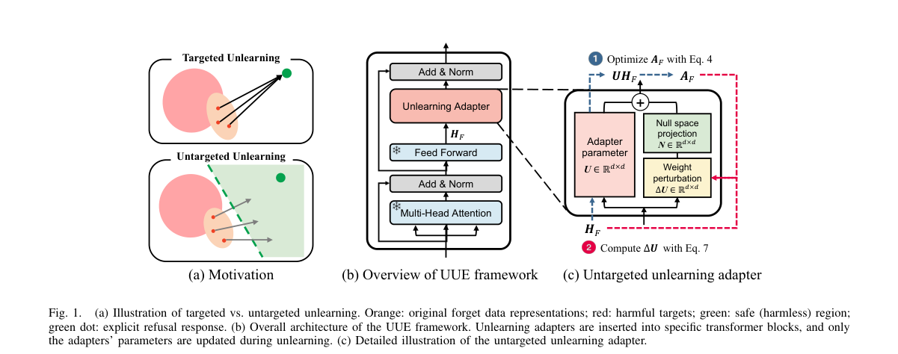

*Result - Evaluation of regularization parameters on TOFU forget05 with Phi- 1.5B. Vertical dashed lines mark the selected settings.*

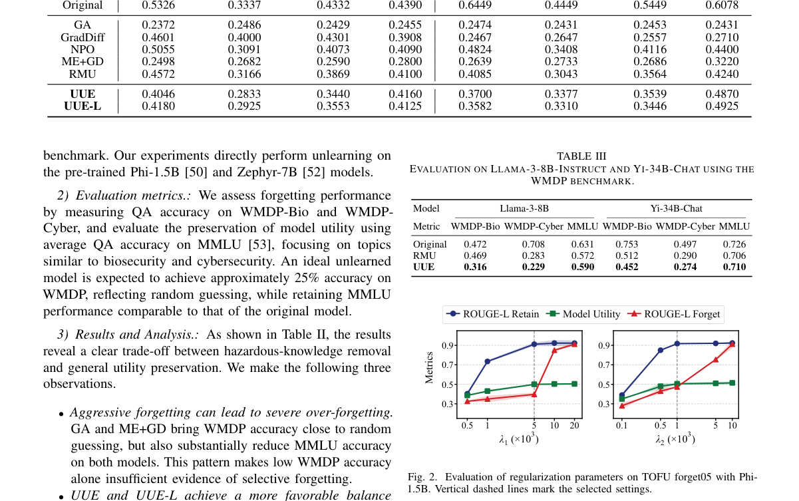

**Why this ranks #3**: 遗忘属可控的模型编辑问题：UUE 把更新投影到保留表征的左零空间并给出闭式解，TOFU forget01 上把 Phi-1.5B 的 ROUGE-L 遗忘分从 0.9530 压到 0.3178，保留分仅从 0.9290 微降到 0.9228，成员推断 AUC 达 0.6372 高于 RMU 的 0.6127。

---

### 4. Soteria: Formally Verified Planning with Runtime Enforcement for Safe LLM Agents

**arXiv**: [2611.17880](https://arxiv.org/abs/2611.17880) | **Score**: 8.7 (relevance 9 x 0.7 + quality 8 x 0.3) | **Direction**: `llm_core` | **Tags**: LLM-VLM, llm-agent, formal-verification, runtime-enforcement, tool-use, safety, Princeton University | **Categories**: cs.AI, cs.SE | **Pages**: 30

**Authors**: Mike He; Ankush Desai; Sharad Malik; Aarti Gupta

**Affiliation**: Princeton University

**Abstract**

> LLM agents that execute multi-step tool calls must satisfy two objectives simultaneously: completing the user's task (utility) and conforming to domain policies and correctness constraints (safety). These objectives are in tension -- blocking an unsafe action prevents a violation but can leave the agent stranded with no principled way to recover. Existing approaches sacrifice one objective for the other. We introduce Soteria, a framework that reconciles safety and utility through verified hierarchical planning and runtime enforcement of specifications. Before execution, the agent generates a structured plan that is formally verified against the specifications prior to any tool invocation. During execution, the verified plan serves dual roles: it ensures that the agent takes specification-conformant trajectories and provides guidance when unsafe actions are blocked. Across multiple benchmarks covering a diverse range of tool-use tasks, Soteria achieves 1.7 times the average task success rate of the best baselines, with no violations of policy specifications, demonstrating that safety and utility need not be traded off.

**Key findings**

- **Finding**: 在三个基准的 207 个任务上，SOTERIA 对四个模型全部达到 100% 一致性、零规格违反；最强基线 τ²-Retail 的 ABC 配 Gemini 一致性 93.0% 但伴 8 次违反，τ²-Airline 最佳为 90.0% 伴 5 次违反。
- **Inference**: 先验地形式验证计划并在运行期强制执行，能让被拦下的动作沿已验证的子计划恢复，因此安全与可用性不必二选一。
- **Recommendation**: 给多步工具调用智能体加护栏时先让规划器产出可验证的分层计划并固化可复用子计划，可把计划中位长度从 11 个状态压到 8 个。

**Key figures**

*Framework - Overview of SOTERIA*

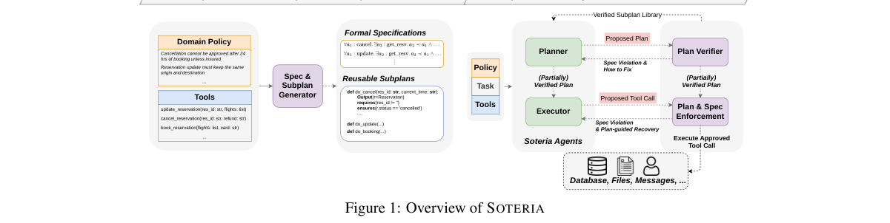

*Result - A parent plan composing the CANCEL and REFUND sub-plans. The planner generates the top-level plan; each sub-plan encapsulates one procedure and is reused across tasks.*

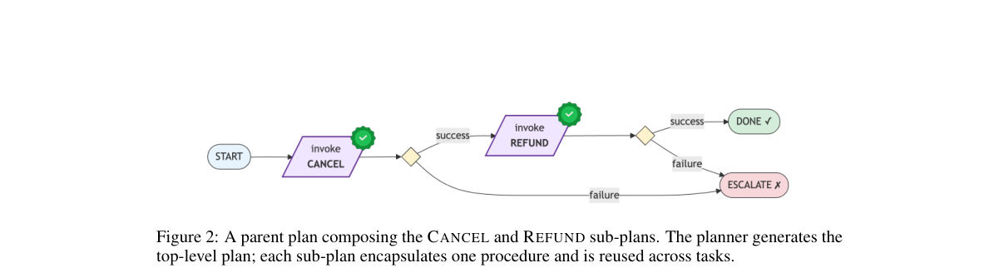

**Why this ranks #4**: 多步工具调用的 LLM 智能体属本方向跟踪范围：Soteria 在三个基准 207 个任务、四个模型上全部达成 100% 一致性与零规格违反，最强基线一致性最高仅 93.0%，任务成功率平均为最强基线的 1.7 倍，GPT-5.4-mini 在 τ²-Retail 上达 90.4% 对基线 46.5%。

---

### 5. LACCO: Local Accumulation with Computation--Communication Overlap

**arXiv**: [2611.17991](https://arxiv.org/abs/2611.17991) | **Score**: 8.4 (relevance 9 x 0.7 + quality 7 x 0.3) | **Direction**: `llm_core` | **Tags**: LLM-VLM, distributed-training, communication-overlap, low-bandwidth-pretraining, convergence-guarantee, Sorbonne Université | **Categories**: cs.AI, cs.LG | **Pages**: 34

**Authors**: Daniele Kopyshevskiy; Benjamin Th{é}rien; Nicolas Pinto; Edouard Oyallon

**Affiliation**: Sorbonne Université, ISIR

**Abstract**

> Training language models across low-bandwidth networks requires reducing synchronization overhead. Local optimization methods such as DiLoCo communicate only after several local steps, but outer gradient averaging and the outer update remain on the critical path. Existing computation-communication overlap methods avoid this stall through delayed or replica-local updates, which can degrade convergence or cause replicas to drift. We propose LACCO (Local Accumulation with Computation-Communication Overlap), a two-stage algorithm that overlaps global communication with local computation while applying globally aggregated updates shared by every replica, without introducing staleness in the outer update. We establish convergence guarantees for smooth non-convex objectives. Experiments on language-model pre-training with FineWeb show that LACCO consistently outperforms communication-overlapped baselines such as Eager and Delayed DiLoCo. These gains remain robust as model size scales up to 0.5B parameters and across a range of communication intervals and numbers of replicas up to 16 workers, while incurring only negligible-or fully overlappable-computational or memory overhead, which demonstrates the strength of LACCO.

**Key findings**

- **Finding**: 在 FineWeb 预训练 134M 模型、K=4、H=30 的对照中，LACCO 与 DDP 的差距不超过 1.77%、与 DiLoCo 不超过 0.91%，同时在 HellaSwag 与 PIQA 上优于重叠类基线。
- **Inference**: 用前瞻加主两阶段让全局通信与本地计算重叠，且所有副本共享全局聚合更新，就能在不引入外层参数陈旧的前提下消掉同步停顿。
- **Recommendation**: 在低带宽集群预训练时可按两阶段外层更新组织通信与计算，0.5B 模型在 0.5 Gbps 下实测端到端加速 1.89 倍，且额外显存与计算开销可忽略。

**Key figures**

*Framework - Timeline of outer updates in LACCO and DiLoCo. Vertical marks indicate communica- tion launches of outer gradients. B is the global batch size and K is the number of replicas.*

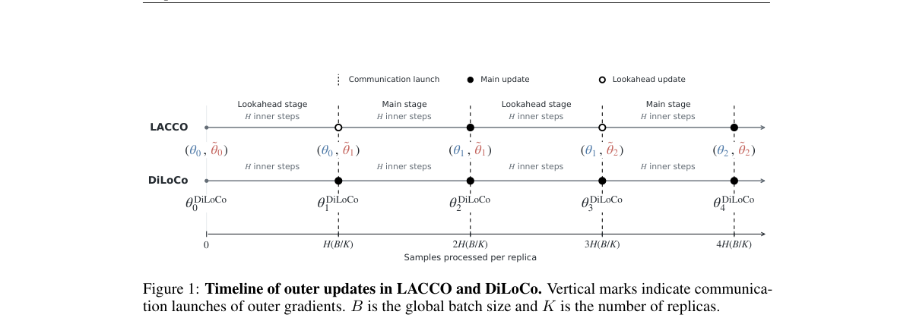

*Result - Overview of LACCO. Each outer iteration alternates a lookahead stage (red) and a main stage (blue), each consisting of H inner steps on K = 4 replicas. While one stage performs its local ste*

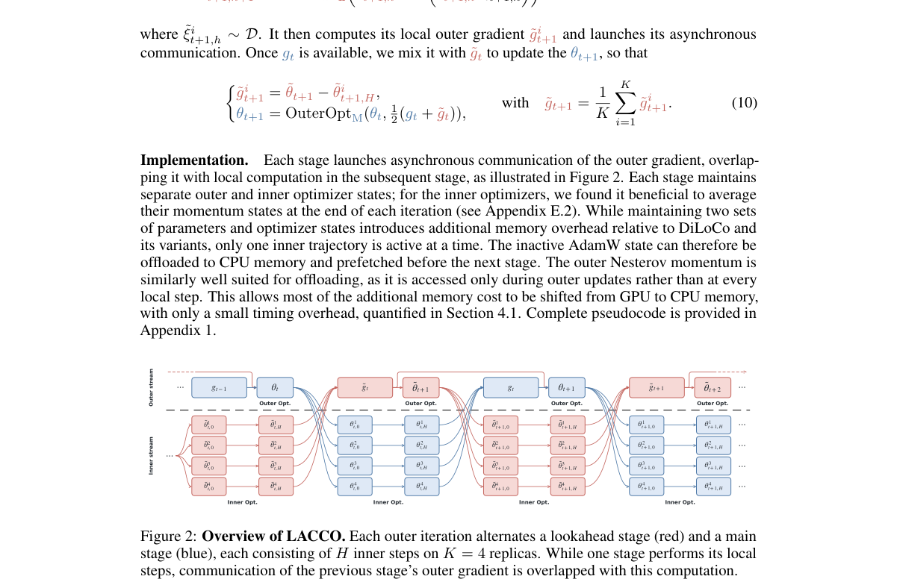

**Why this ranks #5**: 预训练通信开销是训练基础设施问题：LACCO 在 FineWeb 上训练 134M 至 500M 模型，与 DDP 的差距不超过 1.77%、与 DiLoCo 不超过 0.91%，0.5B 模型在 K=4、H=30、0.5 Gbps 带宽下端到端加速 1.89 倍，1 Gbps 下 1.44 倍。

---

### 6. VelServe: Taming Decode Jitters in LLM Inference with Tail-Calibrated Scheduling

**arXiv**: [2611.18392](https://arxiv.org/abs/2611.18392) | **Score**: 8.4 (relevance 9 x 0.7 + quality 7 x 0.3) | **Direction**: `llm_core` | **Tags**: LLM-VLM, llm-serving, latency-slo, prefill-decode, tail-latency, scheduling, Microsoft | **Categories**: cs.AI | **Pages**: 22

**Authors**: Ishaan Datta; Alind Khare; Koushik Kumar Dey; Ratnesh Jamidar; Anand Kumar Singh

**Affiliation**: Microsoft

**Abstract**

> Interactive LLM services must meet latency service-level objectives (SLOs) for the time to first token (TTFT) and the time between tokens (TBT), as streaming and soft real-time applications require predictable token delivery. We identify decode jitters in both aggregated and disaggregated serving. A jitter delays every request in the batch, and long responses span hundreds of steps, so even rare overruns cause many SLO violations. In aggregated serving, SLO-aware schedulers set each step's prefill budget until its predicted latency just meets the TBT target, leaving no room for mispredictions or host stalls. Disaggregation meets average TBT targets at a cost in capacity, yet the steps that admit new requests still run late. We present \sysname, a scheduler that calibrates how much prefill work each decode step carries using the measured tail of its own iteration latency. The SLO determines how rare a late step must be, and \sysname leaves enough headroom in each iteration to prevent overruns and meet the target decode latency. This headroom slows prefill, so \sysname serves the shortest waiting prompt first. When TTFT deadlines grow with prompt length, the long prompts it delays have the most time to spare. Under disaggregation, it spaces admissions so that no request waits on more slow admission steps than its P99 target allows. On three attention families and varying workloads, \sysname sustains 2.4--2.9$\times$ the SLO goodput of the strongest baseline on Qwen3-8B and DeepSeek-V4-Flash, and at least 4.4$\times$ on DeepSeek-V2-Lite. With prefill and decode disaggregated on eight GPUs, \sysname meets the SLO for more than twice as many requests as state-of-the-art baselines.

**Key findings**

- **Finding**: VELSERVE 在 Qwen3-8B 与 DeepSeek-V4-Flash 上的 SLO goodput 是最强基线的 2.4–2.9 倍，在 DeepSeek-V2-Lite 上至少 4.4 倍，在回放的 Mooncake trace 上为 2.7 倍。
- **Inference**: 尾部校准的预填充预算把偶发超时从算力问题变成可预留裕量的问题，说明解码抖动的主因是每步预埋的预填充工作量而非解码本身。
- **Recommendation**: 配置解码调度时应按自己迭代延迟的实测尾部反推每步预填充 token 预算而非用均值预测，并优先服务等待时间最短的提示。

**Key figures**

*Framework - Decode jitters persist despite chunked prefill and disaggregation (DeepSeek-V4-Flash, replayed Mooncake trace). Each step of a staircase is one iteration, which gives every decoding request on*

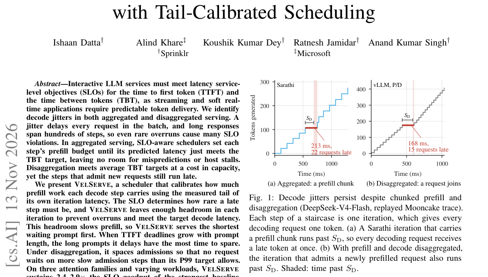

*Result - With compressed attention, a decode costs about one prefill token (a) and context barely matters (b).*

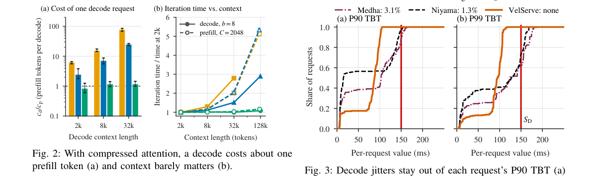

**Why this ranks #6**: 推理效率是 LLM 本体的核心议题之一：VelServe 按自身迭代延迟的实测尾部校准每步预填充预算，在 Qwen3-8B 与 DeepSeek-V4-Flash 上把 SLO goodput 提到最强基线的 2.4–2.9 倍，DeepSeek-V2-Lite 上至少 4.4 倍，回放 Mooncake trace 上为 2.7 倍。

---

### 7. Callo: Serving Cache-Miss Requests with Speculative Decoding on Invalidated KV under Prefill-Decode Disaggregation

**arXiv**: [2611.18459](https://arxiv.org/abs/2611.18459) | **Score**: 8.4 (relevance 9 x 0.7 + quality 7 x 0.3) | **Direction**: `llm_core` | **Tags**: LLM-VLM, speculative-decoding, kv-cache, prefill-decode-disaggregation, llm-serving, agent-workloads, Duke University | **Categories**: cs.DC, cs.LG | **Pages**: 24

**Authors**: Jianjun Ou; Matthew Lentz

**Affiliation**: Duke University

**Abstract**

> Agent sessions may involve frequent context edits, which effectively invalidate cached KV state and force requests to wait for re-prefill before decoding. We present Callo, a disaggregated serving system that leverages invalidated KV for speculative drafts to reduce this latency, while verifying drafts against the exact KV after prefill before committing tokens. Callo makes effective use of decode resources by scheduling speculations during periods of underutilization and preempting speculations when drafts are likely to not be accepted. We evaluated Callo on a two-GPU testbed using SWE-agent sessions across three model families, observing all-request speedups of 1.05-1.19x over vLLM at moderate load. We demonstrate that these gains are also realized at scale through cluster-level simulations driven by real-world traces.

**Key findings**

- **Finding**: 在失效 KV 上起草的草稿，其下一 token 与精确 KV 上一致的比例达 98.3%，下一 token 分布与精确分布在 80% 的位置落在 0.01 总变差以内；32 token 窗口在 65% 的 miss 请求中被整窗接受。
- **Inference**: 上下文编辑导致的缓存失效本来是纯开销，但失效 KV 与精确 KV 已足够接近，可以当作无损推测草稿的近似来源。
- **Recommendation**: 做 agent 长会话服务时可在解码实例上复用失效 KV 起草、提交前再替换为精确 KV 校验，并让草稿 top-1 与 top-2 差距过小的位置直接判否以省算力。

**Key figures**

*Result - Drafts made on invalidated KV (Llama-3.3-70B-Instruct FP8, SWE-agent L5, 32-token window, offline). (a) Miss steps whose*

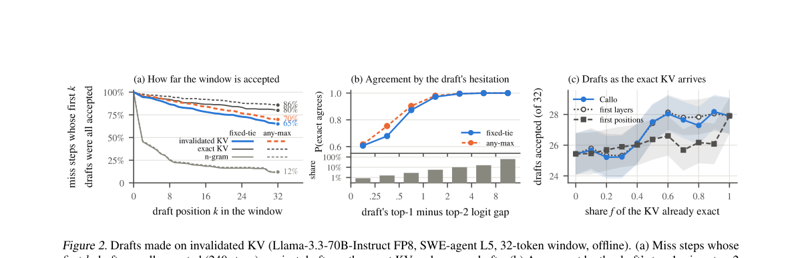

**Why this ranks #7**: 推测解码是 LLM 推理加速的主线：Callo 复用被作废的 KV 起草并在精确 KV 上校验，草稿下一 token 与精确一致率 98.3%、80% 位置的总变差在 0.01 以内，32 token 窗口在 65% 的 miss 请求中整窗接受，全请求加速 1.05–1.19 倍、miss 请求 1.06–1.24 倍。

---

### 8. Alignment with Reflect-Reasoning: Learning How To Follow Principles

**arXiv**: [2611.17398](https://arxiv.org/abs/2611.17398) | **Score**: 8.0 (relevance 8 x 0.7 + quality 8 x 0.3) | **Direction**: `llm_core` | **Tags**: LLM-VLM, constitutional-alignment, reflective-reasoning, grpo-posttraining, ood-principles, jailbreak-robustness, Duke University | **Categories**: cs.LG | **Pages**: 51

**Authors**: Henry Bell; Caroline Zhang; Dhaval Potdar; Mohammed Mobasserul Haque; Brandon Fain

**Affiliation**: Duke University; Independent Researcher

**Abstract**

> The appropriate governing norms and principles for the alignment of Large Language Models (LLMs) often depend on cultural context and deployment application. However, most alignment techniques focus on training models to conform to human preferences or constitutional principles specified at training time and subsequently fixed. In practice, many deployers rely on system prompting to implement contextual norms and guardrails at inference time. Prior work has shown that post-generation reflective reasoning with critique and revision can improve conformance compared to simple system prompting, but such methods are limited to the reasoning abilities inherent in the trained model. We introduce Reflect-Reasoning, a training method that teaches models how to reason about alignment to principles, rather than simply which principles to follow. Across five models, Reflect-Reasoning consistently outperforms both system prompting and explicit prompting strategies for in-context reflective reasoning. These improvements extend and generalize to entirely out-of-distribution domains of medical and financial principles. We additionally demonstrate that Reflect-Reasoning reduces the occurrence of rare but serious principle violations. Finally, we show that Reflect-Reasoning does not erode the safety engineering of a model and is robust against jailbreaking attempts using adversarial constitutions. Overall, our results demonstrate that Reflect-Reasoning is a scalable method for training constitutional alignment as a generalizable reasoning capability, enabling models to adapt to novel principles and produce transparent reasoning traces without additional fine-tuning.

**Key findings**

- **Finding**: 五个模型在留出原则上对 Base-ICL 胜率 82.5%–94.7%、对 Reflect-ICL 66.8%–86.9%，金融与医疗分布外领域最高分别达 80.2% 与 86.3%。
- **Inference**: 胜率优势来自训练出的反思过程本身，因此换一套新原则也能直接迁移，而不必为每个部署场景重启后训练。
- **Recommendation**: 需要按场景切换原则时优先训练反思推理能力，并为罕见但严重的原则违规单独做尾部统计，别只看平均胜率。

**Key figures**

*Framework - Demonstration of reflective reasoning traces on different deployment-specific constitutions of princi- ples*

*Result - Reflect-Reasoning training process*

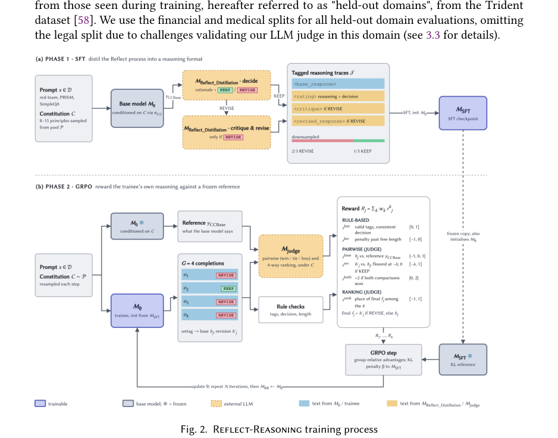

**Why this ranks #8**: 杜克大学与独立研究者用两阶段后训练（先 SFT 再 GRPO）教模型「如何对原则做反思推理」而不是「遵守哪些原则」，全程不需要人工标注数据。五个模型在留出原则上的成对胜率对 Base-ICL 达 82.5%–94.7%、对 Reflect-ICL 达 66.8%–86.9%，并延伸到金融与医疗两个分布外领域（最高 80.2% 与 86.3%），且不损伤模型原有安全工程、对抗性越狱宪法也稳健。

---

## VLM 核心（多模态架构 / 理解 / 视频 / GUI agent） · `vlm_core` (6 papers)

本方向 6 篇里 1 篇新增，主线是**多模态模型「看到了」之后是否用对了**。DoubleTake 针对长文档问答里「检索到的页面其实含有充分证据、模型却仍然答错」，让规划器先写出一个可直接从图上核对的事实问题，再由看不到任何候选的独立核验器作答，四个 benchmark 共 4,816 道题微平均准确率 66.76%，高于 MDocAgent 的 65.16% 与基线 60.13%，去掉核验环节就降到 64.56%。ParseBench-2 从评测侧指出既有文档解析度量会给「改了重要事实」的输出打高分（45 张测试表里达到十分目标的只有 56%，修正比较规则后升到 98%），因此按严重程度重新定义了指标。Zoom In, Scale Out 用数码变焦这个极简测试揭示度量深度模型把裁剪放大误当成相机靠近——Depth Anything V2 的深度指数 α=0.95（理想 0），给真实相机的 Metric3D v2-S 才有 −0.07。Q-GAS 把视频表征压进秒级预算（约 3M 参数档下 Beauty 上 PSNR 32.04、418.27 FPS），Vision-as-a-Tool 则把通用 MLLM 重构成 coding agent 可调用的五个原子动作，纯文本 agent 借此完全外放视觉推理。新增的 MMFlash 测出视觉依赖最高四分位的 token 接受率只有 22%、最低四分位 46%，据此对视觉相关 token 加权并用稀疏注意力把长视频上下文从 40K 以上压到约 1.6K，实现最高 3.58 倍无损加速、比 EAGLE-3 高至 195.4%。

### 9. DoubleTake: Focused Verification of Visual Evidence for Long-Document Understanding

**arXiv**: [2611.17853](https://arxiv.org/abs/2611.17853) | **Score**: 8.7 (relevance 9 x 0.7 + quality 8 x 0.3) | **Direction**: `vlm_core` | **Tags**: LLM-VLM, long-document-qa, focused-verification, training-free, frozen-backbone, visual-evidence, [unverified] | **Categories**: cs.CV | **Pages**: 6

**Authors**: Kejun Xue; Ang Li; Jinghua Tang; Xincheng Wang; Yongbin Gao; Yanghua Xiao; Zhijun Fang

**Affiliation**: [unverified]

**Abstract**

> In long-document question answering, a vision-language model can answer incorrectly even when the retrieved pages contain sufficient evidence. Rereading those pages with the original question gives the model little guidance about which fact to check. We introduce DoubleTake, a training-free framework for focused verification of visual evidence. An initial reading produces a candidate answer and a separate evidence record that guides retrieval for a second reading. A planner compares the two candidates and their supporting evidence to formulate a factual question. A verifier answers it from the source images without seeing either candidate or evidence record, and a reasoner uses this observation to resolve the original question. With a frozen Qwen3-VL-8B-Instruct backbone, DoubleTake achieves the highest overall accuracy among the evaluated methods on each of four benchmarks. With the same pages and number of model calls, asking a focused factual question yields higher accuracy on all four benchmarks than asking the original question again. Our code is available at https://github.com/small-code-cat/double_take.

**Key findings**

- **Finding**: 四个 benchmark 微平均准确率 66.76%，MDocAgent 65.16%、Base 60.13%；去掉核验环节降到 64.56%，去掉补读在 PaperTab 上从 56.23% 降到 52.16%。
- **Inference**: 只有两个候选之一正确时 DoubleTake 答对 391/591（66.2%），而始终选初读或补读分别只有 53.6% 与 46.4%，说明收益来自比较与核验而非重复阅读。
- **Recommendation**: 长文档问答里与其重问原问题，不如让规划器先写出一个可直接核对的聚焦事实问题，再让独立核验器只看页面回答。

**Key figures**

*Framework - Illustrative example. (a) Direct reading compares sales across years. (b) Rereading with the original question repeats the error. (c) DoubleTake uses the two readings to check the 2024 target*

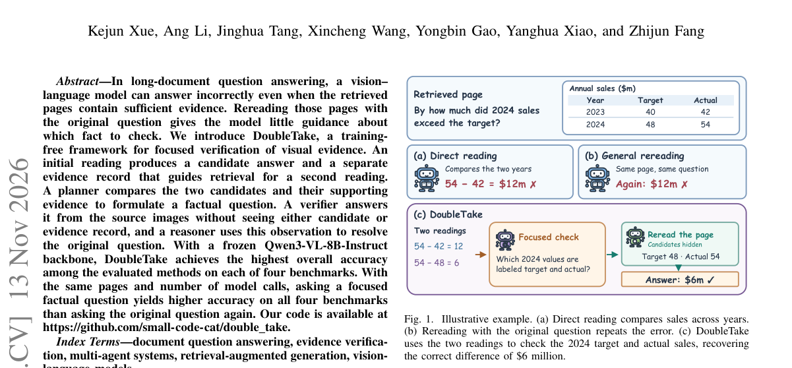

*Result - DoubleTake connects evidence-guided dual reading with comparison-guided visual verification. All roles receive the original question. The first evidence record guides the second search. Both c*

**Why this ranks #9**: 全文未标注机构的 6 页论文提出免训练的 DoubleTake：冻结 Qwen3-VL-8B-Instruct，先读出候选答案与独立证据记录，再由规划器据此构造一个可直接从图上核对的事实问题，让核验器在看不到任何候选的前提下作答。四个 benchmark 共 4,816 道题的微平均准确率 66.76%，高于 MDocAgent 的 65.16% 与基线的 60.13%，且同样页面、同样调用次数下问聚焦事实优于重复原问题。

---

### 10. MMFlash: Faster Speculative Decoding for Vision-Language Models

**arXiv**: [2611.18482](https://arxiv.org/abs/2611.18482) | **Score**: 8.7 (relevance 9 x 0.7 + quality 8 x 0.3) | **Direction**: `vlm_core` | **Tags**: LLM-VLM, speculative-decoding, vlm, visual-dependence, diffusion-drafter, sparse-attention, National University of Singapore | **Categories**: cs.CV | **Pages**: 15

**Authors**: Sicheng Feng; Zigeng Chen; Song Wang; Gongfan Fang; Xinchao Wang

**Affiliation**: National University of Singapore

**Abstract**

> Speculative decoding accelerates generation by letting a lightweight drafter propose tokens for parallel verification by a target model. Diffusion drafters such as DFlash propose an entire token block in a single forward pass, but mainly focus on text-only tasks, leaving multimodal drafting underexplored. To study this setting, we first introduce a metric of token-level visual dependence based on the KL divergence between next-token distributions with and without visual input. We find that acceptance rates decrease from 46% in the lowest visual-dependence quartile to 22% in the highest, with this disparity persisting after multimodal training. Motivated by this observation, we propose MMFlash, a simple and effective framework that adaptively upweights visually dependent tokens that the drafter predicts poorly. For long video inputs, MMFlash further employs sparse attention to reduce redundant attention computation and improve drafting quality. Across various multimodal benchmarks, MMFlash achieves lossless decoding speedups of up to $3.58\times$, outperforming EAGLE-3 and DFlash by up to 195.4% and 17.1%, respectively.

**Key findings**

- **Finding**: 视觉依赖度最高四分位的 token 接受率只有 22%，最低四分位为 46%（2.1 倍差距），且该差距在多模态训练后依旧存在；最高四分位集中了 44% 的首拒位置，最低四分位仅 7%。
- **Inference**: 文本草稿器在强视觉依赖的 token 上系统性失效，因此必须按视觉依赖度重新分配草稿块的权重，否则长视频解码会被这些 token 卡住。
- **Recommendation**: 为 VLM 做推测解码时先用有与无视觉输入的 next-token 分布 KL 估计视觉依赖度并对高依赖 token 加权，长视频再叠加稀疏注意力把上下文压到 1.6K 量级。

**Key figures**

*Framework - Decoding speedup comparison with SOTA speculative decoding methods (EAGLE-3 & DFlash) on SGLang.*

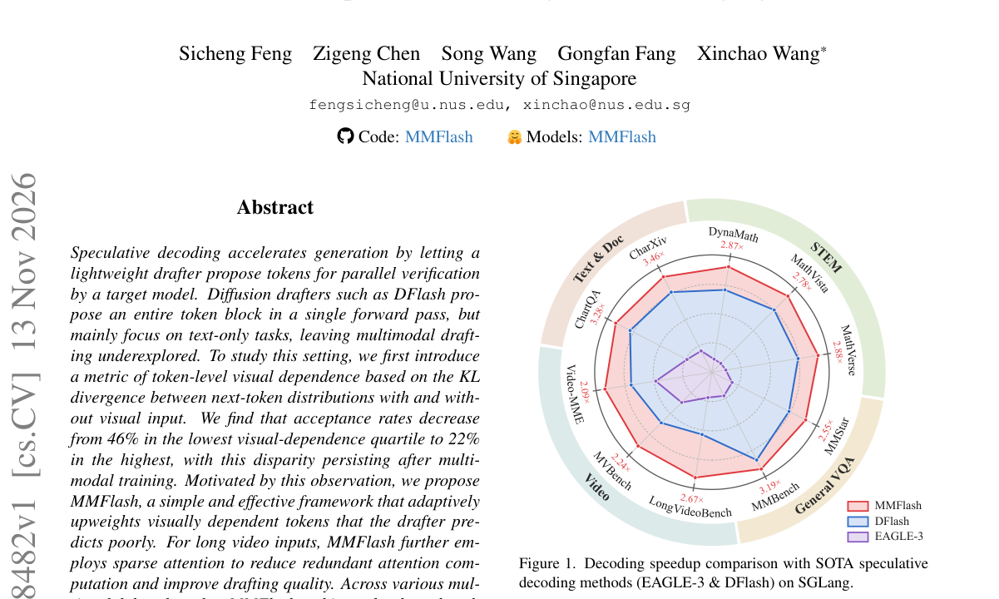

*Result - Overview of MMFlash. (a) The target VLM is run twice on the same prefix x<t, with and without the image I, and the visual dependence score dt is the KL divergence between the two next-token*

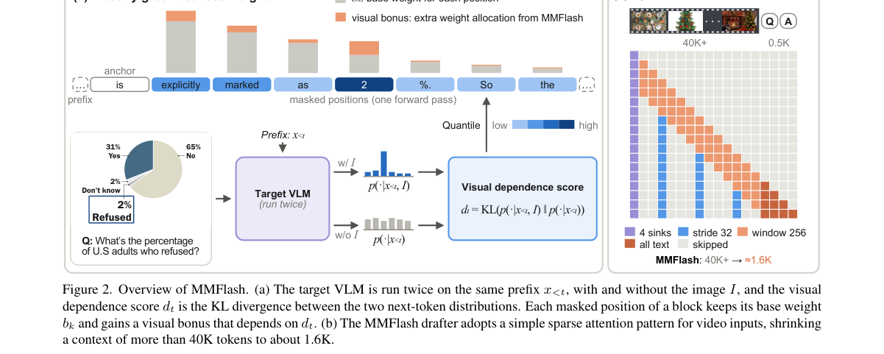

**Why this ranks #10**: 多模态大模型的解码效率归入 VLM 本体：MMFlash 测得视觉依赖最高四分位的接受率只有 22%、最低四分位 46%，据此对视觉相关 token 加权并用稀疏注意力把长视频上下文从 40K 以上压到约 1.6K，实现最高 3.58 倍无损加速、比 EAGLE-3 高至 195.4%。

---

### 11. ParseBench-2: Severity-Aware Evaluation of Document Parsing

**arXiv**: [2611.17400](https://arxiv.org/abs/2611.17400) | **Score**: 8.0 (relevance 8 x 0.7 + quality 8 x 0.3) | **Direction**: `vlm_core` | **Tags**: LLM-VLM, document-parsing, severity-aware-metric, benchmark, error-severity, metric-alignment, LlamaIndex | **Categories**: cs.CV | **Pages**: 59

**Authors**: Pierre-Loïc Doulcet; Boyang Zhang; Sebastián G. Acosta; Sacha Bron; Daniel B. Ospina; Antonio Jimeno Yepes; Nutchapol Dendumrongsup; Simon Suo

**Affiliation**: LlamaIndex

**Abstract**

> Document-parsing metrics can give high scores to outputs that change important facts and penalize changes that preserve meaning. People can often judge these consequences more easily than they can design a metric to measure them. We introduce a method for developing parsing metrics from severity policies that specify how each error type should affect the score. We express these policies through test scenarios that specify how a metric should behave. We then optimize the metric implementations against these fixed expectations, using coding agents to refine comparison rules, error detectors and weights under human review. This makes stated human priorities an explicit objective of metric design. We apply this method in ParseBench-2, a comprehensive document-parsing benchmark that combines broad capability coverage with metrics calibrated to error severity. It covers 4,317 pages across six dimensions of parsing quality: text, formatting, tables, charts, visual grounding, and forms. We use detailed annotations and targeted difficult cases to check for changed facts, broken structural relationships, and missing content. We take the lower of a parsing score that measures content recovery and a severity cap that penalizes detected errors, so recovering most of a page cannot hide a serious error. Across six severity test suites, our metrics more closely match the expert judgments expressed by the scenario targets than existing metrics and penalize at most 3.4% of the tested benign variations. We conduct a comprehensive evaluation spanning frontier vision-language models, specialized document parsers and open-weight systems, comparing their overall rankings, performance across parsing capabilities and tradeoffs between accuracy and cost.

**Key findings**

- **Finding**: 基准含 4,317 页、6 个维度、2,645 份源文档与 1,025 张带完整数据表的图表，评分取内容恢复分与严重度上限的较小值。
- **Inference**: 曾把数值单元格的改动当成普通改写时，45 张测试表里达到十分目标的只有 56%，修正比较规则后升到 98%，说明指标必须按错误严重度重写而非加权平均。
- **Recommendation**: 选文档解析系统要看按严重度加权的分数，并单独检查数值、表头关联与遗漏内容，别被整体内容恢复率掩盖。

**Key figures**

*Framework - ParseBench-2 aligns parsing scores with human judgments of error severity.*

*Result - Experts express their severity policy through test scenarios, and we refine parsing metrics to follow that policy (Sections 2.1 to 2.3).*

**Why this ranks #11**: LlamaIndex 的 ParseBench-2 覆盖 4,317 页、文本/格式/表格/图表/视觉定位/表单 6 个解析维度，来自 2,645 份源文档、13 个集合，1,025 张图表都附完整数据表。指标本身由专家严重度策略经编码 agent 反复迭代校准，评分取内容恢复分与严重度上限的较小值，六个严重度测试套件上比既有指标更贴近专家判断，同时最多只惩罚 3.4% 的良性变体。

---

### 12. Towards Seconds-level Video Representation: Quadratically Gated Feature Grid with Adaptive, Prediction-free Sampling

**arXiv**: [2611.17786](https://arxiv.org/abs/2611.17786) | **Score**: 8.0 (relevance 8 x 0.7 + quality 8 x 0.3) | **Direction**: `vlm_core` | **Tags**: LLM-VLM, video-representation, implicit-neural-representation, feature-grid, quadratic-gating, fast-decoding, Harbin Institute of Technology | **Categories**: cs.AI, cs.CV | **Pages**: 13

**Authors**: Tie-Yun Li; Hao-Ran Wang; Chao Wang; Zhiyong Yin; Yiming Xu; Zhenwei Cai; Li Li; Rongzhi Lin; Feng-Lei Fan

**Affiliation**: Harbin Institute of Technology; City University of Hong Kong; China Construction Third Engineering Bureau (Shenzhen) Co., Ltd.; University of Science and Technology of China

**Abstract**

> Implicit neural video representations are notoriously slow to build, which does not cross the basic practical threshold for most industrial applications. Here, we present Q-GAS, a coordinate-queryable video representation that couples multi-resolution explicit 3D feature grids with a compact SwiGLU-style quadratic-gating (QG) decoder and an error-aware, prediction-free sampler. The explicit grids avoid hash-collision coefficient sharing at the cost of modestly higher storage yet greatly boost the expressive capacity; the QG decoder introduces low-rank local second-order interactions to improve the nonlinear feature response. During fitting, a global error map periodically refreshes a high-error pool, and each batch mixes pool samples with uniform samples, which is free from the auxiliary model to predict difficult samples, thereby further escalating the efficiency. On UVG Beauty/Bosphorus/Jockey, Q-GAS fits and quantizes under 50 s on one RTX PRO 6000, decodes at over 370 FPS with mixed precision and about 146 FPS in FP32. In our PyTorch implementation, Q-GAS trains and quantizes 5.5-7.2 times faster than the evaluated Instant-NGP baseline and 19-28 times faster than RNeRV. Under a 90 s budget, it improves PSNR/MS-SSIM/LPIPS over the evaluated NeRV-family pipelines at comparable BPP over the measured overlap. We have shared our code at https://github.com/MillenRosen/Q-GAS for readers' free use.

**Key findings**

- **Finding**: 约 3M 参数档下 Q-GAS 在 Beauty 上 PSNR 32.04、耗时 33.94 秒、418.27 FPS，而 Instant-NGP 为 30.65、203.68 秒、18.37 FPS，RNeRV 单是拟合加量化就要 958.65 秒。
- **Inference**: 训练加量化耗时比 Instant-NGP 快 5.5–7.2 倍、比 RNeRV 快 19–28 倍，加速来自显式网格加二次门控的表达力而非少算了样本。
- **Recommendation**: 做实时视频重建或播放时优先试显式网格加误差感知采样这类秒级拟合方案，并按 90 秒预算与 NeRV 系管线对齐后再比较 PSNR 与感知指标。

**Key figures**

*Framework - An overview of Q-GAS. Multi-Resolution 3D Feature Grids: At each coordinate (x, y, t), trilinear interpolation retrieves features. The schematic illustrates the multiscale construction. QG Dec*

*Result - Explicit and hash-constrained 3D feature grids at the same resolution and feature dimension. Both use trilinear interpolation. Feature grid: Each vertex has an independent feature vector. Hash*

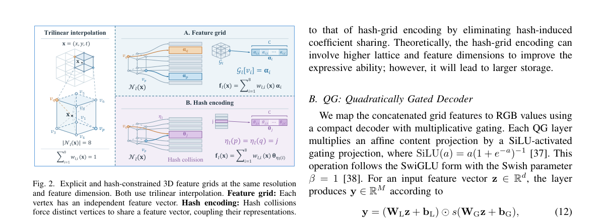

**Why this ranks #12**: 哈尔滨工业大学、香港城市大学等用多分辨率显式 3D 特征网格配 SwiGLU 式二次门控解码器和免辅助模型预测的误差感知采样器，做坐标可查询的视频隐式表示。在 UVG Beauty/Bosphorus/Jockey 的完整 600 帧、1920×1080 序列上，单张 RTX PRO 6000 拟合加量化不到 50 秒、混合精度解码超过 370 FPS、FP32 约 146 FPS，是把视频表征拉进秒级预算的一篇。

---

### 13. Vision-as-a-Tool: Visual Harness for Multimodal Agentic Coding

**arXiv**: [2611.17797](https://arxiv.org/abs/2611.17797) | **Score**: 8.0 (relevance 8 x 0.7 + quality 8 x 0.3) | **Direction**: `vlm_core` | **Tags**: LLM-VLM, vision-as-a-tool, agentic-coding, tool-use, modular-perception, text-only-agent, Peking University | **Categories**: cs.AI, cs.CV | **Pages**: 27

**Authors**: Haolin Yang; Wenshan Wu; Jin Jiang; Yu Cheng; Yan Xia; Ting Song; Yangyu Huang; Zhiliang Peng; Wenhui Wang; Hangbo Bao; Yuzhe Zhang; Wen-Da Wei

**Affiliation**: Peking University; Microsoft Research; University of Edinburgh; Nanjing University

**Abstract**

> Multimodal agentic coding requires robust visual reasoning to analyze observations and evaluate generated artifacts. Current frameworks largely rely on a Thinking-with-Images paradigm, where agents depend on their intrinsic vision to execute visually grounded tasks. However, this architectural coupling introduces a fundamental bottleneck. Agent performance remains strictly bounded by internal perceptual limitations. Furthermore, text-only agents lack native perception. Without specialized tools, they cannot perform visual reasoning. To overcome these constraints, we introduce the Vision-as-a-Tool (VaaT) paradigm. Prior visual tool-use merely manipulates images for an agent's intrinsic vision to read. In contrast, VaaT reframes general-purpose multimodal large language models (MLLMs) as callable external utilities. As a result, text-only agents can completely offload visual reasoning during agentic execution. Meanwhile, vision-capable agents can dynamically augment their native perception on demand. We instantiate this paradigm in VHarness, a unified framework driven by five atomic actions. We comprehensively evaluate VHarness across Image-to-HTML, Image-to-SVG, and Image-to-3D generation tasks. Experimental results demonstrate that VHarness consistently improves visual fidelity and geometric accuracy across both text-only and multimodal coding agents. These findings highlight that modularizing visual reasoning into callable utilities provides a flexible and scalable foundation for future agentic coding systems.

**Key findings**

- **Finding**: Image-to-SVG 消融中 SigLIP2 从 0.7368 升到 0.7529、LPIPS 从 0.0572 降到 0.0473、Edge F1 从 0.8310 升到 0.8546；纯文本的 GLM-5.2 因此能做出视觉落地任务。
- **Inference**: Image-to-3D 上换成自由格式 MLLM 接口仍明显落后五个原子动作（SigLIP2 0.6677 对 0.7212，Chamfer 0.0070 对 0.0035），说明接口粒度本身决定效果。
- **Recommendation**: 做视觉 coding agent 时把外置视觉能力拆成可组合的原子动作，而不是给一个自由问答式接口，否则收益会打折。

**Key figures**

*Framework - Overview of VHarness, an instantiation of the Vision-as-a-Tool (VaaT) paradigm. Given a target visual input across*

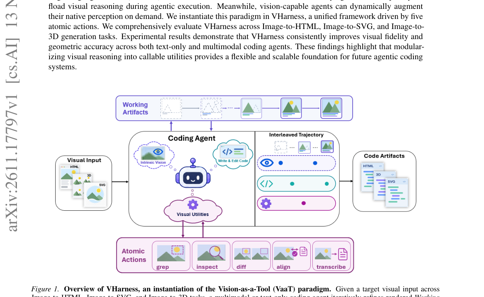

*Result - Qualitative comparisons across Image-to-HTML, Image-to-SVG, and Image-to-3D tasks. From left to right, we show the*

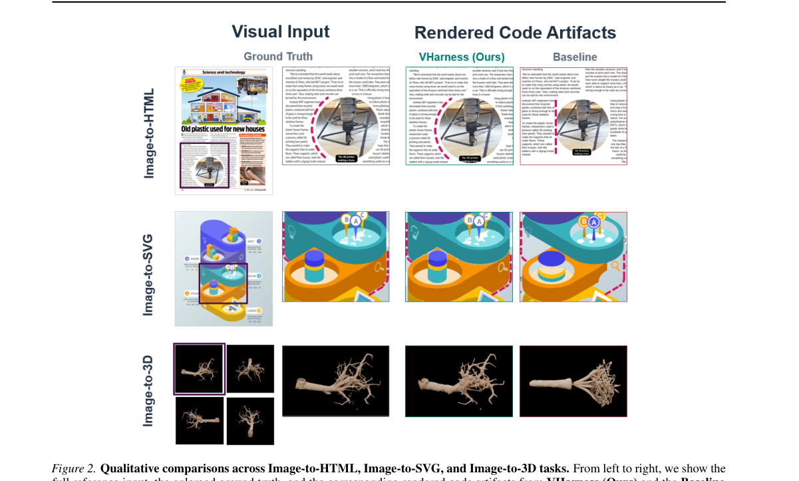

**Why this ranks #13**: 北京大学与微软研究院等提出 Vision-as-a-Tool：把通用 MLLM 重构为 coding agent 可调用的外部视觉工具，用 transcribe、grep、inspect、align、diff 五个原子动作覆盖 Image-to-HTML、Image-to-SVG、Image-to-3D 三类任务，纯文本 agent 借此完全外放视觉推理，多模态 agent 则可按需增强自身感知，是把感知能力模块化后交给 agent 调用的少见范式。

---

### 14. Zoom In, Scale Out: Metric Depth Models Mistake Digital Zoom for Moving Closer

**arXiv**: [2611.17903](https://arxiv.org/abs/2611.17903) | **Score**: 8.0 (relevance 8 x 0.7 + quality 8 x 0.3) | **Direction**: `vlm_core` | **Tags**: LLM-VLM, metric-depth, digital-zoom, focal-length-estimation, label-free-correction, depth-consistency, Daffodil International University | **Categories**: cs.CV | **Pages**: 22

**Authors**: Rabeya Noor; Khandoker Nosiba Arifin

**Affiliation**: Daffodil International University

**Abstract**

> Many new AI models estimate how far away things are, in metres, from a single photo. To do this they must also work out what camera took the photo. We check whether they really do with a simple test: digital zoom, that is, cropping a photo and enlarging the crop back to full size. Zooming moves nothing in the scene, so a correct model should give the same distance for every point still in the picture. The test is free, exact and needs no labels. Two numbers describe a model's reaction: its depth changes like $s^{-α}$ (ideal $α=0$) and its focal-length estimate like $s^β$ (ideal $β=1$), for zoom factor $s$. On 800 images from KITTI, NYUv2 and DIODE, the widely used Depth Anything V2 has $α=0.95$: it treats a zoomed photo almost as if the camera had moved closer, because it judges distance mainly from how large things look. Models that also predict the camera remove only part of this error ($α\approx0.31$-$0.36$), because their focal estimate grows too little. Given the true camera, Depth Pro and DA3-Nested keep their depth ($α\approx0$), so the error lies in their camera estimate. The reason: a zoomed photo is, pixel for pixel, a normal photo of a scene squashed in depth, so size alone cannot tell the two apart, and a focal estimator trained by regression stays close to the cameras it saw in training. Undoing this needs no labels or training and makes Depth Pro pass the test ($α=0.04$) at almost no cost on normal photos. Controls, including a real optical zoom lens, rule out blur and resizing artefacts. Finally, label-free fine-tuning for self-consistency lowers $α$ to 0.05 on KITTI and 0.07 on NYUv2 once a "blurry means zoomed" shortcut is removed; we report what this costs on normal and unseen photos.

**Key findings**

- **Finding**: Depth Anything V2 的 α=0.95、ZoeDepth 0.61，而会预测相机的 Depth Pro 0.31、MoGe-2 0.36、UniDepthV2 0.34，给出真实相机的 Metric3D v2-S 为 −0.07。
- **Inference**: 模糊对照只让 DA-V2-S 的深度变动 1.3%，说明误差来自「数字变焦等于场景被压缩」这条提示，而不是分辨率或重采样损失。
- **Recommendation**: 用度量深度做测量或重建前先按预测焦距把数字变焦的尺度换算回去，并用免标签的自一致性微调进一步校正 α。

**Key figures**

*Framework - A KITTI image at 1×, 2×, 3× digital zoom, one colour scale (metres); the number is the median depth inside the 3× crop, the same points in every column. Depth Anything V2 moves the scene clo*

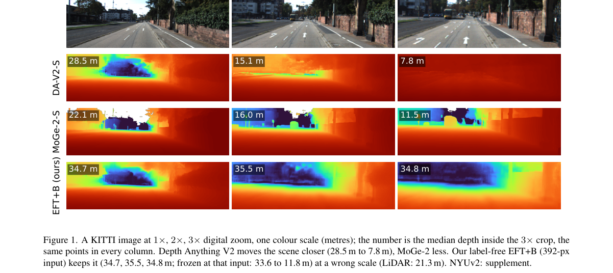

*Result - Depth (left) and predicted focal (right) of the same pixels as a function of the zoom factor, median over images. Dashed: the law; dotted: apparent size only.*

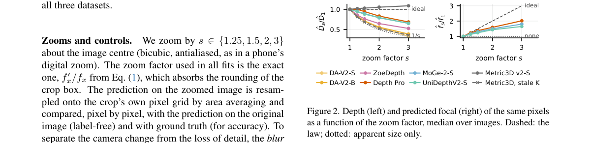

**Why this ranks #14**: 达卡大学（Daffodil International University）给度量深度模型设计了一个免标签体检：把照片裁剪放大做数字变焦，场景没动，正确模型应对图内每个点给出同一距离。在 KITTI、NYUv2、DIODE 每个模型 800 张图上，Depth Anything V2 的深度指数 α=0.95（理想 0），几乎把裁剪当成相机靠近；会预测相机的模型也只有 0.31–0.36，问题出在焦距估计（β 理想为 1）。

---

## LLM / VLM 的 RL 与偏好优化 · `llm_vlm_rl` (6 papers)

本方向 6 篇里 1 篇新增，六篇全部围绕**可验证的奖励信号**展开，且只有 PaperCritic 一条走人类偏好、其余五条都不依赖人工偏好数据。见 Every Block Once 指出 masked diffusion LM 的 log-likelihood 无法直接计算，用「每个 block 恰好评一次」的全块估计替代蒙特卡洛随机抽块，把估计方差比压到 0.076–0.122、五个基准上平均比随机采样高 12.79 分；Benchmarks Don't Talk Back 训练模型自己陈述立场、自己生成最强反方陈词、自己裁定，D-probe 上 Qwen3-8B 的守住率从 53.3% 升到 88.9%，全程没有奖励模型与偏好数据；Verifiable pXRD 把晶体结构测定写成可验证的 agentic 搜索问题，200 题上结构精确匹配率 69.0% 对专用求解器最好成绩 32.0%；AutoRL 用四个感知器、三个提案器与一个编排器接管 GRPO 训练的过程级监督，AIME 2024 由 46.67% 升到 66.67%；PaperCritic 则把 AI 审稿目标改成审查点的 F1，PaperCritic-4B 的 F1 达 45.1、比最强 4B 训练基线高 21.4 pp。新增的 G-CAST 补上了这条路线里最常被忽略的一环——奖励治理：它把每日生产证据按 rollout 结果路由成 SFT / RL / 回归监控三条分支，在阿里巴巴 1688 的真实电商 agent 上第 4 轮累积奖励 0.8078 高于 AutoTrainess 的 0.7911，保留期奖励从 0.8712 升到 0.8833（对手从 0.8907 降到 0.8739），并指出固定 checkpoint 在能力契约扩张下会从 0.9065 衰减到 0.6354。

### 15. Benchmarks Don't Talk Back: Learning Through Self-Disagreement

**arXiv**: [2611.17563](https://arxiv.org/abs/2611.17563) | **Score**: 8.7 (relevance 9 x 0.7 + quality 8 x 0.3) | **Direction**: `llm_vlm_rl` | **Tags**: LLM-VLM, self-disagreement, dialectical-competence, rlvr, grpo, capitulation, Microsoft Research | **Categories**: cs.AI, cs.CL, cs.LG | **Pages**: 34

**Authors**: Soheil Abbasloo; Peng Cheng

**Affiliation**: Microsoft Research

**Abstract**

> A benchmark usually measures a language model alone with a question, and deployment rarely looks like that: answers get contested, and models give up correct ones under counter-reasoning that is itself wrong. We show that what fails there is not a shortfall of accuracy but a capability in its own right -- knowing when to hold a position and when to yield to a better one -- which we call dialectical competence. It stands on first-answer accuracy without following from it: a model can be made materially better at answering and no better at this, and training for accuracy alone can drift against it. Nor can it be bought at inference, by self-reflection or by sampling more. Taking a cue from the dialectical tradition in philosophy, in which productive opposition arises within a position rather than being imposed on it from outside, we hypothesize that this capability can be trained from opposition the model supplies itself. It states a position, generates the strongest case against that position -- its antithesis -- rules on whether the case stands, and is trained on that ruling, with no second model at training or at deployment. We call this learning through Self-Disagreement: reinforcement learning from verifiable rewards throughout, where the same check that scores an answer against its reference scores the ruling too, so no reward model, no preference data and no human annotation enter anywhere. The capability is trained rather than elicited: weak in the base model, it arrives with the reward, is not paid for out of first-answer accuracy, and holds against challengers the model never trained against, including ones stronger than itself. The opposition a model needs in order to improve, it turns out, need not come from outside it.

**Key findings**

- **Finding**: D-probe 用 327 道题 × 17 个挑战者测「被质疑后是否守住正确回答」，基础模型 Qwen3-8B 守住率只有 53.3%、让步率高达 84.1%，Self-Disagreement 训练后守住率升到 88.9%、让步率降到 53.3%（Gemma-2 9B 守住率 25.1%→89.5%）。
- **Inference**: 奖励消融里各臂综合准确率跨度 12.23 pp，而首答准确率跨度只有 2.75 pp（差 4.4 倍），说明学到的是「分辨对错挑战」的独立能力，而不是答案变准的副产品。
- **Recommendation**: 需要抗辩能力的助手可直接复用该配方——反题不进训练轨迹、格式门控失败即置地板分、capitulation 与 stubbornness 必须对称惩罚，但不必另配奖励模型或偏好数据。

**Key figures**

*Framework - Answering better does not buy the ca- pability. Share of the base model’s correct an- swers each arm gives up under challenge, one po- sition per challenger; each trained arm is the mean of*

*Result - Buying accuracy is not buying the ca- pability. SuperGPQA: each arm sits at its thesis accuracy (x) against how often it gave up a cor- rect answer under challenge (y, inverted), so bet- ter*

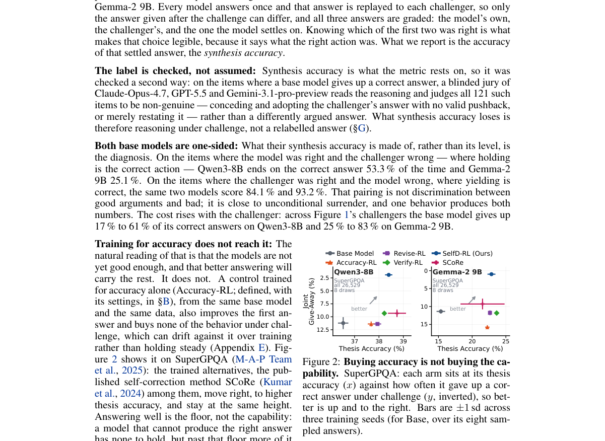

**Why this ranks #15**: 把 RLVR 的验证器从「只判答案对错」扩到「也判裁决对错」：单策略依次扮演正题 T、反题 A、综合裁决 S，反题只采样不入训练轨迹，只有答与裁两轮拿奖励，回报里 capitulation 与 stubbornness 各罚 0.5、格式解析失败直接压到 Rfloor=-0.75，算法本身仍是标准 GRPO。在 327 题 × 17 挑战者的 D-probe 上，Qwen3-8B 九个公开基准的平均综合准确率（synthesis accuracy）从 50.0% 升到 55.9%（+5.90 pp），Gemma-2 9B 从 19.9% 升到 37.8%，全程没有奖励模型、偏好数据或人工标注，因此属于 RLVR 方向的核心工作。

---

### 16. See Every Block Once: Variance-Reduced Post-Training for Masked Diffusion Language Models

**arXiv**: [2611.17754](https://arxiv.org/abs/2611.17754) | **Score**: 8.7 (relevance 9 x 0.7 + quality 8 x 0.3) | **Direction**: `llm_vlm_rl` | **Tags**: LLM-VLM, masked-diffusion, monte-carlo, variance-reduction, blockwise-generation, grpo, Kyoto University | **Categories**: cs.CL | **Pages**: 22

**Authors**: Yunzhen He; Hiroaki Yamagiwa; Hidetoshi Shimodaira

**Affiliation**: Kyoto University; SB Intuitions; RIKEN AIP

**Abstract**

> Policy gradient methods are widely used to align large language model outputs with human preferences, but the log-likelihoods they require cannot be directly computed in Masked Diffusion Language Models (MDLMs). MDLM post-training therefore relies on a surrogate objective based on the Evidence Lower Bound (ELBO), and recent work estimates a blockwise variant of this objective via Monte Carlo methods to support blockwise generation. However, existing estimation schemes randomly sample the block index, so they may evaluate the same block more than once and leave some blocks unevaluated. This introduces variance arising from block selection into the estimates. In this work, we propose a full-block estimator that evaluates every block exactly once and averages the results. We theoretically show that the proposed estimator remains unbiased while eliminating the between-group variance arising from block selection, thereby achieving lower variance than the baseline for the same sample size. In experiments on five benchmarks spanning mathematics, planning, and coding, our method achieves the highest accuracy on four benchmarks and outperforms the random block sampling baseline by an average of 12.79 points.

**Key findings**

- **Finding**: 随机抽 block 时 K=C=4 有 0.91 的概率漏掉整块；全块估计在 K=4 就拿到 Spearman ρ=0.878、RMSE=50.1，而随机采样只有 ρ=0.602、RMSE=136.0，约等于随机采样 K≈32 的估计质量。
- **Inference**: 五个数据集上的方差比 Var[L̂Full]/Var[L̂Rand] 仅 0.076–0.122，但策略梯度层面的方差比仍高达 0.79–0.96，说明精度收益主要来自「每步给每个 block 都发学习信号」而不只是梯度更稳。
- **Recommendation**: 在 MDLM 上做 GRPO 后训练时，可直接把蒙特卡洛样本数设为 block 数 C 并逐块求平均，这是零额外模型成本的可插拔改动；作者提示 C 变大时并行实现会线性占用显存，可改用顺序累加梯度。

**Key figures**

*Framework - Comparison of block selection in Monte Carlo estimation of the blockwise surrogate objective. For each Monte Carlo sample index k, a block b is sam- pled, and the corresponding set of token*

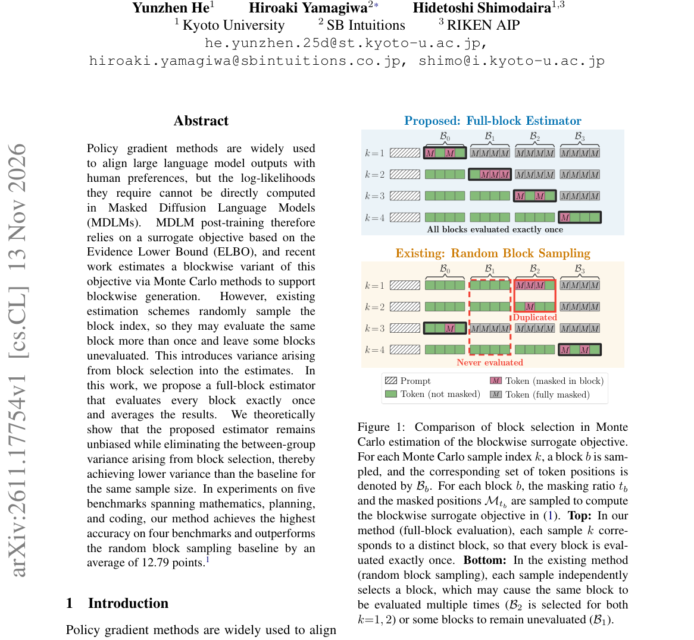

*Result - Mask state during the generation of block b = 1 for a response o of length L = 12 (C = 3, B = 4). Block B0 is considered already generated, so its original tokens are retained. In this examp*

**Why this ranks #16**: 针对掩码扩散语言模型（MDLM）后训练里 blockwise 代理目标的蒙特卡洛估计器做改造：京都大学、SB Intuitions 与 RIKEN AIP 把随机抽 block 换成「每个 block 恰好评一次」的全块估计，代理目标与 GRPO 策略更新完全不动。K=C=4 时随机采样至少漏掉一个 block 的概率高达 0.91，全块估计把估计方差比压到 0.076–0.122（约为随机采样的十分之一），在 GSM8K/MATH-500/Countdown/Sudoku/HumanEval 五个基准上平均比随机采样高 12.79 分、比最强基线 SPG 高 5.05 分。

---

### 17. Verifiable pXRD: Hill-climbing pXRD structure determination with LLM agents

**arXiv**: [2611.17539](https://arxiv.org/abs/2611.17539) | **Score**: 8.0 (relevance 8 x 0.7 + quality 8 x 0.3) | **Direction**: `llm_vlm_rl` | **Tags**: LLM-VLM, pxrd, crystal-structure, verifiable-reward, agent-adaptation, inference-time-scaling, Stanford University | **Categories**: cs.AI | **Pages**: 49

**Authors**: Samuel Chen; Jiaru Bai; Austin Henry Cheng; Varinia Bernales; Alán Aspuru-Guzik

**Affiliation**: Stanford University; University of Toronto; Vector Institute for Artificial Intelligence; Acceleration Consortium; Canadian Institute for Advanced Research (CIFAR); NVIDIA

**Abstract**

> Autonomous crystal-structure determination from powder X-ray diffraction (pXRD) remains a key bottleneck for self-driving materials laboratories. We formulate the task of pXRD structure determination as a verifiable agentic search problem: candidate structures can be assessed during inference through forward-simulated profile agreement and during evaluation through structural matching to a known reference. To benchmark progress, we introduce pXRD-Bench, a suite of 200 simulated single-phase problems spanning in-distribution structure determination, challenging and polymorphic structures, and controlled compositional and topological distribution shifts. Agent adaptation raises selected structural recovery from 27% to 69%, with further gains from repeated sampling and verifier-guided inference-time scaling. We extend this approach to experimental multiphase pXRD through a reflexive evolution framework that learns from self-generated synthetic problems. A replaceable laboratory specification defines the sample family and measurement conditions. An evolver agent uses the known generating structures and measurement parameters to diagnose solver failures and develop persistent guidance and executable tools, which are then provided to agents on measured patterns. This supplies verifiable training experience without requiring a collection of solved experimental measurements. On 15 measured patterns from solid-state synthesis, the evolved package improves average profile agreement and transfers an analogue-substitution procedure that recovers a phase whose structure is absent from the supplied reference library. These results demonstrate how learning from verifiable synthetic experience can improve agentic characterization of experimental samples whose structures are not known in advance.

**Key findings**

- **Finding**: pXRD-Bench 含 200 道单相题（pXRD-100 与 pXRD-ood 各 100），已有专用求解器最好也只有 32.0%（PXRDGen，pass@1），而 adapted-codex 选中的结构精确匹配率是 69.0%，pXRD-ood 上为 61.0%。
- **Inference**: 学习型适配的收益来自验证器引导的自我进化——能力包只有 139 词的技能加一个 DICVOL 适配器，却把准确率从 57.0% 推到 69.0%，说明对齐验证器评分比堆砌工具更关键。
- **Recommendation**: 任何「能算出物理残差」的科学领域都可照搬该思路：用 Rwp 做推理期验证器时，LLM 验证器判定 155/200（77.5%）正确，优于固定阈值 Rwp≤6.66% 的 149/200（74.5%），并应按覆盖率定向续跑而非盲目重复采样。

**Key figures**

*Framework - pXRD structure determination as a verifiable inverse problem. Ground truth: pXRD-Bench case pxrd100-rep-010. Proposed: pxrd-codex selected.cif. Structures rendered with Crystal Toolkit [Hort*

*Result - Repeated-sampling results on pXRD-Bench-20. Panels (a)–(c) show candidate-set exact StructureMatcher recovery for pxrd-codex Sol, pxrd-codex Luna, and adapted-codex Sol, respec- tively. A co*

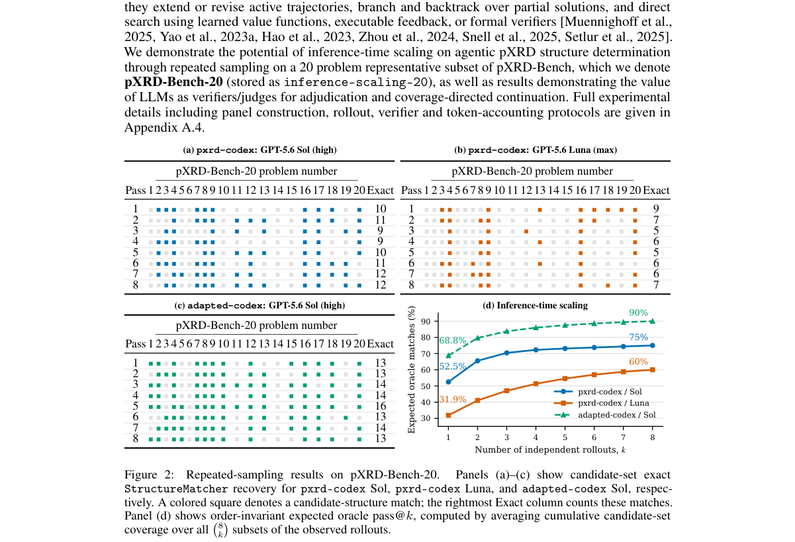

**Why this ranks #17**: 斯坦福大学与多伦多大学等把粉末 X 射线衍射（pXRD）结构测定写成可验证的智能体搜索问题：推理期用前向模拟的 Rwp 残差评估候选结构、评测期用 pymatgen StructureMatcher 与真值比对，这个验证器同时充当训练信号与推理期筛选依据，于是可以做奖励式爬坡。在 200 题的 pXRD-Bench 上，无工具的 GPT-5.6 Sol 只有 27.0%，加材料科学编码智能体升到 52.0%，接入 GSAS-II/DICVOL 升到 57.0%，再用 50 题独立课程做可验证自进化得到 69.0%，属于典型的 RLVR 路线。

---

### 18. AutoRL: A Multi-Agent System towards Autonomous Reinforcement Learning

**arXiv**: [2611.17790](https://arxiv.org/abs/2611.17790) | **Score**: 8.0 (relevance 8 x 0.7 + quality 8 x 0.3) | **Direction**: `llm_vlm_rl` | **Tags**: LLM-VLM, autonomous-rl, multi-agent, training-supervision, reward-repair, checkpoint-resume, Meituan | **Categories**: cs.AI, cs.LG | **Pages**: 23

**Authors**: Simon Tang; Wenjie Shi; Yongjing Yin; Keheng Wang; Jialin Liu; Zheng Zhang; Linvo Lin; Xiangyuan Xue; Kan Ren; Jingang Wang; Xunliang Cai

**Affiliation**: Meituan; The Chinese University of Hong Kong; ShanghaiTech University; Fudan University

**Abstract**

> Recursive self-improvement (RSI) is one of the most promising paths toward an AI singularity for superintelligence. Achieving this vision requires AI systems to undertake the full training pipeline for iterative improvement. Reinforcement learning (RL) plays an essential role in this cycle to improve model capabilities and generalization, yet automating RL remains difficult due to unstable training dynamics and the need for sustained supervision. We introduce AutoRL, a multi-agent system for automating RL training, as a cornerstone for future RSI. Different from conducting research by end-to-end complete experiments, AutoRL monitors the evolving training state and integrates process-level supervision and research into an ongoing RL training, following the practical workflow of an RL researcher. Specifically, AutoRL consists of three RL-specific agentic roles. Perceptors track training dynamics, rollouts, evaluation, and efficiency, triggering deliberation when they detect anomalies, degradation, or stagnation. Three complementary Proposers diagnose problems and refine candidate interventions through shared evidence and checks. The Orchestrator reviews their recommendation and applies approved changes through online hot updates or checkpoint-based resumption. Experiments on Qwen3 and LongCat-Flash-Lite demonstrate the superiority of AutoRL over static RL recipes and a general agent. The research records show that existing agents can handle unattended RL supervision and dynamic adjustment. The difficulty for future RSI lies in developing fundamental methods that are valuable for resource-consuming validation.

**Key findings**

- **Finding**: Qwen3-4B 上 AutoRL 在全部九个基准超过静态 GRPO 配方：AIME 2024 由 46.67% 升到 66.67%（+20.00 pp），HMMT 2025 由 20.00% 升到 31.67%，MBPP 由 63.55% 升到 65.25%，1.7B 规模上同样全项领先。
- **Inference**: LongCat-Flash-Lite 上 AutoRL 在 64 步内从 65.53% 升到 73.16%，而静态配方同期跌到 56.05%，差距 17.11 pp；六次热更新里有四次在修评分器（选项映射、多值匹配、LaTeX 解析、空白与单位），说明瓶颈常在奖励实现而非算法。
- **Recommendation**: 要做长时无人值守 RL，应先搭好「感知—诊断—提案—CPU 校验—热更新/检查点恢复」这条链；编码智能体实验里 14.7 天训练经历 11 次运行时故障后仍把 SWE 相关任务 pass@1 从 52.29% 推到 65.13%。

**Key figures**

*Framework - AutoRL: autonomous RL supervision and research. Right: AutoRL continually adopts interventions, such as fixes and adjustments, to sustain gains over a static recipe.*

*Result - Framework of AutoRL. Four Perceptors monitor training and diagnose problems. Three specialized Proposers discuss candidates, review evidence, and perform CPU-only checks to guide revision an*

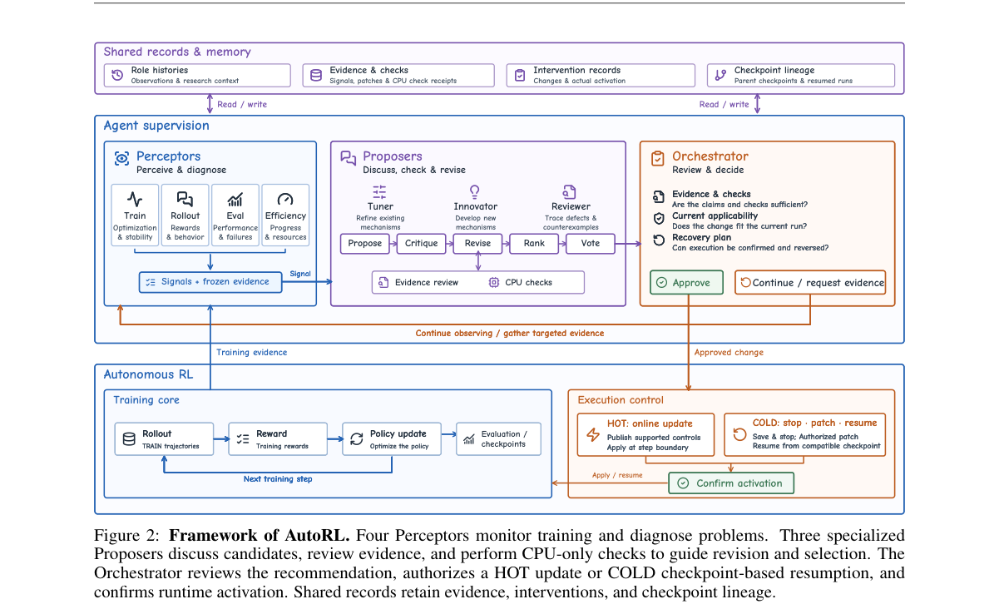

**Why this ranks #18**: 美团联合香港中文大学、上海科技大学与复旦大学提出 AutoRL，用四个感知器（梯度/rollout/评测/效率）、三个提案器（Tuner/Innovator/Reviewer）和一个编排器接管 GRPO 训练的过程级监督：提案器在至多五轮辩论里用 Borda 打分选出最多两个候选，编排器再决定 HOT 在线热更新还是 COLD 从检查点恢复。Qwen3-4B 上九个基准全面超过静态 GRPO 配方，AIME 2024 由 46.67% 升到 66.67%（+20.00 pp），是把 RL 训练本身当作智能体 RL 任务的代表作。

---

### 19. G-CAST: Governed Continual Self-Training for E-Commerce Agents under Evolving Demands

**arXiv**: [2611.17814](https://arxiv.org/abs/2611.17814) | **Score**: 8.0 (relevance 8 x 0.7 + quality 8 x 0.3) | **Direction**: `llm_vlm_rl` | **Tags**: LLM-VLM, continual-self-training, reward-routing, entropy-prioritization, agent-adaptation, e-commerce-agent, Alibaba Group | **Categories**: cs.AI, cs.CL | **Pages**: 9

**Authors**: Yuechun Yu; Wenzheng Kong; Xiaofeng Mao; Jin Zhang

**Affiliation**: Alibaba Group

**Abstract**

> With the rapid advancement of Large Language Models (LLMs), an increasing number of users are turning to LLM-powered agents for conversational shopping in e-commerce. However, the user needs continue to change as new product categories, procurement scenarios, and feature requests emerge. At the same time, the product's execution harness-including its tools, skills, and operating procedures-continues to evolve to support increasingly sophisticated interactions. These changes create two practical challenges: 1) Demand drift alters the distribution, intent, and complexity of user requests, causing a model trained once to fall behind; 2) Harness evolution requires the model to use newly introduced capabilities correctly without losing behavior that users already rely on. Periodic manual retraining is too delayed and labor-intensive for this setting. To address these challenges, we present G-CAST, a governed continual self-training system that converts daily production evidence under evolving demand and capability contracts into reward-routed, entropy-prioritized training data and governed reward evolution. Governed checkpoint transition under cumulative evaluation controls each model update, enabling the agent to learn newly introduced behaviors without sacrificing previously accepted capabilities. Experiments on a real production e-commerce agent show that G-CAST achieves stronger adaptation to newly introduced demand while better preserving previously accepted behavior compared with a strong autonomous post-training baseline. Ablations further show that both reward-routed, entropy-prioritized data orchestration and governed reward evolution are important to these gains. G-CAST is now deployed in Yuancai(http://cai.1688.com/), a B2B procurement agent on Alibaba's 1688 platform.

**Key findings**

- **Finding**: G-CAST 把每日生产证据按 rollout 结果路由成三条训练分支（全失败走 SFT、混合结果走 RL、全成功走回归监控），在第 4 轮累积奖励 0.8078 优于 AutoTrainess 的 0.7911，且保留期奖励由 0.8712 升到 0.8833，对手则由 0.8907 降到 0.8739。
- **Inference**: 固定 checkpoint 在能力契约扩张下从 0.9065 衰减到 0.6354、新周期奖励只剩 0.1877，说明需求漂移会同时废掉模型、训练证据与奖励三者，只做大规模后训练无法补回这份落差。
- **Recommendation**: 部署型 agent 应把「奖励可靠性检查 + 奖励路由」前置为硬闸门，奖励变更需通过目标用例验证、旧新重打分与轨迹回放，再由累积评估决定 checkpoint 是否替换。

**Key figures**

*Framework - G-CAST, a governed continual adaptation loop for deployed e-commerce agents. The main self-evolution loop converts daily production queries into checkpoint updates through multi-rollout gene*

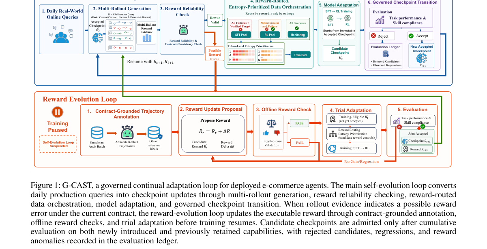

*Result - Performance degradation of a fixed checkpoint as the capability contract expands across demand periods. The figure reports the base reward, which excludes auxiliary re- ward components intro*

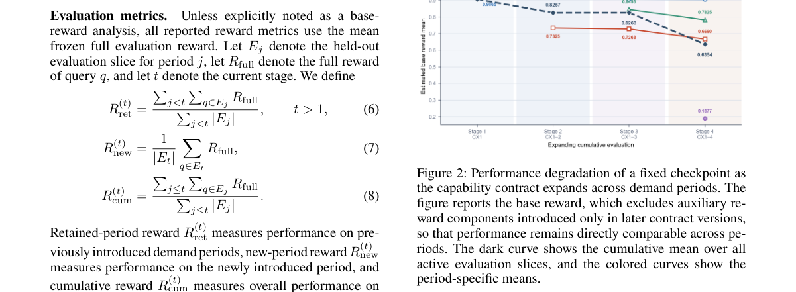

**Why this ranks #19**: 它把 RL 后训练里最容易被忽略的奖励治理做成了可上线的闭环：在阿里巴巴 1688 的真实电商 agent 上以 Qwen3-4B-Thinking-2507 为底座，每条查询 8 次 rollout、每期 2,000 条 rollout 池（16,000 条轨迹），第 4 轮累积奖励 0.8078 高于 AutoTrainess 的 0.7911，保留期奖励从 0.8712 升到 0.8833（对手从 0.8907 降到 0.8739），技能选择准确率 0.7625 对 0.6875。

---

### 20. PaperCritic: Training AI Reviewers to Assess the Soundness of Papers

**arXiv**: [2611.17834](https://arxiv.org/abs/2611.17834) | **Score**: 8.0 (relevance 8 x 0.7 + quality 8 x 0.3) | **Direction**: `llm_vlm_rl` | **Tags**: LLM-VLM, paper-review, reward-modeling, grpo, f1-reward, review-points, KAIST AI | **Categories**: cs.CL | **Pages**: 26

**Authors**: Hyun Ryu; Ji Yong Cho; Eunho Yang; Moontae Lee; June Yong Yang; Sean Welleck; Carolyn Rose

**Affiliation**: KAIST AI; Carnegie Mellon University Language Technologies Institute; LG AI Research

**Abstract**

> As AI conference submissions grow rapidly, AI reviewers are being considered as an alternative. However, simply imitating human reviewing is problematic because reviewing serves multiple purposes, including evaluating papers' soundness, interestingness, and clarity, the last two of which are subjective. In this work, we focus solely on evaluating soundness, the most important and objective criterion, and define the learning objective as jointly maximizing (1) precision, based on the soundness and substantiveness of review points, and (2) recall, the coverage of high-quality reference review points. Under this problem formulation, we construct a quality-labeled review point dataset, PaperSound-23K, using 1K ICLR submissions and 23K human-written and LLM-generated review points. Using this dataset, we train an AI reviewer model, PaperCritic, through reinforcement learning with the F1 score of precision and recall as the reward. Our experiments show that PaperCritic outperforms frontier models and models trained with other AI reviewer training methods on an in-domain test set. Surprisingly, learning to review ICLR submissions also transfers to reviewing Nature-family papers and even to out-of-domain reviewing tasks (e.g., code review, legal contract review, and feedback on story writing).

**Key findings**

- **Finding**: PaperSound-23K 取 1K 篇 ICLR 投稿中的 989 篇论文、23,215 个审查点（人均 23.47±6.95），其中 62.4% 来自人类评审，人机一致性 0.624 已高于人人一致性 0.597。
- **Inference**: 奖励三件套缺一不可——去掉匹配器召回掉到 10.3（F1 13.2），去掉 soundness 奖励模型精确率掉到 13.1（F1 17.6），把精确率换成基于匹配的版本则 F1 只剩 25.7。
- **Recommendation**: 用 F1 型密集奖励做领域审查时，应分别建「内容正确性」与「实质重要性」两个奖励模型并保留覆盖率匹配器；改用 Gemini 3.8 Flash 复评时 PaperCritic-4B 仍以 44.4 F1 领先 DeepSeek-V4-Flash-0731 的 33.3。

**Key figures**

*Framework - Comparison of paper soundness assess- ments with conventional holistic review-and-score generation. Conventional AI reviewers are trained us- ing holistic review similarity or preference and*

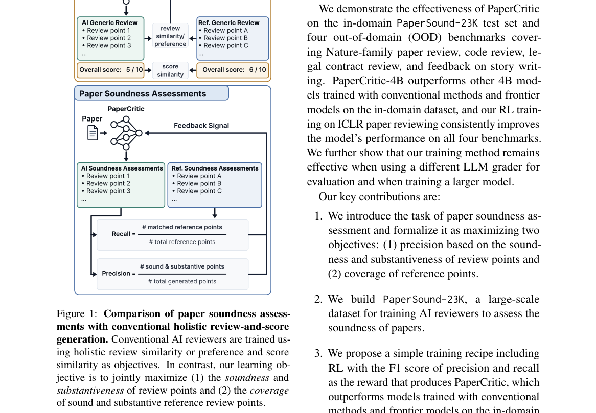

*Result - An overview of the PaperCritic training framework. SFT uses sound and substantive reference points. Online RL maximizes a review-level F1 reward, combining precision estimated by soundness a*

**Why this ranks #20**: 把 AI 审稿目标从「模仿人类整篇评审」改成「最大化审查点的精确率与召回率 F1」：SFT 后用两个奖励模型分别评 soundness 与 substantiveness 估计精确率、用 LLM 匹配器算参考点覆盖度估计召回，合成整篇评审级的 F1 奖励交给 GRPO 优化，奖励由人类评审点标注驱动因而属 RLHF 路线。PaperSound-23K 覆盖 989 篇论文、23,215 个带质量标签的审查点，PaperCritic-4B 的 F1 达 45.1，比最强 4B 训练基线高 21.4 pp，并泛化到四个域外审稿任务。

---

## Footer

- Total papers reviewed across all 4 axes: 60
- llm_vlm axis final count: 20
- Wild-cards in this axis: 0
- Figure assets: 2026-11-16/res/

Generated by `mine-arxiv-daily-digest` skill. Sister file: `2026-11-16_llm_vlm_entry.md`.
