# Mine Arxiv Daily Digest - 2026-11-16 (具身智能与世界模型 Axis, 15 papers)

**Generated**: 2026-11-16 11:54 CST

**Source**: arXiv cs.CV, cs.SD, eess.AS, cs.CL, cs.AI, cs.RO, cs.LG, cs.IR submissions, listing day 2026-11-13 (announced 2026-11-16 01:00 UTC)

**Batch window**: 2026-11-12T19:00:00Z .. 2026-11-13T19:00:00Z（arXiv 公告批次横跨两个 UTC 日：从前一日的美东 14:00 截止时刻起算（EDT 为 18:00Z，EST 为 19:00Z），到当日的同一时刻为止）

**Axis**: world_embodied (15 papers, base 15, cap 20)

**Directions**: world_model (5), embodied_ai (10)

**Selection**: 15 papers ranked by relevance x quality, with 0 wild-card slots

**Day total**: 48 papers across 4 axes (target 60)

**Scope**: 世界模型、学习型模拟器与具身智能，含移动操作、人形控制、触觉反射、VLA 策略与面向具身任务的强化学习

**Wild-card**: 0 —— 本 axis 未启用任何补位名额。`world_model` 供给略薄但有 5 篇够格论文，`embodied_ai` 有 12 篇 rel≥7 的候选，两个 direction 都不需要用邻接选题补位。

**本 axis 15 篇（base 15，cap 20）**：`world_model` 5 篇、`embodied_ai` 10 篇。`embodied_ai` 超出基准 2 个，由 `world_model` 让出的 2 个名额吸收——本轮 `world_model` 只有 5 篇够格（7 篇基准），而 `embodied_ai` 有 12 篇 rel≥7 的候选。

**`world_model` 的 5 篇质量很高但数量被供给卡住**：V-JEPA-LM（读动态而非检索属性）、LASR（动作落地潜变量的度量）、WATO（世界动作模型的可微轨迹优化）、Learning Latent Goal Costs（可学习目标代价）、Ego2Flow（闭环交通影响）。另有两篇 JEPA 论文（胸片、视网膜 OCT）因属医学影像未纳入。

---

## 世界模型与学习型模拟器 · `world_model` (5 papers)

本方向 5 篇，几乎都在问同一个问题的不同侧面：**「模型到底读懂了吗，还是只是记住了样子」**。V-JEPA-LM 指出把 V-JEPA 这样的世界模型视频编码器接上语言模型之后，模型学到的是「检索被点名的属性」而不是「读出片段的动态」，因为字幕与问题只覆盖了少数属性。LASR 给出衡量动作落地潜变量的指标，替代只看预测增益的做法。WATO 把世界动作模型生成的动作与未来状态放在一起做可微轨迹优化，并把「轨迹像不像」与「轨迹有没有用」这两件事分开处理。Learning Latent Goal Costs 给视觉世界模型的图像目标规划配一个可学习的小残差适配器，绕开 MSE 会偏好「看起来像目标却隔着障碍到不了」的偏好。Ego2Flow 用 agent 引导的地图蒸馏造出六张来自真实城市道路的 CARLA 地图，把自动驾驶策略对整个交通系统的影响放进闭环里评估。

### 1. V-JEPA-LM: Video-Language Models That Read Dynamics Beyond Static, Text-Aligned Representations

**arXiv**: [2611.17831](https://arxiv.org/abs/2611.17831) | **Score**: 8.7 (relevance 9 x 0.7 + quality 8 x 0.3) | **Direction**: `world_model` | **Tags**: embodied, video-language-model, jepa, counterfactual-supervision, dynamic-reasoning, linear-probe, Hanyang University | **Categories**: cs.AI, cs.CV | **Pages**: 29

**Authors**: Keuntae Kim; Dongjun Kim; Yong Suk Choi

**Affiliation**: Hanyang University

**Abstract**

> World-model video encoders such as V-JEPA learn how scenes change (direction, speed, order, state) from video alone. To answer questions, they are joined to a language model trained on captions and question-answer pairs. But each caption or question names only a few attributes of a clip, so the model learns to retrieve those attributes rather than to read the clip, and the dynamics the encoder carries go unused: on the same items, a linear probe reads speed from frozen V-JEPA features at 87% while the VLM answers at chance. We show where dynamics lives in a frozen encoder: in a subspace shared across videos for predictive encoders such as V-JEPA, but not as a shared component of frame-wise, text-aligned encoders such as SigLIP. We then build counterfactual supervision that makes the language model read it: pixel transformations turn public videos into answer-balanced variants whose answers are set by the transformation and differ only in the change. Trained in a single stage on 4.53M public samples with 32 visual tokens per frame, where open video LLMs use several stages, 9M to 172M samples and 64 to 256 tokens per frame on average, the resulting V-JEPA-LM models (1B to 8B, Qwen3 and Llama) lead every size class in average score across eleven video benchmarks; our 4B model scores 72.1, against 61.1 for the best open 4B and 64.8 for the best open 8B model. A controlled encoder x supervision study shows that the encoder decides what can be read and the supervision what is read: at a matched budget, counterfactual supervision adds 4.5 points on average and 38 on the speed questions of natural benchmarks. Code and models: https://github.com/kkt94/Llama-V-JEPA-LM.

**Key findings**

- **Finding**: 线性探针从冻结 V-JEPA 特征读出速度达 87%，而同样题目上 VLM 的回答处于随机水平；经 VLM 桥接后特征也能读到 84%，但模型同样答不出。
- **Inference**: 瓶颈不在编码器能力而在监督信号，caption 与 QA 只教会检索静态属性，编码器携带的动力学信息被整体浪费。
- **Recommendation**: 用像素反事实变换构造答案由变换决定、且只在变化处不同的训练变体，再做单阶段训练，同预算下平均可加 4.5 分、自然基准速度题可加 38 分。

**Key figures**

*Framework - Top: what captions and QA teach (left), where the dynamics lives in the encoder (middle), and the supervision built from it (right). Bottom: the model, trained in one stage, and what the rec*

*Result - One generated pair: the same clip forward and backward, with the same question and opposite answers (4 of 32 frames). Other constructions: Fig. 6.*

**Why this ranks #1**: 冻结 V-JEPA 特征上的线性探针读速度可达 87%，而同一批题目上 VLM 的回答处于随机水平；作者据此把动力学定位在预测式编码器的共享子空间，并用反事实监督让 4B 模型在 11 个视频基准上的均分从 61.1 提到 72.1（8B 开源模型仅 64.8），且只用单阶段 4.53M 样本、每帧 32 个视觉 token，因此在本 direction 排在首位。

---

### 2. Learning Latent Goal Costs for Visual World-Model Planning with an Expanding Curriculum

**arXiv**: [2611.17529](https://arxiv.org/abs/2611.17529) | **Score**: 8.0 (relevance 8 x 0.7 + quality 8 x 0.3) | **Direction**: `world_model` | **Tags**: embodied, latent-goal-cost, jepa, world-model-planning, residual-adapter, curriculum-expansion, Technical University of Crete | **Categories**: cs.LG, cs.RO | **Pages**: 9

**Authors**: Konstantinos Mylonas; Thrasyvoulos Spyropoulos

**Affiliation**: Technical University of Crete

**Abstract**

> Image-goal planning with a frozen visual world model depends on how predicted observations are scored against the goal. Mean-squared error (MSE) between embeddings from a pretrained visual encoder can provide a useful signal near a goal, yet favor states across an obstacle that are visually similar to the goal and difficult to reach. We fit a small residual adapter on top of frozen I-JEPA embeddings to improve this latent goal cost. Starting near each goal, a planner collects trajectories from progressively wider regions of initial states. The adapter learns from the order of observations along successful trajectories, with additional comparisons inferred from failed rollouts. No task-specific progress labels are used for fitting, so the procedure can be applied to other goal-reaching tasks. DotWall and PointMaze are used in this work. In paired 50-case evaluations with identical starts, goals, world models, and planner settings, success increases from 54% to 98% in DotWall and from 82% to 96% in PointMaze. On 16 unseen DotWall layout-goal cases, the adapter fitted on one fixed layout improves agreement between latent-cost ordering and shortest legal-path ordering from 71.9% to 85.8%. The results indicate that planning experience can improve a frozen visual representation's goal cost without retraining the encoder or the world model.

**Key findings**

- **Finding**: 冻结 I-JEPA 嵌入上拟合的小残差适配器把 DotWall 成功率从 54% 提到 98%、PointMaze 从 82% 提到 96%，且不重训编码器与世界模型、不用任何任务特定的进度标签。
- **Inference**: 规划经验本身可以纠正 MSE 潜代价偏爱「隔着墙看起来像目标」的状态这一偏差，说明瓶颈是目标代价的刻画而非表征容量。
- **Recommendation**: 若已有冻结的视觉世界模型，优先按逐步扩大的初始状态课程采集成功轨迹顺序来训一个潜代价适配器，再交给图搜索式规划器使用。

**Key figures**

*Framework - The ball can appear close to the goal across the wall, even though it has to travel through the doorway to reach the other room. A planner using raw latent cost may therefore favor a state tha*

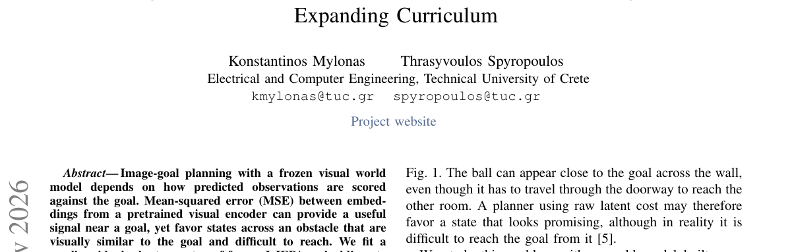

**Why this ranks #2**: 在冻结 I-JEPA 嵌入上只拟合一个小残差适配器，DotWall 成功率从 27/50（54%）升到 49/50（98%），PointMaze 从 41/50（82%）升到 48/50（96%）；在 16 个未见布局上潜代价与最短合法路径的排序一致性从 71.9% 提到 85.8%，全程不重训编码器与世界模型，是本 direction 里成本最低的规划期修正方案。

---

### 3. Joint World Action Models through Differentiable Trajectory Optimization

**arXiv**: [2611.17626](https://arxiv.org/abs/2611.17626) | **Score**: 8.0 (relevance 8 x 0.7 + quality 8 x 0.3) | **Direction**: `world_model` | **Tags**: embodied, world-action-model, differentiable-optimization, model-based-control, amortized-planning, multi-task-control, Hybrid Robotics | **Categories**: cs.LG | **Pages**: 29

**Authors**: Mintae Kim; Koushil Sreenath

**Affiliation**: Hybrid Robotics, BAIR, UC Berkeley

**Abstract**

> Joint world action models (WAMs) generate future actions and states together, modeling world-action trajectories rather than actions alone. However, trajectory imitation does not ensure that these trajectories are task-effective or consistent with dynamics. We present \textbf{world action trajectory optimization (WATO)}, which optimizes generated actions and future states jointly for control. WATO uses both as references in a dynamics-constrained trajectory optimization problem and differentiates the task loss through the optimized trajectory to train the generator. This makes generated trajectories task-aware and dynamics-consistent while using trajectory optimization only during training. At deployment, WATO directly generates candidate trajectories and ranks them with a world model, without iterative trajectory optimization. Across $7$ visual control environments, WATO improves average success from $79.9\%$ for the imitation joint WAM to $91.7\%$, outperforming strong model-based, goal-conditioned RL, and generative control baselines. Compared with cross-entropy method (CEM), WATO is on average $11.5\times$ faster and uses $600.5\times$ fewer world model evaluations at deployment.

**Key findings**

- **Finding**: WATO 在 7 个视觉控制环境上把平均成功率从联合 WAM 的 79.9% 提到 91.7%，7 个环境中有 6 个取得最优或并列最优。
- **Inference**: 只做轨迹模仿浪费了生成状态的价值，把任务损失经优化后的轨迹反传回生成器，才能让「世界-动作」联合建模真正服务于控制。
- **Recommendation**: 训练侧加一次动力学约束轨迹优化并对任务损失反传，部署侧只保留「生成候选轨迹加世界模型排序加滚动重规划」，省掉在线 CEM 的昂贵迭代。

**Key figures**

*Framework - WATO overview. Joint world-action trajectories are optimized during training and amortized into the generator, enabling deployment with generation and world model evaluation only.*

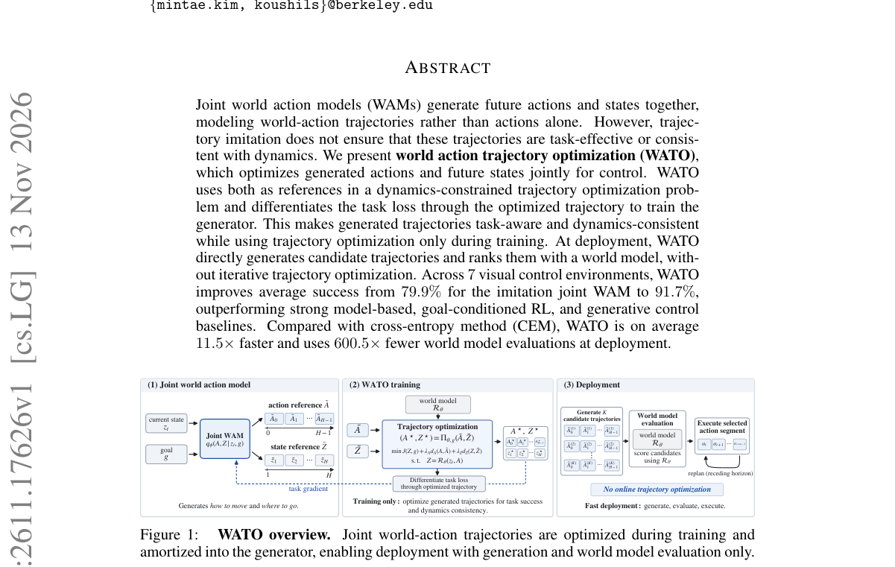

*Result - separates single-step candidate quality from full closed-loop behavior. A good local pro- posal does not necessarily yield reliable control over repeated planning.*

**Why this ranks #3**: 在 7 个视觉控制环境上，把生成的动作与未来状态同时当作参考做动力学约束的可微轨迹优化再摊销进生成器，平均成功率从模仿式联合 WAM 的 79.9% 提到 91.7%（+11.8 个百分点，7 个环境中 6 个最优或并列最优），部署时相对 CEM 平均快 11.5 倍、世界模型评估少 600.5 倍，是本 direction 里推理成本压得最低的一篇。

---

### 4. Beyond Prediction Gain: LASR as a Metric for Action-Grounded Latents in World Models

**arXiv**: [2611.17775](https://arxiv.org/abs/2611.17775) | **Score**: 8.0 (relevance 8 x 0.7 + quality 8 x 0.3) | **Direction**: `world_model` | **Tags**: embodied, latent-action, evaluation-metric, world-model-audit, shortcut-detection, offline-protocol, Tsinghua University | **Categories**: cs.LG, cs.RO | **Pages**: 20

**Authors**: Yu Zhou; Changsong Lei; Yixiang Wei; Kairui Wen; Huankun Sheng; Ming Li; Yeying Fan; Yu-Hui Wen; Yong-Jin Liu

**Affiliation**: Tsinghua University; Beijing Jiaotong University

**Abstract**

> World models that support planning, control, and interpretable reasoning require latent representations that genuinely encode action. Yet the large-scale video data from which such models are learned overwhelmingly lack action annotations. Latent-action models infer action-like variables from observation sequences, enabling action-aware learning from unlabeled videos or trajectories. A fundamental concern, however, remains: a latent that improves future prediction may simply encode the current state, episode progress, task identity, or other predictive shortcuts. Existing evaluation practices---reconstruction loss, rollout fidelity, action recovery, or downstream performance---cannot isolate this distinction. We introduce the Latent Action Support Ratio (LASR), a dimensionless metric that measures, under offline evaluation on held-out data, whether a learned latent provides predictive support for action-related targets beyond the current state and non-action alternatives. LASR provides two complementary summaries: GeoLASR captures typical support, while WorstLASR identifies the weakest case. We instantiate the LASR benchmark with recorded actions and corresponding physical state changes as targets, episode-held-out splits, one predictor type for all comparisons, and positive and negative controls. Experiments on recorded robot manipulation data and a matched multi-task panel demonstrate that LASR detects known action information, rejects representative non-action shortcuts, and enables graded comparisons among imperfect latent representations. We further use LASR to train and audit a lightweight residual adapter, obtaining descriptively better point estimates whose uncertainty is assessed with paired comparisons. LASR thus provides a principled offline protocol for measuring action-related predictive support in world-model latents.

**Key findings**

- **Finding**: ALOHA 面板上 DiLA 的 GeoLASR/WorstLASR 为 0.750/0.796、LaWAM 为 0.891/0.947，而真实记录动作的正对照为 0/0.174，指标越低表示动作支持越强。
- **Inference**: 重建损失、rollout 保真度、动作恢复和下游成绩都无法区分「潜变量编码了动作」与「潜变量只编码当前状态、回合进度或任务身份」，必须引入正负对照。
- **Recommendation**: 评测世界模型潜变量时，除重建与 rollout 保真度外加入以当前状态和非动作为对照的 LASR，并同时看 GeoLASR 与 WorstLASR 两个摘要，避免把预测增益误当成动作落地能力。

**Key figures**

*Framework - Two shortcuts in offline latent-action evaluation. (a) A trajectory from the ALOHA static-battery release illustrates how the current state and task phase constrain the next motion [51]. (b)*

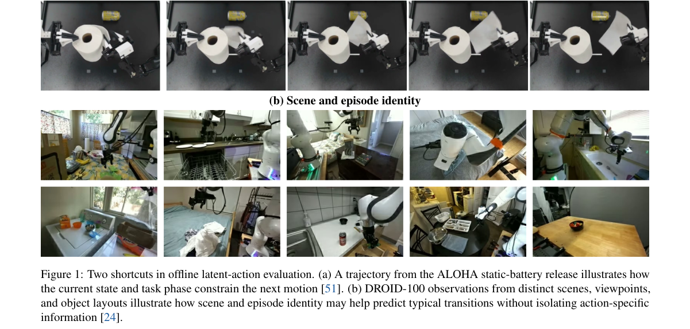

*Result - Overview of LASR. (A) A logged transition aligns the current state St, recorded action At, and next state St+1. (B) For each target–fold pair, separately fitted state, latent, and validation*

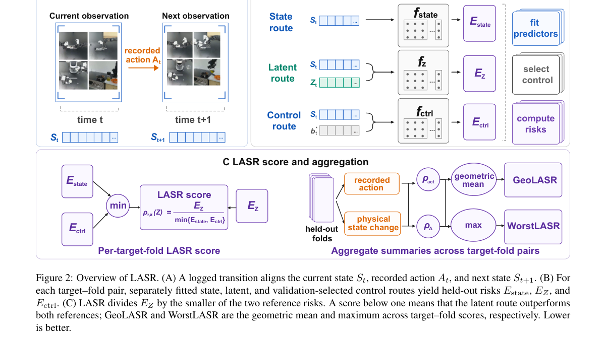

**Why this ranks #4**: 提出无量纲指标 LASR，用「扣除当前状态与非动作对照后还剩多少预测支持」来判断潜变量是否真的编码了动作；在 49 条 ALOHA 演示的 2,048 个对齐转移上，DiLA 的 GeoLASR 0.750、WorstLASR 0.796，真实记录动作的正对照为 0 与 0.174。它提供的是世界模型潜变量的离线审计协议而非新模型，因此在本 direction 处于中段。

---

### 5. Ego2Flow: Benchmarking the Traffic-System Impact of Autonomous Driving on Maps Distilled from Real-World Roads

**arXiv**: [2611.17720](https://arxiv.org/abs/2611.17720) | **Score**: 7.3 (relevance 7 x 0.7 + quality 8 x 0.3) | **Direction**: `world_model` | **Tags**: embodied, autonomous-driving, map-distillation, closed-loop-simulation, traffic-system, benchmark, University of Wisconsin–Madison | **Categories**: cs.CV, cs.RO | **Pages**: 10

**Authors**: Yu Dong; Weiying Shen; Hangyu Li; Shu Han; Hong Li; Xiangbo Gao; Keshu Wu; Zhengzhong Tu; Soyoung Ahn; Zhiyuan Liu; Xiaopeng Li

**Affiliation**: University of Wisconsin–Madison; Southeast University; Texas A&M University–College Station

**Abstract**

> End-to-end autonomous driving is predominantly evaluated through ego-vehicle safety and task completion. Its deployment in urban traffic, however, creates sustained interactions among vehicles whose collective effects remain insufficiently evaluated. We introduce Ego2Flow, a closed-loop benchmark for assessing the traffic-system impact of autonomous driving on maps distilled from real-world cities. To construct realistic 3D urban environments for sustained closed-loop traffic simulation, we develop an agent-guided map distillation framework that integrates real-world maps and observations with complementary geographic information. Through an iterative feedback mechanism and a traffic information graph that jointly guide scene generation, the framework preserves lane topology, critical road geometry and decision-relevant visual conditions while simplifying nonessential details and completing unobserved regions. Using our proposed framework, we generate and publicly release six CARLA maps from the Argoverse 2 dataset, covering the corresponding real-world regions and enabling paired comparisons of driving behavior under real and simulated observations. On these maps, Ego2Flow evaluates how autonomous driving policies affect traffic efficiency, safety, stability and energy consumption across diverse road structures. Compared with existing construction methods, our framework achieves the lowest average displacement error between planning outputs from paired real and simulated observations. We further benchmark representative driving policies to characterize their system-level impact on urban traffic. Project Page: https://github.com/Fisher-007/Ego2Flow.

**Key findings**

- **Finding**: 框架公开 6 张与 AV2 区域空间对齐的 CARLA 地图，六城等权平均 ADE 0.7966 m、FDE 2.1357 m，而次优方法 MDrive 为 0.9055 m 与 2.4630 m。
- **Inference**: 交通信息图与静态、动态评审的迭代反馈保住了车道拓扑与关键道路几何，说明地图可信度取决于建图约束而不是渲染逼真度。
- **Recommendation**: 评估自动驾驶策略时，除了自车成功率，还应在其蒸馏地图上测车流效率、安全、稳定性与能耗，以暴露车队中的速度扰动放大效应。

**Key figures**

*Result - Agent-guided map distillation. Aligned AV2 observations and geographic data provide the geometry and evidence for con- struction. The traffic information graph links road elements, evidence,*

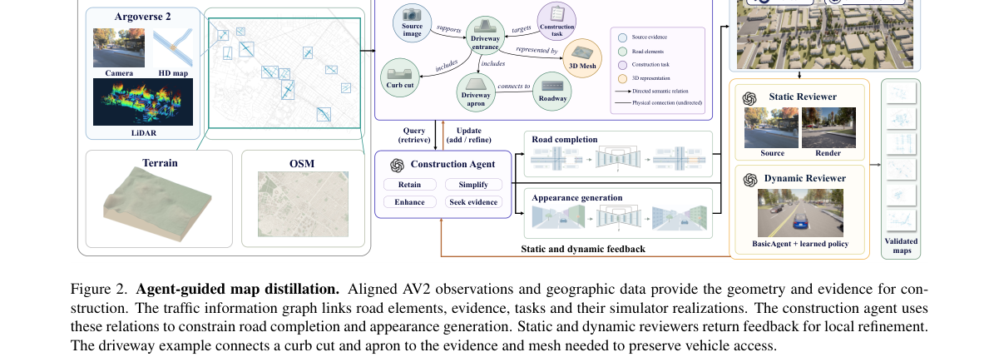

**Why this ranks #5**: 用交通信息图加静态与动态评审的迭代反馈，把 Argoverse 2 观测蒸馏成 6 张可执行 CARLA 地图，覆盖奥斯汀、底特律、迈阿密、帕洛阿尔托、匹兹堡、华盛顿特区六城，六城等权平均 ADE 0.7966 m、FDE 2.1357 m，论文称比次优构造方法低 9.3%；它的贡献在评测维度而非新模型，因此在本 direction 排在末位。

---

## 具身智能与机器人学习 · `embodied_ai` (10 papers)

本方向 10 篇。**VLA 与数据**：Agentic-Teacher 用 coding agent 自主生成演示，并指出「执行成功」并不等于「对 VLA 是有效监督」，因此要做失败驱动的数据引擎。**导航与长程**：X-Nav 让双足人形机器人完成室内到室外的长程导航，一条指令要穿过房间、门与道路；Racing the Clock 教 VLN 按时间预算调整搜索广度——30 秒该直冲最可能的房间，10 分钟该广泛巡游，而既有评测用固定 episode 上限、策略根本看不到这个预算；ERA 用预测深度做零样本物体导航，并抑制视相关误差在地图里的累积。**操作与灵巧**：TouchTwin 指出 real-to-sim-to-real 流水线重建的是「手怎么动」而非「哪根手指何时以多大力触碰」，它用真到真把人类触觉数据放大；VACO 用顶点对齐解码做稠密手部接触估计；Cross-View Consistency 用仿真状态重放隔离出多视角外观增强里到底哪一类一致性对 visuomotor 策略真正有用；Imitation Policies Learn a Proprioceptive Anchor 给出感知噪声折扣律——因为示范者总是朝物体转向，机器人自身状态其实携带了物体位置的信息。**表征与协作**：Pre-Trained Visual Representations 系统评估预训练视觉表征在接触密集插入任务里的价值；Talk to Act 用多轮对话先提取意图再规划动作。

### 6. Agentic-Teacher: An Agentic Data Engine for Failure-Driven VLA Post-Training

**arXiv**: [2611.17394](https://arxiv.org/abs/2611.17394) | **Score**: 8.7 (relevance 9 x 0.7 + quality 8 x 0.3) | **Direction**: `embodied_ai` | **Tags**: embodied, vla-post-training, code-agent, failure-driven-data, flow-matching, libero, Tsinghua University | **Categories**: cs.RO | **Pages**: 15

**Authors**: Gongyue Teng; Yuqing Xie; Yixian Zhang; Feng Gao; Shu'ang Yu; Jiaji Rao; Sukai Wang; Guanghui Ren; Ya Zhang; Maoqing Yao; Yu Wang; Chao Yu

**Affiliation**: Tsinghua University; Striding AI; AGIBot

**Abstract**

> Improving a pretrained vision-language-action (VLA) model requires demonstrations that address its weaknesses and provide effective supervision for learning. Coding agents can autonomously generate demonstrations through environment interaction, yet successful execution alone does not ensure effective supervision for VLA learning. We introduce Agentic-Teacher, an autonomous data engine for failure-driven VLA post-training. Given a VLA checkpoint, a task specification, and configured environment tools, the engine analyzes failed rollouts, selects intervention states, and iteratively develops closed-loop code policies through execution feedback. Validated policies become reusable demonstration generators that collect successful continuations from states where the VLA struggles. To make these demonstrations suitable for learning, Agentic-Teacher introduces temporally correlated action noise to broaden state-action coverage, removes idle frames while preserving gripper transitions, and filters trajectories using the frozen base model's flow-matching loss. The resulting demonstrations are combined with successful VLA rollouts for post-training, yielding an updated policy that operates without coding-agent assistance. Agentic-Teacher thus connects the weaknesses of a target VLA to both the generation and curation of its training data. In simulation, it improves $π_0$ success rates from 79.4% to 87.8% on LIBERO-10, from 80.4% to 90.6% on MetaWorld-10, and from 0% to 30.0% across three RoboCasa tasks.

**Key findings**

- **Finding**: Agentic-Teacher 让 π0 在 LIBERO-10 上从 79.4% 提到 87.8%、MetaWorld-10 从 80.4% 提到 90.6%、三个 RoboCasa 任务从 0% 提到 30.0%，每任务 50 次评测。
- **Inference**: 成功不等于有效监督，只有从 VLA 真正失败的状态出发、由代码策略补齐后续动作的示范，才带有可学习的纠错信息。
- **Recommendation**: 做 VLA 后训练时先做失败驱动的状态筛选，再加时序相关动作噪声扩覆盖、剔除空闲帧保留夹爪切换，并用冻结基座的 flow-matching loss 过滤轨迹质量。

**Key figures**

*Framework - Agentic-Teacher pipeline. Given a VLA checkpoint, simulation environment, and task interface, a coding agent uses the harness to evaluate the VLA under varied initial conditions and diagnose*

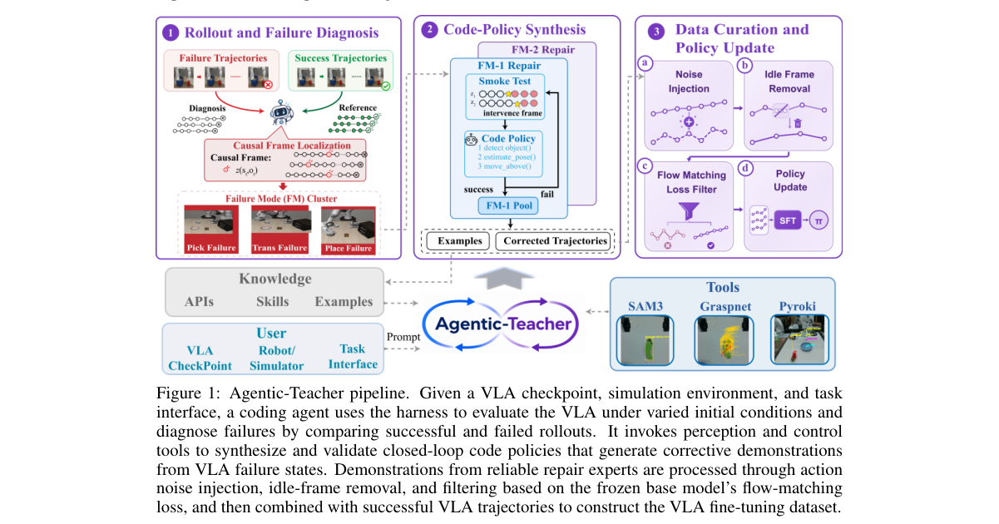

*Result - A VLA grasp failure and the corresponding code-policy repair. (a) The VLA approaches off target, misses the grasp, and fails to lift the bowl. (b) The repair program realigns the gripper, gr*

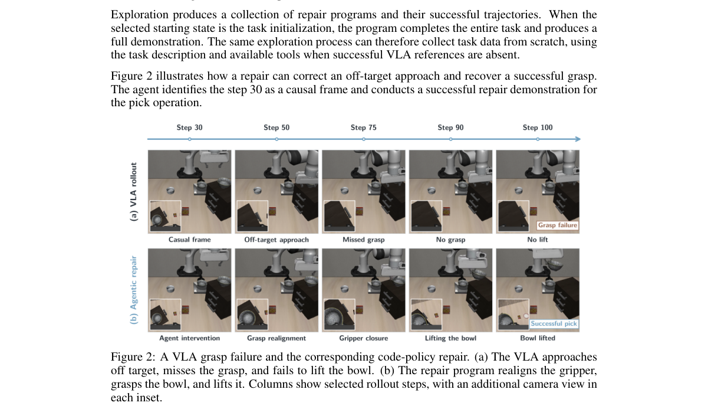

**Why this ranks #6**: 让编码智能体读失败回放、定位干预状态并迭代写出闭环代码策略，把修好的轨迹变成可复用示范；在 LIBERO-10 上把 π0 从 79.4% 提到 87.8%、MetaWorld-10 从 80.4% 提到 90.6%，三个 RoboCasa 任务从 0% 提到 30.0%，而拒绝采样微调基线只能到 81.4% 与 85.2%，因此在 embodied_ai 排在第一。

---

### 7. X-Nav Technical Report: Real-World Long-Horizon Indoor-to-Outdoor Navigation on a Humanoid Robot

**arXiv**: [2611.17598](https://arxiv.org/abs/2611.17598) | **Score**: 8.7 (relevance 9 x 0.7 + quality 8 x 0.3) | **Direction**: `embodied_ai` | **Tags**: embodied, humanoid-navigation, vision-language-navigation, digital-twin, sim-to-real, vision-language-action, AgiBot X-Lab (Boson Lab) | **Categories**: cs.AI, cs.CV, cs.RO | **Pages**: 24

**Authors**: Jiaxin Huang; Chengxing Lin; Xiaoyu Luo; Sirui Chen; Jingyu Guo; Aolin Li; Kairui Chen; Rui Zhen; Cheng Wen; Kerui Gu; Shunyao Wang; Zhihui Peng

**Affiliation**: AgiBot X-Lab (Boson Lab); MBZUAI; UESTC; University of Macau; Nanyang Technological University; The University of Melbourne; Wuhan University

**Abstract**

> Long-horizon navigation from indoors to outdoors remains an open problem for humanoid robots: one instruction covers rooms, doors and roads, and the camera moves with the gait. Worken, AGIBOT's measure of productive robot work, depends on robots that reach their workplaces autonomously. We present X-Nav, to our knowledge the first system to take a bipedal humanoid through a language-instructed long-horizon mission from indoors to outdoors. X-Nav covers a pipeline from data to deployment. Its data engine collects navigation data in open-source scenes, in digital twins of deployment sites and on real robots. Its navigation model, MELIOR, takes only RGB images from the robot's built-in camera and comes in two versions: MELIOR-A predicts actions, and MELIOR-N predicts a navigation goal. Its agentic workflow, X-Navarch, turns a brief human instruction into sub-tasks and deploys MELIOR on the robot with explicit target navigation and obstacle avoidance. On the Lingxi X2, X-Nav completes a mission of about a hundred metres from an office lobby to a store in a neighbouring building; LiDAR and odometry are used for target approach and low-level control. The mission is completed with both versions of MELIOR: the robot follows a change of destination and walks through a door from the lobby to the road, and with X-Navarch it also passes static and dynamic obstacles on the route. During deployment, MELIOR is adapted with data collected in a digital twin of the site; the adaptation raises its closed-loop success rate in the twin, and the adapted model is then deployed on the robot at the real site. In addition, MELIOR achieves competitive results on the R2R-CE and RxR-CE benchmarks.

**Key findings**

- **Finding**: X-Nav 用 MELIOR-A 在灵犀 X2 上跑完 96.6 米跨楼任务，MELIOR-N 在 R2R-CE 上成功率 70.5%，数字孪生中 3 米内停止率从 34% 提到 78%。
- **Inference**: 导航模型只吃机器人自带相机、把目标接近与静态动态避障交给显式技能 MELIOR-X，是长程任务能在真实场景落地的关键分工。
- **Recommendation**: 做真实人形导航时，优先打通开源场景、数字孪生与真机采集三条数据通路，先在孪生场地闭环验证适配收益，再把适配后的模型部署到真机。

**Key figures**

*Framework - X-Nav overview. Top: one mission on the Lingxi X2, about a hundred metres long, from an office lobby to a store in a neighbouring building, with the instruction that the robot receives; the*

*Result - The three loops of X-Nav. The sub-task loop (L1), the mission loop (L2) and the deployment loop (L3). The box below each loop gives one result of this report: the success rate (SR) of MELIOR*

**Why this ranks #7**: 首个让双足人形机器人只凭内置 RGB 相机完成室内到室外长程任务的全链路系统：MELIOR-N 在 R2R-CE 上成功率 70.5%，数字孪生现场适配把 3 米内停止率从 34% 提到 78%，真机在灵犀 X2 上跑完 96.6 米的跨楼任务，因此与 Agentic-Teacher 同处 embodied_ai 的第一梯队。

---

### 8. Racing the Clock: Teaching VLNs Budget-Conditioned Object Search

**arXiv**: [2611.17442](https://arxiv.org/abs/2611.17442) | **Score**: 8.0 (relevance 8 x 0.7 + quality 8 x 0.3) | **Direction**: `embodied_ai` | **Tags**: embodied, budget-conditioned-search, bellman-expert, vln, exploration-supervision, object-search, University of California | **Categories**: cs.AI, cs.CV, cs.LG, cs.RO | **Pages**: 12

**Authors**: Maitree Meher; Siming He; S. Shankar Sastry; Jitendra Malik; Claire Tomlin; Jonas Frey

**Affiliation**: University of California, Berkeley; Stanford University

**Abstract**

> A rescue robot entering a building with thirty seconds on the clock should sprint toward the single most promising room; given ten minutes, it should instead explore a broader tour. Yet vision-language-navigation (VLN) models are typically evaluated under a fixed episode limit that the policy never observes, even though time-critical missions require behavior to adapt to the available budget. We study budget-conditioned object search: given a target category and an explicit action budget, an agent must find as many distinct target instances as possible before the budget expires. We investigate how to supervise VLNs for this task by comparing a privileged TSP expert, which plans near-optimal routes using the full map and true target locations, with a room-level Bellman expert that maximizes expected return under partial observability using high-level cross-scene semantic priors. Despite the TSP expert achieving substantially higher expert performance, its demonstrations are less effective for learning exploration: on held-out HM3D scenes, the Bellman-supervised VLN consistently outperforms the TSP-supervised VLN, with the advantage becoming more pronounced at longer budgets. At 2000 steps (500m), the Bellman-supervised VLN finds 71.4% of reachable target instances, compared with 65.5% for the TSP-supervised VLN and 44.8% for the pretrained VLN. These results highlight a distinction between optimal routing and optimal exploration: effective exploration supervision should optimize decisions under partial observability rather than imitate routes that are optimal only once the environment is fully known.

**Key findings**

- **Finding**: 在 10 个留出 HM3D 场景上，B=2000 步时房间级 Bellman 监督的 Uni-NaVid 收集率 72.7%，贪心前沿 68.5%、对象级 Bellman 65.5%、预训练模型 44.8%。
- **Inference**: 专家回报高低取决于它看到多少学生看不到的信息；抽象与学生信息集对齐的专家才教得出有效的部分可观测探索。
- **Recommendation**: 设计示范专家时先固定学生的信息集，再按预算索引做 Bellman 递归，并额外做去掉倒计时的预算盲训练对照，确认收益来自预算条件化本身。

**Key figures**

*Framework - The stated budget changes the learned VLN’s search strategy. Room-level Bellman-supervised Uni-NaVid is rolled out from the same start pose in the same held-out HM3D scene with identical deter*

*Result - Room-level Bellman expert. (a) “Known” rooms have been entered; their recorded contents include only discovered objects. (b) Frontier rooms are valued using doorway-visible semantic evidence a*

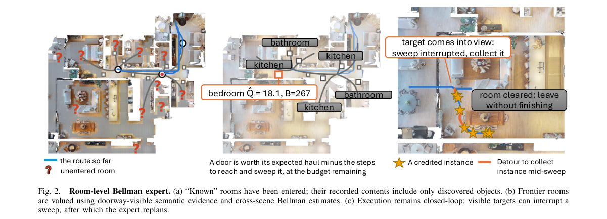

**Why this ranks #8**: 把「专家更强」与「监督更好」明确拆开：拿到全部目标位置的对象级 Bellman 专家回报更高，但蒸馏到 Uni-NaVid 后在 B=2000 步只有 65.5%，房间级 Bellman 专家反而到 72.7%（贪心前沿监督 68.5%、预训练模型 44.8%），把预算条件化搜索的监督机制讲得最清楚，因此在 embodied_ai 居中上。

---

### 9. TouchTwin: Scaling Human Touch Data via Real-to-Sim-to-Real

**arXiv**: [2611.17619](https://arxiv.org/abs/2611.17619) | **Score**: 8.0 (relevance 8 x 0.7 + quality 8 x 0.3) | **Direction**: `embodied_ai` | **Tags**: embodied, real-to-sim-to-real, tactile-glove, dexterous-manipulation, force-grounding, mujoco, Stanford University | **Categories**: cs.RO | **Pages**: 8

**Authors**: Huiwen Han; Nuo Chen; Ziyao Zeng; Dayou Li; Hao Wang; Amir Hossein Rahmati; Xiaoning Qian; Bangya Liu; Zhiwen Fan

**Affiliation**: Stanford University; Texas A&M University; Yale University; 2077AI

**Abstract**

> Human demonstrations are becoming the main source of data for dexterous manipulation, and real-to-sim-to-real pipelines multiply each demonstration in simulation. These pipelines rebuild the interaction from vision, which recovers how the hand moves. Which fingers touch, when, and how hard remain unobserved, because a hand pose shows where each finger stops on the surface rather than how far it is driven to close. This gap is a force gap: on held-out recordings, a hand policy that imitates the observed pose grips with 0.31x the recorded force, and a policy trained on physics replays of vision-tracked poses grips with 1.55x. TouchTwin closes the gap with measured human touch. Each selected TouchScale recording, captured with head and wrist RGB-D cameras and an 880-taxel glove, is rebuilt in MuJoCo. Coding agents write the objects as physics-tested programs, and a per-subject tactile hand replays the interaction with the recorded touch setting the contact and the closing force of each finger. In simulation, a policy trained on touch-grounded replays grips at 0.99x the recorded force and succeeds in 20/20 trials on held-out recordings and 35/36 unseen perturbations; a contact predictor trained on them misses 13% of real contact frames, against 32% for vision-based replays. Each replay also seeds perturbed demonstrations with simulated contact and force labels, rendered as realistic video in new views and scenes.

**Key findings**

- **Finding**: 姿态模仿策略只产生 0.31 倍记录抓握力、留出录像 17/20，纯视觉物理回放为 1.55 倍、15/20，触觉标定回放为 0.99 倍、20/20，未见扰动 35/36。
- **Inference**: 手部姿态只给出指尖停在哪里而非压入多深，因此纯视觉重建天然无法还原人类抓握力这一物理量。
- **Recommendation**: 做灵巧操作的数据扩增时务必一并采集可穿戴触觉并写进仿真回放，验收要看抓握力比与接触漏检率，而不只是任务成功率。

**Key figures**

*Framework - TouchTwin overview. Top: an agentic pipeline rebuilds each recording; GT touch sets where, when and how hard fingers touch and checks the replay. Bottom: each replay yields N perturbed demos,*

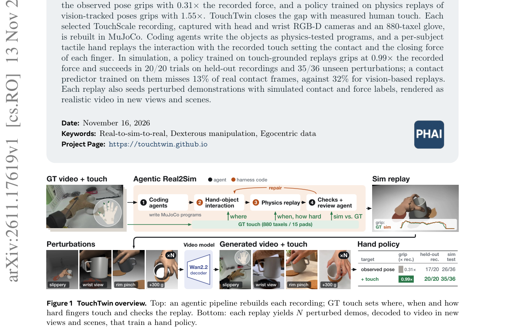

*Result - Simulating a tactile hand from egocentric video and paired tactile recordings. (a) A participant’s tactile glove grasping a mug, seen by the head camera. (b) The simulated hand fitted to the*

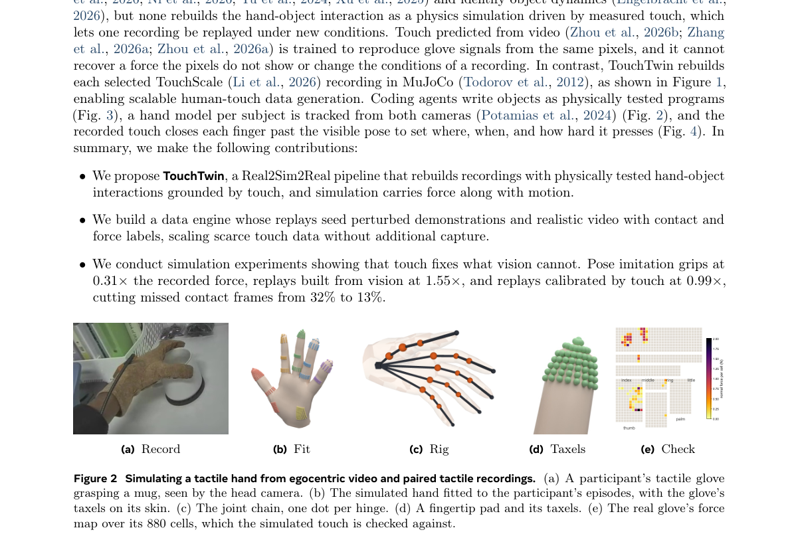

**Why this ranks #9**: 把「力缺口」量化清楚：只模仿手部姿态的策略只给出 0.31 倍记录抓握力，纯视觉重建的物理回放给到 1.55 倍，接入 880 税元件手套实测触觉后回到 0.99 倍，留出录像 20/20、未见扰动 35/36 成功，接触预测漏检从 32.2% 降到 13.1%，是 embodied_ai 里数据链路最完整的一篇。

---

### 10. Imitation Policies Learn a Proprioceptive Anchor: A Predictive Law for Perception Noise and Its Closed Loop Cost

**arXiv**: [2611.17658](https://arxiv.org/abs/2611.17658) | **Score**: 7.3 (relevance 7 x 0.7 + quality 8 x 0.3) | **Direction**: `embodied_ai` | **Tags**: embodied, errors-in-variables, perception-noise, imitation-policy, preregistration, diffusion-policy, Arizona State University | **Categories**: cs.AI, cs.LG, cs.RO | **Pages**: 18

**Authors**: Christopher Malili

**Affiliation**: Arizona State University

**Abstract**

> Imitation policies for robot manipulation are often trained on noisy object positions, and they learn to discount the noisy reading. We show how much they discount it, and why. Because demonstrators steer toward the object, the robot's own state carries information about where the object is. A trained policy combines this proprioceptive anchor with the reading and weights the reading by $α= V/(V + s^2)$, where $s^2$ is the reading noise and $V$ the anchor's error variance. $V$ belongs to the learner and is far smaller than a linear model of the demonstrations implies, which is why classical errors-in-variables (EIV) regression overestimates $α$. Measured once, $V$ predicted ten held-out sensitivities across two robomimic tasks, two learners and four new noise levels, with mean absolute error 0.025 against 0.37 for classical EIV, and a parameter-free bias test rules out the simpler explanation that the policies just overestimate the noise. The discount does not carry over to deployment, where the policy produces its own state: closed-loop sensitivity to a persistent reading offset exceeded $α$ in all 15 policies that passed the registered gates, although the stricter registered prediction, that all would follow the offset fully, held for 8 of them. Post hoc, lower $α$ went with lower success, steeply for diffusion, and a registered prospective test confirmed this for diffusion on Can at two new noise levels: the measured $α$ predicted success before any rollout, within 0.03 (95% intervals $\pm 0.08$), although training noise predicts it equally well. Every test was registered before its data, including the classical benchmark that failed, and all other analyses are labelled post hoc; all results are in simulation with synthetic Gaussian noise.

**Key findings**

- **Finding**: 用同一 12 mm 策略测得的锚点方差 V 预测 10 组留出灵敏度，平均绝对误差 0.025 且 10 组全在容差内，经典 EIV 误差 0.37、0 组通过。
- **Inference**: 示范者朝目标驾驶使机器人自身状态携带目标位置信息，经典 EIV 把这个锚点方差估得远大于真实值，才系统性高估折价系数。
- **Recommendation**: 训练噪声感知策略时单独测一次策略自身的锚点方差再套 α=V/(V+s²) 外推灵敏度，并必须用闭环偏移响应复核，因为开环折价不会自动迁移到部署。

**Key figures**

*Result - The ten prospective predictions of Table 1. Filled: the anchor law, with V measured on the 12-mm policy of the same seed. Open: classical EIV. A horizontal segment joins the two predictions*

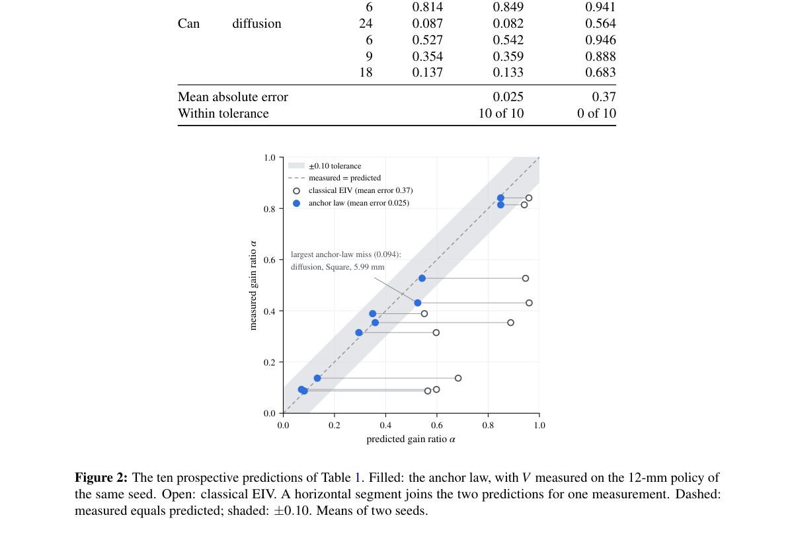

**Why this ranks #10**: 给出模仿策略对噪声读数的折价定律 α=V/(V+s²)，实测 V 一次即预测 10 组留出灵敏度，平均绝对误差 0.025、10 组全部落在容差内，而经典 errors-in-variables 误差 0.37、0 组通过；但闭环下 15 个策略的偏移响应全部超过 α，且全部结论限于仿真合成高斯噪声，因此排在 embodied_ai 中段。

---

### 11. VACO: Vertex-Aligned Decoding for Dense Hand Contact Estimation from a Single Image

**arXiv**: [2611.17755](https://arxiv.org/abs/2611.17755) | **Score**: 7.3 (relevance 7 x 0.7 + quality 8 x 0.3) | **Direction**: `embodied_ai` | **Tags**: embodied, hand-contact, dense-contact-map, mano-vertices, hand-reconstruction, vertex-aligned-decoding, Zhejiang University | **Categories**: cs.CV | **Pages**: 18

**Authors**: Binhong Ye; Jin-Chuan Shi; Tao Liu; Xin Wang; Hao Chen; Chunhua Shen

**Affiliation**: Zhejiang University; Zhejiang University of Technology

**Abstract**

> Dense hand contact estimation from a single RGB image is a foundational primitive for dexterous manipulation and 3D interaction analysis. Direct predictors typically decode the entire per-vertex contact map from one shared query, leaving individual vertices ungrounded in the image and smearing contact across adjacent, non-touching surfaces. We present VACO, a vertex-aligned decoder in which each MANO vertex samples local image features at its projected location. A hand-reconstruction backbone, jointly trained for reconstruction and contact, predicts these locations at inference without an auxiliary reconstructor. Training uses noise-perturbed ground-truth projections and end-to-end feature adaptation to improve robustness and contact-sensitive features. A single VACO checkpoint sets a new state of the art on five benchmarks spanning hand-object, hand-human, hand-scene, and bimanual interactions. It improves F1 by +20.7 pp over the strongest prior direct predictor on Hi4D and generalizes to the held-out HOT3D and HOCap, with gains of +5.5 and +2.7 pp. The resulting contact predictions also improve downstream HOI reconstruction.

**Key findings**

- **Finding**: 单个 VACO 检查点在 DexYCB、Hi4D、RICH、HOT3D、HOCap 上 F1 分别为 0.693、0.860、0.840、0.615、0.488，Hi4D 上比最强直接预测器高 20.7 个百分点。
- **Inference**: 共享 query 的直接预测器把接触抹到相邻不接触的表面，逐顶点锚定投影处的局部证据才能保住接触边界。
- **Recommendation**: 做稠密手部接触估计时优先改解码器结构，即顶点对齐采样加网格自注意力，再考虑换更大的骨干网络；消融显示后者影响小得多。

**Key figures**

*Framework - Dense hand contact paradigms. (a) Geometric proximity after reconstruction. (b) Shared- query direct prediction. (c) VACO samples image evidence at projected vertices.*

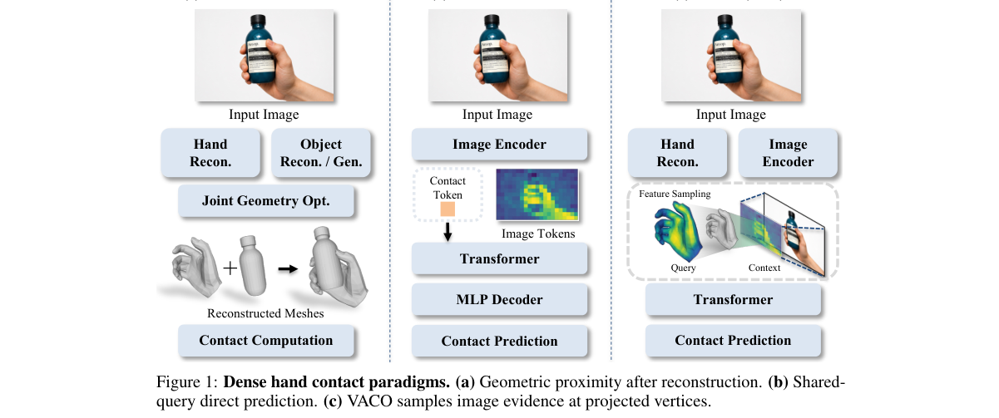

*Result - VACO pipeline. A co-trained WiLoR Potamias et al. [2025] backbone predicts MANO vertices and image features. Multi-scale sampling at vertex projections forms contact tokens; four decoder blo*

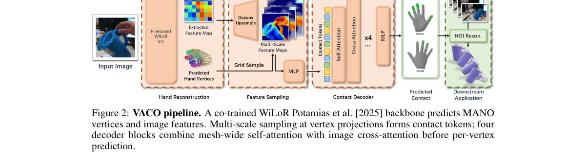

**Why this ranks #11**: 把 MANO 顶点当作独立 query、在其投影处多尺度采样图像特征再解码接触，Hi4D 上 F1 达 0.860、HOT3D 0.615、HOCap 0.488，论文报出相对最强直接预测器 +20.7、+5.5、+2.7 个百分点；去掉网格对齐采样后平均 F1 从 0.699 掉到 0.471，是 embodied_ai 里几何接地最硬的一篇。

---

### 12. Talk to Act: A Synthetic Multi-Turn Dialogue Benchmark for Human Intent Extraction and Action Planning in Robotics

**arXiv**: [2611.17549](https://arxiv.org/abs/2611.17549) | **Score**: 7.0 (relevance 7 x 0.7 + quality 7 x 0.3) | **Direction**: `embodied_ai` | **Tags**: embodied, human-robot-interaction, multi-turn-dialogue, intent-extraction, tool-calling, small-llm, Reutlingen University | **Categories**: cs.RO | **Pages**: 6

**Authors**: Deepu Krishnareddy; Mohammad Haziq Khan; Michael Danner; Matthias Rätsch

**Affiliation**: Reutlingen University; Bochum University of Applied Sciences

**Abstract**

> Multi-turn conversational human-robot interaction (HRI) continues to be a challenging problem in robotics, as many existing systems rely on rigid, command-driven interfaces that can be unintuitive for users. Recent advances in Large Language Models (LLMs) provide a promising direction, given their ability to process natural language, generate structured outputs, and support tool-based reasoning, all of which are relevant for interpreting user intent in robotic settings. However, progress in this area is constrained by the limited availability of datasets and benchmarks that capture the nuances of real-world human communication, such as multi-turn dialogue, ambiguity, and context-dependent requests. In this work, we present a synthetically generated multi-turn dialogue dataset for HRI, annotated with action intents, object references, and task plans across a range of scenarios and user personas. Our primary focus is on evaluating the capability of small, open-weight language models for robotic tasks, particularly in settings where local deployment and efficiency are important. To this end, we frame intent extraction as a tool-calling problem where each predicted action corresponds to a structured function call with arguments grounded in the dialogue and benchmark models ranging from 270M to 8B parameters on their ability to perform intent extraction and action planning without task-specific fine-tuning. Our results show that these models can achieve reasonable performance on the task even at relatively small scales and without any task-specific fine-tuning. This suggests that compact, locally deployable models already provide a useful baseline for conversational robotic systems. We expect that task-specific fine-tuning and more realistic training data will enhance performance further and make such models increasingly suitable for real-world robotic applications.

**Key findings**

- **Finding**: 评测表显示 Gemma4:E4B 目标准确率 63.6%、动作级 F1 74.2%、动作准确率 59.0%，FunctionGemma-270M 为 32.3%、53.2%、36.2%，全部未做任务微调。
- **Inference**: 为函数调用训练过的小模型在多轮机器人对话上已具可用性，模型规模的影响小于交互建模方式的选择。
- **Recommendation**: 端侧机器人助手可先用 270M 级别的函数调用模型作意图解析基线，再用任务微调与更真实的对话数据补齐「那个」「另一个」这类歧义指代。

**Key figures**

*Framework - Overview of the proposed HRI framework. A multi-turn conversation between a user and a robot is processed by context-aware intent parsing tools. Ambiguous references (e.g., “that”, “the other*

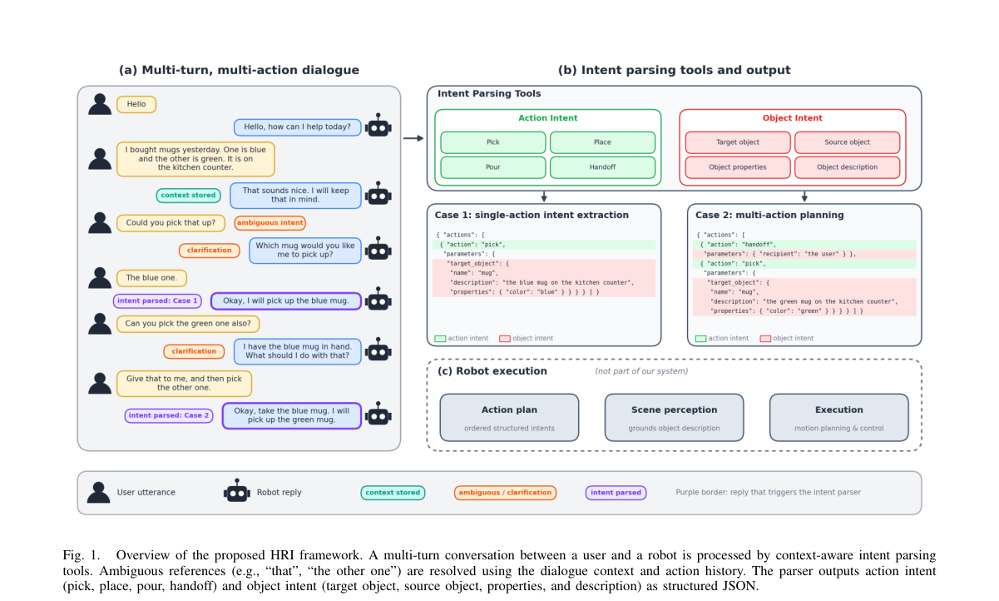

*Result - Overview of the synthetic data generation pipeline.*

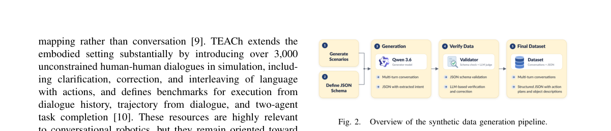

**Why this ranks #12**: 把多轮对话里的意图抽取形式化为结构化 function call，在合成数据集上评测 270M 到 8B 的开权重小模型：Gemma4:E4B 目标达成准确率 63.6%、动作级 F1 74.2%，而 270M 的 FunctionGemma 仍有 32.3% 与 53.2%；因只给数据集与基线、未接真机闭环，排在 embodied_ai 末段。

---

### 13. On the Utility of Pre-Trained Visual Representations for Policy Learning of Contact-Rich Insertion Tasks

**arXiv**: [2611.17631](https://arxiv.org/abs/2611.17631) | **Score**: 7.0 (relevance 7 x 0.7 + quality 7 x 0.3) | **Direction**: `embodied_ai` | **Tags**: embodied, insertion-task, visual-representation, contact-centric-features, diffusion-policy, sim-to-real, University of Pennsylvania (GRASP | **Categories**: cs.RO | **Pages**: 8

**Authors**: Leon Kim; Dinesh Jayaraman; Michael Posa

**Affiliation**: University of Pennsylvania (GRASP Laboratory)

**Abstract**

> Visuomotor imitation learning has become a predominant paradigm for real-world robotic manipulation, yet it remains data-inefficient and brittle to task-irrelevant visual shifts. Pre-trained visual representations promise to ease this burden by distilling priors from internet-scale data, but the ``right'' representation for robotics remains unresolved: existing studies span broad but sparse task distributions and reach conclusions that vary and even conflict, pointing to strong task and setting dependence. We examine this question by bringing a magnifying glass to a common contact-rich manipulation task: insertion. We compare representations from widely used vision foundation models against an explicit contact-centric representation on two closely related insertion tasks, perturb each along controlled axes of occlusion and physical tolerance, and test whether conclusions transfer to the real world. Task dependence proves to be more subtle than previous, broadly scoped evaluations revealed: the best representation differs even between our near-identical tasks, and small changes shift trends in unpredictable ways. Despite this variability, results across simulation and real-world experiments demonstrate the distinct value of spatially-grounded, and in particular, contact-centric information for contact-rich policy learning, while underscoring how difficult it is to estimate such cues reliably under realistic visual complexity and sensor noise. We hope these findings motivate further study of representations in contact-rich manipulation, along with advances in contact perception and its integration into visuomotor policy learning.

**Key findings**

- **Finding**: 仿真最终评估在 300 个未见环境上进行，真实书插任务在 3 本未见书上各跑 30 个回合并给出 95% 置信区间；真值接触特征在全部设定下均最优。
- **Inference**: 最好的视觉表征甚至在两个几乎相同的插入任务之间就不同，说明遮挡与物理公差这类受控变量才能定位表征取舍。
- **Recommendation**: 选接触密集任务的视觉表征时别套用通用基础模型的宽泛结论，应先自建与任务相关的接触中心特征，并单独验证其估计误差与遮挡下的可靠性。

**Key figures**

*Result - Execution of book-insertion task showcasing different visual representations evaluated in this work. We evaluate policies trained from scratch with raw RGB-D inputs (a), policies augmented wit*

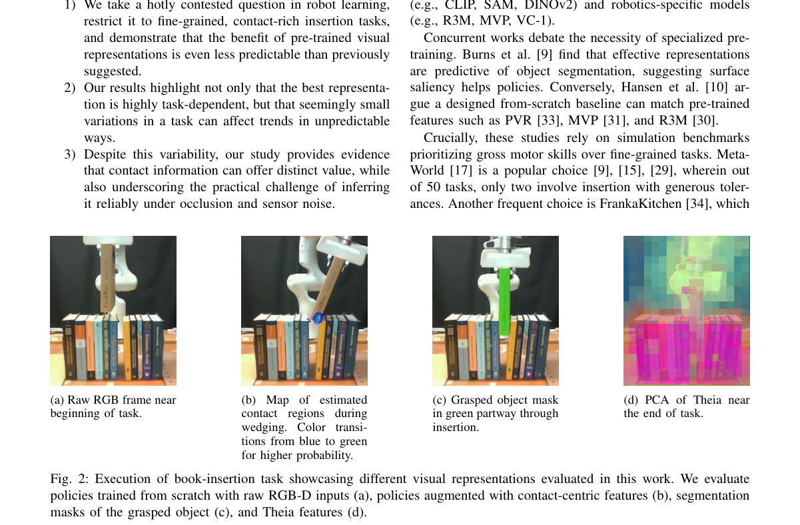

**Why this ranks #13**: 把插入任务放大镜化比较视觉基础模型特征与显式接触中心特征：真值接触信息在全部设定下最优，而 DINOv2 与 Theia 在仿真书插任务上没能超过从零训练基线、在真实书插上却有明显增益，说明结论高度依赖任务与遮挡条件，比宽泛扫任务的既有研究更细致，因此排在 embodied_ai 中后段。

---

### 14. ERA: Error-Resistant Autonomous Object Navigation with Predicted Depth

**arXiv**: [2611.17730](https://arxiv.org/abs/2611.17730) | **Score**: 7.0 (relevance 7 x 0.7 + quality 7 x 0.3) | **Direction**: `embodied_ai` | **Tags**: embodied, object-navigation, predicted-depth, training-free, exploration, zero-shot, Shanghai Jiao Tong University | **Categories**: cs.RO | **Pages**: 19

**Authors**: Shunyang Huang; Shuo Wang; Wenyuan Xie; Mingyu Lin; Yue Ding; Hongtao Lu

**Affiliation**: Shanghai Jiao Tong University; Tsinghua University

**Abstract**

> Depth and 3D foundation models can predict geometry from RGB images, allowing zero-shot object navigation without a depth sensor. However, when predicted depth is mapped as if it came from a sensor, view-dependent errors accumulate in the map, remove exploration goals, and end the search before the agent can observe and correct them. We propose ERA, a training-free object navigation system that replaces the depth sensor with depth predicted from RGB images and poses. ERA follows a paradigm we call Move with Error: movement provides new views that correct map errors, and the corrected map enables further movement. It realizes this paradigm with revisable occupancy and with exploration from reachable viewpoints, which continues the search when no frontier remains, and verifies the target across views before stopping. On three benchmarks, ERA achieves state-of-the-art performance among training-free methods without depth sensors. Its map and exploration components also raise VLFM's success from 10.8% to 61.7% under the same predicted depth. We further deploy ERA on a real robot.

**Key findings**

- **Finding**: 在 HM3D v2 上用预测深度替换传感器深度后，VLFM 成功率从 68.2% 降到 10.8%、SPL 从 34.5% 降到 7.5%，L3MVN 从 63.2% 降到 29.2%，而平均相对深度误差仅约 10%。
- **Inference**: 失败不是深度不准，而是视相关误差在地图里累积后消灭了探索前沿，使智能体在有机会观察并纠正之前就终止搜索。
- **Recommendation**: 用预测深度做无传感器导航时，务必实现可修正占据与「没有前沿就退向可达视点」的续搜策略，并在多视角交叉验证目标后再决定停止。

**Key figures**

*Framework - Effect of replacing the depth sensor with predicted depth. (a) Two views from VLFM’s initial turn, highlighting pixels whose predicted depth differs from sensor depth by more than 15%. (b–d)*

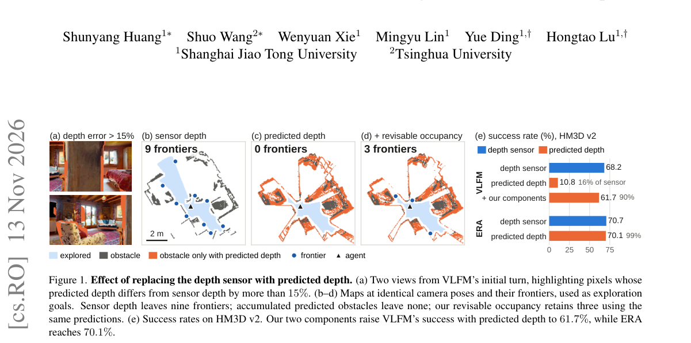

*Result - Map update rules under predicted depth, along the same 120 trajectories on HM3D v2. (a) Frames in which the map offers no reachable frontier, with sensor and with predicted depth. (b, c) Err*

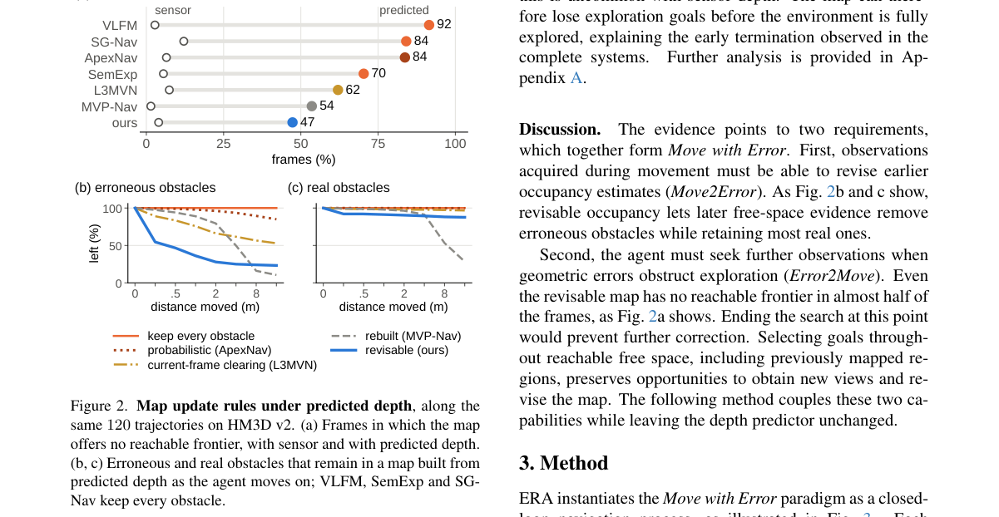

**Why this ranks #14**: 指出把预测深度当传感器深度用会让探索直接崩掉：VLFM 在 HM3D v2 上成功率从 68.2% 掉到 10.8%，尽管平均相对深度误差只有约 10%；可修正占据加可达视点探索把成功率抬到 61.7%（传感器深度的 90%），ERA 本身达 70.1%，是 training-free 无深度传感器方法里最稳的一套地图机制。

---

### 15. When Does Cross-View Consistency Matter in Multi-View Appearance Augmentation? A Controlled Study for Visuomotor Policies

**arXiv**: [2611.17751](https://arxiv.org/abs/2611.17751) | **Score**: 7.0 (relevance 7 x 0.7 + quality 7 x 0.3) | **Direction**: `embodied_ai` | **Tags**: embodied, data-augmentation, cross-view-consistency, diffusion-policy, libero, bayesian-inference, Peking University | **Categories**: cs.CV, cs.RO | **Pages**: 30

**Authors**: Zixuan Jiang

**Affiliation**: Peking University

**Abstract**

> Multi-view visual augmentation often seeks consistency across cameras, but it is unclear which forms of consistency matter for downstream control. We use simulation-state replay to manipulate cross-view coupling while preserving the per-camera perturbation distributions, physical trajectories, and action labels. Across seven LIBERO manipulation tasks, marginal-matched changes in global appearance, ghost injection, and target color have small average costs for a late-fusion Diffusion Policy: point estimates are near zero or negative, and the largest upper endpoint of the 90% posterior credible intervals is 2.55 percentage points. In contrast, geometrically anti-coupled observations reduce success by 3.30 percentage points relative to coupled observations (90% CrI [0.64, 6.28]), with displacement magnitude, direction marginals, and the number of affected views matched. Camera interventions reveal substantial dependence on wrist-view geometry, while feature analysis shows appearance sensitivity patterns associated with the factors randomized during training. ACT shows a higher target-color cost estimate than DP, with uncertainty that includes zero and sensitivity to task composition. Within the tested tasks and policy configurations, these findings motivate selective consistency constraints: appearance coupling can sometimes be relaxed, whereas task-relevant geometry and cross-view spatial correspondence warrant protection.

**Key findings**

- **Finding**: 七个 LIBERO 任务上后融合扩散策略的外观耦合对比代价点估计接近零或为负，90% 后验可信区间上端最大 2.55 个百分点，几何反耦合则降低 3.30 个百分点（CrI [0.64, 6.28]）。
- **Inference**: 跨视角约束的价值集中在任务相关的几何与空间对应上，外观一致性的边际收益远小于直觉，因此增强策略应做选择性约束。
- **Recommendation**: 构造多视角增强数据时，只对几何与跨视角空间对应设一致性约束、外观耦合可以放开，并把腕部视角几何当作首要保护对象。

**Key figures**

*Framework - Controlled visual augmentation. (a) State replay preserves physical trajectories and action labels while rendering each camera under its assigned recipe. (b) Shared and independent joint dis*

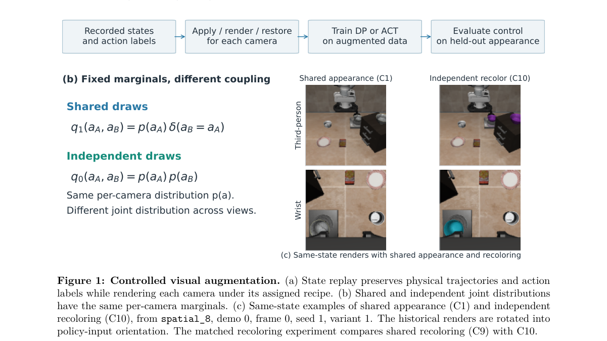

*Result - Average effects of appearance coupling and added photometric variation. Points and bars show posterior means and 90% CrI. (a) Coupling contrasts with matched per-camera perturbation distribu*

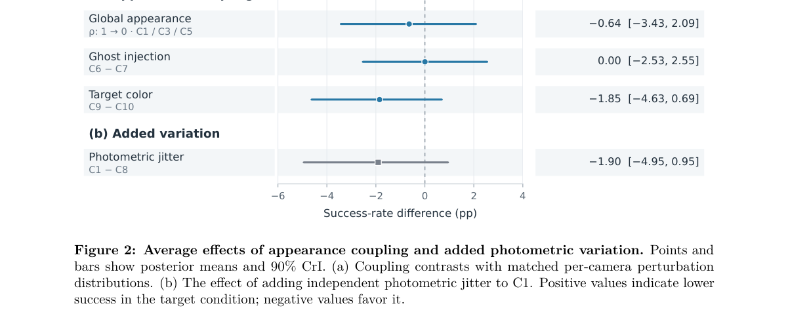

**Why this ranks #15**: 用仿真状态回放把跨视角耦合与逐视角扰动分布解耦做受控实验：7 个 LIBERO 任务上，边缘匹配的外观、鬼影、目标颜色改动对后融合扩散策略的平均代价接近零甚至为负，90% 可信区间上端最大只有 2.55 个百分点；而几何反耦合让成功率掉 3.30 个百分点（CrI [0.64, 6.28]），是 embodied_ai 里结论清晰但偏研究型的一篇。

---

## Footer

- Total papers reviewed across all 4 axes: 48
- world_embodied axis final count: 15
- Wild-cards in this axis: 0
- Figure assets: 2026-11-16/res/

Generated by `mine-arxiv-daily-digest` skill. Sister file: `2026-11-16_world_embodied_entry.md`.
