# Mine Arxiv Daily Digest - 2026-11-16 (具身智能与世界模型 Axis, 20 papers)

**Generated**: 2026-11-16 11:54 CST

**Source**: arXiv cs.CV, cs.SD, eess.AS, cs.CL, cs.AI, cs.RO, cs.LG, cs.IR submissions, listing day 2026-11-13 (announced 2026-11-16 01:00 UTC)

**Batch window**: 2026-11-12T19:00:00Z .. 2026-11-13T19:00:00Z（arXiv 公告批次横跨两个 UTC 日：从前一日的美东 14:00 截止时刻起算（EDT 为 18:00Z，EST 为 19:00Z），到当日的同一时刻为止）

**Axis**: world_embodied (20 papers, base 15, cap 20)

**Directions**: world_model (7), embodied_ai (13)

**Selection**: 20 papers ranked by relevance x quality, with 0 wild-card slots

**Day total**: 60 papers across 4 axes (target 60)

**Scope**: 世界模型、学习型模拟器与具身智能，含移动操作、人形控制、触觉反射、VLA 策略与面向具身任务的强化学习

**Wild-card**: 0 —— 本 axis 未启用任何 wild-card 名额。`world_model` 补到基准 7 篇、`embodied_ai` 有 13 篇够格候选，两个方向都不需要用邻接选题补位。

**本 axis 从 15 篇补到 20 篇，打满 `AXIS_CAP = 20`。** `world_model` 5 → 7 篇（打满基准），`embodied_ai` 10 → 13 篇，超基准 5 个。

**5 个超基准名额由 axis 富余吸收。** 本 axis 的 direction 基准和是 15、实际 20，因此 `axis_surplus = 5`，`embodied_ai` 超基准的 5 个名额全部由它承担，其中 5 篇是 rel ≥ 9 的必进论文（Heavy Metal Acrobatics、Reusing Locomotion Training Recipes、When Will You Hand It Over、PROOF、Gamer）。被挤出的 6 篇 `embodied_ai`（Imitation Policies Learn a Proprioceptive Anchor、VACO、Talk to Act、On the Utility of Pre-Trained Visual Representations、ERA、Cross-View Consistency）relevance 均为 7，低于必进线。

**`world_model` 侧新增的两篇是审计而非新模型**：Recovered or Memorized? 用记忆型 null 定地板做多重比较校正后的显著性检验，Support-Gated World Models 用双闸门换覆盖率换精度，两篇把「世界模型什么时候不可信」这个方向补了起来。

---

## 世界模型与学习型模拟器 · `world_model` (7 papers)

本方向 7 篇里 2 篇新增，几乎都在问同一个问题的不同侧面：**模型到底读懂了动力学，还是只是记住了轨迹的样子**。V-JEPA-LM 用线性探针从冻结 V-JEPA 特征读出速度可达 87%，而同样题目上 VLM 的回答处于随机水平，瓶颈在监督信号而非编码器容量，用反事实监督让 4B 模型在 11 个视频基准上的均分从 61.1 提到 72.1；LASR 用「扣除当前状态与非动作对照后还剩多少预测支持」来判断潜变量是否真的编码了动作，DiLA 的 GeoLASR 0.750 而真实记录动作的正对照为 0；新增的 Recovered or Memorized? 进一步把记忆型、逆转记忆型与未训练模型当作 null 逐约束定地板，k=10 步时 7 个约束经 Holm–Bonferroni 校正后仍有 6 个显著，k=25 步则一个都无法认证。规划期修正这一支是本 direction 的另一条线：Learning Latent Goal Costs 只在冻结 I-JEPA 嵌入上拟合一个小残差适配器，就把 DotWall 成功率从 54% 提到 98%、PointMaze 从 82% 提到 96%；WATO 把生成的动作与未来状态同时当作参考做可微轨迹优化再摊销进生成器，7 个视觉控制环境平均成功率从 79.9% 提到 91.7%，部署时相对 CEM 平均快 11.5 倍。第三支问「模拟结果什么时候能用」：新增的 Support-Gated World Models 用观测支撑加集成分歧双闸门，在 eICU-CRD 的 70 家医院、30,700 条决策转移上只放行 62.0% 的事实转移，却把 MAP 平均绝对误差从同等覆盖下随机选择的 9.2 降到 7.3 mmHg；Ego2Flow 则把真实城市道路蒸馏成 6 张可执行 CARLA 地图，用闭环交通影响而非单看自车成功率。

### 1. V-JEPA-LM: Video-Language Models That Read Dynamics Beyond Static, Text-Aligned Representations

**arXiv**: [2611.17831](https://arxiv.org/abs/2611.17831) | **Score**: 8.7 (relevance 9 x 0.7 + quality 8 x 0.3) | **Direction**: `world_model` | **Tags**: embodied, video-language-model, jepa, counterfactual-supervision, dynamic-reasoning, linear-probe, Hanyang University | **Categories**: cs.AI, cs.CV | **Pages**: 29

**Authors**: Keuntae Kim; Dongjun Kim; Yong Suk Choi

**Affiliation**: Hanyang University

**Abstract**

> World-model video encoders such as V-JEPA learn how scenes change (direction, speed, order, state) from video alone. To answer questions, they are joined to a language model trained on captions and question-answer pairs. But each caption or question names only a few attributes of a clip, so the model learns to retrieve those attributes rather than to read the clip, and the dynamics the encoder carries go unused: on the same items, a linear probe reads speed from frozen V-JEPA features at 87% while the VLM answers at chance. We show where dynamics lives in a frozen encoder: in a subspace shared across videos for predictive encoders such as V-JEPA, but not as a shared component of frame-wise, text-aligned encoders such as SigLIP. We then build counterfactual supervision that makes the language model read it: pixel transformations turn public videos into answer-balanced variants whose answers are set by the transformation and differ only in the change. Trained in a single stage on 4.53M public samples with 32 visual tokens per frame, where open video LLMs use several stages, 9M to 172M samples and 64 to 256 tokens per frame on average, the resulting V-JEPA-LM models (1B to 8B, Qwen3 and Llama) lead every size class in average score across eleven video benchmarks; our 4B model scores 72.1, against 61.1 for the best open 4B and 64.8 for the best open 8B model. A controlled encoder x supervision study shows that the encoder decides what can be read and the supervision what is read: at a matched budget, counterfactual supervision adds 4.5 points on average and 38 on the speed questions of natural benchmarks. Code and models: https://github.com/kkt94/Llama-V-JEPA-LM.

**Key findings**

- **Finding**: 线性探针从冻结 V-JEPA 特征读出速度达 87%，而同样题目上 VLM 的回答处于随机水平；经 VLM 桥接后特征也能读到 84%，但模型同样答不出。
- **Inference**: 瓶颈不在编码器能力而在监督信号，caption 与 QA 只教会检索静态属性，编码器携带的动力学信息被整体浪费。
- **Recommendation**: 用像素反事实变换构造答案由变换决定、且只在变化处不同的训练变体，再做单阶段训练，同预算下平均可加 4.5 分、自然基准速度题可加 38 分。

**Key figures**

*Framework - Top: what captions and QA teach (left), where the dynamics lives in the encoder (middle), and the supervision built from it (right). Bottom: the model, trained in one stage, and what the rec*

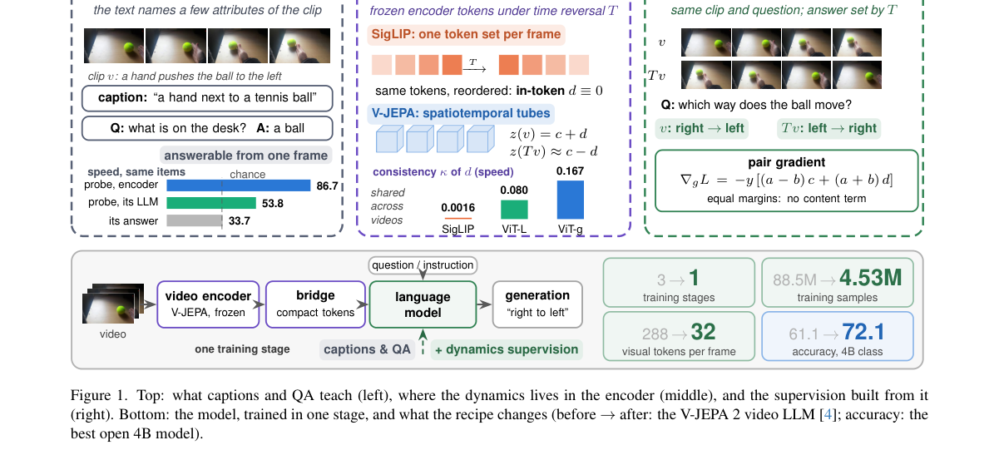

*Result - One generated pair: the same clip forward and backward, with the same question and opposite answers (4 of 32 frames). Other constructions: Fig. 6.*

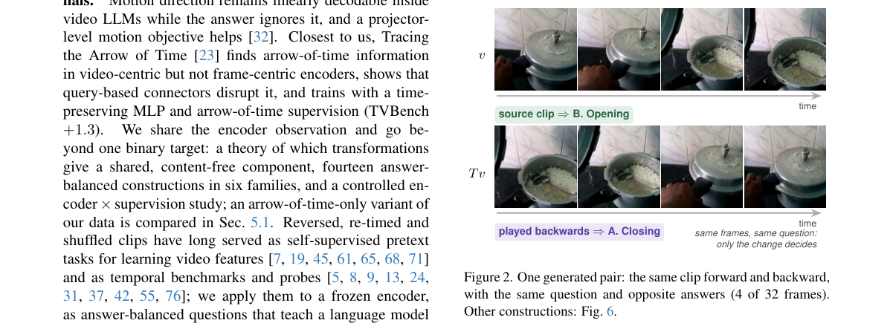

**Why this ranks #1**: 冻结 V-JEPA 特征上的线性探针读速度可达 87%，而同一批题目上 VLM 的回答处于随机水平；作者据此把动力学定位在预测式编码器的共享子空间，并用反事实监督让 4B 模型在 11 个视频基准上的均分从 61.1 提到 72.1（8B 开源模型仅 64.8），且只用单阶段 4.53M 样本、每帧 32 个视觉 token，因此在本 direction 排在首位。

---

### 2. Learning Latent Goal Costs for Visual World-Model Planning with an Expanding Curriculum

**arXiv**: [2611.17529](https://arxiv.org/abs/2611.17529) | **Score**: 8.0 (relevance 8 x 0.7 + quality 8 x 0.3) | **Direction**: `world_model` | **Tags**: embodied, latent-goal-cost, jepa, world-model-planning, residual-adapter, curriculum-expansion, Technical University of Crete | **Categories**: cs.LG, cs.RO | **Pages**: 9

**Authors**: Konstantinos Mylonas; Thrasyvoulos Spyropoulos

**Affiliation**: Technical University of Crete

**Abstract**

> Image-goal planning with a frozen visual world model depends on how predicted observations are scored against the goal. Mean-squared error (MSE) between embeddings from a pretrained visual encoder can provide a useful signal near a goal, yet favor states across an obstacle that are visually similar to the goal and difficult to reach. We fit a small residual adapter on top of frozen I-JEPA embeddings to improve this latent goal cost. Starting near each goal, a planner collects trajectories from progressively wider regions of initial states. The adapter learns from the order of observations along successful trajectories, with additional comparisons inferred from failed rollouts. No task-specific progress labels are used for fitting, so the procedure can be applied to other goal-reaching tasks. DotWall and PointMaze are used in this work. In paired 50-case evaluations with identical starts, goals, world models, and planner settings, success increases from 54% to 98% in DotWall and from 82% to 96% in PointMaze. On 16 unseen DotWall layout-goal cases, the adapter fitted on one fixed layout improves agreement between latent-cost ordering and shortest legal-path ordering from 71.9% to 85.8%. The results indicate that planning experience can improve a frozen visual representation's goal cost without retraining the encoder or the world model.

**Key findings**

- **Finding**: 冻结 I-JEPA 嵌入上拟合的小残差适配器把 DotWall 成功率从 54% 提到 98%、PointMaze 从 82% 提到 96%，且不重训编码器与世界模型、不用任何任务特定的进度标签。
- **Inference**: 规划经验本身可以纠正 MSE 潜代价偏爱「隔着墙看起来像目标」的状态这一偏差，说明瓶颈是目标代价的刻画而非表征容量。
- **Recommendation**: 若已有冻结的视觉世界模型，优先按逐步扩大的初始状态课程采集成功轨迹顺序来训一个潜代价适配器，再交给图搜索式规划器使用。

**Key figures**

*Framework - The ball can appear close to the goal across the wall, even though it has to travel through the doorway to reach the other room. A planner using raw latent cost may therefore favor a state tha*

**Why this ranks #2**: 在冻结 I-JEPA 嵌入上只拟合一个小残差适配器，DotWall 成功率从 27/50（54%）升到 49/50（98%），PointMaze 从 41/50（82%）升到 48/50（96%）；在 16 个未见布局上潜代价与最短合法路径的排序一致性从 71.9% 提到 85.8%，全程不重训编码器与世界模型，是本 direction 里成本最低的规划期修正方案。

---

### 3. Joint World Action Models through Differentiable Trajectory Optimization

**arXiv**: [2611.17626](https://arxiv.org/abs/2611.17626) | **Score**: 8.0 (relevance 8 x 0.7 + quality 8 x 0.3) | **Direction**: `world_model` | **Tags**: embodied, world-action-model, differentiable-optimization, model-based-control, amortized-planning, multi-task-control, Hybrid Robotics | **Categories**: cs.LG | **Pages**: 29

**Authors**: Mintae Kim; Koushil Sreenath

**Affiliation**: Hybrid Robotics, BAIR, UC Berkeley

**Abstract**

> Joint world action models (WAMs) generate future actions and states together, modeling world-action trajectories rather than actions alone. However, trajectory imitation does not ensure that these trajectories are task-effective or consistent with dynamics. We present \textbf{world action trajectory optimization (WATO)}, which optimizes generated actions and future states jointly for control. WATO uses both as references in a dynamics-constrained trajectory optimization problem and differentiates the task loss through the optimized trajectory to train the generator. This makes generated trajectories task-aware and dynamics-consistent while using trajectory optimization only during training. At deployment, WATO directly generates candidate trajectories and ranks them with a world model, without iterative trajectory optimization. Across $7$ visual control environments, WATO improves average success from $79.9\%$ for the imitation joint WAM to $91.7\%$, outperforming strong model-based, goal-conditioned RL, and generative control baselines. Compared with cross-entropy method (CEM), WATO is on average $11.5\times$ faster and uses $600.5\times$ fewer world model evaluations at deployment.

**Key findings**

- **Finding**: WATO 在 7 个视觉控制环境上把平均成功率从联合 WAM 的 79.9% 提到 91.7%，7 个环境中有 6 个取得最优或并列最优。
- **Inference**: 只做轨迹模仿浪费了生成状态的价值，把任务损失经优化后的轨迹反传回生成器，才能让「世界-动作」联合建模真正服务于控制。
- **Recommendation**: 训练侧加一次动力学约束轨迹优化并对任务损失反传，部署侧只保留「生成候选轨迹加世界模型排序加滚动重规划」，省掉在线 CEM 的昂贵迭代。

**Key figures**

*Framework - WATO overview. Joint world-action trajectories are optimized during training and amortized into the generator, enabling deployment with generation and world model evaluation only.*

*Result - separates single-step candidate quality from full closed-loop behavior. A good local pro- posal does not necessarily yield reliable control over repeated planning.*

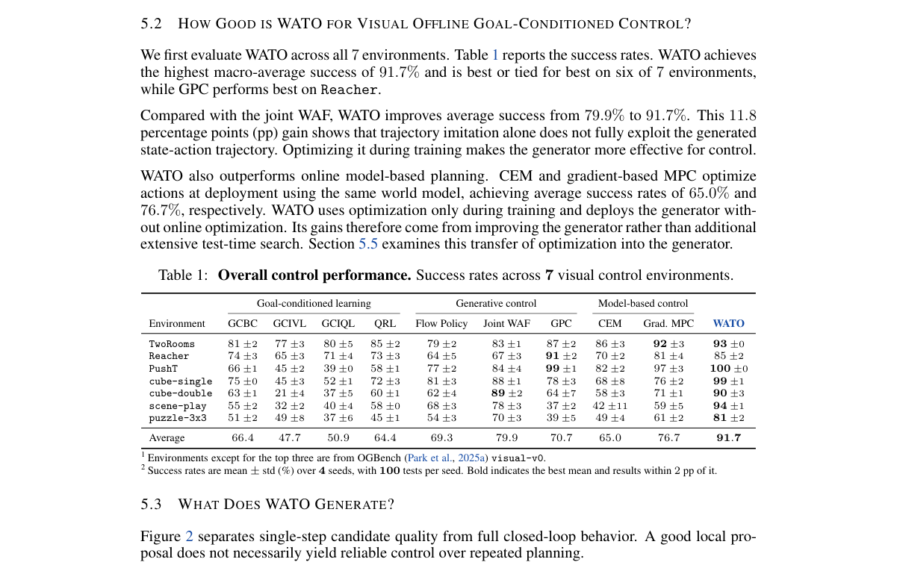

**Why this ranks #3**: 在 7 个视觉控制环境上，把生成的动作与未来状态同时当作参考做动力学约束的可微轨迹优化再摊销进生成器，平均成功率从模仿式联合 WAM 的 79.9% 提到 91.7%（+11.8 个百分点，7 个环境中 6 个最优或并列最优），部署时相对 CEM 平均快 11.5 倍、世界模型评估少 600.5 倍，是本 direction 里推理成本压得最低的一篇。

---

### 4. Beyond Prediction Gain: LASR as a Metric for Action-Grounded Latents in World Models

**arXiv**: [2611.17775](https://arxiv.org/abs/2611.17775) | **Score**: 8.0 (relevance 8 x 0.7 + quality 8 x 0.3) | **Direction**: `world_model` | **Tags**: embodied, latent-action, evaluation-metric, world-model-audit, shortcut-detection, offline-protocol, Tsinghua University | **Categories**: cs.LG, cs.RO | **Pages**: 20

**Authors**: Yu Zhou; Changsong Lei; Yixiang Wei; Kairui Wen; Huankun Sheng; Ming Li; Yeying Fan; Yu-Hui Wen; Yong-Jin Liu

**Affiliation**: Tsinghua University; Beijing Jiaotong University

**Abstract**

> World models that support planning, control, and interpretable reasoning require latent representations that genuinely encode action. Yet the large-scale video data from which such models are learned overwhelmingly lack action annotations. Latent-action models infer action-like variables from observation sequences, enabling action-aware learning from unlabeled videos or trajectories. A fundamental concern, however, remains: a latent that improves future prediction may simply encode the current state, episode progress, task identity, or other predictive shortcuts. Existing evaluation practices---reconstruction loss, rollout fidelity, action recovery, or downstream performance---cannot isolate this distinction. We introduce the Latent Action Support Ratio (LASR), a dimensionless metric that measures, under offline evaluation on held-out data, whether a learned latent provides predictive support for action-related targets beyond the current state and non-action alternatives. LASR provides two complementary summaries: GeoLASR captures typical support, while WorstLASR identifies the weakest case. We instantiate the LASR benchmark with recorded actions and corresponding physical state changes as targets, episode-held-out splits, one predictor type for all comparisons, and positive and negative controls. Experiments on recorded robot manipulation data and a matched multi-task panel demonstrate that LASR detects known action information, rejects representative non-action shortcuts, and enables graded comparisons among imperfect latent representations. We further use LASR to train and audit a lightweight residual adapter, obtaining descriptively better point estimates whose uncertainty is assessed with paired comparisons. LASR thus provides a principled offline protocol for measuring action-related predictive support in world-model latents.

**Key findings**

- **Finding**: ALOHA 面板上 DiLA 的 GeoLASR/WorstLASR 为 0.750/0.796、LaWAM 为 0.891/0.947，而真实记录动作的正对照为 0/0.174，指标越低表示动作支持越强。
- **Inference**: 重建损失、rollout 保真度、动作恢复和下游成绩都无法区分「潜变量编码了动作」与「潜变量只编码当前状态、回合进度或任务身份」，必须引入正负对照。
- **Recommendation**: 评测世界模型潜变量时，除重建与 rollout 保真度外加入以当前状态和非动作为对照的 LASR，并同时看 GeoLASR 与 WorstLASR 两个摘要，避免把预测增益误当成动作落地能力。

**Key figures**

*Framework - Two shortcuts in offline latent-action evaluation. (a) A trajectory from the ALOHA static-battery release illustrates how the current state and task phase constrain the next motion [51]. (b)*

*Result - Overview of LASR. (A) A logged transition aligns the current state St, recorded action At, and next state St+1. (B) For each target–fold pair, separately fitted state, latent, and validation*

**Why this ranks #4**: 提出无量纲指标 LASR，用「扣除当前状态与非动作对照后还剩多少预测支持」来判断潜变量是否真的编码了动作；在 49 条 ALOHA 演示的 2,048 个对齐转移上，DiLA 的 GeoLASR 0.750、WorstLASR 0.796，真实记录动作的正对照为 0 与 0.174。它提供的是世界模型潜变量的离线审计协议而非新模型，因此在本 direction 处于中段。

---

### 5. Ego2Flow: Benchmarking the Traffic-System Impact of Autonomous Driving on Maps Distilled from Real-World Roads

**arXiv**: [2611.17720](https://arxiv.org/abs/2611.17720) | **Score**: 7.3 (relevance 7 x 0.7 + quality 8 x 0.3) | **Direction**: `world_model` | **Tags**: embodied, autonomous-driving, map-distillation, closed-loop-simulation, traffic-system, benchmark, University of Wisconsin–Madison | **Categories**: cs.CV, cs.RO | **Pages**: 10

**Authors**: Yu Dong; Weiying Shen; Hangyu Li; Shu Han; Hong Li; Xiangbo Gao; Keshu Wu; Zhengzhong Tu; Soyoung Ahn; Zhiyuan Liu; Xiaopeng Li

**Affiliation**: University of Wisconsin–Madison; Southeast University; Texas A&M University–College Station

**Abstract**

> End-to-end autonomous driving is predominantly evaluated through ego-vehicle safety and task completion. Its deployment in urban traffic, however, creates sustained interactions among vehicles whose collective effects remain insufficiently evaluated. We introduce Ego2Flow, a closed-loop benchmark for assessing the traffic-system impact of autonomous driving on maps distilled from real-world cities. To construct realistic 3D urban environments for sustained closed-loop traffic simulation, we develop an agent-guided map distillation framework that integrates real-world maps and observations with complementary geographic information. Through an iterative feedback mechanism and a traffic information graph that jointly guide scene generation, the framework preserves lane topology, critical road geometry and decision-relevant visual conditions while simplifying nonessential details and completing unobserved regions. Using our proposed framework, we generate and publicly release six CARLA maps from the Argoverse 2 dataset, covering the corresponding real-world regions and enabling paired comparisons of driving behavior under real and simulated observations. On these maps, Ego2Flow evaluates how autonomous driving policies affect traffic efficiency, safety, stability and energy consumption across diverse road structures. Compared with existing construction methods, our framework achieves the lowest average displacement error between planning outputs from paired real and simulated observations. We further benchmark representative driving policies to characterize their system-level impact on urban traffic. Project Page: https://github.com/Fisher-007/Ego2Flow.

**Key findings**

- **Finding**: 框架公开 6 张与 AV2 区域空间对齐的 CARLA 地图，六城等权平均 ADE 0.7966 m、FDE 2.1357 m，而次优方法 MDrive 为 0.9055 m 与 2.4630 m。
- **Inference**: 交通信息图与静态、动态评审的迭代反馈保住了车道拓扑与关键道路几何，说明地图可信度取决于建图约束而不是渲染逼真度。
- **Recommendation**: 评估自动驾驶策略时，除了自车成功率，还应在其蒸馏地图上测车流效率、安全、稳定性与能耗，以暴露车队中的速度扰动放大效应。

**Key figures**

*Result - Agent-guided map distillation. Aligned AV2 observations and geographic data provide the geometry and evidence for con- struction. The traffic information graph links road elements, evidence,*

**Why this ranks #5**: 用交通信息图加静态与动态评审的迭代反馈，把 Argoverse 2 观测蒸馏成 6 张可执行 CARLA 地图，覆盖奥斯汀、底特律、迈阿密、帕洛阿尔托、匹兹堡、华盛顿特区六城，六城等权平均 ADE 0.7966 m、FDE 2.1357 m，论文称比次优构造方法低 9.3%；它的贡献在评测维度而非新模型，因此在本 direction 排在末位。

---

### 6. Recovered or Memorized? Investigating Dynamical Consistency and Faithfulness in World Model Latents

**arXiv**: [2611.18807](https://arxiv.org/abs/2611.18807) | **Score**: 6.7 (relevance 7 x 0.7 + quality 6 x 0.3) | **Direction**: `world_model` | **Tags**: embodied, world-model-audit, dynamical-consistency, frechet-distance, causal-intervention, td-mpc2, Southern Alberta Institute of Technology | **Categories**: cs.LG | **Pages**: 11

**Authors**: Jerome Francisco; Kyle Deng; George Flint; Kevin Zhu

**Affiliation**: Southern Alberta Institute of Technology; Carleton University; University of California, Berkeley

**Abstract**

> World models develop internal simulators that can learn the structure and dynamics of an environment. It has been demonstrated that their internal representations are both meaningful and causal, but are these representations faithful to the governing dynamics of the environment they are learning? We introduce Anchored Recovery Certification (ARC), a procedure that utilizes a discrete Fréchet distance calculation with ground truth to evaluate dynamical consistency on candidate world models up to an affine gauge. We use the procedure on TD-MPC2 (decoder-free world model) that has learned the pendulum swing on an observation lift under varying hyperparameters at k = 5, 10, 25 steps. The model is then steered within a PCA-derived intervention subspace and compared against a ground-truth simulator using relative error to investigate dynamical faithfulness. ARC sufficiency held for TD-MPC2 most consistently at k = 10, with six of seven constraints statistically significant after Holm-Bonferroni correction, while the relative error between the simulator and the causal latent remained substantial. Further research could be conducted with decoder world models such as DreamerV3 (reconstruction loss) to investigate whether the results differ.

**Key findings**

- **Finding**: TD-MPC2 在 k=10 步时全部 7 个约束的平均 FSS 都高过所选 null 地板，Holm–Bonferroni 校正后 6 个显著（Baseline 0.577±0.041 对地板 0.277±0.034）；k=5 仅 2/7 显著，k=25 为 0/7。
- **Inference**: k=25 时三个估计型 null 都低于 Persistence 的 0，那个地板是构造出来的常数而非实测值，因此在这个视野上任何「达标」都不可信，结论会被预测视野长度绑架。
- **Recommendation**: 审计世界模型是否只是记忆轨迹时，应照 ARC 的做法把记忆型、逆转记忆型与未训练模型作为 null 逐约束定地板，并在多个 k 上重复做多重比较校正后的显著性检验。

**Why this ranks #6**: 它给出了判定世界模型是学到动力学还是只是背轨迹的量化程序：在 DMControl 钟摆环境上训练 TD-MPC2（外加 3→64→32 的冻结随机观测提升层），k=10 步时 7 个约束的平均 FSS 全部高于所选 null 的地板，经 Holm–Bonferroni 校正（7×3=21 次检验）后仍有 6 个显著，Baseline 为 0.577±0.041 对地板 0.277±0.034，而 k=25 时 7 个约束一个都无法认证。

---

### 7. When to Trust Simulated Patient Responses:Support-Gated World Models for Vasopressor Decision Support

**arXiv**: [2611.18458](https://arxiv.org/abs/2611.18458) | **Score**: 6.3 (relevance 6 x 0.7 + quality 7 x 0.3) | **Direction**: `world_model` | **Tags**: embodied, clinical-world-model, selective-prediction, abstention, eicu-crd, ensemble-disagreement, Sun Yat-sen University | **Categories**: cs.AI | **Pages**: 12

**Authors**: Yifan Jin; Tao Liu

**Affiliation**: Sun Yat-sen University

**Abstract**

> Clinical world models expose language-model agents to predicted patient responses, but simulations can be unreliable for poorly supported treatments or unfamiliar hospitals. We introduce Support-Gated World-Model decision support, a lightweight extension of a propose--simulate--refine agent. A recurrent dynamics ensemble predicts short-horizon physiological responses to documented norepinephrine dose categories, while a behavior model estimates observational action support. The interface withholds predictions with insufficient support or excessive ensemble disagreement and abstains when no candidate qualifies. Evaluation on eICU-CRD includes 70 hospitals and 30,700 decision transitions, with 14 hospitals held out for testing. At 62.0% factual-transition coverage, joint gating yields a MAP mean absolute error of 7.3 mmHg, compared with 9.2 mmHg for random selection at the same coverage. The gated agent achieves 60.0% agreement with recorded actions at 81.0% decision coverage, compared with 55.0% agreement and 99.5% coverage for an ungated ensemble agent. Component ablations show lower factual risk with joint gating than with either gate alone.These results characterize a reliability--coverage trade-off in selective clinical simulation; they do not identify individualized treatment effects or establish improved patient outcomes.

**Key findings**

- **Finding**: 在 eICU-CRD 的 70 家医院、30,700 条决策转移上，联合门控保留 62.0% 的事实转移，MAP 平均绝对误差 7.3 mmHg，低于同等覆盖下随机选择的 9.2 mmHg（相对下降 20.7%），心率误差 9.6 bpm 对 11.6 bpm。
- **Inference**: 可靠性与覆盖率是显式可交易的：门控把决策覆盖率压到 81.0%，换来一致率从 55.0% 升到 60.0%、无支撑动作选择率从 12.0% 归零，说明少答但答准比全答但常错更适合面向 LLM 的模拟接口。
- **Recommendation**: 把世界模型接进决策 agent 时应照此设双闸门（观测支撑 + 集成分歧）加显式弃权，并如实报告名义 90% 预测区间的实测覆盖只有 87.8%，避免读者误读精度。

**Key figures**

*Framework - Support-gated simulation interface. Candidate predictions are released only when they satisfy both observational-support and model-disagreement constraints.*

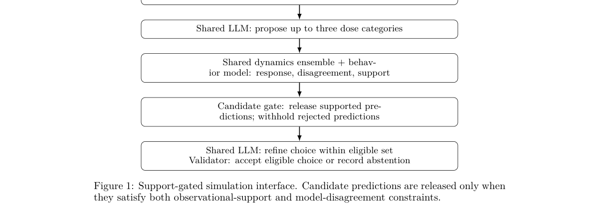

**Why this ranks #7**: 它把「模拟出来的病人反应什么时候能用」做成了可核对的接口实验：在 eICU-CRD 的 70 家医院、30,700 条决策转移上，联合门控只放行 62.0% 的事实转移，却把 MAP 平均绝对误差从同等覆盖下随机选择的 9.2 mmHg 降到 7.3 mmHg（相对下降 20.7%），心率误差从 11.6 降到 9.6 bpm，代理一致率 60.0% 对 55.0%，覆盖率则从 99.5% 降到 81.0%。

---

## 具身智能与机器人学习 · `embodied_ai` (13 papers)

本方向 13 篇是当天最大的方向，其中 9 篇为补跑新增，且新增集中在**真机与部署**上。Heavy Metal Acrobatics 是本方向最高分（9.0）：它把 sim-to-real 推到 5 吨级滑移装载机，实测 28° 与 31° 机械臂角分别 11/11 与 12/12 成功，抬到 34° 时降到 11/14（78.6%），3 次失败全是铲斗触地，说明残余差距来自未被随机化的惯量参数；Reusing Locomotion Training Recipes Across Humanoids 指出跨机型复用的瓶颈在坐标接口而非网络——同一套未改动的配方在三种人形上训练，身体对齐虚拟关节把 Adam 的速度误差从 0.106 降到 0.085 m/s、脚步朝向角从 4.8° 降到 0.5°，G1 真机上偏航漂移从 5.31±1.90 降到 0.89±0.54 度每秒；PROOF 则把「视觉失效时退回本体感知」做成可验证机制，去掉教师掩码的基线在五类地形上通过率全部为 0%，PROOF 则是 100%、99%、100%、95%、100%。协作侧 When Will You Hand It Over? 用配对干预定位自博弈交接的典型失效：陌生伙伴下成功率从 95.0% 与 89.5% 掉到 30.5%，只把伙伴起手延迟 1 秒就跌到 6.0% 与 33.5%，加入隐藏起始延迟随机化后再训 300 步即升到 80.5% 与 80.0%（同等预算续训对照组只有 35.0% 与 41.0%）。安全与可验证接口是新增里最完整的一条线：3D Risk Fields 把「该任务本身不可做」与「该避开哪些空间关系」分开判断（带安全工具的 VLM 可预防危险成功率 90.9%、违规率 4.4%，纯几何避障安全成功率 0、违规率 15.2%）；Constraint Space 用双塔模型按任务-场景条件选约束，F1 0.3881 全面超过同预算的 BGE-M3 检索（0.2519）；Objectives as Policies 把任务写成由固定代价库组合的可编辑目标程序，四个桌面操作任务拿到 36/40（90%）对 CoRAL 的 31/40。已发布部分里 Agentic-Teacher（LIBERO-10 上 π0 从 79.4% 提到 87.8%）与 X-Nav （MELIOR-N 在 R2R-CE 上成功率 70.5%，真机跑完 96.6 米跨楼任务）仍居第一梯队。

### 8. Heavy Metal Acrobatics: Learning Dynamic Control for Skid-Steer Loaders

**arXiv**: [2611.18365](https://arxiv.org/abs/2611.18365) | **Score**: 9.0 (relevance 9 x 0.7 + quality 9 x 0.3) | **Direction**: `embodied_ai` | **Tags**: embodied, heavy-machinery, skid-steer-loader, dynamic-balance, hydraulic-actuation, sim-to-real, Robotic Systems Lab (RSL) | **Categories**: cs.RO | **Pages**: 21

**Authors**: Pierre-Jean Lorentz; Pascal Egli; Edo Jelavic; Cliff Li; Ramitha Sundar; Harikrishnan Suresh; Paul Montgomery; Lee Redden; Matthias Müller; Ozan Sener; Vladlen Koltun; Marco Hutter

**Affiliation**: Robotic Systems Lab (RSL), ETH Zürich; Blue River Technology; Gravis Robotics AG; Intelligent Systems Lab, Intel

**Abstract**

> Automation of heavy machinery offers the opportunity to improve productivity in mechanized industries such as construction, mining, and material handling. Yet, automation of such machines is challenged by their complex dynamics, in part because of hydraulic actuation that involves fluids, flexible elements, and nonlinear delays. A concomitant challenge is the size and weight of these machines, which can make experiments on the physical systems exceedingly dangerous. Here, we show that \ac{RL} in simulation, followed by transfer of the learned policies from simulation to reality, can successfully automate acrobatic maneuvers that push a heavy construction machine to the limits of its actuation and have only previously been accomplished by a small number of elite human operators in official world-record performances. We trained policies that perform autonomous acrobatic maneuvers on a John Deere 332G, an operational 5-tonne skid-steer loader. The policies can autonomously swing the machine up onto two wheels and, while balancing on two wheels, drive over rough terrain, trace out specified trajectories, spin around, and swing the bucket back and forth before landing it safely back onto four wheels. This work demonstrates that \ac{RL} and sim-to-real transfer enable dynamic autonomous control of heavy machinery, directly contributing to greater automation in heavy equipment sectors. Videos: https://sites.google.com/leggedrobotics.com/heavy-metal-acrobatics This is the author's version of the work. It is posted here by permission of the AAAS for personal use, not for redistribution. The definitive version was published in Science Robotics on 11 November 2026, DOI: https://doi.org/10.1126/scirobotics.aef0894

**Key findings**

- **Finding**: 5 吨 John Deere 332G 的真实摆起测试里，机械臂 28° 与 31° 时分别 11/11、12/12 全部成功，抬到 34° 时降为 11/14（78.6%），3 次失败均为铲斗触地；训练时臂角只在 29°–31° 之间随机化。
- **Inference**: 失败集中落在训练分布之外的高臂角，因为臂抬高后系统惯量变大、摆起后更难减速，说明残余 sim-to-real 差距主要来自未被随机化的惯量参数而非策略本身。
- **Recommendation**: 复现重型液压机器的 sim-to-real 时，应把臂位这类改变惯量的构型参数一并纳入训练随机化，并用「训练分布内/外」分组成功率而不是单一成功率来评估策略。

**Key figures**

*Framework - Acrobatic maneuvers trained with RL in simulation and deployed on a 5-tonne SSL. (A) Swing-up from four onto two wheels. (B) Driving over rough terrain on two wheels. (C) Stable balancing wh*

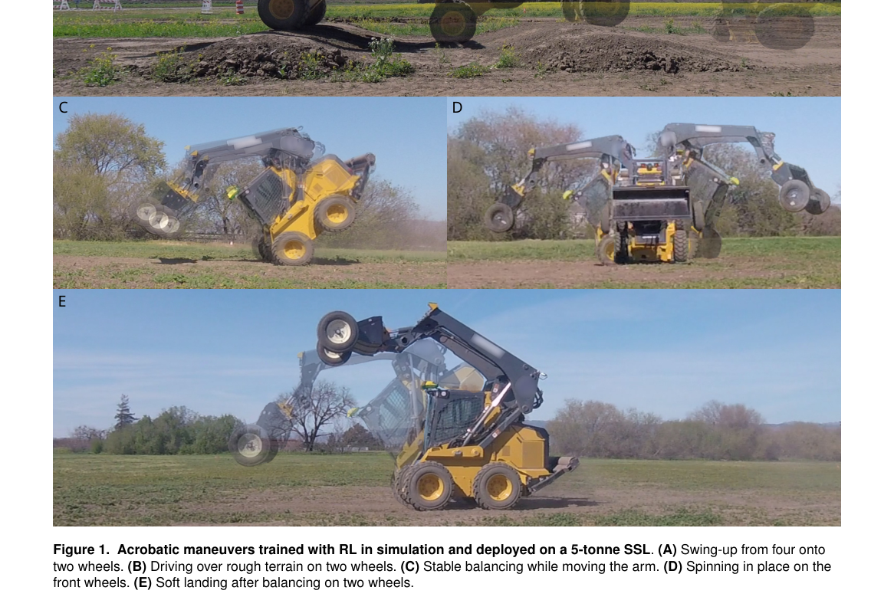

**Why this ranks #8**: 它是少见地把 sim-to-real 推到吨级液压机械上的工作：在真实的 5 吨 John Deere 332G 滑移装载机上做两轮起立、轮上越野与原地旋转，机械臂可行角区间是 [28°, 34°]，训练时只在 29°–31° 之间随机化，实测 28° 与 31° 时分别 11/11 与 12/12 成功，抬到 34° 时降到 11/14（78.6%），3 次失败全是铲斗触地。

---

### 9. Agentic-Teacher: An Agentic Data Engine for Failure-Driven VLA Post-Training

**arXiv**: [2611.17394](https://arxiv.org/abs/2611.17394) | **Score**: 8.7 (relevance 9 x 0.7 + quality 8 x 0.3) | **Direction**: `embodied_ai` | **Tags**: embodied, vla-post-training, code-agent, failure-driven-data, flow-matching, libero, Tsinghua University | **Categories**: cs.RO | **Pages**: 15

**Authors**: Gongyue Teng; Yuqing Xie; Yixian Zhang; Feng Gao; Shu'ang Yu; Jiaji Rao; Sukai Wang; Guanghui Ren; Ya Zhang; Maoqing Yao; Yu Wang; Chao Yu

**Affiliation**: Tsinghua University; Striding AI; AGIBot

**Abstract**

> Improving a pretrained vision-language-action (VLA) model requires demonstrations that address its weaknesses and provide effective supervision for learning. Coding agents can autonomously generate demonstrations through environment interaction, yet successful execution alone does not ensure effective supervision for VLA learning. We introduce Agentic-Teacher, an autonomous data engine for failure-driven VLA post-training. Given a VLA checkpoint, a task specification, and configured environment tools, the engine analyzes failed rollouts, selects intervention states, and iteratively develops closed-loop code policies through execution feedback. Validated policies become reusable demonstration generators that collect successful continuations from states where the VLA struggles. To make these demonstrations suitable for learning, Agentic-Teacher introduces temporally correlated action noise to broaden state-action coverage, removes idle frames while preserving gripper transitions, and filters trajectories using the frozen base model's flow-matching loss. The resulting demonstrations are combined with successful VLA rollouts for post-training, yielding an updated policy that operates without coding-agent assistance. Agentic-Teacher thus connects the weaknesses of a target VLA to both the generation and curation of its training data. In simulation, it improves $π_0$ success rates from 79.4% to 87.8% on LIBERO-10, from 80.4% to 90.6% on MetaWorld-10, and from 0% to 30.0% across three RoboCasa tasks.

**Key findings**

- **Finding**: Agentic-Teacher 让 π0 在 LIBERO-10 上从 79.4% 提到 87.8%、MetaWorld-10 从 80.4% 提到 90.6%、三个 RoboCasa 任务从 0% 提到 30.0%，每任务 50 次评测。
- **Inference**: 成功不等于有效监督，只有从 VLA 真正失败的状态出发、由代码策略补齐后续动作的示范，才带有可学习的纠错信息。
- **Recommendation**: 做 VLA 后训练时先做失败驱动的状态筛选，再加时序相关动作噪声扩覆盖、剔除空闲帧保留夹爪切换，并用冻结基座的 flow-matching loss 过滤轨迹质量。

**Key figures**

*Framework - Agentic-Teacher pipeline. Given a VLA checkpoint, simulation environment, and task interface, a coding agent uses the harness to evaluate the VLA under varied initial conditions and diagnose*

*Result - A VLA grasp failure and the corresponding code-policy repair. (a) The VLA approaches off target, misses the grasp, and fails to lift the bowl. (b) The repair program realigns the gripper, gr*

**Why this ranks #9**: 让编码智能体读失败回放、定位干预状态并迭代写出闭环代码策略，把修好的轨迹变成可复用示范；在 LIBERO-10 上把 π0 从 79.4% 提到 87.8%、MetaWorld-10 从 80.4% 提到 90.6%，三个 RoboCasa 任务从 0% 提到 30.0%，而拒绝采样微调基线只能到 81.4% 与 85.2%，因此在 embodied_ai 排在第一。

---

### 10. X-Nav Technical Report: Real-World Long-Horizon Indoor-to-Outdoor Navigation on a Humanoid Robot

**arXiv**: [2611.17598](https://arxiv.org/abs/2611.17598) | **Score**: 8.7 (relevance 9 x 0.7 + quality 8 x 0.3) | **Direction**: `embodied_ai` | **Tags**: embodied, humanoid-navigation, vision-language-navigation, digital-twin, sim-to-real, vision-language-action, AgiBot X-Lab (Boson Lab) | **Categories**: cs.AI, cs.CV, cs.RO | **Pages**: 24

**Authors**: Jiaxin Huang; Chengxing Lin; Xiaoyu Luo; Sirui Chen; Jingyu Guo; Aolin Li; Kairui Chen; Rui Zhen; Cheng Wen; Kerui Gu; Shunyao Wang; Zhihui Peng

**Affiliation**: AgiBot X-Lab (Boson Lab); MBZUAI; UESTC; University of Macau; Nanyang Technological University; The University of Melbourne; Wuhan University

**Abstract**

> Long-horizon navigation from indoors to outdoors remains an open problem for humanoid robots: one instruction covers rooms, doors and roads, and the camera moves with the gait. Worken, AGIBOT's measure of productive robot work, depends on robots that reach their workplaces autonomously. We present X-Nav, to our knowledge the first system to take a bipedal humanoid through a language-instructed long-horizon mission from indoors to outdoors. X-Nav covers a pipeline from data to deployment. Its data engine collects navigation data in open-source scenes, in digital twins of deployment sites and on real robots. Its navigation model, MELIOR, takes only RGB images from the robot's built-in camera and comes in two versions: MELIOR-A predicts actions, and MELIOR-N predicts a navigation goal. Its agentic workflow, X-Navarch, turns a brief human instruction into sub-tasks and deploys MELIOR on the robot with explicit target navigation and obstacle avoidance. On the Lingxi X2, X-Nav completes a mission of about a hundred metres from an office lobby to a store in a neighbouring building; LiDAR and odometry are used for target approach and low-level control. The mission is completed with both versions of MELIOR: the robot follows a change of destination and walks through a door from the lobby to the road, and with X-Navarch it also passes static and dynamic obstacles on the route. During deployment, MELIOR is adapted with data collected in a digital twin of the site; the adaptation raises its closed-loop success rate in the twin, and the adapted model is then deployed on the robot at the real site. In addition, MELIOR achieves competitive results on the R2R-CE and RxR-CE benchmarks.

**Key findings**

- **Finding**: X-Nav 用 MELIOR-A 在灵犀 X2 上跑完 96.6 米跨楼任务，MELIOR-N 在 R2R-CE 上成功率 70.5%，数字孪生中 3 米内停止率从 34% 提到 78%。
- **Inference**: 导航模型只吃机器人自带相机、把目标接近与静态动态避障交给显式技能 MELIOR-X，是长程任务能在真实场景落地的关键分工。
- **Recommendation**: 做真实人形导航时，优先打通开源场景、数字孪生与真机采集三条数据通路，先在孪生场地闭环验证适配收益，再把适配后的模型部署到真机。

**Key figures**

*Framework - X-Nav overview. Top: one mission on the Lingxi X2, about a hundred metres long, from an office lobby to a store in a neighbouring building, with the instruction that the robot receives; the*

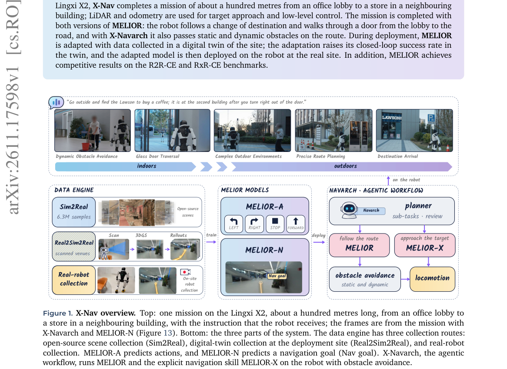

*Result - The three loops of X-Nav. The sub-task loop (L1), the mission loop (L2) and the deployment loop (L3). The box below each loop gives one result of this report: the success rate (SR) of MELIOR*

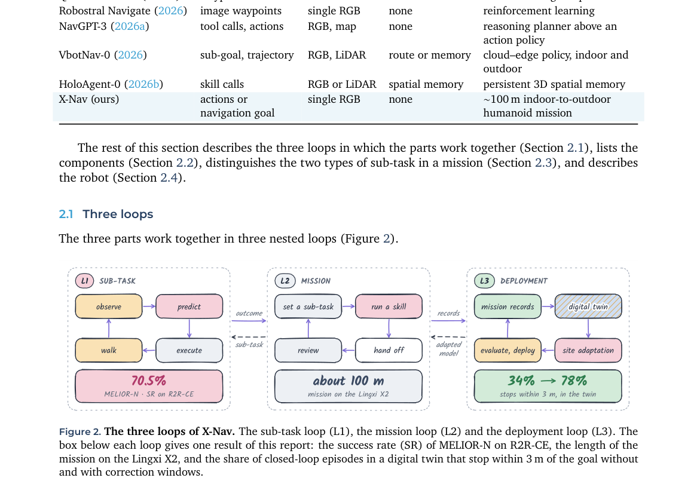

**Why this ranks #10**: 首个让双足人形机器人只凭内置 RGB 相机完成室内到室外长程任务的全链路系统：MELIOR-N 在 R2R-CE 上成功率 70.5%，数字孪生现场适配把 3 米内停止率从 34% 提到 78%，真机在灵犀 X2 上跑完 96.6 米的跨楼任务，因此与 Agentic-Teacher 同处 embodied_ai 的第一梯队。

---

### 11. Reusing Locomotion Training Recipes Across Humanoids via Body-Aligned Virtual Joints

**arXiv**: [2611.18003](https://arxiv.org/abs/2611.18003) | **Score**: 8.7 (relevance 9 x 0.7 + quality 8 x 0.3) | **Direction**: `embodied_ai` | **Tags**: embodied, humanoid-locomotion, coordinate-interface, cross-embodiment, sim-to-sim, heading-drift, Center for Humanoid Research | **Categories**: cs.RO | **Pages**: 8

**Authors**: Sol Choi; Mingon Kim; Seokin Seo; Jongeun Choi; Donghyeon Kim; Yisoo Lee

**Affiliation**: Center for Humanoid Research, Korea Institute of Science and Technology; Advanced Robotics Lab., CTO Division, LG Electronics Inc.; Department of Mechanical Engineering, Yonsei University; 1X Technologies

**Abstract**

> Reinforcement learning has enabled robust humanoid locomotion, yet training recipes (rewards, architectures, hyperparameters) remain hard to reuse across robots with different native joint coordinates, since policies output native joint angles while action scales, bounds, gains, and penalties are defined in those robot-specific coordinates. Existing transmission models convert native targets into actuator commands but do not standardize the coordinate interface exposed to the policy. We introduce a body-aligned virtual joint space upstream of this mapping: policy actions and observations follow a common anatomical convention, and a deterministic kinematic layer maps virtual targets to native ones, leaving the existing transmission and low-level control stack unchanged. Under a single unmodified recipe on three humanoids with different leg-axis layouts, it is the only interface that tracks accurately, keeps the feet aligned with the travel direction, and trains stably on all three, and on Unitree G1 hardware it reduces heading drift by nearly a factor of six.

**Key findings**

- **Finding**: 在 PND Adam 上采用身体对齐虚拟关节后，速度跟踪误差从原生坐标的 0.106±0.018 m/s 降到 0.085±0.018 m/s，横向漂移从 0.094±0.007 m 降到 0.075±0.006 m，脚步朝向角从 4.8° 降到 0.5°（任务空间基线 14.2°）。
- **Inference**: Adam 的髋俯仰轴倾斜 35°，会让纯矢状面的运动注入 sin(35°)≈0.57 倍的髋偏航，原生坐标策略必须隐式学这套轴向混合，虚拟坐标层则把它挪进解析运动学。
- **Recommendation**: 跨机型复用配方时应把动作与观测表达在身体对齐的虚拟关节空间、并在训练后再映射到原生坐标（in-loop 版本在 Adam 上有 15.3% 的迭代不稳定），同时单独测朝向漂移而不是只看聚合跟踪误差。

**Key figures**

*Framework - Hip-joint coordinates of three representative hu- manoids. The native axes differ across platforms (top), whereas the proposed body-aligned virtual joint coordinates express the same joints ab*

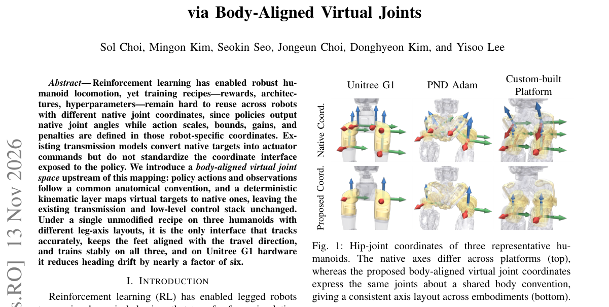

*Result - Overview of the proposed body-aligned virtual joint interface. The proposed modules map policy actions and joint-state observations between the shared virtual space and each robot’s native spa*

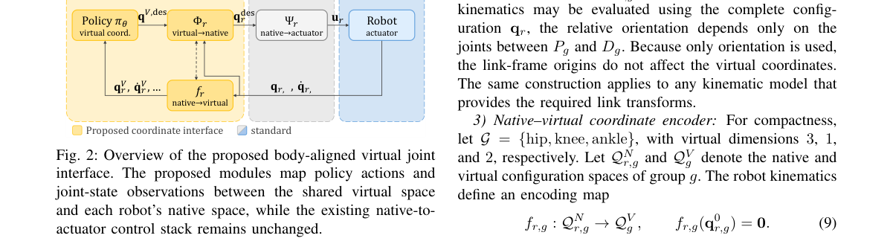

**Why this ranks #11**: 它指出了跨机型复用训练配方的真正瓶颈在坐标接口而非网络：以同一套未改动的配方在 Unitree G1、PND Adam 与自建平台三种人形上训练，虚拟关节后处理方案在 Adam 上把速度误差从 0.106 降到 0.085 m/s、横向漂移从 0.094 降到 0.075 m，脚步朝向角从 4.8° 降到 0.5°，G1 真机上偏航漂移更从 5.31±1.90 降到 0.89±0.54 度每秒。

---

### 12. When Will You Hand It Over? A Hidden Start Delay Makes Self-Play Handover Robust to Unfamiliar Partners

**arXiv**: [2611.18491](https://arxiv.org/abs/2611.18491) | **Score**: 8.7 (relevance 9 x 0.7 + quality 8 x 0.3) | **Direction**: `embodied_ai` | **Tags**: embodied, self-play, handover, humanoid, partner-generalization, distribution-shift, Toyota Motor North America | **Categories**: cs.RO | **Pages**: 10

**Authors**: Mohammad Khoshnazar; Mike Degany; Deyuan Qu; Qing Yang; Matyas Szanto

**Affiliation**: Toyota Motor North America; Budapest University of Technology and Economics

**Abstract**

> Cooperative self-play can teach a humanoid to receive an object without any human data, but the partner it meets after training is never the one it trained with; we show that a fluent self-play handover policy breaks with unfamiliar partners, identify the main cause, and repair it. In a physics-based parcel handover between a Unitree G1 and a learned giver, both trained by alternating PPO self-play, the receiver completes 95% and 90% of handovers with its own partner (two training seeds) but only 31% with scripted partners it has never met. Paired interventions isolate the cause: under a shared reward the learned giver always starts its offer at once, so the receiver learns a single rendezvous, and delaying its own partner by one second cuts success from 95% to 6% (87% to 34% in the second seed). We introduce hidden start-delay randomisation (HSD), a one-line rule on the learned partner that the receiver never observes. After 300 further updates, success with unseen scripted partners rises from 31% to 80% in both seeds, against 35--41% for a budget-matched control. The gain holds on a fresh scenario seed, on eleven held-out partner conditions and on partners that start later than any training delay; it cuts high-force contact three- to five-fold and needs no retraining of the partner.

**Key findings**

- **Finding**: 自博弈交接策略在自己的伙伴上成功率达 95.0% 与 89.5%，遇到陌生脚本伙伴只剩 30.5% 与 30.5%；把伙伴起手推迟 1 秒、其余不变，成功率就掉到 6.0% 与 33.5%。
- **Inference**: 共享奖励让伙伴永远立刻伸手，接收方学到的是一个固定会合时刻而不是「从不同时间到来的手里接物」，所以补数据不如打散时序分布。
- **Recommendation**: 训练人机协作接物策略时，给伙伴加一条接收方观测不到的隐藏起始延迟随机化，并用同等预算的续训做对照，否则无法确认收益来自随机化本身还是额外训练量。

**Key figures**

*Framework - The task. A Unitree G1 with a Dex3 hand receives a parcel from a learned partner: it reaches, shares the load, and holds the parcel alone once the partner lets go (one episode of the self-pl*

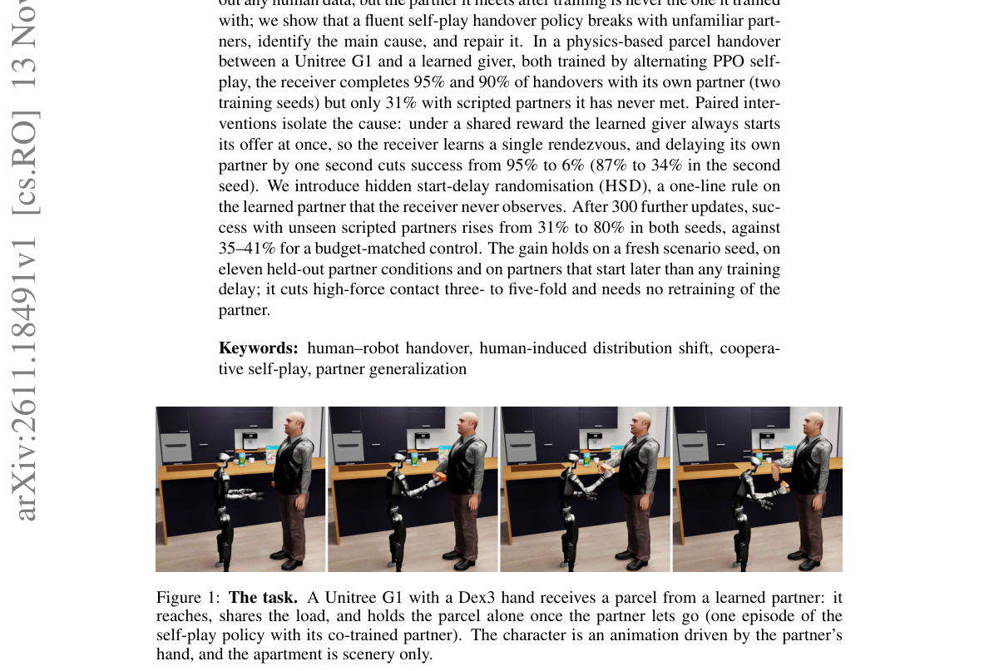

*Result - COPLAY-HANDOVER. (a) Training: receiver and partner act in the same physics sim- ulation and are updated in alternation by PPO, each with a privileged critic. Hidden partner rules sit betwee*

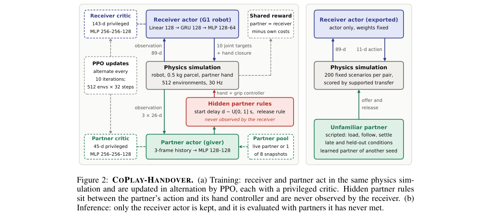

**Why this ranks #12**: 它用配对干预定位了自博弈协作策略的典型失效：Unitree G1 加 Dex3 手与学习到的伙伴互传包裹，在自己的伙伴上成功率达 95.0% 与 89.5%，遇到从未见过的脚本伙伴只剩 30.5% 与 30.5%，而只把伙伴起手延迟 1 秒（其余不变）就让成功率跌到 6.0% 与 33.5%；加入隐藏起始延迟随机化后再训 300 步即升到 80.5% 与 80.0%，同等预算续训的对照组只有 35.0% 与 41.0%。

---

### 13. PROOF: Perceptive Robustness via Out-of-Distribution Fallback for Legged Locomotion

**arXiv**: [2611.18305](https://arxiv.org/abs/2611.18305) | **Score**: 8.4 (relevance 9 x 0.7 + quality 7 x 0.3) | **Direction**: `embodied_ai` | **Tags**: embodied, legged-locomotion, perception-robustness, teacher-student, out-of-distribution, depth-camera, Southern University of Science and | **Categories**: cs.RO | **Pages**: 19

**Authors**: Siyuan Wang; Dongjie Zhu; Jinxuan Lu; Wenjun Xu; Jiankun Wang

**Affiliation**: Southern University of Science and Technology; Pengcheng Lab; Tsinghua University; The Hong Kong University of Science and Technology (Guangzhou)

**Abstract**

> Vision-based perceptive locomotion has enabled legged robots to achieve agile and terrain-aware locomotion across complex environments. However, the reliability of such systems heavily depends on visual observations, which are inherently susceptible to occlusion, reflective surfaces, and illumination variations, often resulting in catastrophic locomotion failures under degraded perception conditions. In this paper, we present PROOF (Perceptive Robustness via Out-of-Distribution Fallback for Legged Locomotion), a perceptive locomotion framework that enables robust locomotion under severe visual disturbances. Our method adopts a two-stage teacher-student learning paradigm that explicitly models perception reliability: the teacher learns both perception-driven and proprioceptive fallback behaviors, while the student predicts exteroceptive features with uncertainty and suppresses them under out-of-distribution inputs. We evaluate our method on a Unitree Go2 quadruped equipped with a RealSense D435 depth camera in real-world settings. Under normal visual conditions, our method enables the robot to successfully perform high-dynamic parkour maneuvers, including traversing large gaps, elevated platforms, and narrow beam terrains. Under severe visual degradation, such as heavy occlusion and strong illumination changes, the robot continues to maintain stable and robust locomotion performance.

**Key findings**

- **Finding**: 仿真第 5 难度、每类地形 100 次测试下，PROOF 的通过率在崎岖/上坡/下坡/上楼梯/下楼梯分别为 100%、99%、100%、95%、100%，而去掉教师掩码的基线全部为 0%，仅用 MSE 蒸馏潜变量的基线为 96%、79%、84%、73%、91%。
- **Inference**: 关键不是把视觉特征蒸馏得更准，而是先让教师学会「没有外感受时的纯本体感知行为」，这样视觉失效时关闭外感受通道仍留有可用策略。
- **Recommendation**: 做感知型腿足策略时应显式训练不确定度头，并用带滞回的硬掩码（0.8 开、0.5 关）切到本体感知回退，同时把教师掩码写进训练，否则域外时没有回退目标可学。

**Key figures**

*Framework - PROOF enables agile perceptive robot parkour under challenging real-world conditions. The robot traverses large platforms and discontinuous obstacles while remaining reliable under se- vere*

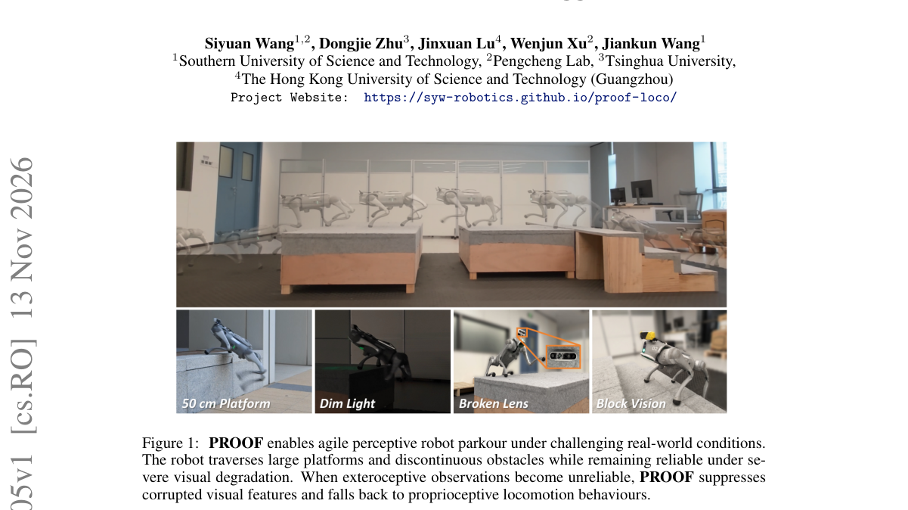

*Result - Our framework consists of two parts: a teacher policy, trained using elevation maps in simulation; and a student policy, trained using depth vision and teacher-student distillation.*

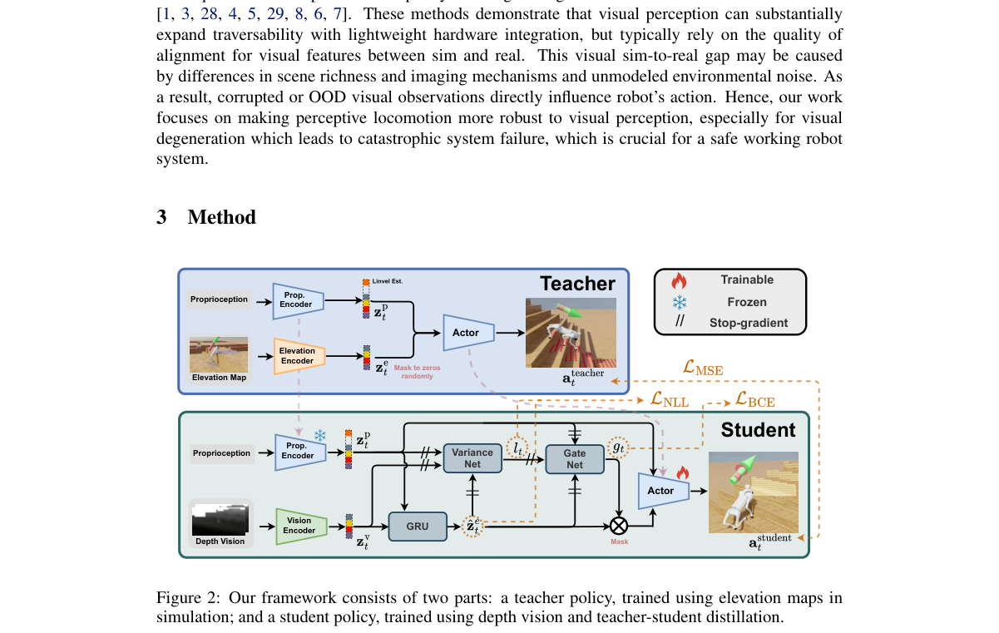

**Why this ranks #13**: 它把「视觉失效时该退回本体感知」做成了可验证机制：在 Unitree Go2 加 RealSense D435 上用单张 RTX 4090 训约 4.5 小时（教师 8000 步、学生 4000 步），仿真第 5 难度、每类地形 100 次测试中 PROOF 在崎岖/上坡/下坡/上楼梯/下楼梯的通过率为 100%、99%、100%、95%、100%，去掉教师掩码的基线全部为 0%，只用 MSE 蒸馏潜变量的基线为 96%、79%、84%、73%、91%。

---

### 14. Gamer: A Generalist Vision-Language-Action Foundation Model for Long-Horizon Real-Time Game Agent

**arXiv**: [2611.18397](https://arxiv.org/abs/2611.18397) | **Score**: 8.4 (relevance 9 x 0.7 + quality 7 x 0.3) | **Direction**: `embodied_ai` | **Tags**: embodied, game-agent, vla, long-horizon, grpo, memory-compaction, miHoYo Honkai AI R&D Team | **Categories**: cs.AI, cs.CL, cs.CV | **Pages**: 52

**Authors**: Run Luo; Kuan Zhang; Qi Deng; Yukun Chen; Zhihao Yang; Yufei Zhang; Renrong Hu; Yi Zhang; Guiyu Ma; Tianyu Fan; Longze Chen; Hao Sun

**Affiliation**: miHoYo Honkai AI R&D Team

**Abstract**

> We introduce Gamer, a generalist agent framework built for long-horizon tasks in complex interactive environments. Its end-to-end architecture combines perception, memory management, and multi-step reasoning. A shared training and deployment pipeline supports interaction with both conventional 2D graphical interfaces and complex 3D simulated worlds. We first continue pre-training on a dataset constructed from tens of thousands of hours of device-level keyboard and mouse interaction. These trajectories span simulated games and embodied environments, allowing the model to learn environmental dynamics across both physical and virtual domains. Sparse-thinking instruction tuning then substantially reduces redundant computation while preserving the reasoning needed for complex decisions. We train the policy for long-horizon interaction with a stable multi-turn reinforcement learning method that addresses finite context windows, accumulated rollout errors, and sparse rewards. For real-time interaction, a cloud-edge inference engine serves numerous simulated game environments concurrently, supports unbounded-context execution, and keeps online inference latency low. Across multiple challenging 3D open-world games, Gamer demonstrates solid generalization and operational efficiency comparable to skilled players. It also achieves competitive results on a range of conventional 2D game benchmarks. These results suggest that even repetitive keyboard and mouse trajectories can support substantial gains from scaling data and learning algorithms. Training on these trajectories helps Gamer learn complex skills more steadily in environments with both physical and digital properties. This approach offers a path toward generalist agents that can interact across digital and physical worlds.

**Key findings**

- **Finding**: 统一动作表示把游戏交互压到 5 Hz 观测、每个观测区间切成 6 个约 33 ms 的键鼠动作块（合计 30 Hz 动作率），而交互数据里超过 85% 的动作步是重复动作，需要用 γ=0.9 的重复衰减损失降权。
- **Inference**: 对重复动作降权而不是丢弃，是为了让模型仍能从「持续行为的长度」里读出时序，同时把梯度集中到停止、转向、交互这些行为切换点上。
- **Recommendation**: 做键鼠级长时程智能体时应先统一动作序列化并做键位随机重映射，再叠重复衰减损失训练，并用记忆压缩把超长轨迹切段后送进多轮 RL 优化。

**Key figures**

*Framework - Overview of Gamer. A generalist game agent framework operates across a broad range of visually and mechanically diverse games. At each step, the agent uses the current screen, task context, r*

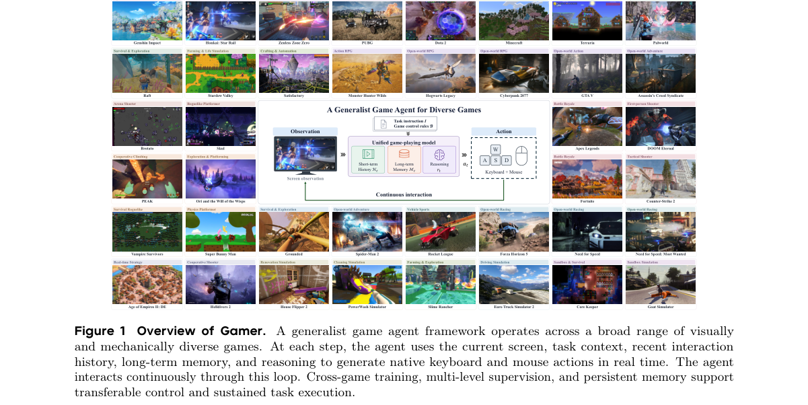

*Result - CPT for unified keyboard-mouse control. Synchronized gameplay observations and device events are mapped to a shared action representation. Random key remapping reduces reliance on key identit*

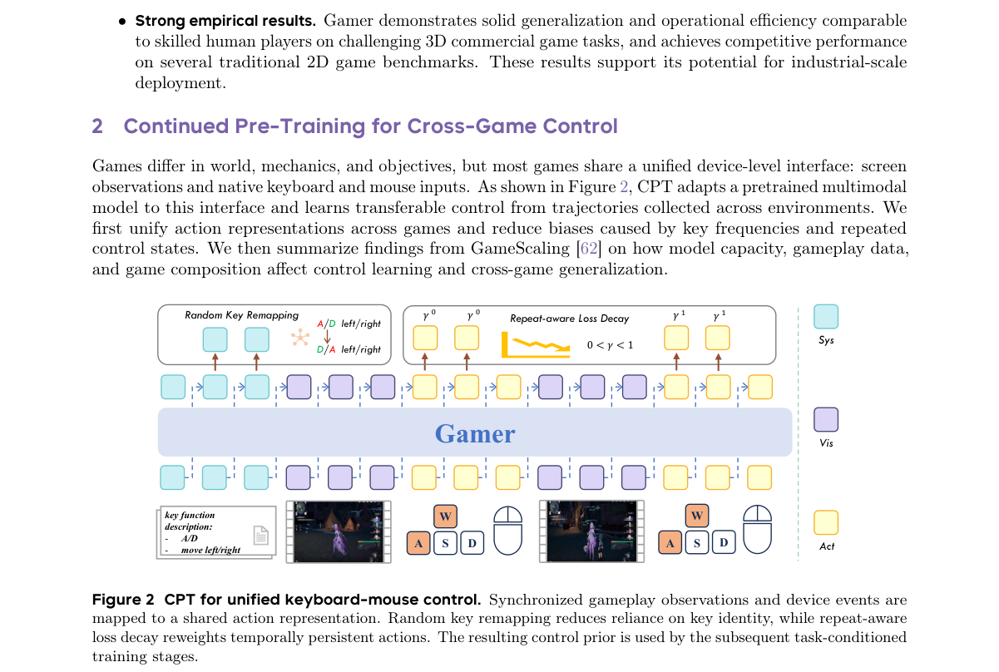

**Why this ranks #14**: 它是把视觉-语言-动作范式推到长时程数字环境的大规模尝试：用数万小时设备级键鼠操作做继续预训练并筛出上千小时高质量指令数据，把游戏交互统一成 5 Hz 观测加每段 6 个约 33 ms 的动作块（即 30 Hz 动作率），并针对交互数据里超过 85% 的重复动作步用 γ=0.9 的重复衰减损失降权，再用记忆压缩配合时序感知 GRPO 做长程优化。

---

### 15. Racing the Clock: Teaching VLNs Budget-Conditioned Object Search

**arXiv**: [2611.17442](https://arxiv.org/abs/2611.17442) | **Score**: 8.0 (relevance 8 x 0.7 + quality 8 x 0.3) | **Direction**: `embodied_ai` | **Tags**: embodied, budget-conditioned-search, bellman-expert, vln, exploration-supervision, object-search, University of California | **Categories**: cs.AI, cs.CV, cs.LG, cs.RO | **Pages**: 12

**Authors**: Maitree Meher; Siming He; S. Shankar Sastry; Jitendra Malik; Claire Tomlin; Jonas Frey

**Affiliation**: University of California, Berkeley; Stanford University

**Abstract**

> A rescue robot entering a building with thirty seconds on the clock should sprint toward the single most promising room; given ten minutes, it should instead explore a broader tour. Yet vision-language-navigation (VLN) models are typically evaluated under a fixed episode limit that the policy never observes, even though time-critical missions require behavior to adapt to the available budget. We study budget-conditioned object search: given a target category and an explicit action budget, an agent must find as many distinct target instances as possible before the budget expires. We investigate how to supervise VLNs for this task by comparing a privileged TSP expert, which plans near-optimal routes using the full map and true target locations, with a room-level Bellman expert that maximizes expected return under partial observability using high-level cross-scene semantic priors. Despite the TSP expert achieving substantially higher expert performance, its demonstrations are less effective for learning exploration: on held-out HM3D scenes, the Bellman-supervised VLN consistently outperforms the TSP-supervised VLN, with the advantage becoming more pronounced at longer budgets. At 2000 steps (500m), the Bellman-supervised VLN finds 71.4% of reachable target instances, compared with 65.5% for the TSP-supervised VLN and 44.8% for the pretrained VLN. These results highlight a distinction between optimal routing and optimal exploration: effective exploration supervision should optimize decisions under partial observability rather than imitate routes that are optimal only once the environment is fully known.

**Key findings**

- **Finding**: 在 10 个留出 HM3D 场景上，B=2000 步时房间级 Bellman 监督的 Uni-NaVid 收集率 72.7%，贪心前沿 68.5%、对象级 Bellman 65.5%、预训练模型 44.8%。
- **Inference**: 专家回报高低取决于它看到多少学生看不到的信息；抽象与学生信息集对齐的专家才教得出有效的部分可观测探索。
- **Recommendation**: 设计示范专家时先固定学生的信息集，再按预算索引做 Bellman 递归，并额外做去掉倒计时的预算盲训练对照，确认收益来自预算条件化本身。

**Key figures**

*Framework - The stated budget changes the learned VLN’s search strategy. Room-level Bellman-supervised Uni-NaVid is rolled out from the same start pose in the same held-out HM3D scene with identical deter*

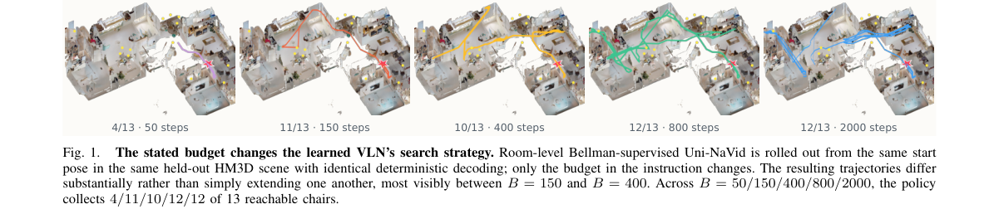

*Result - Room-level Bellman expert. (a) “Known” rooms have been entered; their recorded contents include only discovered objects. (b) Frontier rooms are valued using doorway-visible semantic evidence a*

**Why this ranks #15**: 把「专家更强」与「监督更好」明确拆开：拿到全部目标位置的对象级 Bellman 专家回报更高，但蒸馏到 Uni-NaVid 后在 B=2000 步只有 65.5%，房间级 Bellman 专家反而到 72.7%（贪心前沿监督 68.5%、预训练模型 44.8%），把预算条件化搜索的监督机制讲得最清楚，因此在 embodied_ai 居中上。

---

### 16. TouchTwin: Scaling Human Touch Data via Real-to-Sim-to-Real

**arXiv**: [2611.17619](https://arxiv.org/abs/2611.17619) | **Score**: 8.0 (relevance 8 x 0.7 + quality 8 x 0.3) | **Direction**: `embodied_ai` | **Tags**: embodied, real-to-sim-to-real, tactile-glove, dexterous-manipulation, force-grounding, mujoco, Stanford University | **Categories**: cs.RO | **Pages**: 8

**Authors**: Huiwen Han; Nuo Chen; Ziyao Zeng; Dayou Li; Hao Wang; Amir Hossein Rahmati; Xiaoning Qian; Bangya Liu; Zhiwen Fan

**Affiliation**: Stanford University; Texas A&M University; Yale University; 2077AI

**Abstract**

> Human demonstrations are becoming the main source of data for dexterous manipulation, and real-to-sim-to-real pipelines multiply each demonstration in simulation. These pipelines rebuild the interaction from vision, which recovers how the hand moves. Which fingers touch, when, and how hard remain unobserved, because a hand pose shows where each finger stops on the surface rather than how far it is driven to close. This gap is a force gap: on held-out recordings, a hand policy that imitates the observed pose grips with 0.31x the recorded force, and a policy trained on physics replays of vision-tracked poses grips with 1.55x. TouchTwin closes the gap with measured human touch. Each selected TouchScale recording, captured with head and wrist RGB-D cameras and an 880-taxel glove, is rebuilt in MuJoCo. Coding agents write the objects as physics-tested programs, and a per-subject tactile hand replays the interaction with the recorded touch setting the contact and the closing force of each finger. In simulation, a policy trained on touch-grounded replays grips at 0.99x the recorded force and succeeds in 20/20 trials on held-out recordings and 35/36 unseen perturbations; a contact predictor trained on them misses 13% of real contact frames, against 32% for vision-based replays. Each replay also seeds perturbed demonstrations with simulated contact and force labels, rendered as realistic video in new views and scenes.

**Key findings**

- **Finding**: 姿态模仿策略只产生 0.31 倍记录抓握力、留出录像 17/20，纯视觉物理回放为 1.55 倍、15/20，触觉标定回放为 0.99 倍、20/20，未见扰动 35/36。
- **Inference**: 手部姿态只给出指尖停在哪里而非压入多深，因此纯视觉重建天然无法还原人类抓握力这一物理量。
- **Recommendation**: 做灵巧操作的数据扩增时务必一并采集可穿戴触觉并写进仿真回放，验收要看抓握力比与接触漏检率，而不只是任务成功率。

**Key figures**

*Framework - TouchTwin overview. Top: an agentic pipeline rebuilds each recording; GT touch sets where, when and how hard fingers touch and checks the replay. Bottom: each replay yields N perturbed demos,*

*Result - Simulating a tactile hand from egocentric video and paired tactile recordings. (a) A participant’s tactile glove grasping a mug, seen by the head camera. (b) The simulated hand fitted to the*

**Why this ranks #16**: 把「力缺口」量化清楚：只模仿手部姿态的策略只给出 0.31 倍记录抓握力，纯视觉重建的物理回放给到 1.55 倍，接入 880 税元件手套实测触觉后回到 0.99 倍，留出录像 20/20、未见扰动 35/36 成功，接触预测漏检从 32.2% 降到 13.1%，是 embodied_ai 里数据链路最完整的一篇。

---

### 17. Vision-Language-Action Models: A Life-Cycle Survey of Design, Training and Deployment

**arXiv**: [2611.18372](https://arxiv.org/abs/2611.18372) | **Score**: 8.0 (relevance 8 x 0.7 + quality 8 x 0.3) | **Direction**: `embodied_ai` | **Tags**: embodied, vla-survey, robot-foundation-model, pretraining-data, action-representation, real-time-deployment, Computer Science | **Categories**: cs.AI, cs.ET, cs.LG, cs.RO | **Pages**: 43

**Authors**: Suvarna Kadam; Soran Parsa

**Affiliation**: Department of Computer Science, University of Huddersfield

**Abstract**

> Vision-language-action (VLA) models adapt web-pretrained vision-language models to output robot actions, so that web knowledge carries over to physical control. In under 4 years the field has moved from RT-2, the first VLA, to open models that fine-tune on a single consumer GPU and to proprietary generalists that clean unseen homes. This survey reviews 88 works from December 2022 to October 2026, mainly on manipulation and navigation, plus humanoid control, world-action models and evaluation. We follow a VLA through its life cycle, from model design to training and deployment, along seven axes. Model design covers (a) inputs and memory, what the model observes; (b) architecture, how its pipeline is built; (c) action output, how it produces motor commands; and (d) intermediate predictions, what else it predicts, from reasoning steps to future observations. Training covers (e) pretraining data, the mix of robot, web, human and simulated data, and (f) post-training, adaptation to the target robot. Deployment covers (g) real-time execution, keeping pace with the robot. We analyse 22 models on these axes and report their training data, model size, inference speed and hardware. Three trends emerge: (i) training data has broadened, from about 10,000 hours of teleoperated robot data ($π_0$) to 23,000 community-collected episodes (SmolVLA) and 20,000 hours of egocentric human video (GR00T N1.7); (ii) model sizes have split: most recent models have 3-7 billion parameters, while a new group under one billion runs on consumer GPUs; and (iii) generalist VLAs are emerging that handle both manipulation and navigation, such as UniVLA and Qwen-VLA. We also compare VLAs with world-action models, which predict future observations as well as actions. We review evidence that some VLAs with near-perfect benchmark scores fail when objects or the camera move slightly, and open up further research questions.

**Key findings**

- **Finding**: 综述沿七条生命周期轴梳理 88 篇工作（5 篇奠基、38 篇操作 VLA、12 篇导航 VLA、5 篇综述、28 篇人形/世界动作/评测），并在表 3 上逐轴标注 22 个主模型的训练数据、参数量、推理速度与硬件。
- **Inference**: 训练数据从 π0 的约 1 万小时扩到 GR00T N1.7 的 2 万小时第一人称人类视频，参数量却分裂为 3–7B 主流与 1B 以下新阵营，说明「更大模型加更多机器人数据」不再是唯一可行路径。
- **Recommendation**: 选型与复现前先看部署表：ECoT 这类推理增强带来 28% 的绝对成功率提升、FAST 的 DCT 压缩带来最多 5 倍训练加速，同时要把基准分数与真实场景稳健性分开评估。

**Key figures**

*Framework - places the main works on a single timeline.*

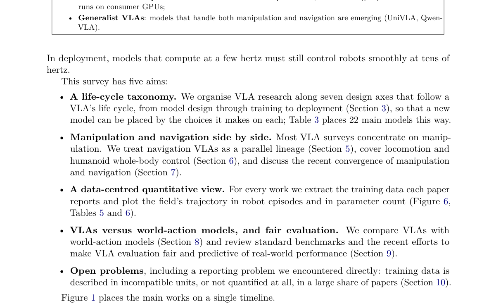

*Result - contrasts three architectural patterns. The split follows Shao et al. [7], except that we treat dual-system designs as a pattern of their own rather than as a kind of monolithic model.*

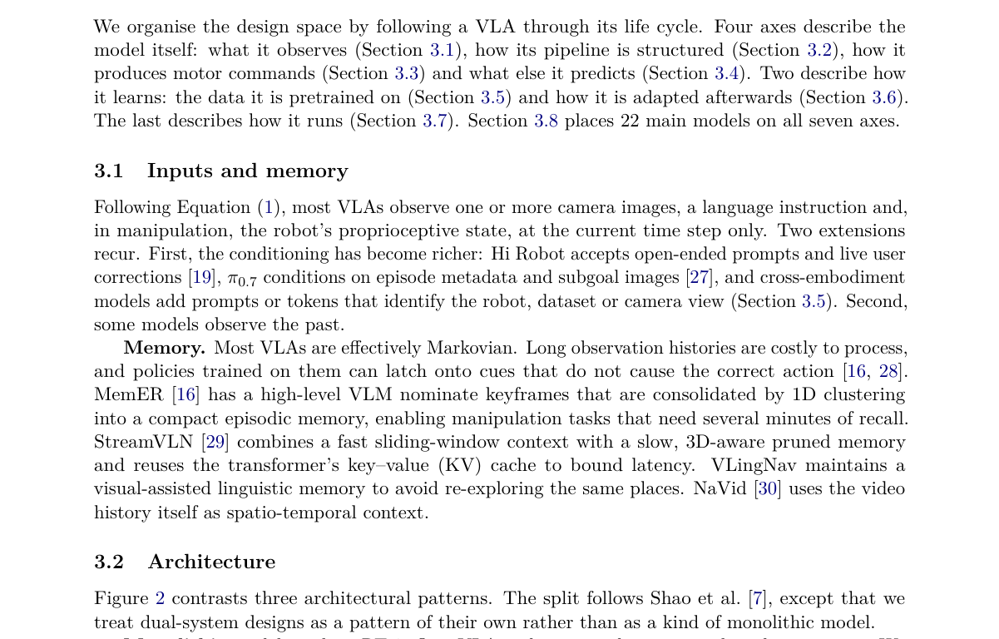

**Why this ranks #17**: 它把 VLA 四年演进做成了可查表的横向对照：综述 2022 年 12 月到 2026 年 10 月的 88 篇工作（5 篇奠基、38 篇操作 VLA、12 篇导航 VLA、5 篇综述、28 篇人形与世界动作及评测），在 22 个主模型上逐条给出训练数据、参数量、推理速度与硬件，趋势是数据从 π0 的约 1 万小时遥操作扩到 GR00T N1.7 的 2 万小时第一人称人类视频，参数分成 3–7B 主流与 1B 以下可在消费级 GPU 微调的新阵营。

---

### 18. Grounding Object-to-Object Hazard Reasoning into 3D Risk Fields for Task-Conditioned Safety

**arXiv**: [2611.17566](https://arxiv.org/abs/2611.17566) | **Score**: 7.7 (relevance 8 x 0.7 + quality 7 x 0.3) | **Direction**: `embodied_ai` | **Tags**: embodied, task-conditioned-safety, vlm-reasoning, risk-field, obstacle-modulation, open-vocab-segmentation, Computer Science | **Categories**: cs.RO | **Pages**: 8

**Authors**: Mariana Sosa Guzmán; Yide Song; Amin Abyaneh; Gregory Dudek; Hsiu-Chin Lin

**Affiliation**: Department of Computer Science, McGill University; Department of Electrical and Computer Engineering, McGill University

**Abstract**

> Safety in robotics does not solely depend on geometric constraints, but also on semantics: the given task, environment properties, and interactions between objects in the scene. We present a framework based on vision-language models (VLMs) to infer task- and scene-dependent safety constraints for robot manipulation. We provide the VLM a structured safety tool based on an RGB-D observation and a natural-language task instruction that first decides whether the task should be rejected since its execution may result in a non-recoverable hazardous outcome. Otherwise, it identifies preventable object-pair hazards and specifies the spatial relations that must be avoided. Open-vocabulary segmentation and depth information are then used to ground the detected objects in 3D and construct continuous risk fields that represent the corresponding hazardous regions. These fields are integrated with an obstacle avoidance module that corrects nominal robot motions during execution while accounting for the risk field. We evaluate the framework on preventable hazards, tasks requiring rejection, and safe variants in simulation and the real-world. Project website: https://vlm-hazard-riskfield.github.io

**Key findings**

- **Finding**: 在 3 个可预防危险、3 个必须拒接与 3 个安全变体共 9 个场景上，带安全工具的 VLM 总体可预防危险成功率与安全成功率均为 90.9%、违规率 4.4%，而纯几何避障成功率为 100% 但安全成功率为 0、违规率 15.2%。
- **Inference**: 几何避障只能保证被握持物体不撞上障碍，而把「该任务本身不可做」（金属杯进微波炉）与「该避开哪些空间关系」（咖啡杯经过笔记本电脑）分开判断，才谈得上任务级安全。
- **Recommendation**: 机器人安全层应先做任务级拒接，再把物体对危害落成 3D 风险场，并按包围盒的角点与面心取最小风险系数，否则末端点安全并不代表整只杯子安全。

**Key figures**

*Framework - Overview of the proposed framework. Given a task instruction and a scene image, we either reject the task or identifies object-pair hazards (top) that are grounded into a 3D risk field (middle*

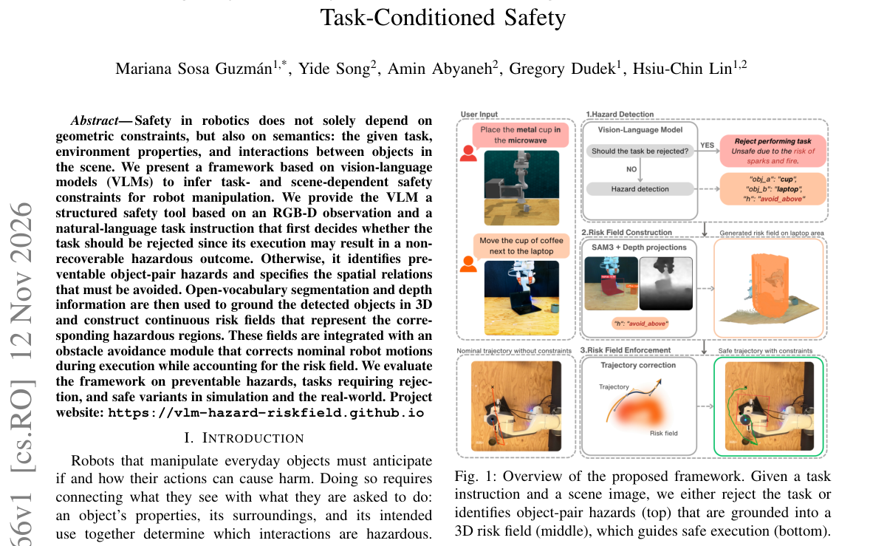

*Result - Representation of how the location of a point x in the field ρ affects Γ.*

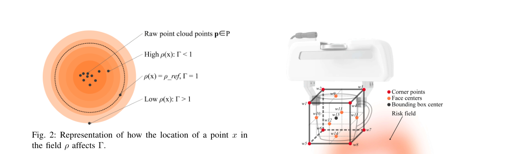

**Why this ranks #18**: 它把语义安全落成了可执行的 3D 风险场：在 Franka Emika Panda 与 CoppeliaSim V4.10.0 上构造 3 个可预防危险、3 个必须拒接、3 个安全变体共 9 个场景，带安全工具的 VLM 在可预防危险上成功率与安全成功率同为 90.9%、违规率 4.4%，纯几何避障成功率 100% 但安全成功率 0、违规率 15.2%；拒接实验里正确拒接 96/96 且安全场景误拒 0/90。

---

### 19. A Generalizable Approach to Safety-Aware Robotic Behavior Planning with an Explicit Constraint Space

**arXiv**: [2611.18026](https://arxiv.org/abs/2611.18026) | **Score**: 7.7 (relevance 8 x 0.7 + quality 7 x 0.3) | **Direction**: `embodied_ai` | **Tags**: embodied, safety-constraint-space, constraint-applicability, safety-inspector, test-time-adaptation, behavior-planning, [unverified] | **Categories**: cs.LG, cs.RO | **Pages**: 8

**Authors**: Xianxu Wu; Shang-Ching Liu; Zhaocong Liang; Hengxiang Chen; Yujian Ma; Shenwen Deng; Qiang Li; Yung-Hui Li; Jianwei Zhang

**Affiliation**: [unverified]

**Abstract**

> Large language and vision-language models have substantially advanced robotic behavior planning from natural-language instructions and visual observations. However, safe manipulation in tabletop environments remains challenging because the safety constraints required for a task depend on the surrounding scene and may not be explicitly specified in the instruction. We propose a safety-aware behavior planning framework based on an explicit Constraint Space that stores reusable textual safety rules. Rather than retrieving rules solely by semantic similarity, we formulate constraint selection as task- and environment-conditioned applicability learning. A lightweight query-conditioned dual-tower model identifies the constraints applicable to the current context, which are then provided together with the original task and image to a multimodal behavior planner. To handle incorrect constraint selections and previously unseen hazards, we introduce a multimodal Safety Inspector that evaluates generated primitive plans, reconstructs the complete applicable constraint set, and provides corrective planning feedback. Validated inspection feedback is further used for test-time adaptation of constraint applicability and parameter-efficient adaptation of the Safety Inspector through LoRA, while newly identified constraints are incorporated into the Constraint Space. The resulting framework integrates explicit safety knowledge representation,context-aware constraint selection, corrective safety inspection, and test-time knowledge adaptation for safety-aware robotic behavior planning.

**Key findings**

- **Finding**: 在 93 条候选规则的统一 Constraint Space 与 150 条留出查询上，查询条件化适用性模型的召回 37.48%、精确率 40.23%、F1 0.3881、精确匹配率 2.67%，而同规则预算的 BGE-M3 语义检索为 24.32%、26.11%、0.2519、0.00%。
- **Inference**: 语义相似并不等于「在当前场景该被强制执行」，把选择建模成任务与环境条件下的适用性学习，才能把约束用对而不只是用得像。
- **Recommendation**: 安全规划系统应把规则存成显式文本库、由双塔模型按上下文选约束，并用带后审的检验器做闭环纠错与测试时知识扩展，未通过复核的自我反馈不得写回知识库。

**Key figures**

*Framework - Closed-loop architecture for safety-aware behavior planning with adaptive constraint knowledge. Task–scene-relevant constraints are selected from the Constraint Space and provided to a multimo*

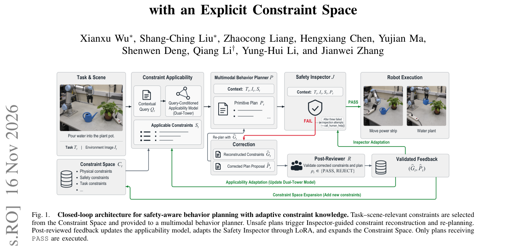

*Result - Representative real-world robot experiments. Direct task plans are compared with safety-aware plans generated after incorporating scene- dependent constraints. For the ball-placement task, the*

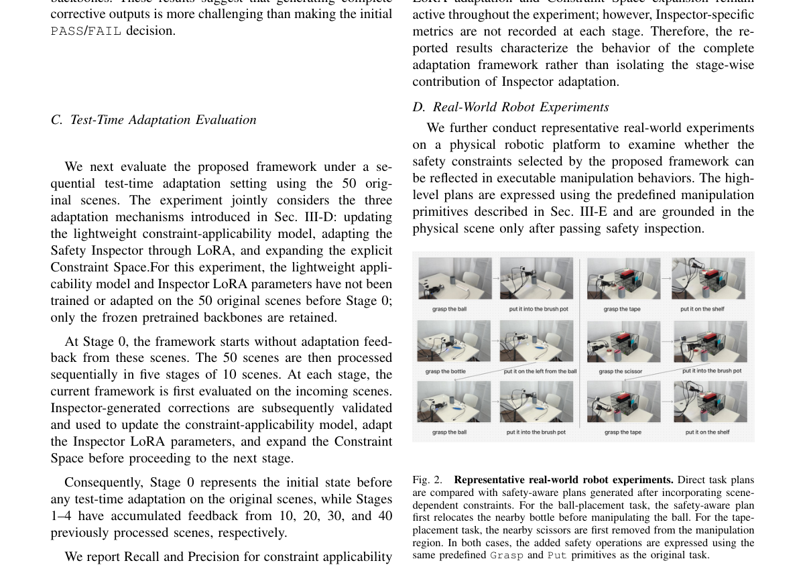

**Why this ranks #19**: 它把安全知识变成可复用、可增长、可纠错的显式对象：在 93 条候选安全规则构成的 Constraint Space 上，查询条件化双塔模型在 150 条留出任务-场景查询上的召回 37.48%、精确率 40.23%、F1 0.3881，全面超过同预算的 BGE-M3 语义检索（24.32%、26.11%、0.2519），30 个未见过场景、390 个检验样本上 LoRA 适配的 Safety Inspector 判定准确率达 96.7%–97.7%、缺失规则重建覆盖率 97.8%–98.1%。

---

### 20. Objectives as Policies: Vision-Language Model Cost Programs for Contact-Rich Manipulation

**arXiv**: [2611.18298](https://arxiv.org/abs/2611.18298) | **Score**: 7.7 (relevance 8 x 0.7 + quality 7 x 0.3) | **Direction**: `embodied_ai` | **Tags**: embodied, vlm-planning, model-predictive-control, digital-twin, cost-program, contact-rich, University of Illinois Chicago | **Categories**: cs.RO | **Pages**: 8

**Authors**: Zihao Lu; Trong Gia Hung Nguyen; Fuquan Wang; Yifan Zhu

**Affiliation**: University of Illinois Chicago

**Abstract**

> Vision-language models (VLMs) have shown strong semantic and spatial reasoning capabilities in 3D environments. Recently, connecting VLMs with model-predictive controllers (MPC) has emerged as a paradigm for combining strong semantic reasoning with physics-based planning. However, connecting these two for contact-rich robotic manipulation requires a task representation that bridges the two and captures how physical interactions can be reasoned by VLMs. In this work, we introduce Objectives as Policies (OaP), a framework that connects a pretrained VLM to a shared sampling-based MPC through an editable objective program. Each program specifies a sequence of stages for completing a task, combining running and terminal costs from a cost library with stage completion conditions. Given a natural-language task instruction and scene observation, we build a simulation-based digital twin through real-to-sim, and the VLM generates an objective program that is executed by the MPC in the simulation. The program is iteratively updated by the VLM based on MPC rollouts, before being deployed in the real world. We evaluate our framework in both simulation and the real world on four tabletop manipulation tasks, and show that it outperforms strong baselines. Additional videos and examples are available on the project website: https://zihaolu001.github.io/oap-project/

**Key findings**

- **Finding**: 四个桌面操作任务各 10 次的仿真对比中，OaP 用 2 轮反馈拿到 36/40（90%），高于 CoRAL 的 31/40（77.5%）、ReKep 的 17/40（42.5%）、π0.5 的 10/40（25%），OpenVLA-OFT 为 0/40。
- **Inference**: 把任务写成由固定代价库组合的可编辑目标程序，让语义推理与接触物理各待在擅长的层次；去掉代价库的消融从 26/40（65%）掉到 14/40（35%）正好印证这一点。
- **Recommendation**: 用 VLM 接 MPC 时应给一份带残差定义的固定代价库，让 VLM 只负责组合阶段与终值条件，再靠仿真 rollout 反馈迭代程序，并为摩擦与刚度误差导致的真机抓取失败预留余量。

**Key figures**

*Framework - Our method combines the semantic understanding of modern vision-language models and physics-based model-predictive control that encodes physical understanding. The two are interfaced through a*

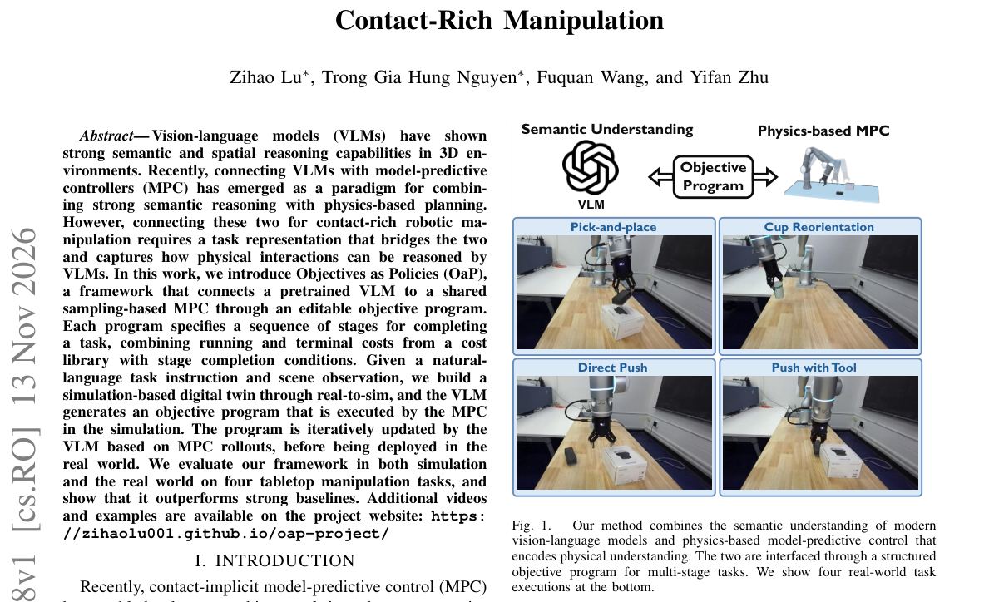

*Result - Method Overview. Given the task specification in the form of a scene observation and a language description, we generate a digital twin through real-to-sim. VLM then generates objective progra*

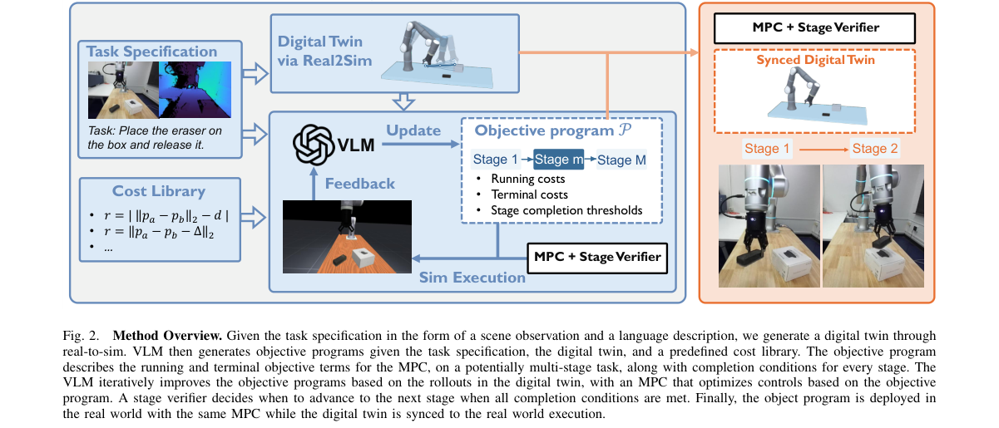

**Why this ranks #20**: 它给「VLM 怎么接物理控制器」提供了一个可编辑接口：在四个桌面操作任务各 10 次的仿真对比中，OaP 用 2 轮反馈拿到 36/40（90%），高于 CoRAL 的 31/40（77.5%）、ReKep 的 17/40（42.5%）、π0.5 的 10/40（25%）与 L2R 的 11/40（27.5%），OpenVLA-OFT 为 0/40；反馈预算从 0 加到 5 轮时成功率由 50% 升到 95%（含自审为 65% 升到 97.5%），真机迁移 32/40（80%）。

---

## Footer

- Total papers reviewed across all 4 axes: 60
- world_embodied axis final count: 20
- Wild-cards in this axis: 0
- Figure assets: 2026-11-16/res/

Generated by `mine-arxiv-daily-digest` skill. Sister file: `2026-11-16_world_embodied_entry.md`.
