# Mine Arxiv Daily Digest - 2026-11-17 (AIGC 视觉生成与编辑 Axis, 15 papers)

**Generated**: 2026-11-17 12:27 CST

**Source**: arXiv cs.CV, cs.SD, eess.AS, cs.CL, cs.AI, cs.RO, cs.LG, cs.IR submissions, listing day 2026-11-11 + 2026-11-12 + 2026-11-13 + 2026-11-14 (announced 2026-11-16 20:00 ET = 2026-11-17 01:00 UTC)

**Batch window**: 2026-11-10T19:00:00Z .. 2026-11-14T19:00:00Z（arXiv 公告批次横跨两个 UTC 日：从前一日的美东 14:00 截止时刻起算（EDT 为 18:00Z，EST 为 19:00Z），到当日的同一时刻为止）

**Axis**: aigc_visual (15 papers, base 15, cap 20)

**Directions**: aigc_generation (10), aigc_editing (4), aigc_rl (1)

**Selection**: 15 papers ranked by relevance x quality, with 0 wild-card slots

**Day total**: 60 papers across 4 axes (target 60)

**Scope**: 图像 / 视频 / 3D / 4D 内容的生成与编辑，以及面向视觉生成的 RL / 偏好优化与奖励模型

**Wild-card**: 0 —— 本 axis 三个方向都有够格论文按基准分配满 15 篇，没有需要用邻接选题补位的空位。唯一能算「生成侧奖励模型」的相邻论文（2611.16093 Community Scorers，为 AI 生成图像建模社群偏好）final 仅 5.6，低于它会顶掉的任何一个 generation 候选（8.0），不满足「比够格论文更该进」的门槛，因此不启用 wild-card。

**本 axis 15 篇（base 15，cap 20）**：`aigc_generation` 10 篇、`aigc_editing` 4 篇、`aigc_rl` **1 篇**。`aigc_rl` 断供让出 2 个名额，由同 axis 内候选最充裕的 `aigc_generation`（44 篇候选）吸收；`aigc_editing` 有 14 篇候选，按基准发 4 篇。

**`aigc_rl` 全批只有 1 篇**，这是严格扫描后的结论：RL 类词与视觉生成类词 160 字符双向共现命中 19 篇，逐篇回读原文后确认只有 2611.19215（Mem2Fair）属于面向视觉生成的 RL/对齐。典型假阳性——多目标探索式 RL 驱动的是**分子**生成、晶体扩散上的 MCTS 推理时适应、扩散生成**多智能体动作轨迹**给离线 MARL 做 inpainting、以及 LVLM **理解侧**的多语 DPO（后者按方法学归 `llm_vlm_rl`，已收录）。

**0 条 wild-card**：本 axis 的两个薄方向都没有「比够格论文更该进」的邻接候选，按口径让出名额而不是被填充。

---

## AIGC 生成（图像 / 视频 / 3D / 4D） · `aigc_generation` (10 papers)

本档 10 篇里有 5 篇 relevance≥9，是本轮密度最高的方向之一，主线是**视频生成回到像素域**与**3D 生成的容量/吞吐瓶颈**。JVT 去掉 VAE、级联与辅助细化器，直接在像素域做视频扩散 DiT；Role-Separated Diffusion Transformers 让 adaLN 在 controller 指令下计算以隔离全局规则，参数少 32% 仍达 15.34 FID；Restoring Diversity 定位出蒸馏学生把激活方差集中到少数方向导致多样性坍缩，再用轻量 adapter 回归教师激活把多样性救回来。3D 侧三条线各打一个痛点：Split-and-scale 推理期切分子区域放大隐变量容量，Kosmo-GFM 把几何基础模型做成生产可用的重建/位姿优化引擎，Sprint3D 把占 85% 耗时的 CPU 网格后处理搬到 GPU 并把 rectified flow 从 76 次蒸馏到 8 次。Elliptic Sampling 则是数学侧：用 conformal mapping 解析求解出 Jacobi 椭圆函数调度族，对高斯目标达到 minimax 最优。

### 1. Split-and-scale Latent 3D Representations

**arXiv**: [2611.16126](https://arxiv.org/abs/2611.16126) | **Score**: 8.7 (relevance 9 x 0.7 + quality 8 x 0.3) | **Direction**: `aigc_generation` | **Tags**: AIGC-visual, 3d-latent-representation, autoregressive-voxel-generation, latent-scaling, flow-matching, Apple | **Categories**: cs.CV | **Pages**: 20

**Authors**: Dorian Chan; Muhammed Kocabas; Xiaoming Zhao; Oncel Tuzel; Jen-Hao Rick Chang

**Affiliation**: Apple

**Abstract**

> Latent 3D representations have significantly expanded the capabilities of modern shape modeling, enabling compact encoding of 3D scenes and supporting powerful 3D generative models. Despite this progress, current representations struggle to capture the fine details of complex objects, fundamentally limited by the capacity of their latents. However, scaling latent capacity at training time is computationally expensive and often infeasible under memory limits, and naively increasing the number of latents at inference fails to make effective use of the added capacity. In this paper, we address both challenges with \textit{split-and-scale}, a method that effectively expands latent capacity at inference while keeping training cost tractable. Our key observation is that by representing 3D scenes as continuous functions of 3D coordinates, a single pretrained tokenizer can be applied at inference to arbitrarily small sub-regions of a scene, allocating the same latent capacity to a smaller spatial extent and thus capturing far higher detail. We validate this insight by conducting extensive ablations to study the trade-offs between compute, memory, latent capacity, and reconstruction quality, demonstrating our inference-time scaling method achieves quality competitive with much larger models that exceed single-GPU memory limits. We further demonstrate that split-and-scale supports high-quality generative modeling, training an autoregressive 3D generator that performs competitively with state-of-the-art baselines.

**Key findings**

- **Finding**: 训练侧 split-and-scale 约 14k token、峰值显存 73.51GB、单步 1.32s，而 LiTo-32768 需 145.58GB 且训练耗时是 2.7 倍（Table 1）。
- **Inference**: 把扩容从训练期挪到推理期，等于用推理算力换显存墙，因此重建上限由 latent 数而非显卡容量决定。
- **Recommendation**: 需要更细的 3D 细节时，优先用子区域切块扩 latent，再考虑换更大显存的卡重训 tokenizer。

**Key figures**

*Framework - Split-and-scale reuses the same tokenizer across spatial scales to effectively increase latent capacity at inference time. Recommend viewing the figure on monitor, zoomed in. Asset credit (Ch*

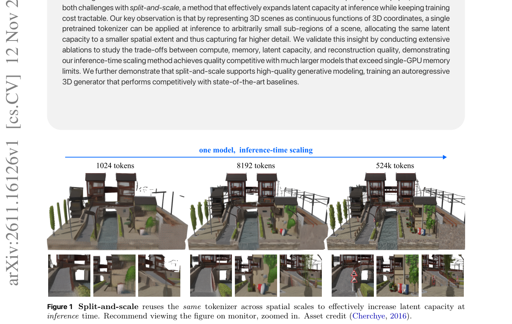

*Result - Naive scaling vs. split-and-scale. (Left) Naive scaling increases number of latents by using more queries to the tokenizer. As the tokenizer is not trained with the higher number of queries,*

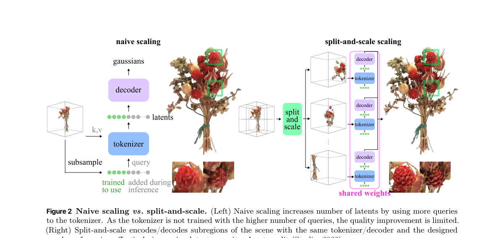

**Why this ranks #1**: 把同一套 3D tokenizer 切到场景子区域上独立推理，训练只用约 14k token、峰值显存 73.51GB（LiTo-8192 为 68.22GB，LiTo-32768 需 145.58GB 且训练慢 2.7 倍），推理端可扩到 131072 个 latent；32768 token 时 LPIPS 0.091 优于 LiTo 的 0.106，Chamfer 1.57×10⁻³ 也低于 TRELLIS 的 1.28×10⁻²。

---

### 2. Structural Self-Teaching for Compositional Generation in Unified Multimodal Models

**arXiv**: [2611.18261](https://arxiv.org/abs/2611.18261) | **Score**: 8.7 (relevance 9 x 0.7 + quality 8 x 0.3) | **Direction**: `aigc_generation` | **Tags**: AIGC-visual, compositional-generation, unified-multimodal-model, attention-grounding, self-supervision, Seoul National University | **Categories**: cs.CV | **Pages**: 21

**Authors**: Jaeyoo Park; Bohyung Han

**Affiliation**: Seoul National University; Samsung Electronics

**Abstract**

> We propose Structural Self-Teaching (SST), a novel framework that enhances compositional image generation in diffusion-based unified multimodal models (UMMs) by leveraging their internal understanding path as a source of structural supervision. The generation path of UMMs often struggles with dense compositional prompts, leading to missing objects, attribute binding failures, and spatial errors. In contrast, their understanding path localizes the same phrases in images that satisfy these prompts. SST converts this phrase-level grounding into training-time structural signals for the generation path. Specifically, we extract phrase-conditioned support masks from internal attention maps derived from the understanding path and employ them through two mechanisms. Phrase-local contrastive alignment uses these masks as pooling regions and aligns each generated phrase region with the same region of the target image. A structural scaffold builds a phrase-level layout from the same masks and modulates an intermediate spatial state of the generation path during training. The scaffold is phased out during training and removed at inference. SST requires no external structural annotations for training and no additional input at test time. Extensive experiments across multiple UMMs demonstrate that SST improves compositional fidelity over LoRA fine-tuning on the same data, with no inference-time cost. Project page is available at https://bellos1203.github.io/sst

**Key findings**

- **Finding**: 同一份 Echo-4o 数据上，SST 在四个骨干的 AM/GM 均超过 LoRA 微调，BLIP-3o 4B 的 GM 为 16.13±0.28 对 13.00±0.35（Table 1）。
- **Inference**: 增益来自结构监督而非数据量，因为对照组 LoRA 用了完全相同的数据与优化步数，且每类提升都超出三次运行的方差。
- **Recommendation**: 做稠密组合提示生成时，可先试「用理解路径的掩码自蒸馏」这条轻量改造，而不是先扩数据或换更大生成器。

**Key figures**

*Framework - Unified multimodal models can localize phrases they fail to generate. Given an image-text pair that satisfies a compositional prompt, the understanding path produces phrase-wise attention ma*

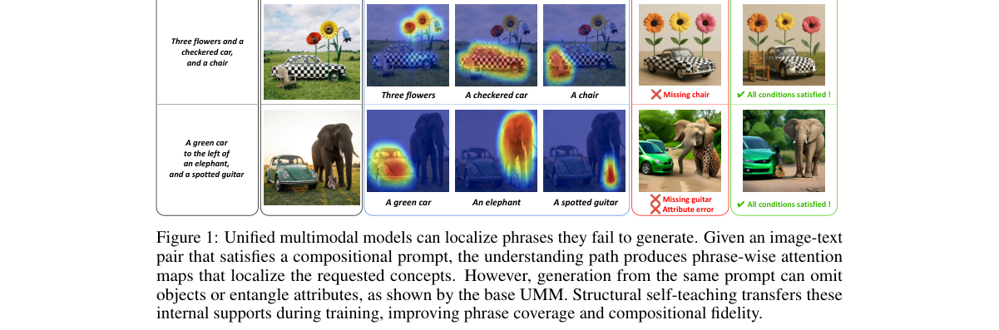

**Why this ranks #2**: 用统一多模态模型自身理解路径的注意力图提取短语级支持掩码，训练期做短语局部对比对齐加结构脚手架，推理期两者全部丢弃且无额外输入与算力开销；在 GenEval2 上 BLIP-3o 4B 的几何均值 GM 从同数据 LoRA 微调的 13.00 提到 16.13，BAGEL 从 26.47 提到 27.33。

---

### 3. JVT: Just Video Transformer makes pixel-space video diffusion simple

**arXiv**: [2611.18549](https://arxiv.org/abs/2611.18549) | **Score**: 8.7 (relevance 9 x 0.7 + quality 8 x 0.3) | **Direction**: `aigc_generation` | **Tags**: AIGC-visual, pixel-space-diffusion, video-transformer, register-tokens, joint-generation, Zhejiang University | **Categories**: cs.CV | **Pages**: 23

**Authors**: Jianjun Zhou; Hua Geng; Haoyu Guo

**Affiliation**: Zhejiang University; Shanghai Innovation Institute; Shanghai AI Laboratory

**Abstract**

> Direct diffusion modeling of high-dimensional raw video data is challenging, and existing pixel-space methods often rely on specialized architectures. We introduce JVT (Just Video Transformer), a simple large-patch DiT-style Transformer for pixel-space video diffusion, without a pretrained autoencoder, auxiliary detailers, cascaded stages, or U-Net-style skip connections. We systematically examine video patch embeddings, register tokens, and adaptive layer normalization to identify design choices that balance generation quality and computational efficiency. The resulting JVT design achieves generation quality competitive with latent diffusion baselines in both class-conditioned and unconditional settings. The pixel-space formulation of JVT also naturally supports joint generation of pixel-aligned modalities. We demonstrate this capability through camera-conditioned RGB-disparity generation, which improves camera following relative to RGB-only baselines and yields explicit scene geometry without an additional reconstruction model at inference. These results highlight the potential of simple DiT-style Transformers for pixel-space video diffusion, and we hope our findings offer useful insights and practical guidance for future research.

**Key findings**

- **Finding**: JVT 在 UCF-101 类条件 FVD@2048 为 136.5，register guidance（e_r=0、50 步/150 NFE）后降到 129.2，而完全去掉 AdaLN 反而恶化到 156.3（Table 3/4）。
- **Inference**: 像素空间方案省掉了 VAE，但它的收益依赖标准 adaLN 条件注入，register 只能当采样期引导而不是 AdaLN 替代品。
- **Recommendation**: 要做像素对齐的多模态联合生成（如 RGB 加视差），可优先考虑跳过自编码器的 DiT 路线再补几何监督。

**Key figures**

*Framework - JVT generates videos directly in pixel space with a simple DiT-style transformer, support- ing (a) class-conditioned and (b) unconditional generation. Given an initial RGB frame and a target*

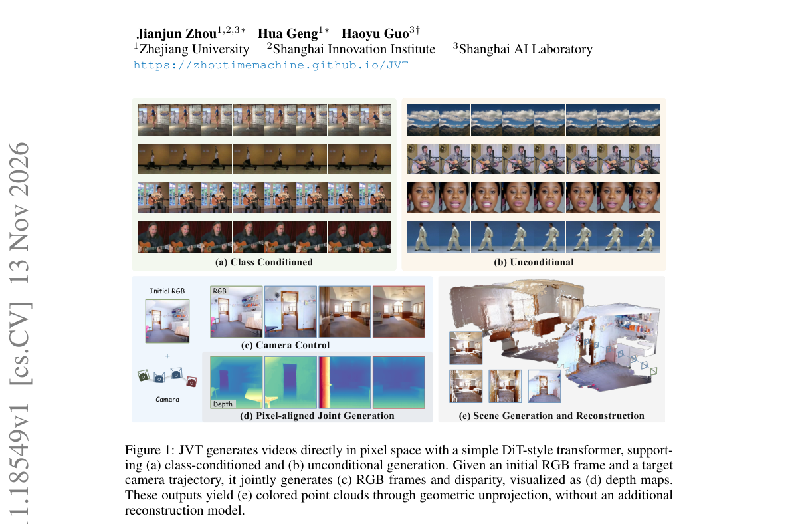

*Result - JVT architecture and register token design. The network predicts a clean video ˆx0 from a noisy input xt. Register tokens are prepended to visual tokens after the first L1 blocks, and then d*

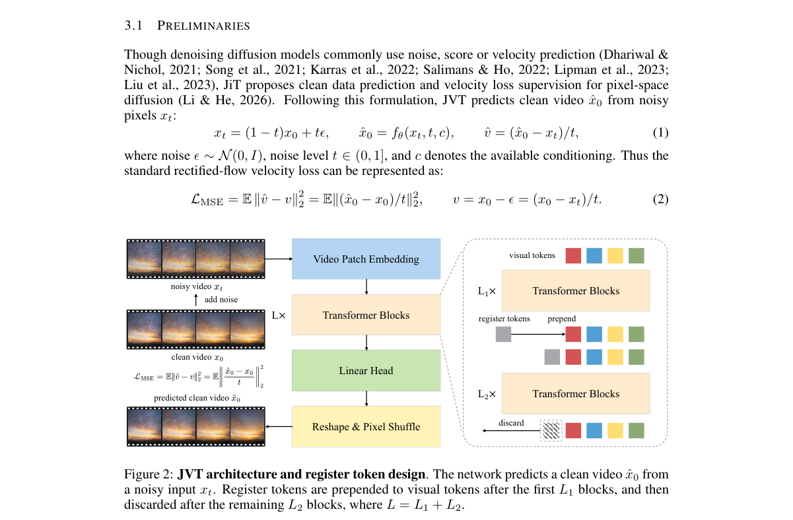

**Why this ranks #3**: 不用预训练自编码器、无级联、无 U-Net 跳连的像素空间视频 DiT，UCF-101 类条件 FVD@2048 做到 136.5，加 register guidance 后 129.2，FaceForensics 无条件 32.86；RGB-视差联合生成把 RTA@5 从 RGB-only 的 72.4 提到 79.5，代价是 FVD 从 27.0 升到 27.5。

---

### 4. Restoring Diversity in Distilled Image and Video Generators by Probing Activations

**arXiv**: [2611.18550](https://arxiv.org/abs/2611.18550) | **Score**: 8.7 (relevance 9 x 0.7 + quality 8 x 0.3) | **Direction**: `aigc_generation` | **Tags**: AIGC-visual, diversity-collapse, activation-steering, few-step-distillation, participation-ratio, University of Illinois at Urbana-Champaign | **Categories**: cs.CV | **Pages**: 42

**Authors**: Furkan Horoz; Ozgur Kara; Kaan Oktay; Adil Kaan Akan; Atakan Kara; Anand Bhattad; James Matthew Rehg

**Affiliation**: University of Illinois at Urbana-Champaign; fal; Johns Hopkins University

**Abstract**

> Distilling diffusion models into few-step student models substantially reduces sampling latency, but induces severe diversity collapse: samples generated from different random seeds show minimal variation. In this work, we investigate the root cause of this failure by probing the internal representations of student models relative to their teachers. We find that distilled students maintain total activation variance comparable to their teachers, but concentrate it into substantially fewer directions. This directional collapse is localized to an identifiable intermediate block at the initial denoising step. Consequently, diversity collapse stems from a misallocation of activation variance rather than an inherent loss of generative capacity. Guided by this finding, we propose ReDiverse to reinstate the missing variance directions. At training time, ReDiverse-FT fine-tunes a lightweight adapter that regresses student activations onto the teacher's, reviving the teacher's feature variance characteristic. At inference time, ReDiverse-TF introduces a training-free mechanism that steers activations along precomputed teacher principal directions. Across image and video distillation benchmarks, ReDiverse consistently restores sample diversity while preserving generation quality, further supported by the user study.

**Key findings**

- **Finding**: 四个师生对在塌缩块上，学生保留的参与比 PR 只有教师的 0.37–0.60，而总方差 TV 放大到 1.03–2.92 倍、集中度最高达 8.08 倍（Table 1）。
- **Inference**: 多样性塌缩是激活方差被错误挤进少数方向，而非生成容量被不可逆破坏，因此可以用干预而非重蒸馏来修复。
- **Recommendation**: 少步蒸馏模型出图同质化时，先测塌缩块的参与比，再考虑沿教师主方向做激活干预而不是重新蒸馏。

**Key figures**

*Framework - ReDiverse improves diversity in distilled image and video generators. For a fixed prompt, the student tends to repeat similar visual compositions, while ReDiverse produces broader variation:*

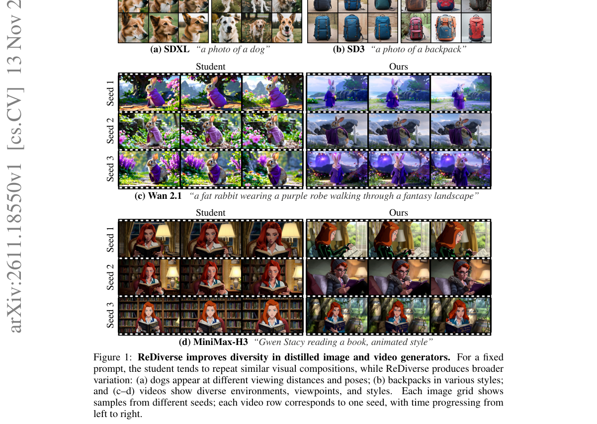

*Result - Variance characteristic along the depth. Participation ratio, total variance and concen- tration of teacher and student activations at every layer, for (a) an image model (SDXL) and (b) a vi*

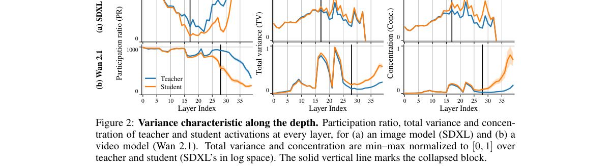

**Why this ranks #4**: 定位蒸馏学生模型多样性塌缩的根因：学生在塌缩块的总方差反而是教师的 1.03–2.92 倍，却只保留教师方向跨度的 37%–60%，幸存方向被塞进最多 8 倍方差；ReDiverse 在 SDXL 上把 DINO 多样性从学生的 59.4 恢复到 65.0、Wan 2.1 上从 31.6 恢复到 52.2，且不重新蒸馏任何学生权重。

---

### 5. Role-Separated Diffusion Transformers: Global Rule Isolation and Deterministic Sampling Manifold Compression

**arXiv**: [2611.19009](https://arxiv.org/abs/2611.19009) | **Score**: 8.7 (relevance 9 x 0.7 + quality 8 x 0.3) | **Direction**: `aigc_generation` | **Tags**: AIGC-visual, diffusion-transformer, role-separation, entropy-theorem, imagenet-256, University of Missouri | **Categories**: cs.AI, cs.CV | **Pages**: 10

**Authors**: Zhiguang Liu; Yi Shang

**Affiliation**: University of Missouri; Department of Electrical Engineering and Computer Science, University of Missouri

**Abstract**

> We present Role-Separated Diffusion Transformers (RoSeDiT), a new diffusion transformer architecture that isolates the global rule from the image tokens. RoSeViT showed in visual reasoning that a vanilla ViT spreads a shared rule over all $L$ tokens at an entropy of order $Ld$, whereas an enforced controller route reduces it to order $d$. In class-conditional DiT and SiT, the class and the noise level are explicitly conditioned by adaLN, so a RoSeViT-style controller channel on the ViT side is insufficient to establish the full role separation. By introducing the adaLN listening mechanism, which makes adaLN compute under the controller's command, RoSeDiT brings the entropy theorem and role separation into the latent diffusion domain. Under the same SiT training and evaluation protocol at the same level of parameter count, RoSeDiT surpasses SiT at all four model scales at 400K steps, and RoSeDiT-L/2 even surpasses SiT-XL/2's 17.2 FID with 15.34 and 32% fewer parameters. RoSeDiT-XL/2 surpasses SiT-XL/2's 7M-step FID of 8.3 at 1.4M steps with 7.98, using one-fifth as many training steps. We further observe that models with the same denoising loss can have a large FID gap, which indicates a misalignment between the denoising objective and the image manifold. We formalize this phenomenon into Deterministic Sampling Manifold Compression (DSMC), a two-stage training schedule with which RoSeDiT-XL/2 surpasses SiT + REPA's 4M-step FID of 5.9 at 2.4M steps with 5.84.

**Key findings**

- **Finding**: RoSeDiT-L/2 用 458M 参数在 400K 步取得 FID 15.34，比 675M 参数的 SiT-XL/2 的 17.2 好 1.9 点；XL/2 在 1.4M 步达 7.98，比 SiT-XL/2 的 7M 步结果更优（Table 1）。
- **Inference**: 相同去噪损失下仍可出现 1 点以上 FID 差距，说明去噪目标与图像流形存在错位，这正是 DSMC 两阶段训练要修的对象。
- **Recommendation**: 复现 DiT/SiT 时可先量一量全局条件是否被摊到全部 token 上，再决定要不要加 controller 通道。

**Key figures**

*Framework - Global rule isolation and generation performance. (a) Illustration of role separation. SiT applies global conditioning through shared modulation across image tokens, whereas RoSeDiT maintain*

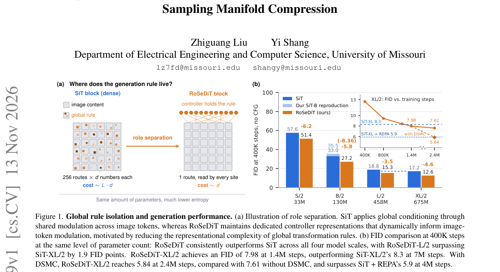

*Result - The RoSeDiT block. Twelve controller tokens are prepended to the image tokens. Each block combines dense attention over all tokens with a structural pass that restricts each image token to i*

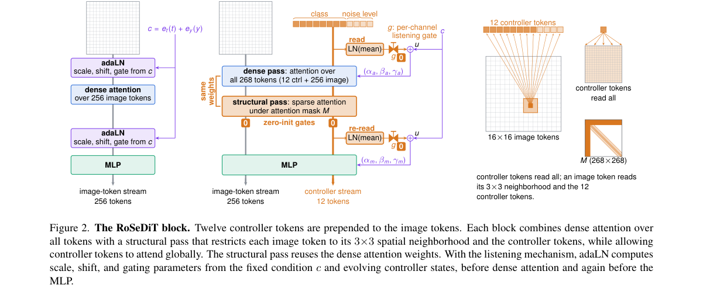

**Why this ranks #5**: 用 12 个 controller token 把全局规则从图像 token 中隔离出来，并让 adaLN 按 controller 指令计算；ImageNet 256×256 上 RoSeDiT-L/2 以 458M 参数拿到 15.34 FID，胜过 675M 参数 SiT-XL/2 的 17.2；XL/2 在 1.4M 步达 7.98，比 SiT-XL/2 跑满 7M 步的 8.3 还低。

---

### 6. Elliptic Sampling: Optimal Interpolant Schedules for Gaussians and Beyond

**arXiv**: [2611.18542](https://arxiv.org/abs/2611.18542) | **Score**: 8.3 (relevance 8 x 0.7 + quality 9 x 0.3) | **Direction**: `aigc_generation` | **Tags**: AIGC-visual, stochastic-interpolants, schedule-design, ode-discretization, minimax-optimality, Laboratory for Information and Decision | **Categories**: cs.AI, cs.LG, stat.ML | **Pages**: 109

**Authors**: Cole Becker; Taylan Kargin; Kimia Hassibi; Asuman Ozdaglar; Pablo A. Parrilo

**Affiliation**: Laboratory for Information and Decision Systems (LIDS); Massachusetts Institute of Technology

**Abstract**

> Generative modeling based on stochastic interpolants requires specifying two key choices: an interpolant schedule bridging the initial and target distributions, and an efficient discretization of the resulting probability-flow ODE. In this work, we introduce a new framework for joint schedule/discretization design based on the analyticity properties of the (complexified) ODE trajectories, which in turn ensure good numerical behavior. Our formulation can be solved exactly via conformal mapping, yielding a natural family of variance-preserving elliptic schedules, parametrized by Jacobi elliptic functions. Pairing an elliptic schedule with a tailored discretization, we obtain Zoloflow, a new sampling algorithm closely connected to Zolotarev's optimal rational function approximants. Crucially, both the elliptic schedule and Zoloflow explicitly incorporate the condition number $κ$ of the target distribution and reduce to the classical trig schedule in the limit $κ\rightarrow 1$. For Gaussian targets, Zoloflow achieves minimax optimality among all oblivious score-span algorithms, attaining total-variation error $\varepsilon$ using $Θ(\logκ\,\log(\sqrt d/\varepsilon))$ (exact) score queries. For the log-concave case, the elliptic schedule allows sampling with at most $\varepsilon$ 2-Wasserstein-error by requiring merely $\widetilde{O}(\sqrt{d} \, \mathrm{polylog}(κ, 1/\varepsilon))$ score evaluations. Complementing these theoretical results, we empirically evaluate the elliptic schedule on general (non-log-concave) target distributions, including detailed comparisons with alternative schedule proposals on both synthetic benchmarks and existing image generation datasets.

**Key findings**

- **Finding**: 椭圆调度由 Jacobi 椭圆函数参数化并显式依赖条件数 κ，κ=1 时严格退化为三角调度，其配套采样器 Zoloflow 与 Zolotarev 最优有理逼近相连。
- **Inference**: 调度与离散化可联合解析求解，意味着少步数下的最优采样器不必靠逐网格调参得到，κ 应该是一阶设计变量。
- **Recommendation**: 做少步 flow matching 采样器时，先按目标分布定下条件数 κ 与调度族，再去调步数与求解器阶数。

**Key figures**

*Framework - Side-by-side comparison of schedules. Images are generated by Stable Diffusion 3.5 Medium (CFG = 4.5) using DPM-Solver++ with only 4 neural network evaluations (4 oracle calls). From left to*

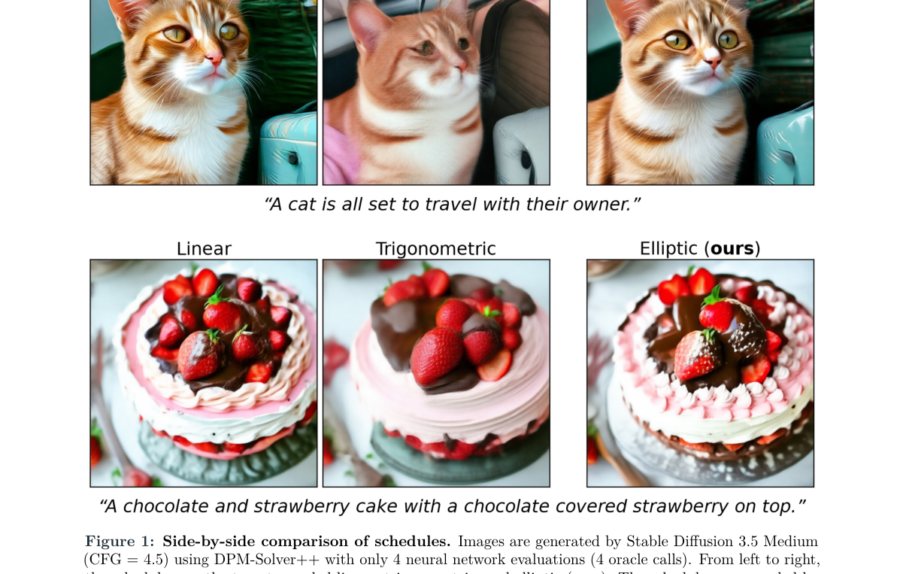

*Result - Elliptic schedules for several values of κ: (a) αt, (b) βt and (c) the signal-to-noise ratio β2*

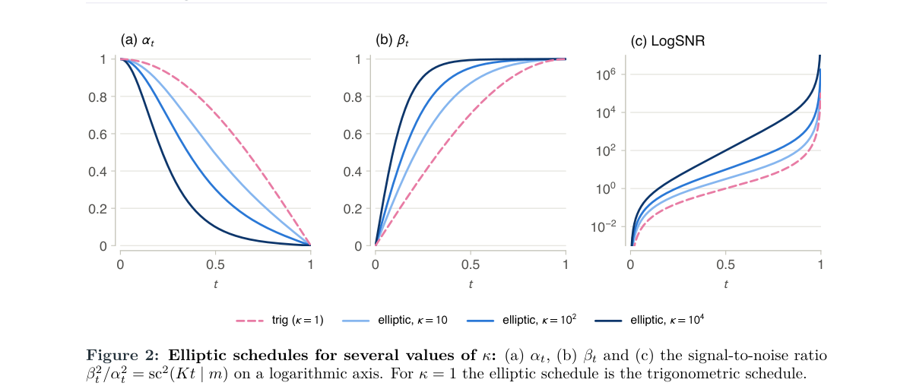

**Why this ranks #6**: 由概率流 ODE 轨迹的解析性出发联合设计插值调度与离散化，用共形映射解析求解得到 Jacobi 椭圆函数参数化的保方差椭圆调度，κ→1 时退化为经典三角调度；对高斯目标，Zoloflow 在所有 oblivious score-span 算法中达到 minimax 最优，只需 Θ(logκ·log(√d/ε)) 次精确 score 查询，对数凹目标则需 Õ(√d·polylog(κ,1/ε)) 次。

---

### 7. Sprint3D: Accelerating End-to-End 3D Asset Generation through Pipeline Optimization

**arXiv**: [2611.16701](https://arxiv.org/abs/2611.16701) | **Score**: 8.0 (relevance 8 x 0.7 + quality 8 x 0.3) | **Direction**: `aigc_generation` | **Tags**: AIGC-visual, 3d-asset-generation, pipeline-optimization, uv-unwrapping, distillation, Alaya Lab | **Categories**: cs.CV, cs.GR | **Pages**: 36

**Authors**: Sho Kuno; Ruihan Yu; Yonghao Yu; Guixu Lin; Lian Fu; Muyao Niu; Yu-Ju Tsai; Zheng-Hui Huang; Yi-Chuan Huang; Siqi Yang; Fengbo Lan; Erwin Wu

**Affiliation**: Alaya Lab; The University of Tokyo; University of California, Merced; Institute of Science Tokyo

**Abstract**

> Image-to-3D generative models now produce asset-quality textured meshes, but at minutes per asset they remain slow to iterate with and costly to deploy. Prior work has mostly accelerated the sampling of the networks, and where it also optimizes the mesh processing, it trains its own generators. We instead start from a publicly released pipeline and ask how much of its end-to-end time can be saved. Profiling the public Pixal3D pipeline shows that its latency is dominated by what happens after the networks: the four rectified flows take 14% of the wall-clock time and mesh post-processing takes 85%, most of it in CPU-based UV unwrapping. We therefore first rebuild the mesh post-processing on the GPU and take it off the critical path, then cut the per-evaluation overhead of the flows and distill them from 76 to 8 network evaluations. The resulting pipeline, Sprint3D, reduces the median time per asset from 133 s to 4.05 s on one H200 GPU at the same export settings (33$\times$). At the same time, on 2,653 held-out Toys4K objects it improves every input-view normal metric of the Pixal3D protocol, with a slightly lower mean silhouette IoU, lower point-cloud alignment scores and less fine texture detail. The rebuilt post-processing alone also speeds up TRELLIS.2, which uses the same export code, by 6.7$\times$ without a detectable change in the evaluated metrics.

**Key findings**

- **Finding**: Pixal3D 流水线里四条 rectified flow 只占 14% 墙钟时间、mesh 后处理占 85%；Sprint3D 把 76 次网络评估蒸馏到 8 次，中位耗时 133.0s 降到 4.05s（33×）（Table 1/2）。
- **Inference**: 端到端 3D 生成的瓶颈主要不在网络采样而在网络之后的网格导出，所以优化顺序应该从后往前而不是先蒸馏。
- **Recommendation**: 接手任何开源 3D 生成流水线时，先做分阶段耗时剖析，再决定是蒸馏采样器还是重写网格后处理。

**Key figures**

*Framework - Image-to-3D assets from our pipeline. Twenty-eight assets, each generated from one image (validation objects; about 1M faces and a 40962 texture per asset), rendered in Blender. Bottom: media*

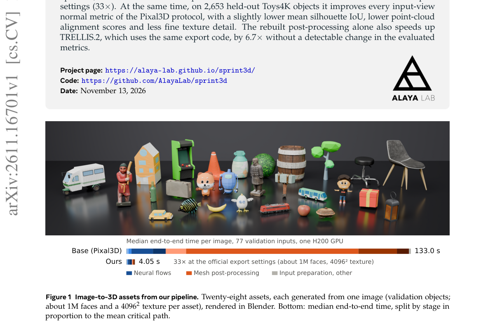

*Result - Our pipeline. The four flows of Pixal3D in three panels, with their sampling steps (Base (Pixal3D) →Ours) and the changes we apply.*

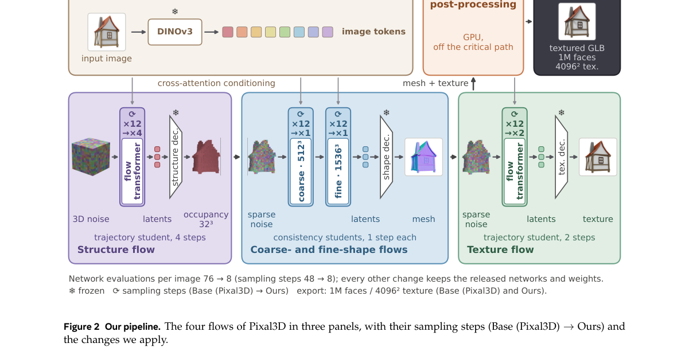

**Why this ranks #7**: 剖析公开 Pixal3D 流水线后发现网络本身只占 14% 墙钟时间、mesh 后处理占 85%（大头是 CPU 端 UV unwrap）；把后处理重写到 GPU 并移出关键路径，再把 76 次网络评估蒸馏到 8 次，单资产中位耗时从 133.0s 降到 4.05s（33×），且 2,653 个 Toys4K 留出对象上输入视角法线指标全面变好。

---

### 8. Kosmo-GFM: A Production-Ready Geometry Foundation Model

**arXiv**: [2611.16840](https://arxiv.org/abs/2611.16840) | **Score**: 8.0 (relevance 8 x 0.7 + quality 8 x 0.3) | **Direction**: `aigc_generation` | **Tags**: AIGC-visual, geometry-foundation-model, scene-reconstruction, camera-pose-optimization, dynamic-points, Kosmo Research | **Categories**: cs.CV | **Pages**: 45

**Authors**: Sheng Tang; Shengzhe Wei; Tiancheng Chen; Wenhua Jin; Xinyang Lu; Tinghao Jiang; Shuoxuan Feng; Yupeng Liu; Yu Zhang; Xingshuo Chang; Keren Zhou; Yuhan Xiong

**Affiliation**: Kosmo Research

**Abstract**

> We present Kosmo-GFM, a scene reconstruction system that integrates a geometry foundation model (GFM), a pose optimization engine (PoseEngine), and reconstruction-derived supervision from KosmoWorld. GFM predicts camera parameters, depth, cross-view correspondences, and dynamic 3D points from images and videos. PoseEngine combines these predictions with geometric optimization to recover scene-level camera poses and geometry for downstream 3D and 4D Gaussian Splatting. KosmoWorld generates images and geometric supervision from reconstructed real-world scenes to improve GFM's geometric predictions. On the Sparse and Medium subsets of SpatialBench, GFM achieves the lowest absolute relative depth error and the highest relative-pose AUC at 5 degrees among the compared methods. It also achieves the lowest mean endpoint errors for dynamic points and scene flow across the five evaluated datasets. Across 34 scenes completed by all compared reconstruction systems, PoseEngine achieves the highest scene-averaged pose AUC at thresholds of 1, 3, and 5 degrees, with a cumulative runtime of 14.07 hours, approximately 20% of GLUEMAP's 69.67 hours. PoseEngine Flash provides a further accuracy-efficiency trade-off, with a measured mixed-precision runtime of 2.62 hours, approximately 4% of GLUEMAP's runtime. Separate scaling experiments show generally favorable trends with increased data, model computation, and training budgets. These results support the use of learned geometric priors within a scene-level reconstruction pipeline.

**Key findings**

- **Finding**: 在 34 个全部对比系统都完成的场景上，PoseEngine 的场景平均位姿 AUC 在 1°、3°、5° 阈值下均为最高，累计运行 14.07 小时，GLUEMAP 同口径为 69.67 小时。
- **Inference**: 学到的几何先验能替代掉大部分迭代式几何求解，因此精度提升与运行时间下降可以同时发生而不是相互折中。
- **Recommendation**: 需要场景级相机位姿与动态点时，优先用「基础模型预测加几何优化兜底」的组合，而不是纯迭代式求解。

**Key figures**

*Framework - Kosmo-GFM. Top: static scene reconstructions with camera trajectories. Bottom: dynamic 3D points and motion trajectories.*

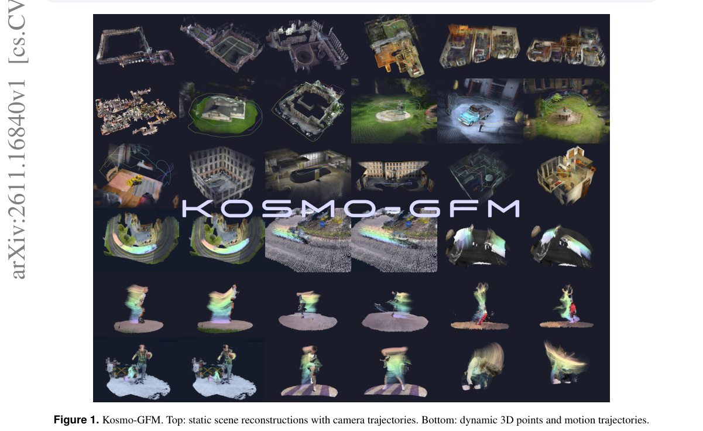

*Result - Overview of Kosmo-GFM. GFM supplies geometric priors, and PoseEngine organizes cross-view constraints and refines scene cameras. The resulting cameras and geometry support point-cloud, 3DGS,*

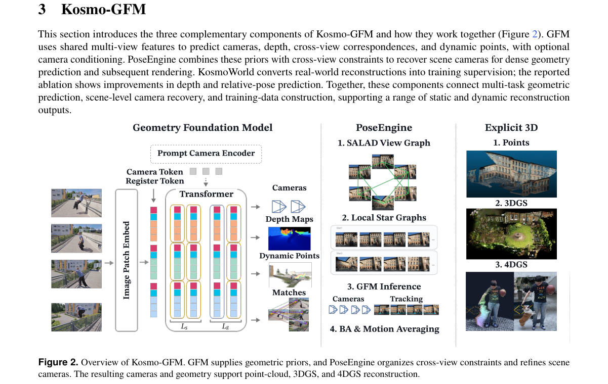

**Why this ranks #8**: 几何基础模型 GFM 一次预测相机参数、深度、跨视图对应与动态 3D 点，PoseEngine 再用几何优化把结果收敛成可供下游 3D/4D 高斯泼溅的场景表示；34 个所有对比系统都完成的场景上，PoseEngine 的场景平均位姿 AUC 在 1°/3°/5° 阈值下均最高，累计耗时 14.07 小时约为 GLUEMAP 69.67 小时的 20%，Flash 版 2.62 小时（约 4%）。

---

### 9. Token2Tile: Token-Wise Sparse Attention with Tile Execution through a Low-Rank Space for Video DiTs

**arXiv**: [2611.17930](https://arxiv.org/abs/2611.17930) | **Score**: 8.0 (relevance 8 x 0.7 + quality 8 x 0.3) | **Direction**: `aigc_generation` | **Tags**: AIGC-visual, sparse-attention, video-diffusion-transformer, tile-execution, low-rank-clustering, Beijing Institute of Technology | **Categories**: cs.CV | **Pages**: 21

**Authors**: Xuecheng Wu; Aichen Feng; Jinyan Chen; Qingjie Zhao; Julien Lai

**Affiliation**: Beijing Institute of Technology; NVIDIA

**Abstract**

> Attention is essential for modeling spatio-temporal dependencies in video diffusion transformers, but its quadratic cost makes it a major inference bottleneck. Its high sparsity offers an opportunity to accelerate generation by focusing computation on important interactions. However, accuracy and execution favor different granularities: each query attends to its own key tokens, whereas GPU kernels work on tiles. We present Token2Tile, a training-free sparse attention operator that combines per-query scoring and a per-query residual with tile execution. An online low-rank space, computed directly from queries and keys to preserve attention logits, makes clustering, scoring, and residual approximation efficient. Token2Tile unites query-specific selections to allocate exact work across query clusters, then packs the selected keys into GPU tiles. On MiniMax-H3 and Wan2.1-14B, Token2Tile delivers 1.48-1.54x end-to-end speedup over dense FlashAttention-3 with VBench scores within 0.5 points of dense. At comparable speeds on H3, it improves PSNR over SOL and SubBlock by 5.5-6.8 dB; on Wan, it exceeds SOL by 4.6-4.8 dB while running faster.

**Key findings**

- **Finding**: Token2Tile 在 MiniMax-H3 与 Wan2.1-14B 上取得 1.48–1.54× 端到端加速，VBench 各维度与 dense 相差不超过 0.5 分；同速下 PSNR 比 SOL 与 SubBlock 高 5.5–6.8 dB（Table 1）。
- **Inference**: 稀疏注意力的真瓶颈不是「选哪些 token」而是「按什么粒度执行」，逐 query 打分加 tile 打包同时解决了精度与 GPU 利用率。
- **Recommendation**: 部署视频 DiT 时可先把稠密注意力换成稀疏算子拿到 1.5× 左右加速，再决定要不要继续蒸馏步数。

**Key figures**

*Framework - Higher dense-reference fidelity at comparable generation speed. (a) H3 I2V sweep on a common VBench-I2V subset with 95% bootstrap PSNR intervals; green labels are nominal budgets. Near 1.49×*

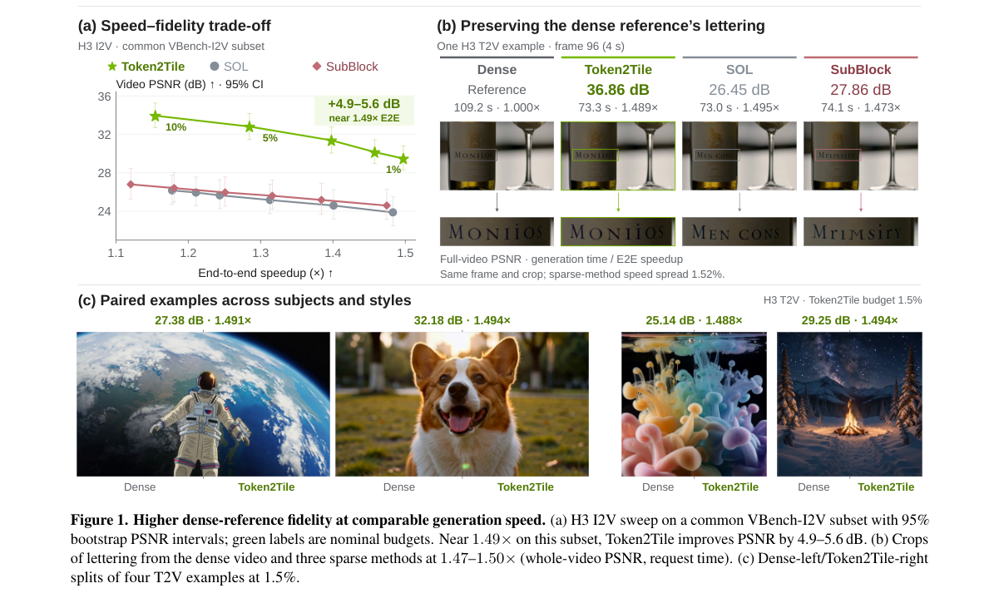

*Result - Why score per query, select key clusters, and keep a per-query residual. Attention captured from four generators at a 1% per-query key budget; whiskers span the inputs, red labels give the r*

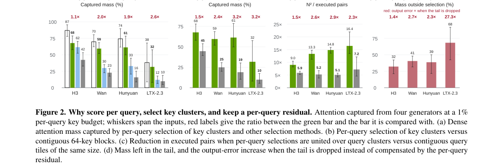

**Why this ranks #9**: 训练无关的稀疏注意力算子：逐 query 打分、再按 query cluster 合并选择、把选中的 key 打包成 GPU tile 执行，在线低秩空间直接由 query 与 key 算出以保住注意力 logits；在 MiniMax-H3 与 Wan2.1-14B 上端到端加速 1.48–1.54×（对 dense FlashAttention-3），VBench 各维度与 dense 差距在 0.5 分内，同速下 PSNR 比 SOL/SubBlock 高 5.5–6.8 dB。

---

### 10. TelePhysica: Agentic Reconstruction of Physically Interactive Scenes

**arXiv**: [2611.18078](https://arxiv.org/abs/2611.18078) | **Score**: 8.0 (relevance 8 x 0.7 + quality 8 x 0.3) | **Direction**: `aigc_generation` | **Tags**: AIGC-visual, physical-simulation, agentic-reconstruction, video-diffusion-conditioning, elastodynamics, Institute of Artificial Intelligence | **Categories**: cs.AI, cs.CV | **Pages**: 19

**Authors**: Ruiqi Shu; Xufeng Zhan; Yuanzhi Liang; Haibin Huang; Chi Zhang; Xuelong Li

**Affiliation**: Institute of Artificial Intelligence, China Telecom (TeleAI)

**Abstract**

> Direct image-to-video diffusion models entangle pixel synthesis with implicit latent motion, precluding persistent 3D mechanical equilibrium, mid-rollout intervention, and counterfactual force control. Conversely, single-pass programmatic 3D reconstruction from an uncalibrated photograph leaves monocular depth and support clearance underconstrained, causing reconstructed scenes to interpenetrate or collapse under gravity. We present TelePhysica, a closed-loop framework that reconstructs an executable, multi-regime physical world from a single photograph to drive stateful 3D interaction and trajectory-grounded video synthesis. A vision-language coding agent synthesizes separable visual meshes and declarative physical models within a two-stage verification loop that pairs pixel-aligned silhouette critique with a zero-force gravitational equilibrium preflight. The verified world compiles into a unified solver coupling rigid bodies, articulated chains, co-dimensional cloth shells, and 3D tetrahedral elastodynamics, whose simulated rollouts condition pretrained video diffusion models through pixel-aligned structural streams. On a 100-scene single-image benchmark, closed-loop execution raises equilibrium-verified world recovery from $0\%$ in single-pass synthesis to $81\%$. Controlled constitutive ablations show over an order-of-magnitude larger localized corner displacement and out-of-plane pleating in finite-element cloth than in matched rigid-plate proxies. Conditioning video diffusion on simulated trajectories increases dynamic motion-mask overlap by $2{\times}\text{--}5{\times}$ and preserves motion direction under counterfactual force reversals where direct image-to-video models fail.

**Key findings**

- **Finding**: 100 场景单图基准上两级闭环把视觉对齐通过率从 2/100 提到 85/100，平衡验证从 0/100 提到 81/100，5.0 秒全力 rollout 验证通过 49/100（Table 1）。
- **Inference**: 几何上「看起来对」的重建仍会在重力下互相穿模或塌陷，所以物理预检必须是生成闭环的一等环节而不是事后筛选。
- **Recommendation**: 做可交互物理场景时把零力平衡预检写进生成回路，同时保留失败诊断回传给 agent 重试。

**Key figures**

*Framework - TelePhysica overview. (a) Closed-loop recovery from a single photograph 𝐼0 refines a procedural scene program via Stage-1 silhouette critique and Stage-2 gravitational equilibrium checks. (b*

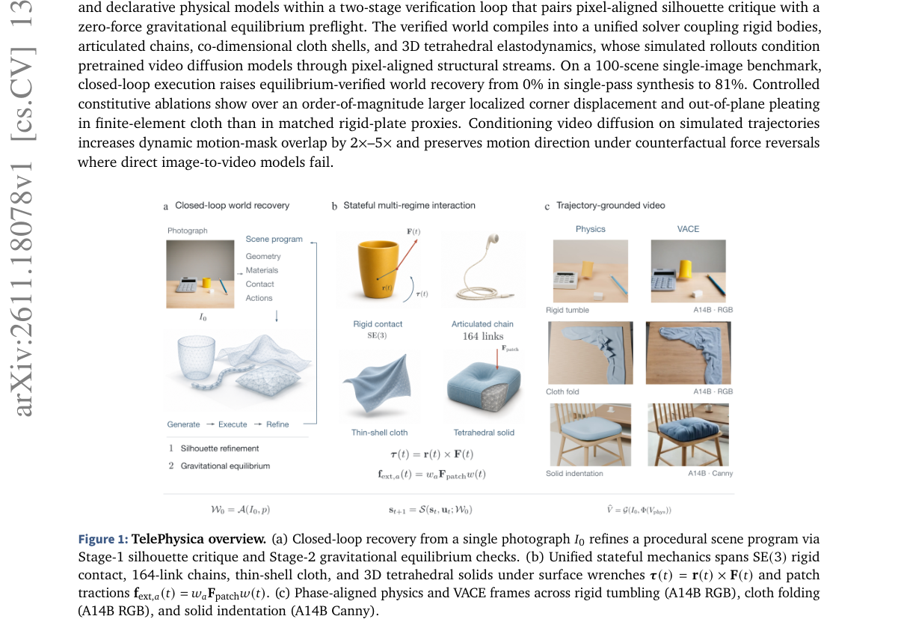

**Why this ranks #10**: 让视觉-语言编码 agent 在「像素级轮廓批评 + 零力重力平衡预检」两级闭环里写出可执行场景程序，再由统一求解器耦合刚体、164 连杆链、布料壳与四面体弹性体，模拟轨迹作为像素对齐结构流喂给预训练视频扩散模型；100 张单图基准上平衡验证通过率从单次生成的 0% 提到 81%，动态运动掩码重叠相对无条件图生视频基线提升 2×–5×。

---

## AIGC 编辑（指令编辑 / 修补 / 个性化） · `aigc_editing` (4 papers)

编辑侧 4 篇里有 2 篇 relevance≥9。ATune 最特别：它不用任何专家修图，只用 1000 万张图库照片自造损坏对训练出 54M 参数的模型，输出 13 个属性的可读滑杆，并在 157 人 9,253 次对比中以 54.3% 胜过 GPT-6 Astra。DecoEdit 用 160 万条 1D/2D/3D 编辑数据加解耦管线，靠 SAM-3D 锚定几何尺度朝向、并行保持纹理细节，3D 姿态控制上超过 Seedream 5.0。Consistent Video-to-Video 用 patch 级显式对应关系治长程不一致；Open Vision Banana 则把预训练生成器当通用视觉感知器用，在 Cityscapes 上零样本 73.9 mIoU。

### 11. ATune: Unsupervised Photo Retouching Through Image-Editor Controls

**arXiv**: [2611.16236](https://arxiv.org/abs/2611.16236) | **Score**: 8.7 (relevance 9 x 0.7 + quality 8 x 0.3) | **Direction**: `aigc_editing` | **Tags**: AIGC-visual, photo-retouching, unsupervised-training, image-editor-control, no-reference-quality, [unverified] | **Categories**: cs.CV, cs.LG | **Pages**: 27

**Authors**: Divyanshu Goyal; Gabriel Ruiz; Amir Meisami

**Affiliation**: [unverified]

**Abstract**

> Photo retouching models are trained on pairs of original and retouched photographs, usually edited by experts. Expert edits are costly, so the two main public sets, FiveK and PPR10K, hold only 16,161 originals. Good photographs on their own are far easier to find: commercial stock collections and free ones such as Pixabay and Unsplash hold millions. We learn retouching from them alone: we damage each photograph the way a camera or a careless edit would, which gives a worse and a better version of the same photograph. From these pairs, our model, ATune, learns how 13 measured attributes, such as brightness, contrast and sharpness, should change to raise a photograph's quality. The edit is declarative: ATune sets target values for the attributes, and a simple search adjusts the sliders of an out-of-the-box photo editor until the photograph reaches them. Every edit is a list of slider values a person can read and adjust. The same model can drive any editor that makes those changes; we test RawTherapee and darktable. We train on 10M photographs from a commercial stock collection and test on FiveK, PPR10K and SPAQ. Nine quality judges score every edit, and in a user study 157 human raters made 9,253 choices between our edit and another method's edit of the same photograph. When Claude Opus 5 and GPT-6 Astra edit the same photographs in the same editor, raters prefer our edits to GPT-6 Astra's (54.3%) and rate them even with Claude's (50.5%). We also compare with supervised retouchers on their home ground: NeurOP on FiveK and AdaInt on PPR10K, each trained on that set's own expert edits. Raters chose our edits in 46.3% of those comparisons. ATune, a 54M-parameter model trained without a single expert edit, now matches frontier models at setting an editor's sliders.

**Key findings**

- **Finding**: 54M 参数、只用 10M 张无配对商用图训练，ATune 在 499 张 FiveK 测试图上让校准搜索达成 82.8% 的属性目标，darktable 上为 77.3%。
- **Inference**: 「把照片按相机或粗心编辑的方式人为损坏再学修复方向」的自监督构造，足以替代费力的专家精修配对数据。
- **Recommendation**: 需要可解释、可回溯的修图流水线时，优先让模型输出属性目标再交给编辑器求解，而不是直接输出像素。

**Key figures**

*Framework - Retouching learned from unpaired photographs. On a FiveK test photograph, ATune predicts how far each attribute should move to reach a desired quality set by τ; a simple search sets RawThera*

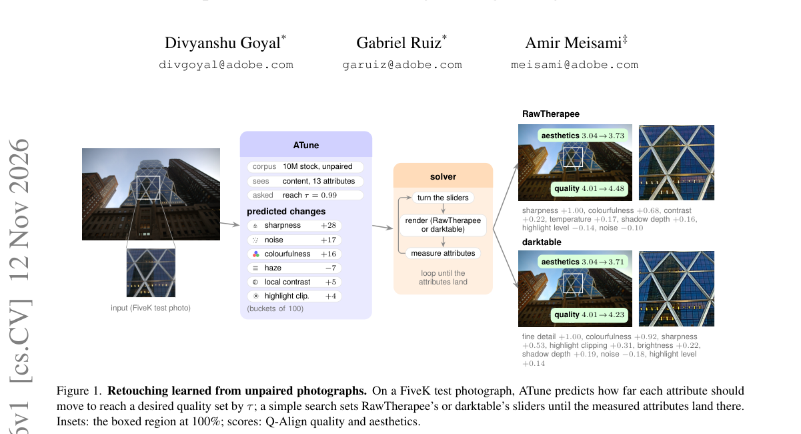

*Result - Three example edits. We score every FiveK and PPR10K photograph by how much the nine judges prefer our edit to Claude’s, and show one photograph the judges clearly give to ours (top), a typi*

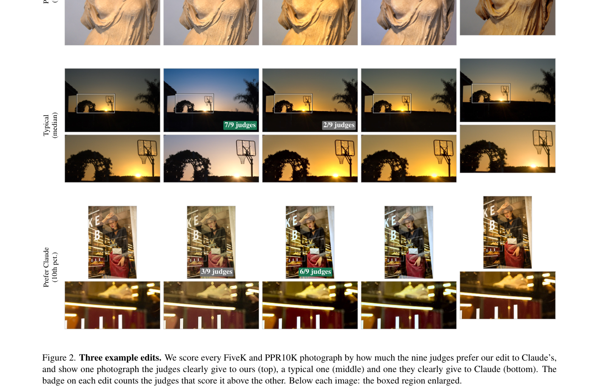

**Why this ranks #11**: 把修图学成「13 个可测属性该往哪走」的声明式决策，再由现成编辑器（RawTherapee 或 darktable）搜索滑块落地；54M 参数、只用 10M 无配对商用图训练且不含任何专家精修标注，在 499 张 FiveK 测试图上校准搜索可达成 82.8% 的属性目标，157 名评分者做 9,253 次二选一，54.3% 胜过 GPT-6 Astra、与 Claude Opus 5 持平 50.5%。PDF 首页未印出机构行，作者只留了三个 @adobe.com 邮箱。

---

### 12. DecoEdit: Beyond Flat Control for 3D-Aware Unified Image Editing

**arXiv**: [2611.19121](https://arxiv.org/abs/2611.19121) | **Score**: 8.7 (relevance 9 x 0.7 + quality 8 x 0.3) | **Direction**: `aigc_editing` | **Tags**: AIGC-visual, 3d-aware-editing, identity-preservation, decoupled-pipeline, mllm-judge, Zhejiang University | **Categories**: cs.AI, cs.CV | **Pages**: 11

**Authors**: Xiaotang Gai; Jinbo Xing; Zijie Meng; Jiayi Yi; Jimin Xiao; Yixuan Qian; Yu Liu; Chaojie Mao; Zuozhu Liu

**Affiliation**: Zhejiang University; Alibaba Group; University of Illinois at Urbana-Champaign

**Abstract**

> While recent advances in multimodal image editing have achieved impressive results, current frameworks remain largely confined to ``flat" 2D controls (e.g., text prompts, bounding boxes, or masks). Precise 3D-aware geometric manipulation -- such as coordinating an object's location, physical scale, and 3D orientation while strictly preserving its fine-grained identity -- remains an elusive challenge, typically suffering from severe detail degradation or requiring expensive per-instance fine-tuning. In this paper, we present DecoEdit, an all-in-one image editing framework that goes beyond flat control by seamlessly integrating 1D textual, 2D spatial, and 3D volumetric inputs under a unified architecture. First, to power this unified model, we establish a data curation pipeline and curate a large-scale dataset, namely DecoDataset, containing 1.6 million samples, encompassing diverse multi-dimensional (1D/2D/3D) tasks and their complex compositions. Furthermore, we establish a comprehensive image editing benchmark named DecoBench to systematically evaluate multi-task editing performance. Finally, to address the fundamental trade-off between complex spatial transformations and identity preservation, we propose a novel decoupled pipeline: DecoEdit factorizes the editing process by utilizing structural guidance from SAM-3D to anchor the target geometry, scale, and spatial orientation, while concurrently leveraging a detail-preservation path to lock in high-fidelity textures. Extensive experiments demonstrate that DecoEdit achieves state-of-the-art results. Notably, on the challenging 3D spatial pose and orientation control tasks, DecoEdit significantly outperforms leading closed-source models such as Seedream 5.0 in both geometric accuracy and identity consistency.

**Key findings**

- **Finding**: DecoEdit 在 DecoBench（261 例）上宏平均 8.97，高于 Seedream 5.0 的 8.58 与 Gemini 3.1 Flash Image 的 8.58；4 位人类评分者给出的归一化排名均分 70.25 居首，Seedream 5.0 为 66.31（Table 2/3）。
- **Inference**: 几何与纹理解耦之所以有效，是因为单一耦合参考必然在姿态与细节之间二选一，两条通路各自优化才可能同时成立。
- **Recommendation**: 做 3D 位姿控制类编辑时先引入结构参考再谈身份保持，不要让模型直接从文本猜朝向。

**Key figures**

*Framework - Data construction pipeline. It involves five filters to select high-quality samples.*

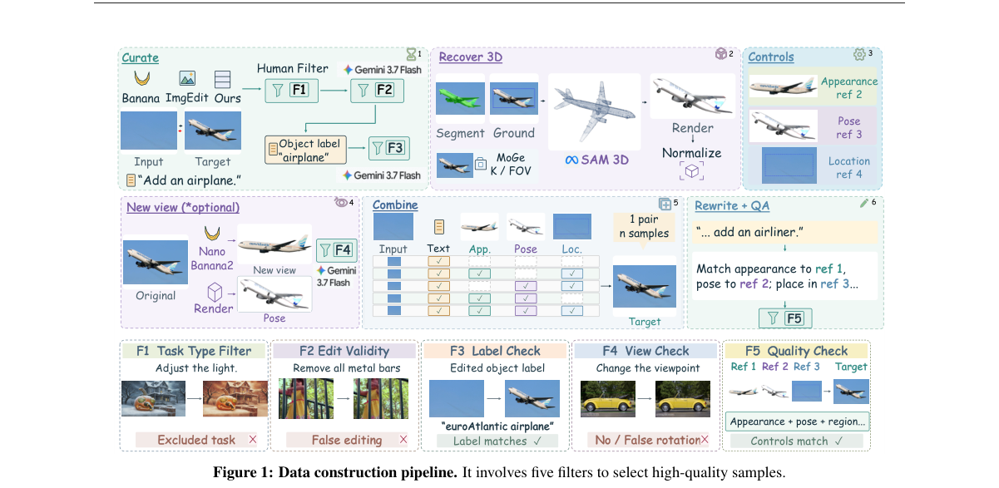

*Result - The MoT architecture of DecoEdit. It comprises a semantic stream and a visual stream.*

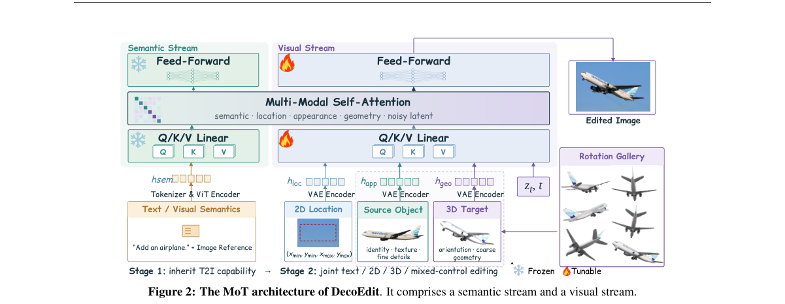

**Why this ranks #12**: 把 1D 文本、2D 空间、3D 体量三类控制统一进一个编辑器，用 SAM-3D 的归一化结构渲染锚定目标几何、尺度与朝向，另设细节保持通路锁定纹理，绕开几何与外观耦合的老问题；DecoBench（261 例）上宏平均 8.97，比最强开源基线 SenseNova-U1.5-8B-MoT 高 0.96，比 Seedream 5.0 的 8.58 高，4 位评分者归一化排名 70.25 居首。

---

### 13. Consistent Video-to-Video Translation via Explicit Correspondences

**arXiv**: [2611.17298](https://arxiv.org/abs/2611.17298) | **Score**: 8.0 (relevance 8 x 0.7 + quality 8 x 0.3) | **Direction**: `aigc_editing` | **Tags**: AIGC-visual, video-to-video, long-range-consistency, correspondence-memory, autoregressive-distillation, Carnegie Mellon University | **Categories**: cs.AI, cs.CV, cs.GR, cs.LG | **Pages**: 30

**Authors**: Gaurav Parmar; Zhengqi Li; Richard Zhang; Jun-Yan Zhu; Srinivasa Narasimhan; Eli Shechtman; Yotam Nitzan

**Affiliation**: Carnegie Mellon University; Adobe Research

**Abstract**

> Interactive video-to-video applications require real-time generation while maintaining long-range temporal consistency. However, recent methods achieve speed by restricting attention to a fixed-length causal window. This limits long-range consistency whenever relevant history falls outside the context window. To address this limitation, we introduce vid2vid-long, a correspondence-based approach grounded in a simple observation. Video-to-video translation provides an explicit cross-frame reference: the regions that match in the input video should match in the output video too. Concretely, we compute patch-level correspondences in the input, guiding retrieval of previously generated outputs in the corresponding regions, and condition the model on these patches through correspondence cross-attention. Our experiments demonstrate that vid2vid-long consistently improves long-range temporal consistency across recent video models while preserving generation quality and real-time performance.

**Key findings**

- **Finding**: LongLive 加对应机制后，VACE-Bench 的 LPIPS 从 0.511 降到 0.272（↓47%）、DreamSim 从 0.218 降到 0.057（↓74%），CLIP-Sim 从 0.874 升到 0.953（Table 3）。
- **Inference**: 视频翻译本就提供显式的跨帧对应，用它给记忆做索引比单纯加长因果窗口更省算力也更能保住长程一致性。
- **Recommendation**: 做实时长视频翻译时优先复用输入输出的对应关系扩展记忆，而不是一味加长因果窗口。

**Key figures**

*Framework - Long-range consistency without long context windows. Standard auto- regressive video translation forgets content once it falls outside its context window (middle row). Our proposed method vid2*

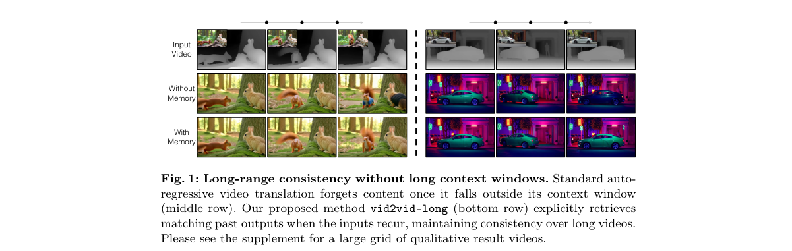

*Result - Correspondence-based video translation. The memory is populated with input-output correspondence pairs from previous generations. To support the consis- tent translation of the next block of f*

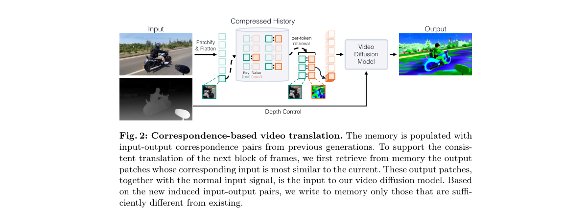

**Why this ranks #13**: 利用视频翻译任务自带的输入-输出对应关系：在输入侧算 patch 级对应，用对应位置去检索此前已生成输出帧的对应区域，再经 correspondence cross-attention 注入，从而绕开定长因果窗口的限制；DL3DV 上 2 步版 LPIPS 0.379、13.88 FPS，5 步版 0.305、8.10 FPS，而 LongLive 加上对应机制后 VACE-Bench 的 LPIPS 从 0.511 降到 0.272（↓47%）。

---

### 14. Open Vision Banana: A Fully Open Recipe for Generative Visual Perception

**arXiv**: [2611.15844](https://arxiv.org/abs/2611.15844) | **Score**: 7.3 (relevance 7 x 0.7 + quality 8 x 0.3) | **Direction**: `aigc_editing` | **Tags**: AIGC-visual, generative-perception, zero-shot-segmentation, legend-ensembling, open-recipe, Fundamental AI Lab | **Categories**: cs.CV | **Pages**: 36

**Authors**: Arpit Jadon; Valentinos Pariza; Jona Ruthardt; Ryousuke Yamada; A. Sophia Koepke; Andrei Bursuc; Yuki M. Asano

**Affiliation**: Fundamental AI Lab, University of Technology Nuremberg; DLR; AIST; University of Tübingen, Tübingen AI Center

**Abstract**

> Recent work suggests that pretrained image generators encode real-world understanding beyond image synthesis. Vision Banana exploits this by framing vision tasks as conditional image editing. However, its data, weights, code, and implementation details are not public. We present Open Vision Banana (OVB), a fully open and reproducible recipe for converting pretrained generators into unified multi-task perception systems. Our analyses identify the design choices that matter most for generalization, including color encoding, prompt design, parameter adaptation, and task balancing. These choices interact, so individually helpful choices can hurt when combined with others. Starting from 4B and 9B parameter open-weight base models and using 2.1M-3.8M training pairs from public datasets, OVB surpasses Vision Banana's reported Cityscapes zero-shot performance (73.9 vs. 69.9 mIoU) and rivals state-of-the-art affine-invariant depth estimators. Its non-zero-shot variants come within five points of Vision Banana on referring and reasoning segmentation but remain further behind on instance segmentation. All models largely retain the base model's image-editing abilities. With legend ensembling, we introduce a test-time scaling method for generator-based perception. It segments an image under several class-color legends and fuses the results by majority vote, correcting unstable color-class bindings and improving mIoU by up to 8.7 points on Cityscapes and 15.0 points on COCO-Object without retraining. We release the dataset construction and processing pipeline, the training and evaluation code, as well as the final, intermediate, and ablation checkpoints. Project website: https://openvisionbanana.github.io

**Key findings**

- **Finding**: 零样本 OVB 9B 在 Cityscapes 达 73.9 mIoU，高于 Vision Banana 的 69.9；legend 集成把单次读取的 65.4 mIoU 抬到 73.9（Table 1/7）。
- **Inference**: 生成器里「颜色与类别」的绑定不稳定才是主要误差源，所以多次重绑定图例再投票比换更大的生成器更有效。
- **Recommendation**: 用生成式模型做感知时把测试期 legend 集成当默认配置，同时要预留它带来的额外推理时间。

**Key figures**

*Framework - Overview of the Open Vision Banana (OVB) recipe and analysis framework. Open image generators are adapted on public datasets to express perception outputs as RGB images. The research questio*

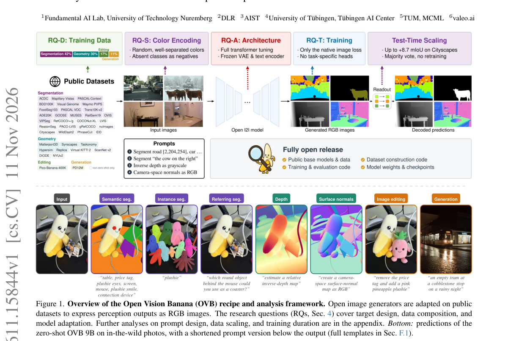

*Result - Zero-shot OVB 9B predictions: semantic segmen- tation (after readout) on Cityscapes (top) and COCO-Object-80 (middle), and instance segmentation of “dried apricots” and “foot- ball helmet” o*

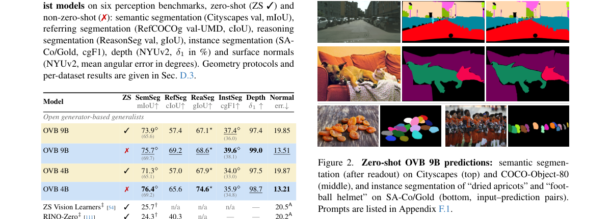

**Why this ranks #14**: 把语义分割、实例分割、深度等视觉任务统一改写成「条件图像编辑」指令，用 4B/9B 开源权重基座加 2.1M–3.8M 公开数据训练成多任务感知系统；零样本 Cityscapes 达 73.9 mIoU，超过 Vision Banana 报告的 69.9，再叠加测试期 legend 集成（多套类别-颜色图例的多数投票）可在不重训的前提下把 mIoU 最多再提 8.7（Cityscapes）与 15.0（COCO-Object）。

---

## 面向视觉生成的 RL 与奖励模型 · `aigc_rl` (1 papers)

本 direction 只有 1 篇。全批 1147 篇候选里，用「RL 类词 × 视觉生成类词 160 字符双向共现」严格扫描后逐篇回读原文，只有 Mem2Fair 一篇真正属于面向视觉生成的 RL/对齐——而且它是**推理期反馈式对齐**：用生成视频作反馈在线挑选提示级属性干预，不改权重就能在黑盒商用 T2V 上提公平性。需要注意的是它不是权重空间的 RL/DPO，这一点在报告里已写明。

### 15. Mem2Fair: Online Fairness Control for Text-to-Video Generation via Fair Memory

**arXiv**: [2611.19215](https://arxiv.org/abs/2611.19215) | **Score**: 7.0 (relevance 7 x 0.7 + quality 7 x 0.3) | **Direction**: `aigc_rl` | **Tags**: AIGC-visual, fairness-control, text-to-video, inference-time-feedback, online-approachability, Zhejiang University | **Categories**: cs.AI | **Pages**: 13

**Authors**: Pengyu Chen; Jiaming Zhang; Xiaohua Feng; Yuyuan Li; Chaochao Chen

**Affiliation**: Zhejiang University; Hangzhou Dianzi University

**Abstract**

> Text-to-video (T2V) generation models can produce systematically unfair demographic outcomes when prompts leave protected attributes unspecified. For example, prompts describing nurses without specifying gender may disproportionately generate videos depicting female nurses. Mitigating unfairness in T2V generation is particularly challenging: training-based methods that modify model internals require architecture-specific access and risk disrupting temporal consistency, while sampling-based methods often incur costly pre-deployment video generation. We present the first conditional online approachability formulation of attribute-level fairness for T2V generation. Building on this formulation, we introduce Mem2Fair, a plug-and-play framework that maintains concept-conditioned Fair Memory. Using generated videos at inference time as feedback, Mem2Fair selects prompt-level attribute interventions based on the deviation from each concept's prescribed fairness target, without training or separate pre-deployment sampling. Experiments demonstrate that Mem2Fair consistently improves fairness over the unmodified generator and existing baselines across multiple demographic attributes, prompt settings, and target distributions, while maintaining comparable prompt-video alignment and video quality. We further demonstrate its effectiveness on commercial black-box T2V models.

**Key findings**

- **Finding**: Wan2.2-5B 上 50 个职业、均匀目标下 Mem2Fair 把 NP 从 0.336 提到 0.917、Bias Score 从 0.384 降到 0.052，CLIPsim 0.1941 与平均质量 0.8975 均高于三个公平基线（Table 1）。
- **Inference**: 干预只在提示层面完成并以已生成视频作为反馈信号，因此这是推理期的在线属性控制，而不是梯度式 RL 或 DPO 式的权重更新。
- **Recommendation**: 要给黑盒 T2V 服务加公平控制时可直接套这种「记忆加反馈」回路，不必碰模型参数或内部表示。

**Key figures**

*Framework - The nurse example illustrates demographic bias from a gender-unspecified prompt. Existing interventions face model- access constraints, fidelity disruption, or costly pre-sampling. Mem2Fair*

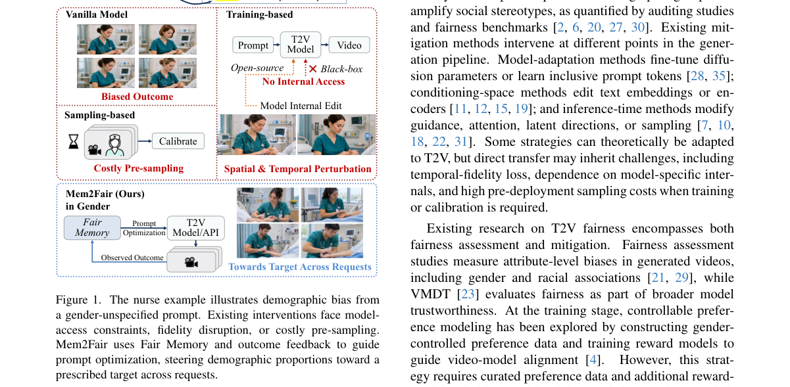

*Result - Overview of Mem2Fair. Concept-conditioned Fair Memory guides fairness-aware prompt optimization through at- tribute selection and prompt optimization. Detected outcomes up- date the correspo*

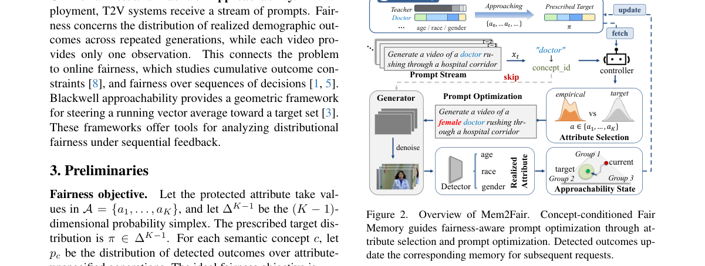

**Why this ranks #15**: 提出 T2V 属性级公平的条件在线可达性形式化，用「概念条件化的 Fair Memory」记住每个概念已生成视频的实际属性分布，再据其与公平目标的偏差在线挑选提示级属性干预——全程只靠推理期反馈，不改权重也不需要预部署采样；在 Wan2.2-5B 上 50 个职业的均匀目标下 NP 从 0.336 提到 0.917、Bias 从 0.384 降到 0.052。

---

## Footer

- Total papers reviewed across all 4 axes: 60
- aigc_visual axis final count: 15
- Wild-cards in this axis: 0
- Figure assets: 2026-11-17/res/

Generated by `mine-arxiv-daily-digest` skill. Sister file: `2026-11-17_aigc_visual_entry.md`.
